# 《面向对象程序设计及C++》第1章 面向对象程序设计及C++概述（课件）

原件的每一页，下面附识别出的文字。

### 面向对象程序设计及C++

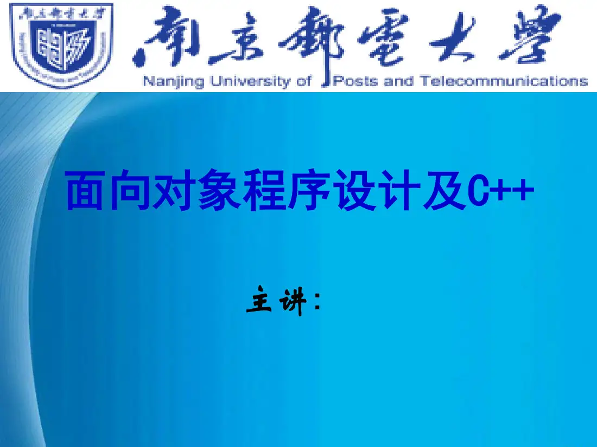

原文：

面向对象程序设计及C++

主讲：

### 面向对象程序设计及C++

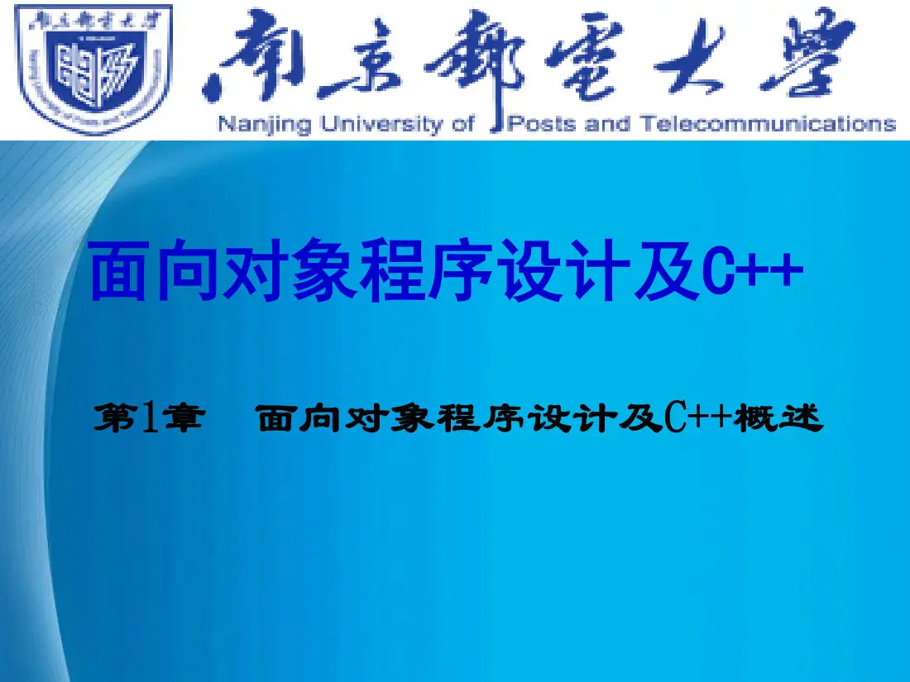

原文：

Nanjing University of JPosts and Telecommunications

面向对象程序设计及C++

第1章 面向对象程序设计及C++概述

### 本章作业

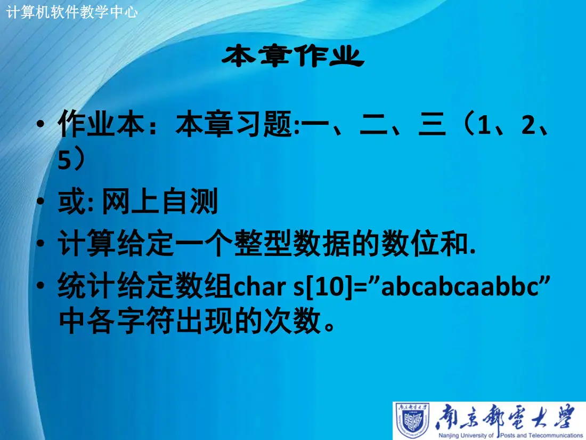

原文：

本章作业

• 作业本: 本章习题:一、二、三 (1、2、5)

\- 或: 网上自测

\- 计算给定一个整型数据的数位和.

\- 统计给定数组char s[10]="abcabcaabbc"中各字符出现的次数。

计算机软件教学中心

南京邮电大学
Nanjing University of Posts and Telecommunications

### 本章内容提要

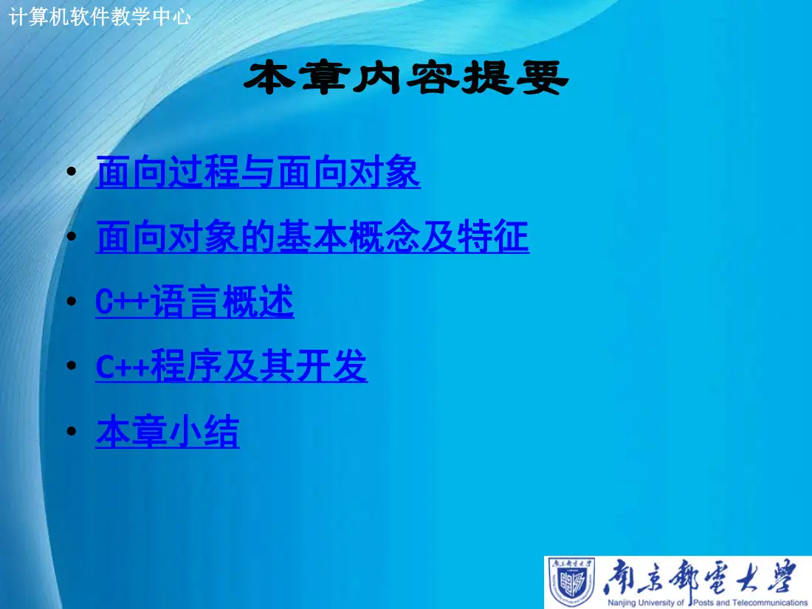

原文：

本章内容提要

\- 面向过程与面向对象

\- 面向对象的基本概念及特征

• C++语言概述

• C++程序及其开发

\- 本章小结

计算机软件教学中心

南京邮电大学
Nanjing University of Posts and Telecommunications

### 1.1.1 面向过程的程序设计

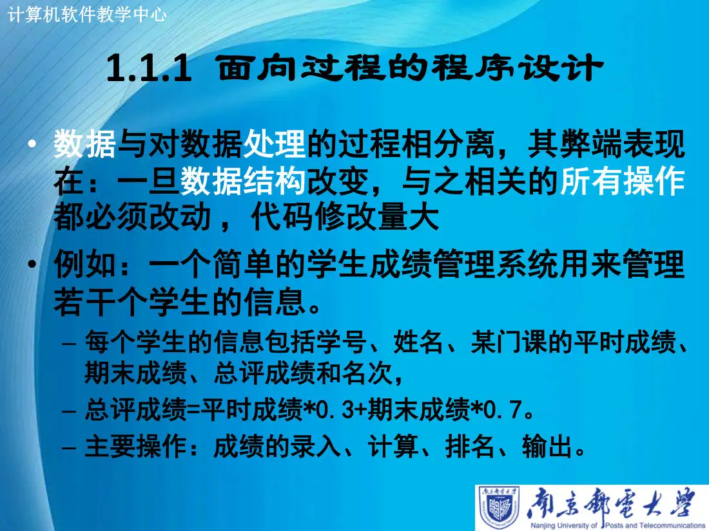

原文：

1.1.1 面向过程的程序设计

\- 数据与对数据处理的过程相分离，其弊端表现在：一旦数据结构改变，与之相关的所有操作都必须改动，代码修改量大

• 例如：一个简单的学生成绩管理系统用来管理若干个学生的信息。

\- 每个学生的信息包括学号、姓名、某门课的平时成绩、期末成绩、总评成绩和名次，

\- 总评成绩=平时成绩\*0.3+期末成绩\*0.7。

\- 主要操作：成绩的录入、计算、排名、输出。

计算机软件教学中心

南京邮电大学
Nanjing University of Posts and Telecommunications

### 1.1.1 面向过程的程序设计

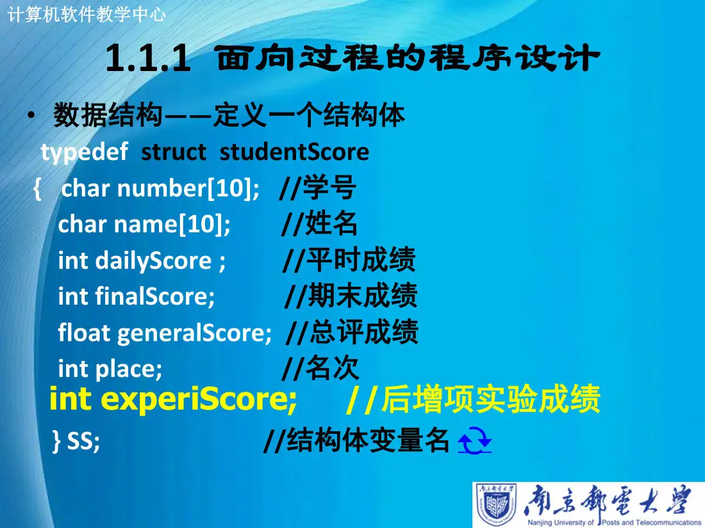

原文：

1.1.1 面向过程的程序设计

\- 数据结构——定义一个结构体

typedef struct studentScore

char number[10]; //学号

char name[10]; //姓名

int dailyScore ; //平时成绩

int finalScore; //期末成绩

float generalScore; //总评成绩

int place; //名次

int experiScore; //后增项实验成绩

} SS; //结构体变量名

计算机软件教学中心

南京邮电大学
Nanjing University of Posts and Telecommunications

### 1.1.1 面向过程的程序设计

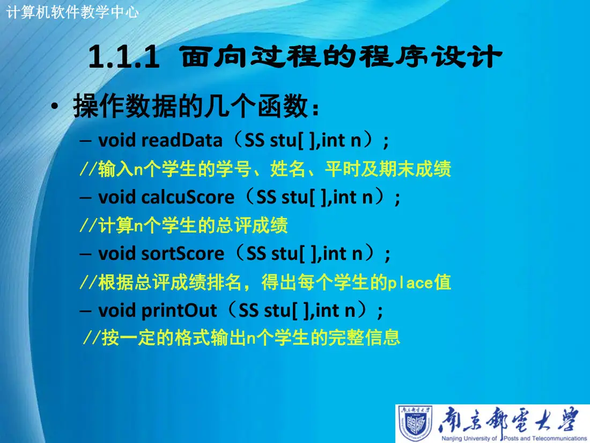

原文：

1.1.1 面向过程的程序设计

\- 操作数据的几个函数：
- void readData（SS stu[], int n）；
//输入n个学生的学号、姓名、平时及期末成绩
- void calcuScore（SS stu[], int n）；
//计算n个学生的总评成绩
- void sortScore（SS stu[], int n）；
//根据总评成绩排名，得出每个学生的place值
- void printOut（SS stu[], int n）；
//按一定的格式输出n个学生的完整信息

计算机软件教学中心

南京邮电大学
Nanjing University of Posts and Telecommunications

### 1.1.1 面向过程的程序设计

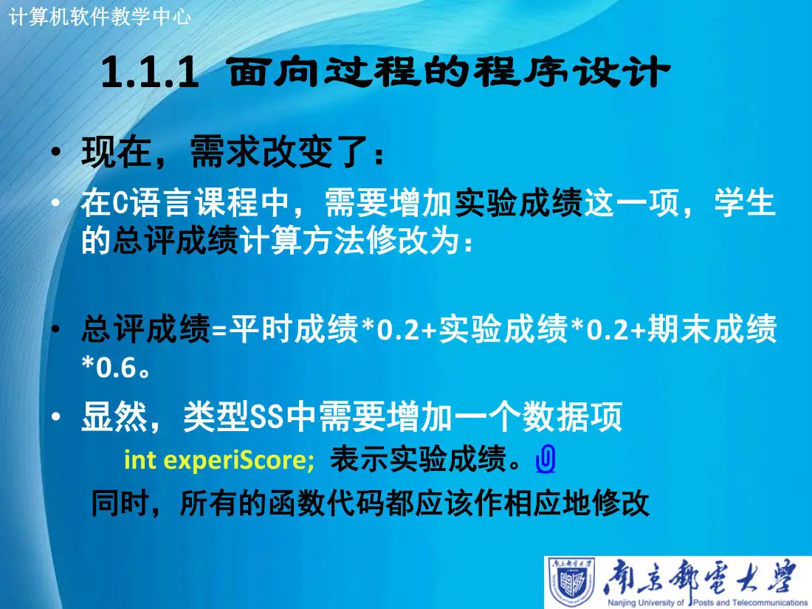

原文：

1.1.1 面向过程的程序设计

\- 现在，需求改变了：

\- 在C语言课程中，需要增加实验成绩这一项，学生的总评成绩计算方法修改为：

\- 总评成绩=平时成绩\*0.2+实验成绩\*0.2+期末成绩\*0.6。

\- 显然，类型SS中需要增加一个数据项
int experiScore; 表示实验成绩。同时，所有的函数代码都应该作相应地修改

计算机软件教学中心

南京邮电大学
Nanjing University of Posts and Telecommunications

### 1.1.2 面向对象的程序设计

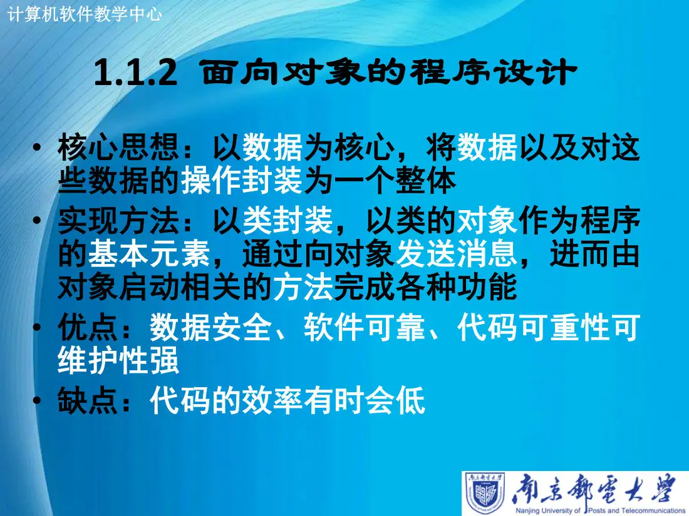

原文：

1.1.2 面向对象的程序设计

\- 核心思想：以数据为核心，将数据以及对这些数据的操作封装为一个整体

\- 实现方法：以类封装，以类的对象作为程序的基本元素，通过向对象发送消息，进而由对象启动相关的方法完成各种功能

\- 优点：数据安全、软件可靠、代码可重性可维护性强

\- 缺点：代码的效率有时会低

计算机软件教学中心

南京邮电大学
Nanjing University of Posts and Telecommunications

### 1.1.2 面向对象的程序设计

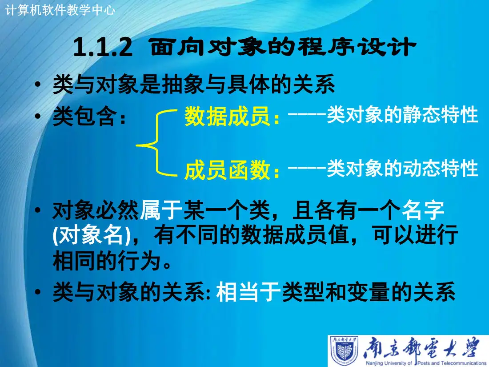

原文：

1.1.2 面向对象的程序设计

\- 类与对象是抽象与具体的关系

\- 类包含:

数据成员：----类对象的静态特性

成员函数：----类对象的动态特性

\- 对象必然属于某一个类，且各有一个名字(对象名)，有不同的数据成员值，可以进行相同的行为。

\- 类与对象的关系: 相当于类型和变量的关系

计算机软件教学中心

南京邮电大学
Nanjing University of Posts and Telecommunications

### 1.1.2 面向对象的程序设计

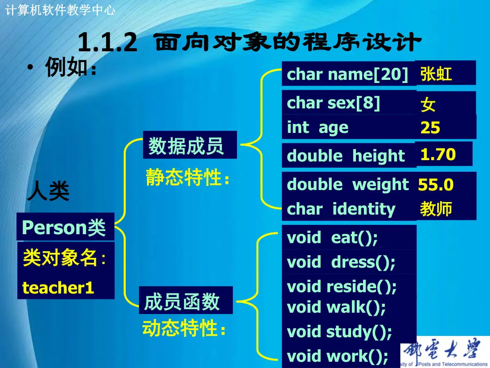

原文：

1.1.2 面向对象的程序设计

• 例如：

人类

Person类

类对象名：

teacher1

数据成员

静态特性：

成员函数动态特性：

char name[20] 张虹

char sex[8] 女  
int age 25  
double height 1.70  
double weight 55.0  
char identity 教师

void eat();
void dress();
void reside();
void walk();
void study();
void work();

计算机软件教学中心

郵電大學
sity of Posts and Telecommunications

### 1.1.2 面向对象的程序设计

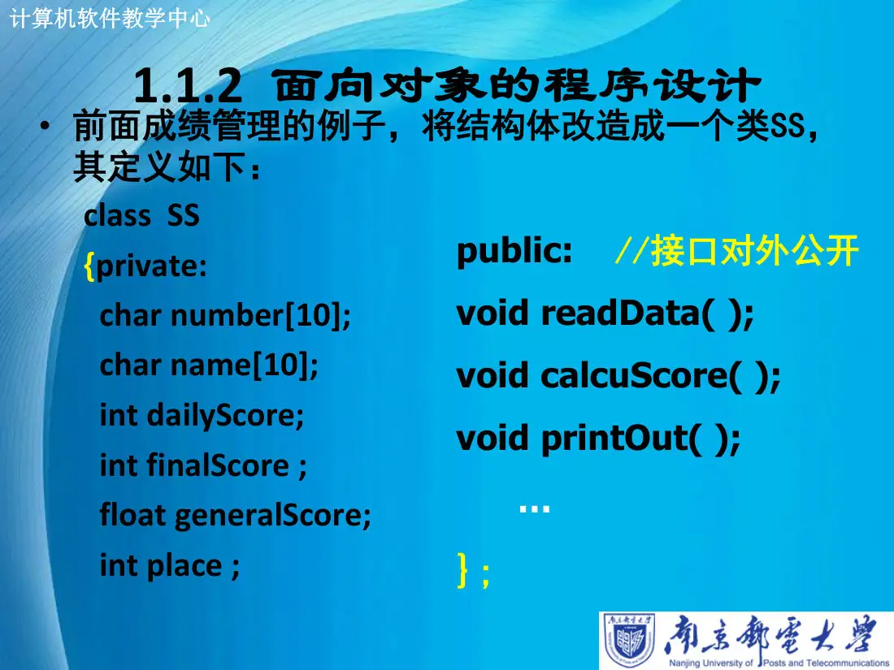

原文：

1.1.2 面向对象的程序设计
• 前面成绩管理的例子，将结构体改造成一个类SS，其定义如下：

class SS

{private:

char number[10];

char name[10];

int dailyScore;

int finalScore ;

float generalScore;

int place ;

public: //接口对外公开

void readData( );

void calcuScore();

void printOut();

计算机软件教学中心

南京邮电大学
Nanjing University of Posts and Telecommunications

### 1.1.2 面向对象的程序设计

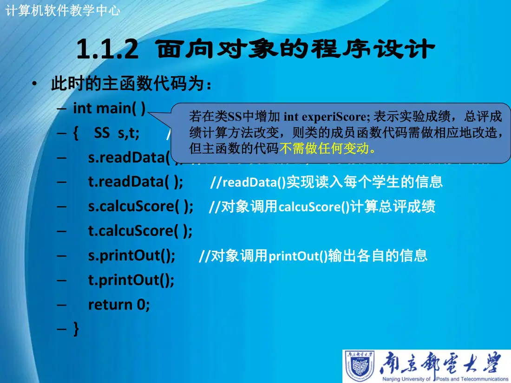

原文：

1.1.2 面向对象的程序设计

\- 此时的主函数代码为:

\- int main( )

$$
- \{\quad S S s, t;
$$

\- s.readData(

若在类SS中增加 int experiScore; 表示实验成绩，总评成绩计算方法改变，则类的成员函数代码需做相应地改造，但主函数的代码不需做任何变动。

\- t.readData(); //readData()实现读入每个学生的信息

\- s.calcuScore(); //对象调用calcuScore()计算总评成绩

\- t.calcuScore();

\- s.printOut(); //对象调用printOut()输出各自的信息

\- t.printOut();

\- return 0;

$$
- \}
$$

计算机软件教学中心

南京邮电大学
Nanjing University of Posts and Telecommunications

### 1.1.2 面向对象的程序设计

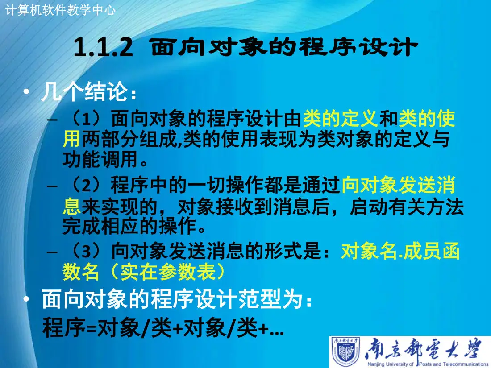

原文：

1.1.2 面向对象的程序设计

\- 几个结论:

(1) 面向对象的程序设计由类的定义和类的使用两部分组成,类的使用表现为类对象的定义与功能调用。

\- （2）程序中的一切操作都是通过向对象发送消息来实现的，对象接收到消息后，启动有关方法完成相应的操作。

\- （3）向对象发送消息的形式是：对象名.成员函数名（实在参数表）

面向对象的程序设计范型为:

程序=对象/类+对象/类+...

计算机软件教学中心

南京邮电大学
Nanjing University of Posts and Telecommunications

### 1.1.2 面向对象的程序设计

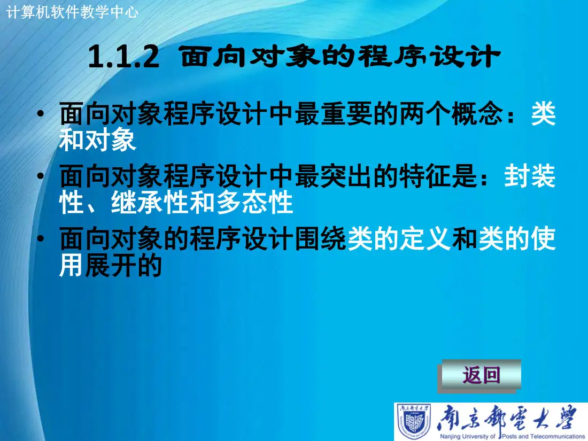

原文：

1.1.2 面向对象的程序设计

\- 面向对象程序设计中最重要的两个概念：类和对象

\- 面向对象程序设计中最突出的特征是：封装性、继承性和多态性

\- 面向对象的程序设计围绕类的定义和类的使用展开的

返回

计算机软件教学中心

南京邮电大学
Nanjing University of Posts and Telecommunications

### 1.2.1 类与对象

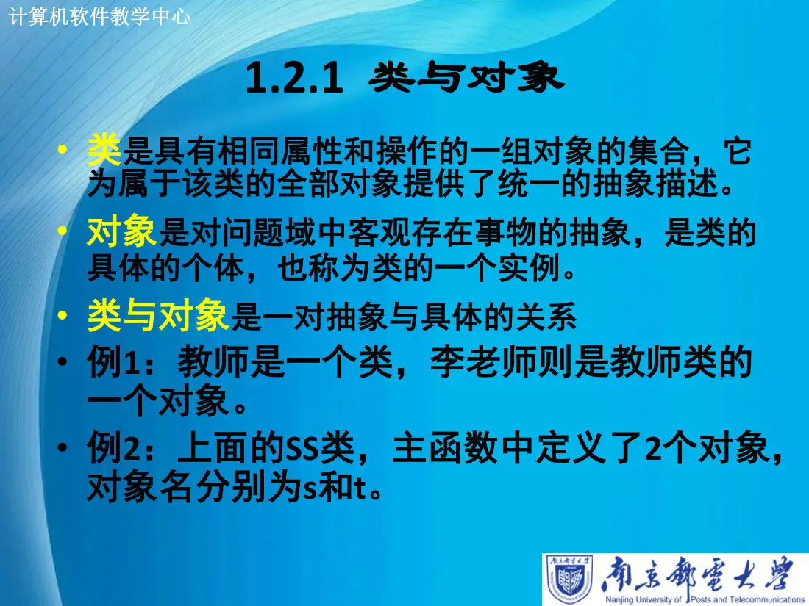

原文：

1.2.1 类与对象

类是具有相同属性和操作的一组对象的集合，它为属于该类的全部对象提供了统一的抽象描述。

对象是对问题域中客观存在事物的抽象，是类的具体的个体，也称为类的一个实例。

\- 类与对象是一对抽象与具体的关系

• 例1：教师是一个类，李老师则是教师类的一个对象。

• 例2：上面的SS类，主函数中定义了2个对象，对象名分别为s和t。

计算机软件教学中心

南京邮电大学
Nanjing University of Posts and Telecommunications

### 1.2.1 类与对象

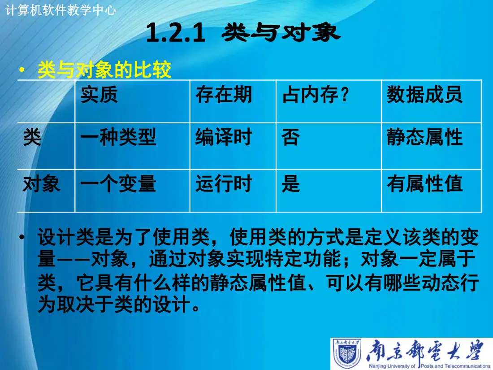

原文：

1.2.1 类与对象

类与对象的比较

<table><tr><td></td><td>实质</td><td>存在期</td><td>占内存?</td><td>数据成员</td></tr><tr><td>类</td><td>一种类型</td><td>编译时</td><td>否</td><td>静态属性</td></tr><tr><td>对象</td><td>一个变量</td><td>运行时</td><td>是</td><td>有属性值</td></tr></table>

\- 设计类是为了使用类，使用类的方式是定义该类的变量——对象，通过对象实现特定功能；对象一定属于类，它具有什么样的静态属性值、可以有哪些动态行为取决于类的设计。

计算机软件教学中心

南京邮电大学
Nanjing University of Posts and Telecommunication

### 1.2.1 类与对象

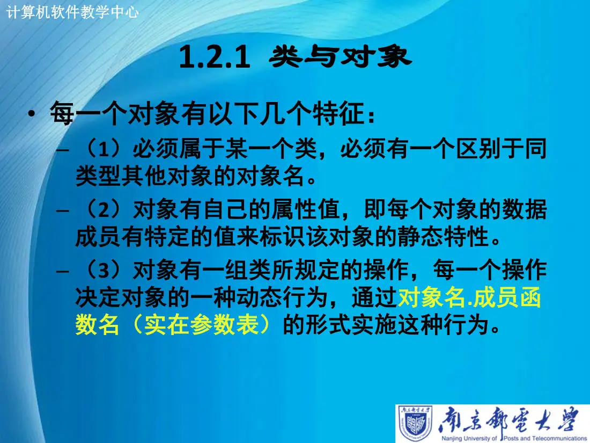

原文：

1.2.1 类与对象

\- 每一个对象有以下几个特征:

\- （1）必须属于某一个类，必须有一个区别于同类型其他对象的对象名。

\- （2）对象有自己的属性值，即每个对象的数据成员有特定的值来标识该对象的静态特性。

\- （3）对象有一组类所规定的操作，每一个操作决定对象的一种动态行为，通过对象名.成员函数名（实在参数表）的形式实施这种行为。

计算机软件教学中心

南京邮电大学
Nanjing University of Posts and Telecommunications

### 1.2.2 封装性

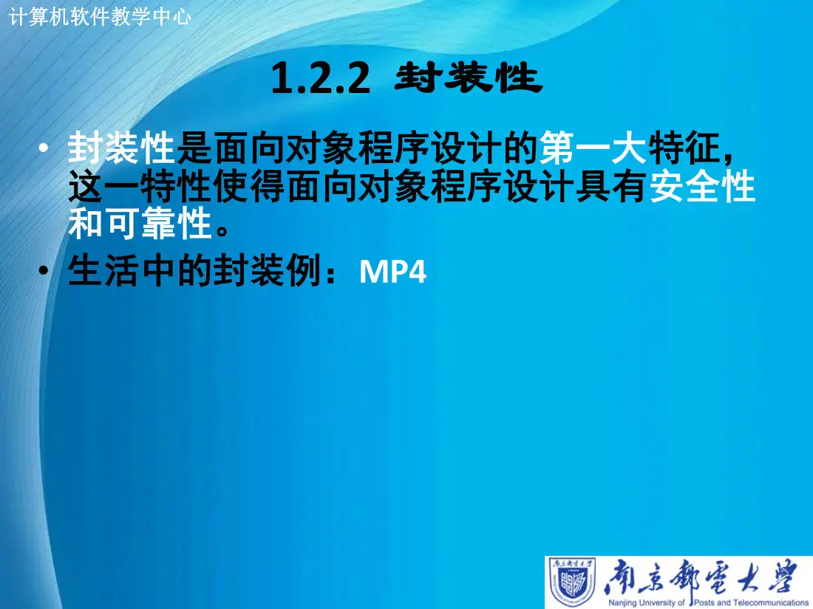

原文：

1.2.2 封装性

\- 封装性是面向对象程序设计的第一大特征，这一特性使得面向对象程序设计具有安全性和可靠性。

\- 生活中的封装例：MP4

计算机软件教学中心

南京邮电大学
Nanjing University of Posts and Telecommunications

### 1.2.2 封装性

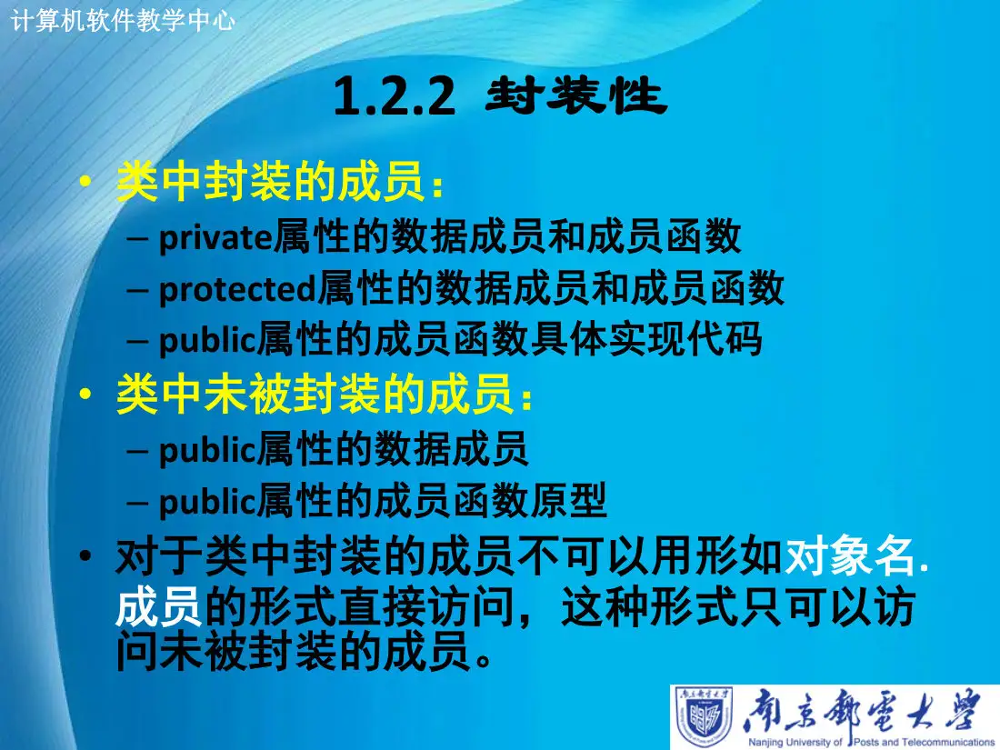

原文：

1.2.2 封装性

类中封装的成员：

\- private属性的数据成员和成员函数

\- protected属性的数据成员和成员函数

\- public属性的成员函数具体实现代码

\- 类中未被封装的成员:

\- public属性的数据成员

\- public属性的成员函数原型

\- 对于类中封装的成员不可以用形如对象名. 成员的形式直接访问, 这种形式只可以访问未被封装的成员。

计算机软件教学中心

南京邮电大学
Nanjing University of Posts and Telecommunications

### 1.2.2 封装性

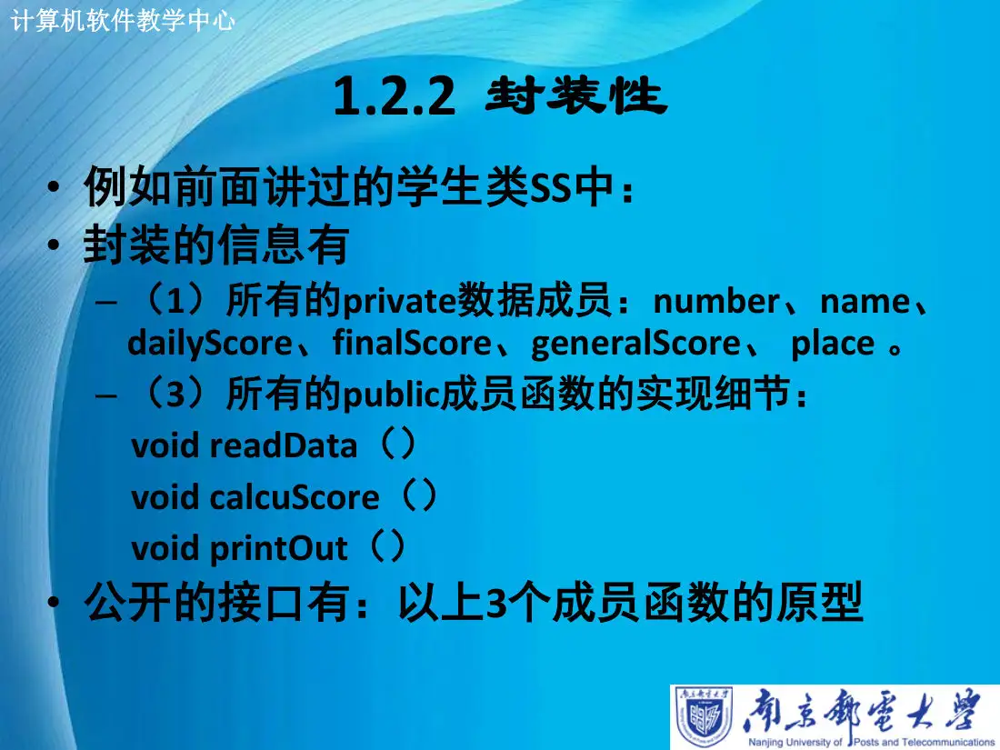

原文：

1.2.2 封装性

• 例如前面讲过的学生类SS中:

\- 封装的信息有

\- （1）所有的private数据成员：number、name、dailyScore、finalScore、generalScore、place。

\- （3）所有的public成员函数的实现细节：

void readData ()

void calcuScore ()

void printOut ()

公开的接口有：以上3个成员函数的原型

计算机软件教学中心

南京邮电大学
Nanjing University of Posts and Telecommunications

### 1.2.2 封装性

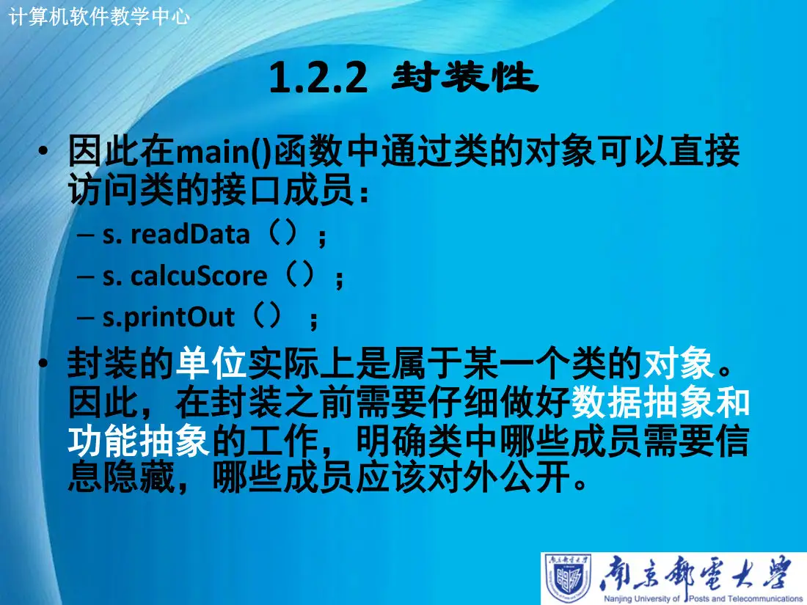

原文：

1.2.2 封装性

\- 因此在main()函数中通过类的对象可以直接访问类的接口成员:

\- s. readData ();

\- s. calcuScore ();

\- s.printOut ( ) ;

\- 封装的单位实际上是属于某一个类的对象。因此，在封装之前需要仔细做好数据抽象和功能抽象的工作，明确类中哪些成员需要信息隐藏，哪些成员应该对外公开。

计算机软件教学中心

南京邮电大学
Nanjing University of Posts and Telecommunications

### 1.2.3 继承性

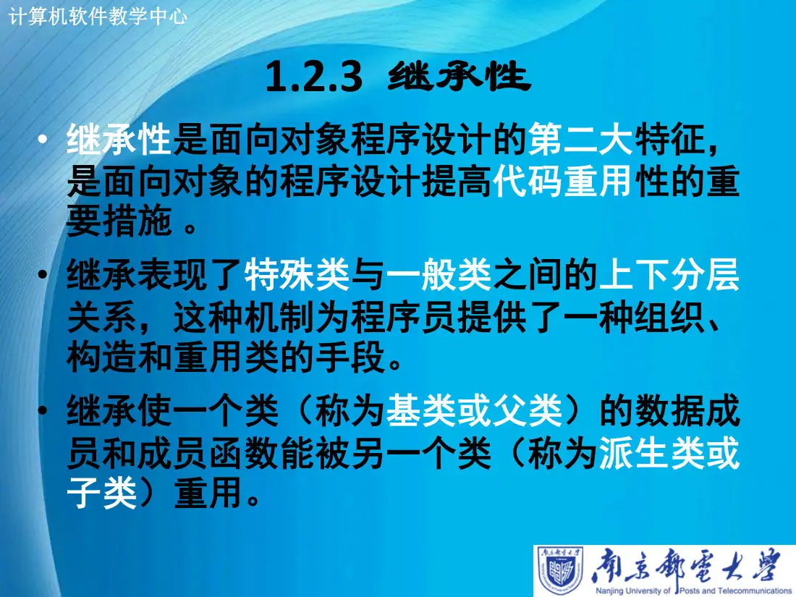

原文：

1.2.3 继承性

\- 继承性是面向对象程序设计的第二大特征，是面向对象的程序设计提高代码重用性的重要措施。

\- 继承表现了特殊类与一般类之间的上下分层关系，这种机制为程序员提供了一种组织、构造和重用类的手段。

\- 继承使一个类（称为基类或父类）的数据成员和成员函数能被另一个类（称为派生类或子类）重用。

计算机软件教学中心

南京邮电大学
Nanjing University of Posts and Telecommunications

### 1.2.3 继承性

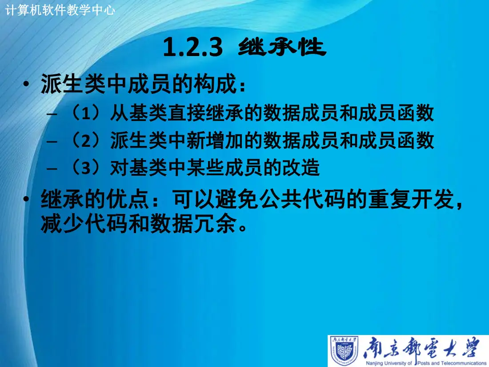

原文：

1.2.3 继承性

\- 派生类中成员的构成:

\- （1）从基类直接继承的数据成员和成员函数

\- （2）派生类中新增加的数据成员和成员函数

\- （3）对基类中某些成员的改造

\- 继承的优点：可以避免公共代码的重复开发，减少代码和数据冗余。

计算机软件教学中心

南京邮电大学
Nanjing University of Posts and Telecommunications

### 1.2.3 继承性

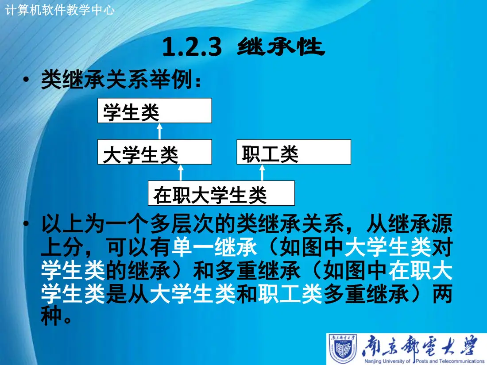

原文：

1.2.3 继承性

\- 类继承关系举例：

学生类

大学生类

职工类

在职大学生类

以上为一个多层次的类继承关系，从继承源上分，可以有单一继承（如图中大学生类对学生类的继承）和多重继承（如图中在职大学生类是从大学生类和职工类多重继承）两种。

计算机软件教学中心

南京邮电大学
Nanjing University of Posts and Telecommunications

### 1.2.4 多态性

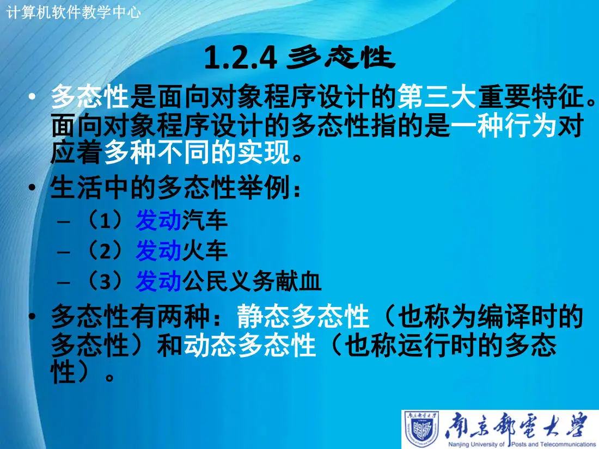

原文：

1.2.4 多态性

\- 多态性是面向对象程序设计的第三大重要特征。面向对象程序设计的多态性指的是一种行为对应着多种不同的实现。

\- 生活中的多态性举例：

\- (1) 发动汽车

\- (2) 发动火车

\- （3）发动公民义务献血

多态性有两种：静态多态性（也称为编译时的多态性）和动态多态性（也称运行时的多态性）。

计算机软件教学中心

南京邮电大学
Nanjing University of Posts and Telecommunications

### 1.2.4 多态性

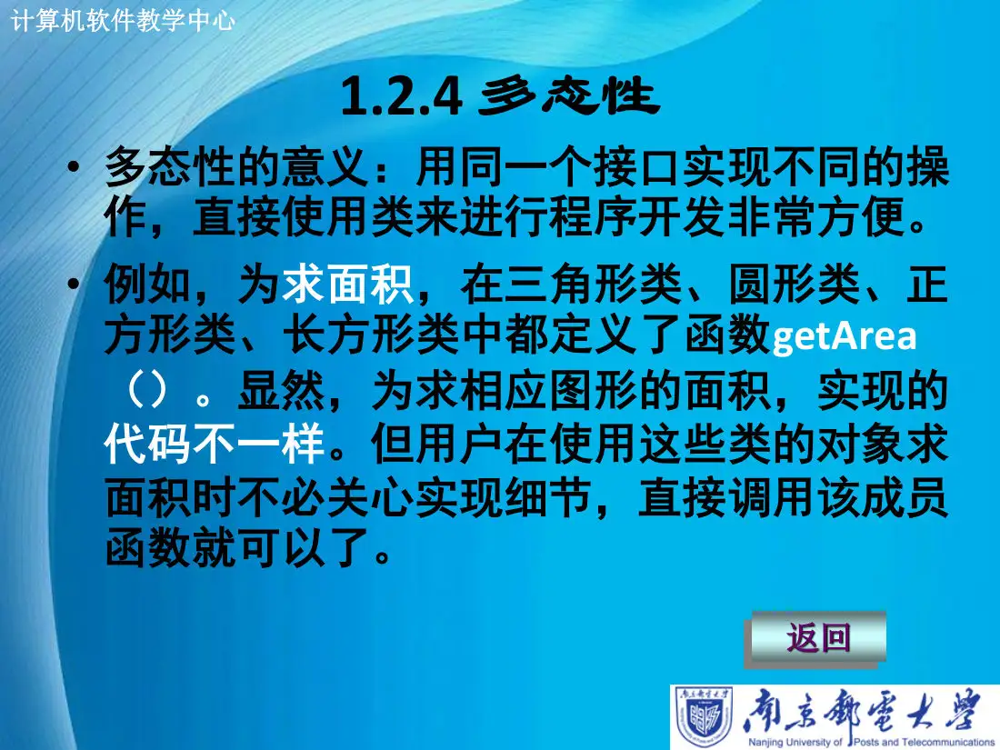

原文：

1.2.4 多态性

\- 多态性的意义：用同一个接口实现不同的操作，直接使用类来进行程序开发非常方便。

• 例如，为求面积，在三角形类、圆形类、正方形类、长方形类中都定义了函数getArea（）。显然，为求相应图形的面积，实现的代码不一样。但用户在使用这些类的对象求面积时不必关心实现细节，直接调用该成员函数就可以了。

返回

计算机软件教学中心

南京邮电大学
Nanjing University of Posts and Telecommunications

### 1.3.1 C++语言支持面向对象的程序设计

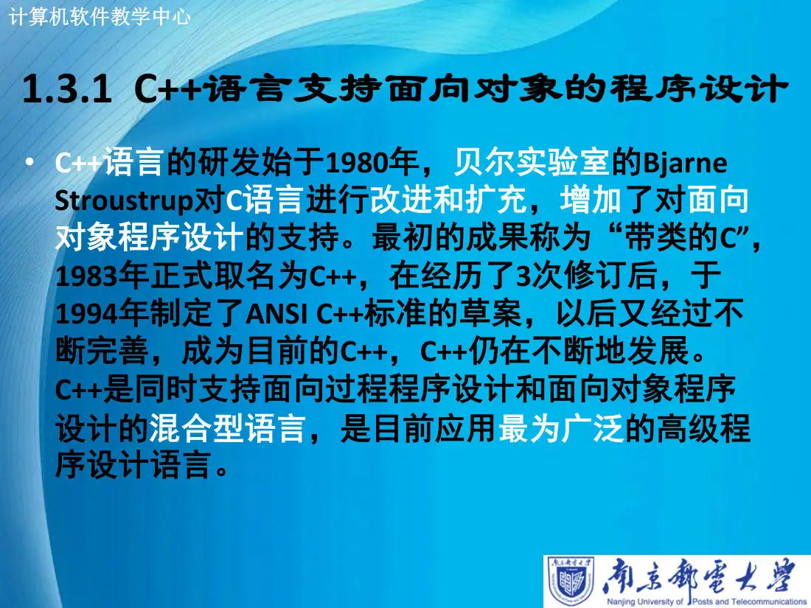

原文：

1.3.1 C++语言支持面向对象的程序设计

• C++语言的研发始于1980年，贝尔实验室的Bjarne Stroustrup对C语言进行改进和扩充，增加了对面向对象程序设计的支持。最初的成果称为“带类的C”，1983年正式取名为C++，在经历了3次修订后，于1994年制定了ANSI C++标准的草案，以后又经过不断完善，成为目前的C++，C++仍在不断地发展。C++是同时支持面向过程程序设计和面向对象程序设计的混合型语言，是目前应用最为广泛的高级程序设计语言。

计算机软件教学中心

南京邮电大学
Nanjing University of Posts and Telecommunications

### 1.3.2 C++语言与C语言的关系

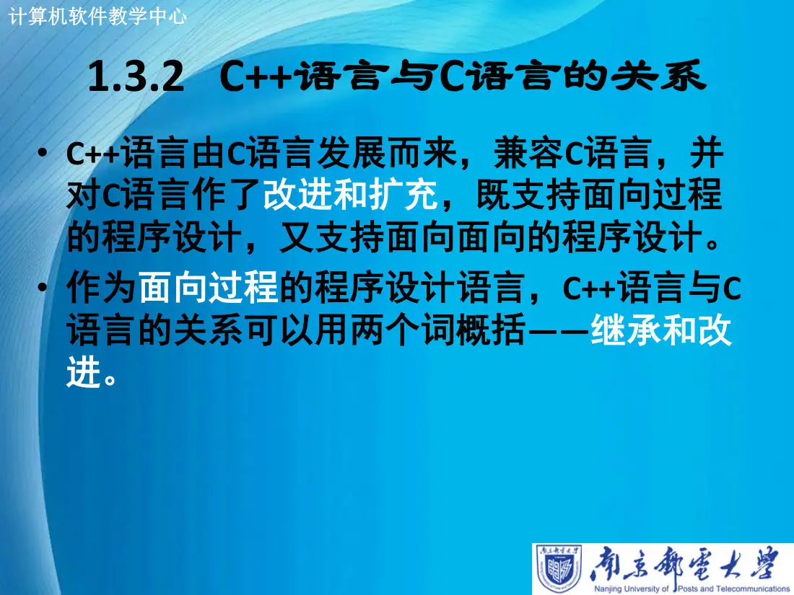

原文：

1.3.2 C++语言与C语言的关系

• C++语言由C语言发展而来，兼容C语言，并对C语言作了改进和扩充，既支持面向过程的程序设计，又支持面向面向的程序设计。

\- 作为面向过程的程序设计语言，C++语言与C语言的关系可以用两个词概括——继承和改进。

计算机软件教学中心

南京邮电大学
Nanjing University of Posts and Telecommunications

### 1.3.2 C++语言与C语言的关系

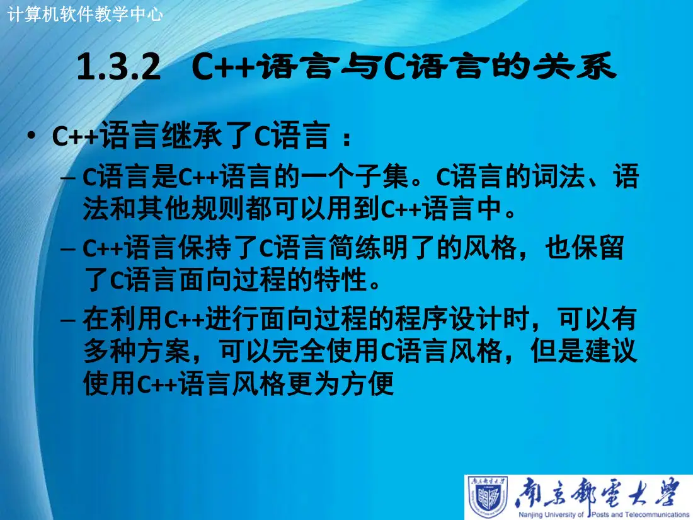

原文：

1.3.2 C++语言与C语言的关系

• C++语言继承了C语言：

\- C语言是C++语言的一个子集。C语言的词法、语法和其他规则都可以用到C++语言中。

\- C++语言保持了C语言简练明了的风格，也保留了C语言面向过程的特性。

\- 在利用C++进行面向过程的程序设计时，可以有多种方案，可以完全使用C语言风格，但是建议使用C++语言风格更为方便

计算机软件教学中心

南京邮电大学
Nanjing University of Posts and Telecommunications

### 1.3.2 C++语言与C语言的关系

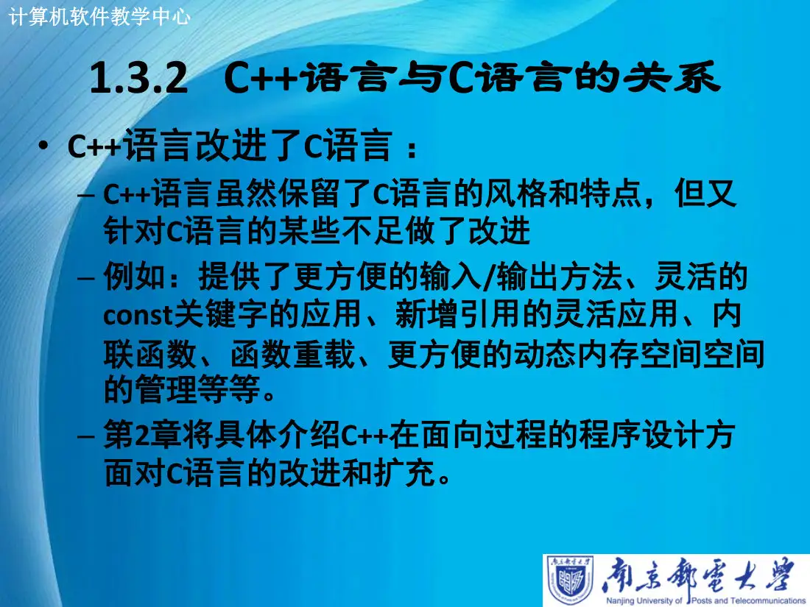

原文：

1.3.2 C++语言与C语言的关系

• C++语言改进了C语言：

\- C++语言虽然保留了C语言的风格和特点，但又针对C语言的某些不足做了改进

\- 例如：提供了更方便的输入/输出方法、灵活的const关键字的应用、新增引用的灵活应用、内联函数、函数重载、更方便的动态内存空间空间的管理等等。

\- 第2章将具体介绍C++在面向过程的程序设计方面对C语言的改进和扩充。

计算机软件教学中心

南京邮电大学
Nanjing University of Posts and Telecommunications

### 1.4.1 C++程序的开发过程

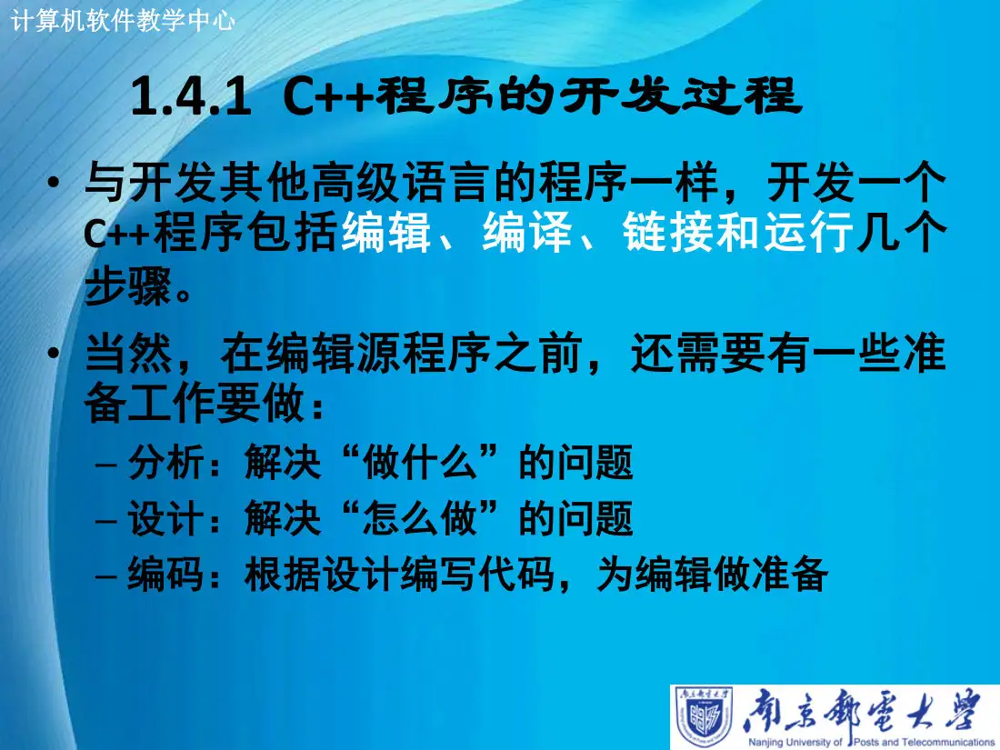

原文：

1.4.1 C++程序的开发过程

\- 与开发其他高级语言的程序一样，开发一个C++程序包括编辑、编译、链接和运行几个步骤。

\- 当然，在编辑源程序之前，还需要有一些准备工作要做：

\- 分析：解决“做什么”的问题

\- 设计：解决“怎么做”的问题

\- 编码：根据设计编写代码，为编辑做准备

计算机软件教学中心

南京邮电大学
Nanjing University of Posts and Telecommunications

### 1.4.1 C++程序的开发过程

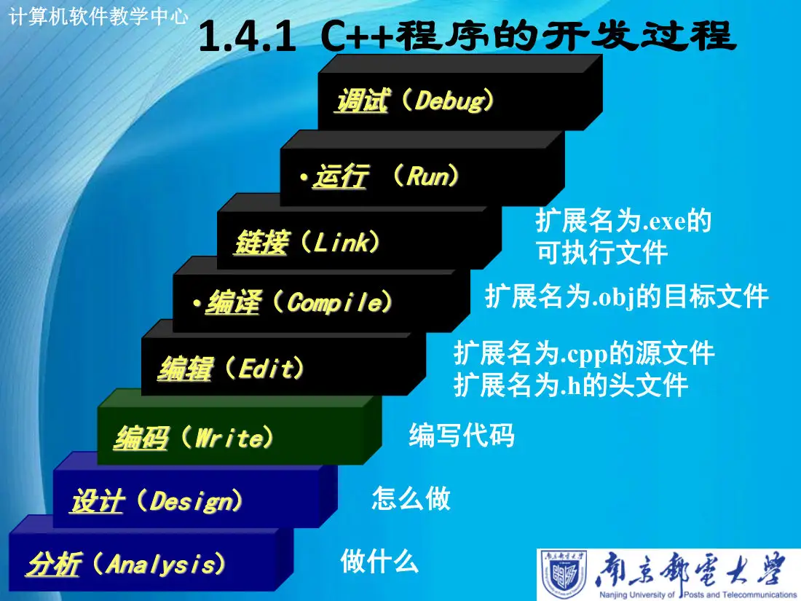

原文：

1.4.1 C++程序的开发过程

调试（Debug）

·运行 (Run)

链接（Link）

·编译（Compile）

编辑（Edit）

编码（Write）

设计（Design）

分析（Analysis）

扩展名为.exe的可执行文件扩展名为.obj的目标文件

扩展名为.cpp的源文件  
扩展名为.h的头文件

编写代码

怎么做

做什么

计算机软件教学中心

南京邮电大学
Nanjing University of Posts and Telecommunications

### 1.4.1 C++程序的开发过程

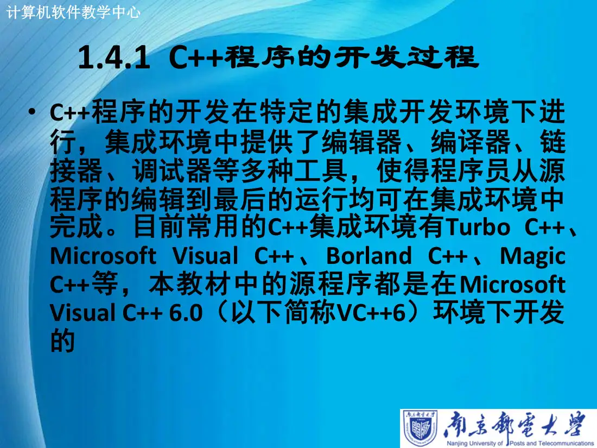

原文：

1.4.1 C++程序的开发过程

• C++程序的开发在特定的集成开发环境下进行，集成环境中提供了编辑器、编译器、链接器、调试器等多种工具，使得程序员从源程序的编辑到最后的运行均可在集成环境中完成。目前常用的C++集成环境有Turbo C++、Microsoft Visual C++、Borland C++、Magic C++等，本教材中的源程序都是在Microsoft Visual C++ 6.0（以下简称VC++6）环境下开发的

计算机软件教学中心

南京邮电大学
Nanjing University of Posts and Telecommunications

### VC++6集成开发环境相关知识

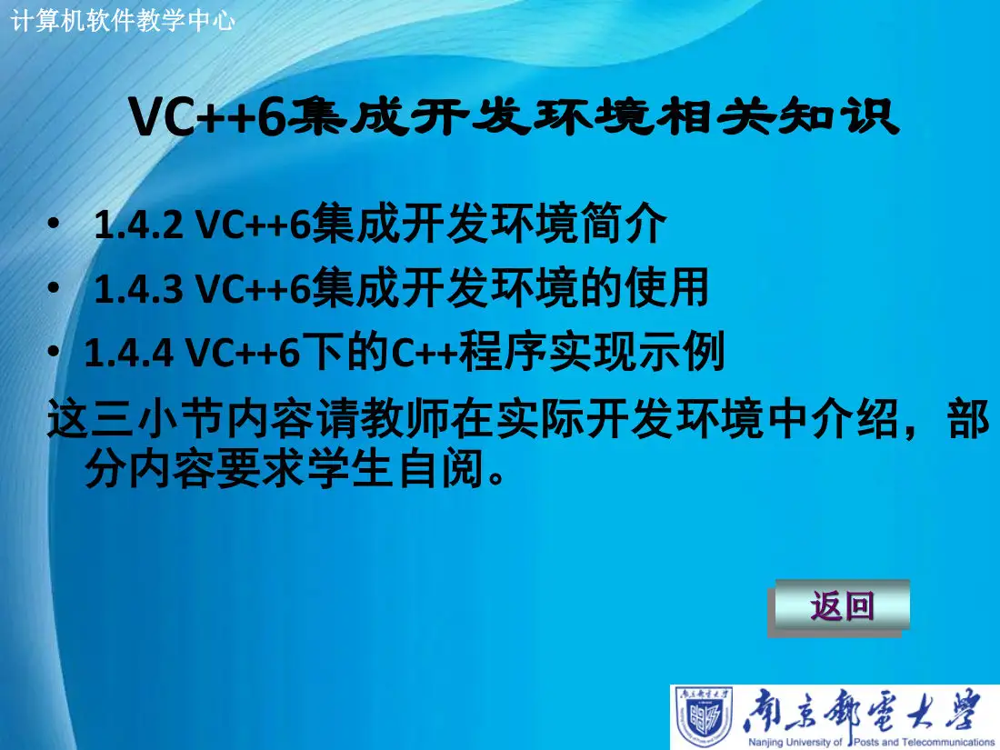

原文：

VC++6集成开发环境相关知识

• 1.4.2 VC++6集成开发环境简介

• 1.4.3 VC++6集成开发环境的使用

• 1.4.4 VC++6下的C++程序实现示例

这三小节内容请教师在实际开发环境中介绍，部分内容要求学生自阅。

返回

计算机软件教学中心

南京邮电大学
Nanjing University of Posts and Telecommunications

### 本章小结

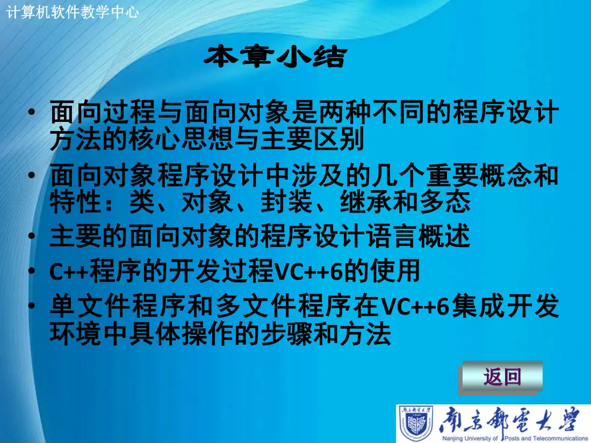

原文：

本章小结

\- 面向过程与面向对象是两种不同的程序设计方法的核心思想与主要区别

\- 面向对象程序设计中涉及的几个重要概念和特性：类、对象、封装、继承和多态

\- 主要的面向对象的程序设计语言概述

C++程序的开发过程VC++6的使用

\- 单文件程序和多文件程序在VC++6集成开发环境中具体操作的步骤和方法

返回

计算机软件教学中心

南京邮电大学
Nanjing University of Posts and Telecommunications
