# 《面向对象程序设计及C++》第2章 C++对C的改进及扩展（课件）

原件的每一页，下面附识别出的文字。

### 面向对象程序设计及C++

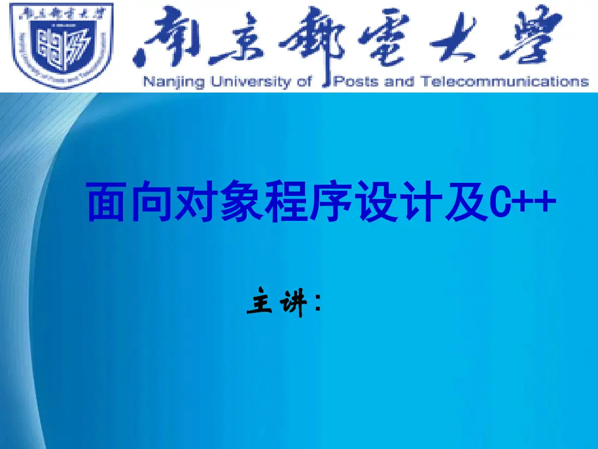

原文：

面向对象程序设计及C++

主讲：

### 面向对象程序设计及C++

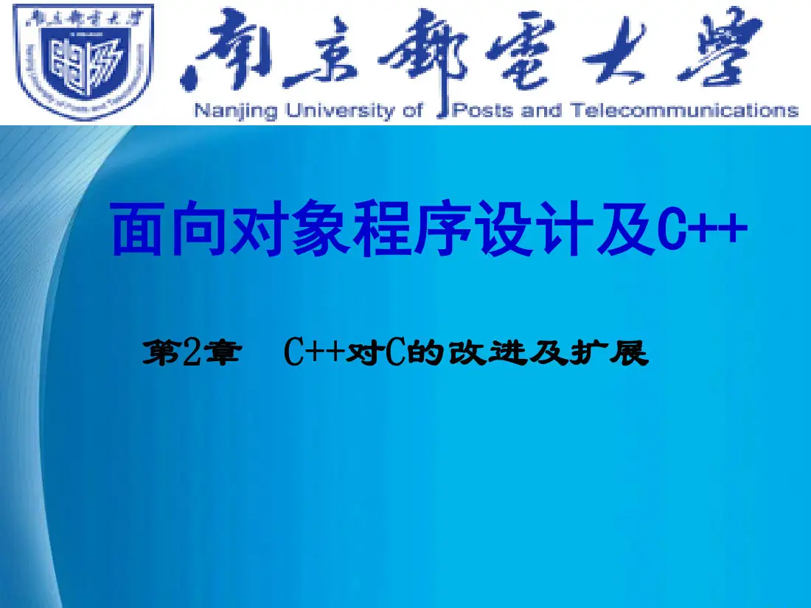

原文：

Nanjing University of JPosts and Telecommunications

面向对象程序设计及C++

第2章 C++对C的改进及扩展

南京郵電大學

### 本章作业

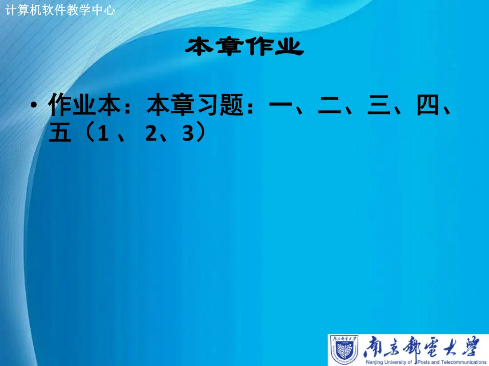

原文：

本章作业

• 作业本: 本章习题: 一、二、三、四、五 (1、2、3)

计算机软件教学中心

南京邮电大学
Nanjing University of Posts and Telecommunications

### 计算机软件教学中心

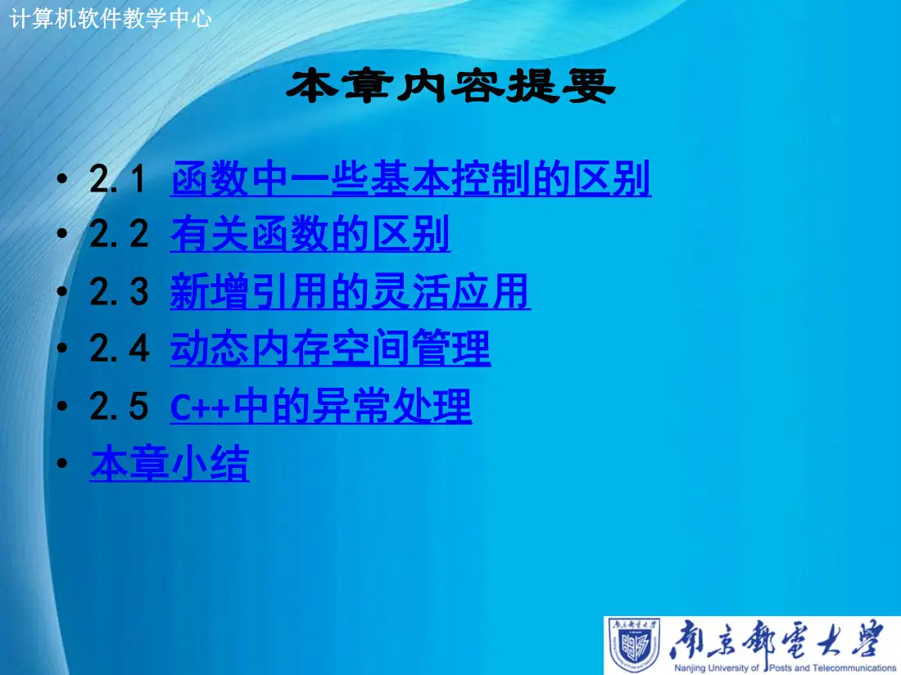

原文：

计算机软件教学中心

本章内容提要

• 2.1 函数中一些基本控制的区别

• 2.2 有关函数的区别

• 2.3 新增引用的灵活应用

• 2.4 动态内存空间管理

• 2.5 C++中的异常处理

本章小结

南京邮电大学
Nanjing University of Posts and Telecommunications

### 计算机软件教学中心

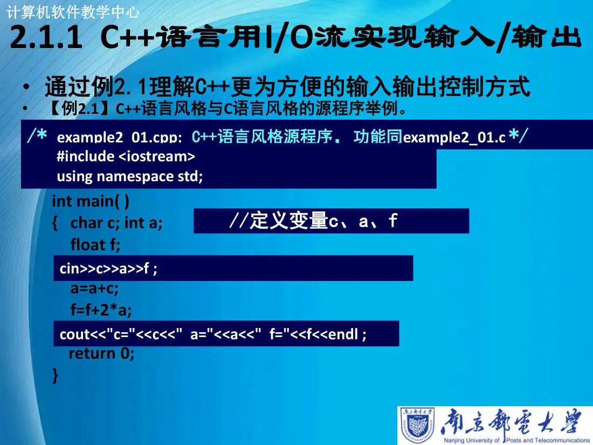

原文：

计算机软件教学中心

2.1.1 C++语言用I/O流实现输入/输出

\- 通过例2.1理解C++更为方便的输入输出控制方式
- 【例2.1】C++语言风格与C语言风格的源程序举例。

/\* example2 01.cpp: C++语言风格源程序，功能同example2\_01.c \*/
include <iostream>
using namespace std;

int main()

{ char c; int a; float f;

//定义变量c、a、f

cin>>c>>a>>f ;

$a = a + c$ ;

$f=f+2*a;$

cout<<"c="<<c<<" a="<<a<<" f="<<f<<endl ; return 0;

南京邮电大学
Nanjing University of Posts and Telecommunications

### 2.1.1 C++语言用I/O流实现输入/输出

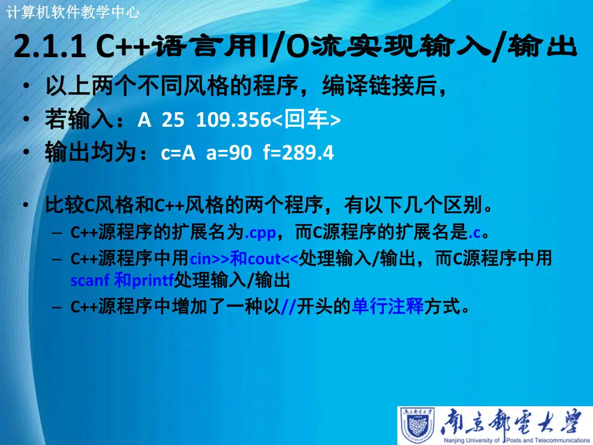

原文：

2.1.1 C++语言用I/O流实现输入/输出

\- 以上两个不同风格的程序，编译链接后，

\- 若输入：A 25 109.356<回车>

\- 输出均为: c=A a=90 f=289.4

\- 比较C风格和C++风格的两个程序，有以下几个区别。

\- C++源程序的扩展名为.cpp，而C源程序的扩展名是.c。

\- C++源程序中用cin>>和cout<<处理输入/输出，而C源程序中用scanf和printf处理输入/输出

\- C++源程序中增加了一种以//开头的单行注释方式。

计算机软件教学中心

南京邮电大学
Nanjing University of Posts and Telecommunications

### 计算机软件教学中心

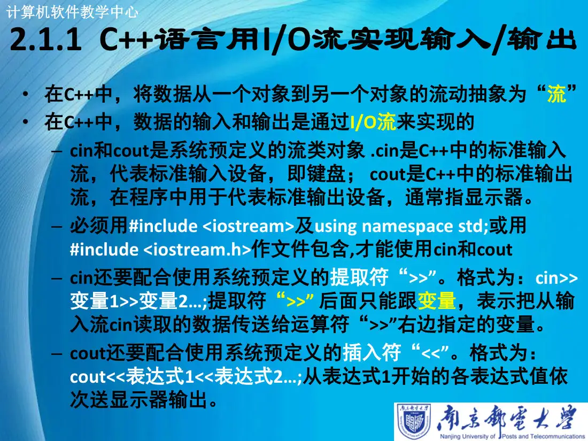

原文：

计算机软件教学中心

2.1.1 C++语言用I/O流实现输入/输出

\- 在C++中，将数据从一个对象到另一个对象的流动抽象为“流”

\- 在C++中，数据的输入和输出是通过I/O流来实现的

\- cin和cout是系统预定义的流类对象 .cin是C++中的标准输入流，代表标准输入设备，即键盘；cout是C++中的标准输出流，在程序中用于代表标准输出设备，通常指显示器。

\- 必须用#include <iostream>及using namespace std;或用#include <iostream.h>作文件包含,才能使用cin和cout

\- cin还要配合使用系统预定义的提取符“>>”。格式为：cin>>变量1>>变量2...;提取符“>>”后面只能跟变量，表示把从输入流cin读取的数据传送给运算符“>>”右边指定的变量。

\- cout还要配合使用系统预定义的插入符“<<”。格式为：cout<<表达式1<<表达式2...；从表达式1开始的各表达式值依次送显示器输出。

南京邮电大学
Nanjing University of Posts and Telecommunications

### 2.1.1 C++语言用I/O流实现输入/输出

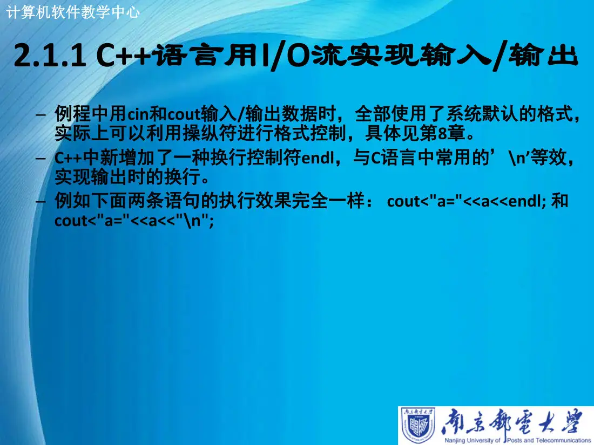

原文：

2.1.1 C++语言用I/O流实现输入/输出

\- 例程中用cin和cout输入/输出数据时，全部使用了系统默认的格式，实际上可以利用操纵符进行格式控制，具体见第8章。

\- C++中新增加了一种换行控制符endl，与C语言中常用的’ \n’等效，实现输出时的换行。

\- 例如下面两条语句的执行效果完全一样: cout<"a="<<a<<endl; 和 cout<"a="<<a<<"\n";

计算机软件教学中心

南京邮电大学
Nanjing University of Posts and Telecommunications

### 2.1.2 新增的单行注释

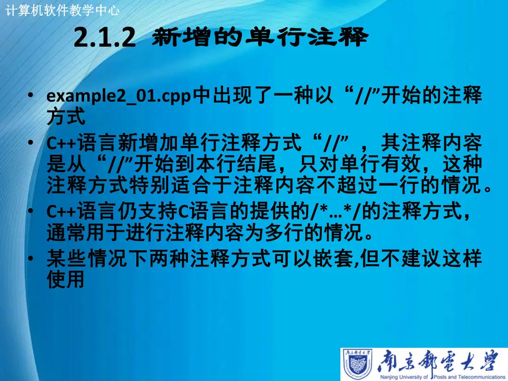

原文：

2.1.2 新增的单行注释

\- example2\_01.cpp中出现了一种以“//”开始的注释方式

• C++语言新增加单行注释方式“//”，其注释内容是从“//”开始到本行结尾，只对单行有效，这种注释方式特别适合于注释内容不超过一行的情况。

• C++语言仍支持C语言的提供的/\*...\*/的注释方式，通常用于进行注释内容为多行的情况。

\- 某些情况下两种注释方式可以嵌套,但不建议这样使用

计算机软件教学中心

南京邮电大学
Nanjing University of Posts and Telecommunications

### 2.1.3 使用const定义常量

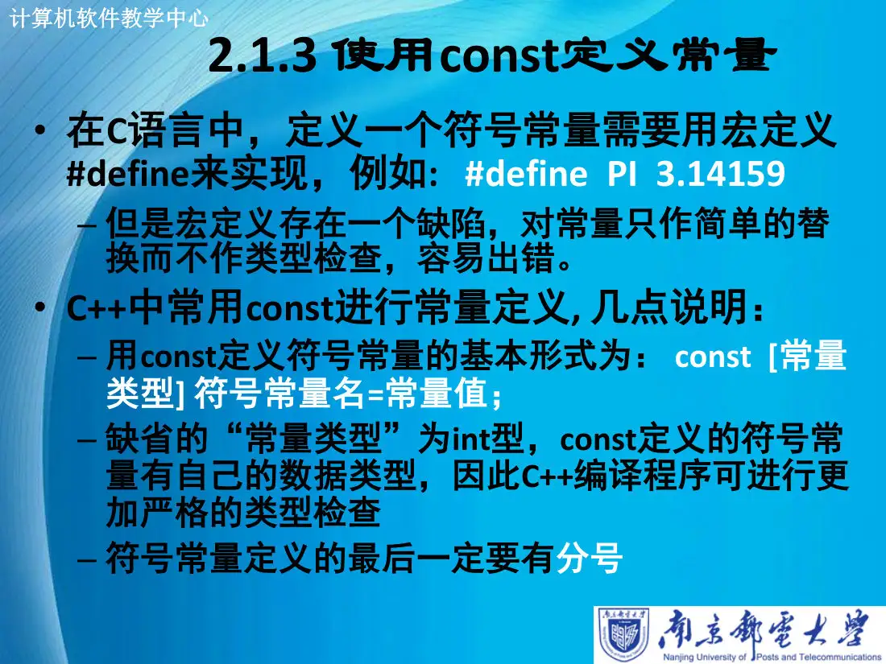

原文：

2.1.3 使用const定义常量

\- 在C语言中，定义一个符号常量需要用宏定义
define来实现，例如：#define PI 3.14159

\- 但是宏定义存在一个缺陷，对常量只作简单的替换而不作类型检查，容易出错。

• C++中常用const进行常量定义, 几点说明:

\- 用const定义符号常量的基本形式为：const [常量类型] 符号常量名=常量值；

\- 缺省的“常量类型”为int型，const定义的符号常量有自己的数据类型，因此C++编译程序可进行更加严格的类型检查

\- 符号常量定义的最后一定要有分号

计算机软件教学中心

南京邮电大学
Nanjing University of Posts and Telecommunications

### 2.1.3 使用const定义常量例2.2：两种符号常量定义的区别示例

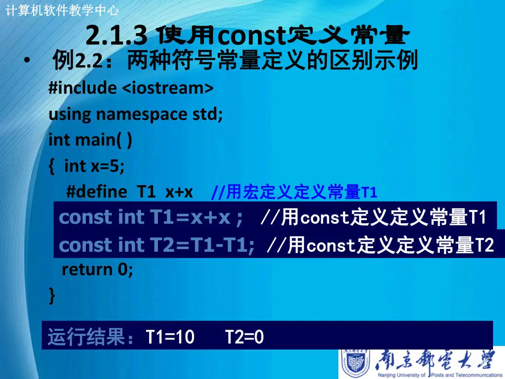

原文：

2.1.3 使用const定义常量例2.2：两种符号常量定义的区别示例

using namespace std;

define T1 x+x //用宏定义定义常量T1

const int T1=x+x; //用const定义定义常量T1
const int T2=T1-T1; //用const定义定义常量T2
return 0;

运行结果：T1=10 T2=0

计算机软件教学中心

南京邮电大学
Nanjing University of Posts and Telecommunication

### 2.1.3 使用const定义常量

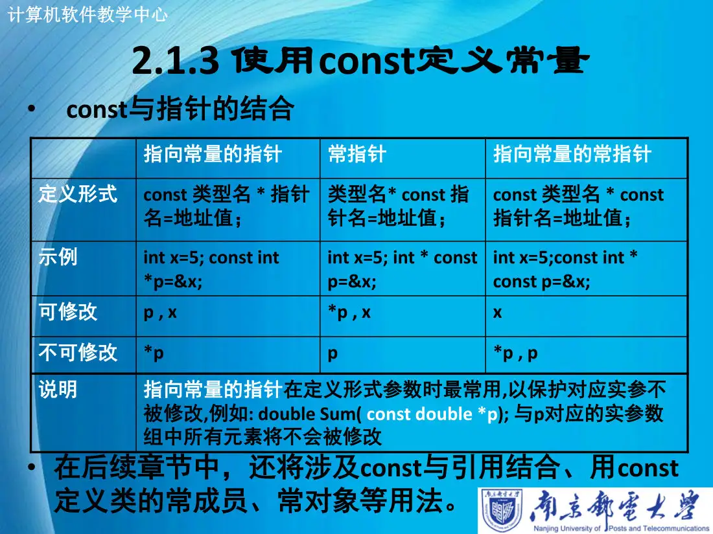

原文：

2.1.3 使用const定义常量

\- const与指针的结合

<table><tr><td></td><td>指向常量的指针</td><td>常指针</td><td>指向常量的常指针</td></tr><tr><td>定义形式</td><td>const 类型名 * 指针名=地址值;</td><td>类型名* const 指针名=地址值;</td><td>const 类型名 * const 指针名=地址值;</td></tr><tr><td>示例</td><td>int x=5; const int*p=&amp;x;</td><td>int x=5; int * const p=&amp;x;</td><td>int x=5; const int * const p=&amp;x;</td></tr><tr><td>可修改</td><td>p, x</td><td>*p, x</td><td>x</td></tr><tr><td>不可修改</td><td>*p</td><td>p</td><td>*p, p</td></tr><tr><td>说明</td><td colspan="3">指向常量的指针在定义形式参数时最常用,以保护对应实参不被修改,例如: double Sum( const double *p); 与p对应的实参数组中所有元素将不会被修改</td></tr></table>

计算机软件教学中心

### 2.1.4 新增的强制类型转换方式

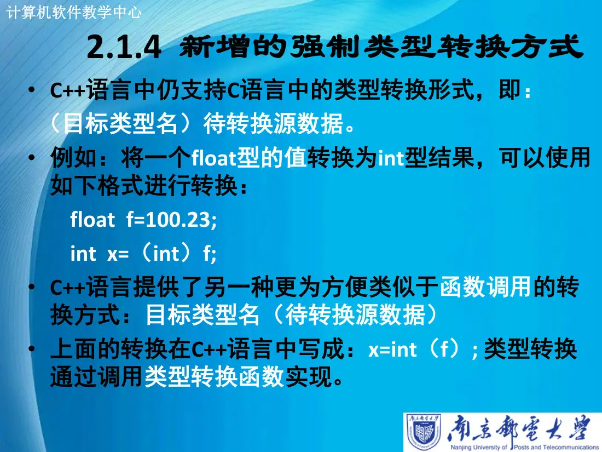

原文：

2.1.4 新增的强制类型转换方式

• C++语言中仍支持C语言中的类型转换形式，即：（目标类型名）待转换源数据。

• 例如：将一个float型的值转换为int型结果，可以使用如下格式进行转换：

float f=100.23;

int x = (int) f;

C++语言提供了另一种更为方便类似于函数调用的转换方式：目标类型名（待转换源数据）

\- 上面的转换在C++语言中写成：x=int（f）；类型转换通过调用类型转换函数实现。

计算机软件教学中心

南京邮电大学
Nanjing University of Posts and Telecommunications

### 2.1.5 新增的bool类型

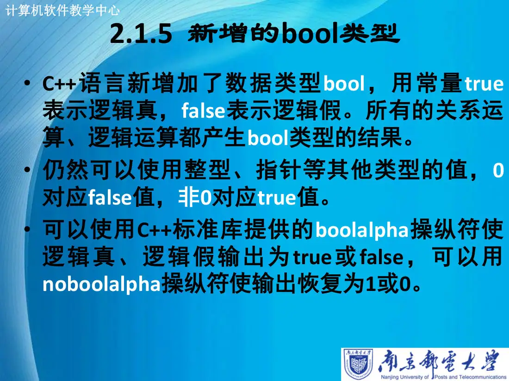

原文：

2.1.5 新增的bool类型

• C++语言新增加了数据类型bool，用常量true表示逻辑真，false表示逻辑假。所有的关系运算、逻辑运算都产生bool类型的结果。

\- 仍然可以使用整型、指针等其他类型的值，0对应false值，非0对应true值。

\- 可以使用C++标准库提供的boolalpha操纵符使逻辑真、逻辑假输出为true或false，可以用noboolalpha操纵符使输出恢复为1或0。

计算机软件教学中心

南京邮电大学
Nanjing University of Posts and Telecommunications

### 2.1.5 新增的bool类型

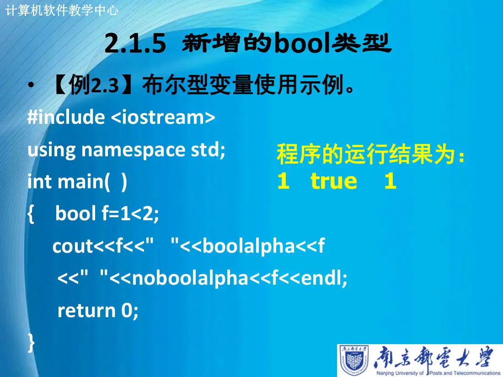

原文：

2.1.5 新增的bool类型

• 【例2.3】布尔型变量使用示例。

include <iostream>

using namespace std;

int main( )

程序的运行结果为: 1 true 1

{ bool f=1<2;
cout<<f<<" "<<boolalpha<<f
<<" "<<noboolalpha<<f<<endl;
return 0;

计算机软件教学中心

南京邮电大学
Nanjing University of Posts and Telecommunications

### 2.1.6 名字空间

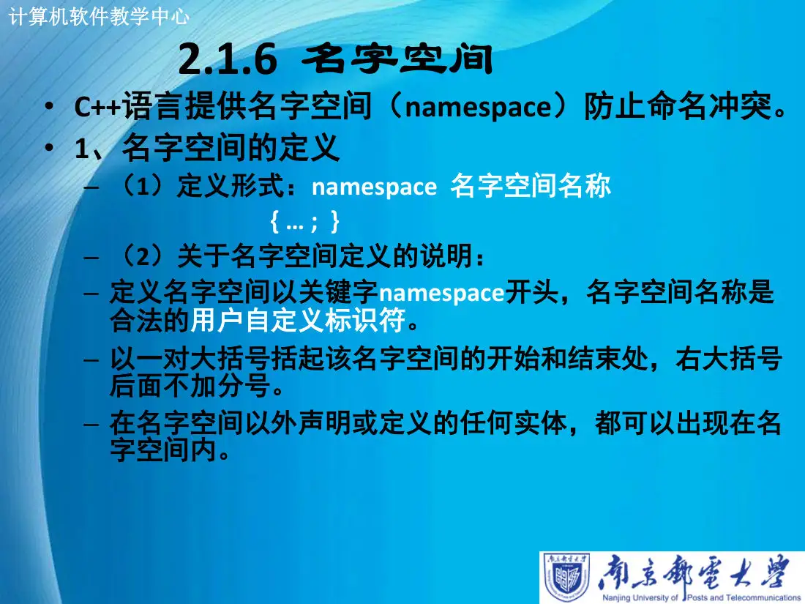

原文：

2.1.6 名字空间

• C++语言提供名字空间（namespace）防止命名冲突。

• 1、名字空间的定义

(1) 定义形式: namespace 名字空间名称

\- （2）关于名字空间定义的说明：

\- 定义名字空间以关键字namespace开头，名字空间名称是合法的用户自定义标识符。

\- 以一对大括号括起该名字空间的开始和结束处，右大括号后面不加分号。

\- 在名字空间以外声明或定义的任何实体，都可以出现在名字空间内。

计算机软件教学中心

南京邮电大学
Nanjing University of Posts and Telecommunications

### 2.1.6 名字空间

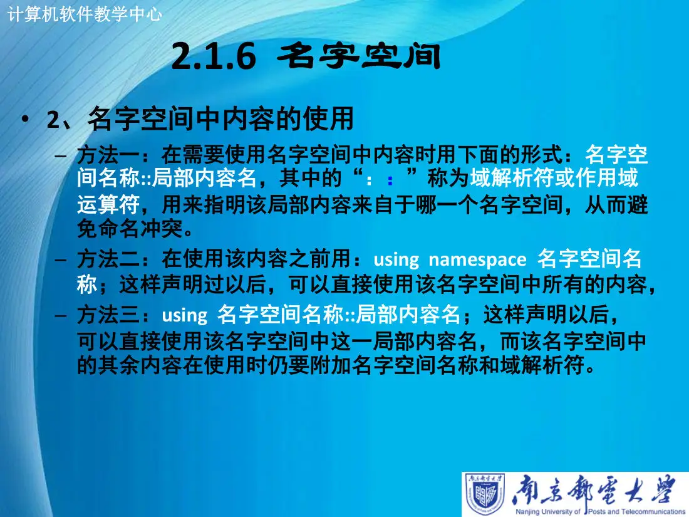

原文：

2.1.6 名字空间

• 2、名字空间中内容的使用

\- 方法一：在需要使用名字空间中内容时用下面的形式：名字空间名称::局部内容名，其中的“：：”称为域解析符或作用域运算符，用来指明该局部内容来自于哪一个名字空间，从而避免命名冲突。

\- 方法二：在使用该内容之前用：using namespace 名字空间名称；这样声明过以后，可以直接使用该名字空间中所有的内容，

\- 方法三：using 名字空间名称::局部内容名；这样声明以后，可以直接使用该名字空间中这一局部内容名，而该名字空间中的其余内容在使用时仍要附加名字空间名称和域解析符。

计算机软件教学中心

南京邮电大学
Nanjing University of Posts and Telecommunications

### 2.1.6 名字空间

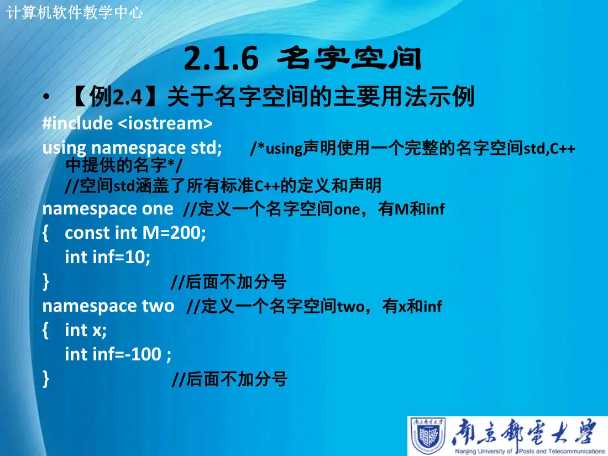

原文：

2.1.6 名字空间

• 【例2.4】关于名字空间的主要用法示例

include <iostream>

using namespace std;    /\*using声明使用一个完整的名字空间std,C++中提供的名字\*/
//空间std涵盖了所有标准C++的定义和声明

namespace one //定义一个名字空间one，有M和inf

{ const int M=200;
int inf=10;

} //后面不加分号
namespace two //定义一个名字空间two，有x和inf

{ int x;
int inf=-100 ;

} //后面不加分号

计算机软件教学中心

南京邮电大学
Nanjing University of Posts and Telecommunications

### 2.1.6 名字空间

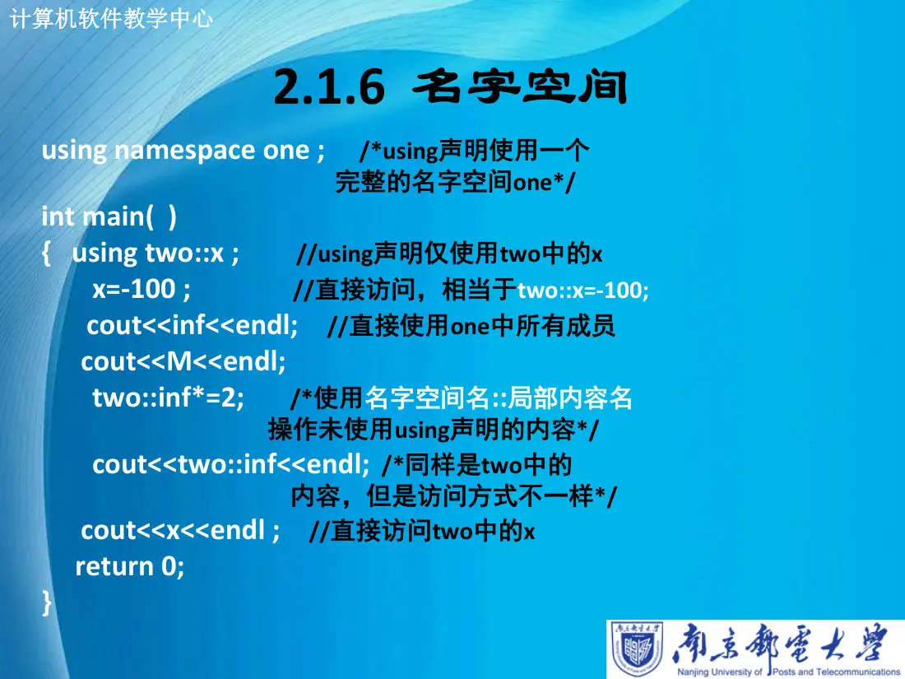

原文：

2.1.6 名字空间

using namespace one ; /\*using声明使用一个完整的名字空间one\*/

using two::x; // using声明仅使用two中的x
x=-100; //直接访问，相当于two::x=-100;
cout<<inf<<endl; //直接使用one中所有成员
cout<<M<<endl;

two::inf\*=2;    /\*使用名字空间名::局部内容名操作未使用using声明的内容\*/

cout<<two::inf<<endl; /\*同样是two中的内容，但是访问方式不一样\*/

cout<<x<<endl; //直接访问two中的x return 0;

计算机软件教学中心

南京邮电大学
Nanjing University of Posts and Telecommunications

### 计算机软件教学中心

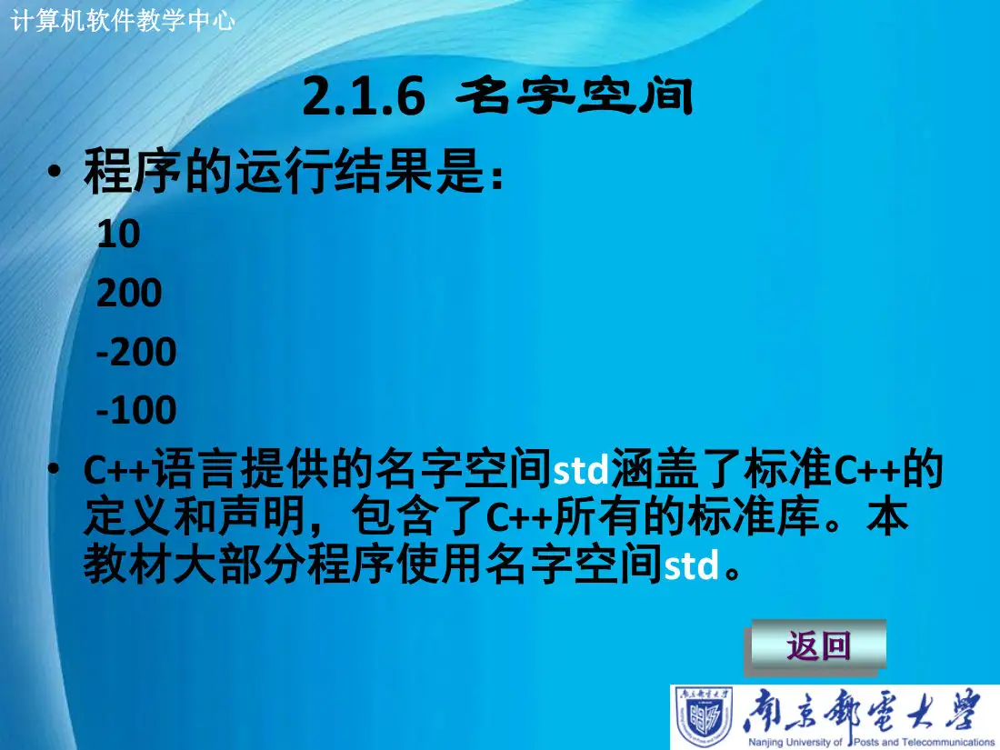

原文：

计算机软件教学中心

2.1.6 名字空间

\- 程序的运行结果是:

10

200

-200

-100

• C++语言提供的名字空间std涵盖了标准C++的定义和声明，包含了C++所有的标准库。本教材大部分程序使用名字空间std。

返回

南京邮电大学
Nanjing University of Posts and Telecommunications

### 2.2.1 局部变量随用随定义

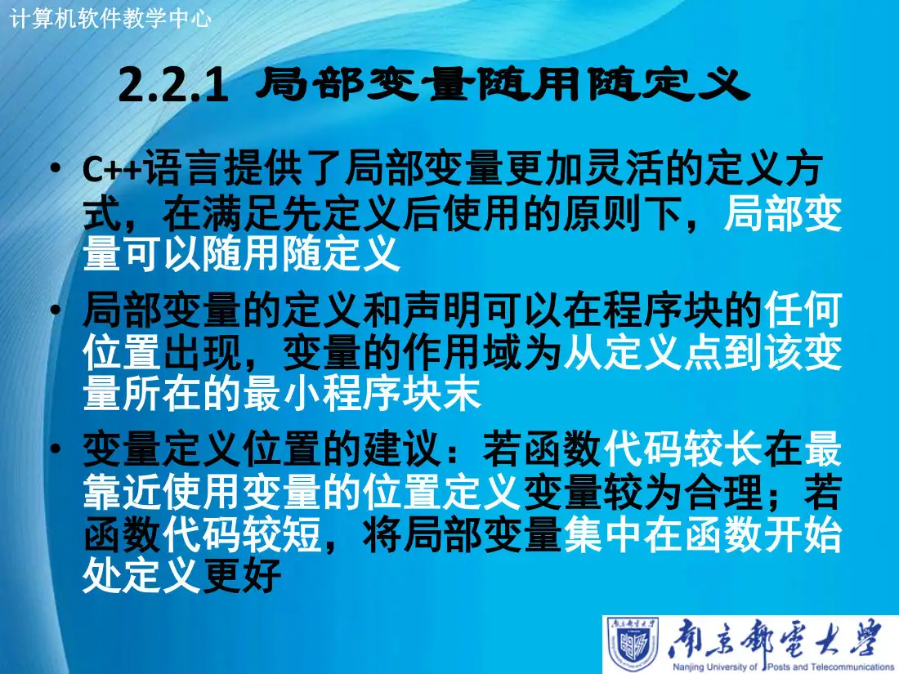

原文：

2.2.1 局部变量随用随定义

• C++语言提供了局部变量更加灵活的定义方式，在满足先定义后使用的原则下，局部变量可以随用随定义

\- 局部变量的定义和声明可以在程序块的任何位置出现，变量的作用域为从定义点到该变量所在的最小程序块末

\- 变量定义位置的建议：若函数代码较长在最靠近使用变量的位置定义变量较为合理；若函数代码较短，将局部变量集中在函数开始处定义更好

计算机软件教学中心

南京邮电大学
Nanjing University of Posts and Telecommunications

### 2.2.1 局部变量随用随定义

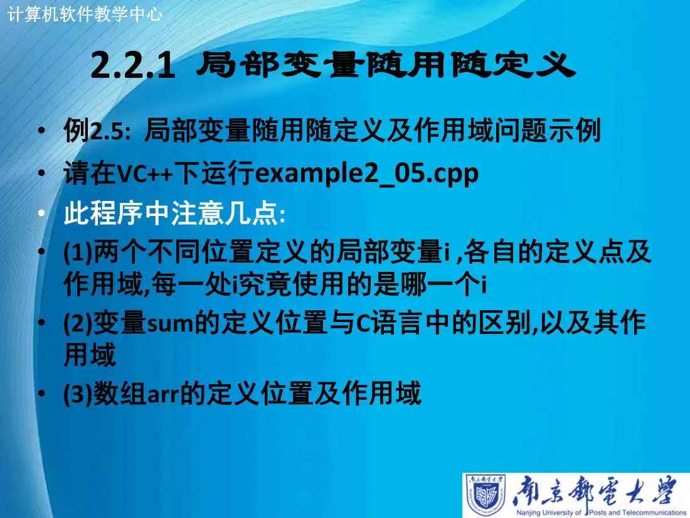

原文：

2.2.1 局部变量随用随定义

• 例2.5: 局部变量随用随定义及作用域问题示例

\- 请在VC++下运行example2\_05.cpp

\- 此程序中注意几点:

• (1)两个不同位置定义的局部变量i,各自的定义点及作用域,每一处i究竟使用的是哪一个i

• (2)变量sum的定义位置与C语言中的区别,以及其作用域

• (3)数组arr的定义位置及作用域

计算机软件教学中心

南京邮电大学
Nanjing University of Posts and Telecommunications

### 2.2.2域解析符::扩大全局变量的可见范围

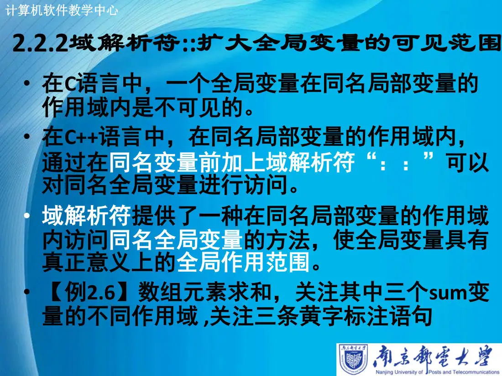

原文：

2.2.2域解析符::扩大全局变量的可见范围

\- 在C语言中，一个全局变量在同名局部变量的作用域内是不可见的。

\- 在C++语言中，在同名局部变量的作用域内，通过在同名变量前加上域解析符“：：”可以对同名全局变量进行访问。

\- 域解析符提供了一种在同名局部变量的作用域内访问同名全局变量的方法，使全局变量具有真正意义上的全局作用范围。

【例2.6】数组元素求和，关注其中三个sum变量的不同作用域,关注三条黄字标注语句

计算机软件教学中心

南京邮电大学
Nanjing University of Posts and Telecommunications

### 计算机软件教学中心

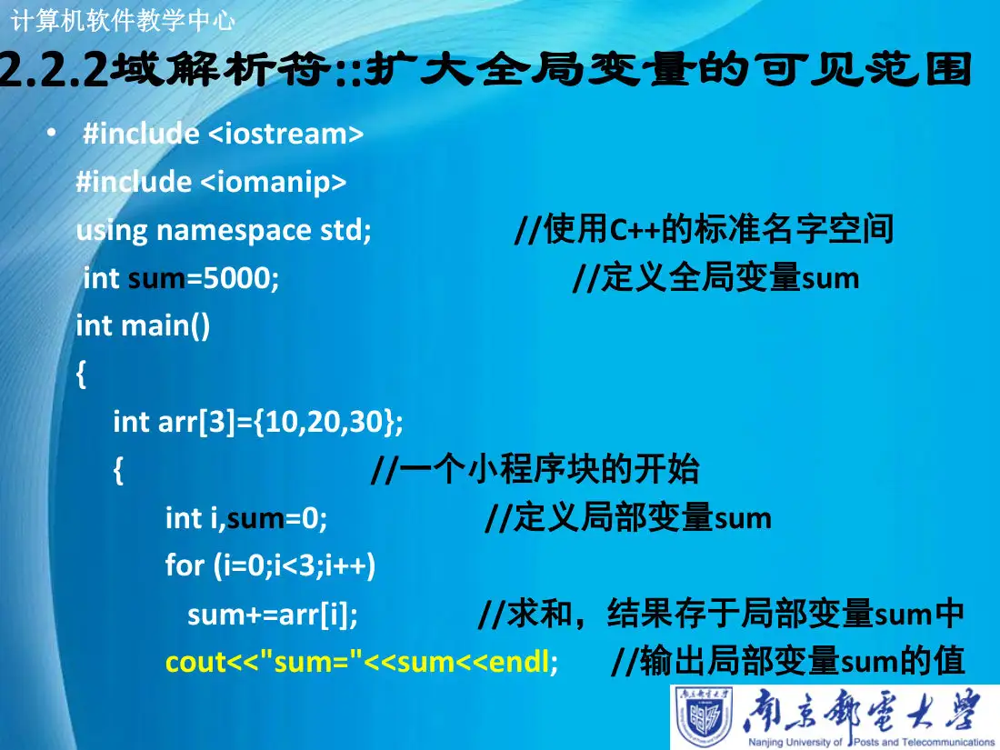

原文：

计算机软件教学中心

2.2.2域解析符::扩大全局变量的可见范围

\- #include <iostream>

include <iomanip>

using namespace std;

int sum=5000;

int main()

//使用C++的标准名字空间
//定义全局变量sum

int arr[3]={10,20,30};

int i,sum=0;

//一个小程序块的开始
//定义局部变量sum

for (i=0;i<3;i++)

sum+=arr[i];

//求和，结果存于局部变量sum中

cout<<"sum="<<sum<<endl; //输出局部变量sum的值

南京邮电大学
Nanjing University of Posts and Telecommunication

### 计算机软件教学中心

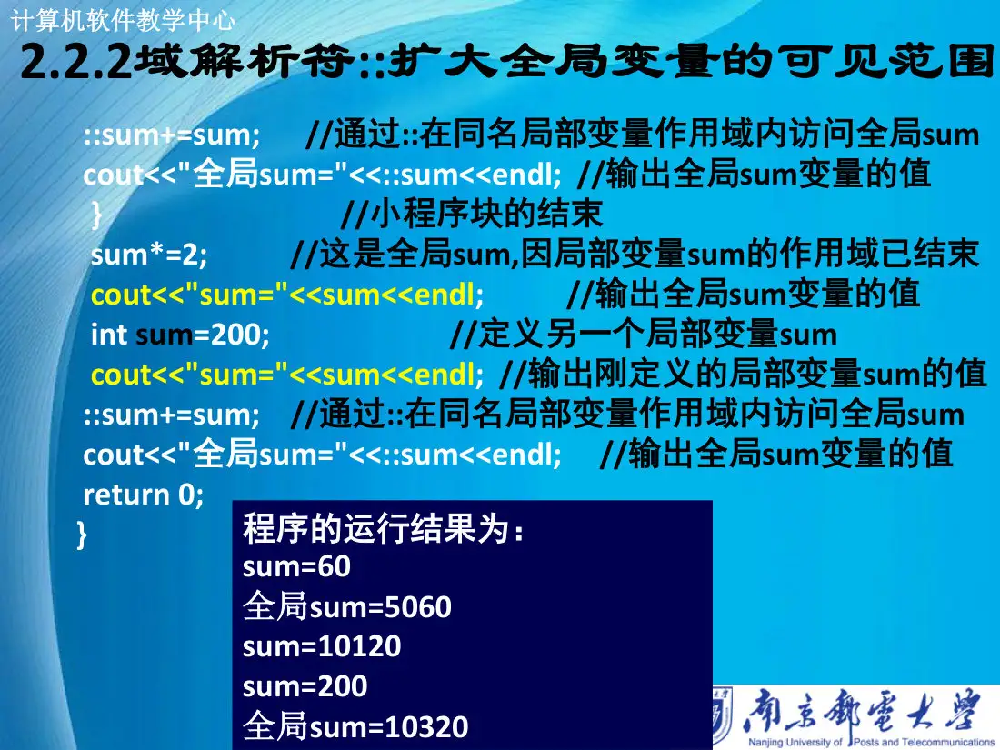

原文：

计算机软件教学中心

2.2.2域解析符::扩大全局变量的可见范围

::sum+=sum; //通过::在同名局部变量作用域内访问全局sum

cout<<"全局sum="<<:sum<<endl; //输出全局sum变量的值

sum\*=2; //这是全局sum,因局部变量sum的作用域已结束

cout<<"sum="<<sum<<endl; //输出刚定义的局部变量sum的值

cout<<"全局sum="<<::sum<<endl; //输出全局sum变量的值

return 0;

程序的运行结果为：

sum=60

全局sum=5060

sum=10120

sum=200

全局sum=10320

南京郵電大學
Nanjing University of Posts and Telecommunications

### 2.2.3 形式参数可带有默认值

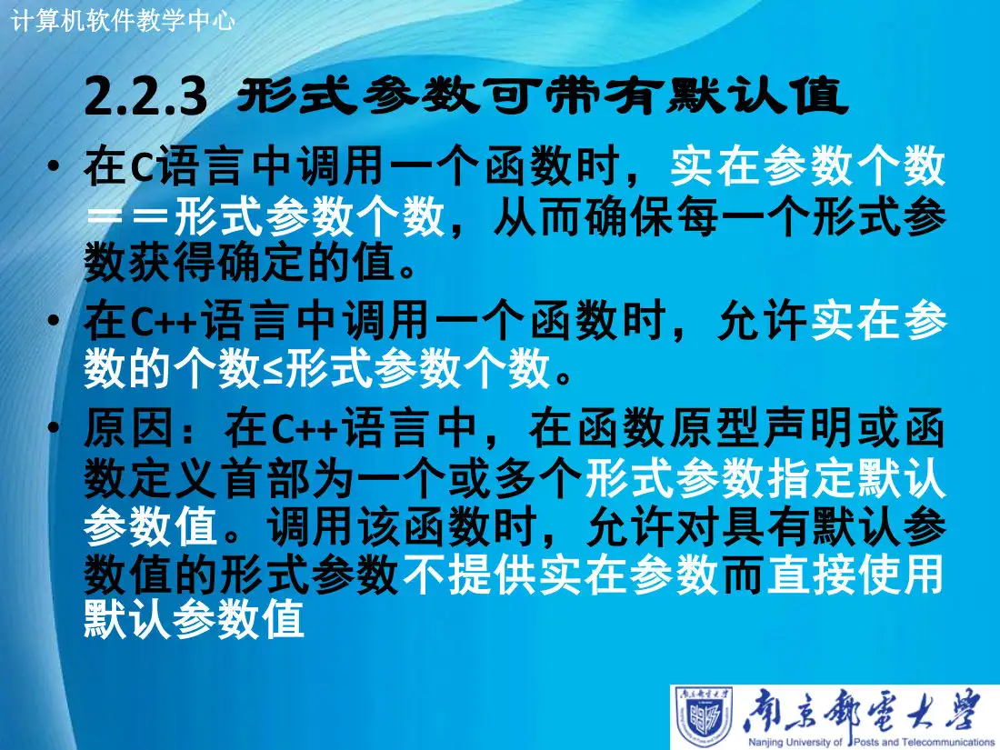

原文：

2.2.3 形式参数可带有默认值

\- 在C语言中调用一个函数时，实在参数个数==形式参数个数，从而确保每一个形式参数获得确定的值。

\- 在C++语言中调用一个函数时，允许实在参数的个数≤形式参数个数。

\- 原因：在C++语言中，在函数原型声明或函数定义首部为一个或多个形式参数指定默认参数值。调用该函数时，允许对具有默认参数值的形式参数不提供实在参数而直接使用默认参数值

计算机软件教学中心

南京邮电大学
Nanjing University of Posts and Telecommunications

### 2.2.3 形式参数可带有默认值

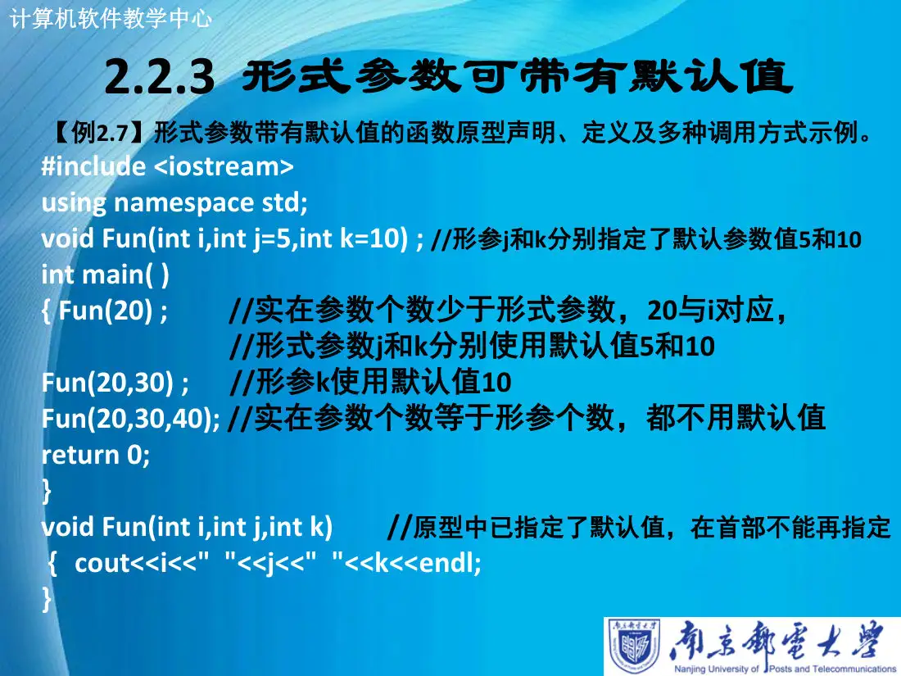

原文：

2.2.3 形式参数可带有默认值

【例2.7】形式参数带有默认值的函数原型声明、定义及多种调用方式示例。
include <iostream>
using namespace std;
void Fun(int i, int j = 5, int k = 10); //形参j和k分别指定了默认参数值5和10
int main()

{Fun(20); //实在参数个数少于形式参数，20与i对应，//形式参数j和k分别使用默认值5和10

Fun(20,30); //形参k使用默认值10
Fun(20,30,40); //实在参数个数等于形参个数，都不用默认值
return 0;

void Fun(int i, int j, int k) //原型中已指定了默认值，在首部不能再指定{ cout<<i<<" "<<j<<" "<<k<<endl;

计算机软件教学中心

南京邮电大学
Nanjing University of Posts and Telecommunications

### 计算机软件教学中心

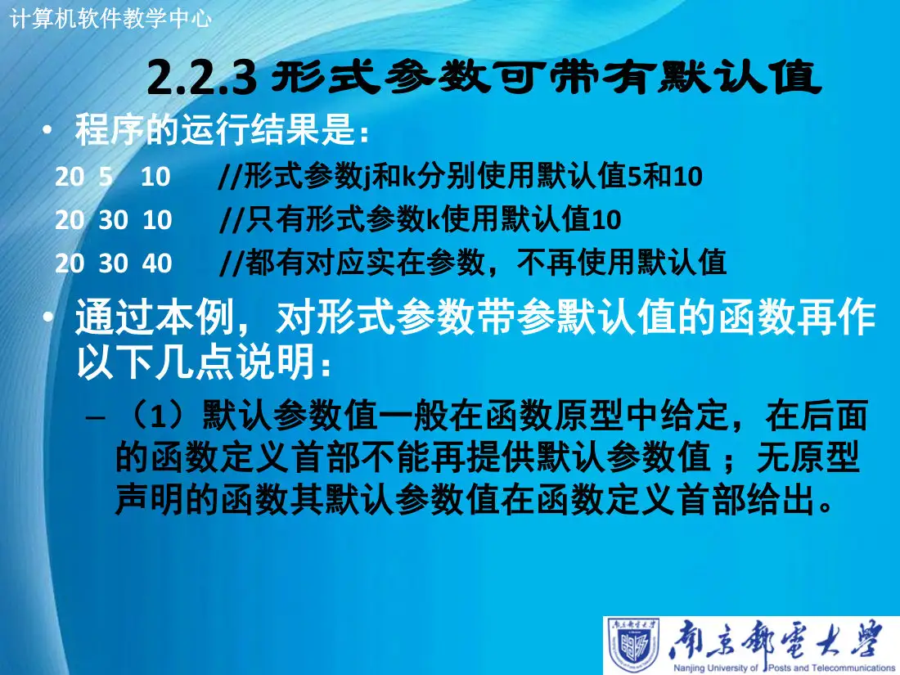

原文：

计算机软件教学中心

2.2.3 形式参数可带有默认值

\- 程序的运行结果是:

20 5 10 //形式参数j和k分别使用默认值5和10

20 30 10 //只有形式参数k使用默认值10

20 30 40 //都有对应实在参数，不再使用默认值

通过本例，对形式参数带参默认值的函数再作以下几点说明：

\- （1）默认参数值一般在函数原型中给定，在后面的函数定义首部不能再提供默认参数值；无原型声明的函数其默认参数值在函数定义首部给出。

南京邮电大学
Nanjing University of Posts and Telecommunications

### 2.2.3 形式参数可带有默认值

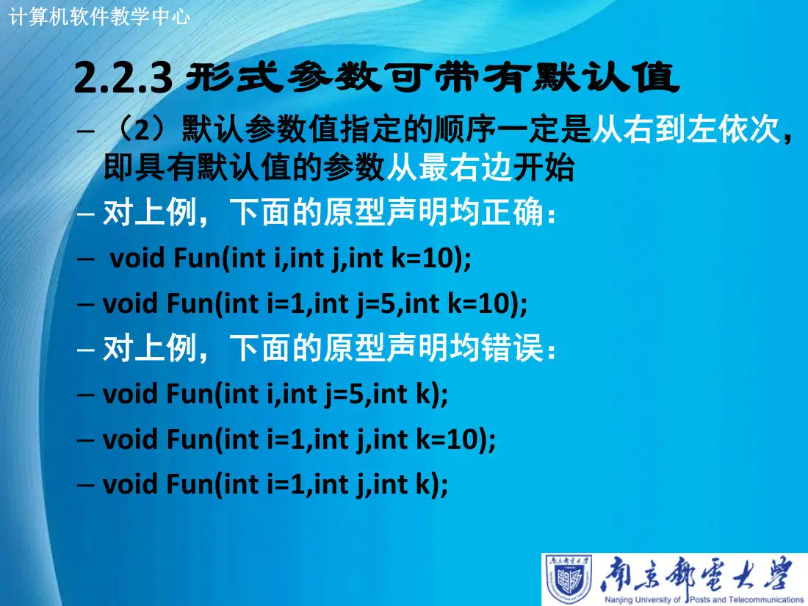

原文：

2.2.3 形式参数可带有默认值

\- （2）默认参数值指定的顺序一定是从右到左依次，即具有默认值的参数从最右边开始

\- 对上例，下面的原型声明均正确：

\- void Fun(int i, int j, int k=10);

\- void Fun(int i=1,int j=5,int k=10);

\- 对上例，下面的原型声明均错误：

\- void Fun(int i, int j=5, int k);

\- void Fun(int i=1,int j,int k=10);

\- void Fun(int i=1,int j,int k);

计算机软件教学中心

南京邮电大学
Nanjing University of Posts and Telecommunications

### 2.2.3 形式参数可带有默认值

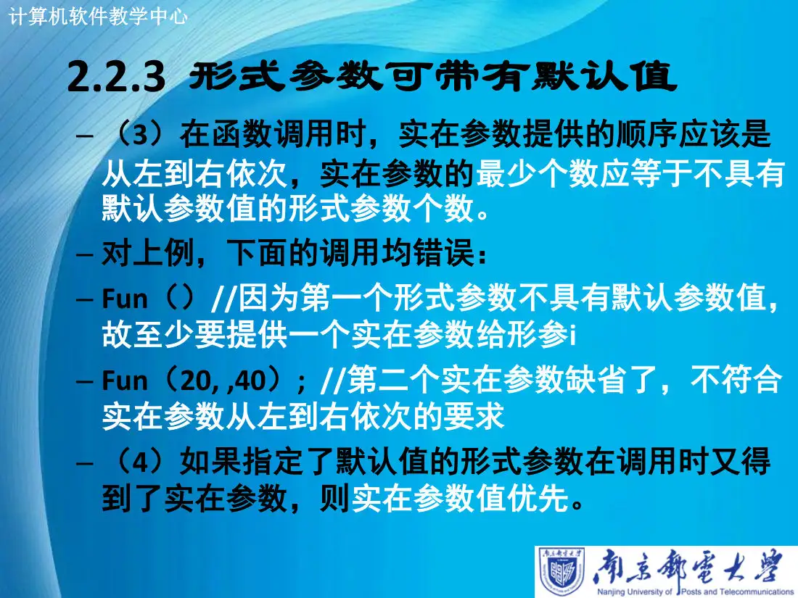

原文：

2.2.3 形式参数可带有默认值

\- （3）在函数调用时，实在参数提供的顺序应该是从左到右依次，实在参数的最少个数应等于不具有默认参数值的形式参数个数。

\- 对上例，下面的调用均错误：

\- Fun（）//因为第一个形式参数不具有默认参数值，故至少要提供一个实在参数给形参i

\- Fun（20,,40）；//第二个实在参数缺省了，不符合实在参数从左到右依次的要求

\- （4）如果指定了默认值的形式参数在调用时又得到了实在参数，则实在参数值优先。

计算机软件教学中心

南京邮电大学
Nanjing University of Posts and Telecommunications

### 2.2.4 内联函数

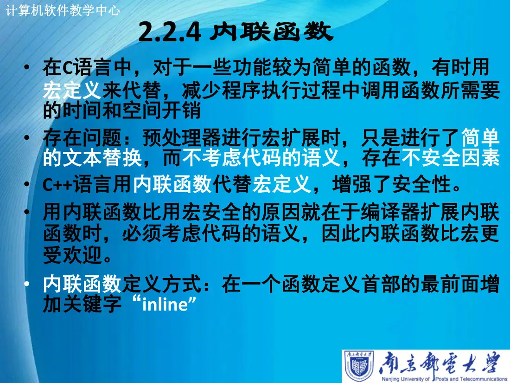

原文：

2.2.4 内联函数

\- 在C语言中，对于一些功能较为简单的函数，有时用宏定义来代替，减少程序执行过程中调用函数所需要的时间和空间开销

\- 存在问题：预处理器进行宏扩展时，只是进行了简单的文本替换，而不考虑代码的语义，存在不安全因素

• C++语言用内联函数代替宏定义，增强了安全性。

\- 用内联函数比用宏安全的原因就在于编译器扩展内联函数时，必须考虑代码的语义，因此内联函数比宏更受欢迎。

\- 内联函数定义方式：在一个函数定义首部的最前面增加关键字“inline”

计算机软件教学中心

南京邮电大学
Nanjing University of Posts and Telecommunications

### 2.2.4 内联函数

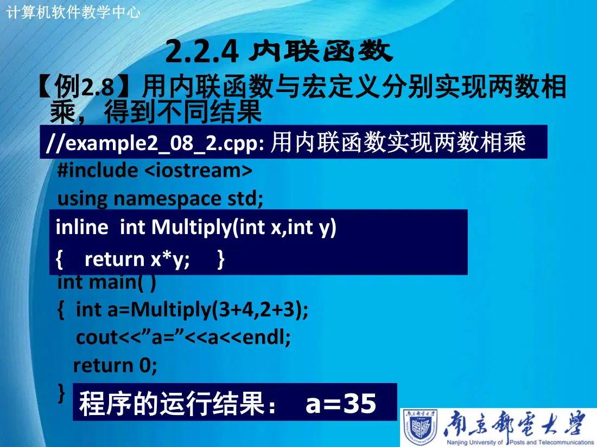

原文：

2.2.4 内联函数

【例2.8】用内联函数与宏定义分别实现两数相乘，得到不同结果

inline int Multiply(int x, int y)

{ return x\*y; }
int main()

{ int a=Multiply(3+4,2+3);
cout<<"a="<<a<<endl;
return 0;

} 程序的运行结果: a=35

计算机软件教学中心

南京邮电大学
Nanjing University of Posts and Telecommunications

### 2.2.4 内联函数

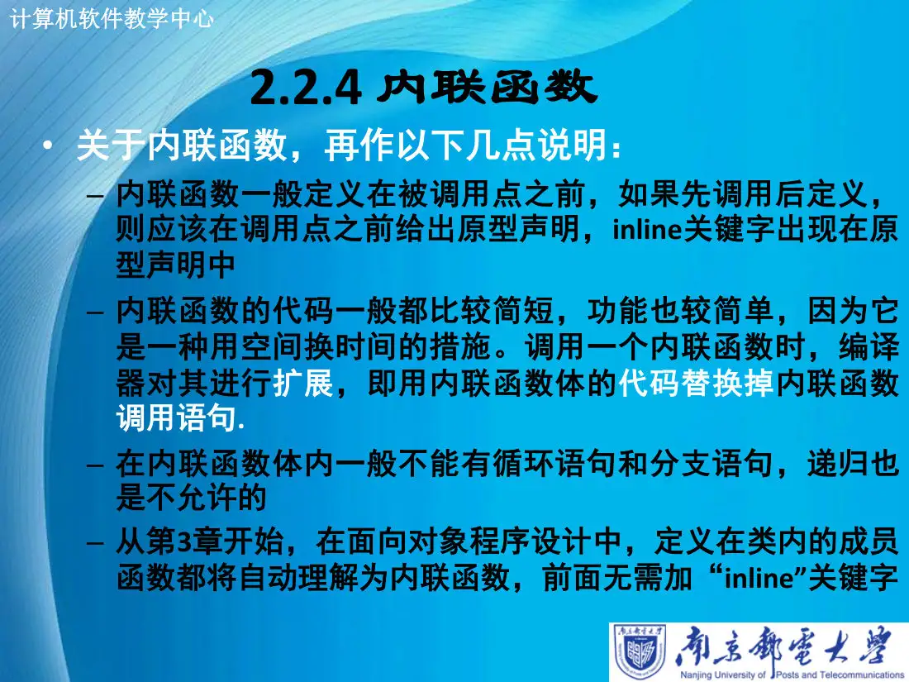

原文：

2.2.4 内联函数

\- 关于内联函数，再作以下几点说明：

\- 内联函数一般定义在被调用点之前，如果先调用后定义，则应该在调用点之前给出原型声明，inline关键字出现在原型声明中

\- 内联函数的代码一般都比较简短，功能也较简单，因为它是一种用空间换时间的措施。调用一个内联函数时，编译器对其进行扩展，即用内联函数体的代码替换掉内联函数调用语句.

\- 在内联函数体内一般不能有循环语句和分支语句，递归也是不允许的

\- 从第3章开始，在面向对象程序设计中，定义在类内的成员函数都将自动理解为内联函数，前面无需加“inline”关键字

计算机软件教学中心

南京邮电大学
Nanjing University of Posts and Telecommunications

### 2.2.5 函数重载

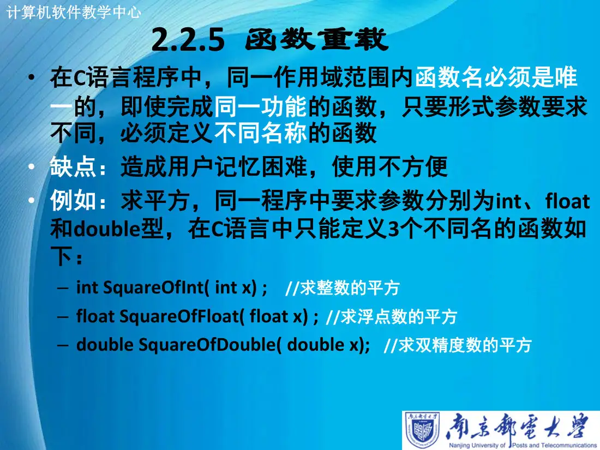

原文：

2.2.5 函数重载

\- 在C语言程序中，同一作用域范围内函数名必须是唯一的，即使完成同一功能的函数，只要形式参数要求不同，必须定义不同名称的函数

\- 缺点：造成用户记忆困难，使用不方便

例如：求平方，同一程序中要求参数分别为int、float和double型，在C语言中只能定义3个不同名的函数如下：

\- int SquareOfInt( int x); //求整数的平方

\- float SquareOfFloat(float x); //求浮点数的平方

\- double SquareOfDouble( double x); //求双精度数的平方

计算机软件教学中心

南京邮电大学
Nanjing University of Posts and Telecommunications

### 2.2.5 函数重载

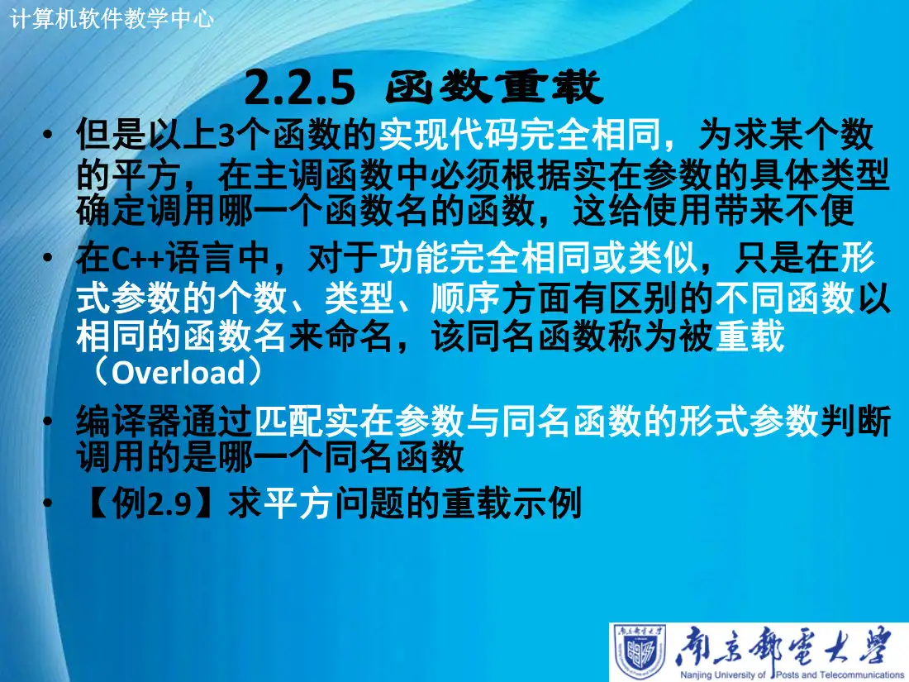

原文：

2.2.5 函数重载

\- 但是以上3个函数的实现代码完全相同，为求某个数的平方，在主调函数中必须根据实在参数的具体类型确定调用哪一个函数名的函数，这给使用带来不便

\- 在C++语言中，对于功能完全相同或类似，只是在形式参数的个数、类型、顺序方面有区别的不同函数以相同的函数名来命名，该同名函数称为被重载（Overload）

编译器通过匹配实在参数与同名函数的形式参数判断调用的是哪一个同名函数【例2.9】求平方问题的重载示例

计算机软件教学中心

南京邮电大学
Nanjing University of Posts and Telecommunications

### 2.2.5 函数重载

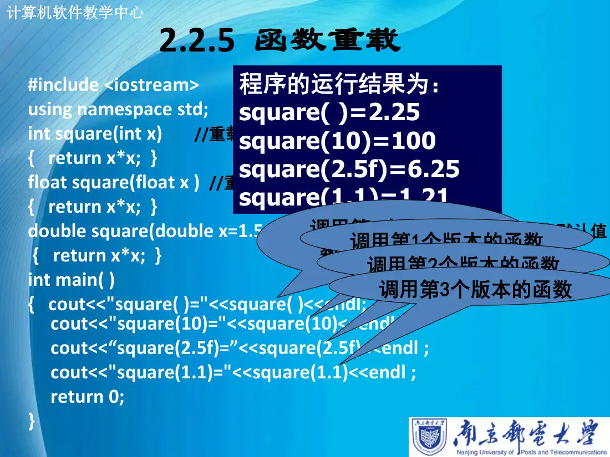

原文：

2.2.5 函数重载

include <iostream>
using namespace std;
int square(int x) // 重
{ return x\*x; }
float square(float x ) // 重
{ return x\*x; }

程序的运行结果为:
square( )=2.25
square(10)=100
square(2.5f)=6.25
square(1.1)-1.21

double square(double x=1.5
{ return x\*x; }
int main()

调用第1个版本的函数
调用第2个版本的函数
调用第3个版本的函数 cout<<"square()="<<square()<<endl;
cout<<"square(10)="<<square(10)<endl;
cout<<"square(2.5f)="<<square(2.5f)<endl;
cout<<"square(1.1)="<<square(1.1)<endl;
return 0;

计算机软件教学中心

南京邮电大学
Nanjing University of Posts and Telecommunications

### 2.2.5 函数重载

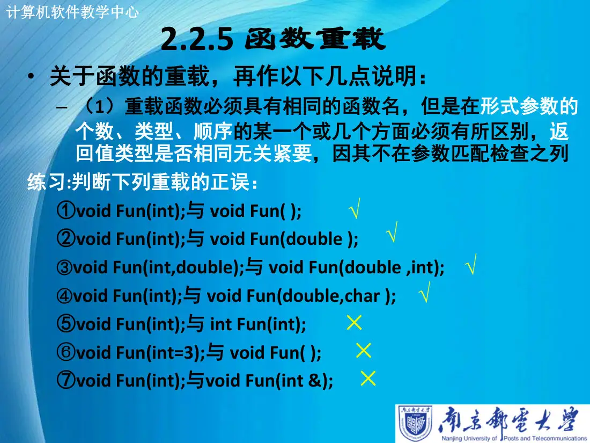

原文：

2.2.5 函数重载

\- 关于函数的重载，再作以下几点说明：

\- （1）重载函数必须具有相同的函数名，但是在形式参数的个数、类型、顺序的某一个或几个方面必须有所区别，返回值类型是否相同无关紧要，因其不在参数匹配检查之列练习:判断下列重载的正误：

①void Fun(int);与 void Fun();

②void Fun(int);与 void Fun(double );

③void Fun(int, double);与 void Fun(double, int);

④void Fun(int);与 void Fun(double,char );

⑤void Fun(int);与 int Fun(int);

⑥void Fun(int=3);与 void Fun();

⑦void Fun(int);与void Fun(int &);

计算机软件教学中心

南京邮电大学
Nanjing University of Posts and Telecommunications

### 2.2.5 函数重载

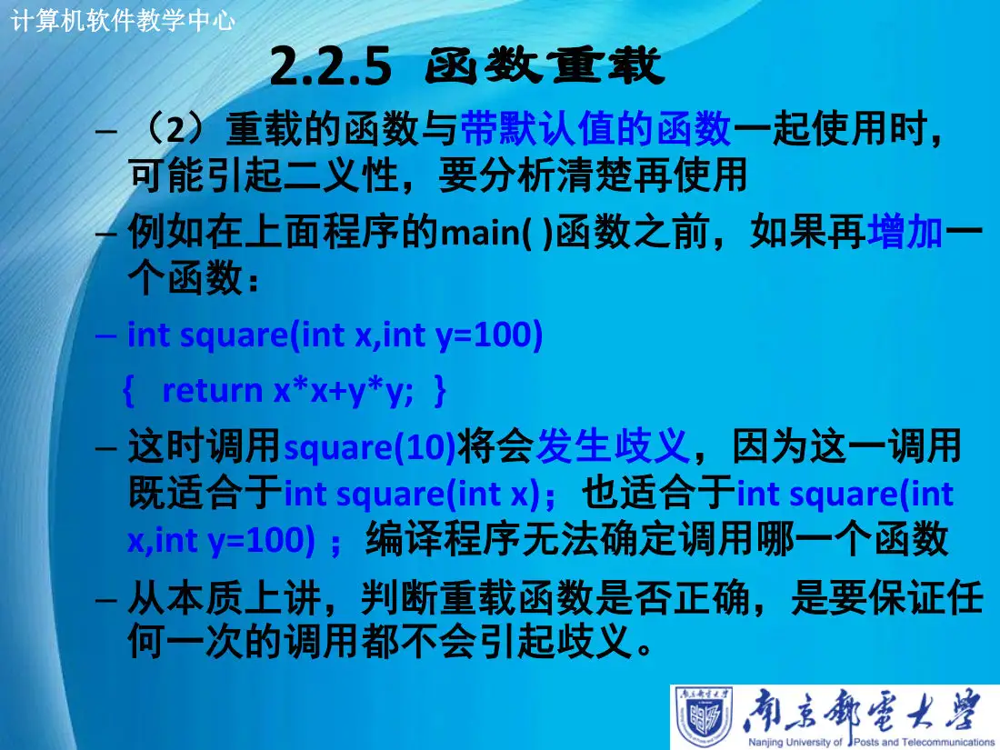

原文：

2.2.5 函数重载

\- (2) 重载的函数与带默认值的函数一起使用时,可能引起二义性,要分析清楚再使用

\- 例如在上面程序的main()函数之前，如果再增加一个函数：

\- int square(int x, int y=100)

{ return x\*x+y\*y; }

\- 这时调用square(10)将会发生歧义，因为这一调用既适合于int square(int x); 也适合于int square(int x,int y=100); 编译程序无法确定调用哪一个函数

\- 从本质上讲，判断重载函数是否正确，是要保证任何一次的调用都不会引起歧义。

计算机软件教学中心

南京邮电大学
Nanjing University of Posts and Telecommunications

### 2.2.5 函数重载

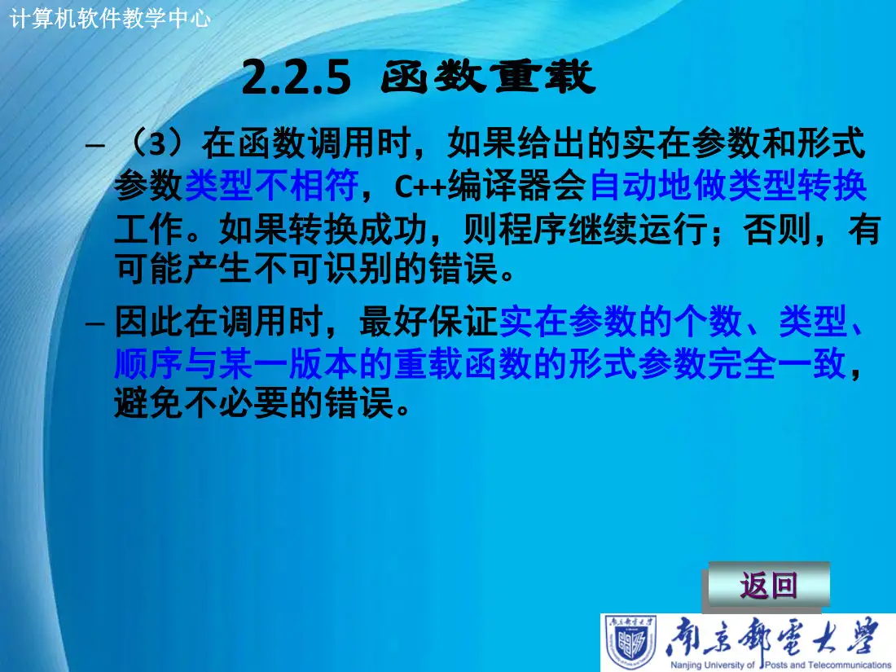

原文：

2.2.5 函数重载

(3) 在函数调用时, 如果给出的实在参数和形式参数类型不相符, C++编译器会自动地做类型转换工作。如果转换成功, 则程序继续运行; 否则, 有可能产生不可识别的错误。

\- 因此在调用时，最好保证实在参数的个数、类型、顺序与某一版本的重载函数的形式参数完全一致，避免不必要的错误。

返回

计算机软件教学中心

南京邮电大学
Nanjing University of Posts and Telecommunications

### 2.3.1 引用的概念及使用

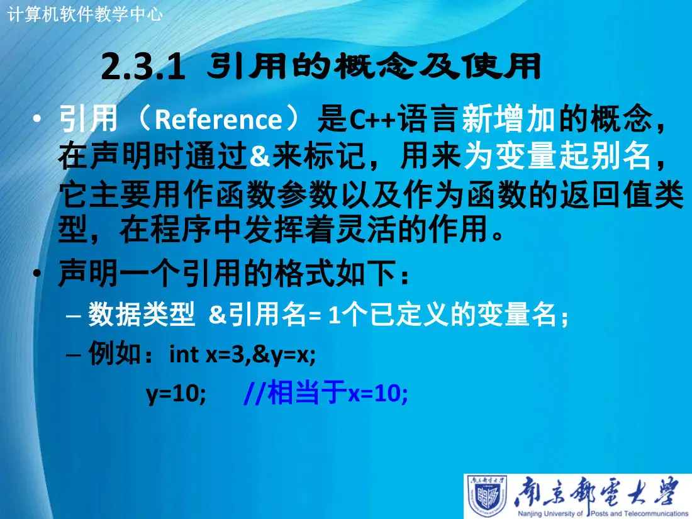

原文：

2.3.1 引用的概念及使用

\- 引用（Reference）是C++语言新增加的概念，在声明时通过&来标记，用来为变量起别名，它主要用作函数参数以及作为函数的返回值类型，在程序中发挥着灵活的作用。

\- 声明一个引用的格式如下:

\- 数据类型 &引用名=1个已定义的变量名;

\- 例如：int x=3,&y=x;

y=10; //相当于x=10;

计算机软件教学中心

南京邮电大学
Nanjing University of Posts and Telecommunications

### 2.3.1 引用的概念及使用

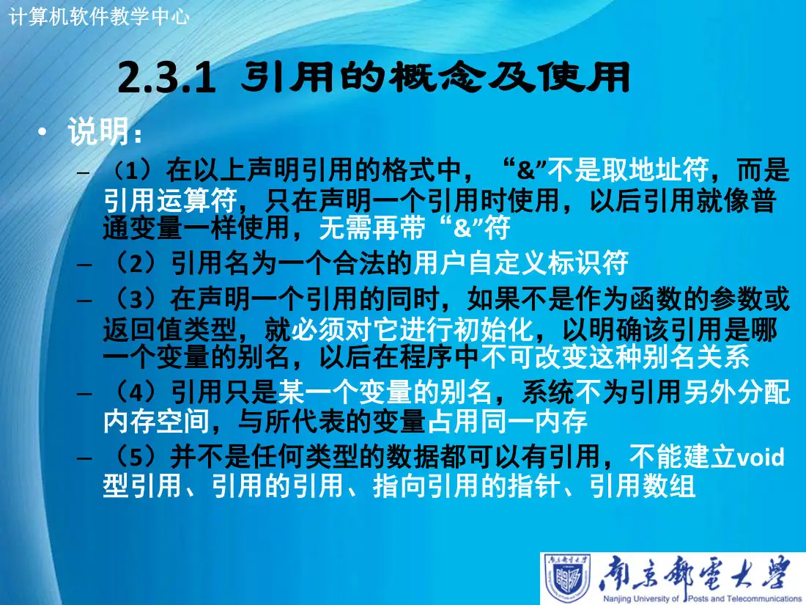

原文：

2.3.1 引用的概念及使用

\- 说明:

(1) 在以上声明引用的格式中，“&”不是取地址符，而是引用运算符，只在声明一个引用时使用，以后引用就像普通变量一样使用，无需再带“&”符

\- （2）引用名为一个合法的用户自定义标识符

\- （3）在声明一个引用的同时，如果不是作为函数的参数或返回值类型，就必须对它进行初始化，以明确该引用是哪一个变量的别名，以后在程序中不可改变这种别名关系

\- （4）引用只是某一个变量的别名，系统不为引用另外分配内存空间，与所代表的变量占用同一内存

\- （5）并不是任何类型的数据都可以有引用，不能建立void型引用、引用的引用、指向引用的指针、引用数组

计算机软件教学中心

南京邮电大学
Nanjing University of Posts and Telecommunications

### 计算机软件教学中心

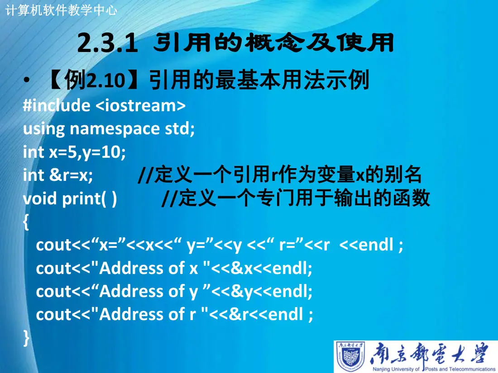

原文：

计算机软件教学中心

2.3.1 引用的概念及使用

• 【例2.10】引用的最基本用法示例

include <iostream>

using namespace std;

int x=5,y=10;

int &r=x; //定义一个引用r作为变量x的别名
void print() //定义一个专门用于输出的函数

cout<<"x="<<x<<" y="<<y<<" r="<<r<<endl;  
cout<<"Address of x "<<&x<<endl;  
cout<<"Address of y "<<&y<<endl;  
cout<<"Address of r "<<&r<<endl;

南京邮电大学
Nanjing University of Posts and Telecommunications

### 2.3.1 引用的概念及使用

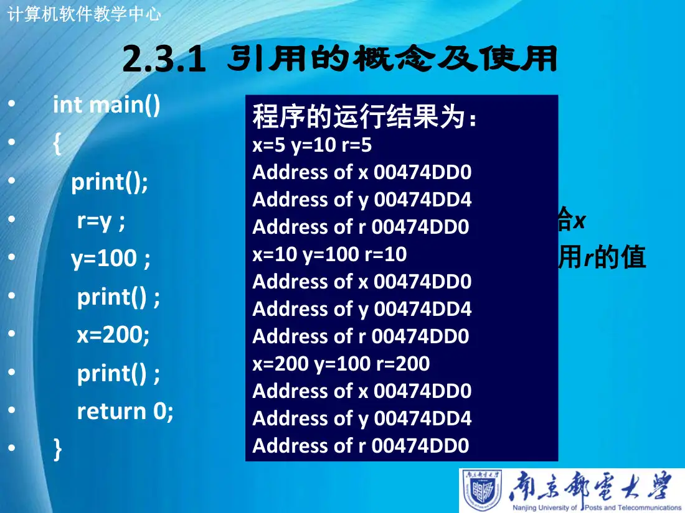

原文：

2.3.1 引用的概念及使用

\- int main()

print();

r=y ;

y=100 ;

print();

x=200;

print();

return 0;

程序的运行结果为：

x=5 y=10 r=5

Address of x 00474DD0

Address of y 00474DD4

Address of x 00474DD0

Address of y 00474DD4

Address of r 00474DD0

合x用r的值

计算机软件教学中心

南京邮电大学
Nanjing University of Posts and Telecommunications

### 2.3.2 引用作为形式参数

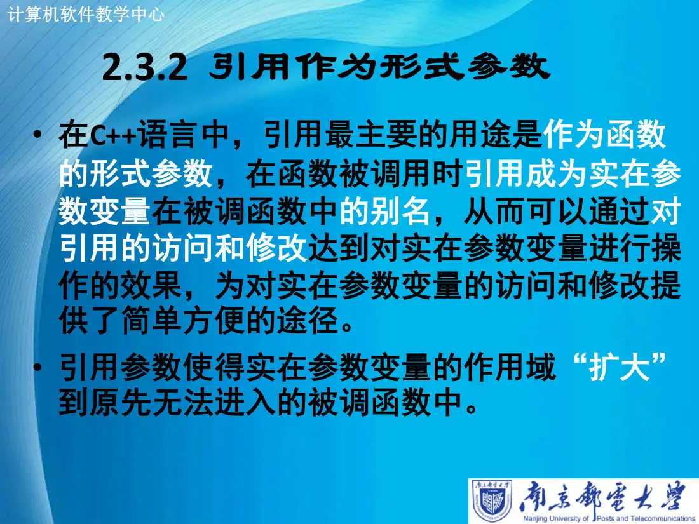

原文：

2.3.2 引用作为形式参数

\- 在C++语言中，引用最主要的用途是作为函数的形式参数，在函数被调用时引用成为实在参数变量在被调函数中的别名，从而可以通过对引用的访问和修改达到对实在参数变量进行操作的效果，为对实在参数变量的访问和修改提供了简单方便的途径。

\- 引用参数使得实在参数变量的作用域“扩大”到原先无法进入的被调函数中。

计算机软件教学中心

南京邮电大学
Nanjing University of Posts and Telecommunications

### 2.3.2 引用作为形式参数

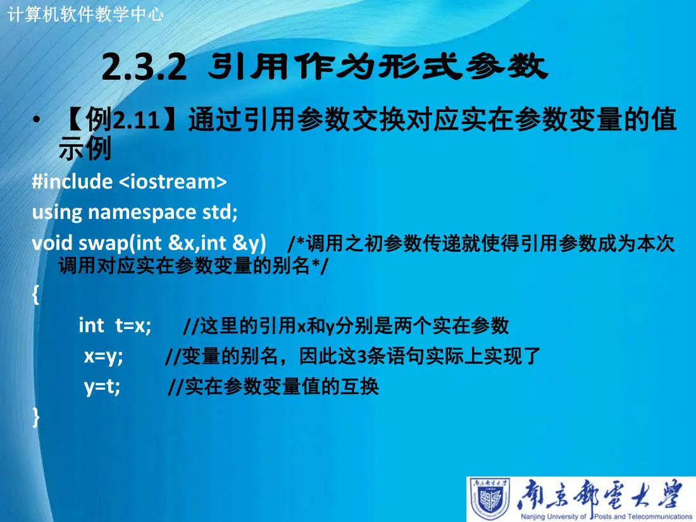

原文：

2.3.2 引用作为形式参数

• 【例2.11】通过引用参数交换对应实在参数变量的值示例

include <iostream>

using namespace std;

void swap(int &x,int &y) /\*调用之初参数传递就使得引用参数成为本次调用对应实在参数变量的别名\*/

int t=x; //这里的引用x和y分别是两个实在参数

x=y; //变量的别名，因此这3条语句实际上实现了

y=t; //实在参数变量值的互换

计算机软件教学中心

南京邮电大学
Nanjing University of Posts and Telecommunications

### 2.3.2 引用作为形式参数

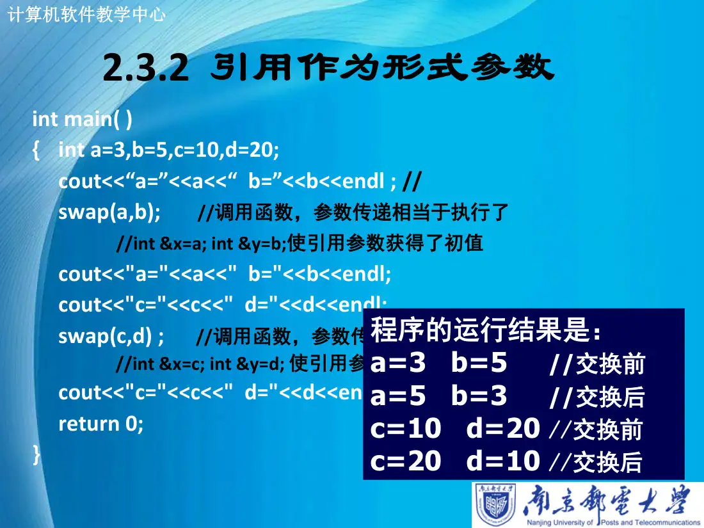

原文：

2.3.2 引用作为形式参数

int main()
{ int a=3,b=5,c=10,d=20;
cout<<"a="<<a<<" b="<<b<<endl; //
swap(a,b);    //调用函数，参数传递相当于执行了
    //int &x=a; int &y=b;使引用参数获得了初值
cout<<"a="<<a<<" b="<<b<<endl;
cout<<"c="<<c<<" d="<<d<<endl;
swap(c,d);    //调用函数，参数传
    //int &x=c; int &y=d; 使引用参
    cout<<"c="<<c<<" d="<<d<<en
return 0;
}
程序的运行结果是:
a=3 b=5 //交换前
a=5 b=3 //交换后
c=10 d=20 //交换前
c=20 d=10 //交换后

计算机软件教学中心

南京邮电大学
Nanjing University of Posts and Telecommunication

### 2.3.2 引用作为形式参数

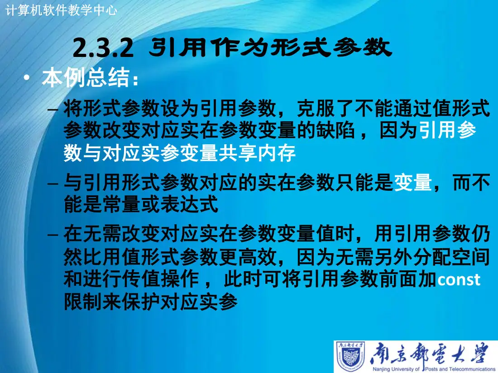

原文：

2.3.2 引用作为形式参数

\- 本例总结:

\- 将形式参数设为引用参数，克服了不能通过值形式参数改变对应实在参数变量的缺陷，因为引用参数与对应实参变量共享内存

\- 与引用形式参数对应的实在参数只能是变量，而不能是常量或表达式

\- 在无需改变对应实在参数变量值时，用引用参数仍然比用值形式参数更高效，因为无需另外分配空间和进行传值操作，此时可将引用参数前面加const限制来保护对应实参

计算机软件教学中心

南京邮电大学
Nanjing University of Posts and Telecommunications

### 2.3.2 引用作为形式参数

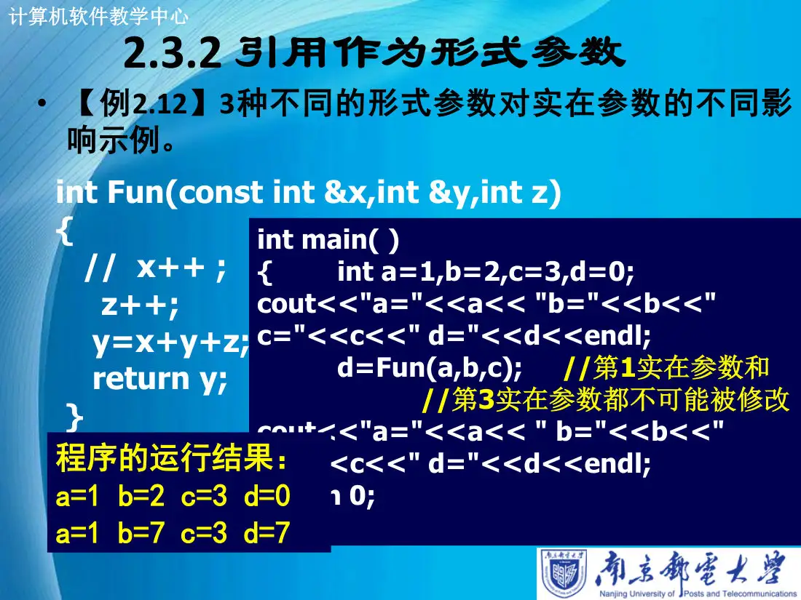

原文：

2.3.2 引用作为形式参数

• 【例2.12】3种不同的形式参数对实在参数的不同影响示例。

int Fun(const int &x,int &y,int z)

// x++;
z++;
y=x+y+z;
return y;

int main()
{
    int a=1,b=2,c=3,d=0;
    cout<<"a="<<a<<"b="<<b<<"
    c="<<c<<" d="<<d<<endl;
    d=Fun(a,b,c); //第1实在参数和
    //第3实在参数都不可能被修改
    cout<<"a="<<a<<" b="<<b<<"

$$
<   c <   <  " d = " <   <   d <   <   e n d l;
$$

a=1 b=2 c=3 d=0 10;

a=1 b=7 c=3 d=7

计算机软件教学中心

南京邮电大学
Nanjing University of Posts and Telecommunications

### 2.3.2 引用作为形式参数

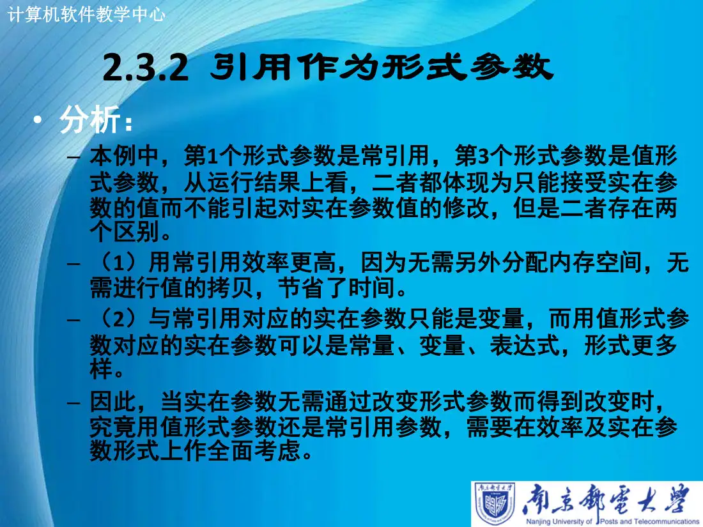

原文：

2.3.2 引用作为形式参数

- 分析:

\- 本例中，第1个形式参数是常引用，第3个形式参数是值形式参数，从运行结果上看，二者都体现为只能接受实在参数的值而不能引起对实在参数值的修改，但是二者存在两个区别。

\- （1）用常引用效率更高，因为无需另外分配内存空间，无需进行值的拷贝，节省了时间。

\- （2）与常引用对应的实在参数只能是变量，而用值形式参数对应的实在参数可以是常量、变量、表达式，形式更多样。

\- 因此，当实在参数无需通过改变形式参数而得到改变时，究竟用值形式参数还是常引用参数，需要在效率及实在参数形式上作全面考虑。

计算机软件教学中心

南京邮电大学
Nanjing University of Posts and Telecommunications

### 2.3.3 引用与指针的区别

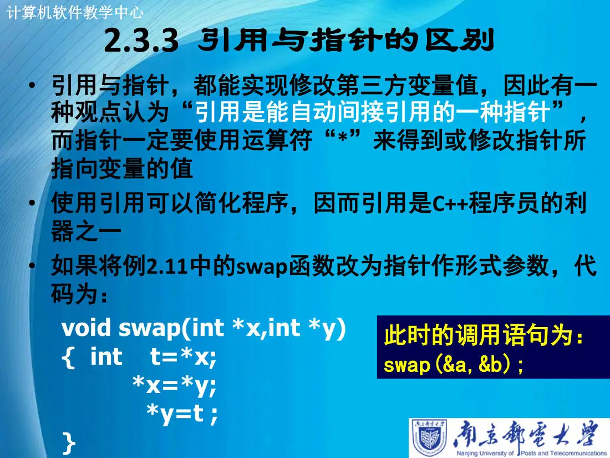

原文：

2.3.3 引用与指针的区别

\- 引用与指针，都能实现修改第三方变量值，因此有一种观点认为“引用是能自动间接引用的一种指针”，而指针一定要使用运算符“\*”来得到或修改指针所指向变量的值

\- 使用引用可以简化程序，因而引用是C++程序员的利器之一

\- 如果将例2.11中的swap函数改为指针作形式参数，代码为：

void swap(int \*x, int \*y)

{ int t=\*x;

$$
^ {*} x = ^ {*} y;
$$

$$
^ {*} \mathbf {y} = t;
$$

此时的调用语句为:

swap (&a, &b);

计算机软件教学中心

}

南京邮电大学
Nanjing University of Posts and Telecommunications

### 2.3.3 引用与指针的区别

原文：

2.3.3 引用与指针的区别

\- 调用以引用作形式参数的函数和以指针作形式参数的函数时不同的内存占用情况

实参 a b

3 5

形参 x y

swap(a,b)调用以引用为形参的函数

实参 a b

3
5

形参 x &a &b y

swap(&a,&b)调用以指针为形参的函数

两种不同的形式参数下都可以实现对实参变量a、b的互换，但是引用参数的效率更高。

当实参为数组名时, 只能以指针作形参

计算机软件教学中心

南京邮电大学
Nanjing University of Posts and Telecommunications

### 计算机软件教学中心

原文：

计算机软件教学中心

2.3.3 引用与指针的区别

<table><tr><td>比较的方面</td><td>引用</td><td>指针</td></tr><tr><td>实质</td><td>变量(对象)的别名</td><td>指向变量(对象)的地址</td></tr><tr><td>初始化</td><td>必须进行初始化</td><td>不是必须,事后可以赋值或申请地址</td></tr><tr><td>可变性</td><td>一旦成为某变量的别名,程序中不可更改</td><td>可以随时更改,指向不同的变量</td></tr><tr><td>是否有空值</td><td>不可为空,必须是某一变量的别名</td><td>可以获得空指针NULL。表示不指向任何变量</td></tr><tr><td>占用空间情况</td><td>不另外占用空间,只是所指代变量的别名</td><td>另外占用四字节空间,存放某变量的地址</td></tr><tr><td>访问方式</td><td>简洁方便,直接用引用名</td><td>相对烦琐一些,需要用指针名配合*运算符</td></tr><tr><td>安全有效性</td><td>安全,总是有效,因为是某一变量的别名</td><td>不安全,不一定总有效,可能误指或野指针</td></tr></table>

南京邮电大学
Nanjing University of Posts and Telecommunication

### 2.3.4 引用作为返回值

原文：

2.3.4 引用作为返回值

\- 在C++语言中，函数除了可以返回值以外，还可以返回一个引用。

\- 引用返回函数的原型声明形式为:

\- 类型名& 函数名（形式参数表）；

\- 调用引用返回函数可以作为:

\- 独立的函数语句

\- 表达式中的某一个运算对象

\- 作为左值（即赋值号左边的变量），这是引用作为返回值的函数的一个主要用法。

计算机软件教学中心

南京邮电大学
Nanjing University of Posts and Telecommunications

### 2.3.4 引用作为返回值

原文：

2.3.4 引用作为返回值

• 例如，将例2.12中的Fun修改为一个引用返回的函数，即，将函数定义的首部改写成：int & Fun(const int &x,int &y,int z)，则主函数中以下3种调用都是正确的。

\- Fun(a,b,c); /\*作为独立的函数调用语句使用，这时返回的引用的值被忽略\*/

\- d=Fun(a,b,c)\*2; /\*作为表达式中的一个运算对象使用，用其返回的引用的值\*/

\- Fun(a,b,c)=20; /\*这是引用返回的函数特有的调用方式，相当于语句b=20；\*/

计算机软件教学中心

南京邮电大学
Nanjing University of Posts and Telecommunications

### 2.3.4 引用作为返回值

原文：

2.3.4 引用作为返回值

• 例2.13 请直接在编程环境下运行,观察结果.

\- 对于引用作为返回值的函数有几个特别的要求：

\- return后面只能是变量（引用也理解为一种特殊的变量），而不能是常量或表达式，因为只有变量才能作为左值使用

\- return后面变量的内存空间在本次函数调用结束后应当仍然存在，因此自动局部变量不能作为引用返回

\- return后面返回的不能是常引用，因为常引用是为了保护对应的实在参数变量不被修改，而引用返回的函数可作为左值需要引起变量的修改

返回

计算机软件教学中心

南京邮电大学
Nanjing University of Posts and Telecommunications

### 2.4.1 用new申请动态内存空间

原文：

2.4.1 用new申请动态内存空间

\- 在C语言中用malloc、calloc函数申请动态空间；在C++语言中，利用运算符new更简单方便地实现动态内存空间的申请

\- 在C++语言中对应地用以下方法

\- int \*ptr;

\- ptr=new int; /\*申请1个int大小的动态内存空间，该空间中是随机数,即\*p是随机数\*/

\- ptr=new int [10];内存空间实现动态一维数组\*//\*申请连续10个int大小的

\- ptr=new int [10]; 存空间实现动态一维数组\*//\*申请连续10个int大小的内

\- ptr=new int (10); /\*申请1个int大小的动态内存空间,

该空间中值为10,即\*p=10 \*/

计算机软件教学中心

南京邮电大学
Nanjing University of Posts and Telecommunications

### 计算机软件教学中心

原文：

计算机软件教学中心

2.4.2 用delete释放动态内存空间

\- 在C语言中，用free(指针变量名)释放指针所指向的动态内存空间；在C++语言中，利用运算符delete更简单方便地实现动态内存空间的释放

\- 使用delete运算符来释放动态内存空间的具体形式是: – delete 指针变量名；/\*释放单个空间，对应于new 类型名；申请\*/

\- delete []指针变量名；/\*释放数组空间，对应于new 类型名[]；申请\*/

南京邮电大学
Nanjing University of Posts and Telecommunications

### 2.4.2 用delete释放动态内存空间

原文：

2.4.2 用delete释放动态内存空间

• C++动态内存空间管理特别注意:

\- 在用new或new[ ]申请了动态内存空间后，一旦这部分动态内存空间使用结束，一定要及时用delete或delete[ ]释放空间，否则会产生内存垃圾

\- 在使用new、delete时不要将它们与存储管理函数malloc、calloc、free混合使用，建议在C++程序中使用new、delete、new[]、delete[]

计算机软件教学中心

南京邮电大学
Nanjing University of Posts and Telecommunications

### 2.5.1 异常和异常处理

原文：

2.5.1 异常和异常处理

\- 异常处理是C++语言的一种工具，使用这种工具可以对程序中某些事先可以预测的错误进行测试和处理

• C++语言使用了throw和try-catch语句支持异常处理

\- 程序中的错误可分为两大类:

\- 语法错误:包括编译错误和链接错误，这类错误在编译链接时根据出现的错误信息可以进行纠正。

\- 运行错误:在编译链接通过后在运行时出现的错误,通常包括不可预料的逻辑错误和可预料的运行异常

计算机软件教学中心

南京邮电大学
Nanjing University of Posts and Telecommunications

### 2.5.2 异常处理的实现

原文：

2.5.2 异常处理的实现

• C++语言中异常处理的机制由以下3步来实现。

\- （1）检查异常（使用try语句块）

\- （2）抛出异常（使用throw语句块）

\- （3）捕捉异常（使用catch语句块）

其中（1）（3）两步在上级函数中处理

第（2）步在可能出现异常的当前函数中处理

【例2.15】C++异常机制的处理过程示例

计算机软件教学中心

南京邮电大学
Nanjing University of Posts and Telecommunications

### 计算机软件教学中心

原文：

计算机软件教学中心

2.5.2 异常处理的实现

include <iostream>
using namespace std;
int divide(int x, int y)
{
    if (y == 0) throw y;
    return x / y;

int main()
{
    int a=10,b=5,c=0;
    try

程序的运行结果是:
a/b=2
b/a=0
except of divide zero
calculate finished

{ cout<<"a/b="<<divide(a,b)<<endl; cout<<"b/a="<<divide(b,a)<<endl; cout<<"a/c="<<divide(a,c)<<endl; cout<<"c/b="<<divide(c,b)<<endl;

catch(int) //捕获异常并作出处理，即输出一条提示信息
{ cout<<"except of divide zero"<<endl; }
cout<<"calculate finished"<<endl; //catch块的后续语句
return 0;

南京邮电大学
Nanjing University of Posts and Telecommunications

### 2.5.2 异常处理的实现

原文：

2.5.2 异常处理的实现

- 几点说明：

\- （1）throw语句的功能是抛出异常，其格式为：throw <表达式>；或throw；通常使用第一种形式，该语句写在可能出现异常的函数体内

(2) try-catch语句块的功能是用来检测、捕获并处理异常,格式为: try { <被进行异常检查的语句> } 、catch (<异常信息类型>或<变量>) { <异常处理语句> }

\- try-catch语句块必须一起出现在调用可能出现异常的函数的上级函数

\- 必须是try块在先catch块在后，try和catch块之间不能有任何其他语句。允许只有try块而没有catch块，表示只检查异常而不处理异常；try块如果有，只能有一个，而对应的catch块可以有多个，表示可以与不同的异常信息相匹配。

计算机软件教学中心

南京邮电大学
Nanjing University of Posts and Telecommunication

### 2.5.2 异常处理的实现

原文：

2.5.2 异常处理的实现

(3) C++语言中异常处理的完整过程: 程序顺序执行try块中的语句。如果在执行try块内的各条语句中都没有发生异常, 则跳过catch块, 转到执行catch块后面的语句。如果在执行try块内的某一条语句中发生异常, 则由被调函数的throw抛出异常信息。由throw抛出的异常信息提供给catch块, 系统寻找与之匹配的catch子句, 进行异常处理后,程序继续执行catch子句后面的语句, 而跳过try中的剩余语句

返回

计算机软件教学中心

南京邮电大学
Nanjing University of Posts and Telecommunications

### 本章小结

原文：

本章小结

\- 本章介绍了C++语言在面向过程的程序设计方面相比于C语言有了哪些方面的改进和扩展，提供了哪些新的功能，本章主要有以下内容：

\- （1）用C++语言编写的源程序扩展名为.cpp，C++语言在iostream中提供的输入/输出流可以更加方便地完成输入/输出。在C++源程序中可使用/\*...\*/或//两种方式进行注释。

\- （2）const修饰符有了更灵活的运用，可以更安全地定义符号常量；可以和指针结合在一起定义指向常量的指针、常指针和指向常量的常指针；可以在定义指针及引用形式参数时，保护对应的实在参数变量不被修改。

计算机软件教学中心

南京邮电大学
Nanjing University of Posts and Telecommunications

### 本章小结

原文：

本章小结

\- （3）C++语言新增加了bool类型处理逻辑值，以及新的强制类型转换方法。

(4) 函数仍然是C++语言面向过程的程序设计最基本单位, 函数中:局部变量可以随用随定义; 全局变量在C++程序中也可以通过域解析符::使其在同名局部变量的作用域可见; C++程序的形式参数可以带有默认参数值; C++语言的内联函数机制提供了一种以空间换时间的方法; C++语言通过函数重载将一些功能相同或类似而只是形式参数有所区别的一组函数以相同的函数名命名, 减轻了用户的记忆负担, 可以更加方便地使用某一类功能的函数

计算机软件教学中心

南京邮电大学
Nanjing University of Posts and Telecommunications

### 本章小结

原文：

本章小结

(5) 引用是C++语言新增加的概念，是变量的别名，不另分配内存空间，与一般的变量一样使用。将引用作为形式参数可以方便直观地改变对应实在参数变量的值，效率更高；而引用返回值使得函数调用结果可以作为左值，这也是引用的一大特色

\- (6) C++语言提供了更加方便的动态内存空间的管理，用new和delete两个运算符非常方便地申请、回收一个或连续若干个连续的动态内存空间。void类型的指针在编写通用程序时非常有用

计算机软件教学中心

南京邮电大学
Nanjing University of Posts and Telecommunications

### 本章小结

原文：

本章小结

\- (7) C++语言提供了处理异常的有效机制，通过throw抛出异常，通过try-catch块检测、捕捉并处理异常，从一定程度上保证了程序的健壮性

\- 本章内容是利用C++语言进行过程化程序设计的基础，了解和掌握与C语言在过程化程序设计方面的区别更有利于用C++语言编程，这些知识也将是接下来学习C++面向对象程序设计的基础

返回

计算机软件教学中心

南京邮电大学
Nanjing University of Posts and Telecommunications
