# 《面向对象程序设计及C++》第3章 类与对象（课件）

原件的每一页，下面附识别出的文字。

### 面向对象程序设计及C++

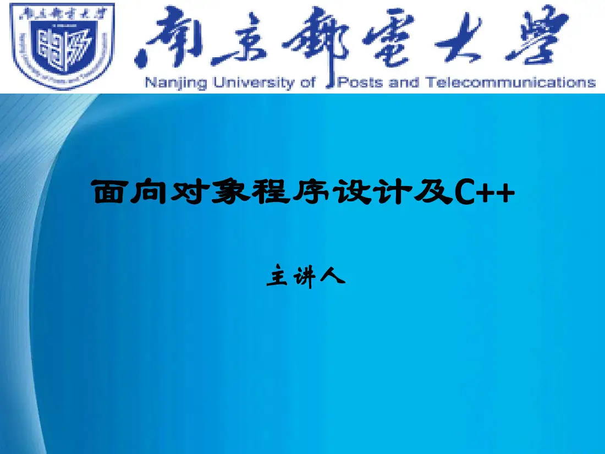

原文：

Nanjing University of JPosts and Telecommunications

面向对象程序设计及C++

主讲人

### 第三章 类与对象

原文：

Nanjing University of JPosts and Telecommunications

第三章 类与对象

### 计算机软件教学中心

原文：

The image provided is a QR code. It does not contain any text, mathematical formulas, tables, or figures that can be processed according to the OCR instructions. Therefore, no textual content can be extracted from this image.

计算机软件教学中心

南京邮电大学
Nanjing University of Posts and Telecommunications

### 本章内容安排

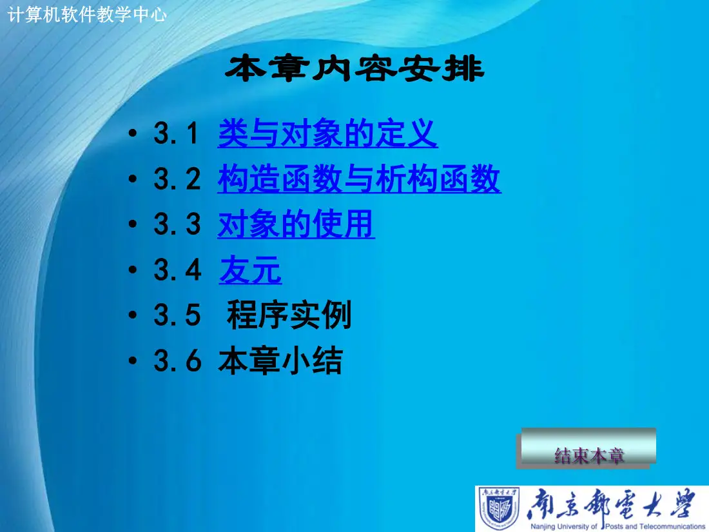

原文：

本章内容安排

• 3.1 类与对象的定义

• 3.2 构造函数与析构函数

• 3.3 对象的使用

• 3.4 友元

• 3.5 程序实例

• 3.6 本章小结

结束本章

计算机软件教学中心

南京邮电大学
Nanjing University of Posts and Telecommunications

### 3.1.1类的定义

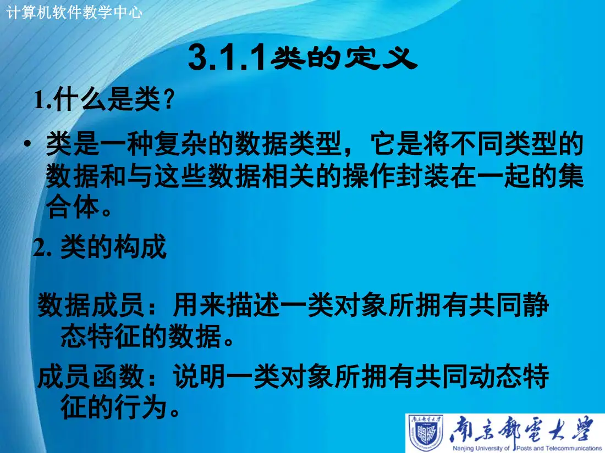

原文：

3.1.1类的定义

1. 什么是类？

\- 类是一种复杂的数据类型，它是将不同类型的数据和与这些数据相关的操作封装在一起的集合体。

2. 类的构成

数据成员：用来描述一类对象所拥有共同静态特征的数据。

成员函数：说明一类对象所拥有共同动态特征的行为。

计算机软件教学中心

南京邮电大学
Nanjing University of Posts and Telecommunications

### 计算机软件教学中心

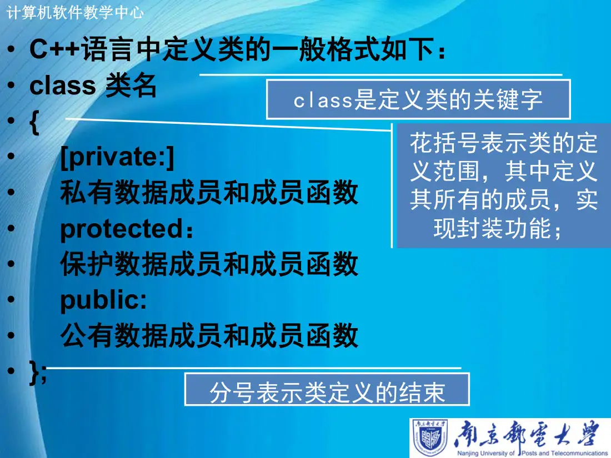

原文：

计算机软件教学中心

• C++语言中定义类的一般格式如下:

\- class 类名

class是定义类的关键字

[private:]

私有数据成员和成员函数

protected:

花括号表示类的定义范围，其中定义其所有的成员，实现封装功能；

保护数据成员和成员函数

public:

公有数据成员和成员函数

分号表示类定义的结束

南京邮电大学
Nanjing University of Posts and Telecommunications

### 计算机软件教学中心

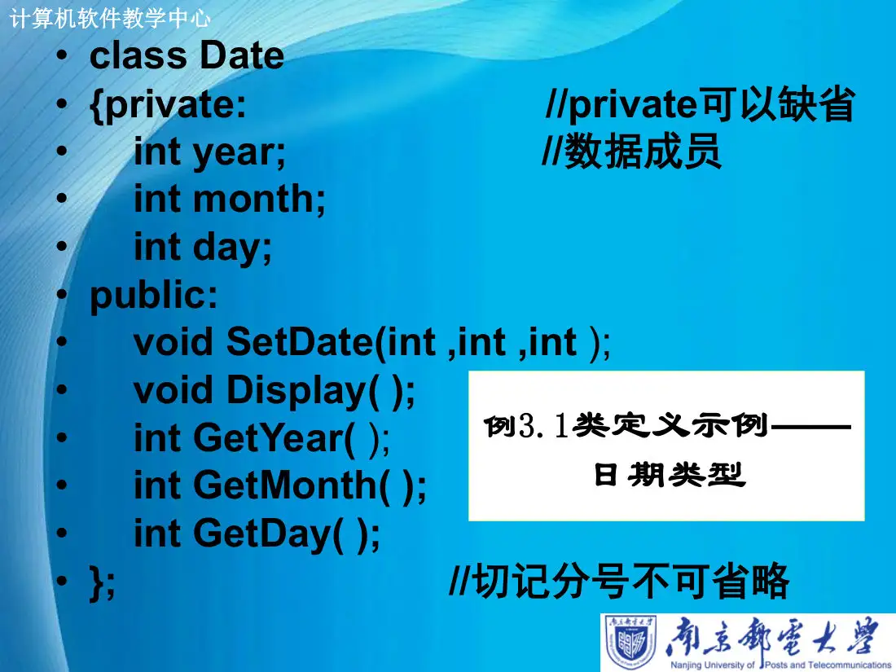

原文：

计算机软件教学中心

\- class Date

\- {private:

\- int year;

\- int month;

int day;

//private可以缺省
//数据成员

public:

void SetDate(int ,int ,int );

• void Display();

\- int GetYear( );

• int GetMonth();

\- int GetDay();

例3.1类定义示例——

日期类型

• };

//切记分号不可省略

南京邮电大学
Nanjing University of Posts and Telecommunications

### 计算机软件教学中心

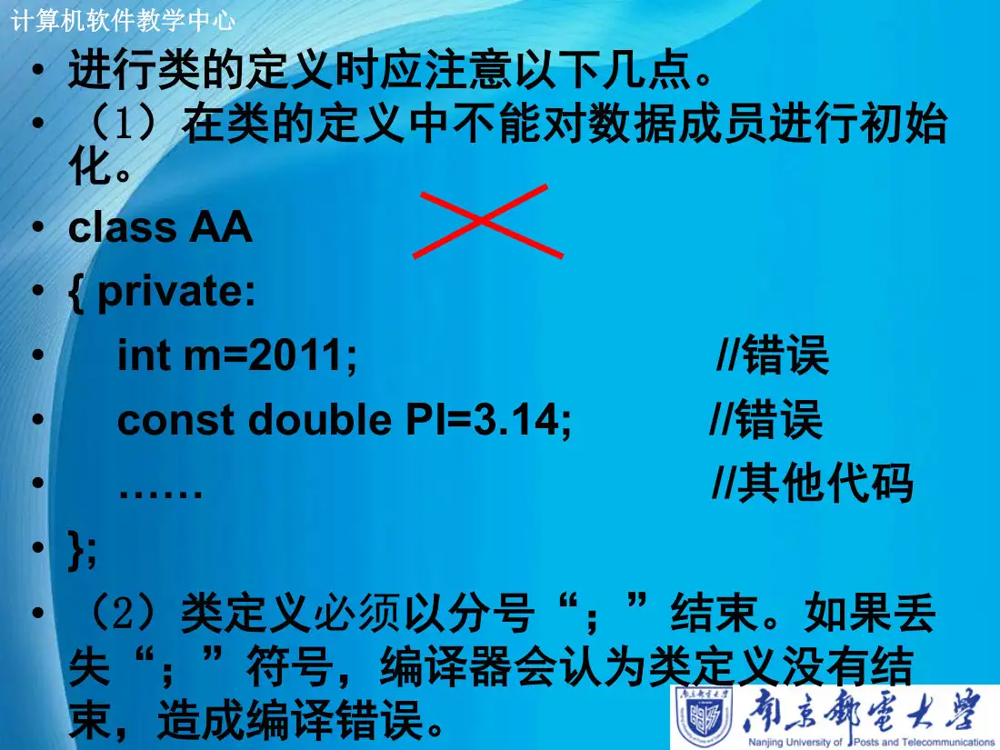

原文：

计算机软件教学中心

\- 进行类的定义时应注意以下几点。

• (1) 在类的定义中不能对数据成员进行初始化。

\- class AA

\- { private:

int m=2011;

const double PI=3.14;

//错误

//错误

//其他代码

};

(2) 类定义必须以分号 “；” 结束。如果丢失 “；” 符号，编译器会认为类定义没有结束，造成编译错误。

### 3. 成员函数的实现

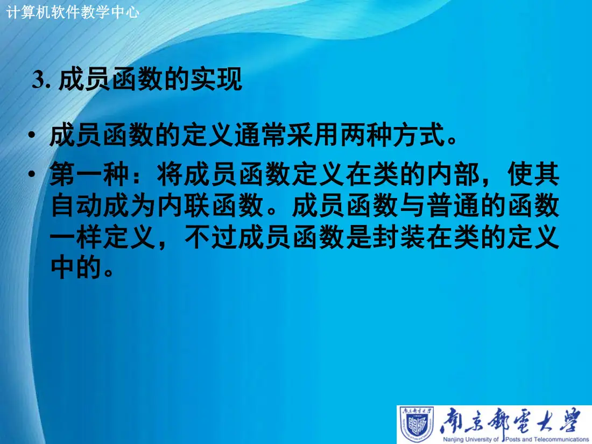

原文：

3. 成员函数的实现

\- 成员函数的定义通常采用两种方式。

\- 第一种：将成员函数定义在类的内部，使其自动成为内联函数。成员函数与普通的函数一样定义，不过成员函数是封装在类的定义中的。

计算机软件教学中心

南京邮电大学
Nanjing University of Posts and Telecommunications

### \- 第二种是在类定义中只给出成员函数的原型，而成员函数的定义放在类的外部。

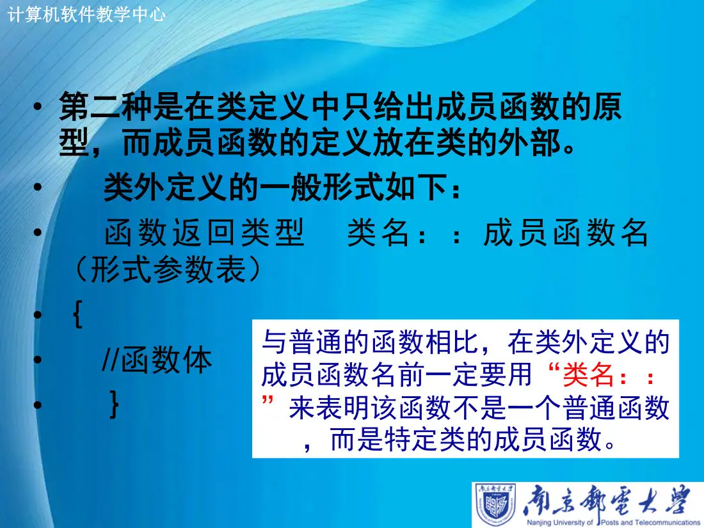

原文：

\- 第二种是在类定义中只给出成员函数的原型，而成员函数的定义放在类的外部。

类外定义的一般形式如下：

函数返回类型 类名：：成员函数名（形式参数表）

//函数体

与普通的函数相比，在类外定义的成员函数名前一定要用“类名：：”来表明该函数不是一个普通函数，而是特定类的成员函数。

计算机软件教学中心

南京邮电大学
Nanjing University of Posts and Telecommunications

### 计算机软件教学中心

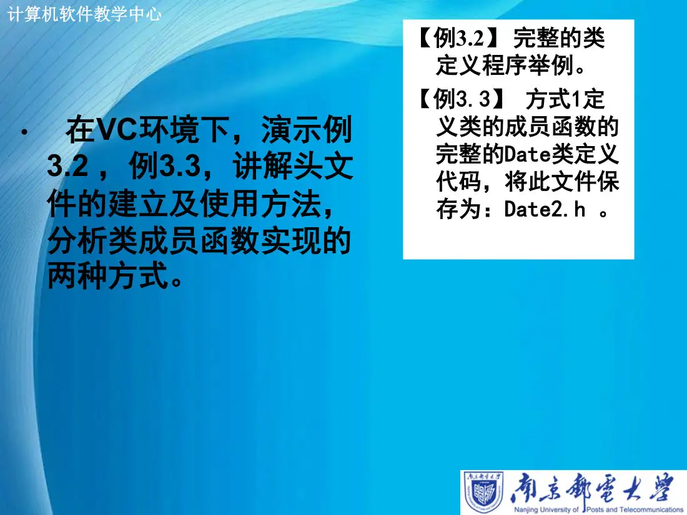

原文：

计算机软件教学中心

\- 在VC环境下，演示例3.2，例3.3，讲解头文件的建立及使用方法，分析类成员函数实现的两种方式。

【例3.2】完整的类定义程序举例。

【例3.3】方式1定义类的成员函数的完整的Date类定义代码，将此文件保存为：Date2.h。

南京邮电大学
Nanjing University of Posts and Telecommunications

### 4. 访问属性

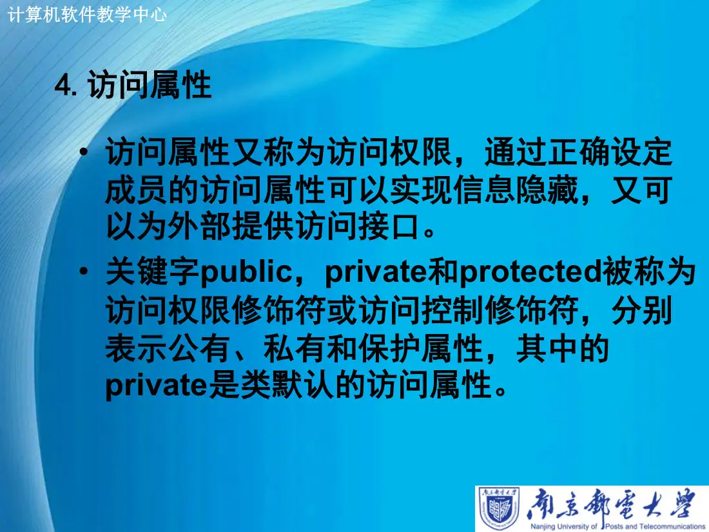

原文：

4. 访问属性

\- 访问属性又称为访问权限，通过正确设定成员的访问属性可以实现信息隐藏，又可以为外部提供访问接口。

\- 关键字public, private和protected被称为访问权限修饰符或访问控制修饰符，分别表示公有、私有和保护属性，其中的private是类默认的访问属性。

计算机软件教学中心

南京邮电大学
Nanjing University of Posts and Telecommunications

### 表3.1 类成员的访问属性及作用 (例3.2、3.3)

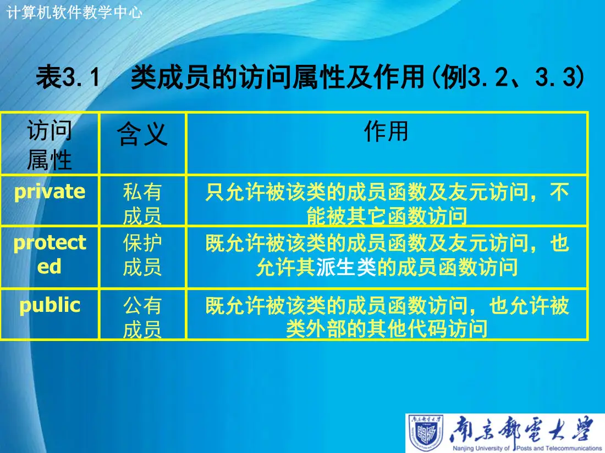

原文：

表3.1 类成员的访问属性及作用 (例3.2、3.3)

<table><tr><td>访问属性</td><td>含义</td><td>作用</td></tr><tr><td>private</td><td>私有成员</td><td>只允许被该类的成员函数及友元访问,不能被其它函数访问</td></tr><tr><td>protected</td><td>保护成员</td><td>既允许被该类的成员函数及友元访问,也允许其派生类的成员函数访问</td></tr><tr><td>public</td><td>公有成员</td><td>既允许被该类的成员函数访问,也允许被类外部的其他代码访问</td></tr></table>

计算机软件教学中心

南京邮电大学
Nanjing University of Posts and Telecommunications

### 3.1.2 定义对象

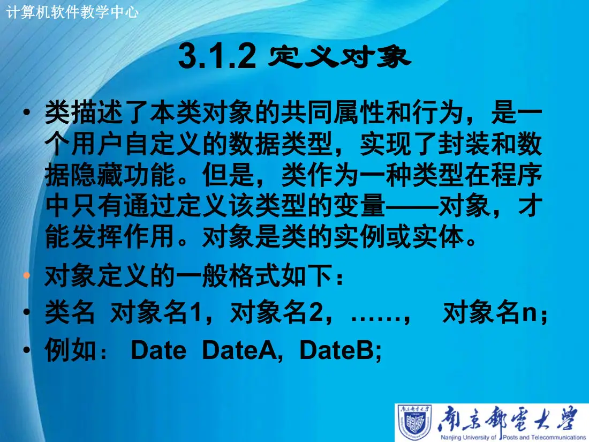

原文：

3.1.2 定义对象

\- 类描述了本类对象的共同属性和行为，是一个用户自定义的数据类型，实现了封装和数据隐藏功能。但是，类作为一种类型在程序中只有通过定义该类型的变量——对象，才能发挥作用。对象是类的实例或实体。

对象定义的一般格式如下：

类名 对象名1，对象名2，……，对象名n；

• 例如：Date DateA, DateB;

计算机软件教学中心

南京邮电大学
Nanjing University of Posts and Telecommunications

### \- 定义类的对象可以有两种方式:

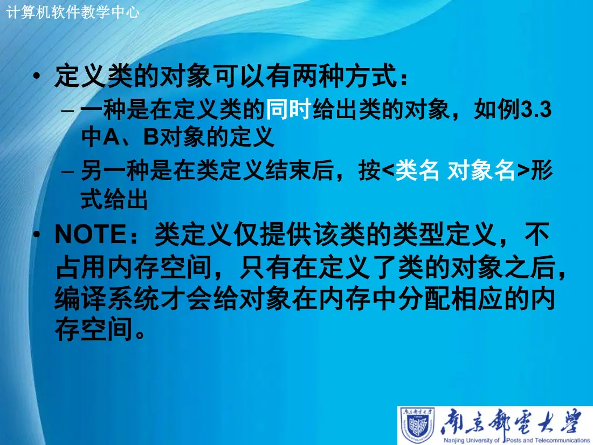

原文：

\- 定义类的对象可以有两种方式:

\- 一种是在定义类的同时给出类的对象，如例3.3中A、B对象的定义

\- 另一种是在类定义结束后，按<类名 对象名>形式给出

NOTE: 类定义仅提供该类的类型定义, 不占用内存空间, 只有在定义了类的对象之后,编译系统才会给对象在内存中分配相应的内存空间。

计算机软件教学中心

南京邮电大学
Nanjing University of Posts and Telecommunications

### • 1. 圆点访问形式

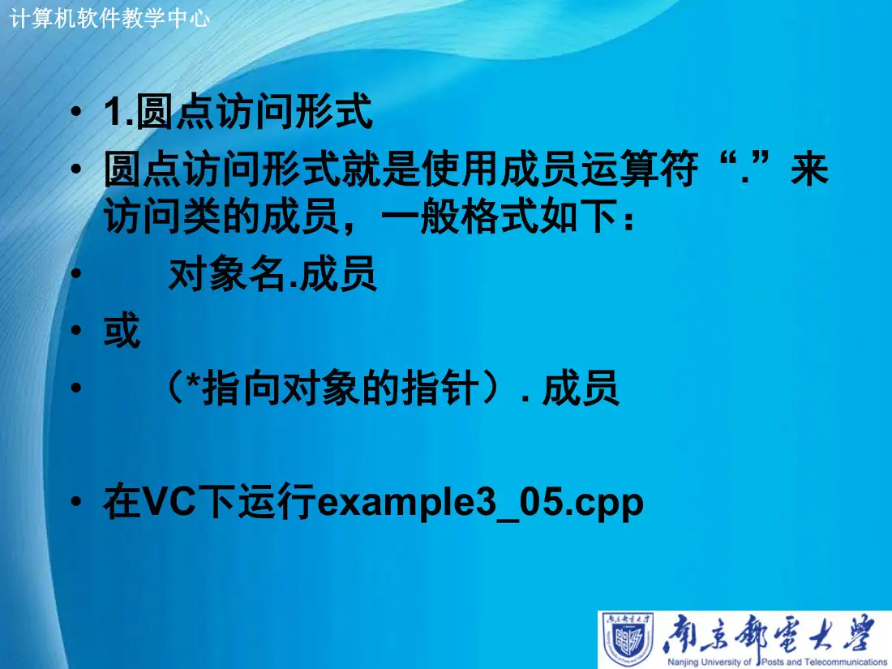

原文：

• 1. 圆点访问形式

\- 圆点访问形式就是使用成员运算符“.”来访问类的成员，一般格式如下：

对象名.成员

• 或

• (\*指向对象的指针). 成员

\- 在VC下运行example3\_05.cpp

计算机软件教学中心

南京邮电大学
Nanjing University of Posts and Telecommunications

### • 2. 指针访问形式

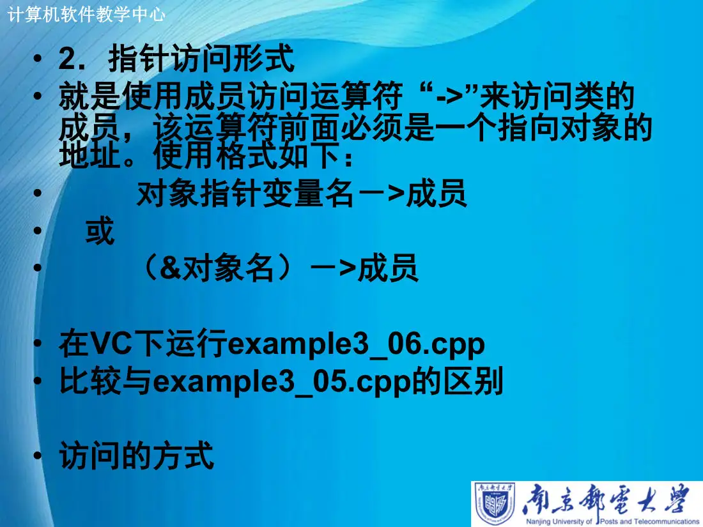

原文：

• 2. 指针访问形式

\- 就是使用成员访问运算符“->”来访问类的成员，该运算符前面必须是一个指向对象的地址。使用格式如下：

对象指针变量名一>成员

或

(&对象名) -> 成员

\- 在VC下运行example3\_06.cpp

\- 比较与example3\_05.cpp的区别

\- 访问的方式

计算机软件教学中心

南京邮电大学
Nanjing University of Posts and Telecommunications

### \- 在VC下运行 example3\_07.cpp: 修改程序中的错误

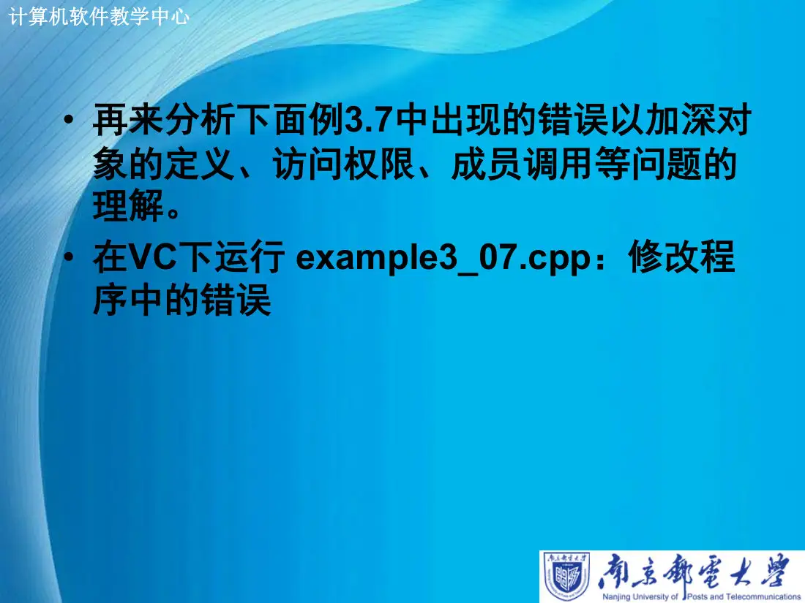

原文：

\- 再来分析下面例3.7中出现的错误以加深对象的定义、访问权限、成员调用等问题的理解。

\- 在VC下运行 example3\_07.cpp: 修改程序中的错误

计算机软件教学中心

南京邮电大学
Nanjing University of Posts and Telecommunications

### 3.1.3 this指针

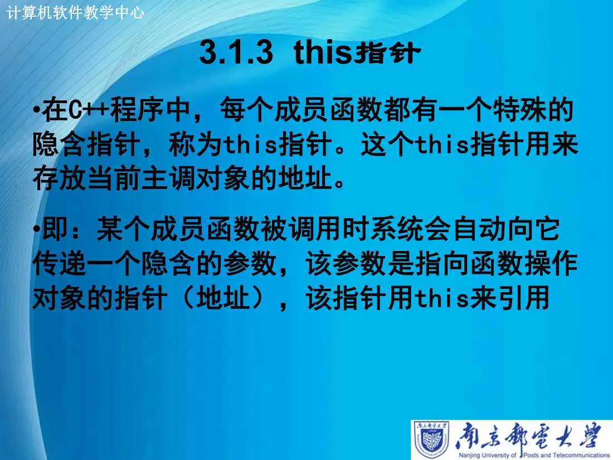

原文：

3.1.3 this指针

\- 在C++程序中，每个成员函数都有一个特殊的隐含指针，称为this指针。这个this指针用来存放当前主调对象的地址。

• 即：某个成员函数被调用时系统会自动向它传递一个隐含的参数，该参数是指向函数操作对象的指针（地址），该指针用this来引用- 当一个对象调用成员函数时:

计算机软件教学中心

南京邮电大学
Nanjing University of Posts and Telecommunications

### • 1、编译程序将this指针指向当前对象的地址

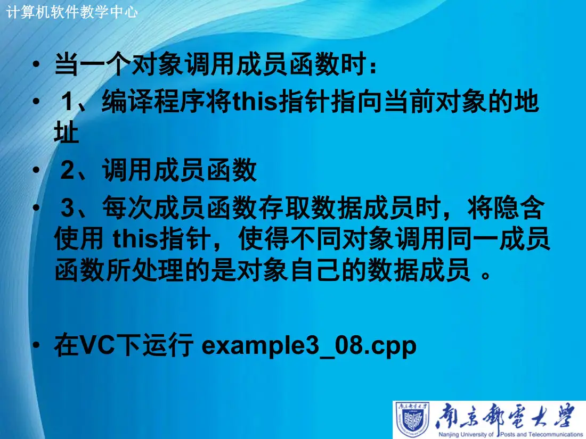

原文：

• 1、编译程序将this指针指向当前对象的地址

• 2、调用成员函数

3、每次成员函数存取数据成员时，将隐含使用 this指针，使得不同对象调用同一成员函数所处理的是对象自己的数据成员。

\- 在VC下运行 example3\_08.cpp

计算机软件教学中心

南京邮电大学
Nanjing University of Posts and Telecommunications

### 计算机软件教学中心

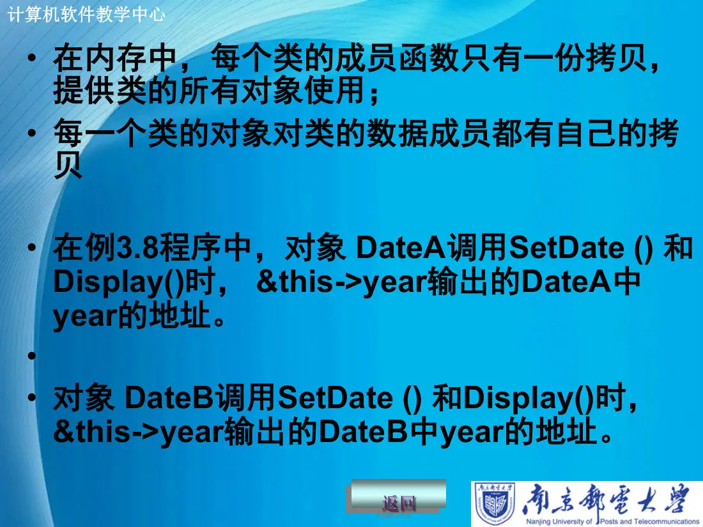

原文：

计算机软件教学中心

\- 在内存中，每个类的成员函数只有一份拷贝，提供类的所有对象使用；

\- 每一个类的对象对类的数据成员都有自己的拷贝

\- 在例3.8程序中，对象 DateA调用SetDate() 和 Display()时，&this->year输出的DateA中 year的地址。

对象 DateB调用SetDate() 和Display()时, &this->year输出的DateB中year的地址。

返回

南京邮电大学
Nanjing University of Posts and Telecommunications

### 3.2 构造函数与析构函数

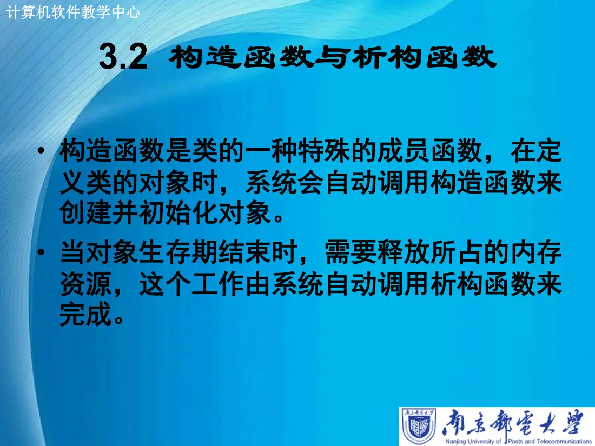

原文：

3.2 构造函数与析构函数

\- 构造函数是类的一种特殊的成员函数，在定义类的对象时，系统会自动调用构造函数来创建并初始化对象。

\- 当对象生存期结束时，需要释放所占的内存资源，这个工作由系统自动调用析构函数来完成。

计算机软件教学中心

南京邮电大学
Nanjing University of Posts and Telecommunications

### 3.2.1 构造函数

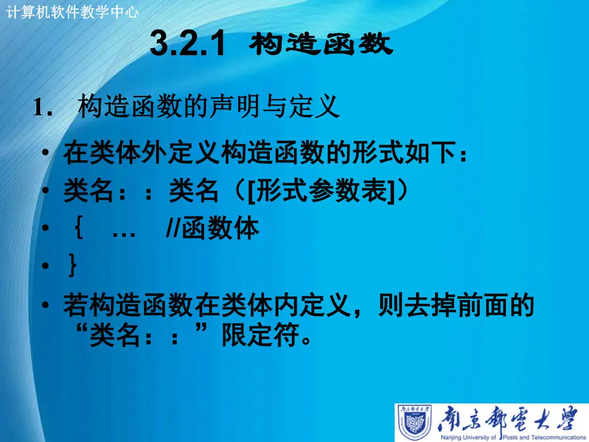

原文：

3.2.1 构造函数

1. 构造函数的声明与定义

\- 在类体外定义构造函数的形式如下:

\- 类名：：类名（[形式参数表]）

• { ... //函数体

• }

\- 若构造函数在类体内定义，则去掉前面的“类名：：”限定符。

计算机软件教学中心

南京邮电大学
Nanjing University of Posts and Telecommunications

### \- 构造函数具有的特殊性质

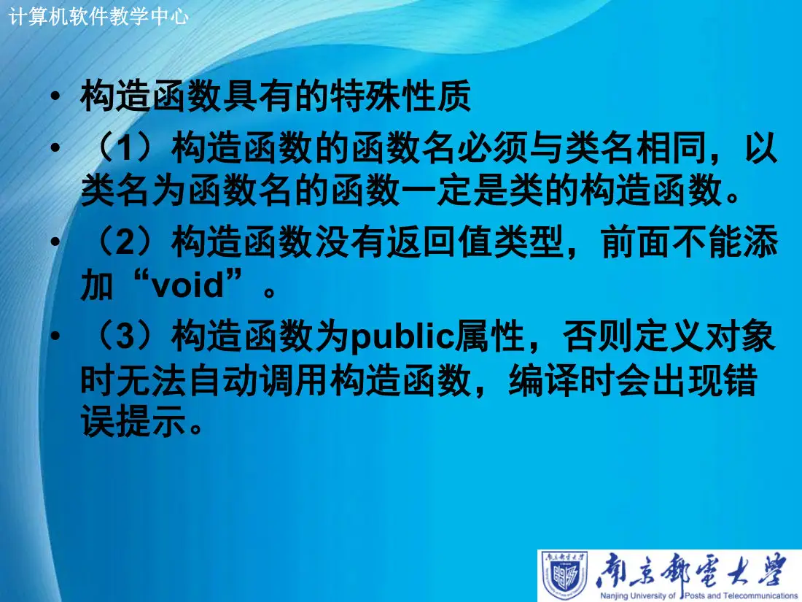

原文：

\- 构造函数具有的特殊性质

• (1) 构造函数的函数名必须与类名相同, 以类名为函数名的函数一定是类的构造函数。

(2) 构造函数没有返回值类型, 前面不能添加 “void”。

• （3）构造函数为public属性，否则定义对象时无法自动调用构造函数，编译时会出现错误提示。

计算机软件教学中心

南京邮电大学
Nanjing University of Posts and Telecommunications

### • 系统默认构造函数的格式是:

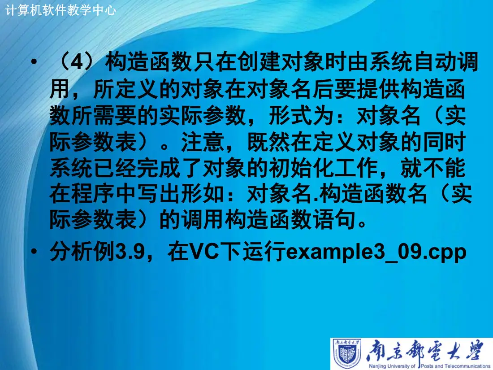

原文：

• (4) 构造函数只在创建对象时由系统自动调用, 所定义的对象在对象名后要提供构造函数所需要的实际参数, 形式为: 对象名 (实际参数表)。注意, 既然在定义对象的同时系统已经完成了对象的初始化工作, 就不能在程序中写出形如: 对象名.构造函数名 (实际参数表) 的调用构造函数语句。

\- 分析例3.9，在VC下运行example3\_09.cpp• 2. 系统默认构造函数及无参构造函数的定义
• 系统默认构造函数的格式是:

计算机软件教学中心

南京邮电大学
Nanjing University of Posts and Telecommunications

### 类名：：类名（）{ }

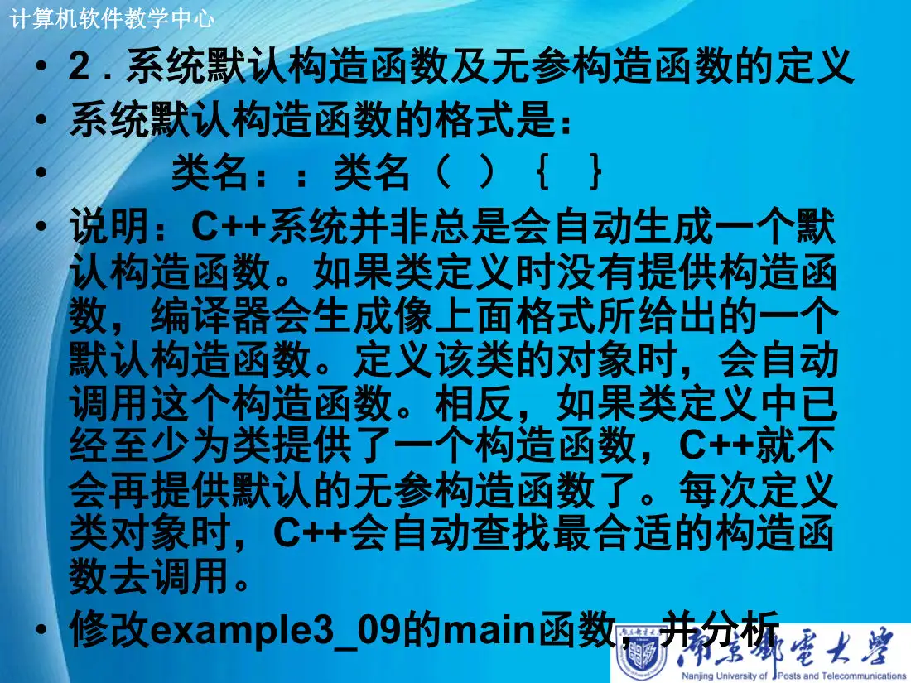

原文：

类名：：类名（）{ }

\- 说明：C++系统并非总是会自动生成一个默认构造函数。如果类定义时没有提供构造函数，编译器会生成像上面格式所给出的一个默认构造函数。定义该类的对象时，会自动调用这个构造函数。相反，如果类定义中已经至少为类提供了一个构造函数，C++就不会再提供默认的无参构造函数了。每次定义类对象时，C++会自动查找最合适的构造函数去调用。

\- 修改example3\_09的main函数，并分析
南京邮电大学
Nanjing University of Posts and Telecommunications

计算机软件教学中心

### 计算机软件教学中心

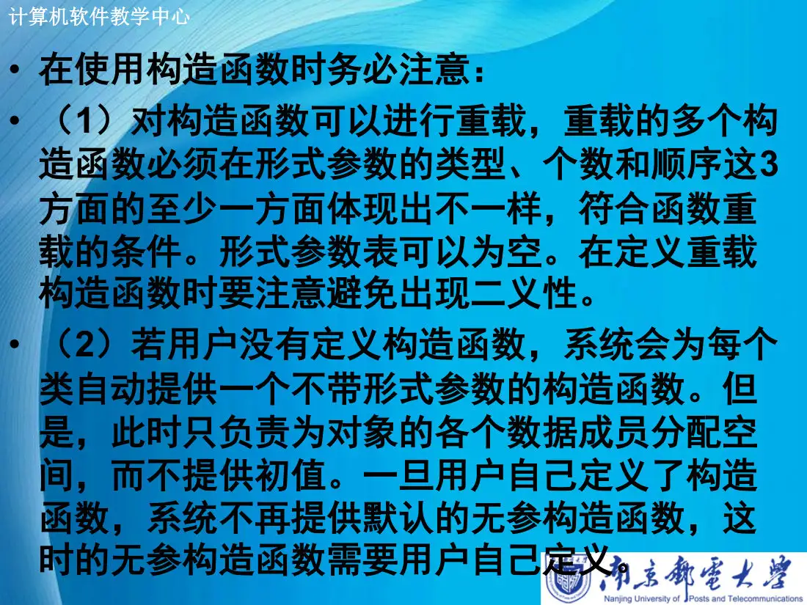

原文：

计算机软件教学中心

\- 在使用构造函数时务必注意:

• (1) 对构造函数可以进行重载, 重载的多个构造函数必须在形式参数的类型、个数和顺序这3方面的至少一方面体现出不一样, 符合函数重载的条件。形式参数表可以为空。在定义重载构造函数时要注意避免出现二义性。

• (2) 若用户没有定义构造函数, 系统会为每个类自动提供一个不带形式参数的构造函数。但是, 此时只负责为对象的各个数据成员分配空间, 而不提供初值。一旦用户自己定义了构造函数, 系统不再提供默认的无参构造函数, 这时的无参构造函数需要用户自己定义。

南京邮電大學 Nanjing University of Posts and Telecommunication

### 3. 具有默认参数值的构造函数

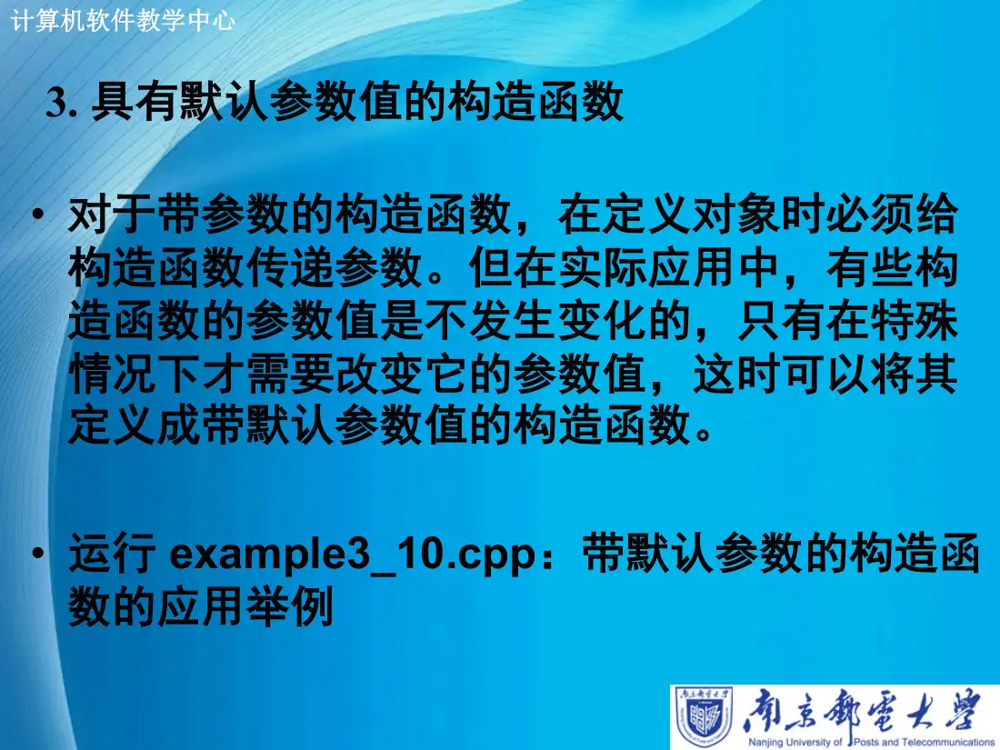

原文：

3. 具有默认参数值的构造函数

\- 对于带参数的构造函数，在定义对象时必须给构造函数传递参数。但在实际应用中，有些构造函数的参数值是不发生变化的，只有在特殊情况下才需要改变它的参数值，这时可以将其定义成带默认参数值的构造函数。

\- 运行 example3\_10.cpp: 带默认参数的构造函数的应用举例

计算机软件教学中心

南京邮电大学
Nanjing University of Posts and Telecommunications

### 计算机软件教学中心

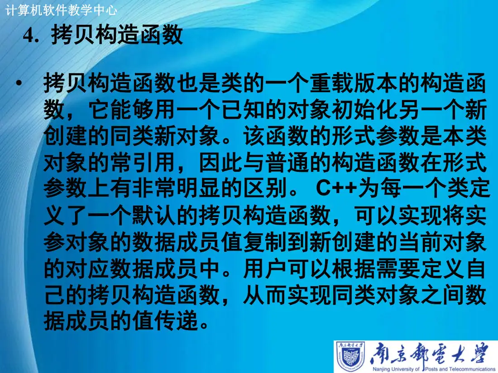

原文：

计算机软件教学中心

4. 拷贝构造函数

\- 拷贝构造函数也是类的一个重载版本的构造函数，它能够用一个已知的对象初始化另一个新创建的同类新对象。该函数的形式参数是本类对象的常引用，因此与普通的构造函数在形式参数上有非常明显的区别。C++为每一个类定义了一个默认的拷贝构造函数，可以实现将实参对象的数据成员值复制到新创建的当前对象的对应数据成员中。用户可以根据需要定义自己的拷贝构造函数，从而实现同类对象之间数据成员的值传递。

南京邮电大学
Nanjing University of Posts and Telecommunications

### 计算机软件教学中心

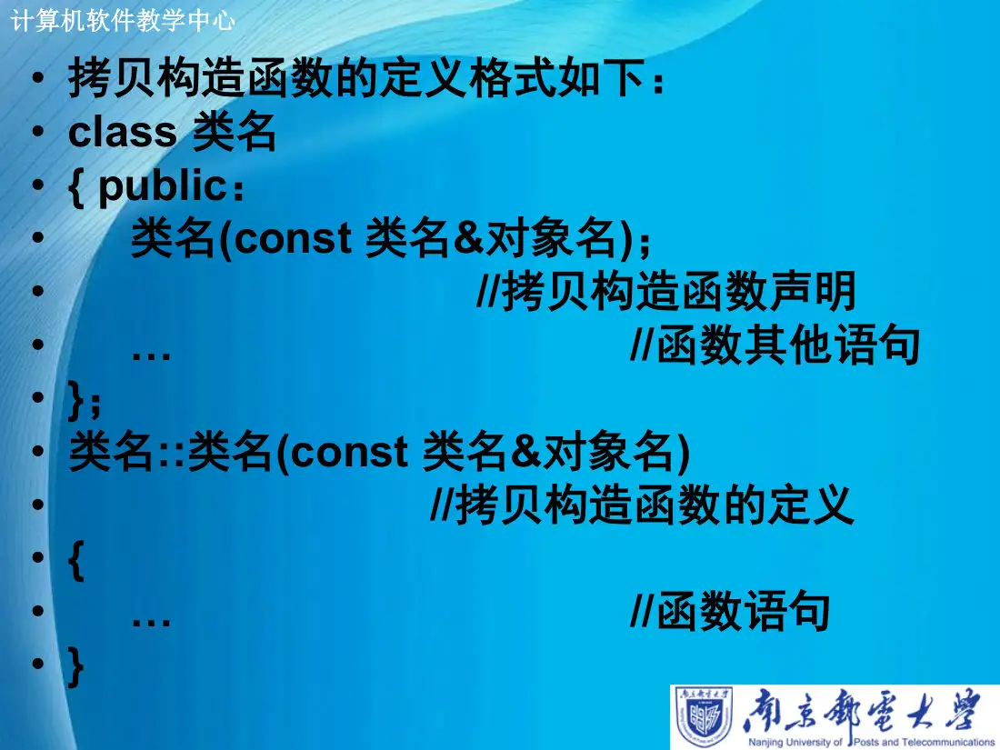

原文：

计算机软件教学中心

\- 拷贝构造函数的定义格式如下:

\- class 类名

• { public :

类名(const 类名&对象名); //拷贝构造函数声明
...    //函数其他语句

类名::类名(const 类名&对象名)
//拷贝构造函数的定义

//函数语句

南京邮电大学
Nanjing University of Posts and Telecommunications

### \- 拷贝构造函数在以下3种情况下由系统自动调用。

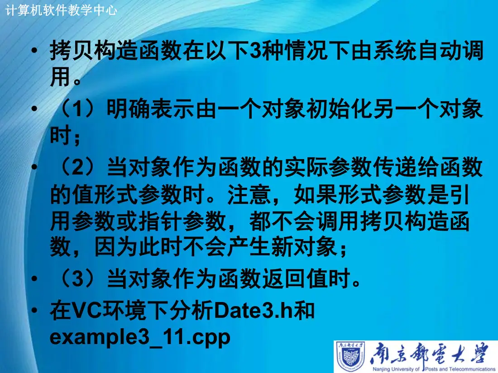

原文：

\- 拷贝构造函数在以下3种情况下由系统自动调用。

• (1) 明确表示由一个对象初始化另一个对象时;

(2) 当对象作为函数的实际参数传递给函数的值形式参数时。注意, 如果形式参数是引用参数或指针参数, 都不会调用拷贝构造函数, 因为此时不会产生新对象;

• （3）当对象作为函数返回值时。

\- 在VC环境下分析Date3.h和example3\_11.cpp

计算机软件教学中心

南京邮电大学
Nanjing University of Posts and Telecommunications

### 3.2.2 析构函数

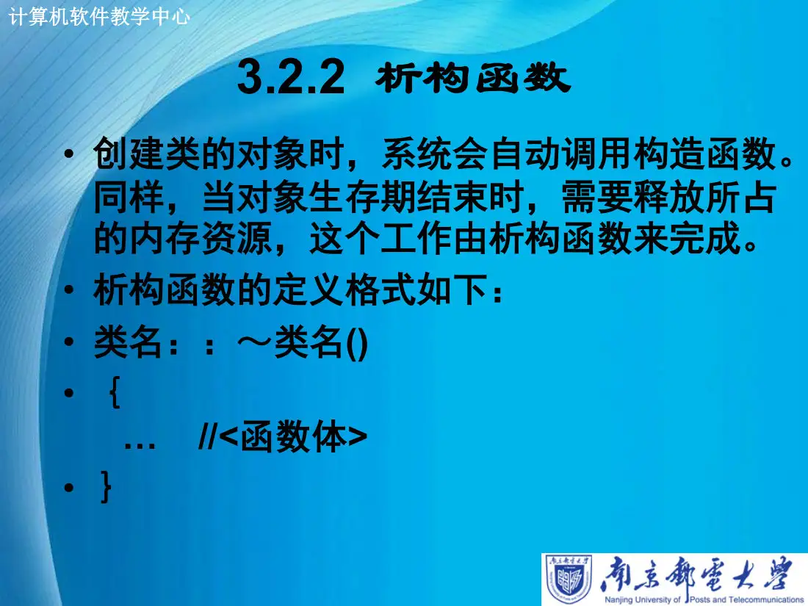

原文：

3.2.2 析构函数

\- 创建类的对象时，系统会自动调用构造函数。同样，当对象生存期结束时，需要释放所占的内存资源，这个工作由析构函数来完成。

\- 析构函数的定义格式如下:

\- 类名：: \~类名()

• {

… //<函数体>

• }

计算机软件教学中心

南京邮电大学
Nanjing University of Posts and Telecommunications

### 计算机软件教学中心

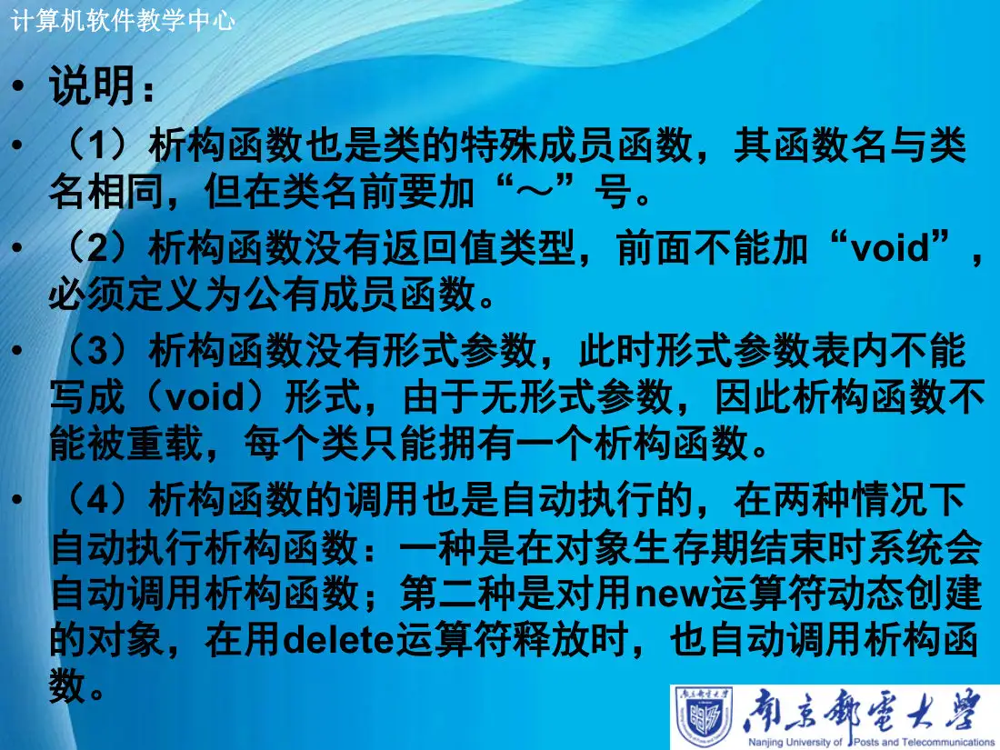

原文：

计算机软件教学中心

- 说明：

• （1）析构函数也是类的特殊成员函数，其函数名与类名相同，但在类名前要加“～”号。

• (2) 析构函数没有返回值类型, 前面不能加 “void”, 必须定义为公有成员函数。

• (3) 析构函数没有形式参数, 此时形式参数表内不能写成 (void) 形式, 由于无形式参数, 因此析构函数不能被重载, 每个类只能拥有一个析构函数。

• (4) 析构函数的调用也是自动执行的, 在两种情况下自动执行析构函数: 一种是在对象生存期结束时系统会自动调用析构函数; 第二种是对用new运算符动态创建的对象, 在用delete运算符释放时, 也自动调用析构函数。

南京邮电大学
Nanjing University of Posts and Telecommunications

### \- \~Date ()

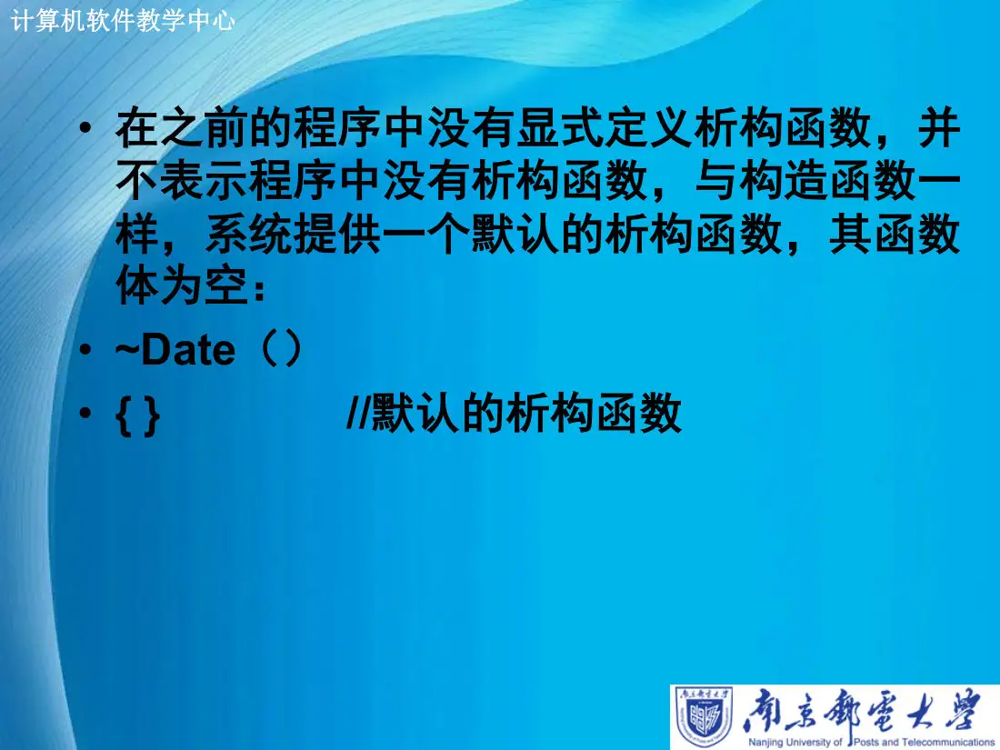

原文：

\- 在之前的程序中没有显式定义析构函数，并不表示程序中没有析构函数，与构造函数一样，系统提供一个默认的析构函数，其函数体为空：

\- \~Date ()

• {} //默认的析构函数- 一般情况下使用系统默认的析构函数就可以了。但是，如果一个类中有指针类型的数据成员，并且在构造函数中该指针申请了动态空间，此时一定要定义析构函数来释放通过指针所申请的动态空间，保证对象生存期结束时释放所有的内存空间。

计算机软件教学中心

南京邮电大学
Nanjing University of Posts and Telecommunications

### 计算机软件教学中心

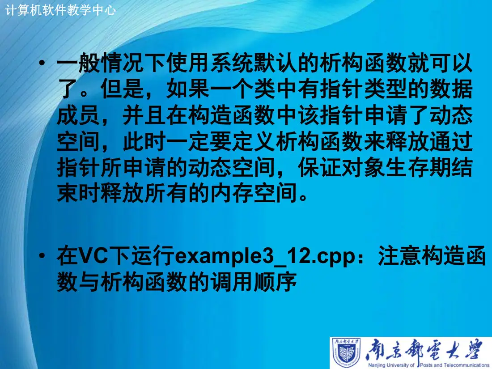

原文：

\- 在VC下运行example3\_12.cpp：注意构造函数与析构函数的调用顺序

计算机软件教学中心

南京邮电大学
Nanjing University of Posts and Telecommunications

### 计算机软件教学中心

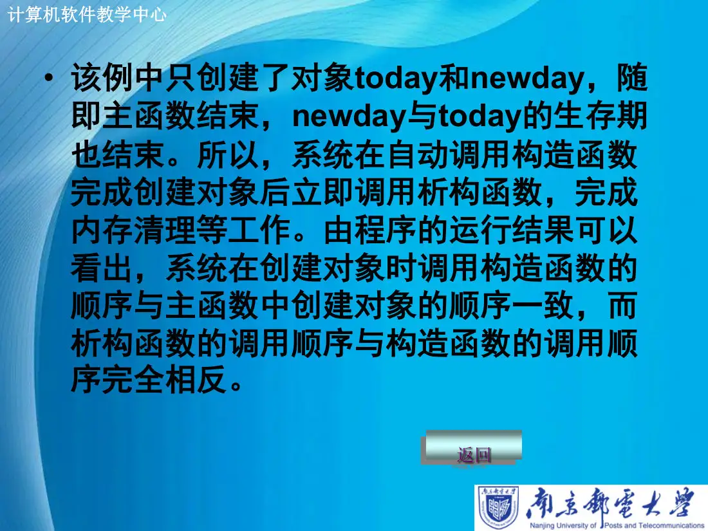

原文：

计算机软件教学中心

\- 该例中只创建了对象today和newday，随即主函数结束，newday与today的生存期也结束。所以，系统在自动调用构造函数完成创建对象后立即调用析构函数，完成内存清理等工作。由程序的运行结果可以看出，系统在创建对象时调用构造函数的顺序与主函数中创建对象的顺序一致，而析构函数的调用顺序与构造函数的调用顺序完全相反。

返回

南京邮电大学
Nanjing University of Posts and Telecommunications

### 3.3 深拷贝与浅拷贝

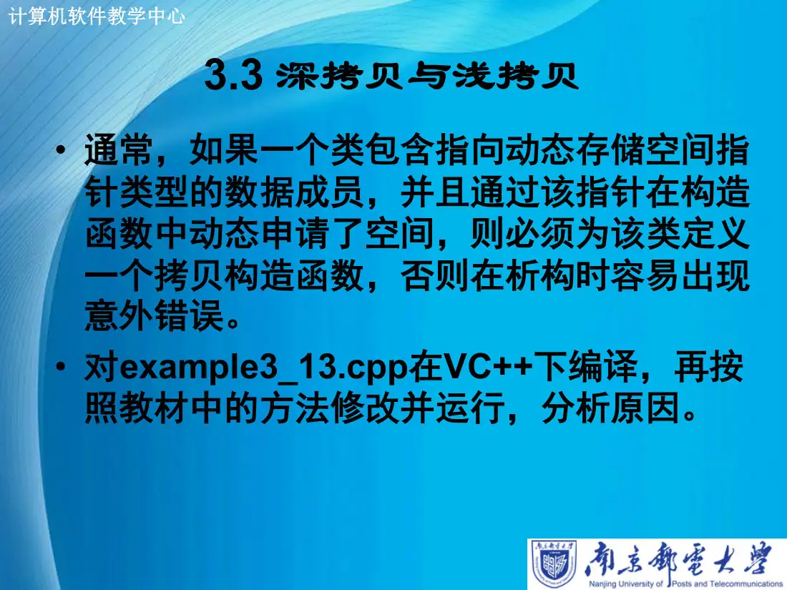

原文：

3.3 深拷贝与浅拷贝

\- 通常，如果一个类包含指向动态存储空间指针类型的数据成员，并且通过该指针在构造函数中动态申请了空间，则必须为该类定义一个拷贝构造函数，否则在析构时容易出现意外错误。

\- 对example3\_13.cpp在VC++下编译，再按照教材中的方法修改并运行，分析原因。

计算机软件教学中心

南京邮电大学
Nanjing University of Posts and Telecommunications

### 计算机软件教学中心

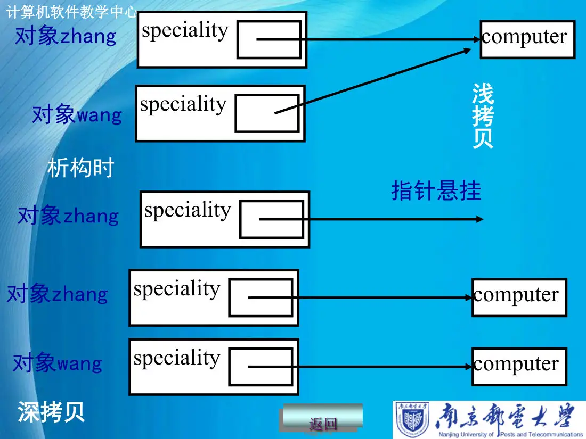

原文：

计算机软件教学中心

对象zhang

对象wang

析构时

对象zhang

对象zhang

对象wang

深拷贝

speciality

speciality

speciality

speciality

speciality

computer

浅拷贝

指针悬挂

computer

computer

返回

南京邮电大学
Nanjing University of Posts and Telecommunications

### 3.4 对象的使用

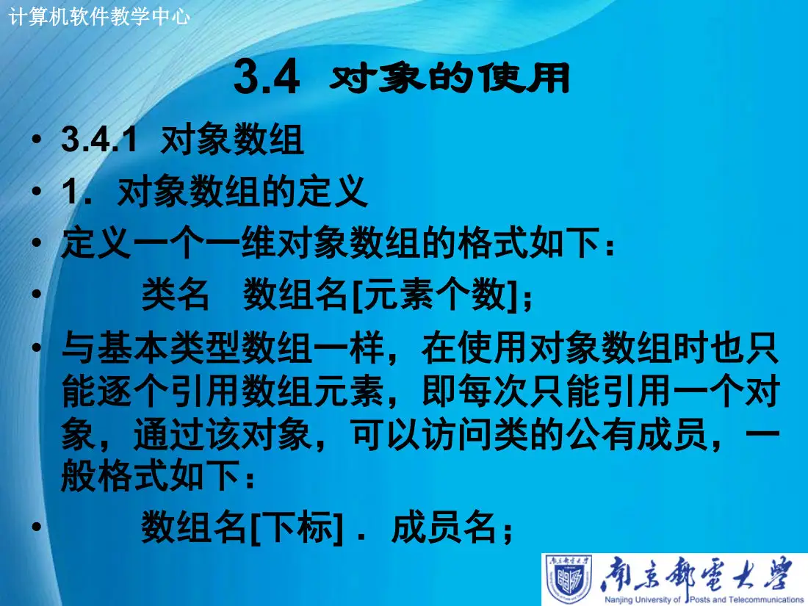

原文：

3.4 对象的使用

• 3.4.1 对象数组

• 1. 对象数组的定义

\- 定义一个一维对象数组的格式如下:

类名 数组名[元素个数];

\- 与基本类型数组一样，在使用对象数组时也只能逐个引用数组元素，即每次只能引用一个对象，通过该对象，可以访问类的公有成员，一般格式如下：

数组名[下标]．成员名；

计算机软件教学中心

南京邮电大学
Nanjing University of Posts and Telecommunications

### 计算机软件教学中心

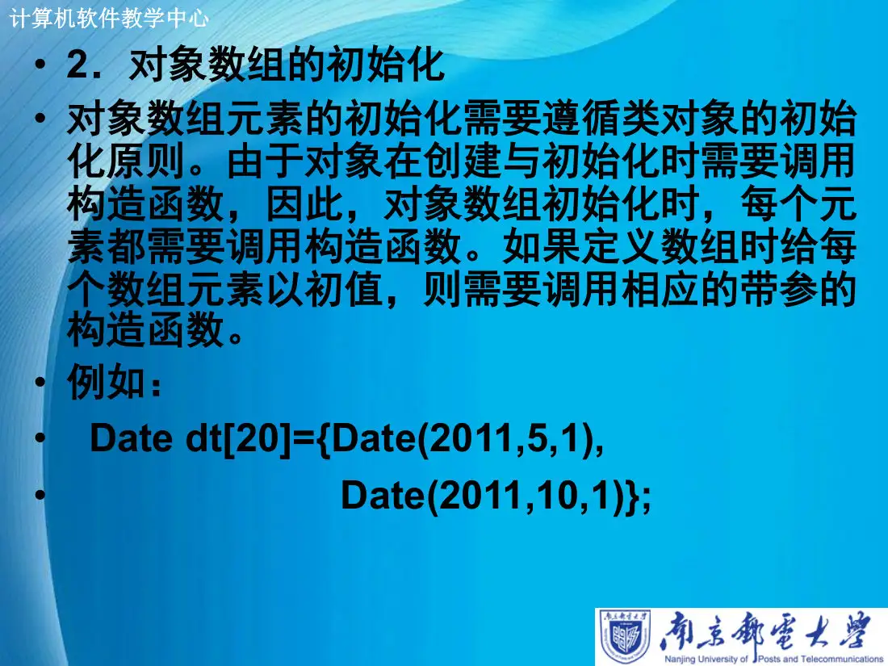

原文：

计算机软件教学中心

• 2. 对象数组的初始化

\- 对象数组元素的初始化需要遵循类对象的初始化原则。由于对象在创建与初始化时需要调用构造函数，因此，对象数组初始化时，每个元素都需要调用构造函数。如果定义数组时给每个数组元素以初值，则需要调用相应的带参的构造函数。

例如：

Date dt[20] = {Date(2011, 5, 1),

Date(2011,10,1)};

南京邮电大学
Nanjing University of Posts and Telecommunications

### \- 在vc环境下分析example3\_14.cpp，建议单步方式运行

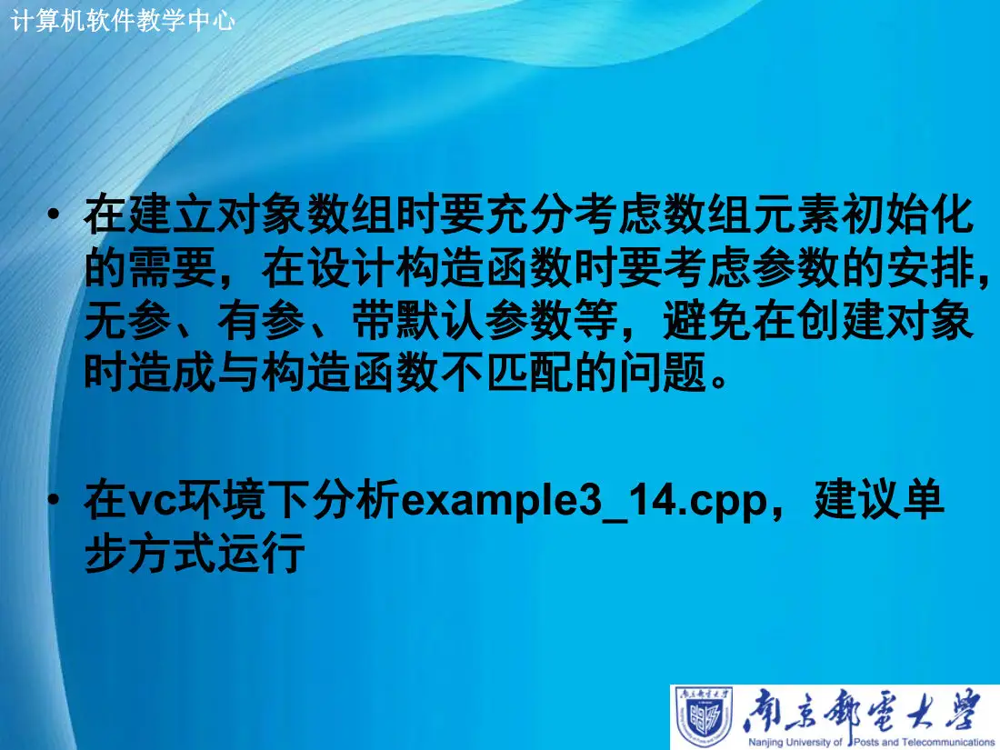

原文：

\- 在建立对象数组时要充分考虑数组元素初始化的需要，在设计构造函数时要考虑参数的安排，无参、有参、带默认参数等，避免在创建对象时造成与构造函数不匹配的问题。

\- 在vc环境下分析example3\_14.cpp，建议单步方式运行

计算机软件教学中心

南京邮电大学
Nanjing University of Posts and Telecommunications

### 3.4.2 对象指针

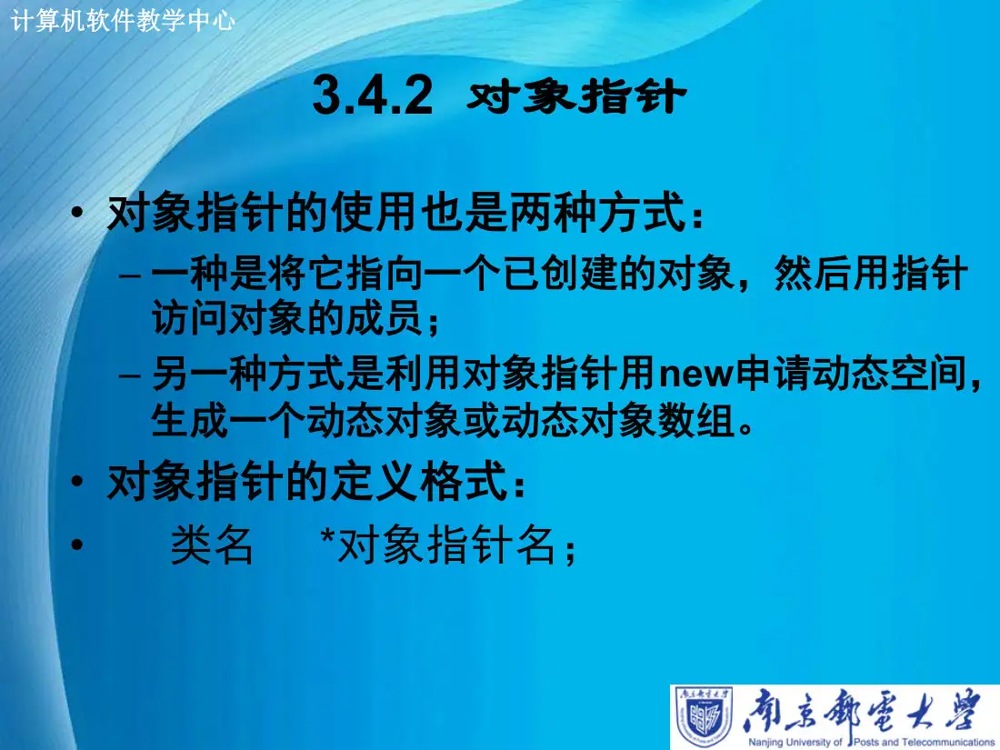

原文：

3.4.2 对象指针

\- 对象指针的使用也是两种方式:

\- 一种是将它指向一个已创建的对象，然后用指针访问对象的成员；

\- 另一种方式是利用对象指针用new申请动态空间，生成一个动态对象或动态对象数组。

\- 对象指针的定义格式:

• 类名 \*对象指针名;

计算机软件教学中心

南京邮电大学
Nanjing University of Posts and Telecommunications

### 或（\*指针变量名）. 成员名

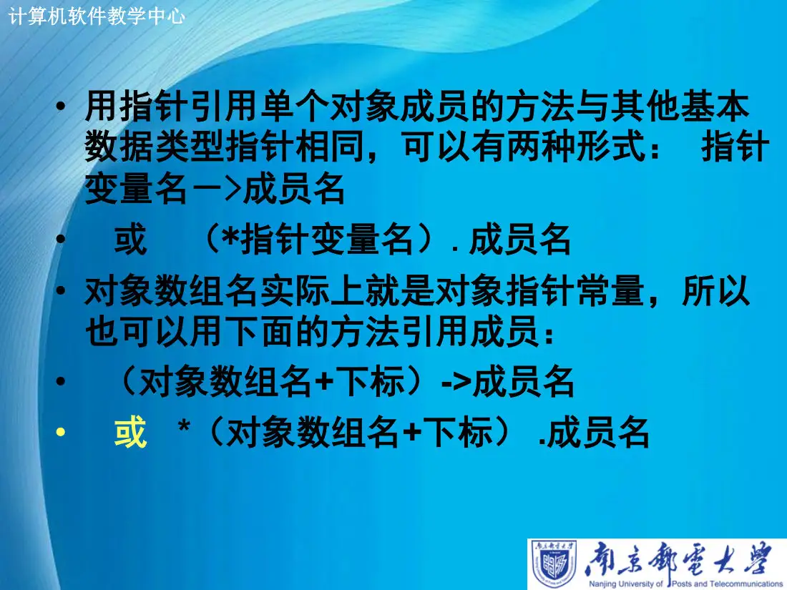

原文：

\- 用指针引用单个对象成员的方法与其他基本数据类型指针相同，可以有两种形式：指针变量名一>成员名

或（\*指针变量名）. 成员名

\- 对象数组名实际上就是对象指针常量，所以也可以用下面的方法引用成员：

• （对象数组名+下标）->成员名

• 或 \*（对象数组名+下标）.成员名

计算机软件教学中心

南京邮电大学
Nanjing University of Posts and Telecommunications

### 计算机软件教学中心

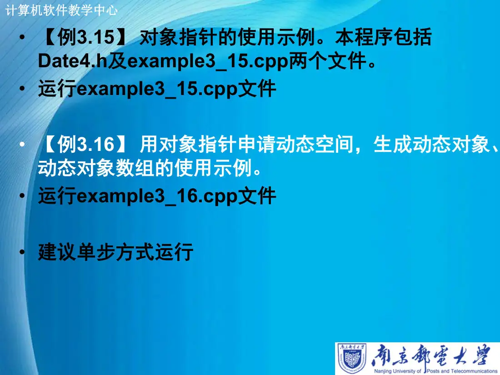

原文：

计算机软件教学中心

• 【例3.15】对象指针的使用示例。本程序包括Date4.h及example3\_15.cpp两个文件。

\- 运行example3\_15.cpp文件

• 【例3.16】用对象指针申请动态空间，生成动态对象、动态对象数组的使用示例。

\- 运行example3\_16.cpp文件

\- 建议单步方式运行

南京邮电大学
Nanjing University of Posts and Telecommunications

### 3.4.3 对象引用

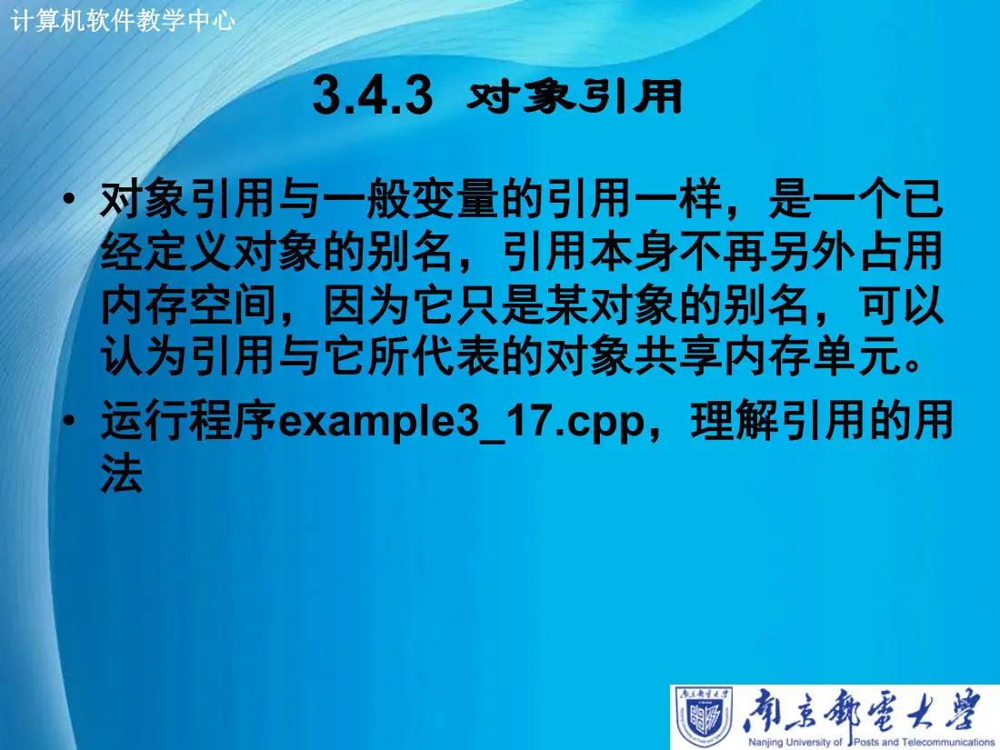

原文：

3.4.3 对象引用

\- 对象引用与一般变量的引用一样，是一个已经定义对象的别名，引用本身不再另外占用内存空间，因为它只是某对象的别名，可以认为引用与它所代表的对象共享内存单元。

\- 运行程序example3\_17.cpp，理解引用的用法

计算机软件教学中心

南京邮电大学
Nanjing University of Posts and Telecommunications

### 3.4.4 对象参数

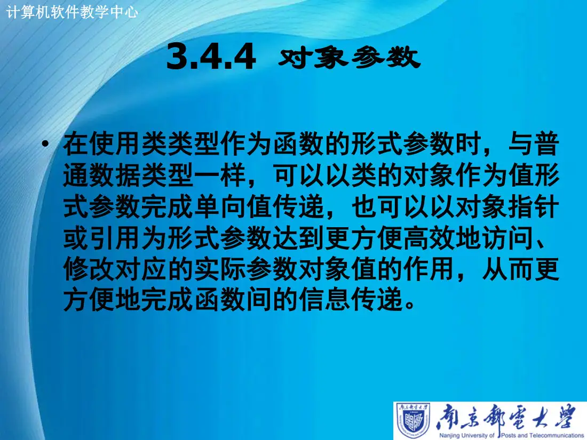

原文：

3.4.4 对象参数

\- 在使用类类型作为函数的形式参数时，与普通数据类型一样，可以以类的对象作为值形式参数完成单向值传递，也可以以对象指针或引用为形式参数达到更方便高效地访问、修改对应的实际参数对象值的作用，从而更方便地完成函数间的信息传递。

计算机软件教学中心

南京邮电大学
Nanjing University of Posts and Telecommunications

### • 1. 对象作为函数参数

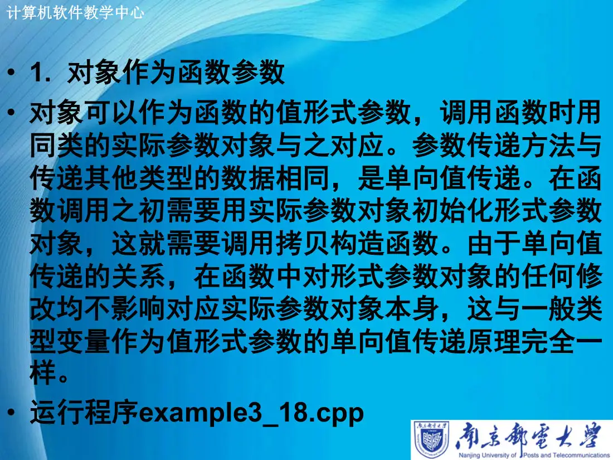

原文：

• 1. 对象作为函数参数

\- 对象可以作为函数的值形式参数，调用函数时用同类的实际参数对象与之对应。参数传递方法与传递其他类型的数据相同，是单向值传递。在函数调用之初需要用实际参数对象初始化形式参数对象，这就需要调用拷贝构造函数。由于单向值传递的关系，在函数中对形式参数对象的任何修改均不影响对应实际参数对象本身，这与一般类型变量作为值形式参数的单向值传递原理完全一样。

\- 运行程序example3\_18.cpp

计算机软件教学中心

南京邮电大学
Nanjing University of Posts and Telecommunications

### 2. 对象指针作为函数参数

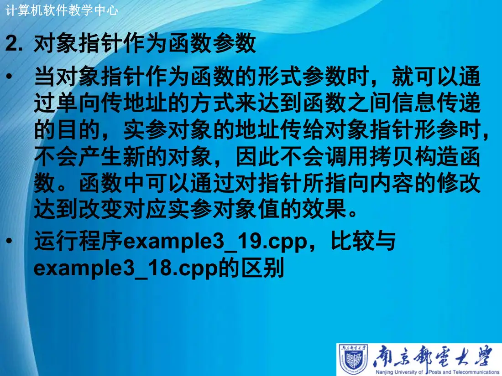

原文：

2. 对象指针作为函数参数

\- 当对象指针作为函数的形式参数时，就可以通过单向传地址的方式来达到函数之间信息传递的目的，实参对象的地址传给对象指针形参时，不会产生新的对象，因此不会调用拷贝构造函数。函数中可以通过对指针所指向内容的修改达到改变对应实参对象值的效果。

\- 运行程序example3\_19.cpp，比较与example3\_18.cpp的区别

计算机软件教学中心

南京邮电大学
Nanjing University of Posts and Telecommunications

### 计算机软件教学中心

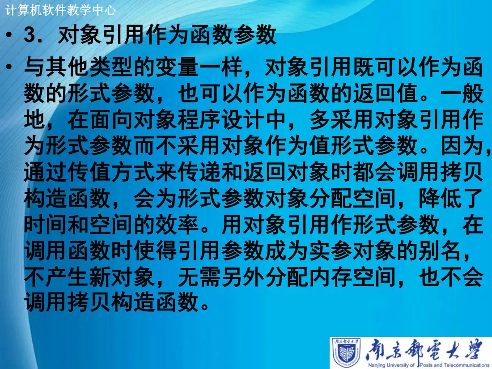

原文：

计算机软件教学中心

• 3. 对象引用作为函数参数

\- 与其他类型的变量一样，对象引用既可以作为函数的形式参数，也可以作为函数的返回值。一般地，在面向对象程序设计中，多采用对象引用作为形式参数而不采用对象作为值形式参数。因为，通过传值方式来传递和返回对象时都会调用拷贝构造函数，会为形式参数对象分配空间，降低了时间和空间的效率。用对象引用作形式参数，在调用函数时使得引用参数成为实参对象的别名，不产生新对象，无需另外分配内存空间，也不会调用拷贝构造函数。

南京邮电大学
Nanjing University of Posts and Telecommunications

### \- 引用作为返回值，函数的调用就可以作为左值使用。

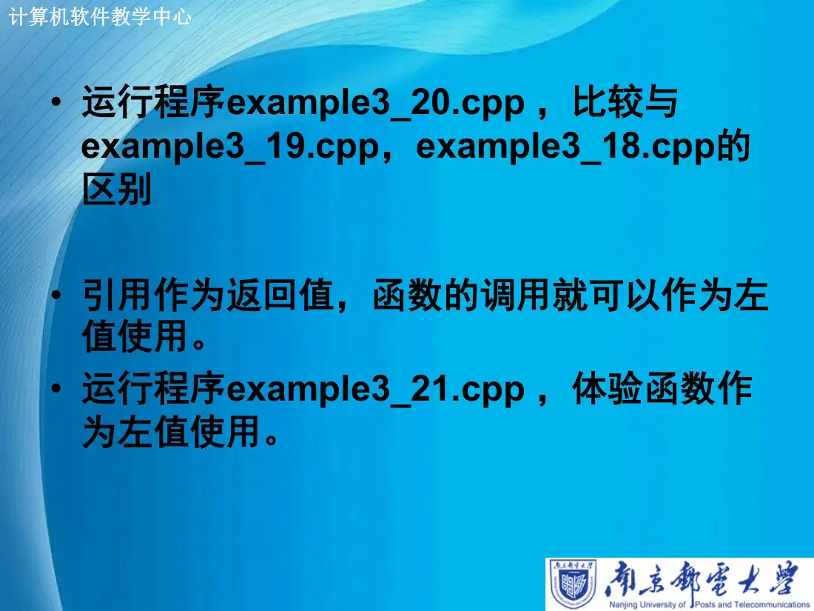

原文：

\- 运行程序example3\_20.cpp，比较与example3\_19.cpp，example3\_18.cpp的区别

\- 引用作为返回值，函数的调用就可以作为左值使用。

\- 运行程序example3\_21.cpp，体验函数作为左值使用。

计算机软件教学中心

南京邮电大学
Nanjing University of Posts and Telecommunications

### 计算机软件教学中心

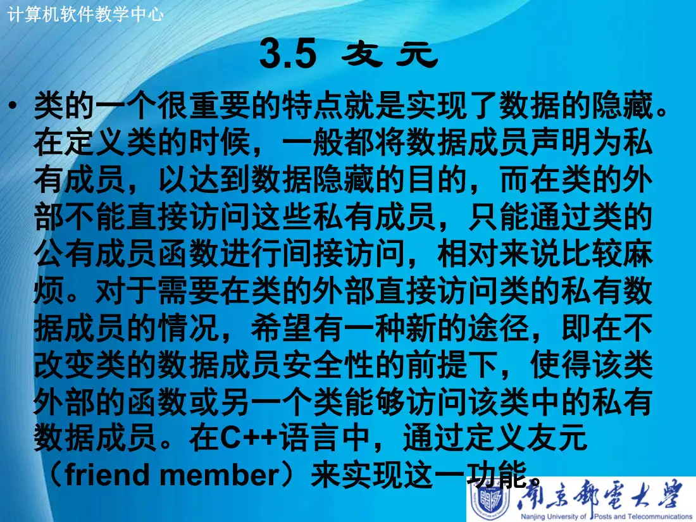

原文：

计算机软件教学中心

3.5 友元

\- 类的一个很重要的特点就是实现了数据的隐藏。在定义类的时候，一般都将数据成员声明为私有成员，以达到数据隐藏的目的，而在类的外部不能直接访问这些私有成员，只能通过类的公有成员函数进行间接访问，相对来说比较麻烦。对于需要在类的外部直接访问类的私有数据成员的情况，希望有一种新的途径，即在不改变类的数据成员安全性的前提下，使得该类外部的函数或另一个类能够访问该类中的私有数据成员。在C++语言中，通过定义友元（friend member）来实现这一功能。

功能。南京邮電大學 Nanjing University of Posts and Telecommunication

### - 友元可以有3种:

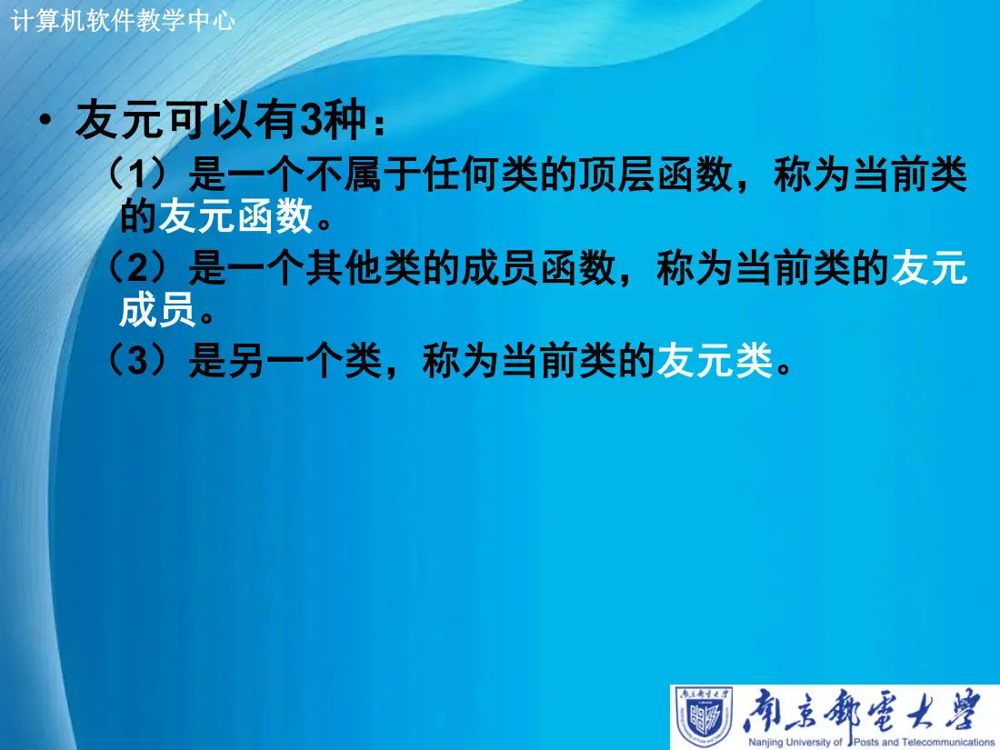

原文：

- 友元可以有3种:

(1) 是一个不属于任何类的顶层函数，称为当前类的友元函数。

(2) 是一个其他类的成员函数，称为当前类的友元成员。

(3) 是另一个类，称为当前类的友元类。

计算机软件教学中心

南京邮电大学
Nanjing University of Posts and Telecommunications

### 3.4.1 友元函数

原文：

3.4.1 友元函数

\- 如果一个普通函数作为某一个类的友元函数，则在该类的定义中，应该增加对该函数的原型声明，形式如下：

\- friend 函数返回类型 函数名（形式参数表）；
- 可以在类外或类内定义函数体。

计算机软件教学中心

南京邮电大学
Nanjing University of Posts and Telecommunications

### • bool Equal( Date &DateA, Date &DateB)

原文：

• 【例3.22】不使用友元时，用普通函数Equal来判断两个日期是否为同一天的实现示例。

• bool Equal( Date &DateA, Date &DateB)

{ return ( DateA.GetYear( ) == DateB.GetYear( )
&&DateA.GetMonth( ) ==

DateB.GetMonth()

&&DateA.GetDay( ) == DateB.GetDay( ) ;

\- 见例程example3\_22.cpp

计算机软件教学中心

南京邮电大学
Nanjing University of Posts and Telecommunications

### 计算机软件教学中心

原文：

计算机软件教学中心

\- 针对上面的例子，一个更简单有效的定义如下：

\- bool Equal( Date &DateA, Date &DateB)

\- {return (DateA.year == DateB.year && DateA.month == DateB.month && DateA.day == DateB.day);

• }

\- 但是，如果直接将例3.22中的Equal函数代码改为上面的代码，必然报错。这是由类的封装和信息隐藏机制所决定的。普通函数无法直接访问类的私有成员，如果将Equal()函数定义为类Date的友元函数，则上述简洁的代码才正确。

\- 运行example3\_23.cpp,比较example3—22

Nanjing University of JPosts and Telecommunications

### 3.5.1 友元函数

原文：

3.5.1 友元函数

\- 正确使用友元函数需要注意以下几点。

(1) 通常友元函数是在类的定义中给出原型声明，声明的位置任意，不受访问属性的限制。声明以后的友元函数在类外面给出完整定义，此时前面不能再加关键字friend。

(2) 友元函数也可以在类内部直接给出定义, 定义的首部相当于原型声明。

(3) 友元函数的定义和调用方式与普通函数相同。

(4) 友元函数提供了不同类成员函数之间、类的成员函数与普通函数之间进行数据共享的机制，尤其是一个函数需要访问多个类时，友元函数非常有用。

(5) 友元毕竟是打破了封装和信息隐藏机制，因此在安全性和效率之间需做折衷考虑。

南京邮电大学
Nanjing University of Posts and Telecommunications

### 3.4.2 友元成员

原文：

3.4.2 友元成员

\- 一个类的成员函数也可以作为另一个类的友元，称为另一个类的友元成员。友元成员函数不仅可以访问自己所在类的所有成员，也可以访问friend声明语句所在类的所有成员。这样，可以使两个类共享数据，相互合作。

\- 在VC++下运行 example3\_24.cpp

NOTE:

\- 友元成员不可以以内联函数的形式出现。

\- 以类外形式实现时必须在友元声明类型定义之后

\- 友元成员所在的类定义在先，其可以访问私有成员的类定义在后，有时需要作类的声明

计算机软件教学中心

南京邮电大学
Nanjing University of Posts and Telecommunications

### 计算机软件教学中心

原文：

\- 在VC下运行think 3\_13.cpp，比较与example3\_24.cpp的区别，注意编程要点，避免错误

计算机软件教学中心

南京邮电大学
Nanjing University of Posts and Telecommunications

### 3.5.3 友元类

原文：

3.5.3 友元类

\- 一个类也可以声明为另一个类的友元，这时成为另一个类的友元类。若一个类被声明为另一个类的友元类，则该类中的所有成员函数都是另一个类的友元成员，都可以访问另一个类的所有成员。

\- 在VC++下运行 example3\_25.cpp

计算机软件教学中心

南京邮电大学
Nanjing University of Posts and Telecommunications

### - 注意:

原文：

- 注意:

\- 友元关系是单向的，并只在两个类之间有效。

\- 友元关系不具有交换性。

\- 友元关系不具有传递性。

\- 友元机制是C++语言对类的封装机制的补充。通过这一机制，一个类可以赋予某些函数以特权来直接访问其私有成员。

\- 使用友元可以避免频繁调用类的接口函数，可以节省系统的开销，从而也提高了程序的运行效率。

返回

计算机软件教学中心

南京邮电大学
Nanjing University of Posts and Telecommunications

### 3.6 程序实例：学生信息管理系统

原文：

3.6 程序实例：学生信息管理系统

\- 本例中学生类，保存为 example3\_26\_student.h文件；类体的实现放在与头文件主文件名相同的文件 example3\_26\_student.cpp中；主函数放在文件example3\_26.cpp中，这3个文件共同组成了本程序。在Visual C++开发环境中，将这3个文件放在一个project中。

\- 在VC下运行该例。

计算机软件教学中心

南京邮电大学
Nanjing University of Posts and Telecommunications

### 本章小结

原文：

本章小结

\- 本章全面介绍了类和对象，展现面向对象的第一个重要特性——封装性。主要有以下内容：

(1) 类是对具有共同特性的一组对象的抽象, 是面向对象程序设计的核心和基础。类与对象的关系是抽象和具体的关系, 对象是类的实例。类实际上也是一种类型, 与一般类型不同的是, 类既包含表现静态属性的数据成员, 又包含表现动态属性的成员函数。

(2) 类的成员可分为公有、私有和保护3种访问控制属性，在类内部可直接访问类的所有成员，而在类外只能通过对象访问类的公有成员。

计算机软件教学中心

南京邮电大学
Nanjing University of Posts and Telecommunications

### 计算机软件教学中心

原文：

(3) 构造函数、析构函数是类的两种特殊的成员函数。在定义类的对象时由系统自动调用构造函数。一个类可以有多个重载的构造函数，通过构造函数实现对对象存储空间的分配和对数据成员的初始化。拷贝构造函数是特殊的构造函数，它能够用一个已知的对象去初始化一个新的同类对象。当对象的生存期结束时，系统自动调用析构函数进行必要的清理工作，释放对象所占用的内存。一个类有且只有一个析构函数。

计算机软件教学中心

南京邮电大学
Nanjing University of Posts and Telecommunications

### 计算机软件教学中心

原文：

• (4) 对象数组、对象指针、对象引用与普通类型的数组、指针、引用有着相似之处,用法也是类似的,对对象数组进行初始化时需要调用构造函数。

(5) 对象、对象指针、对象引用作形式参数各有不同的作用，在面向对象程序设计中对象引用参数使用得最为广泛，当然另两种参数也各有合适的应用场合。

计算机软件教学中心

南京邮电大学
Nanjing University of Posts and Telecommunications

### 计算机软件教学中心

原文：

• (6) 友元的作用主要是为了提高效率和方便编程。有3种形式的友元：友元函数、友元成员、友元类。友元破坏了类的整体操作性和类的封装性，选择使用友元时要在效率与安全方面折中考虑。

计算机软件教学中心

南京邮电大学
Nanjing University of Posts and Telecommunications

### • The End

原文：

• The End

计算机软件教学中心

南京邮电大学
Nanjing University of Posts and Telecommunications
