# 《面向对象程序设计及C++》第4章 类中数据的共享与保护（课件）

原件的每一页，下面附识别出的文字。

### 面向对象程序设计及C++

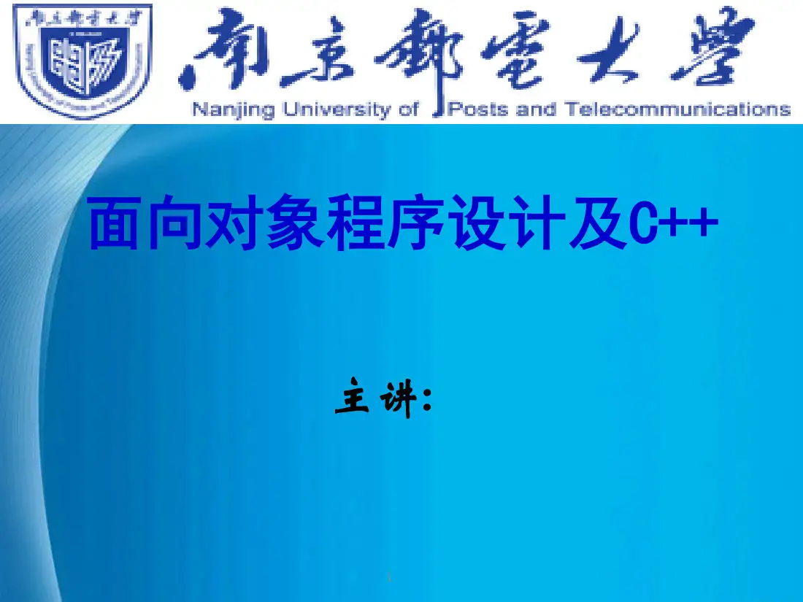

原文：

Nanjing University of JPosts and Telecommunications

面向对象程序设计及C++

主讲：

### 面向对象程序设计及C++

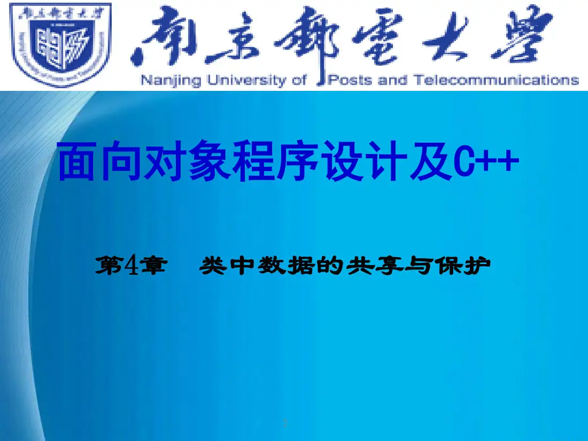

原文：

Nanjing University of JPosts and Telecommunications

面向对象程序设计及C++

第4章 类中数据的共享与保护

### 本章作业

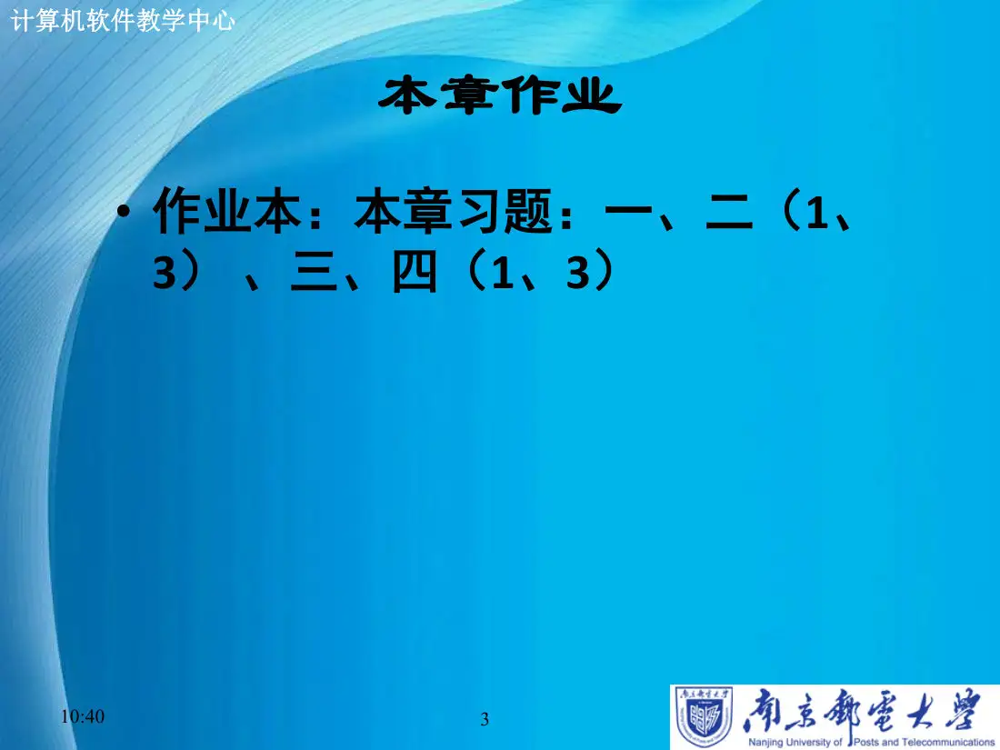

原文：

本章作业

• 作业本: 本章习题: 一、二 (1、3)、三、四 (1、3)

计算机软件教学中心

10:40

3

南京邮电大学
Nanjing University of Posts and Telecommunications

### 本章内容提要

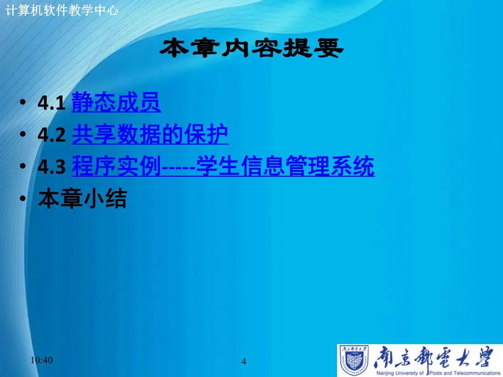

原文：

本章内容提要

• 4.1 静态成员

• 4.2 共享数据的保护

• 4.3 程序实例----学生信息管理系统

\- 本章小结

计算机软件教学中心

10:40

4

南京邮电大学
Nanjing University of Posts and Telecommunications

### 4.1 静态成员

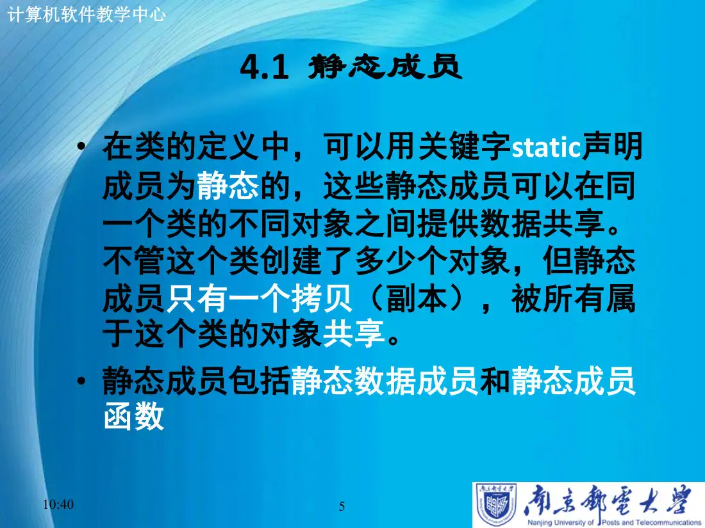

原文：

4.1 静态成员

\- 在类的定义中，可以用关键字static声明成员为静态的，这些静态成员可以在同一个类的不同对象之间提供数据共享。不管这个类创建了多少个对象，但静态成员只有一个拷贝（副本），被所有属于这个类的对象共享。

\- 静态成员包括静态数据成员和静态成员函数

计算机软件教学中心

10:40

5

南京邮电大学
Nanjing University of Posts and Telecommunications

### 4.1.1 静态数据成员

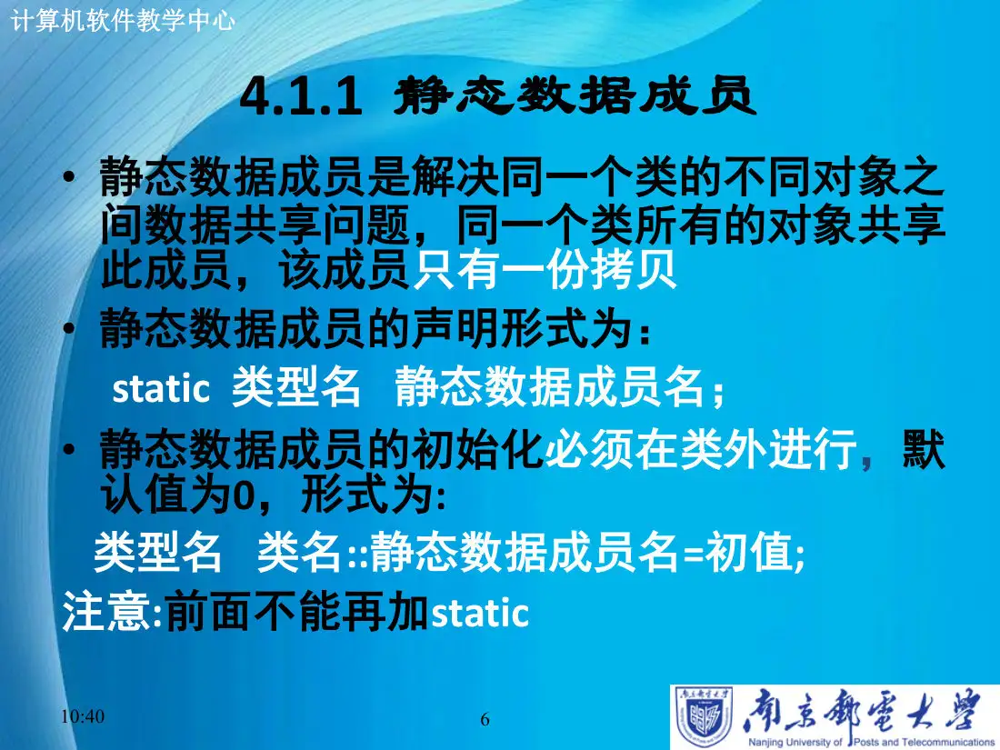

原文：

4.1.1 静态数据成员

\- 静态数据成员是解决同一个类的不同对象之间数据共享问题，同一个类所有的对象共享此成员，该成员只有一份拷贝

\- 静态数据成员的声明形式为:

static 类型名 静态数据成员名；

\- 静态数据成员的初始化必须在类外进行，默认值为0，形式为：

类型名 类名::静态数据成员名=初值;

注意:前面不能再加static

计算机软件教学中心

10:40

6

南京邮电大学
Nanjing University of Posts and Telecommunications

### 4.1.1 静态数据成员

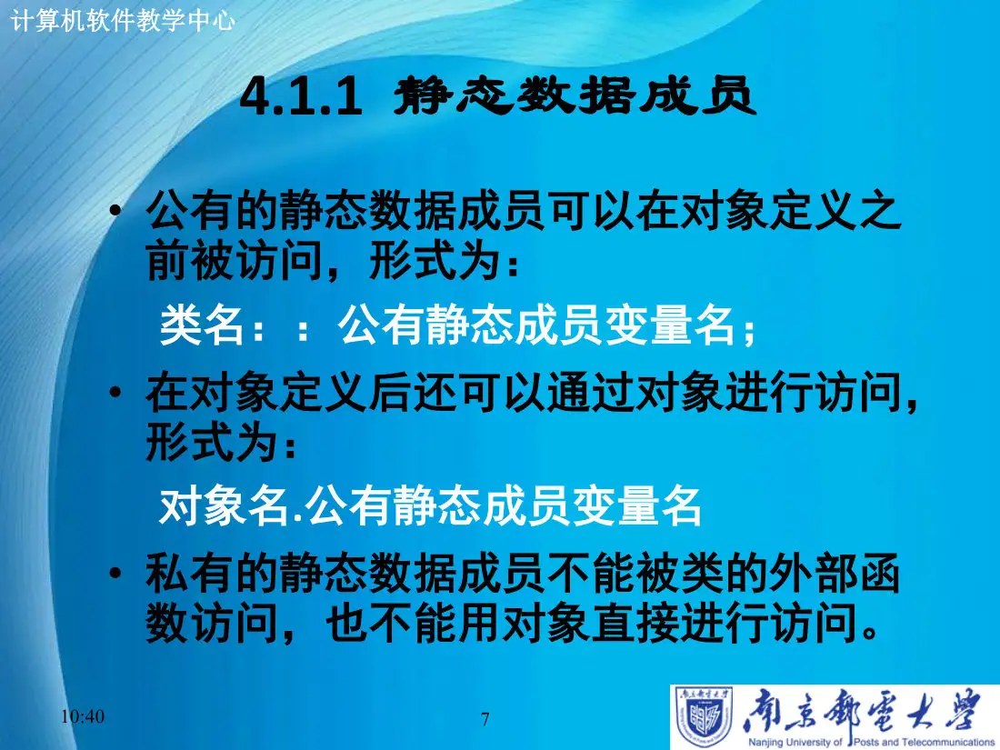

原文：

4.1.1 静态数据成员

\- 公有的静态数据成员可以在对象定义之前被访问，形式为：

类名：：公有静态成员变量名；

\- 在对象定义后还可以通过对象进行访问,形式为:

对象名.公有静态成员变量名

\- 私有的静态数据成员不能被类的外部函数访问，也不能用对象直接进行访问。

计算机软件教学中心

10:40

7

南京邮电大学
Nanjing University of Posts and Telecommunications

### 4.1.1 静态数据成员

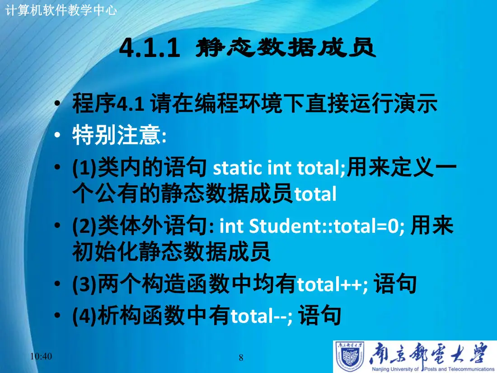

原文：

4.1.1 静态数据成员

\- 程序4.1 请在编程环境下直接运行演示

\- 特别注意:

• (1)类内的语句 static int total;用来定义一个公有的静态数据成员total

• (2)类体外语句: int Student::total=0; 用来初始化静态数据成员

• (3)两个构造函数中均有total++; 语句

• (4)析构函数中有total--; 语句

计算机软件教学中心

10:40

8

南京邮电大学
Nanjing University of Posts and Telecommunications

### 4.1.1 静态数据成员

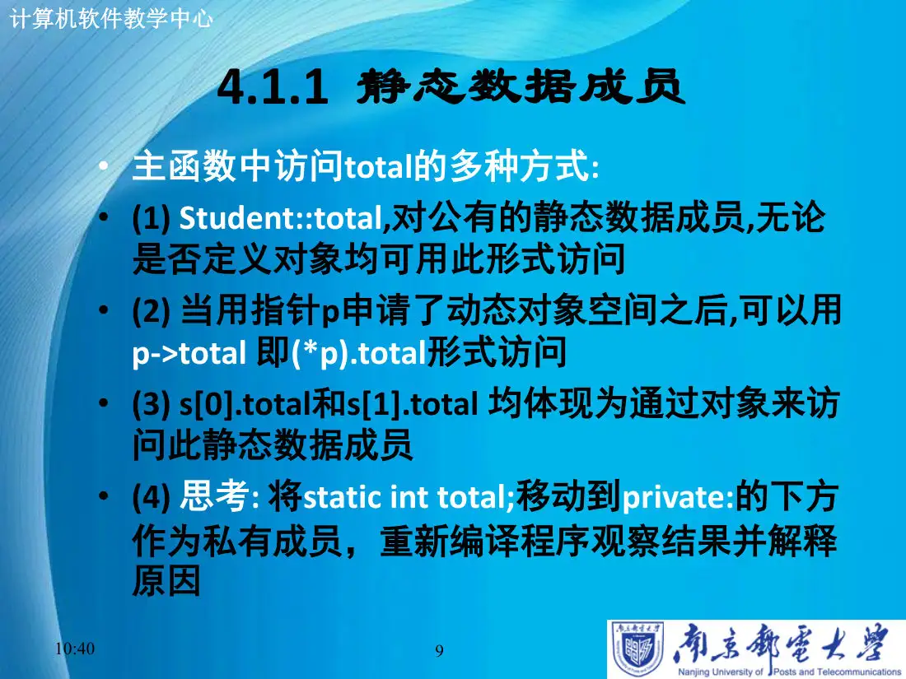

原文：

4.1.1 静态数据成员

主函数中访问total的多种方式:

(1) Student::total,对公有的静态数据成员,无论是否定义对象均可用此形式访问

• (2) 当用指针p申请了动态对象空间之后,可以用p->total 即(\*p).total形式访问

• (3) s[0].total和s[1].total 均体现为通过对象来访问此静态数据成员

• (4) 思考: 将static int total;移动到private:的下方作为私有成员, 重新编译程序观察结果并解释原因

计算机软件教学中心

10:40

9

南京邮电大学
Nanjing University of Posts and Telecommunication

### 4.1.2 静态成员函数

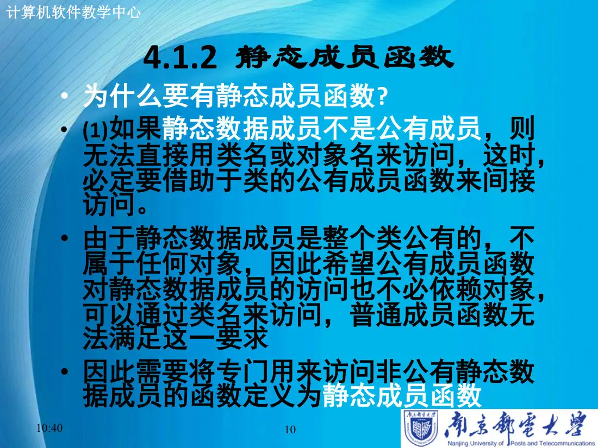

原文：

4.1.2 静态成员函数

为什么要有静态成员函数？

(1)如果静态数据成员不是公有成员，则无法直接用类名或对象名来访问，这时，必定要借助于类的公有成员函数来间接访问。

\- 由于静态数据成员是整个类公有的，不属于任何对象，因此希望公有成员函数对静态数据成员的访问也不必依赖对象，可以通过类名来访问，普通成员函数无法满足这一要求

\- 因此需要将专门用来访问非公有静态数据成员的函数定义为静态成员函数

计算机软件教学中心

10:40

10

南京邮电大学
Nanjing University of Posts and Telecommunication

### 4.1.2 静态成员函数

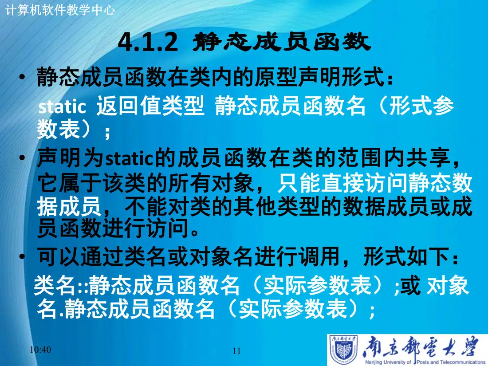

原文：

4.1.2 静态成员函数

\- 静态成员函数在类内的原型声明形式: static 返回值类型 静态成员函数名（形式参数表）;

\- 声明为static的成员函数在类的范围内共享，它属于该类的所有对象，只能直接访问静态数据成员，不能对类的其他类型的数据成员或成员函数进行访问。

\- 可以通过类名或对象名进行调用，形式如下：类名::静态成员函数名（实际参数表）;或对象名.静态成员函数名（实际参数表）；

计算机软件教学中心

10:40

11

南京邮电大学
Nanjing University of Posts and Telecommunication

### 4.1.2 静态成员函数

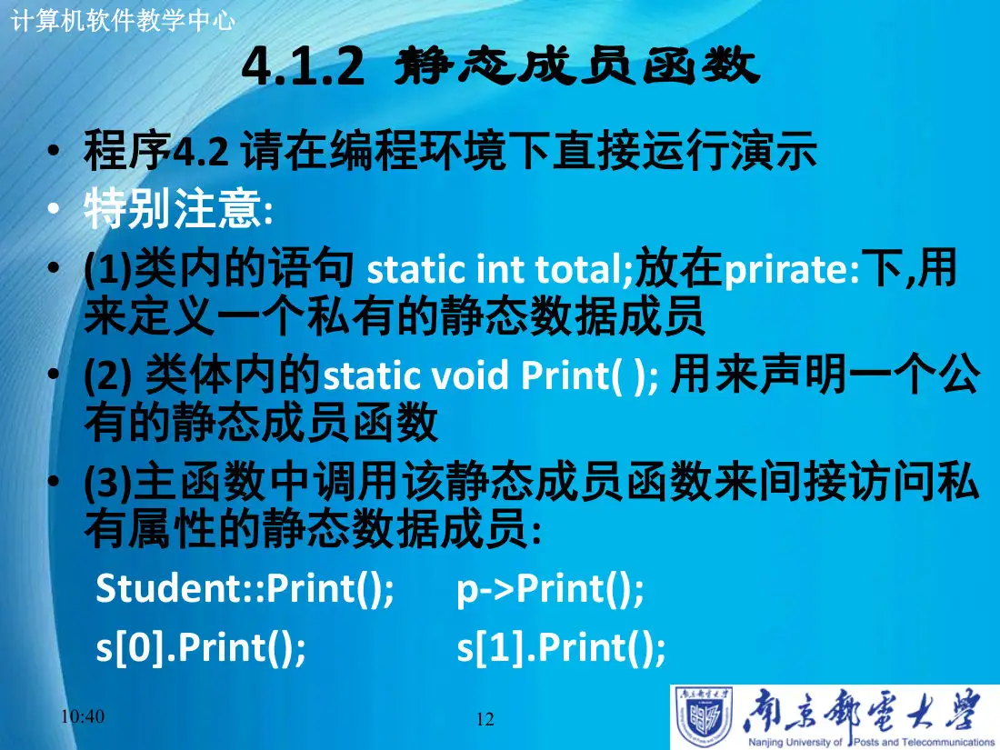

原文：

4.1.2 静态成员函数

\- 程序4.2 请在编程环境下直接运行演示

\- 特别注意:

• (1)类内的语句 static int total;放在private:下,用来定义一个私有的静态数据成员

• (2) 类体内的static void Print(); 用来声明一个公有的静态成员函数

(3)主函数中调用该静态成员函数来间接访问私有属性的静态数据成员:

Student::Print(); p->Print();

s[0].Print(); s[1].Print();

计算机软件教学中心

10:40

12

南京邮电大学
Nanjing University of Posts and Telecommunications

### 4.1.2 静态成员函数

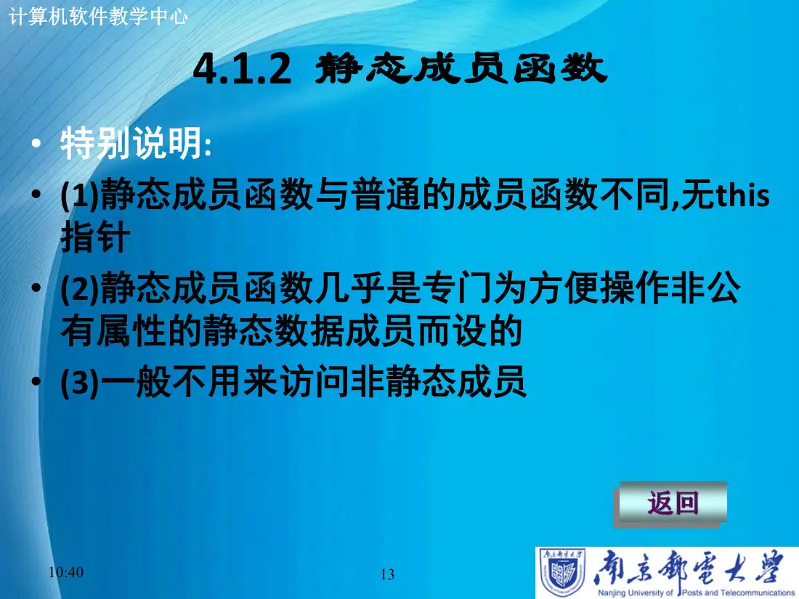

原文：

4.1.2 静态成员函数

- 特别说明:

• (1)静态成员函数与普通的成员函数不同,无this指针

• (2)静态成员函数几乎是专门为方便操作非公有属性的静态数据成员而设的

(3)一般不用来访问非静态成员

返回

计算机软件教学中心

10:40

13

南京邮电大学
Nanjing University of Posts and Telecommunications

### 4.2 共享数据的保护

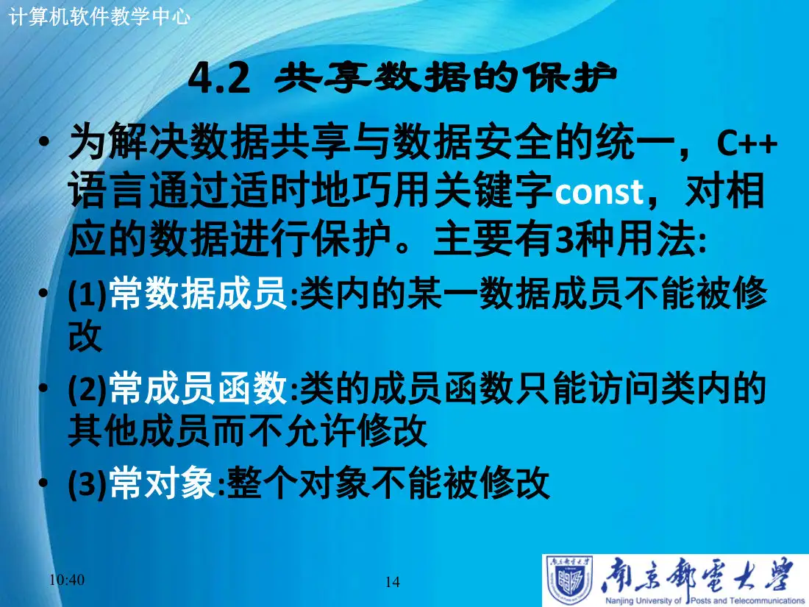

原文：

4.2 共享数据的保护

\- 为解决数据共享与数据安全的统一，C++语言通过适时地巧用关键字const，对相应的数据进行保护。主要有3种用法：

• (1)常数据成员:类内的某一数据成员不能被修改

• (2)常成员函数:类的成员函数只能访问类内的其他成员而不允许修改

(3)常对象:整个对象不能被修改

计算机软件教学中心

10:40

14

南京邮电大学
Nanjing University of Posts and Telecommunications

### 4.2.1 常数据成员

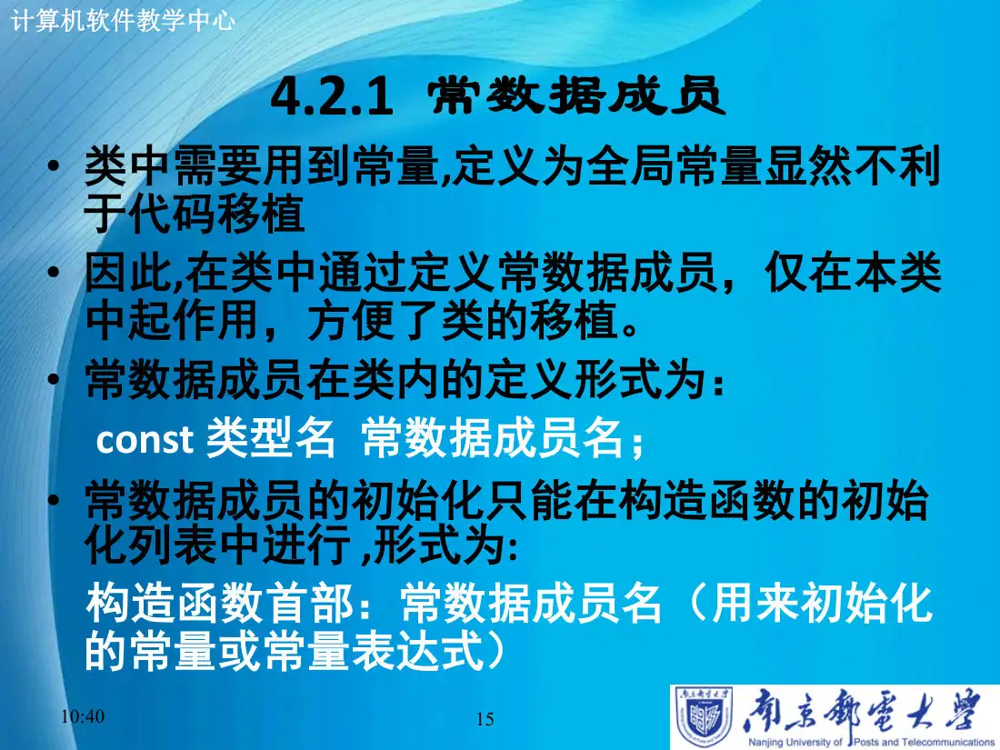

原文：

4.2.1 常数据成员

\- 类中需要用到常量,定义为全局常量显然不利于代码移植

\- 因此,在类中通过定义常数据成员，仅在本类中起作用，方便了类的移植。

\- 常数据成员在类内的定义形式为：

const 类型名 常数据成员名；

\- 常数据成员的初始化只能在构造函数的初始化列表中进行,形式为:

构造函数首部：常数据成员名（用来初始化的常量或常量表达式）

计算机软件教学中心

10:40

15

南京邮电大学
Nanjing University of Posts and Telecommunications

### 4.2.1 常数据成员

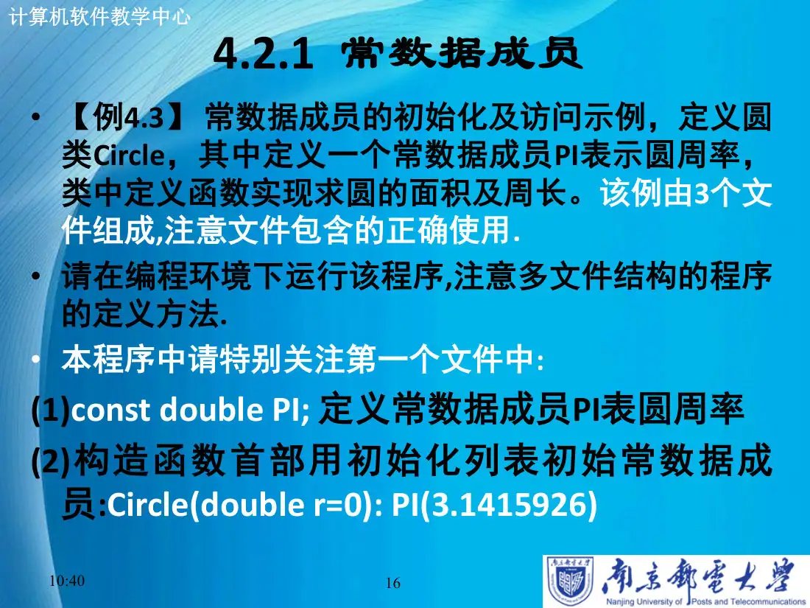

原文：

4.2.1 常数据成员

• 【例4.3】常数据成员的初始化及访问示例，定义圆类Circle，其中定义一个常数据成员PI表示圆周率，类中定义函数实现求圆的面积及周长。该例由3个文件组成,注意文件包含的正确使用.

\- 请在编程环境下运行该程序,注意多文件结构的程序的定义方法.

本程序中请特别关注第一个文件中:

(1)const double PI; 定义常数据成员PI表圆周率

(2)构造函数首部用初始化列表初始常数据成员:Circle(double r=0): PI(3.1415926)

计算机软件教学中心

10:40

16

南京邮电大学
Nanjing University of Posts and Telecommunications

### 4.2.1 常数据成员

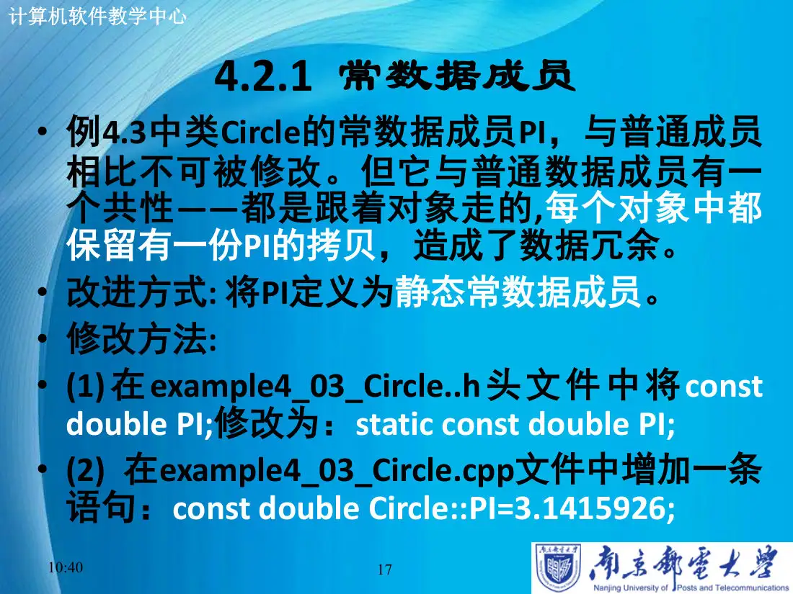

原文：

4.2.1 常数据成员

• 例4.3中类Circle的常数据成员PI，与普通成员相比不可被修改。但它与普通数据成员有一个共性——都是跟着对象走的,每个对象中都保留有一份PI的拷贝，造成了数据冗余。

\- 改进方式: 将PI定义为静态常数据成员。

修改方法:

(1) 在 example4\_03\_Circle..h 头文件中将 const double PI; 修改为: static const double PI;

(2) 在example4\_03\_Circle.cpp文件中增加一条语句：const double Circle::PI=3.1415926;

计算机软件教学中心

10:40

17

南京邮电大学
Nanjing University of Posts and Telecommunications

### 4.2.2 常成员函数

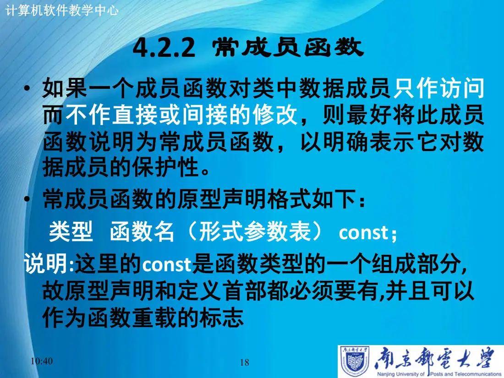

原文：

4.2.2 常成员函数

\- 如果一个成员函数对类中数据成员只作访问而不作直接或间接的修改，则最好将此成员函数说明为常成员函数，以明确表示它对数据成员的保护性。

\- 常成员函数的原型声明格式如下:

类型 函数名（形式参数表） const;

说明:这里的const是函数类型的一个组成部分,故原型声明和定义首部都必须要有,并且可以作为函数重载的标志

计算机软件教学中心

10:40

18

南京邮电大学
Nanjing University of Posts and Telecommunications

### 4.2.2 常成员函数

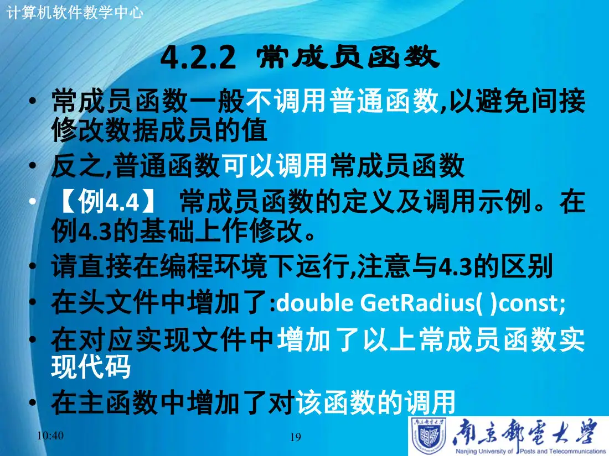

原文：

4.2.2 常成员函数

\- 常成员函数一般不调用普通函数,以避免间接修改数据成员的值

\- 反之,普通函数可以调用常成员函数

【例4.4】常成员函数的定义及调用示例。在例4.3的基础上作修改。

\- 请直接在编程环境下运行,注意与4.3的区别

\- 在头文件中增加了:double GetRadius( )const;

\- 在对应实现文件中增加了以上常成员函数实现代码

\- 在主函数中增加了对该函数的调用

计算机软件教学中心

10:40

19

南京邮电大学
Nanjing University of Posts and Telecommunications

### 计算机软件教学中心

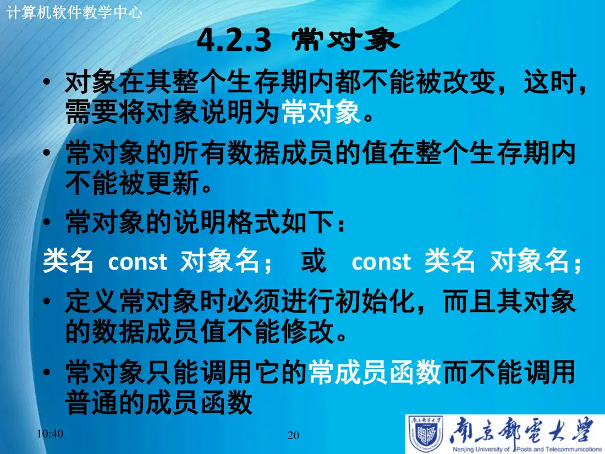

原文：

计算机软件教学中心

4.2.3 常对象

\- 对象在其整个生存期内都不能被改变，这时，需要将对象说明为常对象。

\- 常对象的所有数据成员的值在整个生存期内不能被更新。

\- 常对象的说明格式如下:

类名 const 对象名；或 const 类名 对象名；

\- 定义常对象时必须进行初始化，而且其对象的数据成员值不能修改。

\- 常对象只能调用它的常成员函数而不能调用普通的成员函数

10:40

20

南京邮电大学
Nanjing University of Posts and Telecommunications

### 4.2.3 常对象

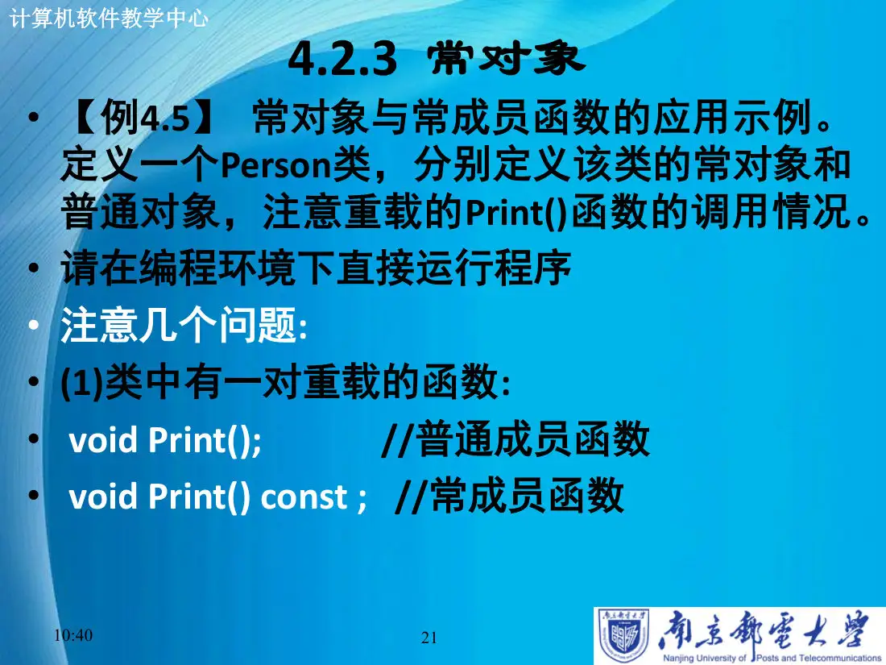

原文：

4.2.3 常对象

• 【例4.5】常对象与常成员函数的应用示例。定义一个Person类，分别定义该类的常对象和普通对象，注意重载的Print()函数的调用情况。

\- 请在编程环境下直接运行程序

\- 注意几个问题:

• (1)类中有一对重载的函数:

\- void Print(); //普通成员函数

\- void Print() const; //常成员函数

计算机软件教学中心

10:40

21

南京邮电大学
Nanjing University of Posts and Telecommunications

### 4.2.3 常对象

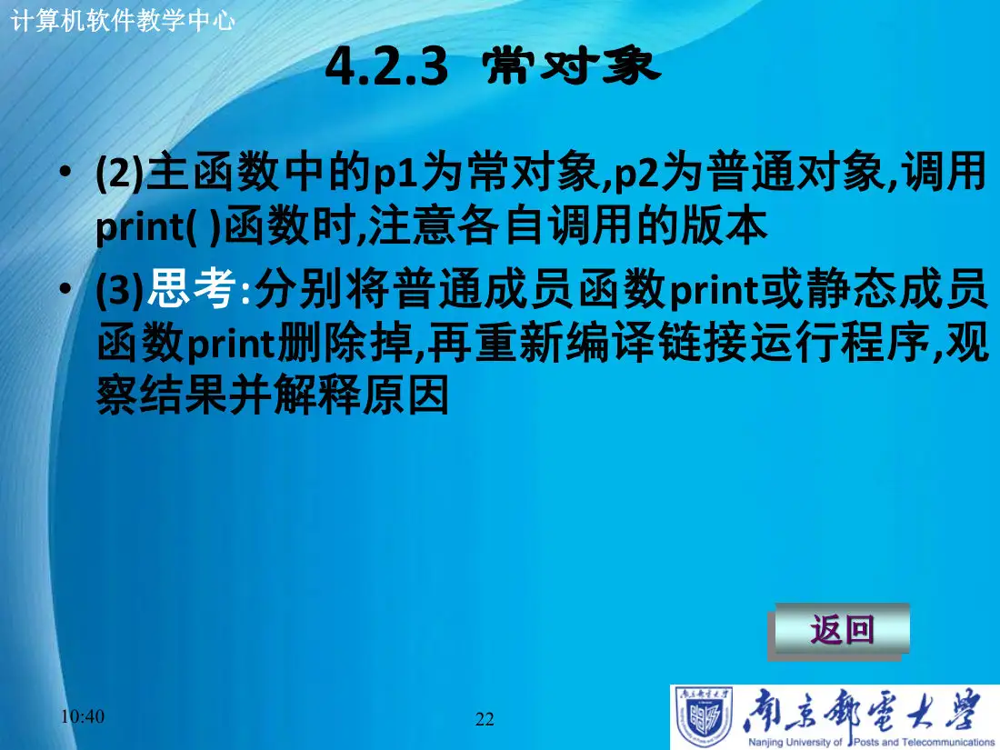

原文：

4.2.3 常对象

• (2)主函数中的p1为常对象,p2为普通对象,调用print()函数时,注意各自调用的版本

(3)思考:分别将普通成员函数print或静态成员函数print删除掉,再重新编译链接运行程序,观察结果并解释原因

返回

计算机软件教学中心

10:40

22

南京邮电大学
Nanjing University of Posts and Telecommunications

### 4.3 程序实例——学生信息管理系统

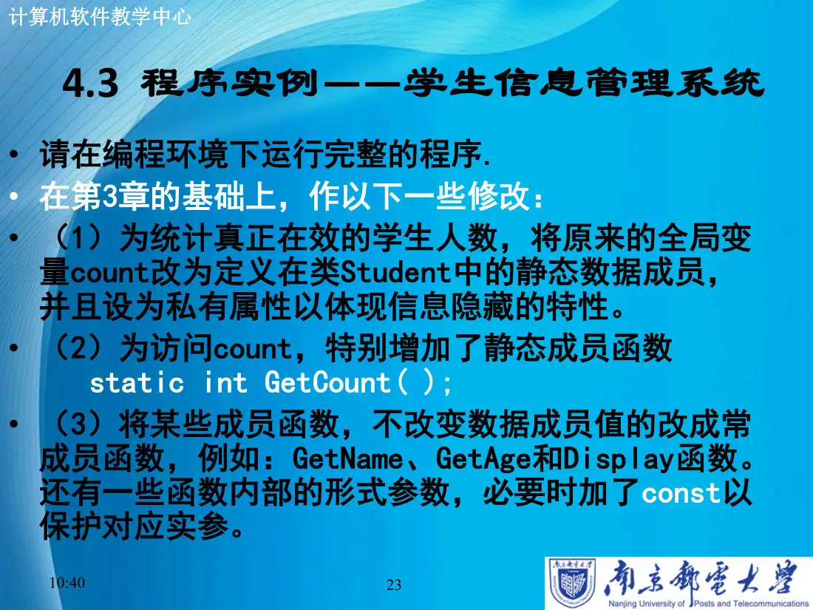

原文：

4.3 程序实例——学生信息管理系统

\- 请在编程环境下运行完整的程序.

\- 在第3章的基础上，作以下一些修改：

• (1) 为统计真正在效的学生人数, 将原来的全局变量count改为定义在类Student中的静态数据成员, 并且设为私有属性以体现信息隐藏的特性。

(2) 为访问count，特别增加了静态成员函数 static int GetCount();

• (3) 将某些成员函数, 不改变数据成员值的改成常成员函数, 例如: GetName、GetAge和Display函数。还有一些函数内部的形式参数, 必要时加了const以保护对应实参。

计算机软件教学中心

10:40

23

南京邮电大学
Nanjing University of Posts and Telecommunications

### 4.3 程序实例——学生信息管理系统

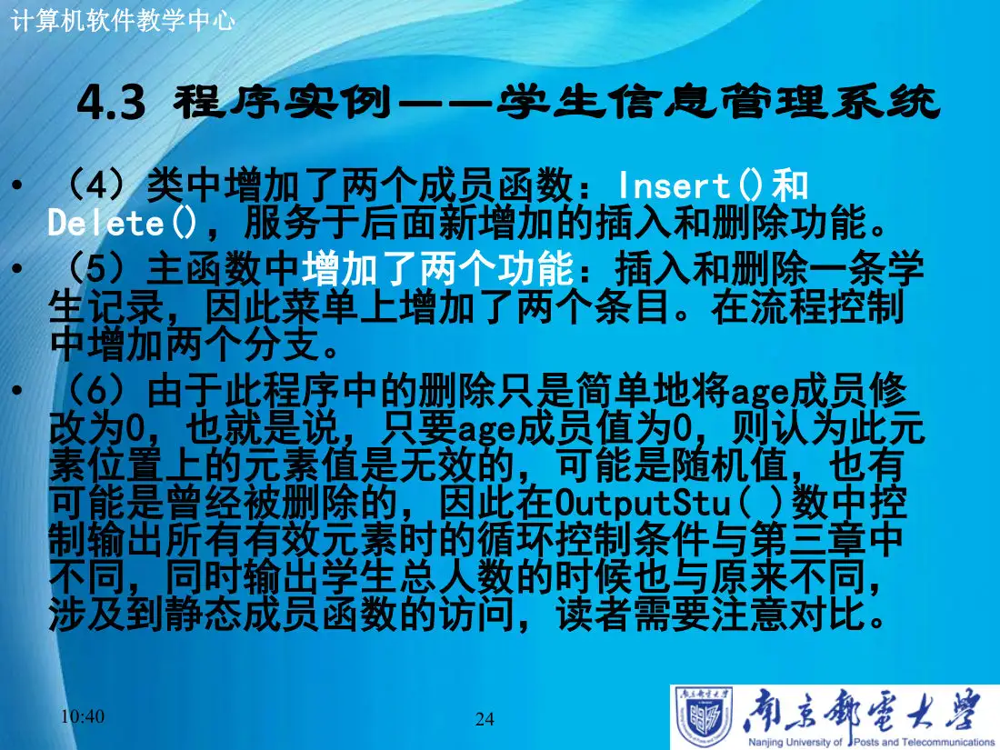

原文：

4.3 程序实例——学生信息管理系统

• (4) 类中增加了两个成员函数: Insert() 和 Delete(), 服务于后面新增加的插入和删除功能。

• (5) 主函数中增加了两个功能: 插入和删除一条学生记录, 因此菜单上增加了两个条目。在流程控制中增加两个分支。

• (6) 由于此程序中的删除只是简单地将age成员修改为0, 也就是说, 只要age成员值为0, 则认为此元素位置上的元素值是无效的, 可能是随机值, 也有可能是曾经被删除的, 因此在OutputStu()数中控制输出所有有效元素时的循环控制条件与第三章中不同, 同时输出学生总人数的时候也与原来不同, 涉及到静态成员函数的访问, 读者需要注意对比。

计算机软件教学中心

10:40

24

南京邮电大学
Nanjing University of Posts and Telecommunications

### 4.3 程序实例——学生信息管理系统

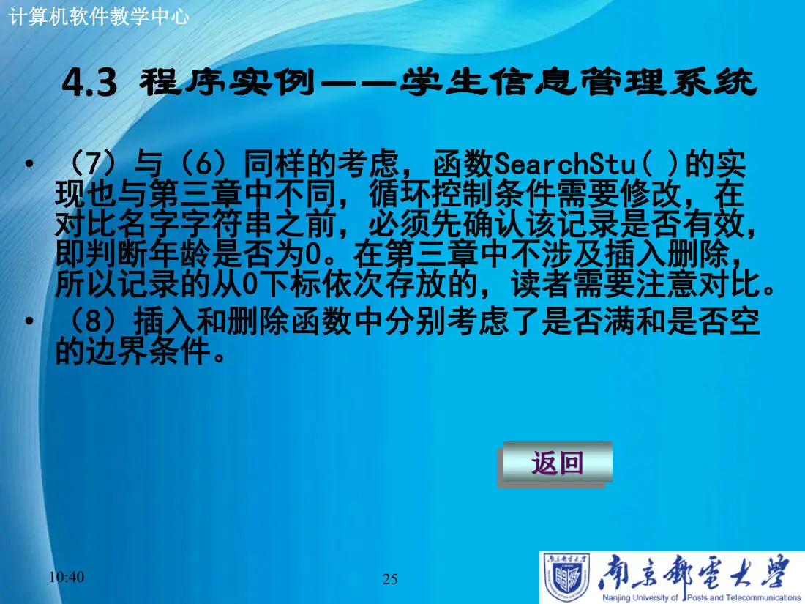

原文：

4.3 程序实例——学生信息管理系统

• (7) 与 (6) 同样的考虑, 函数SearchStu()的实现也与第三章中不同, 循环控制条件需要修改, 在对比名字字符串之前, 必须先确认该记录是否有效, 即判断年龄是否为0。在第三章中不涉及插入删除, 所以记录的从0下标依次存放的, 读者需要注意对比。

(8) 插入和删除函数中分别考虑了是否满和是否空的边界条件。

返回

计算机软件教学中心

10:40

25

南京邮电大学
Nanjing University of Posts and Telecommunications

### 本章小结

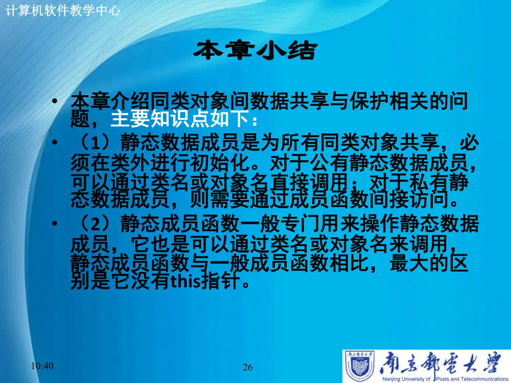

原文：

本章小结

\- 本章介绍同类对象间数据共享与保护相关的问题，主要知识点如下：

• （1）静态数据成员是为所有同类对象共享，必须在类外进行初始化。对于公有静态数据成员，可以通过类名或对象名直接调用；对于私有静态数据成员，则需要通过成员函数间接访问。

• （2）静态成员函数一般专门用来操作静态数据成员，它也是可以通过类名或对象名来调用，静态成员函数与一般成员函数相比，最大的区别是它没有this指针。

计算机软件教学中心

10:40

26

南京邮电大学
Nanjing University of Posts and Telecommunications

### 本章小结

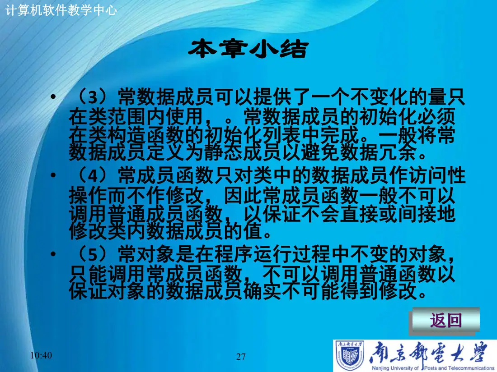

原文：

本章小结

(3) 常数据成员可以提供了一个不变化的量只在类范围内使用，。常数据成员的初始化必须在类构造函数的初始化列表中完成。一般将常数据成员定义为静态成员以避免数据冗余。

• （4）常成员函数只对类中的数据成员作访问性操作而不作修改，因此常成员函数一般不可以调用普通成员函数，以保证不会直接或间接地修改类内数据成员的值。

• （5）常对象是在程序运行过程中不变的对象，只能调用常成员函数，不可以调用普通函数以保证对象的数据成员确实不可能得到修改。

返回

计算机软件教学中心

10:40

27

南京邮电大学
Nanjing University of Posts and Telecommunication
