# 《面向对象程序设计及C++》第5章 类与类之间的关系（课件）

原件的每一页，下面附识别出的文字。

### 面向对象程序设计及C++

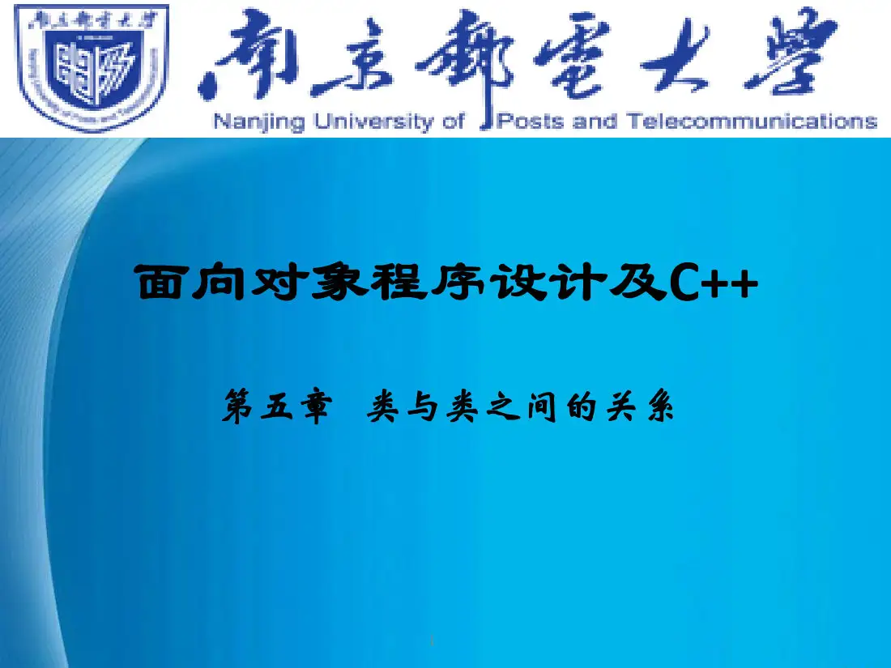

原文：

Nanjing University of JPosts and Telecommunications

面向对象程序设计及C++

第五章 类与类之间的关系

### 计算机软件教学中心

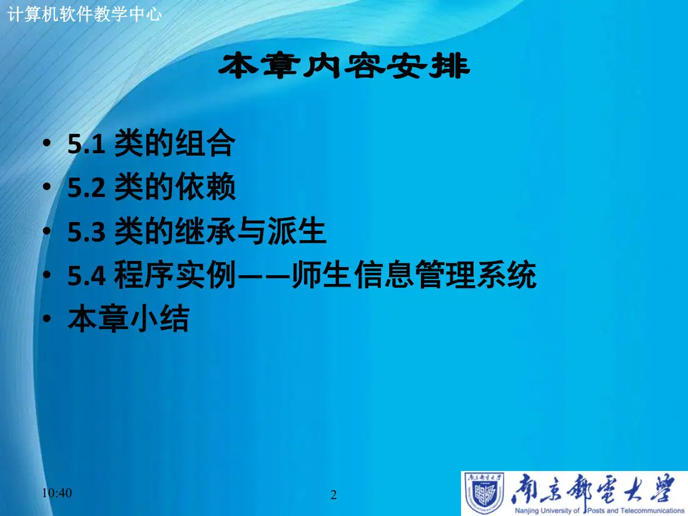

原文：

计算机软件教学中心

本章内容安排

• 5.1 类的组合

• 5.2 类的依赖

5.3 类的继承与派生

• 5.4 程序实例——师生信息管理系统

\- 本章小结

10:40

2

南京邮电大学
Nanjing University of Posts and Telecommunications

### 5.1 类的组合

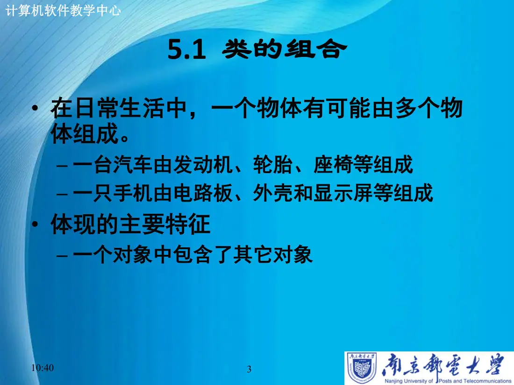

原文：

5.1 类的组合

\- 在日常生活中，一个物体有可能由多个物体组成。

\- 一台汽车由发动机、轮胎、座椅等组成

\- 一只手机由电路板、外壳和显示屏等组成

\- 体现的主要特征

\- 一个对象中包含了其它对象- 面向对象程序设计为描述这种关系，引入组合机制。

计算机软件教学中心

10:40

3

南京邮电大学
Nanjing University of Posts and Telecommunications

### class B

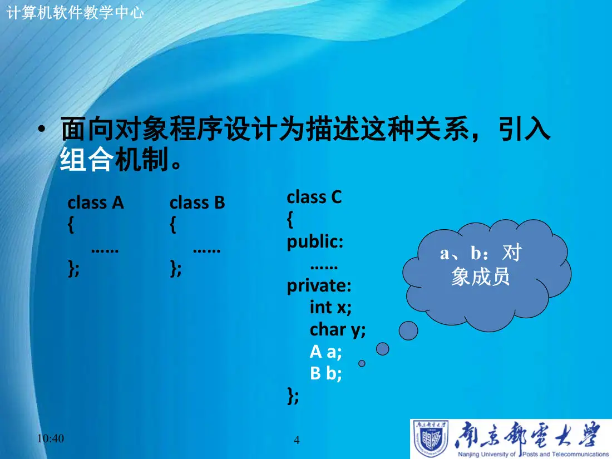

原文：

class B

class C

public:

......
private:
int x;
char y;
A a;
B b;

a、b: 对象成员

计算机软件教学中心

10:40

南京邮电大学
Nanjing University of Posts and Telecommunications

### 对象成员的构造与析构

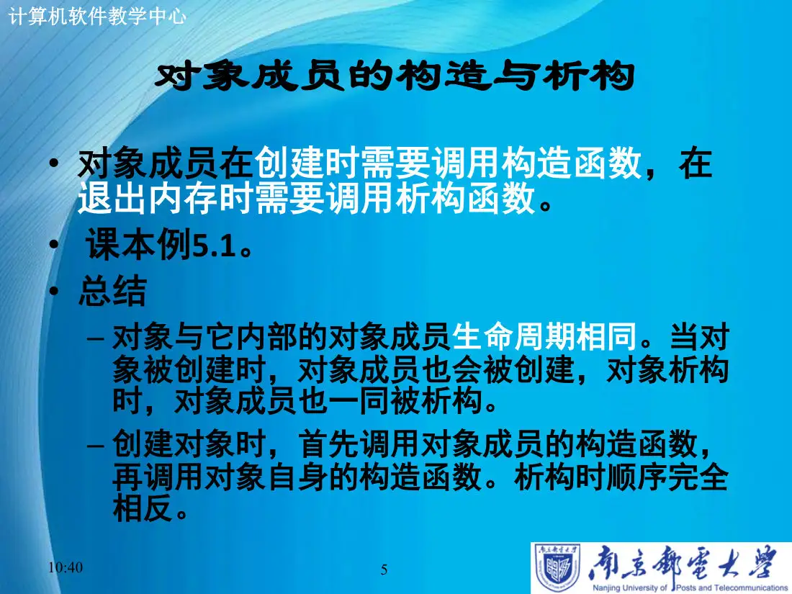

原文：

对象成员的构造与析构

\- 对象成员在创建时需要调用构造函数，在退出内存时需要调用析构函数。

\- 课本例5.1。

总结

\- 对象与它内部的对象成员生命周期相同。当对象被创建时，对象成员也会被创建，对象析构时，对象成员也一同被析构。

\- 创建对象时，首先调用对象成员的构造函数，再调用对象自身的构造函数。析构时顺序完全相反。

计算机软件教学中心

10:40

5

南京邮电大学
Nanjing University of Posts and Telecommunications

### 对象成员的构造与析构

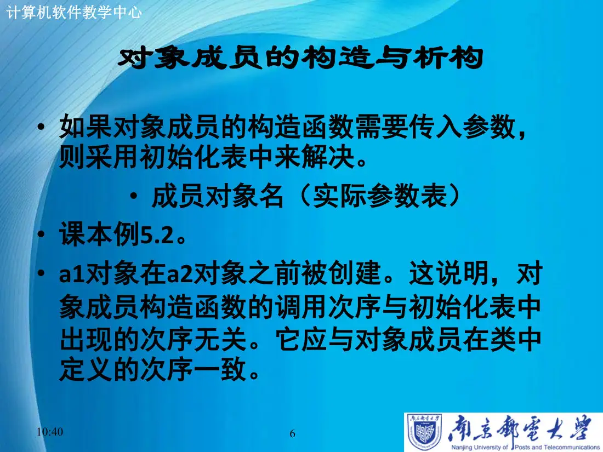

原文：

对象成员的构造与析构

\- 如果对象成员的构造函数需要传入参数,则采用初始化表中来解决。

\- 成员对象名（实际参数表）

\- 课本例5.2。

\- a1对象在a2对象之前被创建。这说明，对象成员构造函数的调用次序与初始化表中出现的次序无关。它应与对象成员在类中定义的次序一致。

计算机软件教学中心

10:40

6

南京邮电大学
Nanjing University of Posts and Telecommunications

### 5.2 类的依赖

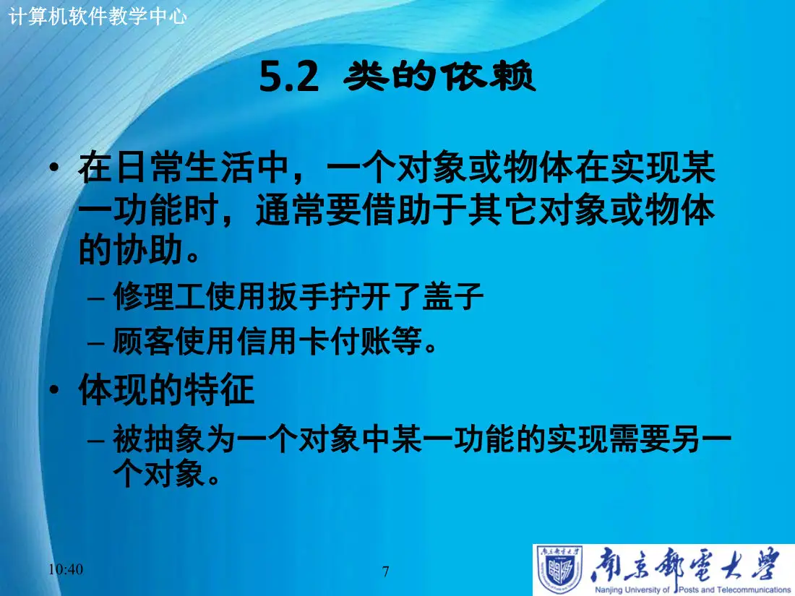

原文：

5.2 类的依赖

\- 在日常生活中，一个对象或物体在实现某一功能时，通常要借助于其它对象或物体的协助。

\- 修理工使用扳手拧开了盖子

\- 顾客使用信用卡付账等。

\- 体现的特征

\- 被抽象为一个对象中某一功能的实现需要另一个对象。

计算机软件教学中心

10:40

7

南京邮电大学
Nanjing University of Posts and Telecommunications

### 类的依赖

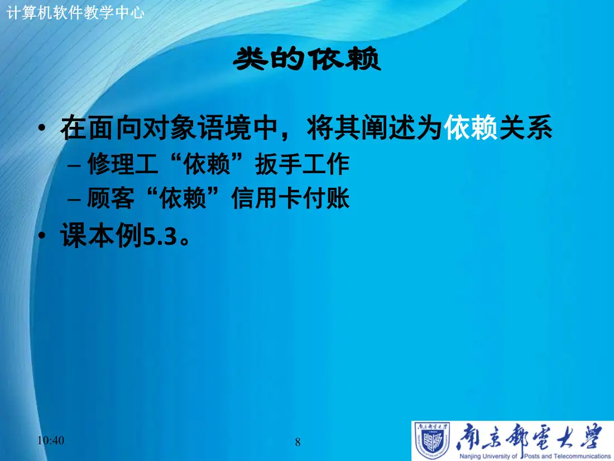

原文：

类的依赖

\- 在面向对象语境中，将其阐述为依赖关系

\- 修理工“依赖”扳手工作

\- 顾客“依赖”信用卡付账

\- 课本例5.3。

计算机软件教学中心

10:40

8

南京邮电大学
Nanjing University of Posts and Telecommunications

### 类的依赖

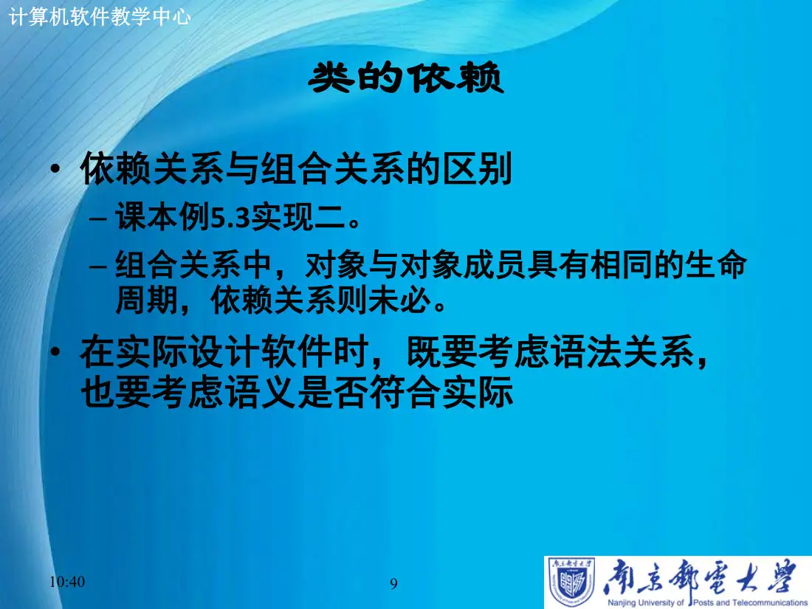

原文：

类的依赖

\- 依赖关系与组合关系的区别

\- 课本例5.3实现二。

\- 组合关系中，对象与对象成员具有相同的生命周期，依赖关系则未必。

\- 在实际设计软件时，既要考虑语法关系，也要考虑语义是否符合实际

计算机软件教学中心

10:40

9

南京邮电大学
Nanjing University of Posts and Telecommunications

### 5.3 类的继承与派生

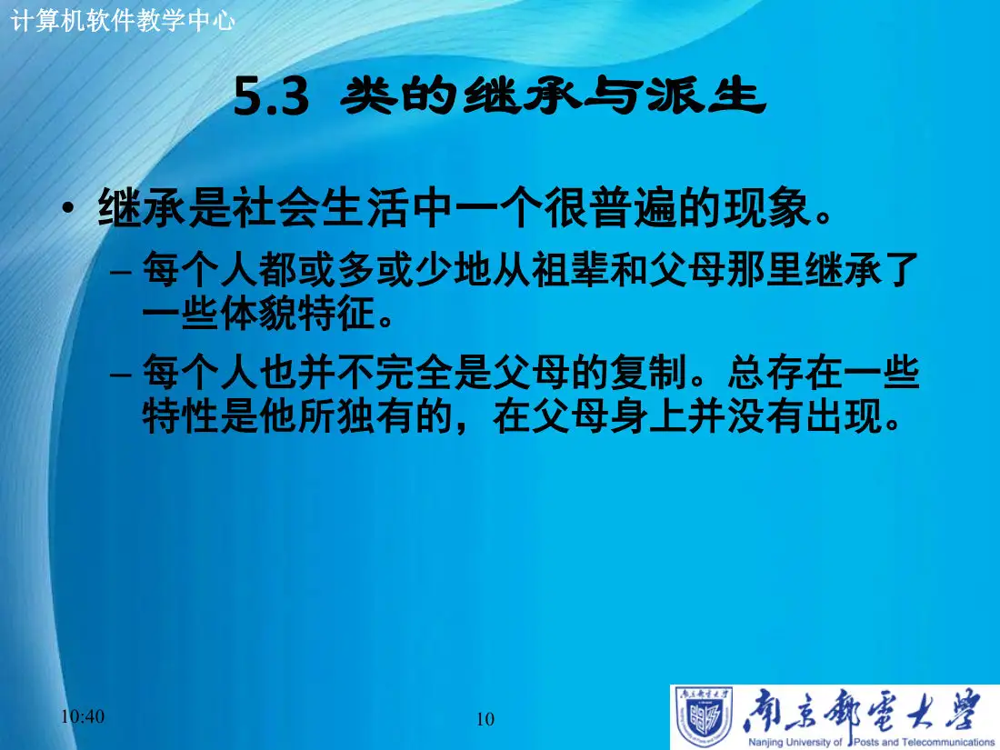

原文：

5.3 类的继承与派生

\- 继承是社会生活中一个很普遍的现象。

\- 每个人都或多或少地从祖辈和父母那里继承了一些体貌特征。

\- 每个人也并不完全是父母的复制。总存在一些特性是他所独有的，在父母身上并没有出现。

计算机软件教学中心

10:40

10

南京邮电大学
Nanjing University of Posts and Telecommunications

### 类的继承与派生

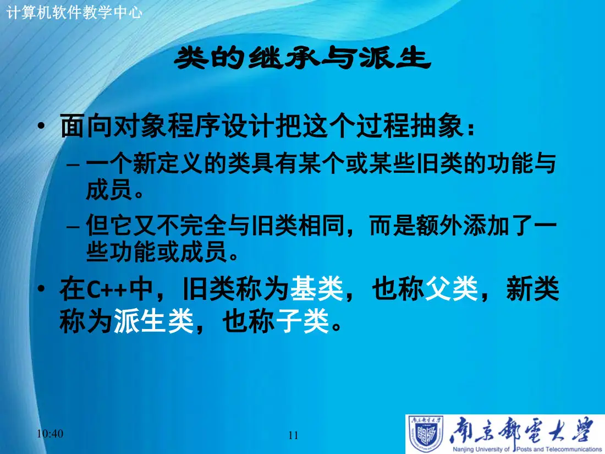

原文：

类的继承与派生

\- 面向对象程序设计把这个过程抽象:

\- 一个新定义的类具有某个或某些旧类的功能与成员。

\- 但它又不完全与旧类相同，而是额外添加了一些功能或成员。

\- 在C++中，旧类称为基类，也称父类，新类称为派生类，也称子类。

计算机软件教学中心

10:40

11

南京邮电大学
Nanjing University of Posts and Telecommunications

### 继承与派生

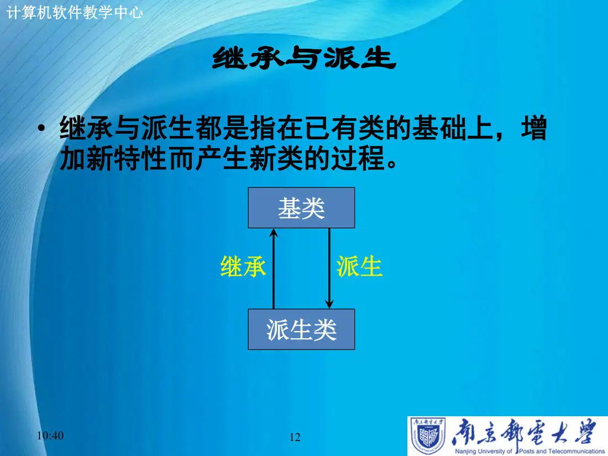

原文：

继承与派生

\- 继承与派生都是指在已有类的基础上，增加新特性而产生新类的过程。

计算机软件教学中心

10:40

12

南京邮电大学
Nanjing University of Posts and Telecommunications

### 基类与派生类

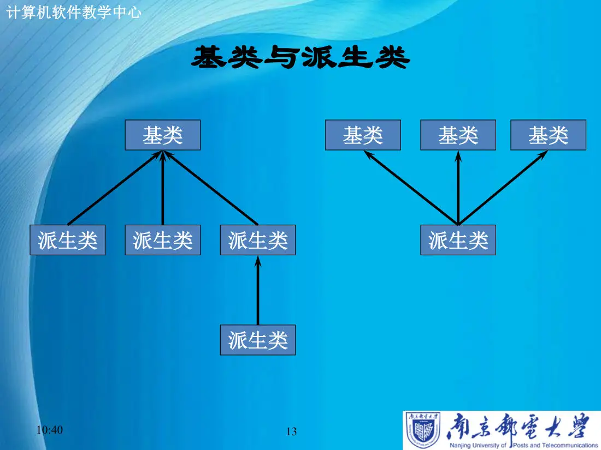

原文：

基类与派生类

基类

基类

基类

基类

派生类

派生类

派生类

派生类

派生类

计算机软件教学中心

13

南京邮电大学
Nanjing University of Posts and Telecommunications

### 单一继承与多重继承

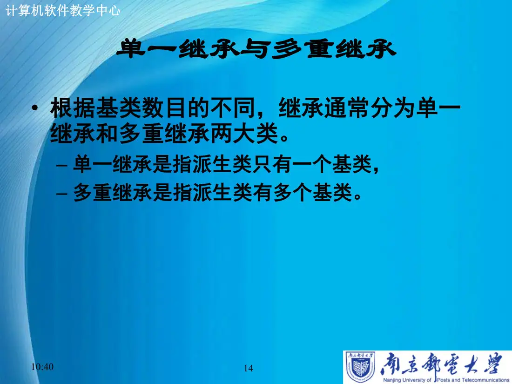

原文：

单一继承与多重继承

\- 根据基类数目的不同，继承通常分为单一继承和多重继承两大类。

\- 单一继承是指派生类只有一个基类，

\- 多重继承是指派生类有多个基类。

计算机软件教学中心

10:40

14

南京邮电大学
Nanjing University of Posts and Telecommunications

### 派生类的定义

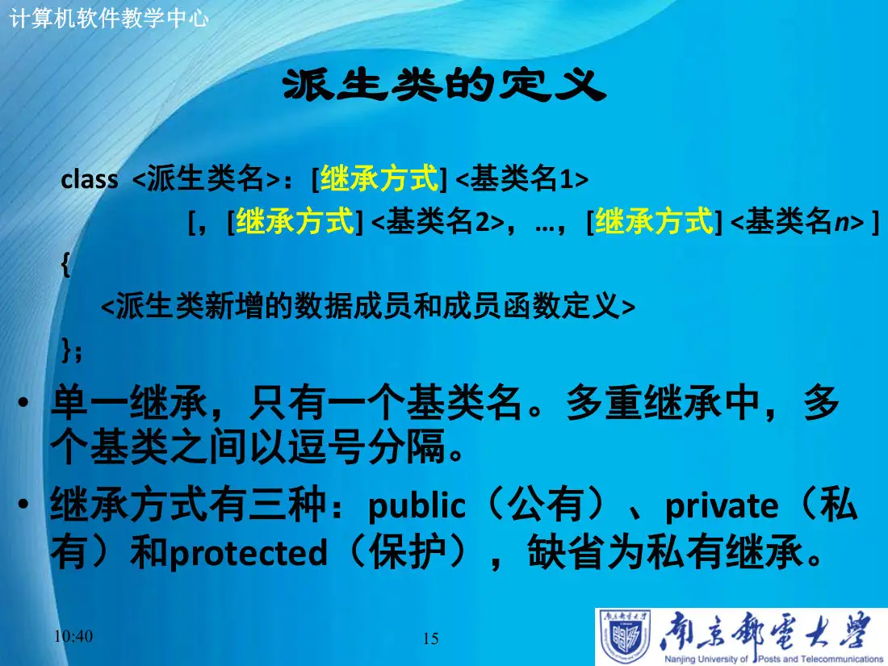

原文：

派生类的定义

class <派生类名>: [继承方式] <基类名1>

[，[继承方式] <基类名2>，…，[继承方式] <基类名n>]

<派生类新增的数据成员和成员函数定义>

\- 单一继承，只有一个基类名。多重继承中，多个基类之间以逗号分隔。

\- 继承方式有三种：public（公有）、private（私有）和protected（保护），缺省为私有继承。

计算机软件教学中心

10:40

15

南京邮电大学
Nanjing University of Posts and Telecommunications

### 继承机制的优势

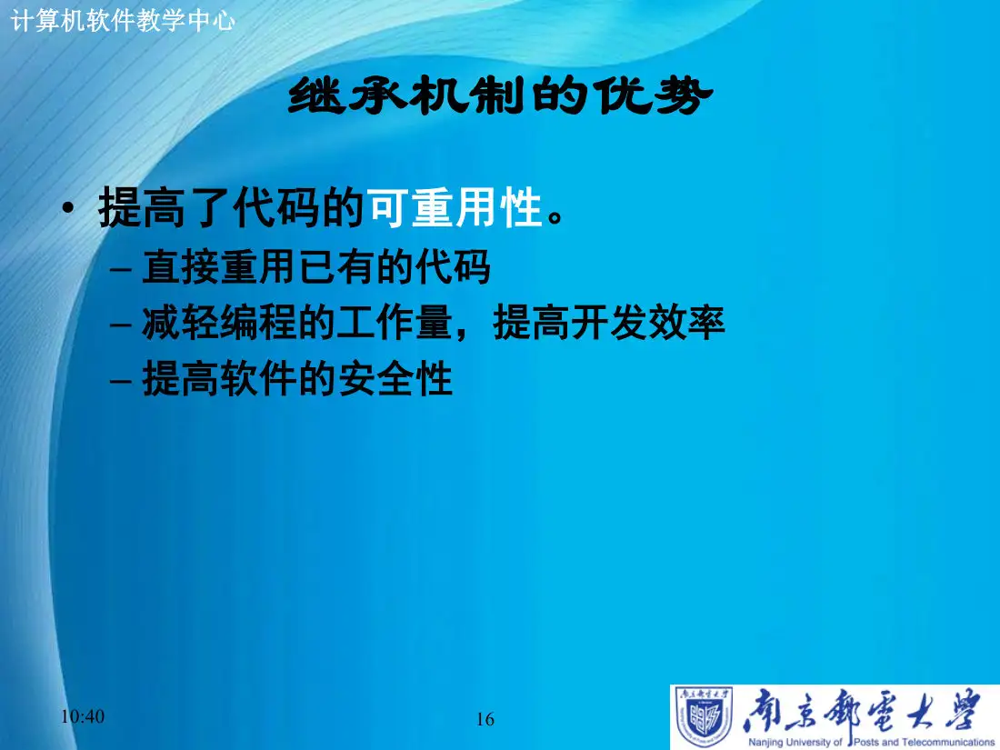

原文：

继承机制的优势

\- 提高了代码的可重用性。

\- 直接重用已有的代码

\- 减轻编程的工作量，提高开发效率

\- 提高软件的安全性

计算机软件教学中心

10:40

16

南京邮电大学
Nanjing University of Posts and Telecommunications

### • 例

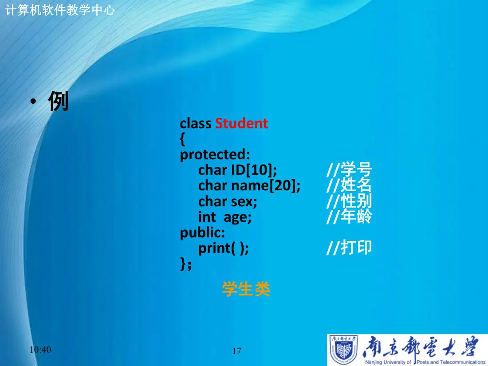

原文：

• 例

class Student
{
protected:
    char ID[10]; //学号
    char name[20]; //姓名
    char sex; //性别
    int age; //年龄
public:
    print(); //打印
};

学生类

计算机软件教学中心

10:40

17

南京邮电大学
Nanjing University of Posts and Telecommunications

### class Graduate

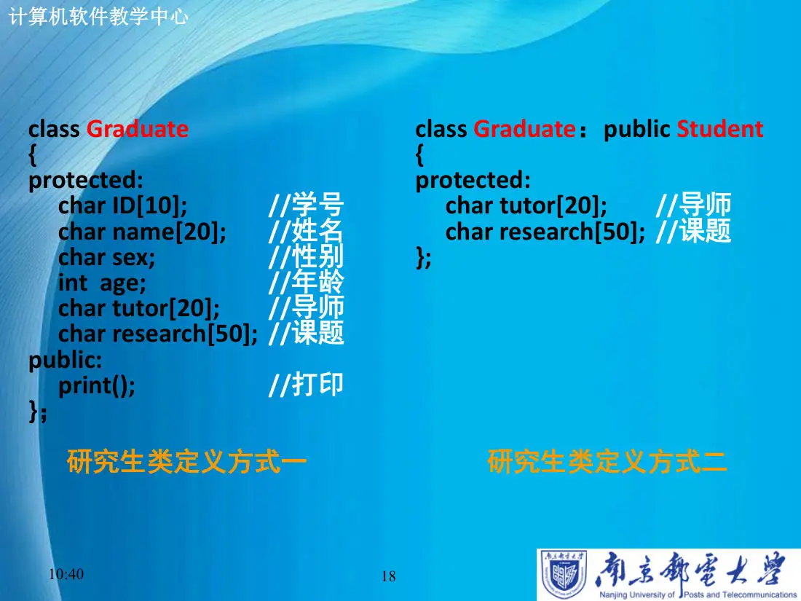

原文：

class Graduate

protected:
char ID[10]; //学号
char name[20]; //姓名
char sex; //性别
int age; //年龄
char tutor[20]; //导师
char research[50]; //课题
public:
print(); //打印

研究生类定义方式一class Graduate: public Student
{
protected:
    char tutor[20]; //导师
    char research[50]; //课题
};

研究生类定义方式二

计算机软件教学中心

10:40

18

南京邮电大学
Nanjing University of Posts and Telecommunications

### 继承方式

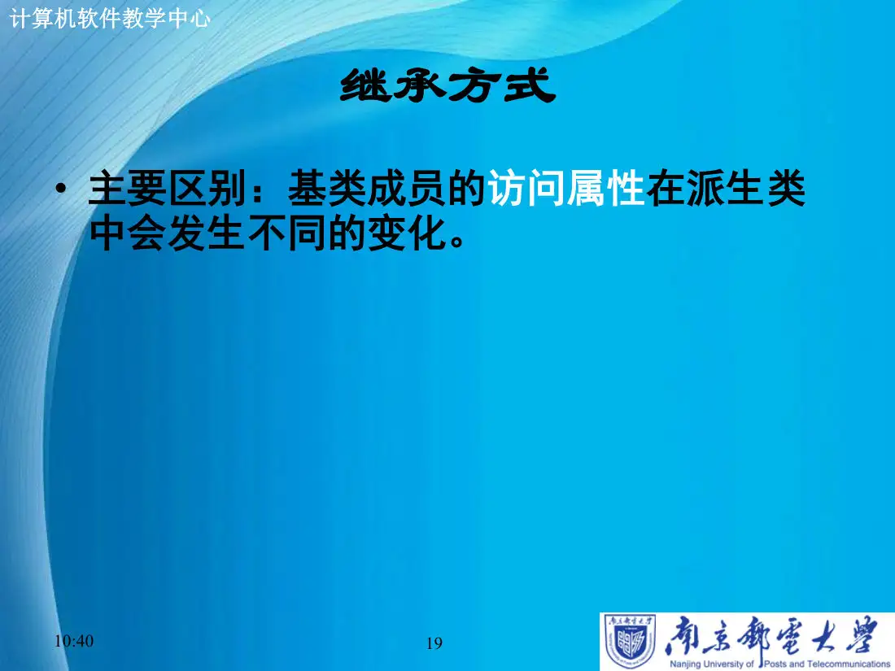

原文：

继承方式

\- 主要区别：基类成员的访问属性在派生类中会发生不同的变化。

计算机软件教学中心

10:40

19

南京邮电大学
Nanjing University of Posts and Telecommunications

### 公有继承

原文：

公有继承

基类

公有成员

保护成员

私有成员

派生类

公有成员

保护成员

私有成员

不可见

计算机软件教学中心

10:40

20

南京邮电大学
Nanjing University of Posts and Telecommunications

### 保护继承

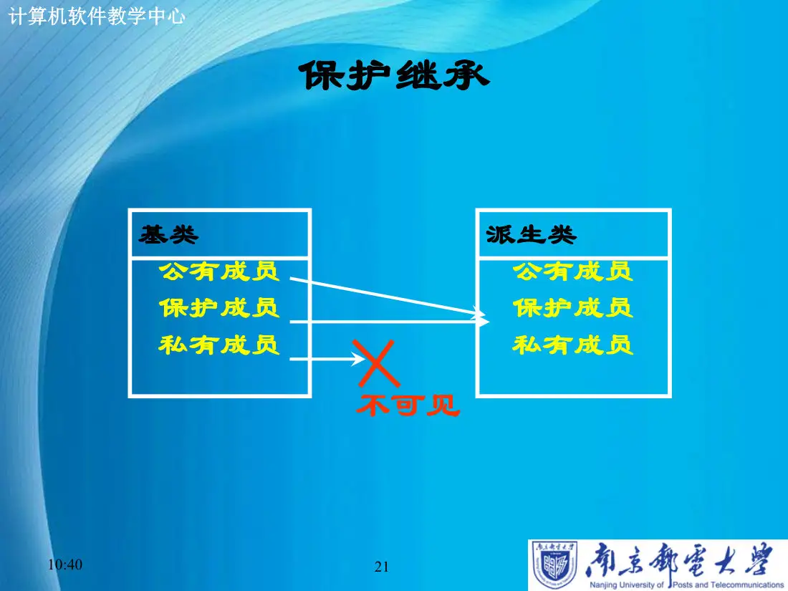

原文：

保护继承

基类

公有成员

保护成员

私有成员

派生类

公有成员

保护成员

私有成员

不可见

计算机软件教学中心

10:40

21

南京邮电大学
Nanjing University of Posts and Telecommunications

### 私有继承

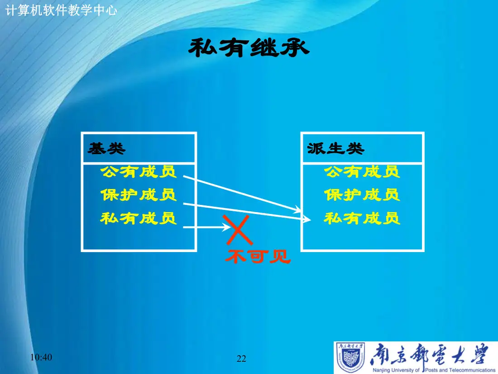

原文：

私有继承

基类

公有成员

保护成员

私有成员

派生类

公有成员

保护成员

私有成员

不可见

计算机软件教学中心

10:40

22

南京邮电大学
Nanjing University of Posts and Telecommunications

### 继承方式的总结

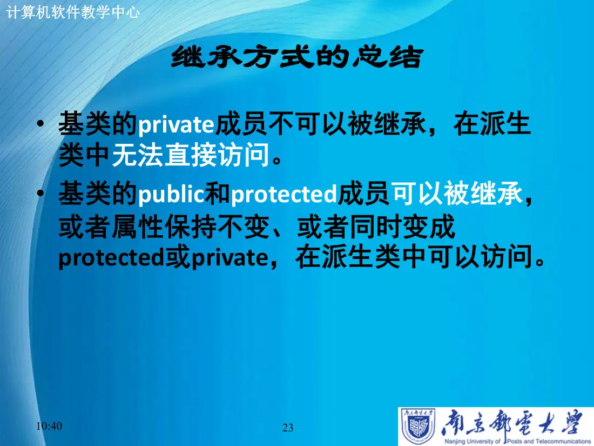

原文：

继承方式的总结

\- 基类的private成员不可以被继承，在派生类中无法直接访问。

\- 基类的public和protected成员可以被继承，或者属性保持不变、或者同时变成protected或private，在派生类中可以访问。

计算机软件教学中心

10:40

23

南京邮电大学
Nanjing University of Posts and Telecommunications

### 单继承举例：5.4

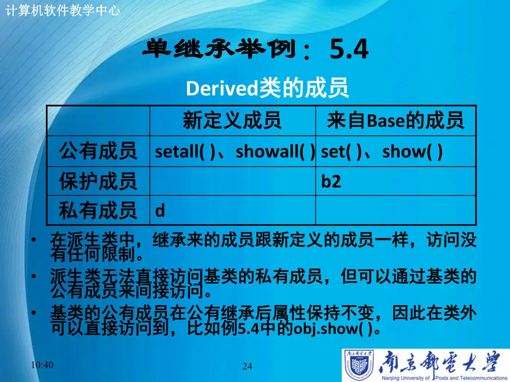

原文：

单继承举例：5.4

Derived类的成员

<table><tr><td></td><td>新定义成员</td><td>来自Base的成员</td></tr><tr><td>公有成员</td><td>setall( )、showall( )</td><td>set( )、show( )</td></tr><tr><td>保护成员</td><td></td><td>b2</td></tr><tr><td>私有成员</td><td>d</td><td></td></tr></table>

\- 在派生类中，继承来的成员跟新定义的成员一样，访问没有任何限制。

\- 派生类无法直接访问基类的私有成员，但可以通过基类的公有成员来间接访问。

\- 基类的公有成员在公有继承后属性保持不变，因此在类外可以直接访问到，比如例5.4中的obj.show()。

计算机软件教学中心

10:40

24

南京邮电大学
Nanjing University of Posts and Telecommunication

### 多重继承举例：5.5

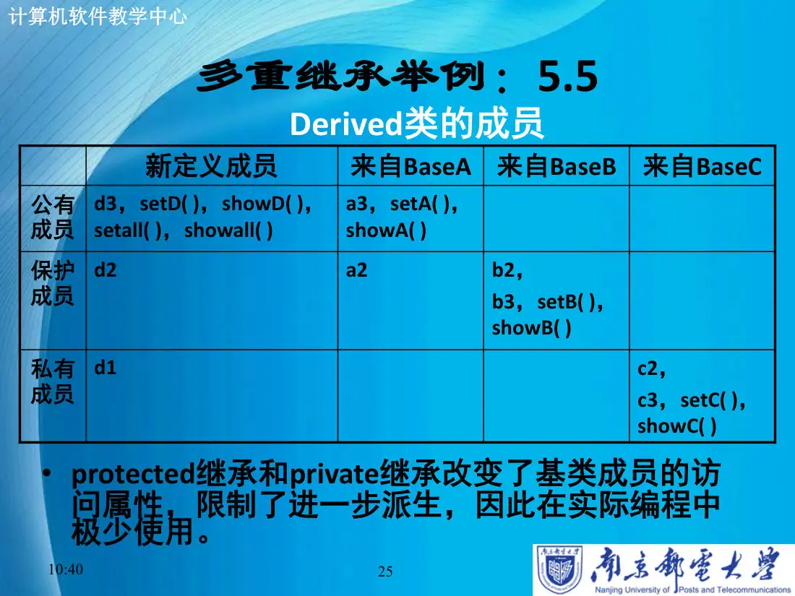

原文：

多重继承举例：5.5

Derived类的成员

<table><tr><td></td><td>新定义成员</td><td>来自BaseA</td><td>来自BaseB</td><td>来自BaseC</td></tr><tr><td>公有成员</td><td>d3, setD(), showD(),setall(), showall()</td><td>a3, setA(),showA()</td><td></td><td></td></tr><tr><td>保护成员</td><td>d2</td><td>a2</td><td>b2,b3, setB(),showB()</td><td></td></tr><tr><td>私有成员</td><td>d1</td><td></td><td></td><td>c2,c3, setC(),showC()</td></tr></table>

\- protected继承和private继承改变了基类成员的访问属性，限制了进一步派生，因此在实际编程中极少使用。

计算机软件教学中心

10:40

25

南京邮电大学
Nanjing University of Posts and Telecommunication

### 派生类对象的构造与析构

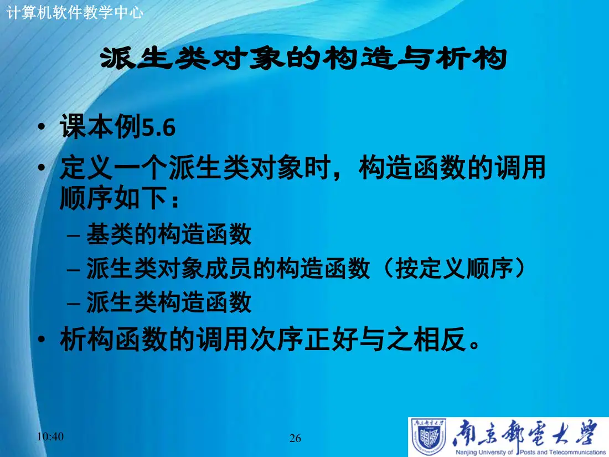

原文：

派生类对象的构造与析构

\- 课本例5.6

\- 定义一个派生类对象时，构造函数的调用顺序如下：

\- 基类的构造函数

\- 派生类对象成员的构造函数（按定义顺序）

\- 派生类构造函数

\- 析构函数的调用次序正好与之相反。

计算机软件教学中心

10:40

26

南京邮电大学
Nanjing University of Posts and Telecommunications

### 基类构造函数的参数传递

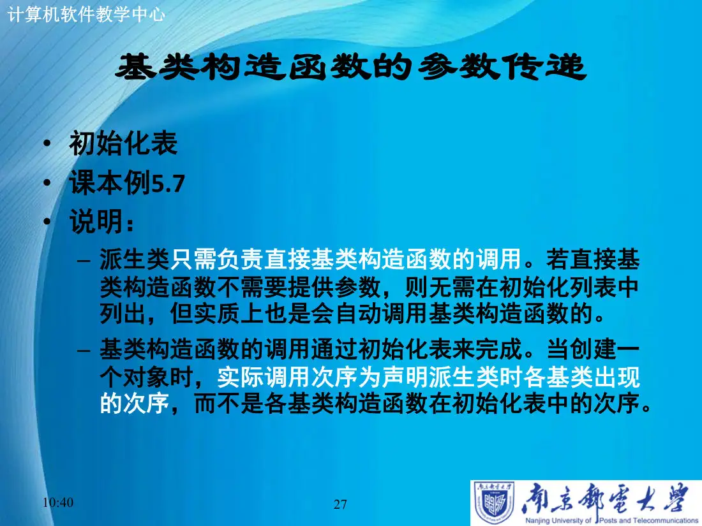

原文：

基类构造函数的参数传递

\- 初始化表

\- 课本例5.7

说明：

\- 派生类只需负责直接基类构造函数的调用。若直接基类构造函数不需要提供参数，则无需在初始化列表中列出，但实质上也是会自动调用基类构造函数的。

\- 基类构造函数的调用通过初始化表来完成。当创建一个对象时，实际调用次序为声明派生类时各基类出现的次序，而不是各基类构造函数在初始化表中的次序。

计算机软件教学中心

10:40

27

南京邮电大学
Nanjing University of Posts and Telecommunications

### 多重继承参数传递

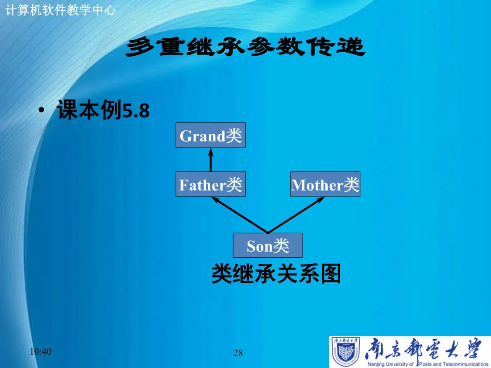

原文：

多重继承参数传递

- 课本例5.8

Grand类

Father类

Mother类

Son类

类继承关系图

计算机软件教学中心

10:40

28

南京邮电大学
Nanjing University of Posts and Telecommunications

### 同名冲突

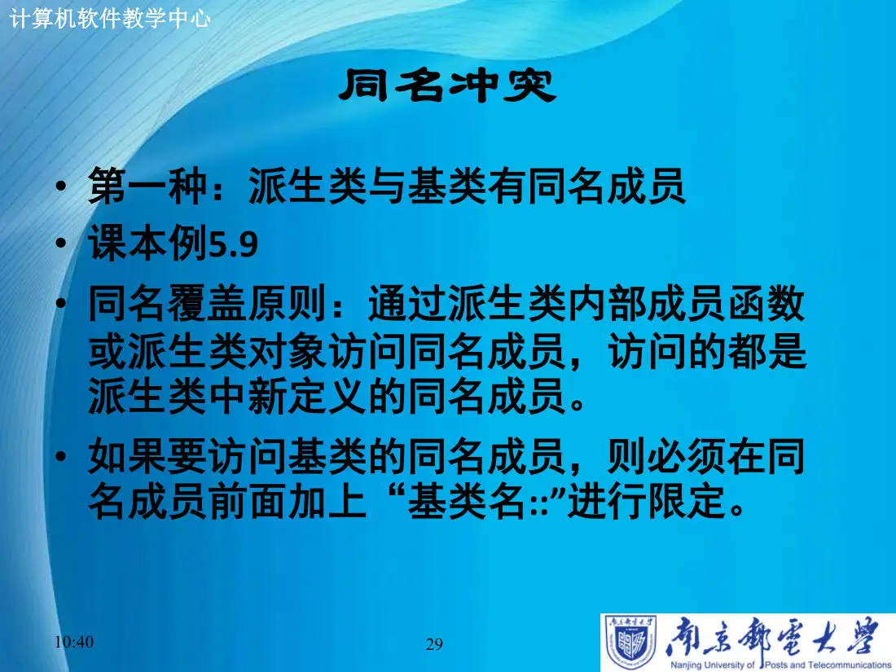

原文：

同名冲突

\- 第一种：派生类与基类有同名成员

\- 课本例5.9

\- 同名覆盖原则：通过派生类内部成员函数或派生类对象访问同名成员，访问的都是派生类中新定义的同名成员。

\- 如果要访问基类的同名成员，则必须在同名成员前面加上“基类名::”进行限定。

计算机软件教学中心

10:40

29

南京邮电大学
Nanjing University of Posts and Telecommunications

### 同名冲突

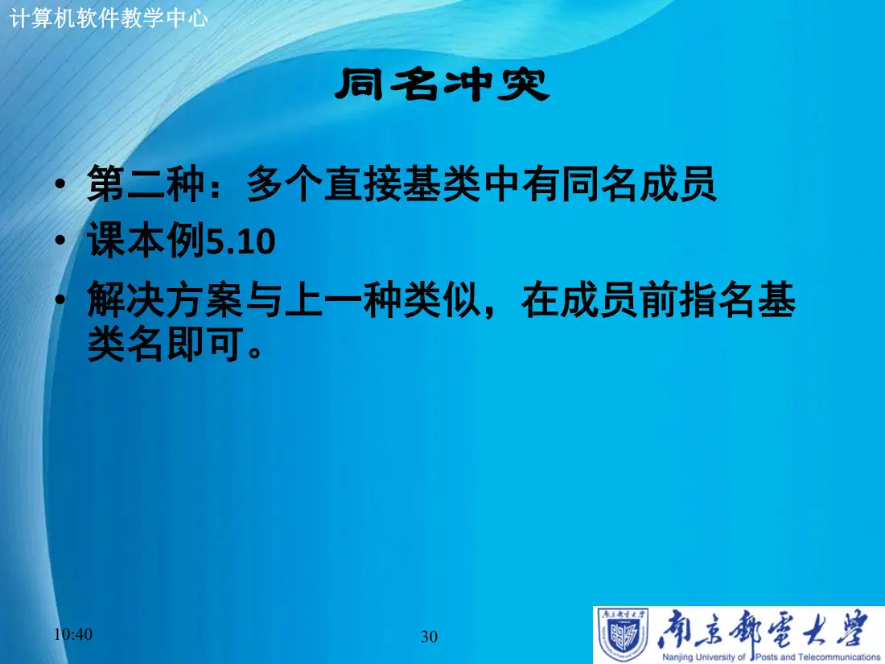

原文：

同名冲突

\- 第二种：多个直接基类中有同名成员

\- 课本例5.10

\- 解决方案与上一种类似，在成员前指名基类名即可。

计算机软件教学中心

10:40

30

南京邮电大学
Nanjing University of Posts and Telecommunications

### 同名冲突

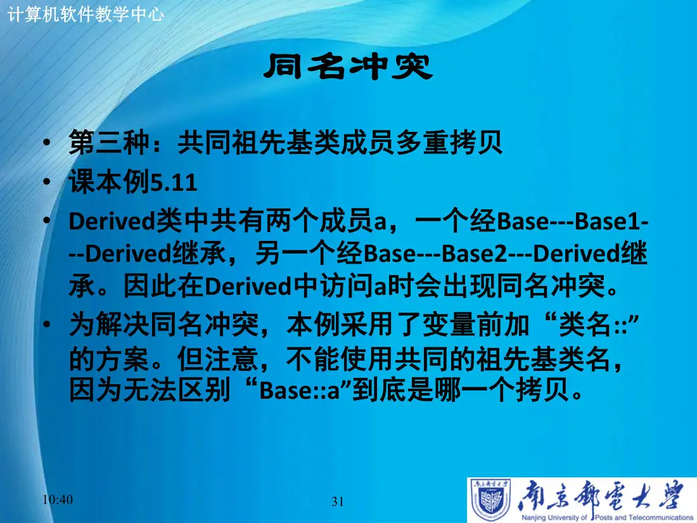

原文：

同名冲突

\- 第三种：共同祖先基类成员多重拷贝

\- 课本例5.11

\- Derived类中共有两个成员a，一个经Base---Base1--Derived继承，另一个经Base---Base2---Derived继承。因此在Derived中访问a时会出现同名冲突。

\- 为解决同名冲突，本例采用了变量前加“类名::”的方案。但注意，不能使用共同的祖先基类名，因为无法区别“Base::a”到底是哪一个拷贝。

计算机软件教学中心

10:40

31

南京邮电大学
Nanjing University of Posts and Telecommunications

### 第三种同名冲突的进一步讨论

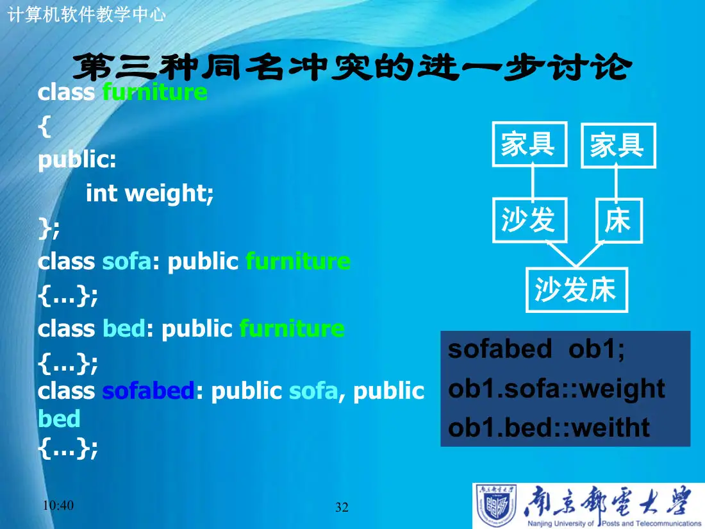

原文：

第三种同名冲突的进一步讨论

class furniture

public:

int weight;

class sofa: public furniture

{...};

class bed: public furniture

{...};
class sofabed: public sofa, public bed

{...};

家具 | 家具

沙发 | 床

沙发床

sofabed ob1;

ob1.sofa::weight

ob1.bed::weitht

计算机软件教学中心

10:40

32

南京邮电大学
Nanjing University of Posts and Telecommunications

### 虚基类

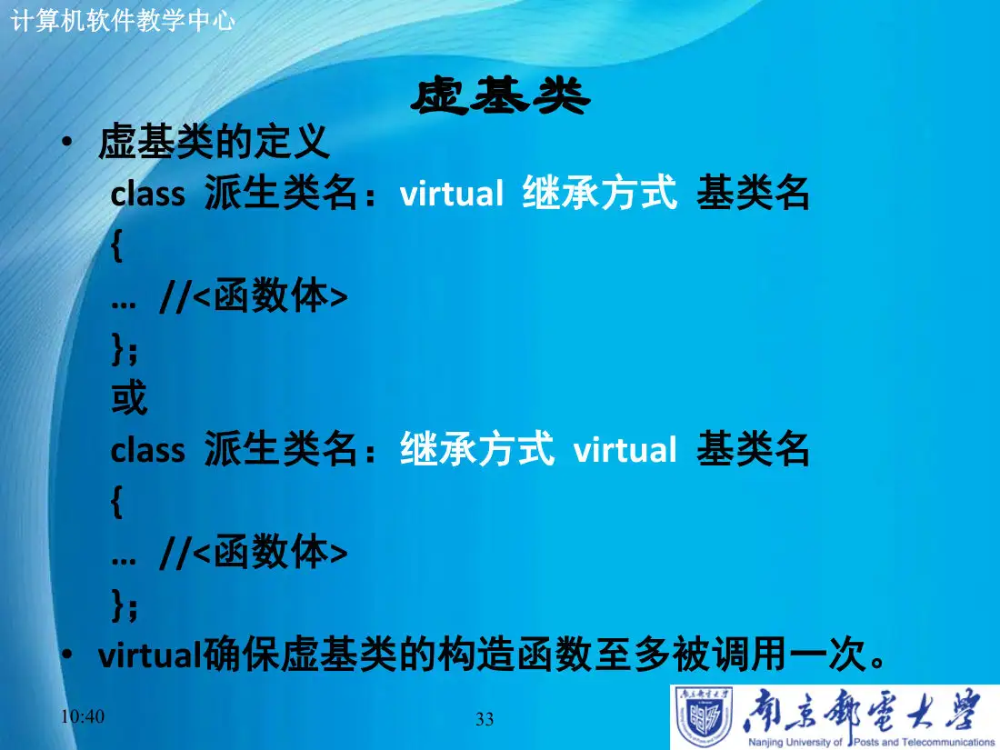

原文：

虚基类

\- 虚基类的定义

class 派生类名：virtual 继承方式 基类名

... //<函数体>

};或

class 派生类名：继承方式 virtual 基类名

... //<函数体>

virtual确保虚基类的构造函数至多被调用一次。

计算机软件教学中心

10:40

33

南京邮电大学
Nanjing University of Posts and Telecommunications

### 虚基类

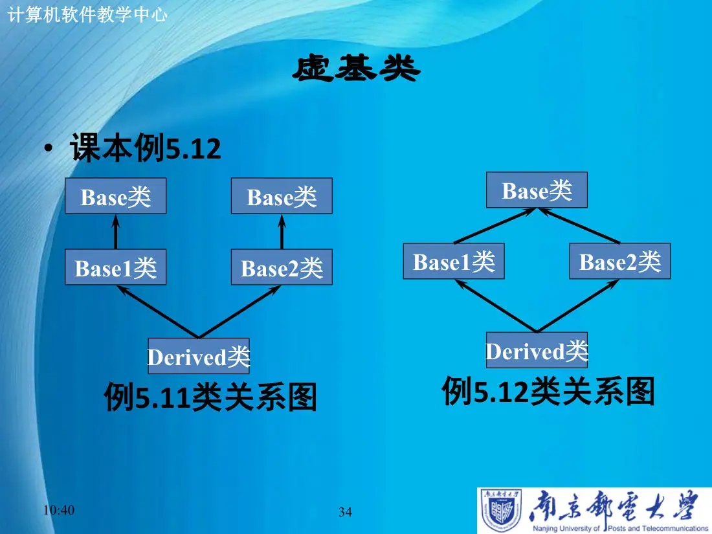

原文：

虚基类

- 课本例5.12

Base类

Base类

Base类

Base1类

Base2类

Base1类

Base2类

Derived类

例5.11类关系图

Derived类

例5.12类关系图

计算机软件教学中心

10:40

34

南京邮电大学
Nanjing University of Posts and Telecommunications

### 构造函数与析构函数的调用

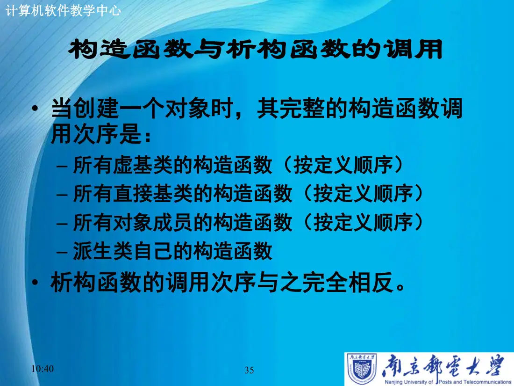

原文：

构造函数与析构函数的调用

\- 当创建一个对象时，其完整的构造函数调用次序是：

\- 所有虚基类的构造函数（按定义顺序）

\- 所有直接基类的构造函数（按定义顺序）

\- 所有对象成员的构造函数（按定义顺序）

\- 派生类自己的构造函数

\- 析构函数的调用次序与之完全相反。

计算机软件教学中心

10:40

35

南京邮电大学
Nanjing University of Posts and Telecommunications

### 赋值兼容规则

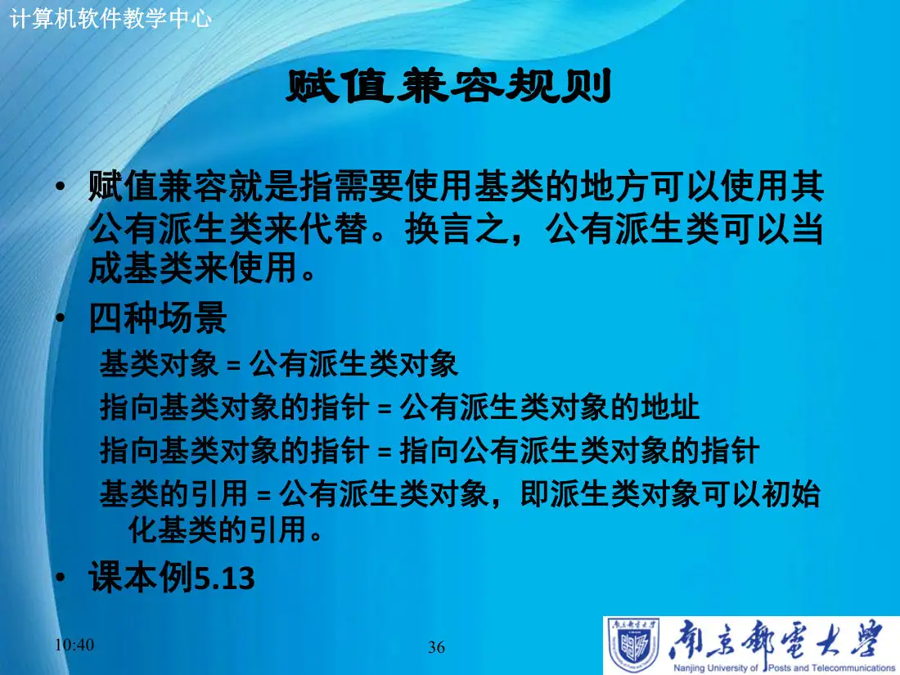

原文：

赋值兼容规则

\- 赋值兼容就是指需要使用基类的地方可以使用其公有派生类来代替。换言之，公有派生类可以当成基类来使用。

四种场景

$$
\mathrm{基类对象} = \mathrm{公有派生类对象}
$$

$$
\mathrm{指向基类对象的指针} = \mathrm{公有派生类对象的地址}
$$

指向基类对象的指针 = 指向公有派生类对象的指针

基类的引用 = 公有派生类对象，即派生类对象可以初始化基类的引用。

\- 课本例5.13

计算机软件教学中心

10:40

36

南京邮电大学
Nanjing University of Posts and Telecommunications

### 程序实例——师生信息管理系统

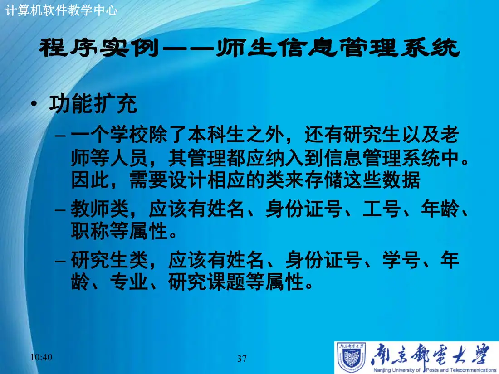

原文：

程序实例——师生信息管理系统

- 功能扩充

\- 一个学校除了本科生之外，还有研究生以及老师等人员，其管理都应纳入到信息管理系统中。因此，需要设计相应的类来存储这些数据

\- 教师类，应该有姓名、身份证号、工号、年龄、职称等属性。

\- 研究生类，应该有姓名、身份证号、学号、年龄、专业、研究课题等属性。

计算机软件教学中心

10:40

37

南京邮电大学
Nanjing University of Posts and Telecommunications

### 程序实例——师生信息管理系统

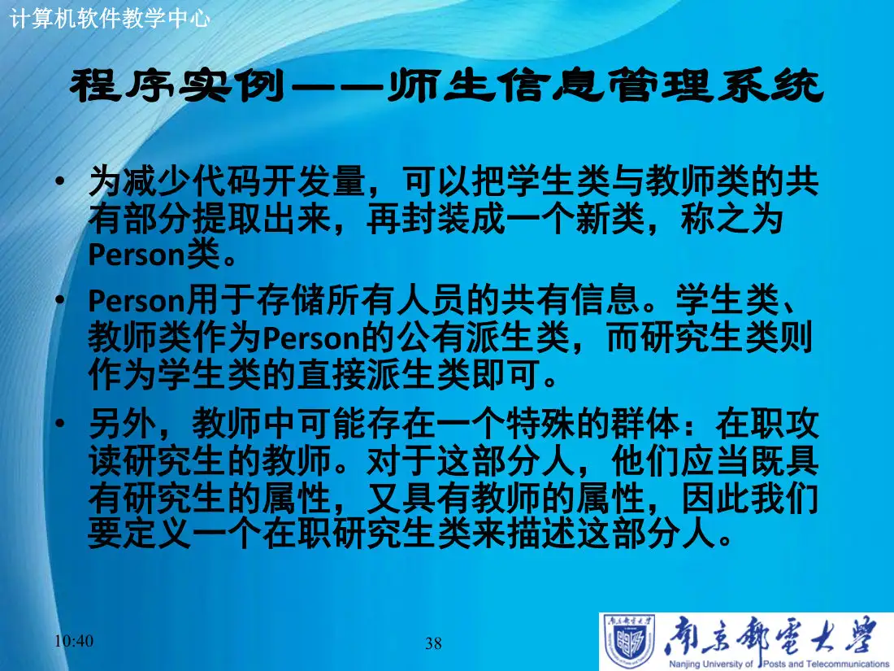

原文：

程序实例——师生信息管理系统

\- 为减少代码开发量，可以把学生类与教师类的共有部分提取出来，再封装成一个新类，称之为Person类。

\- Person用于存储所有人员的共有信息。学生类、教师类作为Person的公有派生类，而研究生类则作为学生类的直接派生类即可。

\- 另外，教师中可能存在一个特殊的群体：在职攻读研究生的教师。对于这部分人，他们应当既具有研究生的属性，又具有教师的属性，因此我们要定义一个在职研究生类来描述这部分人。

计算机软件教学中心

10:40

38

南京邮电大学
Nanjing University of Posts and Telecommunications

### 程序实例——师生信息管理系统

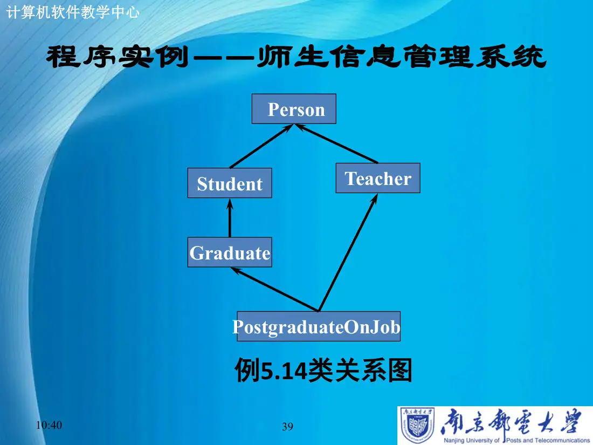

原文：

程序实例——师生信息管理系统

例5.14类关系图

计算机软件教学中心

39

南京邮电大学
Nanjing University of Posts and Telecommunications

### 程序实例——师生信息管理系统

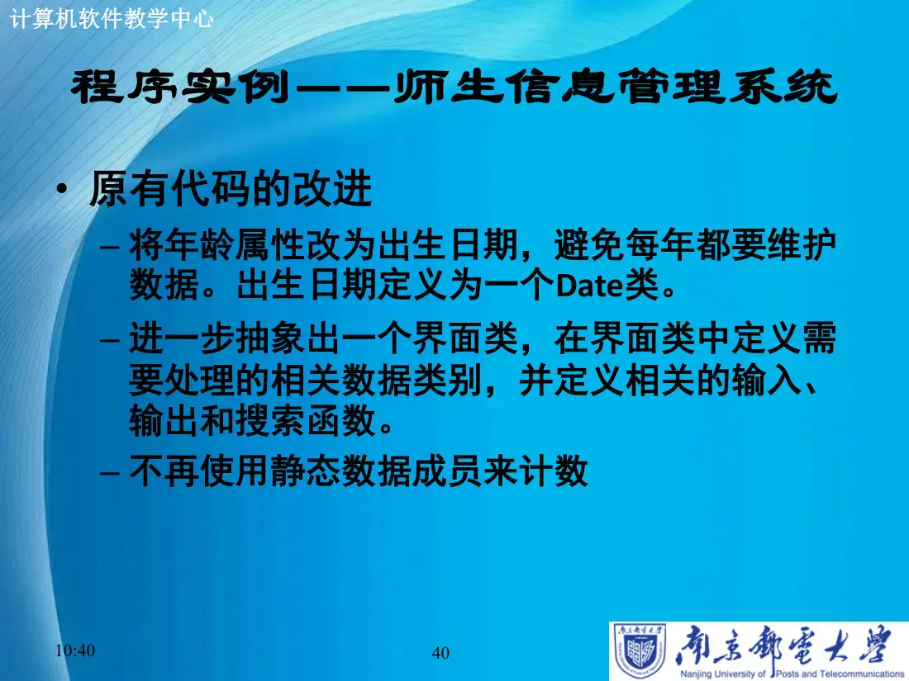

原文：

程序实例——师生信息管理系统

- 原有代码的改进

\- 将年龄属性改为出生日期，避免每年都要维护数据。出生日期定义为一个Date类。

\- 进一步抽象出一个界面类，在界面类中定义需要处理的相关数据类别，并定义相关的输入、输出和搜索函数。

\- 不再使用静态数据成员来计数

计算机软件教学中心

10:40

40

南京邮电大学
Nanjing University of Posts and Telecommunications

### \- 课本例5.14

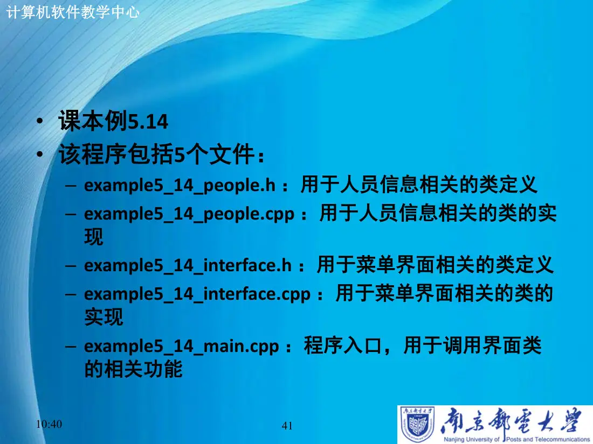

原文：

\- 课本例5.14

- 该程序包括5个文件：

\- example5\_14\_people.h：用于人员信息相关的类定义

\- example5\_14\_people.cpp：用于人员信息相关的类的实现

\- example5\_14\_interface.h：用于菜单界面相关的类定义

\- example5\_14\_interface.cpp：用于菜单界面相关的类的实现

\- example5\_14\_main.cpp：程序入口，用于调用界面类的相关功能

计算机软件教学中心

10:40

41

南京邮电大学
Nanjing University of Posts and Telecommunications

### 本章小结

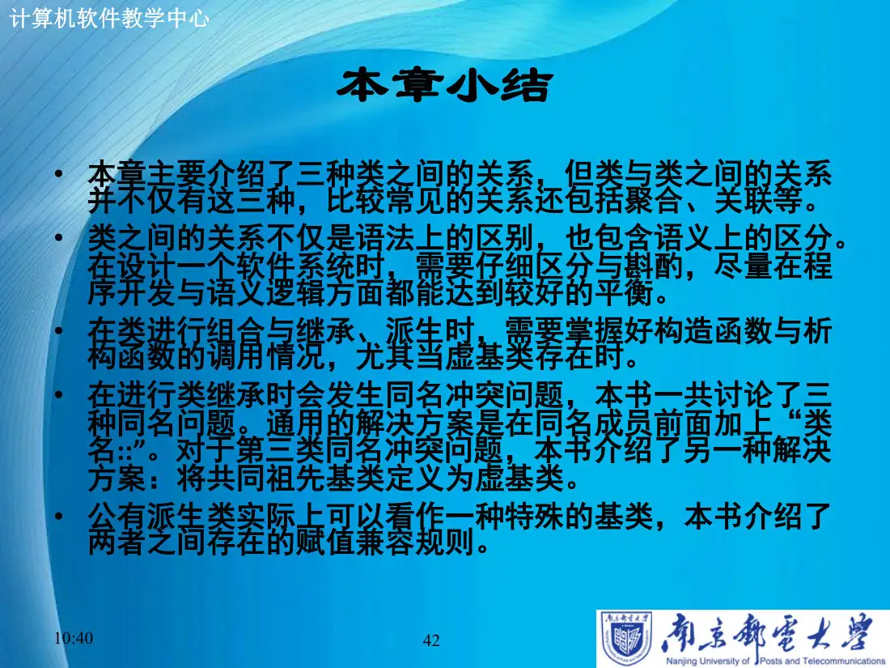

原文：

本章小结

\- 本章主要介绍了三种类之间的关系，但类与类之间的关系并不仅有这三种，比较常见的关系还包括聚合、关联等。

\- 类之间的关系不仅是语法上的区别，也包含语义上的区分。在设计一个软件系统时，需要仔细区分与斟酌，尽量在程序开发与语义逻辑方面都能达到较好的平衡。

\- 在类进行组合与继承、派生时，需要掌握好构造函数与析构函数的调用情况，尤其当虚基类存在时。

\- 在进行类继承时会发生同名冲突问题，本书一共讨论了三种同名问题。通用的解决方案是在同名成员前面加上“类名…”。对于第三类同名冲突问题，本书介绍了另一种解决方案：将共同祖先基类定义为虚基类。

\- 公有派生类实际上可以看作一种特殊的基类，本书介绍了两者之间存在的赋值兼容规则。

计算机软件教学中心

10:40

42

南京邮电大学
Nanjing University of Posts and Telecommunication
