# 《面向对象程序设计及C++》第6章 多态性（课件）

原件的每一页，下面附识别出的文字。

### 面向对象程序设计及C++

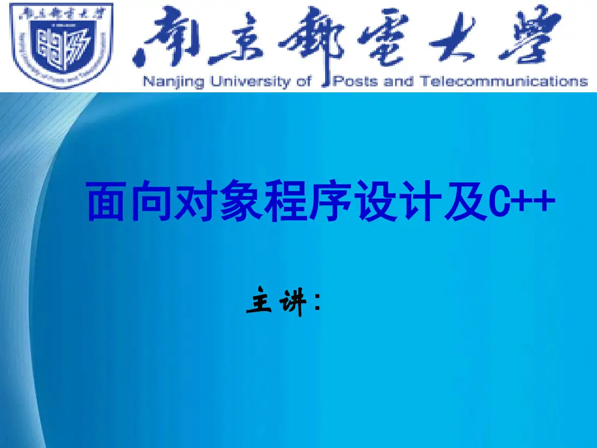

原文：

面向对象程序设计及C++

主讲：

### 面向对象程序设计及C++

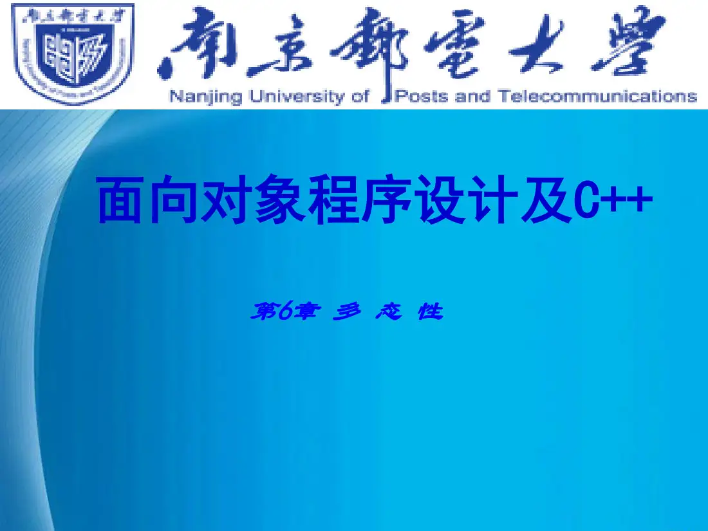

原文：

Nanjing University of JPosts and Telecommunications

面向对象程序设计及C++

第6章 多态性

### 计算机软件教学中心

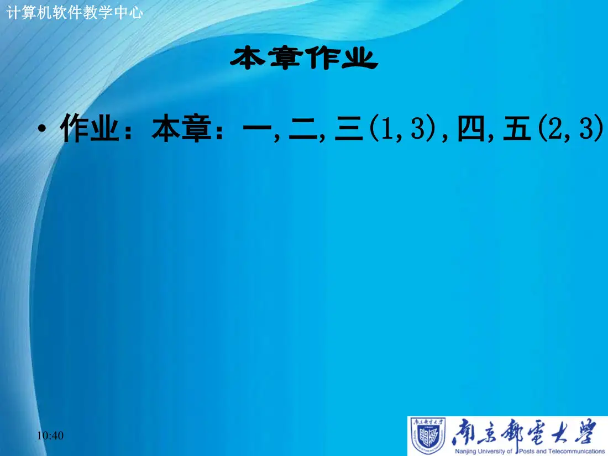

原文：

计算机软件教学中心

本章作业

• 作业：本章：一，二，三(1,3)，四，五(2,3)

10:40

南京邮电大学
Nanjing University of Posts and Telecommunications

### 本章内容提要

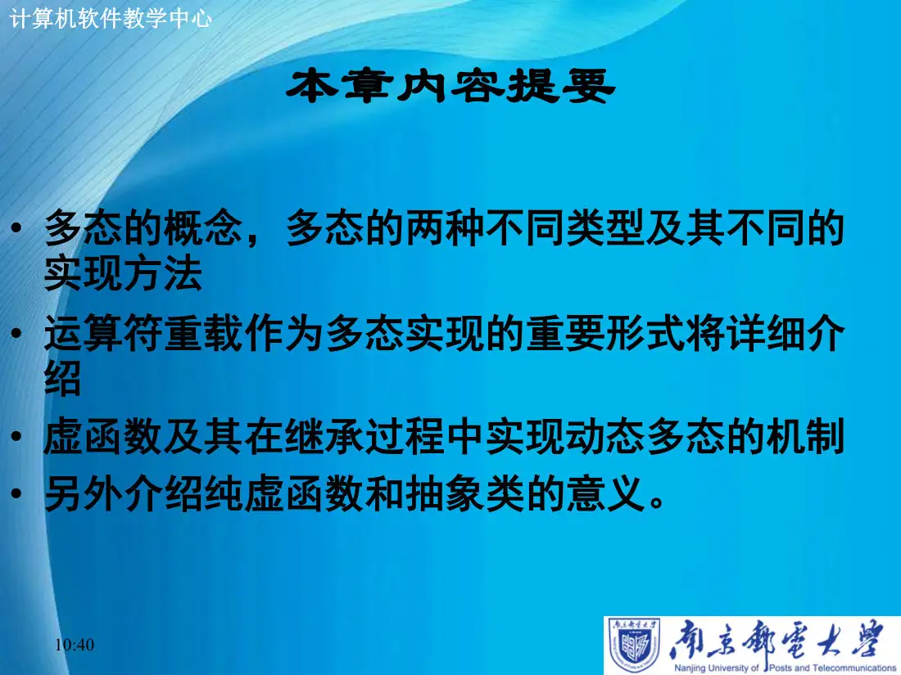

原文：

本章内容提要

\- 多态的概念，多态的两种不同类型及其不同的实现方法

\- 运算符重载作为多态实现的重要形式将详细介绍

\- 虚函数及其在继承过程中实现动态多态的机制

\- 另外介绍纯虚函数和抽象类的意义。

计算机软件教学中心

10:40

南京邮电大学
Nanjing University of Posts and Telecommunications

### 本章内容安排

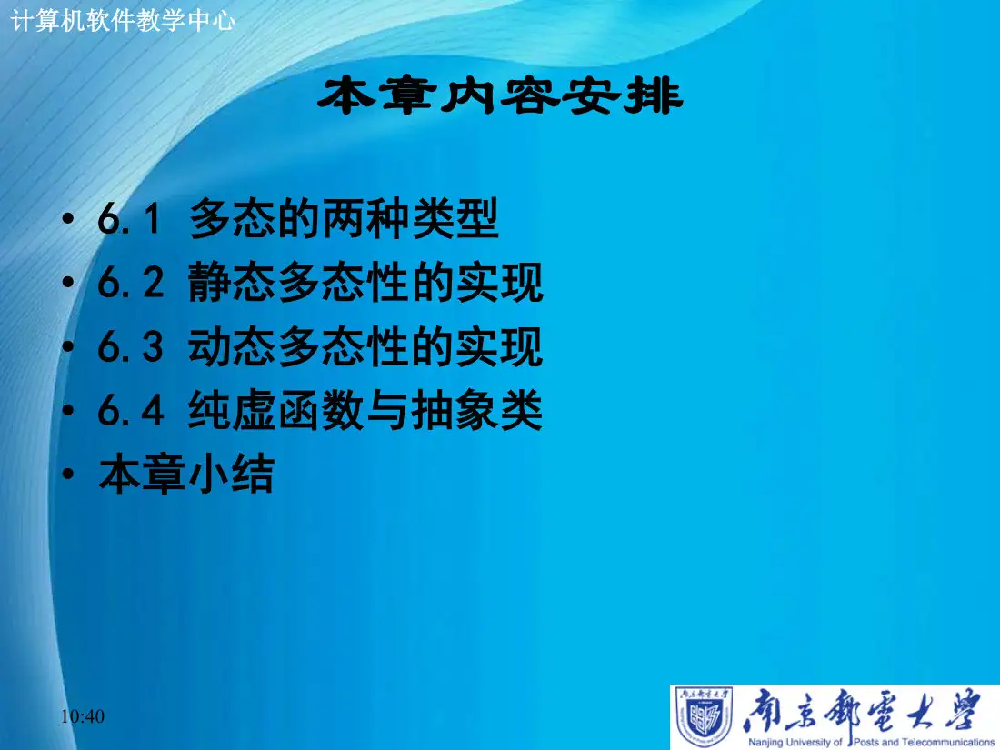

原文：

本章内容安排

• 6.1 多态的两种类型

• 6.2 静态多态性的实现

6.3 动态多态性的实现

• 6.4 纯虚函数与抽象类

\- 本章小结

计算机软件教学中心

10:40

南京邮电大学
Nanjing University of Posts and Telecommunications

### 6.1 多态的两种类型

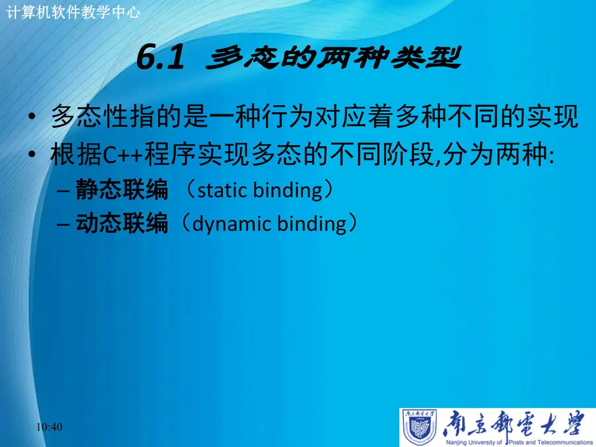

原文：

6.1 多态的两种类型

\- 多态性指的是一种行为对应着多种不同的实现

\- 根据C++程序实现多态的不同阶段,分为两种:

\- 静态联编（static binding）

\- 动态联编（dynamic binding）

计算机软件教学中心

10:40

南京邮电大学
Nanjing University of Posts and Telecommunications

### 6.1 多态的实现类型

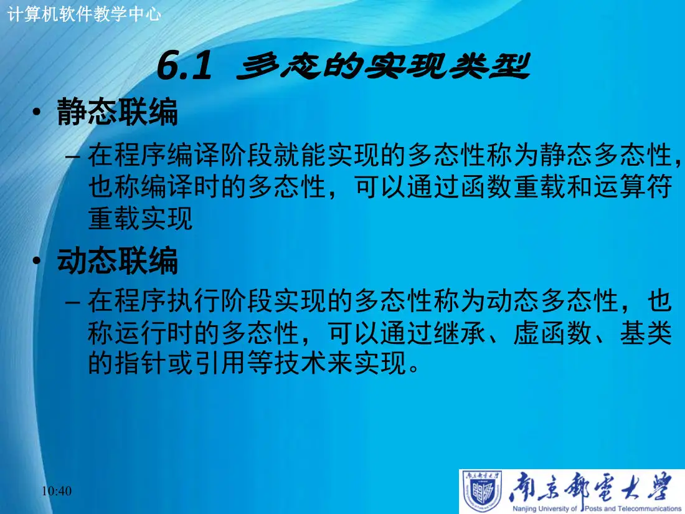

原文：

6.1 多态的实现类型

- 静态联编

\- 在程序编译阶段就能实现的多态性称为静态多态性，也称编译时的多态性，可以通过函数重载和运算符重载实现

动态联编

\- 在程序执行阶段实现的多态性称为动态多态性，也称运行时的多态性，可以通过继承、虚函数、基类的指针或引用等技术来实现。

计算机软件教学中心

10:40

南京邮电大学
Nanjing University of Posts and Telecommunications

### 6.2 静态多态的实现

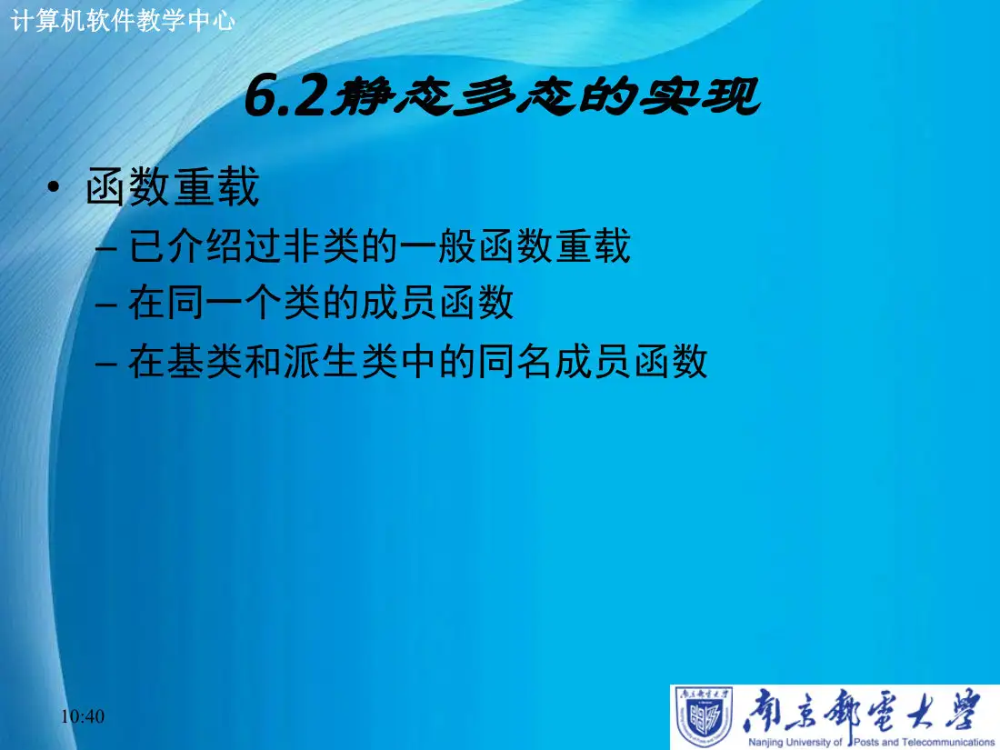

原文：

6.2 静态多态的实现

\- 函数重载

\- 已介绍过非类的一般函数重载

\- 在同一个类的成员函数

\- 在基类和派生类中的同名成员函数

计算机软件教学中心

10:40

南京邮电大学
Nanjing University of Posts and Telecommunications

### 【例6.1】类成员函数重载实现

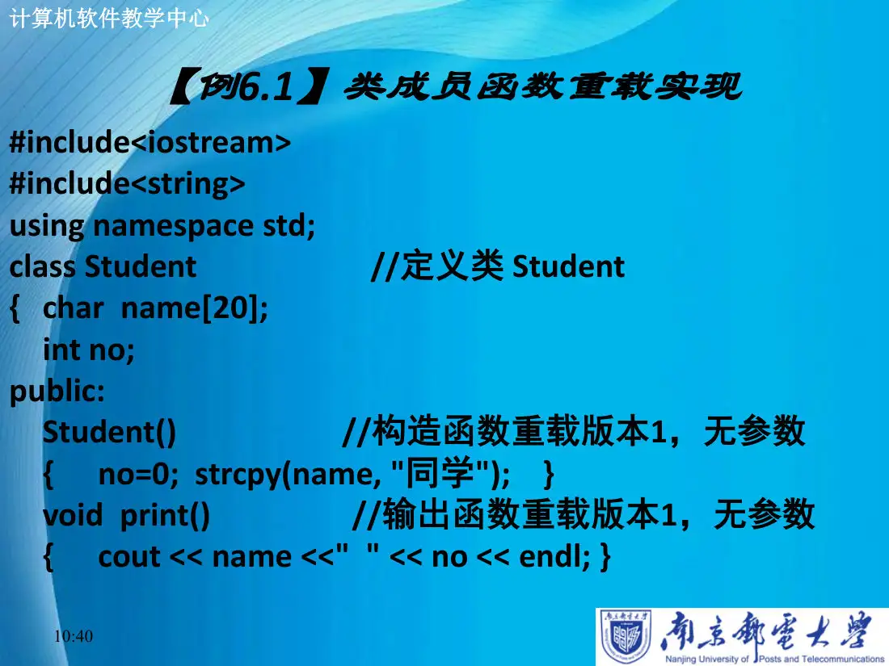

原文：

【例6.1】类成员函数重载实现

include<iostream>

include<string>

using namespace std;

class Student

{ char name[20]; int no;

//定义类 Student

Student() //构造函数重载版本1，无参数
{ no=0; strcpy(name, "同学"); }
void print() //输出函数重载版本1，无参数
{ cout << name << " " << no << endl; }

计算机软件教学中心

10:40

南京邮电大学
Nanjing University of Posts and Telecommunications

### 【例6.1】类成员函数重载实现

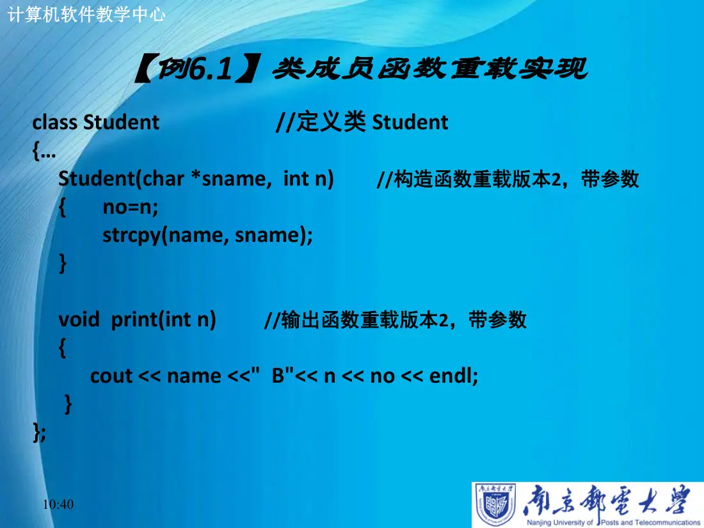

原文：

【例6.1】类成员函数重载实现

计算机软件教学中心

### 【例6.1】类成员函数重载实现

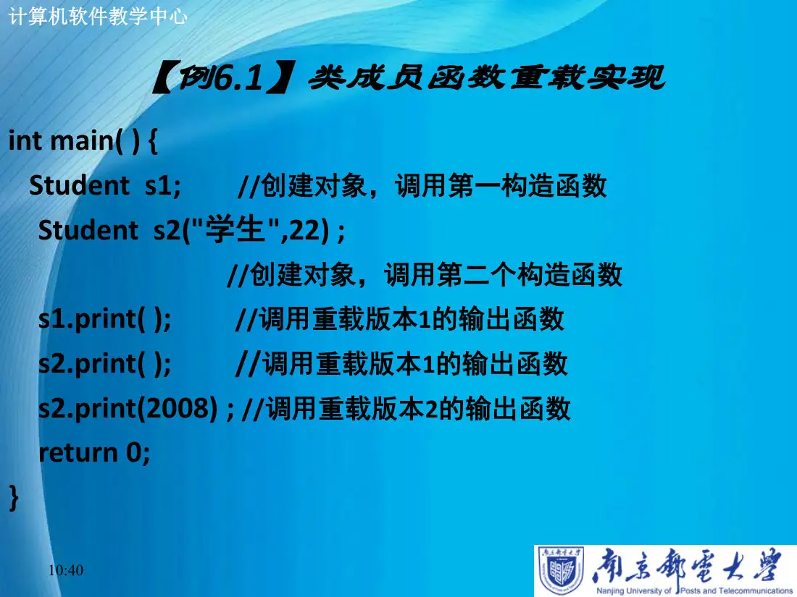

原文：

【例6.1】类成员函数重载实现

int main( ) {

Student s1; //创建对象，调用第一构造函数

Student s2("学生",22);

//创建对象，调用第二个构造函数

s1.print( ); //调用重载版本1的输出函数

s2.print( ); //调用重载版本1的输出函数

s2.print(2008); //调用重载版本2的输出函数
return 0;

计算机软件教学中心

10:40

南京邮电大学
Nanjing University of Posts and Telecommunications

### 【例6.1】类成员函数重载实现

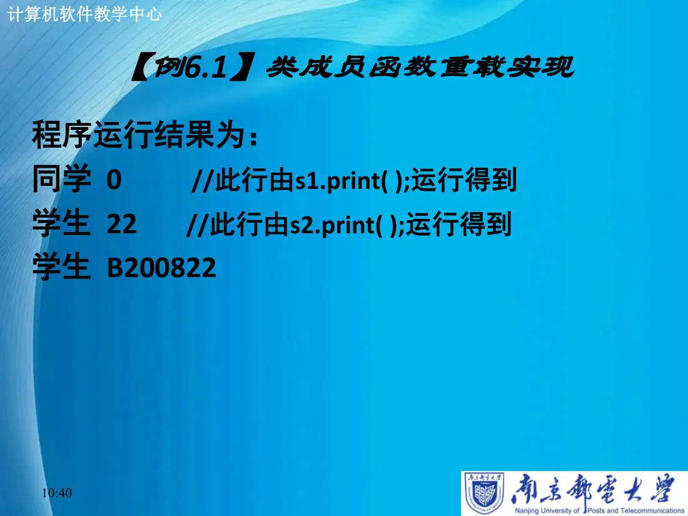

原文：

【例6.1】类成员函数重载实现

程序运行结果为:

同学 0 //此行由s1.print( );运行得到

学生 22 //此行由s2.print( );运行得到

学生 B200822

计算机软件教学中心

10:40

南京邮电大学
Nanjing University of Posts and Telecommunications

### 6.2 静态多态的实现

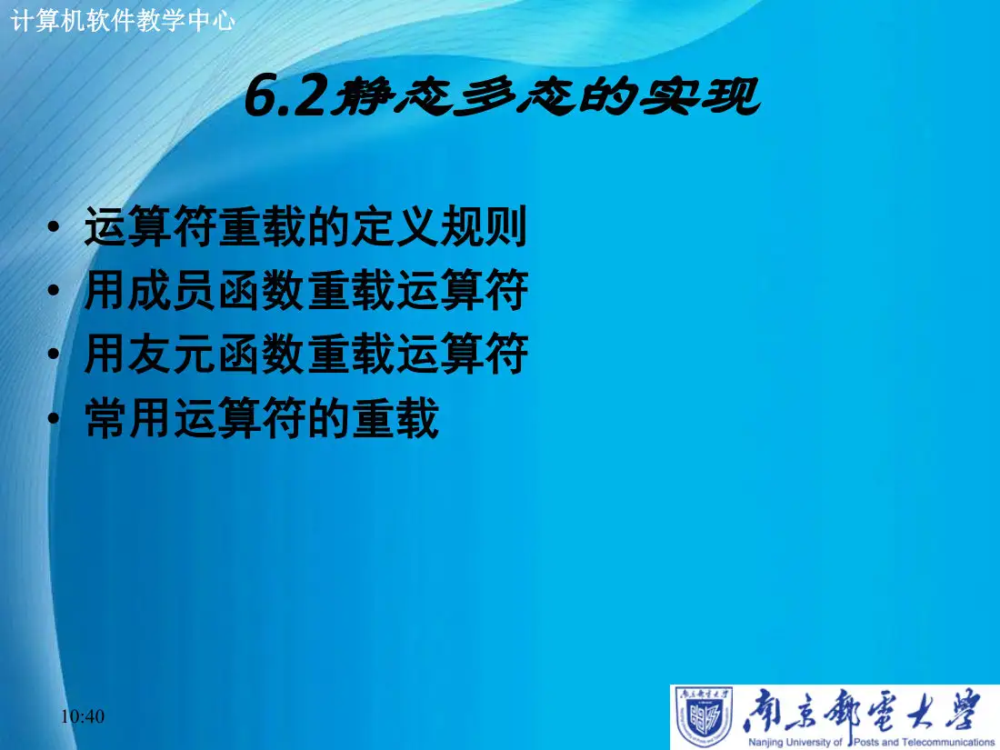

原文：

6.2 静态多态的实现

\- 运算符重载的定义规则

\- 用成员函数重载运算符

\- 用友元函数重载运算符

\- 常用运算符的重载

计算机软件教学中心

10:40

南京邮电大学
Nanjing University of Posts and Telecommunications

### 6.2.1 运算符重载的定义规则

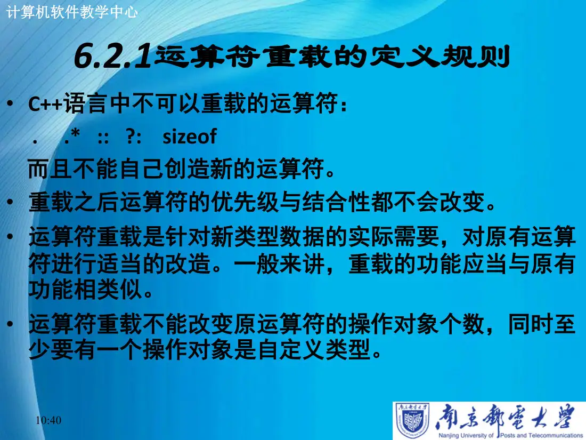

原文：

6.2.1 运算符重载的定义规则

• C++语言中不可以重载的运算符:

.\* :?: sizeof

而且不能自己创造新的运算符。

\- 重载之后运算符的优先级与结合性都不会改变。

\- 运算符重载是针对新类型数据的实际需要，对原有运算符进行适当的改造。一般来讲，重载的功能应当与原有功能相类似。

\- 运算符重载不能改变原运算符的操作对象个数，同时至少要有一个操作对象是自定义类型。

计算机软件教学中心

10:40

南京邮电大学
Nanjing University of Posts and Telecommunications

### \- 运算符重载的定义方法

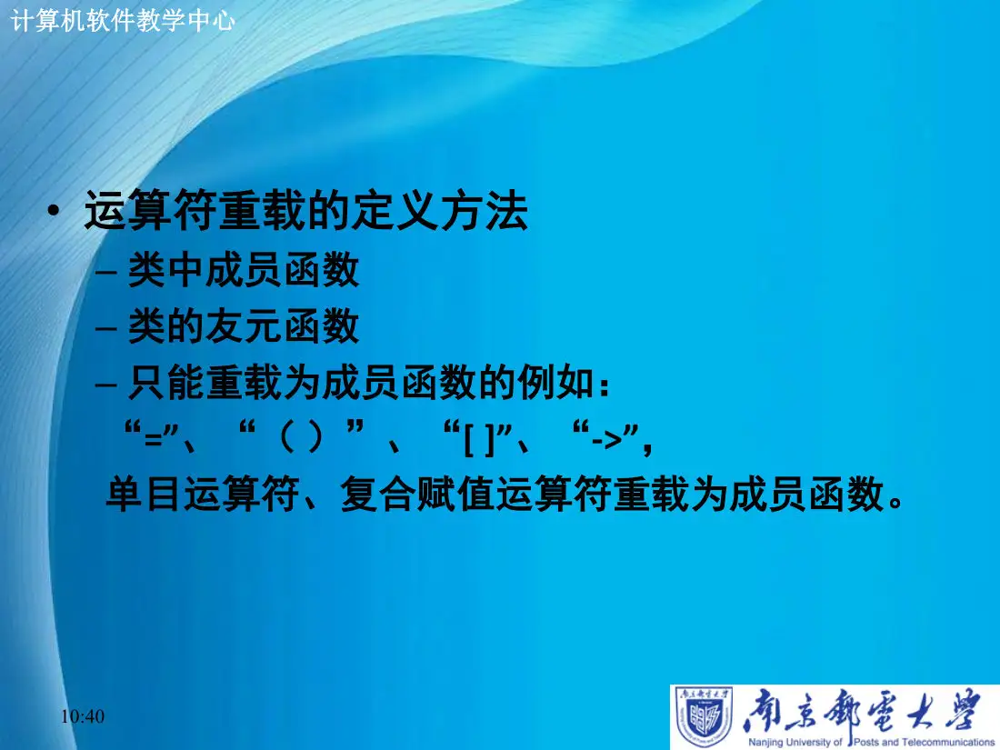

原文：

\- 运算符重载的定义方法

\- 类中成员函数

\- 类的友元函数

\- 只能重载为成员函数的例如:

“=”、 “（）”、“[ ]”、“->”，

单目运算符、复合赋值运算符重载为成员函数。

计算机软件教学中心

10:40

南京邮电大学
Nanjing University of Posts and Telecommunications

### \- 运算符重载的定义形式

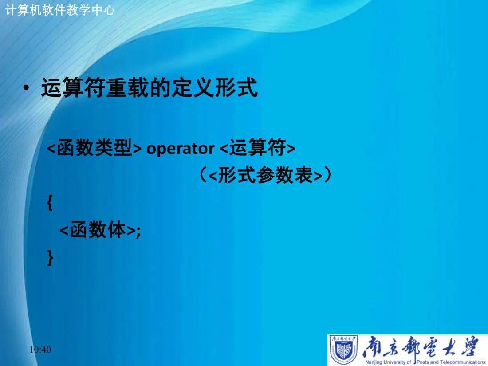

原文：

\- 运算符重载的定义形式

<函数类型> operator <运算符>
(<形式参数表>)

<函数体>;

计算机软件教学中心

10:40

南京邮电大学
Nanjing University of Posts and Telecommunications

### 6.2.2 用成员函数重载运算符

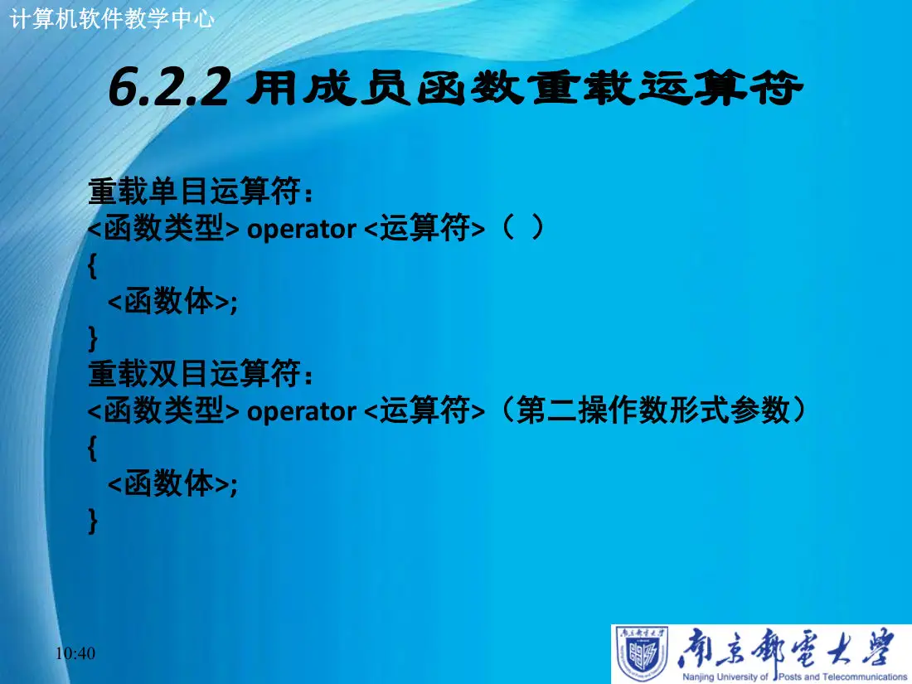

原文：

6.2.2 用成员函数重载运算符

重载单目运算符:

<函数类型> operator <运算符>（）

<函数体>;

重载双目运算符:

<函数类型> operator <运算符>（第二操作数形式参数）

<函数体>;

计算机软件教学中心

10:40

南京邮电大学
Nanjing University of Posts and Telecommunications

### 6.2.2 用成员函数重载运算符

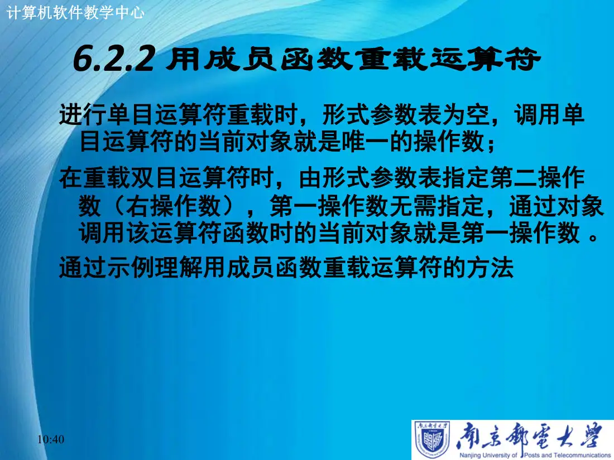

原文：

6.2.2 用成员函数重载运算符

进行单目运算符重载时，形式参数表为空，调用单目运算符的当前对象就是唯一的操作数；

在重载双目运算符时，由形式参数表指定第二操作数（右操作数），第一操作数无需指定，通过对象调用该运算符函数时的当前对象就是第一操作数。

通过示例理解用成员函数重载运算符的方法

计算机软件教学中心

10:40

南京邮电大学
Nanjing University of Posts and Telecommunications

### 示例用成员函数重载运算符

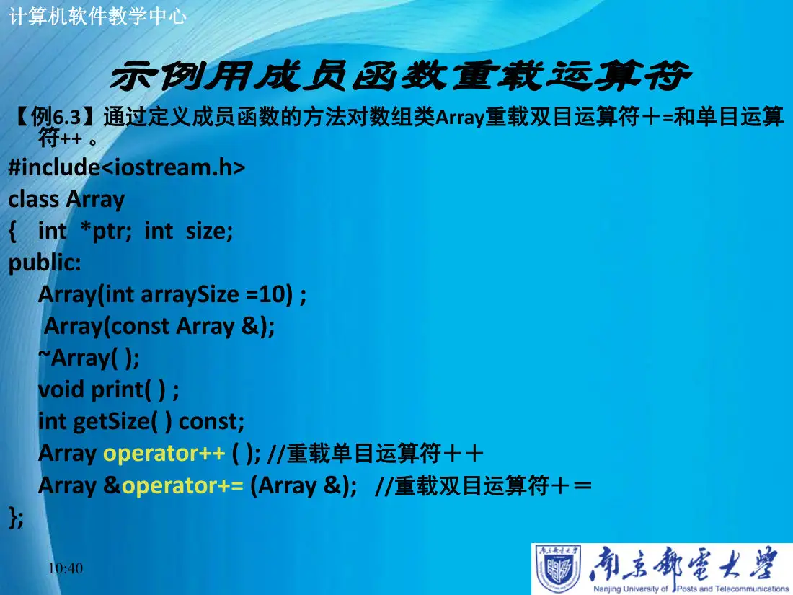

原文：

示例用成员函数重载运算符

计算机软件教学中心

### 示例用成员函数重载运算符

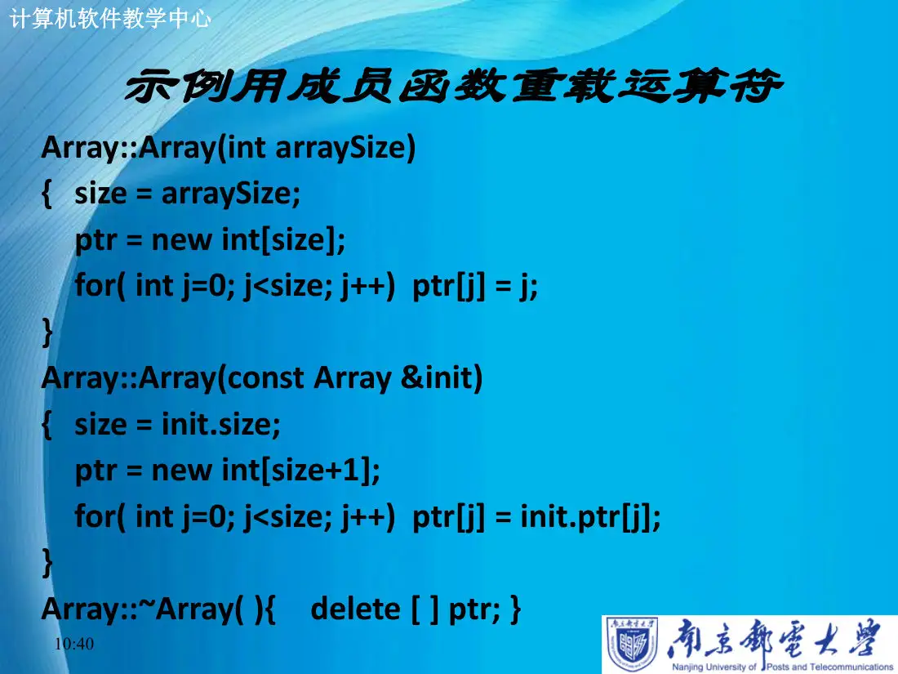

原文：

示例用成员函数重载运算符

计算机软件教学中心

南京邮电大学
Nanjing University of Posts and Telecommunications

### 示例用成员函数重载运算符

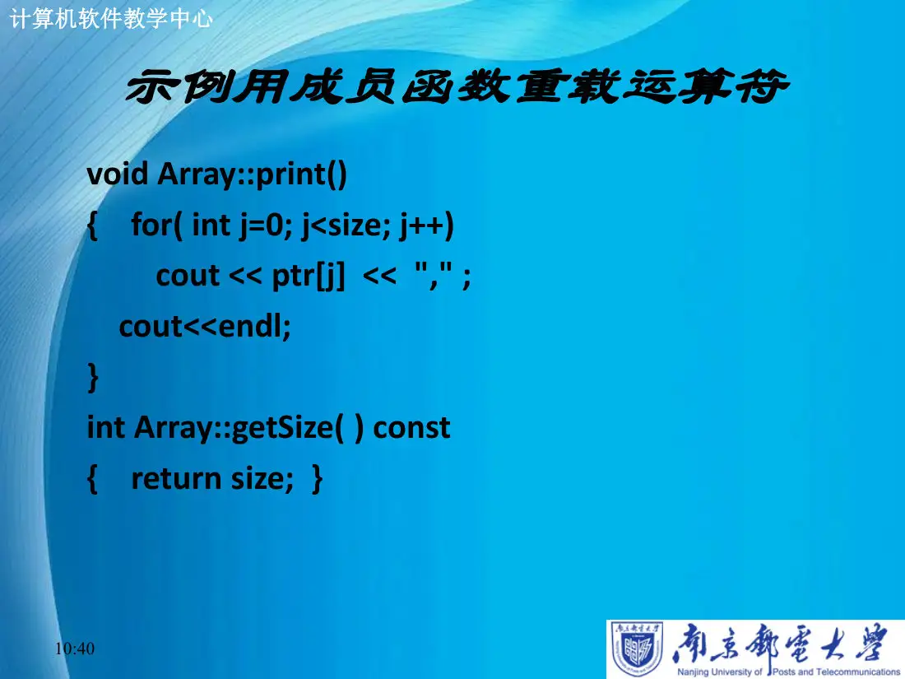

原文：

示例用成员函数重载运算符

计算机软件教学中心

10:40

南京邮电大学
Nanjing University of Posts and Telecommunications

### 示例用成员函数重载运算符

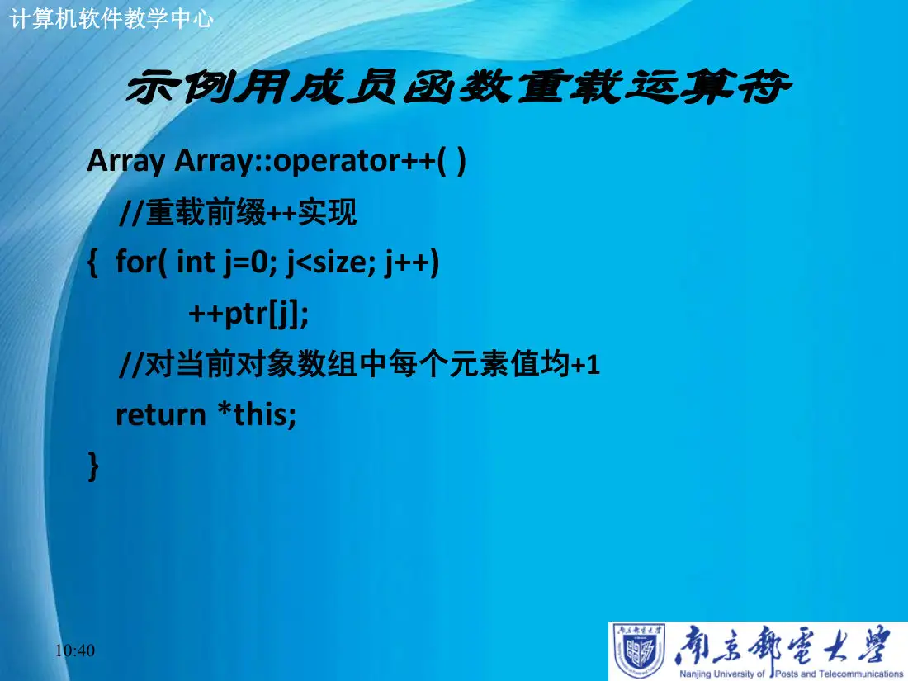

原文：

示例用成员函数重载运算符

Array Array::operator++()

//重载前缀++实现

{ for( int j=0; j<size; j++)
    ++ptr[j];

//对当前对象数组中每个元素值均+1

return \*this;

计算机软件教学中心

10:40

南京邮电大学
Nanjing University of Posts and Telecommunications

### 示例用成员函数重载运算符

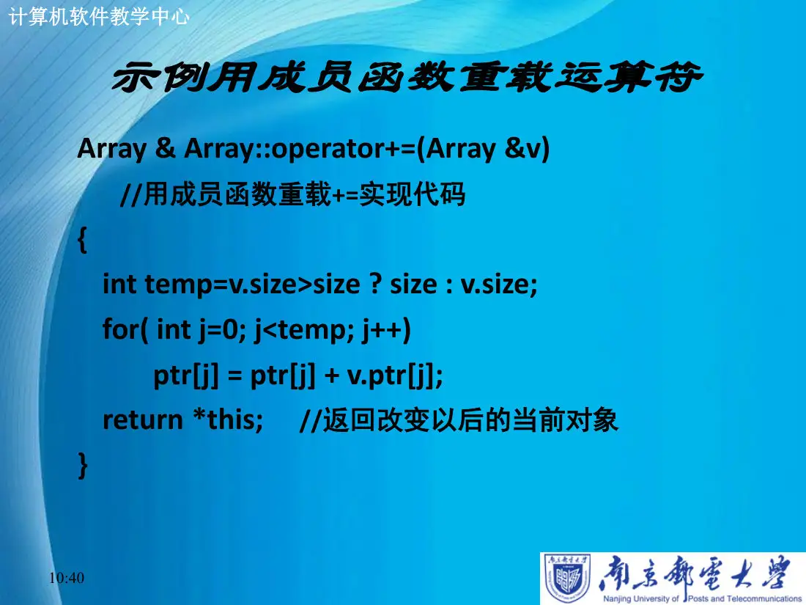

原文：

示例用成员函数重载运算符

Array & Array::operator+=(Array &v) //用成员函数重载+=实现代码

$$
\text { for( int j = 0; j <   temp; j + + ) }
$$

$$
\operatorname{ptr} [ j ] = \operatorname{ptr} [ j ] + v. \operatorname{ptr} [ j ];
$$

return \*this; //返回改变以后的当前对象

计算机软件教学中心

10:40

南京邮电大学
Nanjing University of Posts and Telecommunications

### 示例用成员函数重载运算符

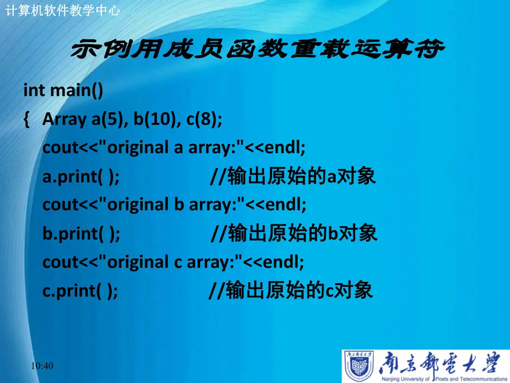

原文：

示例用成员函数重载运算符

int main()

{ Array a(5), b(10), c(8);

cout<<"original a array:"<<endl;

a.print( ); //输出原始的a对象

cout<<"original b array:"<<endl;

b.print( ); //输出原始的b对象

cout<<"original c array:"<<endl;

c.print( ); //输出原始的c对象

计算机软件教学中心

10:40

南京邮电大学
Nanjing University of Posts and Telecommunications

### 示例用成员函数重载运算符

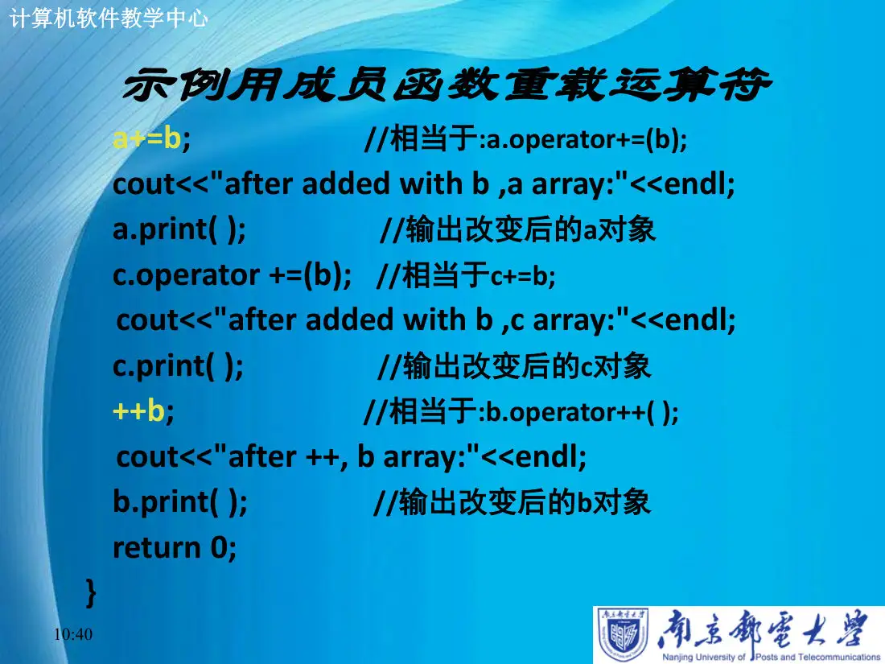

原文：

示例用成员函数重载运算符

a+=b; //相当于:a.operator+=(b);

cout<<"after added with b ,a array:"<<endl;

a.print( ); //输出改变后的a对象

c.operator +=(b); //相当于c+=b;

cout<<"after added with b ,c array:"<<endl;

c.print( ); //输出改变后的c对象

++b; //相当于:b.operator++();

cout<<"after++, b array:"<<endl;

b.print( ); //输出改变后的b对象

return 0;

计算机软件教学中心

10:40

南京邮电大学
Nanjing University of Posts and Telecommunications

### 示例用成员函数重载运算符

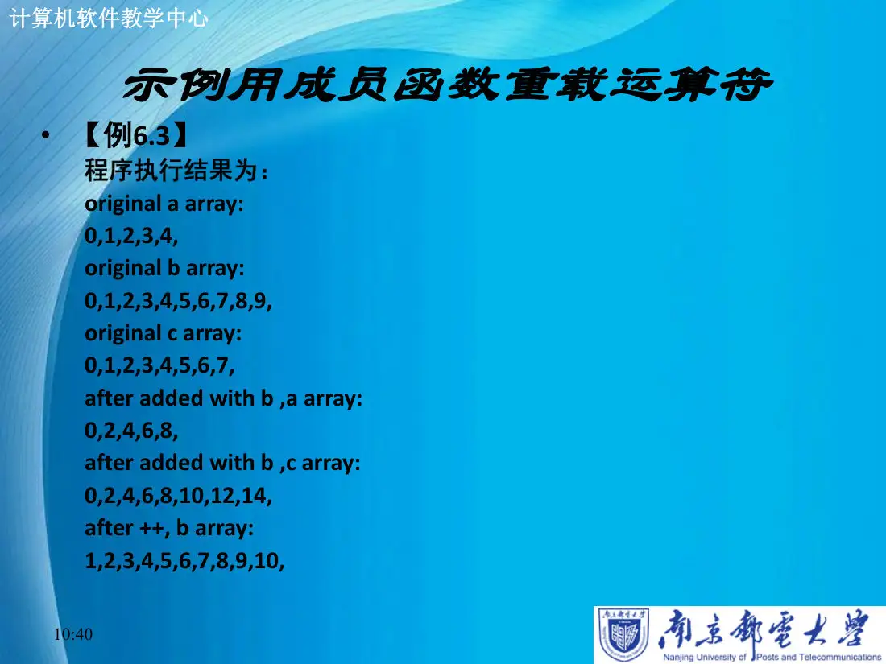

原文：

示例用成员函数重载运算符

【例6.3】
程序执行结果为:
original a array:
0,1,2,3,4,
original b array:
0,1,2,3,4,5,6,7,8,9,
original c array:
0,1,2,3,4,5,6,7,
after added with b ,a array:
0,2,4,6,8,
after added with b ,c array:
0,2,4,6,8,10,12,14,
after++, b array:
1,2,3,4,5,6,7,8,9,10,

计算机软件教学中心

10:40

南京邮电大学
Nanjing University of Posts and Telecommunications

### 6.2.3 用友元函数重载运算符

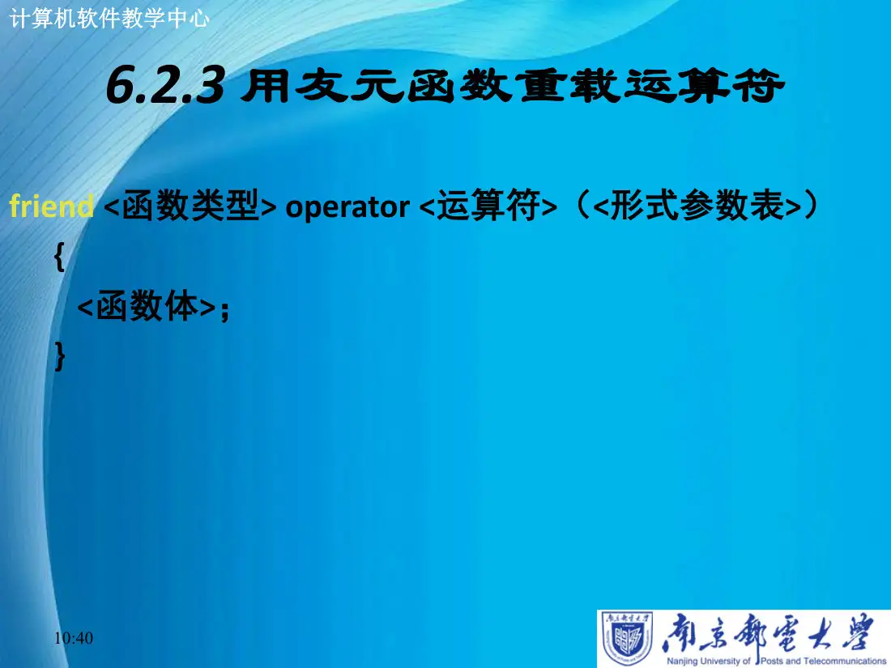

原文：

6.2.3 用友元函数重载运算符

friend <函数类型> operator <运算符> (<形式参数表>)

<函数体>;

计算机软件教学中心

10:40

南京邮电大学
Nanjing University of Posts and Telecommunications

### 6.2.3 用友元函数重载运算符

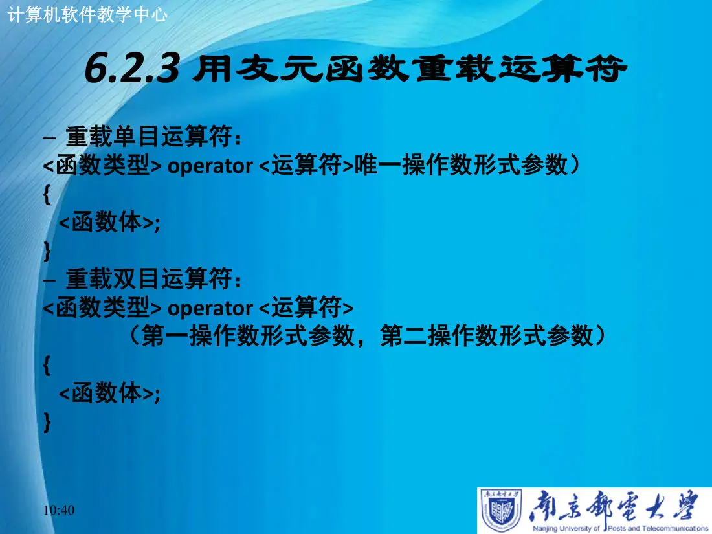

原文：

6.2.3 用友元函数重载运算符

\- 重载单目运算符:

<函数类型> operator <运算符>唯一操作数形式参数)

<函数体>;

\- 重载双目运算符:

<函数类型> operator <运算符>
（第一操作数形式参数，第二操作数形式参数）

<函数体>;

计算机软件教学中心

10:40

南京邮电大学
Nanjing University of Posts and Telecommunications

### 示例用友元函数重载运算符

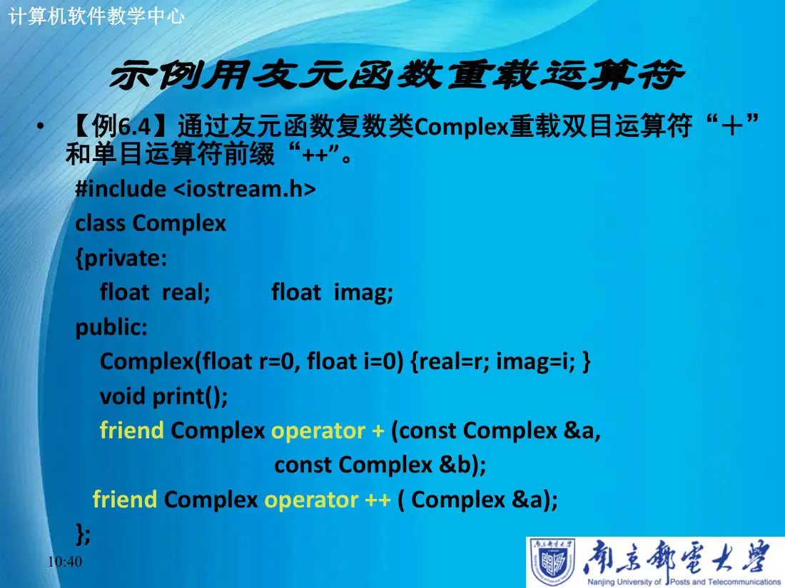

原文：

示例用友元函数重载运算符

• 【例6.4】通过友元函数复数类Complex重载双目运算符“+”和单目运算符前缀“++”。

include <iostream.h>

class Complex

{private:

float real; float imag;

public:

Complex(float r=0, float i=0) {real=r; imag=i;}

void print();

friend Complex operator + (const Complex &a, const Complex &b);

friend Complex operator ++ ( Complex &a);

计算机软件教学中心

南京邮电大学
Nanjing University of Posts and Telecommunications

### 示例用支元函数重载运算符

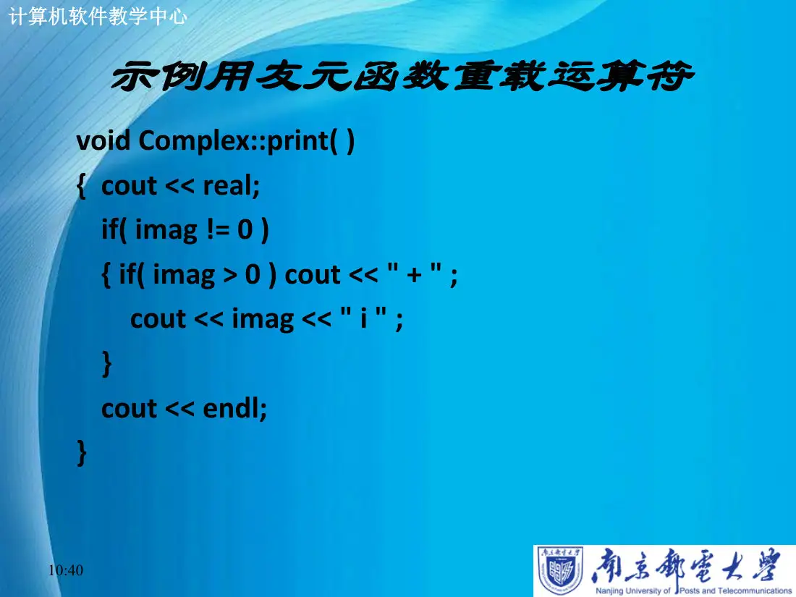

原文：

示例用支元函数重载运算符

计算机软件教学中心

### 示例用支元函数重载运算符

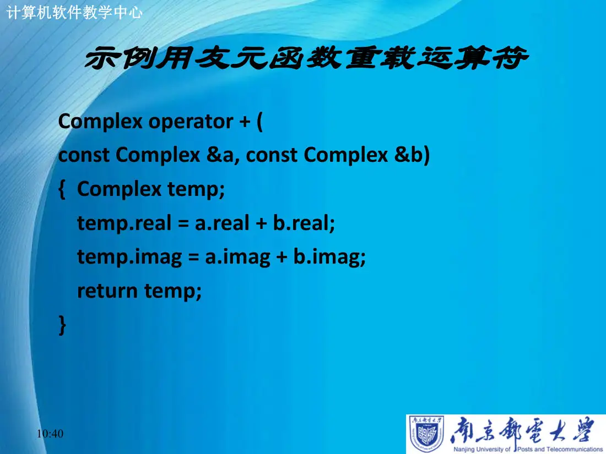

原文：

示例用支元函数重载运算符

Complex operator + (const Complex &a, const Complex &b)

{ Complex temp;
temp.real = a.real + b.real;
temp.imag = a.imag + b.imag;
return temp;

计算机软件教学中心

10:40

南京邮电大学
Nanjing University of Posts and Telecommunications

### 示例用支元函数重载运算符

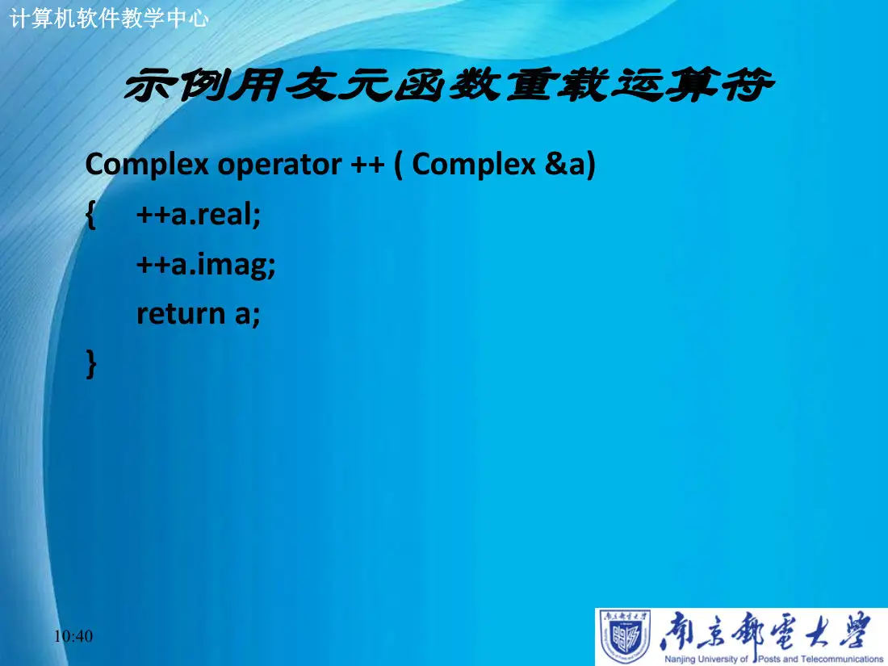

原文：

示例用支元函数重载运算符

Complex operator ++ ( Complex &a)

++a.real;

++a.imag;

return a;

计算机软件教学中心

10:40

南京邮电大学
Nanjing University of Posts and Telecommunications

### 示例用友元函数重载运算符

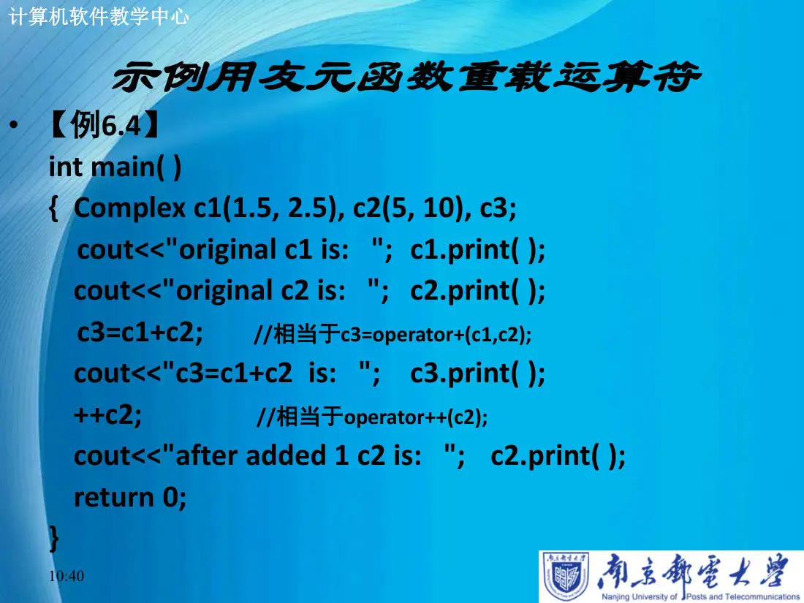

原文：

示例用友元函数重载运算符

计算机软件教学中心

10:40

南京邮电大学
Nanjing University of Posts and Telecommunications

### 示例用友元函数重载运算符

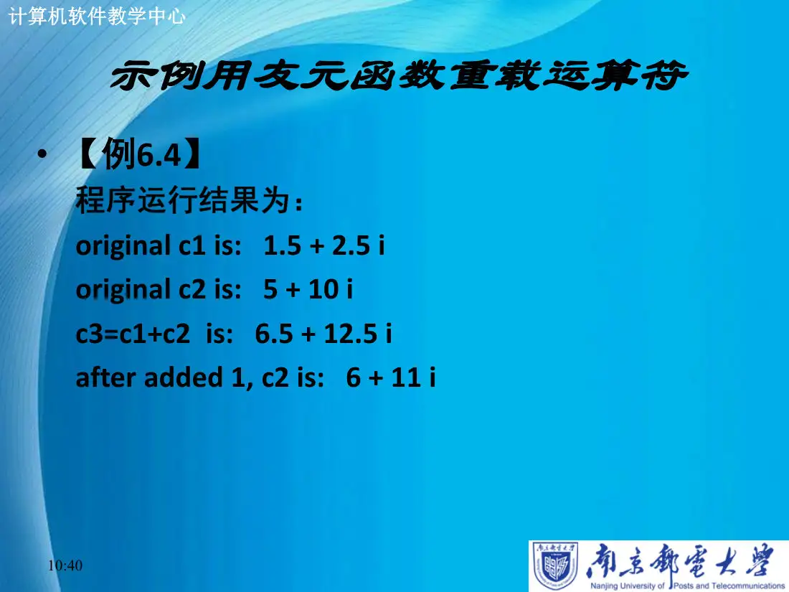

原文：

示例用友元函数重载运算符

• 【例6.4】

程序运行结果为：

original c1 is: 1.5 + 2.5 i

original c2 is: 5 + 10 i

c3=c1+c2 is: 6.5 + 12.5 i

after added 1, c2 is: 6 + 11 i

计算机软件教学中心

10:40

南京邮电大学
Nanjing University of Posts and Telecommunications

### 成员函数形式重载和友元形式重载运算符的区别

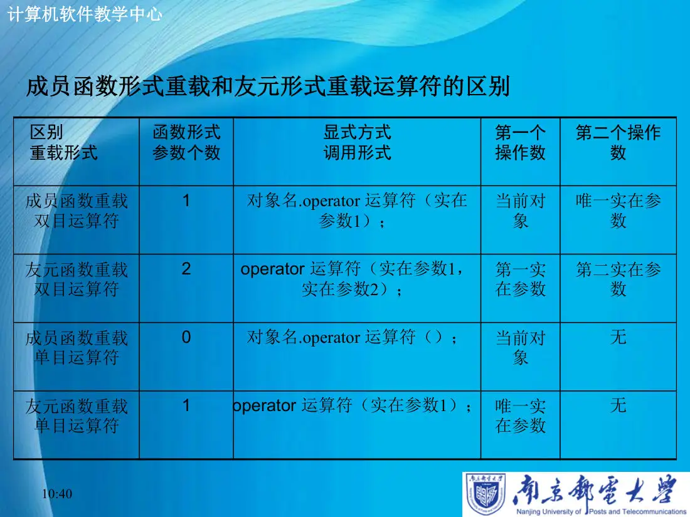

原文：

成员函数形式重载和友元形式重载运算符的区别
<table><tr><td>区别
重载形式</td><td>函数形式
参数个数</td><td>显式方式
调用形式</td><td>第一个
操作数</td><td>第二个操作
数</td></tr><tr><td>成员函数重载
双目运算符</td><td>1</td><td>对象名.operator 运算符（实在参数1）；</td><td>当前对
象</td><td>唯一实在参
数</td></tr><tr><td>友元函数重载
双目运算符</td><td>2</td><td>operator 运算符（实在参数1，实在参数2）；</td><td>第一实
在参数</td><td>第二实在参
数</td></tr><tr><td>成员函数重载
单目运算符</td><td>0</td><td>对象名.operator 运算符（）；</td><td>当前对
象</td><td>无</td></tr><tr><td>友元函数重载
单目运算符</td><td>1</td><td>operator 运算符（实在参数1）；</td><td>唯一实
在参数</td><td>无</td></tr></table>

计算机软件教学中心

10:40

南京邮电大学
Nanjing University of Posts and Telecommunications

### 6.2.4 常用运算符的重载

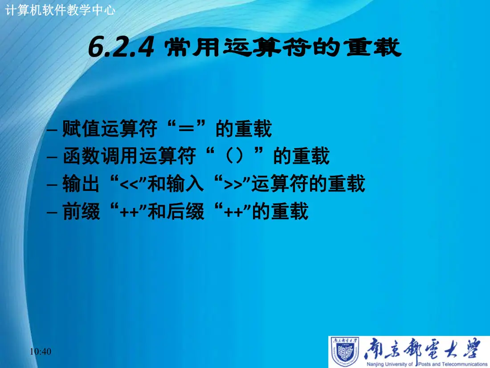

原文：

6.2.4 常用运算符的重载

\- 赋值运算符 “=” 的重载

\- 函数调用运算符 “（）” 的重载

\- 输出“<<”和输入“>>”运算符的重载

\- 前缀 “++”和后缀 “++”的重载

计算机软件教学中心

10:40

南京邮电大学
Nanjing University of Posts and Telecommunications

### 赋值运算符 “=” 的重载

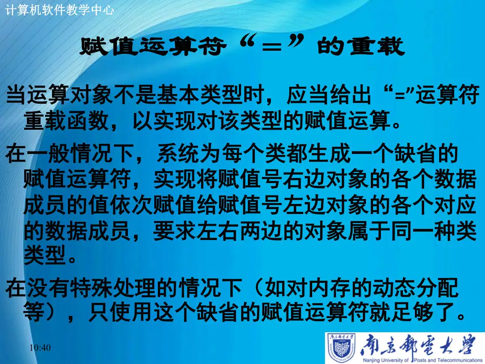

原文：

赋值运算符 “=” 的重载

当运算对象不是基本类型时，应当给出“=”运算符重载函数，以实现对该类型的赋值运算。

在一般情况下，系统为每个类都生成一个缺省的赋值运算符，实现将赋值号右边对象的各个数据成员的值依次赋值给赋值号左边对象的各个对应的数据成员，要求左右两边的对象属于同一种类类型。

在没有特殊处理的情况下（如对内存的动态分配等），只使用这个缺省的赋值运算符就足够了。

计算机软件教学中心

10:40

南京邮电大学
Nanjing University of Posts and Telecommunication

### 计算机软件教学中心

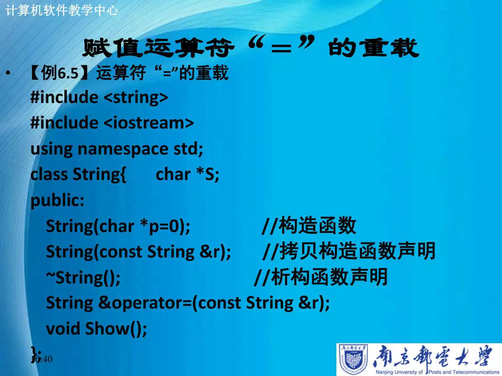

原文：

计算机软件教学中心

赋值运算符“=”的重载

• 【例6.5】运算符“=”的重载

include <string>

include <iostream>

using namespace std;

class String{ char \*S;

public:

String(char \*p=0);

//构造函数

String(const String &r); //拷贝构造函数声明

\~String(); //析构函数声明

String & operator=(const String &r);

void Show();

}10:40

南京邮电大学
Nanjing University of Posts and Telecommunications

### 赋值运算符“=”的重载

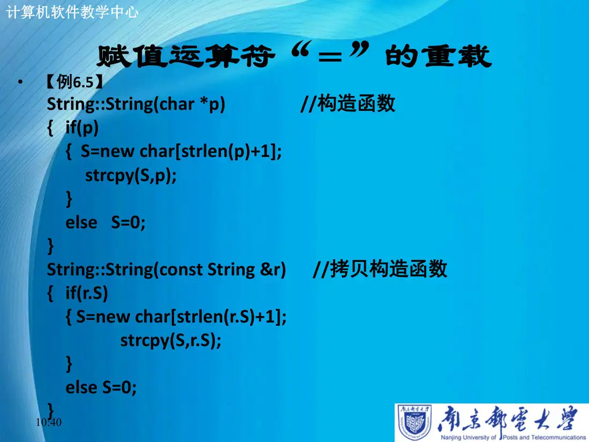

原文：

赋值运算符“=”的重载

计算机软件教学中心

南京邮电大学
Nanjing University of Posts and Telecommunications

### 赋值运算符“=”的重载

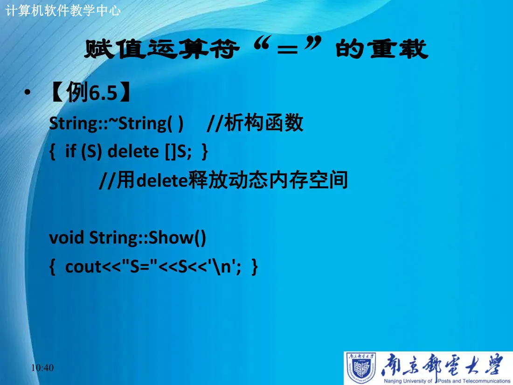

原文：

赋值运算符“=”的重载

• 【例6.5】

String::\~String() //析构函数

{ if (S) delete []S; }

//用delete释放动态内存空间

void String::Show()

{ cout<<"S="<<S<<'\n'; }

计算机软件教学中心

10:40

南京邮电大学
Nanjing University of Posts and Telecommunications

### 赋值运算符“=”的重载

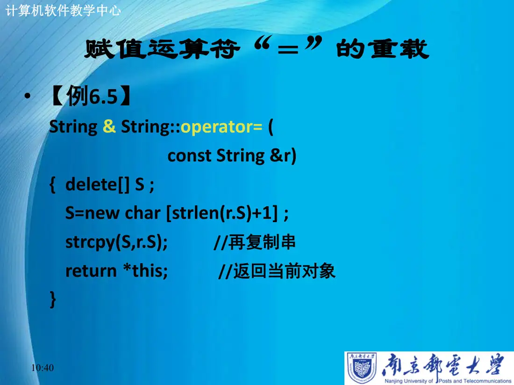

原文：

赋值运算符“=”的重载

• 【例6.5】

String & String::operator= (

const String &r)

{ delete[] S ;

S=new char [strlen(r.S)+1];

strcpy(S,r.S); //再复制串

return \*this; //返回当前对象

计算机软件教学中心

10:40

南京邮电大学
Nanjing University of Posts and Telecommunications

### 计算机软件教学中心

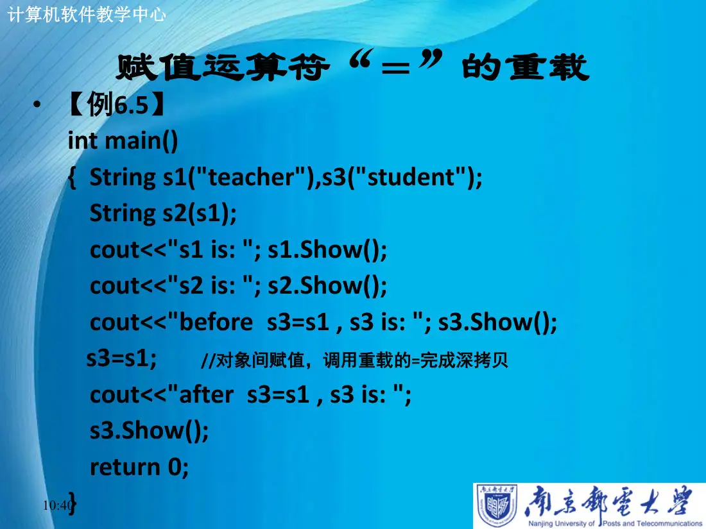

原文：

计算机软件教学中心

南京邮电大学
Nanjing University of Posts and Telecommunications

### 计算机软件教学中心

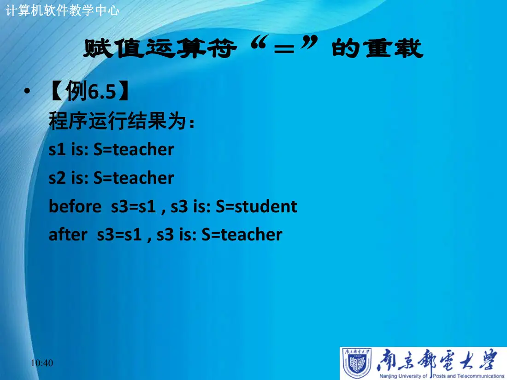

原文：

计算机软件教学中心

赋值运算符 “=” 的重载

• 【例6.5】

程序运行结果为:

s1 is: S=teacher

s2 is: S=teacher

before s3=s1, s3 is: S=student

after s3=s1, s3 is: S=teacher

10:40

南京邮电大学
Nanjing University of Posts and Telecommunications

### 函数调用运算符 “（）” 的重载

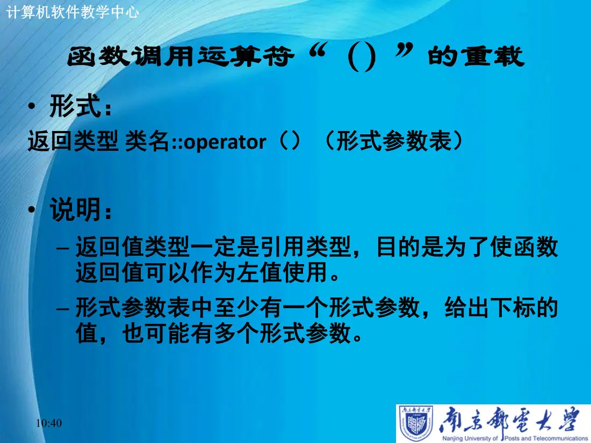

原文：

函数调用运算符 “（）” 的重载

- 形式:

返回类型 类名::operator（）（形式参数表）

- 说明：

\- 返回值类型一定是引用类型，目的是为了使函数返回值可以作为左值使用。

\- 形式参数表中至少有一个形式参数，给出下标的值，也可能有多个形式参数。

计算机软件教学中心

10:40

南京邮电大学
Nanjing University of Posts and Telecommunications

### 函数调用运算符 “（）” 的重载

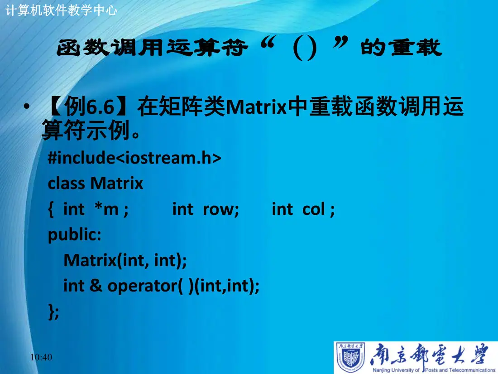

原文：

函数调用运算符 “（）” 的重载

• 【例6.6】在矩阵类Matrix中重载函数调用运算符示例。

include<iostream.h>

class Matrix

{ int \*m ;    int row;    int col ;

public:

Matrix(int, int);

int & operator()(int,int);

};

计算机软件教学中心

10:40

南京邮电大学
Nanjing University of Posts and Telecommunications

### 函数调用运算符 “（）” 的重载

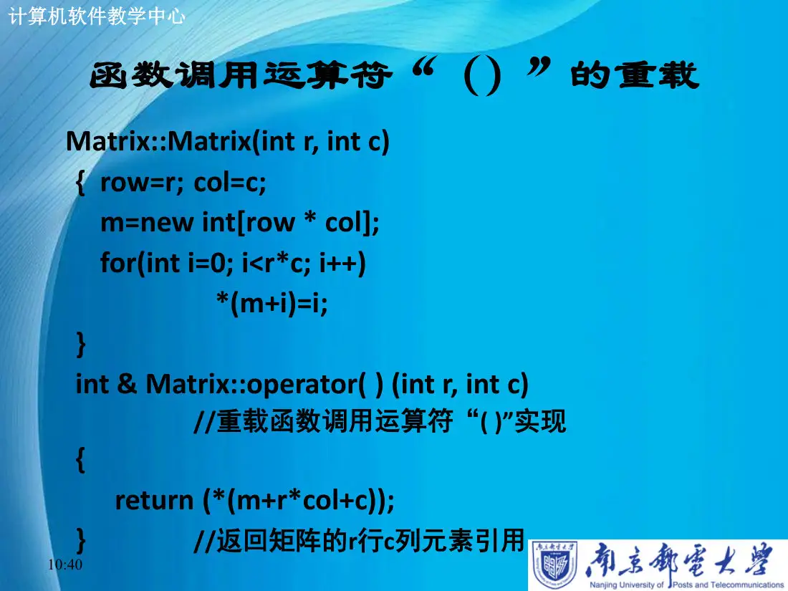

原文：

函数调用运算符 “（）” 的重载

$$
\text { Matrix::Matrix(int   r,   int   c) }
$$

$$
\mathrm{row} = \mathrm{r}; \mathrm{col} = \mathrm{c};
$$

$$
m = \text { new   int[row * col]; }
$$

$$
\text { for(int i = 0; i <   r*c; i++) }
$$

$$
* (m + i) = i;
$$

int & Matrix::operator( ) (int r, int c) //重载函数调用运算符 “()”实现

return $\left(\left(m+r^{*}\text{col}+c\right)\right)$ ;

//返回矩阵的r行c列元素引用

计算机软件教学中心

南京邮电大学
Nanjing University of Posts and Telecommunications

### 函数调用运算符 “（）” 的重载

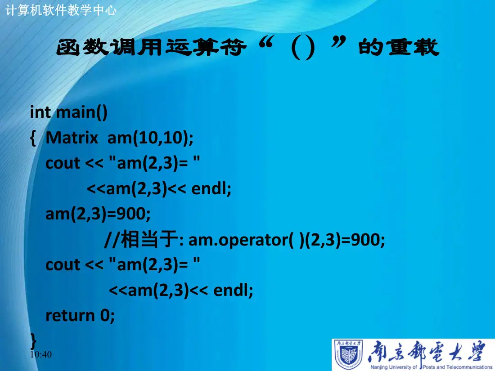

原文：

函数调用运算符 “（）” 的重载

10:40

计算机软件教学中心

南京邮电大学
Nanjing University of Posts and Telecommunications

### 输出“>”运算符的重载

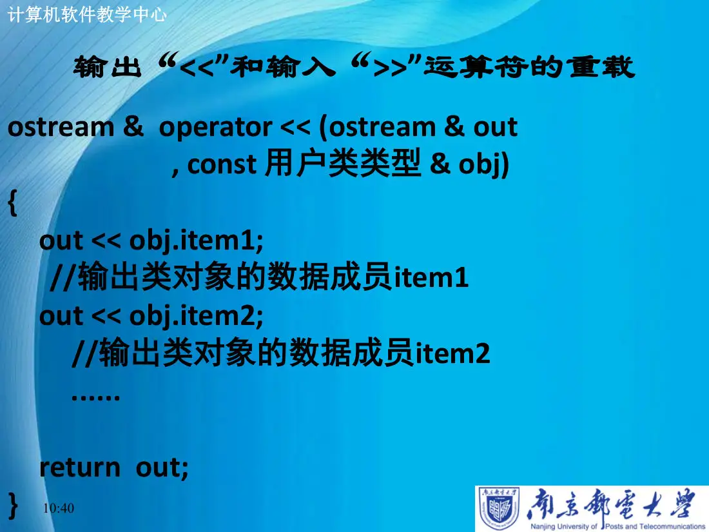

原文：

输出“<<”和输入“>>”运算符的重载

ostream & operator << (ostream & out, const 用户类类型 & obj)

out << obj.item1; //输出类对象的数据成员item1 out << obj.item2; //输出类对象的数据成员item2

return out;

计算机软件教学中心

南京邮电大学
Nanjing University of Posts and Telecommunications

### 输出“>”运算符的重载

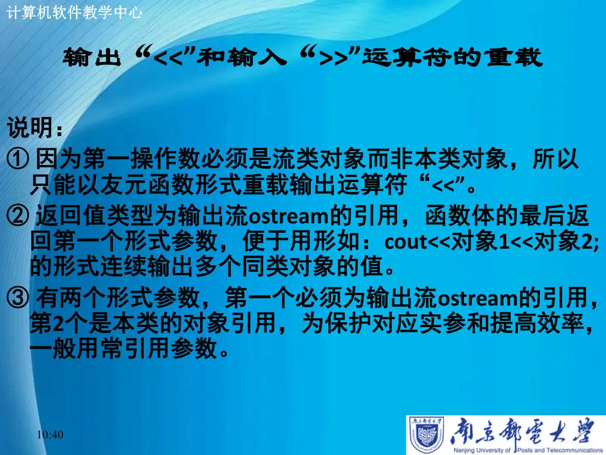

原文：

输出“<<”和输入“>>”运算符的重载

说明：

① 因为第一操作数必须是流类对象而非本类对象，所以只能以友元函数形式重载输出运算符“<<”。

② 返回值类型为输出流ostream的引用，函数体的最后返回第一个形式参数，便于用形如：cout<<对象1<<对象2；的形式连续输出多个同类对象的值。

③有两个形式参数，第一个必须为输出流ostream的引用，第2个是本类的对象引用，为保护对应实参和提高效率，一般用常引用参数。

计算机软件教学中心

10:40

南京邮电大学
Nanjing University of Posts and Telecommunications

### 输出“>”运算符的重载

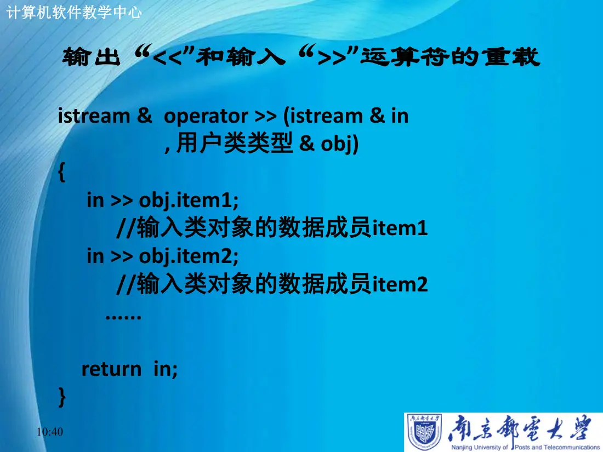

原文：

输出“<<”和输入“>>”运算符的重载

istream & operator >> (istream & in , 用户类类型 & obj)

in >> obj.item1;
//输入类对象的数据成员item1
in >> obj.item2;
//输入类对象的数据成员item2

return in;

计算机软件教学中心

南京邮电大学
Nanjing University of Posts and Telecommunications

### 输出“>”运算符的重载

原文：

输出“<<”和输入“>>”运算符的重载

说明：

① 因为第一操作数必须是流类对象而非本类对象，所以只能以友元函数形式重载输入运算符“>>”。

② 返回值类型为输入流istream的引用，函数体的最后返回第一个形式参数，便于用形如：cin>>对象1>>对象2;的形式连续输入多个同类对象的值。

③有两个形式参数，第一个必须为输入流istream的引用，第2个必须为本类的对象引用，不可以用值形式参数。

计算机软件教学中心

10:40

南京邮电大学
Nanjing University of Posts and Telecommunication

### 6.3 动态多态性的实现

原文：

6.3 动态多态性的实现

\- 虚函数的定义

\- 虚析构函数

\- 虚函数与同名覆盖

\- 多层次、多重继承中的动态多态性

计算机软件教学中心

10:40

南京邮电大学
Nanjing University of Posts and Telecommunications

### 6.3.1 虚函数的定义

原文：

6.3.1 虚函数的定义

\- 虚函数必须是类的非静态成员函数，在类体内声明.
- 函数原型声明方式为：

virtual <返回类型> <成员函数名> （形式参数表）；

计算机软件教学中心

10:40

南京邮电大学
Nanjing University of Posts and Telecommunications

### 6.3.1 虚函数的定义

原文：

6.3.1 虚函数的定义

- 虚函数的作用

\- 可以通过基类指针或引用访问基类与派生类中被说明为虚函数的同名函数。

\- 派生类一定是以公有方式继承了基类。

\- 在派生类中与基类同名虚函数，其函数原型完全一致。即函数的返回值类型、函数名、形式参数表完全相同。

计算机软件教学中心

10:40

南京邮电大学
Nanjing University of Posts and Telecommunications

### 【例6.9】声明虚函数以实现动态多态性

原文：

【例6.9】声明虚函数以实现动态多态性

include <iostream>
using namespace std;
class Base    //定义基类Base
{public:
    Base(int x)    //基类的构造函数
    { a=x; }
virtual void Print()
    //定义函数Print()为虚函数
{cout<<"Base::a="<<a<<endl;} 
int a;    //基类的公有数据成员a【例6.9】声明虚函数以实现动态多态性

计算机软件教学中心

南京邮电大学
Nanjing University of Posts and Telecommunications

### class Derive:public Base //公有派生类

原文：

class Derive:public Base //公有派生类

{public: int a;

//派生类中数据成员a与基类数据成员的同名

Derive(int x, int y): Base(x)

$$
a = y;
$$

$$
\text { Base::a* = 2; }
$$

virtual void Print( ) //此处的virtual可以省略

{Base::Print();

cout<<"Derived::a="<<a<<endl;

//访问本类中的同名成员

计算机软件教学中心

南京邮电大学
Nanjing University of Posts and Telecommunications

### 【例6.9】声明虚函数以实现动态多态性

原文：

【例6.9】声明虚函数以实现动态多态性

void f(Base &bb)

//定义一个函数以基类的引用作形式参数

{ bb.Print( ); }

//通过引用调用Print()函数

计算机软件教学中心

10:40

南京邮电大学
Nanjing University of Posts and Telecommunications

### 【例6.9】声明虚函数以实现动态多态性

原文：

【例6.9】声明虚函数以实现动态多态性

int main()

{ Base b(100),\*ps;

Derive d(200,300);

ps=&b; //将指针 ps 指向基类对象

ps->Print(); //调用的是基类的同名虚函数

ps=&d; //将指针 ps 指向 派生类对象

ps->Print(); //调用的是派生类的同名虚函数

f(b); //调用基类的Print()函数

f(d); //调用派生类的Print()函数

return 0;

计算机软件教学中心

10:40

南京邮电大学
Nanjing University of Posts and Telecommunications

### 【例6.9】声明虚函数以实现动态多态性

原文：

【例6.9】声明虚函数以实现动态多态性

程序的运行结果为:

Base::a=100 //此行调用基类的print函数

Base::a=400 //调用派生类的print函数

Derived::a=300

Base::a=100

Base::a=400

Derived::a=300

计算机软件教学中心

10:40

南京邮电大学
Nanjing University of Posts and Telecommunications

### - 虚函数的限制

原文：

- 虚函数的限制

\- 静态成员函数不能声明为虚函数。因为静态成员函数不属于某一个对象，没有多态性的特征。

\- 内联成员函数不能声明为虚函数。因为内联函数的执行代码是明确的，没有多态性的特征。

\- 构造函数不能是虚函数。构造函数在对象创建时调用，完成对象的初始化，此时对象还没有完全建立，所以，对构造函数声明为虚函数是没有意义的。

\- 析构函数可以是虚函数。

计算机软件教学中心

10:40

南京邮电大学
Nanjing University of Posts and Telecommunications

### 6.3.2 虚析构函数

原文：

6.3.2 虚析构函数

析构函数往往被声明为虚函数。如果基类的析构函数声明为虚函数，则该类所有派生类的析构函数也自动生成为虚函数而无需显式声明。

在这种情况下，由于实施多态性时是通过将基类的指针指向派生类的对象，如果删除该指针，就会调用该指针指向的派生类的析构函数，而派生类的析构函数又自动调用基类的析构函数，这样整个派生类的对象被完全释放。

计算机软件教学中心

10:40

南京邮电大学
Nanjing University of Posts and Telecommunication

### 6.3.3 虚函数与同名覆盖

原文：

6.3.3 虚函数与同名覆盖

\- 在基类的成员函数被声明为虚函数后，其公有派生类中要有该虚函数的重新定义版本，才可以利用基类的指针或引用实现动态多态性。

\- 一个函数，如果在基类和其公有派生类中拥有相同的函数名，但是函数返回值类型不同，或者是形式参数表不同，即使在基类中被声明为虚函数，也不具备多态性。

计算机软件教学中心

10:40

南京邮电大学
Nanjing University of Posts and Telecommunications

### 【例6.11】虚函数与同名覆盖问题示例

原文：

【例6.11】虚函数与同名覆盖问题示例

include<iostream>

using namespace std;

class base

//声明基类 base

{public:

virtual void f1() //声明为虚函数

{ cout<<"f1 function of base \n"; }

virtual void f2() //声明为虚函数

{ cout<<"f2 function of base \n";}

void f3( )    //声明为普通函数

{ cout<<"f3 function of base \n";}

计算机软件教学中心

10:40

南京邮电大学
Nanjing University of Posts and Telecommunications

### 【例6.11】虚函数与同名覆盖问题示例

原文：

【例6.11】虚函数与同名覆盖问题示例

class derive:public base //派生类

{ public:

void f1( )    //具有虚函数特征

{ cout<<"f1 function of derive \n"; }

void f2 (int x) //改变参数,同名覆盖

{ cout<<"f2 function of derive \n"; }

void f3( ) //仍为普通函数,同名覆盖

{ cout<<"f3 function of derive \n";}

计算机软件教学中心

10:40

南京邮电大学
Nanjing University of Posts and Telecommunications

### 【例6.11】虚函数与同名覆盖问题示例

原文：

【例6.11】虚函数与同名覆盖问题示例

int main()

{ base ob1, \*p ;

derive ob2;

p=&ob1;

//创建基类的对象ob1和指针p

//创建派生类的对象ob2

//将指针 p 指向基类的对象ob1

cout<<"p point to base class object ob1:\n";

p->f1( );

p->f2( );

p->f3( );

//调用基类函数f1

//调用基类函数f2

//调用基类函数f3

计算机软件教学中心

10:40

南京邮电大学
Nanjing University of Posts and Telecommunication

### 【例6.11】虚函数与同名覆盖问题示例

原文：

【例6.11】虚函数与同名覆盖问题示例

p=&ob2; //将指针指向派生类的对象ob2

cout<<"p point to derive class object ob2:\n";

p->f1(); //调用派生类的函数f1（动态联编）

p->f2( ); //调用基类的函数f2

p->f2(1); //此行会报错，因基类中的f2()是不带参数的

p->f3( ); //调用基类函数f3

cout<<"derive class object ob2: call member functions:\n";

ob2.f1(); //通过派生类对象只能直接调用本类的f1()函数

// ob2.f2(); //此行会报错

ob2.base::f2(); //同名覆盖,调用加基类名::访问

ob2.f2(1); //调用派生类重新定义的f2()函数

ob2.f3(); //调用派生类重新定义的f3()函数

计算机软件教学中心

10:40

南京邮电大学
Nanjing University of Posts and Telecommunications

### 计算机软件教学中心

原文：

计算机软件教学中心

【例6.11】虚函数与同名覆盖问题示例

程序运行结果为：

p point to base class object ob1:

f1 function of base

f2 function of base

f3 function of base

p point to derive class object ob2:

f1 function of derive

//动态联编

f2 function of base

//静态联编

f3 function of base

derive class object ob2: call member functions:

f1 function of derive

f2 function of base

f2 function of derive

10:40 f3 function of derive

南京邮电大学
Nanjing University of Posts and Telecommunications

### 6.4 纯虚函数与抽象类

原文：

6.4 纯虚函数与抽象类

\- 纯虚函数

\- 函数原型声明的一般形式为:

virtual <返回类型> <成员函数名>

(<形式参数表>) =0;

抽象类

\- 含纯虚函数的类, 称之为抽象类.

计算机软件教学中心

10:40

南京邮电大学
Nanjing University of Posts and Telecommunications

### 【例6.12】纯虚函数示例。

原文：

【例6.12】纯虚函数示例。

include <iostream>

using namespace std;

class Point

{public:

virtual void Draw ()=0; //定义纯虚函数

计算机软件教学中心

10:40

南京邮电大学
Nanjing University of Posts and Telecommunications

### 【例6.12】纯虚函数示例。

原文：

【例6.12】纯虚函数示例。

计算机软件教学中心

10:40

南京邮电大学
Nanjing University of Posts and Telecommunications

### 【例6.12】纯虚函数示例

原文：

【例6.12】纯虚函数示例

void DrawObject(Point \*p)

//定义顶层函数，以基类指针为形式参数

int main()

{ Line L; Circle C;

DrawObject(&L);

DrawObject(&C) ;

return 0;

程序的运行结果: Line::Draw is called. Circle::Draw is called.

计算机软件教学中心

10:40

南京邮电大学
Nanjing University of Posts and Telecommunications

### - 分析:

原文：

- 分析:

\- 纯虚函数是一种没有函数体的特殊虚函数。

\- 纯虚函数不能被调用，只有在派生类中被具体定义后才可调用。

\- 纯虚函数的作用在于基类给派生类提供一个标准的函数原型，统一接口，派生类将根据需要给出纯虚函数的具体实现代码。

计算机软件教学中心

10:40

南京邮电大学
Nanjing University of Posts and Telecommunications

### 6.4.2 抽象类

原文：

6.4.2 抽象类

\- 对于抽象类，注意几点:

\- 抽象类不能生成对象。

\- 抽象类可以定义其指针或引用。

\- 抽象类的基类不能是普通类（即不是抽象类的类），抽象类只能作基类，是下面诸多的派生类的集中归宿。

\- 抽象类除了必须至少有一个纯虚函数以外，还可以定义普通成员函数或虚函数。

计算机软件教学中心

10:40

南京邮电大学
Nanjing University of Posts and Telecommunications

### 本章小结

原文：

本章小结

\- 多态性的两种形式：静态多态性和动态多态性。

\- 运算符的重载可以有两种实现方式——以成员函数形式或友元函数形式重载。

\- 继承、虚函数、基类的指针和引用共同实现了动态多态性，虚函数在基类和公有派生类中要求函数原型完全一致，否则将褪变成同名覆盖现象而不具有动态多态性。

\- 只给出了函数声明而没有给出具体实现的虚成员函数称为纯虚函数;至少包含了一个纯虚函数的类称为抽象类。

计算机软件教学中心

10:40

南京邮电大学
Nanjing University of Posts and Telecommunications
