# 《面向对象程序设计及C++》第7章 模板（课件）

原件的每一页，下面附识别出的文字。

### 面向对象程序设计及C++

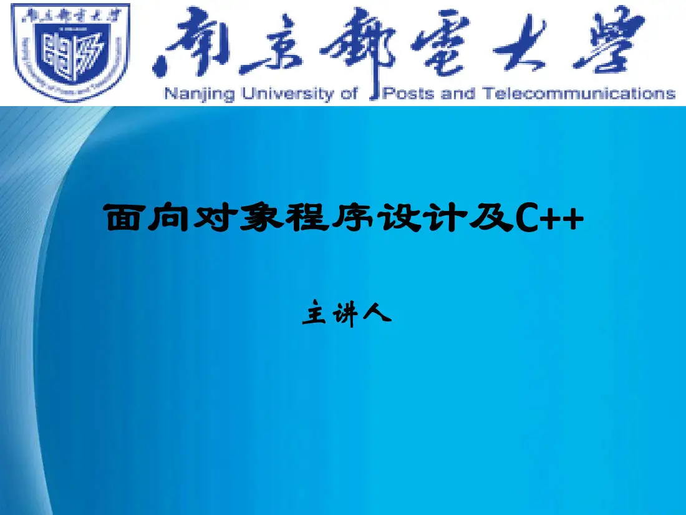

原文：

Nanjing University of JPosts and Telecommunications

面向对象程序设计及C++

主讲人

### 第七章 模板

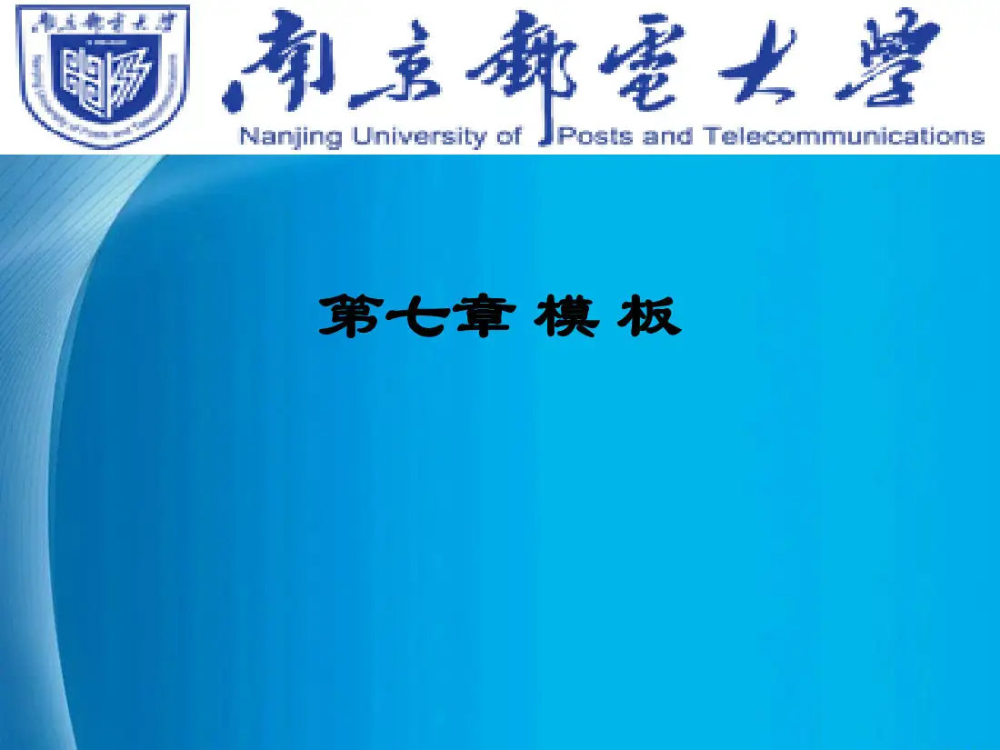

原文：

第七章 模板

### 本章内容提要

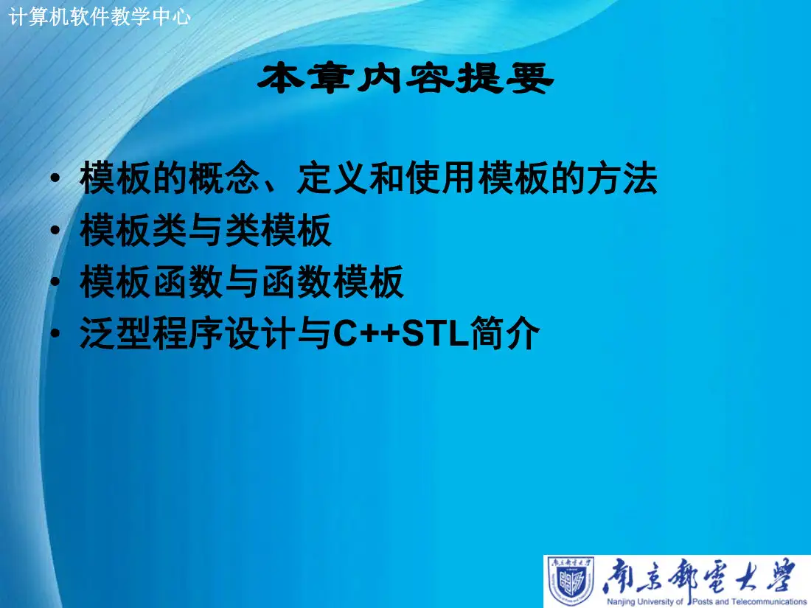

原文：

本章内容提要

\- 模板的概念、定义和使用模板的方法

\- 模板类与类模板

\- 模板函数与函数模板

\- 泛型程序设计与C++STL简介

计算机软件教学中心

南京邮电大学
Nanjing University of Posts and Telecommunications

### 本章内容安排

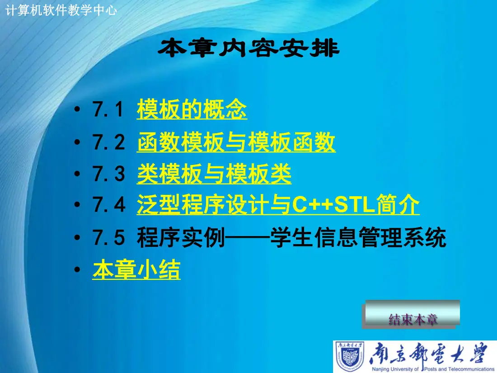

原文：

本章内容安排

• 7.1 模板的概念

• 7.2 函数模板与模板函数

• 7.3 类模板与模板类

• 7.4 泛型程序设计与C++STL简介

• 7.5 程序实例——学生信息管理系统

· 本章小结

结束本章

计算机软件教学中心

南京邮电大学
Nanjing University of Posts and Telecommunications

### 7.1 模板的概念

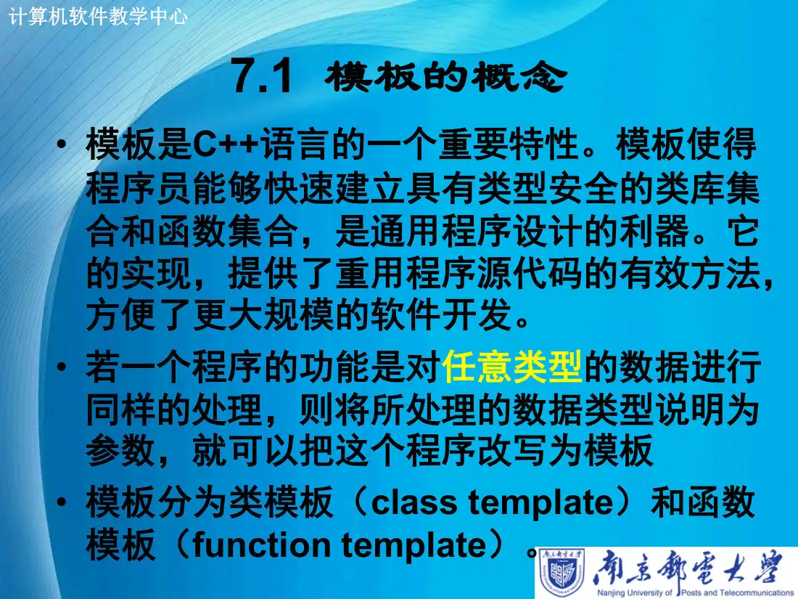

原文：

7.1 模板的概念

\- 模板是C++语言的一个重要特性。模板使得程序员能够快速建立具有类型安全的类库集合和函数集合，是通用程序设计的利器。它的实现，提供了重用程序源代码的有效方法，方便了更大规模的软件开发。

\- 若一个程序的功能是对任意类型的数据进行同样的处理，则将所处理的数据类型说明为参数，就可以把这个程序改写为模板

\- 模板分为类模板（class template）和函数模板（function template）。

计算机软件教学中心

南京邮电大学
Nanjing University of Posts and Telecommunications

### 计算机软件教学中心

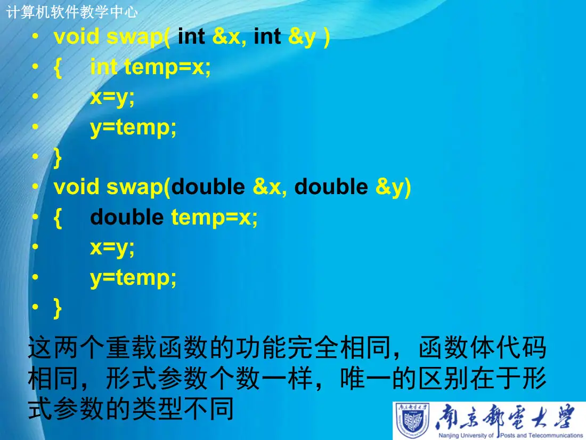

原文：

计算机软件教学中心

\- void swap( int &x, int &y )

void swap(double &x, double &y)

{ double temp=x;

这两个重载函数的功能完全相同，函数体代码相同，形式参数个数一样，唯一的区别在于形式参数的类型不同- template <class T>
- //这里的class不是定义类的标识，
- //而是表明T是一个类型参数

南京邮电大学
Nanjing University of Posts and Telecommunications

### \- void swap(T &x,T &y)

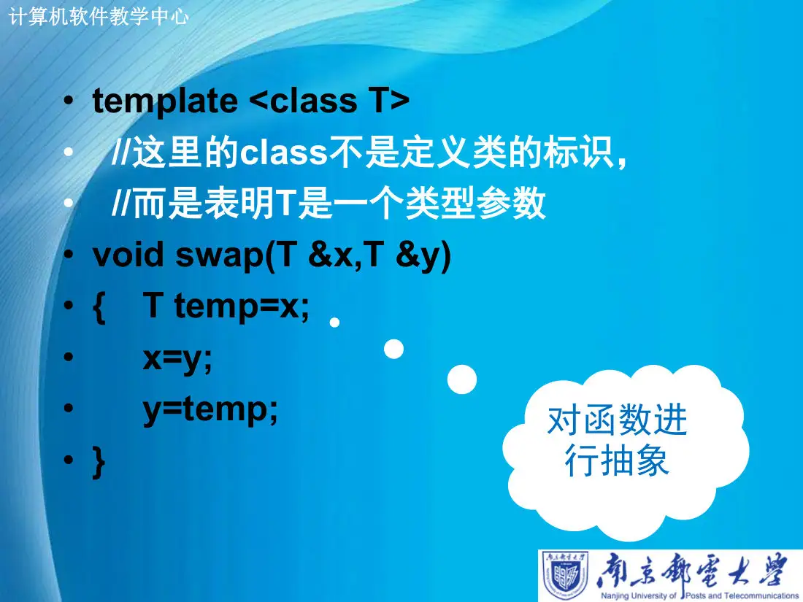

原文：

\- void swap(T &x,T &y)

• { T temp=x;

• x=y;

• y=temp;

• }

对函数进行抽象

计算机软件教学中心

南京邮电大学
Nanjing University of Posts and Telecommunications

### 模板、模板函数、模板类与对象之间的关系示意图

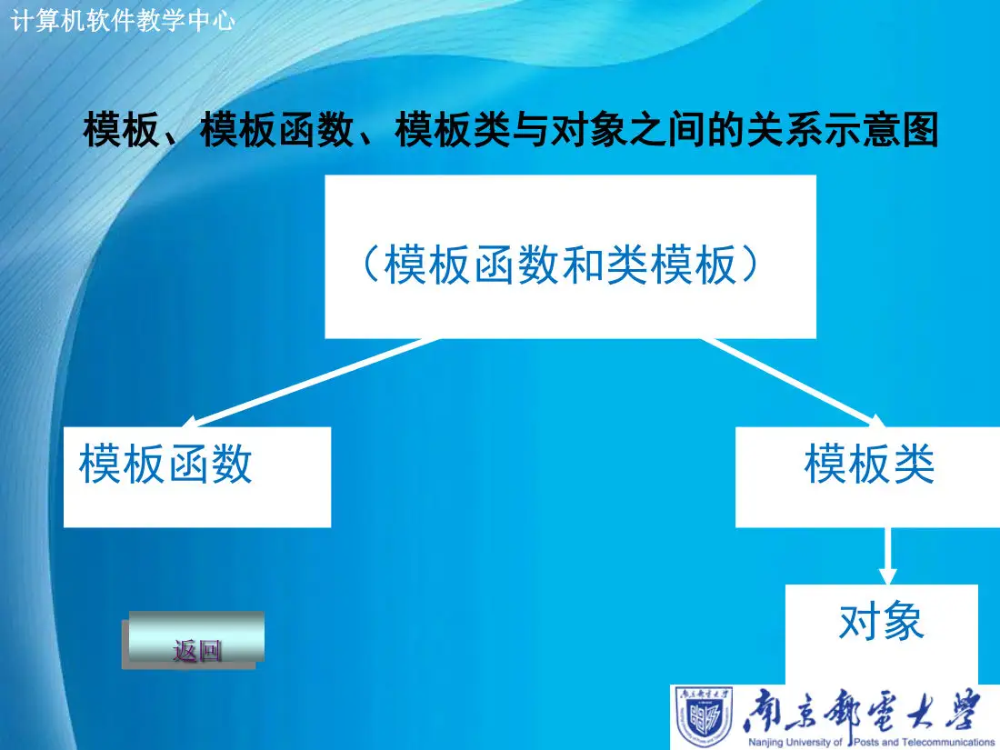

原文：

模板、模板函数、模板类与对象之间的关系示意图

(模板函数和类模板)

模板函数

返回

模板类

对象

计算机软件教学中心

南京邮电大学
Nanjing University of Posts and Telecommunications

### 7.2 函数模板与模板函数

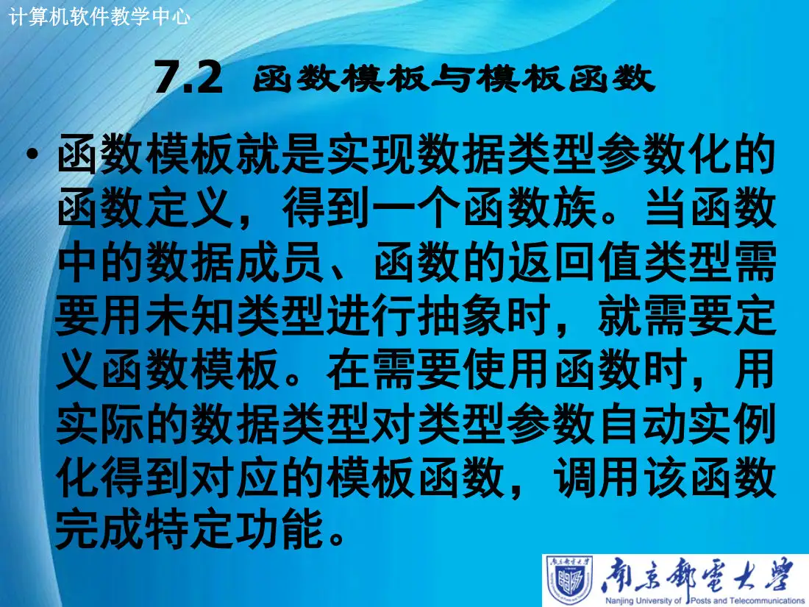

原文：

7.2 函数模板与模板函数

\- 函数模板就是实现数据类型参数化的函数定义，得到一个函数族。当函数中的数据成员、函数的返回值类型需要用未知类型进行抽象时，就需要定义函数模板。在需要使用函数时，用实际的数据类型对类型参数自动实例化得到对应的模板函数，调用该函数完成特定功能。

计算机软件教学中心

南京邮电大学
Nanjing University of Posts and Telecommunications

### 7.2.1 函数模板的定义与模板函数的使用

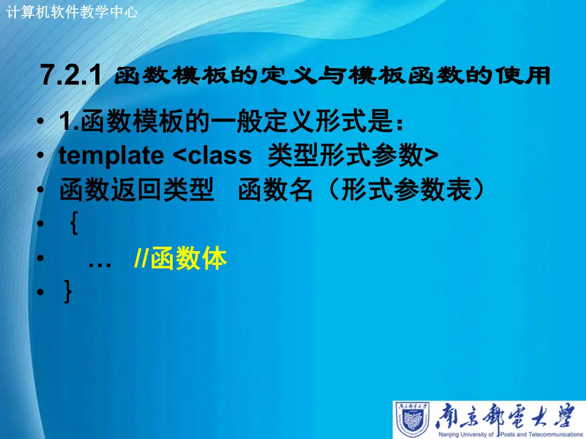

原文：

7.2.1 函数模板的定义与模板函数的使用

• 1. 函数模板的一般定义形式是:

\- template <class 类型形式参数>

\- 函数返回类型 函数名（形式参数表）

... //函数体

计算机软件教学中心

南京邮电大学
Nanjing University of Posts and Telecommunications

### 计算机软件教学中心

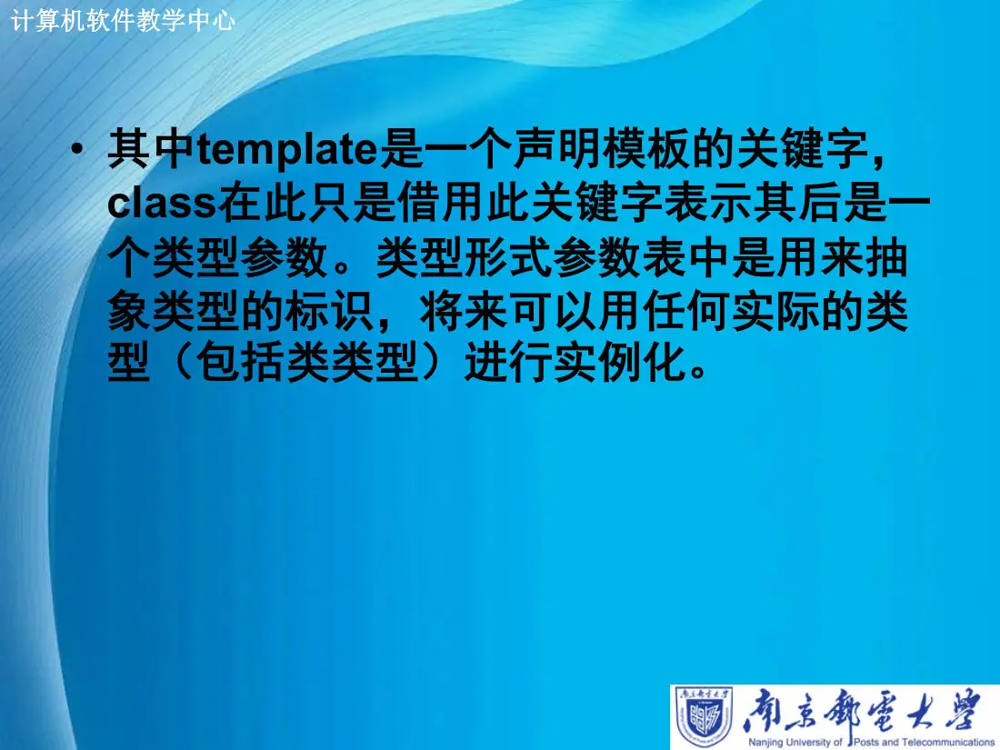

原文：

\- 其中template是一个声明模板的关键字，class在此只是借用此关键字表示其后是一个类型参数。类型形式参数表中是用来抽象类型的标识，将来可以用任何实际的类型（包括类类型）进行实例化。

计算机软件教学中心

南京邮电大学
Nanjing University of Posts and Telecommunications

### \- 在VC下运行example7\_01.cpp

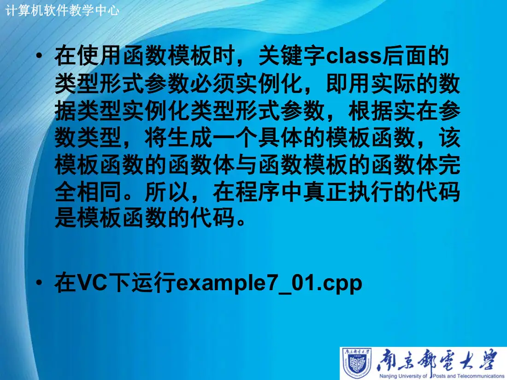

原文：

\- 在使用函数模板时，关键字class后面的类型形式参数必须实例化，即用实际的数据类型实例化类型形式参数，根据实在参数类型，将生成一个具体的模板函数，该模板函数的函数体与函数模板的函数体完全相同。所以，在程序中真正执行的代码是模板函数的代码。

\- 在VC下运行example7\_01.cpp

计算机软件教学中心

南京邮电大学
Nanjing University of Posts and Telecommunications

### • NOTE

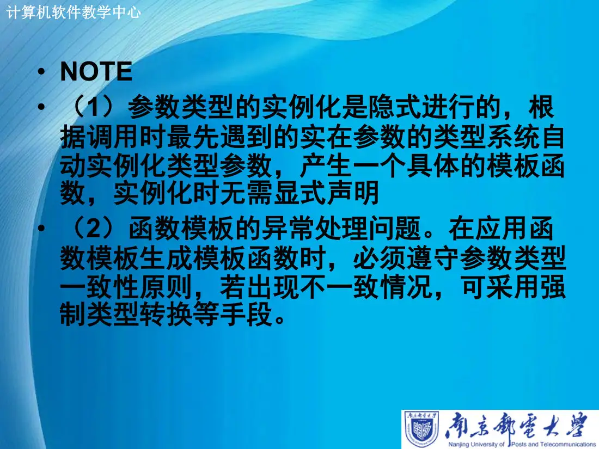

原文：

• NOTE

• (1) 参数类型的实例化是隐式进行的, 根据调用时最先遇到的实在参数的类型系统自动实例化类型参数, 产生一个具体的模板函数, 实例化时无需显式声明

(2) 函数模板的异常处理问题。在应用函数模板生成模板函数时，必须遵守参数类型一致性原则，若出现不一致情况，可采用强制类型转换等手段。

计算机软件教学中心

南京邮电大学
Nanjing University of Posts and Telecommunications

### • (3) 在template语句与函数模板的定义语句之间不能插入其他语句。

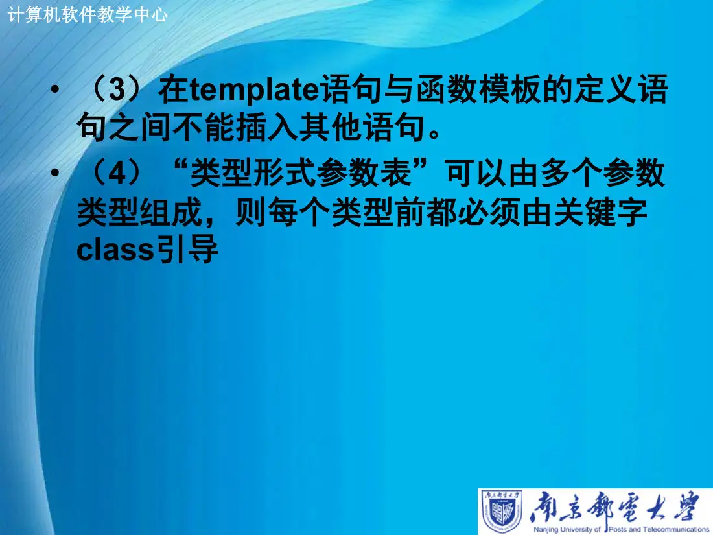

原文：

• (3) 在template语句与函数模板的定义语句之间不能插入其他语句。

(4) “类型形式参数表”可以由多个参数类型组成, 则每个类型前都必须由关键字class引导

计算机软件教学中心

南京邮电大学
Nanjing University of Posts and Telecommunications

### 2. 函数模板的异常处理

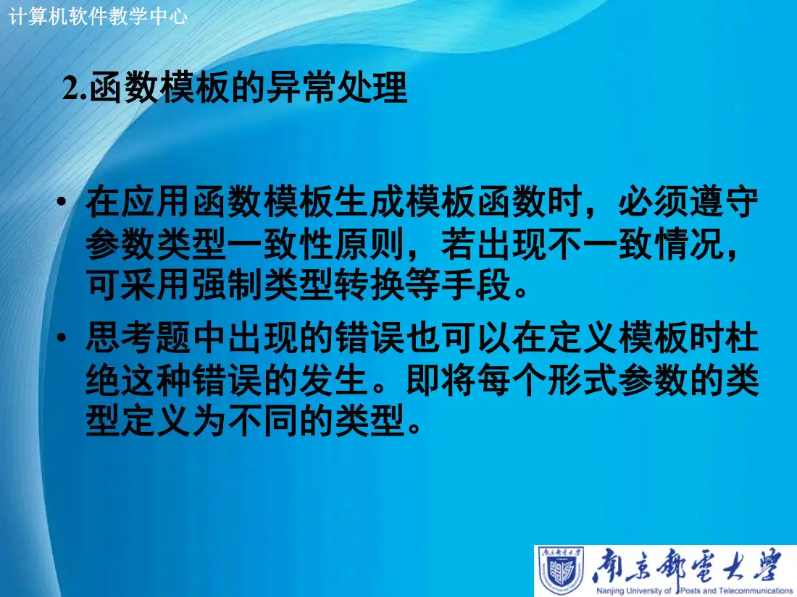

原文：

2. 函数模板的异常处理

\- 在应用函数模板生成模板函数时，必须遵守参数类型一致性原则，若出现不一致情况，可采用强制类型转换等手段。

\- 思考题中出现的错误也可以在定义模板时杜绝这种错误的发生。即将每个形式参数的类型定义为不同的类型。

计算机软件教学中心

南京邮电大学
Nanjing University of Posts and Telecommunications

### 计算机软件教学中心

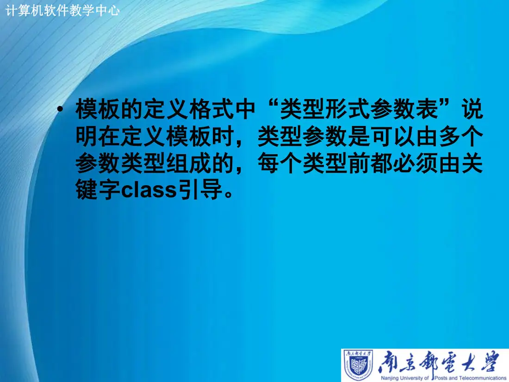

原文：

\- 模板的定义格式中“类型形式参数表”说明在定义模板时，类型参数是可以由多个参数类型组成的，每个类型前都必须由关键字class引导。

计算机软件教学中心

南京邮电大学
Nanjing University of Posts and Telecommunications

### 7.2.2 重载模板函数

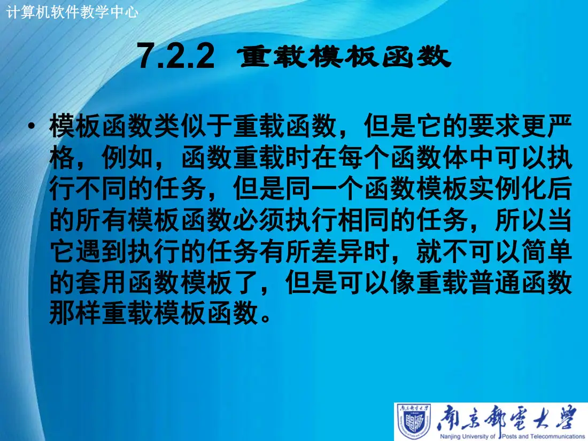

原文：

7.2.2 重载模板函数

\- 模板函数类似于重载函数，但是它的要求更严格，例如，函数重载时在每个函数体中可以执行不同的任务，但是同一个函数模板实例化后的所有模板函数必须执行相同的任务，所以当它遇到执行的任务有所差异时，就不可以简单的套用函数模板了，但是可以像重载普通函数那样重载模板函数。

计算机软件教学中心

南京邮电大学
Nanjing University of Posts and Telecommunications

### \- 在VC下运行example7\_02.cpp

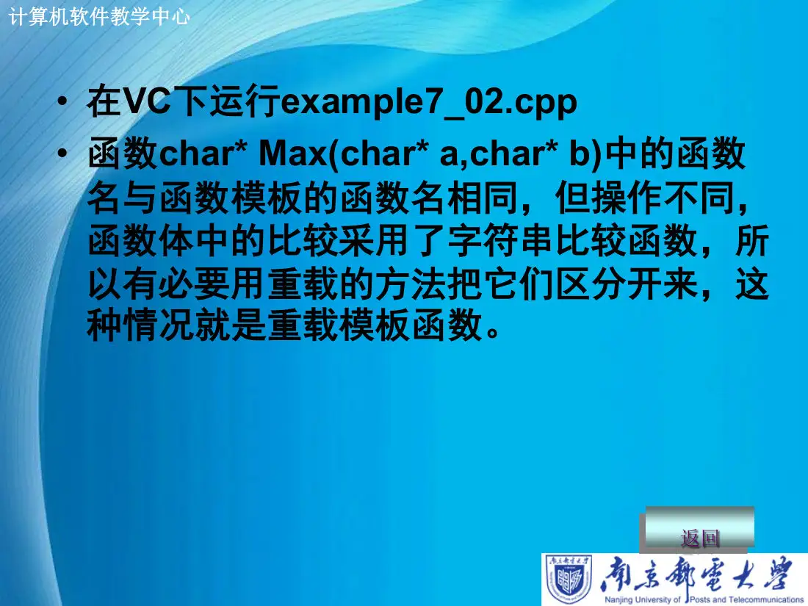

原文：

\- 在VC下运行example7\_02.cpp

\- 函数char\* Max(char\* a,char\* b)中的函数名与函数模板的函数名相同，但操作不同，函数体中的比较采用了字符串比较函数，所以有必要用重载的方法把它们区分开来，这种情况就是重载模板函数。

返回

计算机软件教学中心

南京邮电大学
Nanjing University of Posts and Telecommunications

### 7.3 类模板与模板类

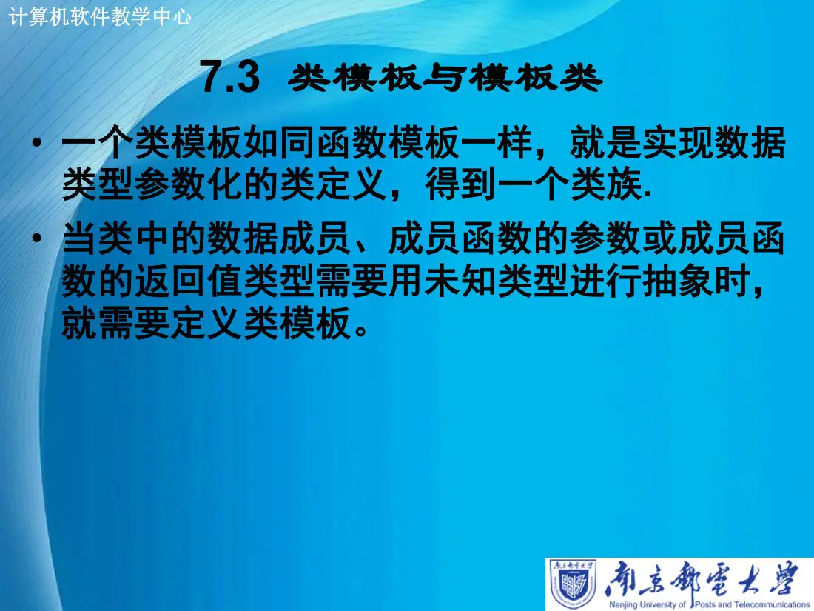

原文：

7.3 类模板与模板类

\- 一个类模板如同函数模板一样，就是实现数据类型参数化的类定义，得到一个类族。

\- 当类中的数据成员、成员函数的参数或成员函数的返回值类型需要用未知类型进行抽象时，就需要定义类模板。

计算机软件教学中心

南京邮电大学
Nanjing University of Posts and Telecommunications

### 计算机软件教学中心

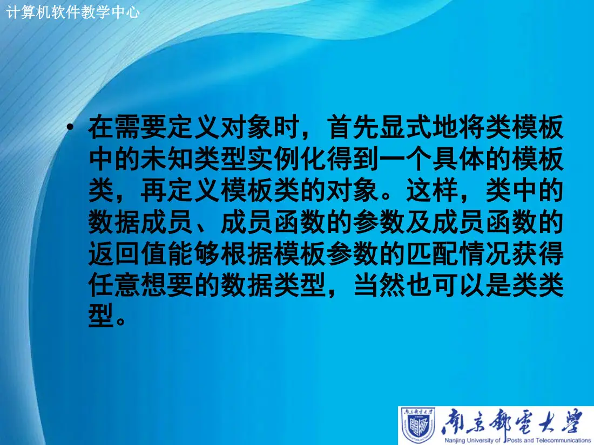

原文：

\- 在需要定义对象时，首先显式地将类模板中的未知类型实例化得到一个具体的模板类，再定义模板类的对象。这样，类中的数据成员、成员函数的参数及成员函数的返回值能够根据模板参数的匹配情况获得任意想要的数据类型，当然也可以是类类型。

计算机软件教学中心

南京邮电大学
Nanjing University of Posts and Telecommunications

### 7.3.1 类模板的定义

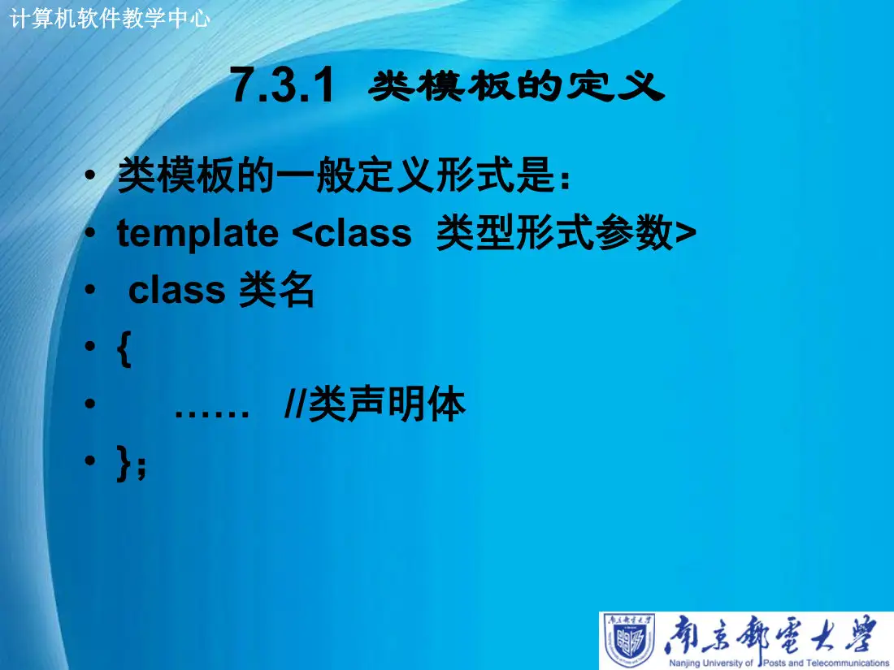

原文：

7.3.1 类模板的定义

\- 类模板的一般定义形式是:

\- template <class 类型形式参数>

\- class 类名

• {

• …… //类声明体

•};

计算机软件教学中心

南京邮电大学
Nanjing University of Posts and Telecommunications

### 计算机软件教学中心

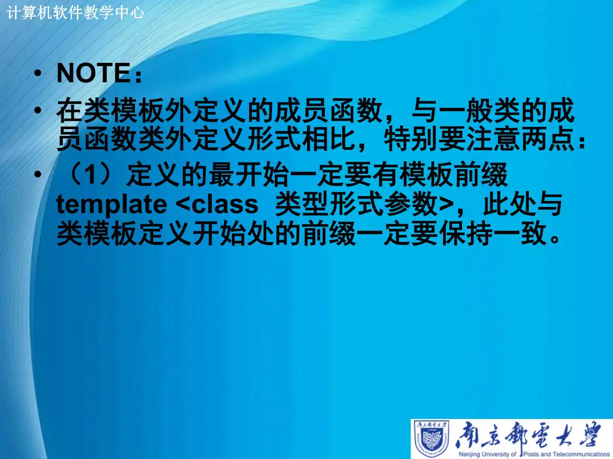

原文：

计算机软件教学中心

• NOTE:

\- 在类模板外定义的成员函数，与一般类的成员函数类外定义形式相比，特别要注意两点：

• (1) 定义的最开始一定要有模板前缀 template <class 类型形式参数>，此处与类模板定义开始处的前缀一定要保持一致。

南京邮电大学
Nanjing University of Posts and Telecommunications

### 计算机软件教学中心

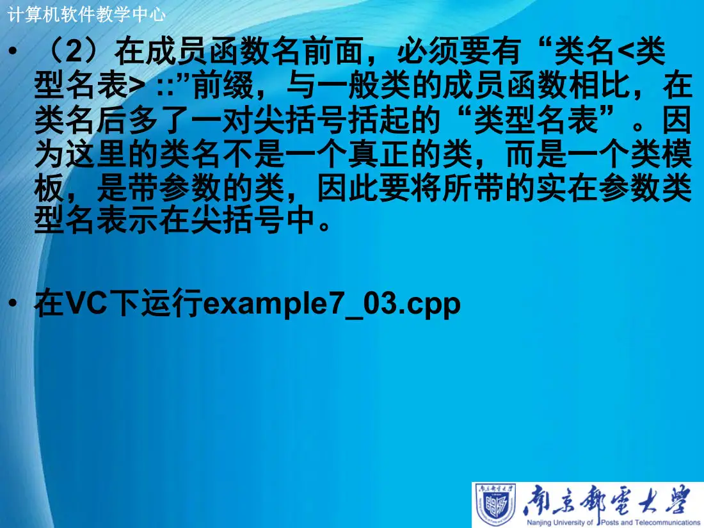

原文：

计算机软件教学中心

• (2) 在成员函数名前面，必须要有“类名<类型名表>::”前缀，与一般类的成员函数相比，在类名后多了一对尖括号括起的“类型名表”。因为这里的类名不是一个真正的类，而是一个类模板，是带参数的类，因此要将所带的实在参数类型名表示在尖括号中。

\- 在VC下运行example7\_03.cpp

南京邮电大学
Nanjing University of Posts and Telecommunications

### 7.3.2 类模板的使用

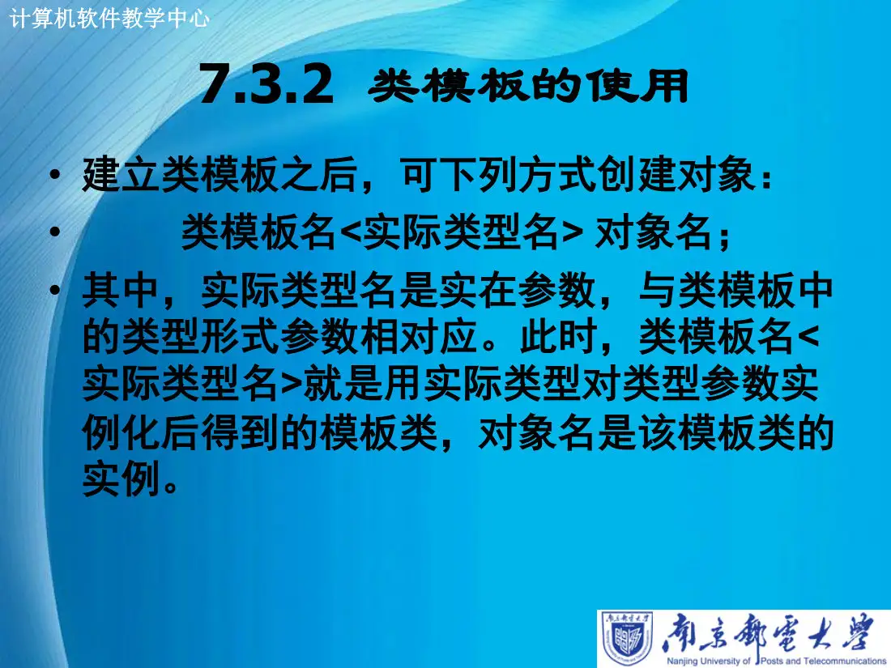

原文：

7.3.2 类模板的使用

\- 建立类模板之后，可下列方式创建对象：

类模板名<实际类型名>对象名；

\- 其中，实际类型名是实在参数，与类模板中的类型形式参数相对应。此时，类模板名<实际类型名>就是用实际类型对类型参数实例化后得到的模板类，对象名是该模板类的实例。

计算机软件教学中心

南京邮电大学
Nanjing University of Posts and Telecommunications

### 7.3.3 模板类的生成与使用

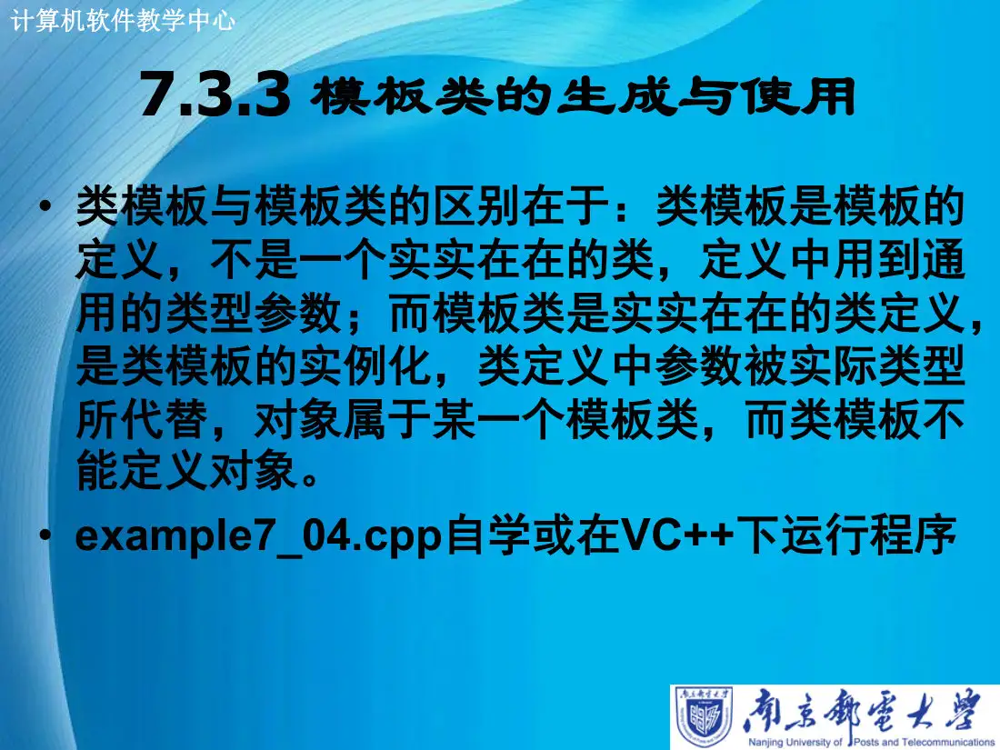

原文：

7.3.3 模板类的生成与使用

\- 类模板与模板类的区别在于：类模板是模板的定义，不是一个实实在在的类，定义中用到通用的类型参数；而模板类是实实在在的类定义，是类模板的实例化，类定义中参数被实际类型所代替，对象属于某一个模板类，而类模板不能定义对象。

example7\_04.cpp自学或在VC++下运行程序

计算机软件教学中心

南京邮电大学
Nanjing University of Posts and Telecommunications

### 7.4 泛型程序设计与C++STL简介

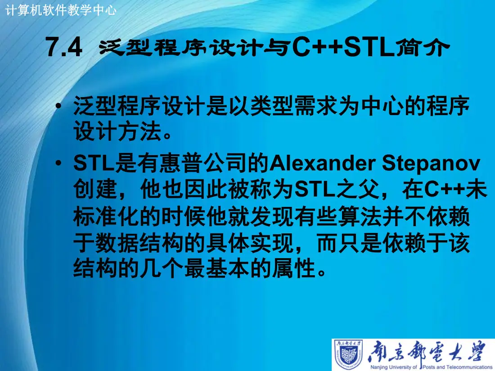

原文：

7.4 泛型程序设计与C++STL简介

\- 泛型程序设计是以类型需求为中心的程序设计方法。

\- STL是有惠普公司的Alexander Stepanov创建，他也因此被称为STL之父，在C++未标准化的时候他就发现有些算法并不依赖于数据结构的具体实现，而只是依赖于该结构的几个最基本的属性。

计算机软件教学中心

南京邮电大学
Nanjing University of Posts and Telecommunications

### 计算机软件教学中心

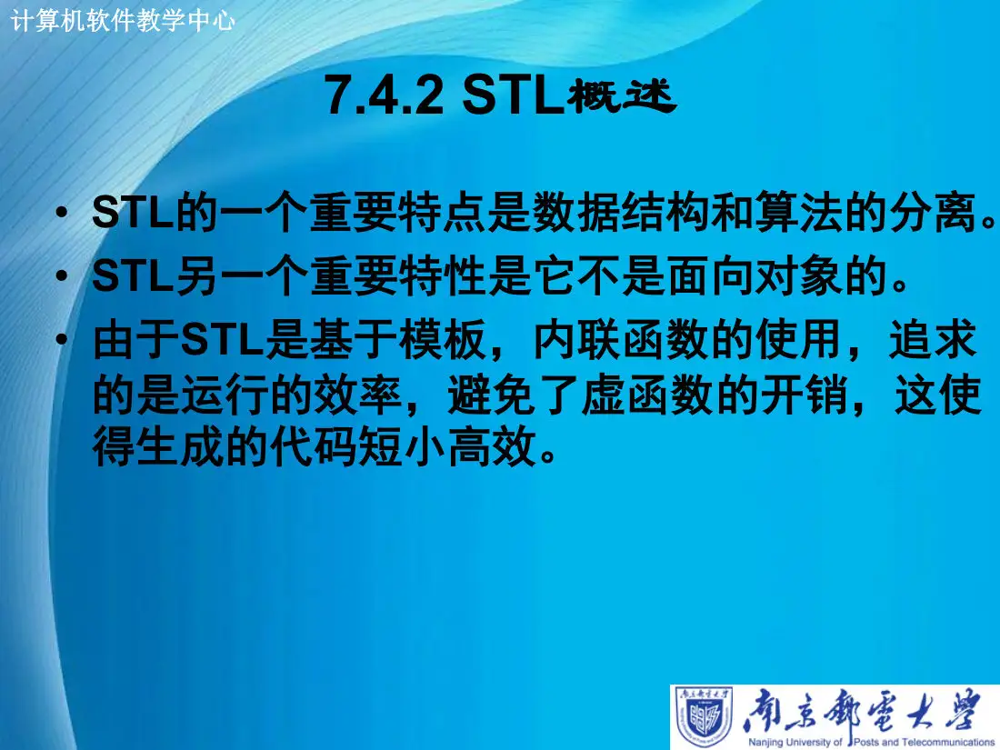

原文：

计算机软件教学中心

7.4.2 STL概述

\- STL的一个重要特点是数据结构和算法的分离。

\- STL另一个重要特性是它不是面向对象的。

\- 由于STL是基于模板，内联函数的使用，追求的是运行的效率，避免了虚函数的开销，这使得生成的代码短小高效。

南京邮电大学
Nanjing University of Posts and Telecommunications

### 7.4.3 容器 (vector)

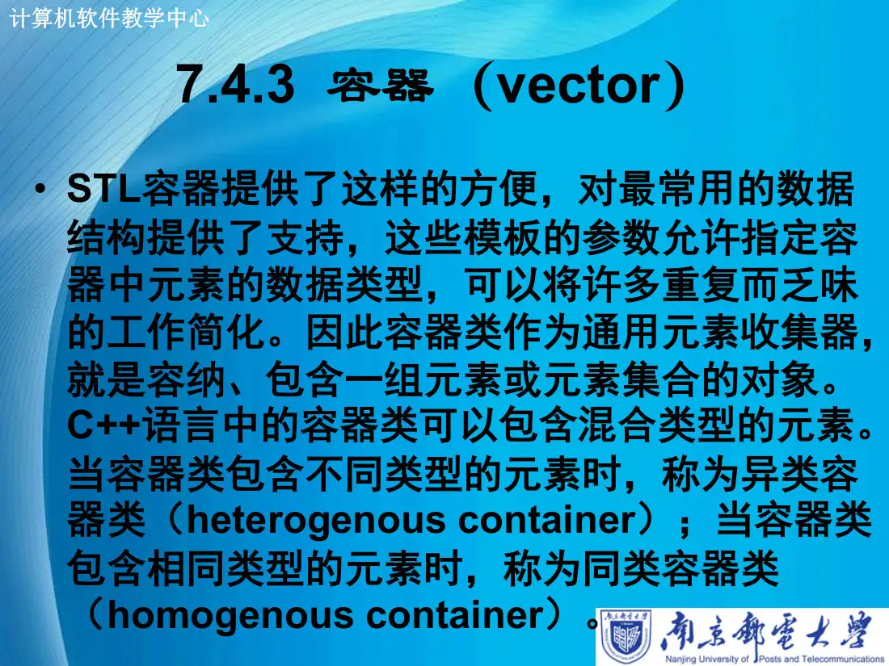

原文：

7.4.3 容器 (vector)

• STL容器提供了这样的方便，对最常用的数据结构提供了支持，这些模板的参数允许指定容器中元素的数据类型，可以将许多重复而乏味的工作简化。因此容器类作为通用元素收集器，就是容纳、包含一组元素或元素集合的对象。C++语言中的容器类可以包含混合类型的元素。当容器类包含不同类型的元素时，称为异类容器类（heterogenous container）；当容器类包含相同类型的元素时，称为同类容器类（homogenous container）。

计算机软件教学中心

南京邮电大学
Nanjing University of Posts and Telecommunications

### 计算机软件教学中心

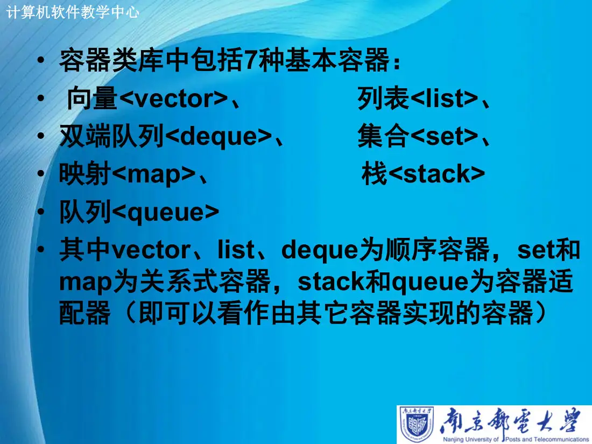

原文：

计算机软件教学中心

\- 容器类库中包括7种基本容器:

\- 向量<vector>、列表 Kirlist>、

\- 双端队列<deque>、

集合<set>、

\- 映射<map>、

栈<stack>

\- 队列<queue>

\- 其中vector、list、deque为顺序容器，set和map为关系式容器，stack和queue为容器适配器（即可以看作由其它容器实现的容器）

南京邮电大学
Nanjing University of Posts and Telecommunications

### • 1.顺序容器

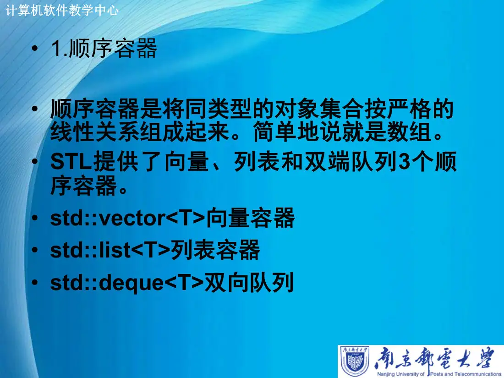

原文：

• 1.顺序容器

\- 顺序容器是将同类型的对象集合按严格的线性关系组成起来。简单地说就是数组。

\- STL提供了向量、列表和双端队列3个顺序容器。

\- std::vector<T>向量容器

\- std::list<T>列表容器

\- std::deque<T>双向队列

计算机软件教学中心

南京邮电大学
Nanjing University of Posts and Telecommunications

### 计算机软件教学中心

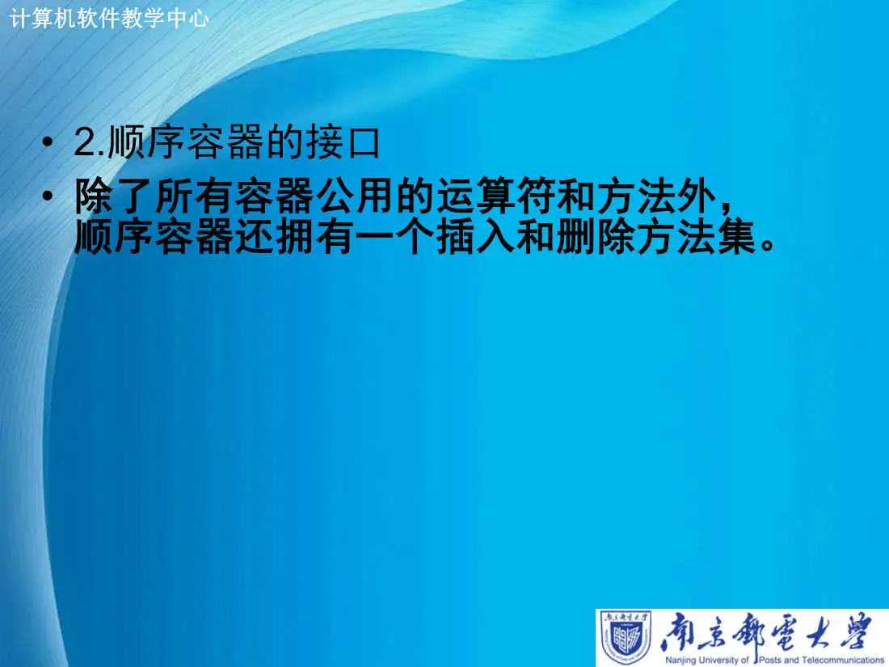

原文：

计算机软件教学中心

• 2.顺序容器的接口

\- 除了所有容器公用的运算符和方法外，顺序容器还拥有一个插入和删除方法集。

南京邮电大学
Nanjing University of Posts and Telecommunications

### \- 插入方法有:

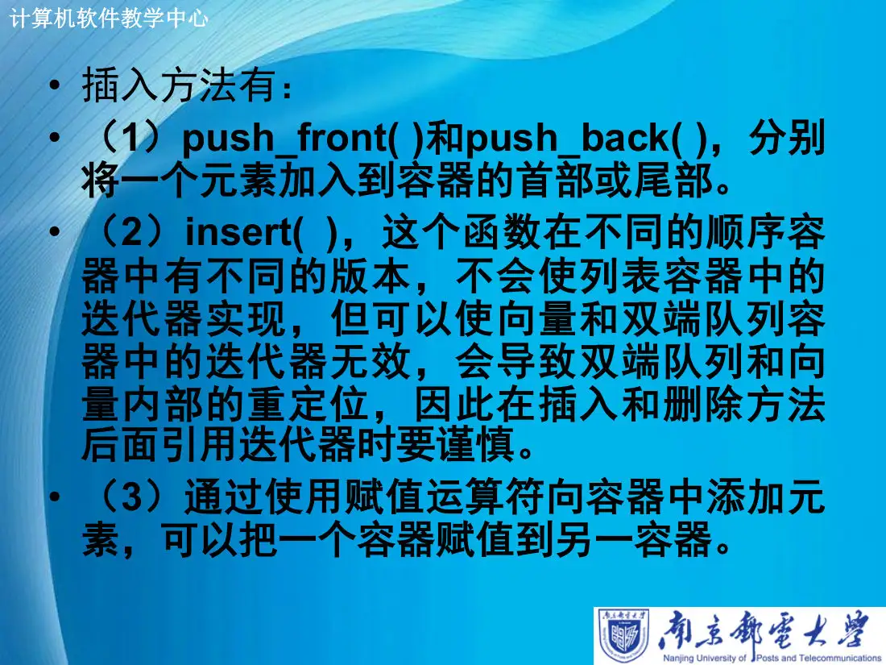

原文：

\- 插入方法有:

• (1) push\_front()和push\_back(), 分别将一个元素加入到容器的首部或尾部。

(2) insert(), 这个函数在不同的顺序容器中有不同的版本, 不会使列表容器中的迭代器实现, 但可以使向量和双端队列容器中的迭代器无效, 会导致双端队列和向量内部的重定位, 因此在插入和删除方法后面引用迭代器时要谨慎。

(3) 通过使用赋值运算符向容器中添加元素, 可以把一个容器赋值到另一容器。

计算机软件教学中心

南京邮电大学
Nanjing University of Posts and Telecommunications

### - 删除方法:

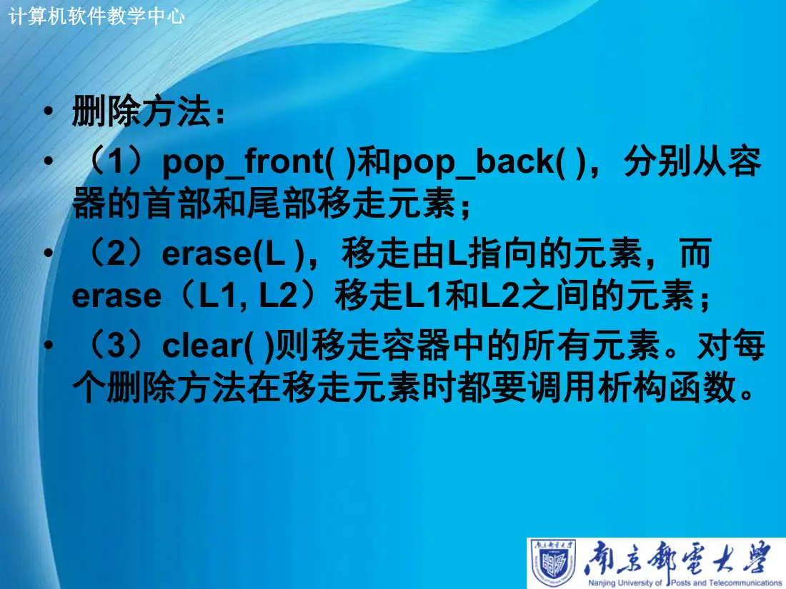

原文：

- 删除方法:

• (1) pop\_front()和pop\_back(), 分别从容器的首部和尾部移走元素;

(2) erase(L), 移走由L指向的元素, 而 erase (L1, L2) 移走L1和L2之间的元素;

(3) clear()则移走容器中的所有元素。对每个删除方法在移走元素时都要调用析构函数。

计算机软件教学中心

南京邮电大学
Nanjing University of Posts and Telecommunications

### • 3. 向量容器

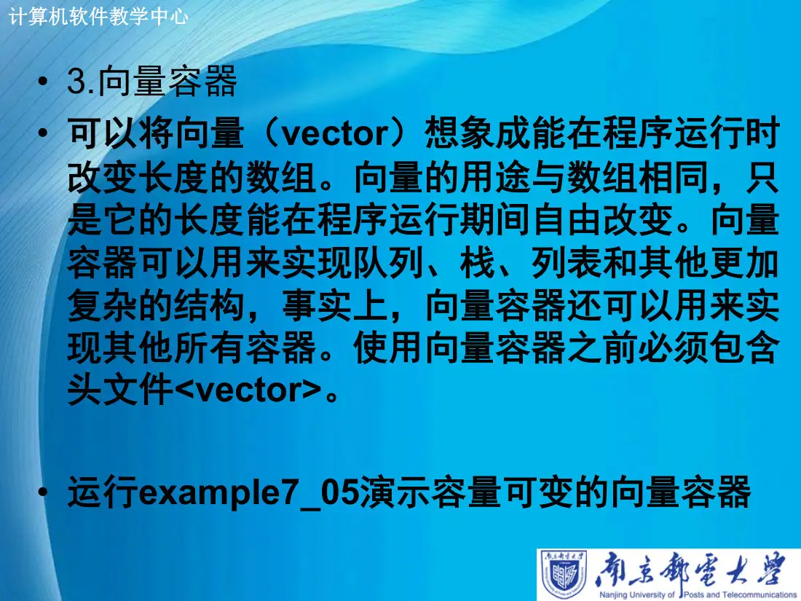

原文：

• 3. 向量容器

\- 可以将向量（vector）想象成能在程序运行时改变长度的数组。向量的用途与数组相同，只是它的长度能在程序运行期间自由改变。向量容器可以用来实现队列、栈、列表和其他更加复杂的结构，事实上，向量容器还可以用来实现其他所有容器。使用向量容器之前必须包含头文件<vector>。

运行example7\_05演示容量可变的向量容器

计算机软件教学中心

南京邮电大学
Nanjing University of Posts and Telecommunications

### 计算机软件教学中心

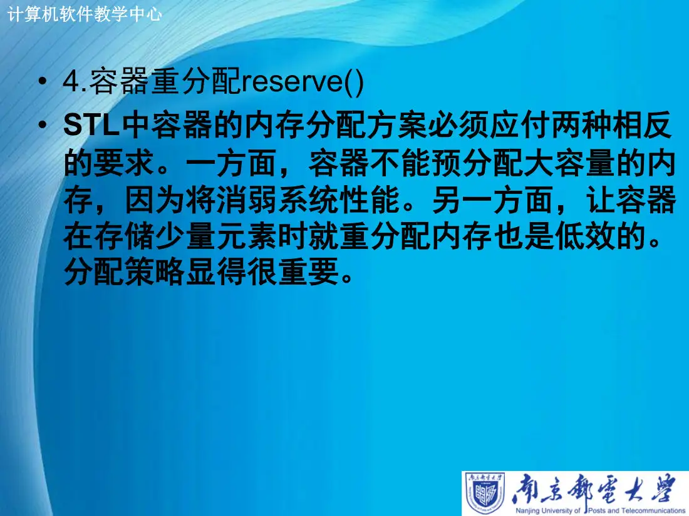

原文：

计算机软件教学中心

• 4. 容器重分配reserve()

\- STL中容器的内存分配方案必须应付两种相反的要求。一方面，容器不能预分配大容量的内存，因为将消弱系统性能。另一方面，让容器在存储少量元素时就重分配内存也是低效的。分配策略显得很重要。

南京邮电大学
Nanjing University of Posts and Telecommunications

### \- 5.capacity()和size()

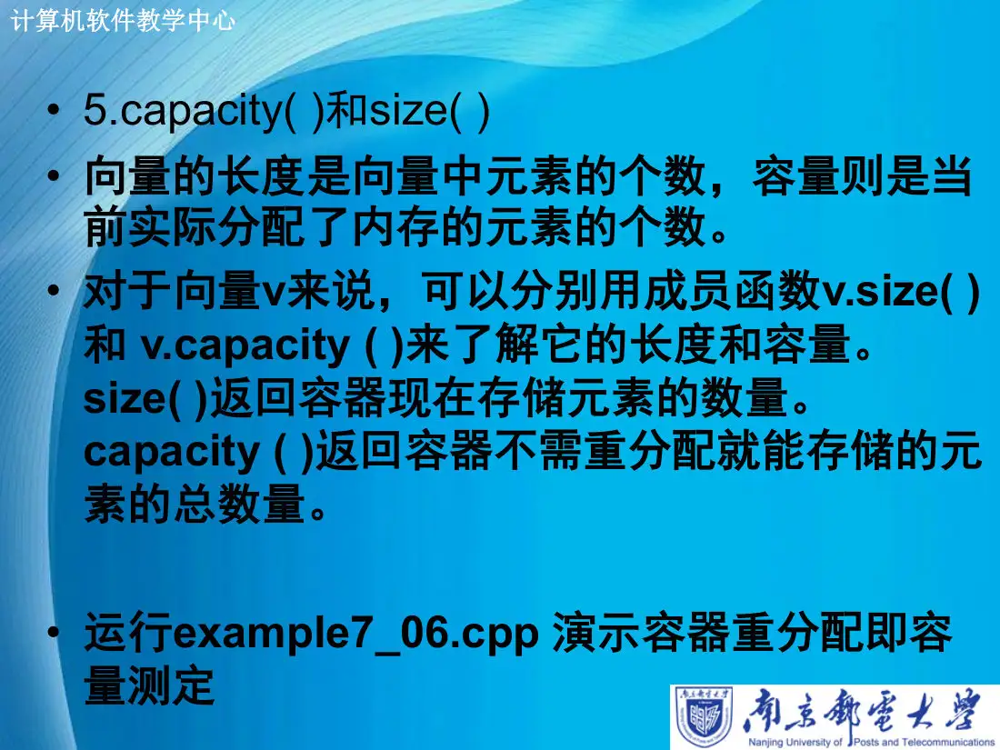

原文：

\- 5.capacity()和size()

\- 向量的长度是向量中元素的个数，容量则是当前实际分配了内存的元素的个数。

\- 对于向量v来说，可以分别用成员函数v.size()和 v.capacity ()来了解它的长度和容量。size()返回容器现在存储元素的数量。capacity ()返回容器不需重分配就能存储的元素的总数量。

运行example7\_06.cpp 演示容器重分配即容量测定

计算机软件教学中心

南京邮电大学
Nanjing University of Posts and Telecommunications

### - 6. 成员函数 at()

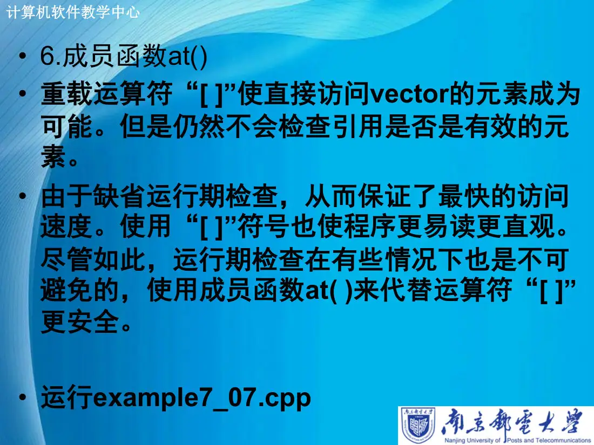

原文：

- 6. 成员函数 at()

\- 重载运算符“[]”使直接访问vector的元素成为可能。但是仍然不会检查引用是否是有效的元素。

\- 由于缺省运行期检查，从而保证了最快的访问速度。使用“[]”符号也使程序更易读更直观。尽管如此，运行期检查在有些情况下也是不可避免的，使用成员函数at()来代替运算符“[]”更安全。

\- 运行example7\_07.cpp

计算机软件教学中心

南京邮电大学
Nanjing University of Posts and Telecommunications

### \- 7.front 和back操作

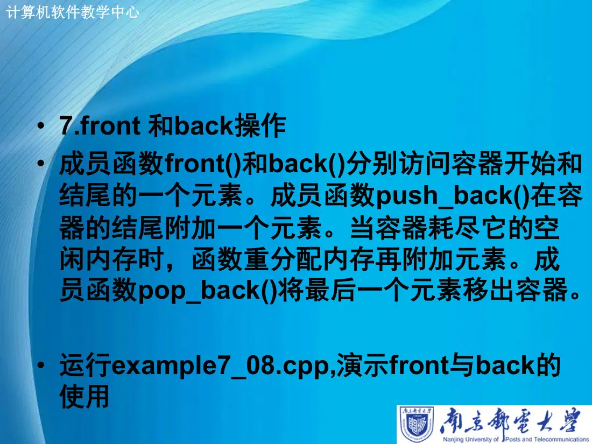

原文：

\- 7.front 和back操作

\- 成员函数front()和back()分别访问容器开始和结尾的一个元素。成员函数push\_back()在容器的结尾附加一个元素。当容器耗尽它的空闲内存时，函数重分配内存再附加元素。成员函数pop\_back()将最后一个元素移出容器。

\- 运行example7\_08.cpp,演示front与back的使用

计算机软件教学中心

南京邮电大学
Nanjing University of Posts and Telecommunications

### • 8.容器赋值

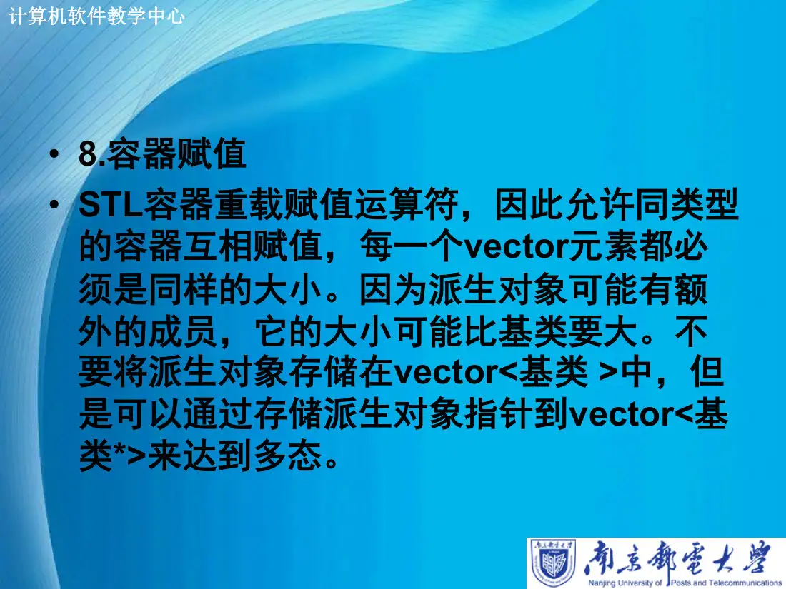

原文：

• 8.容器赋值

\- STL容器重载赋值运算符，因此允许同类型的容器互相赋值，每一个vector元素都必须是同样的大小。因为派生对象可能有额外的成员，它的大小可能比基类要大。不要将派生对象存储在vector<基类>中，但是可以通过存储派生对象指针到vector<基类\*>来达到多态。

计算机软件教学中心

南京邮电大学
Nanjing University of Posts and Telecommunications

### 7.4.3 迭代器 (iterator)

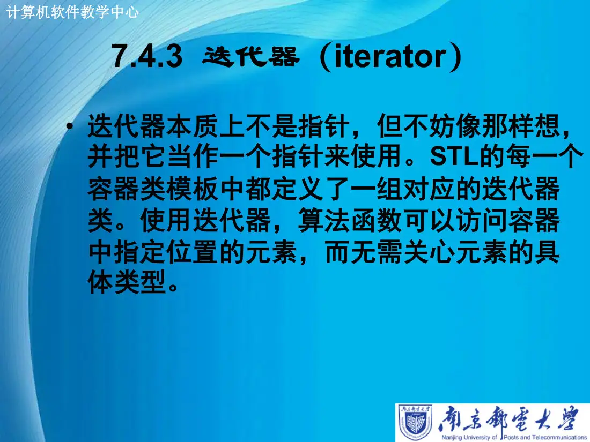

原文：

7.4.3 迭代器 (iterator)

\- 迭代器本质上不是指针，但不妨像那样想，并把它当作一个指针来使用。STL的每一个容器类模板中都定义了一组对应的迭代器类。使用迭代器，算法函数可以访问容器中指定位置的元素，而无需关心元素的具体类型。

计算机软件教学中心

南京邮电大学
Nanjing University of Posts and Telecommunications

### STL中主要的五种迭代器

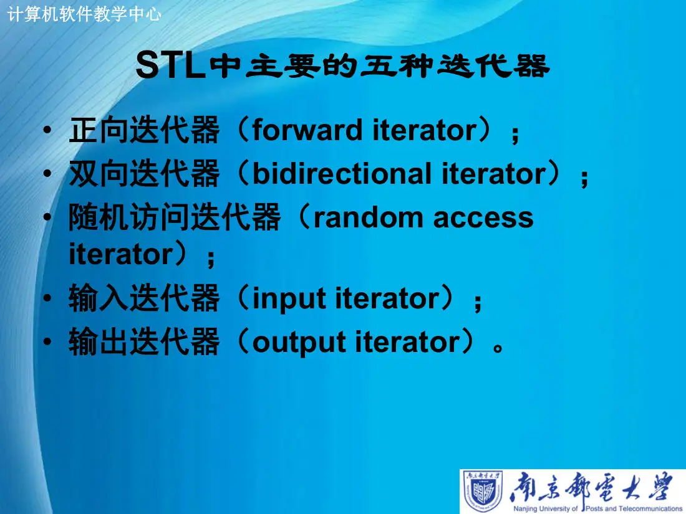

原文：

STL中主要的五种迭代器

\- 正向迭代器（forward iterator）；

\- 双向迭代器（bidirectional iterator）；

\- 随机访问迭代器（random access iterator）；

\- 输入迭代器（input iterator）；

\- 输出迭代器（output iterator）。

计算机软件教学中心

南京邮电大学
Nanjing University of Posts and Telecommunications

### 计算机软件教学中心

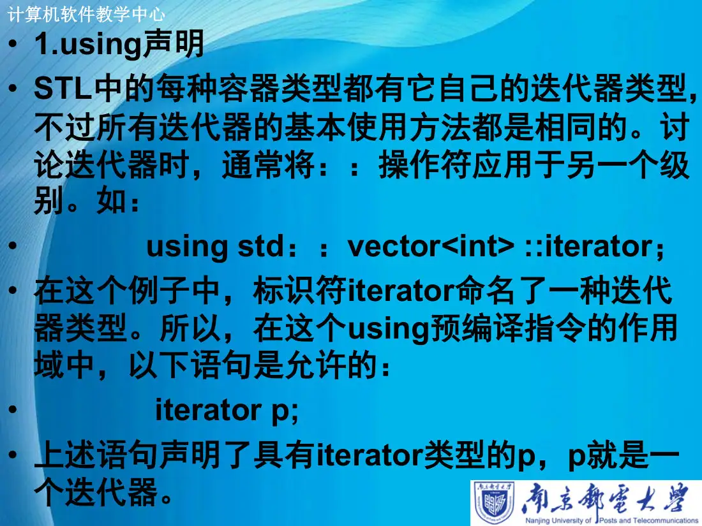

原文：

计算机软件教学中心

- 1. using声明

\- STL中的每种容器类型都有它自己的迭代器类型,不过所有迭代器的基本使用方法都是相同的。讨论迭代器时,通常将::操作符应用于另一个级别。如:

using std: : vector<int> ::iterator;

\- 在这个例子中，标识符iterator命名了一种迭代器类型。所以，在这个using预编译指令的作用域中，以下语句是允许的：

iterator p;

\- 上述语句声明了具有iterator类型的p，p就是一个迭代器。

南京邮电大学
Nanjing University of Posts and Telecommunication

### \- 运行example7\_09.cpp

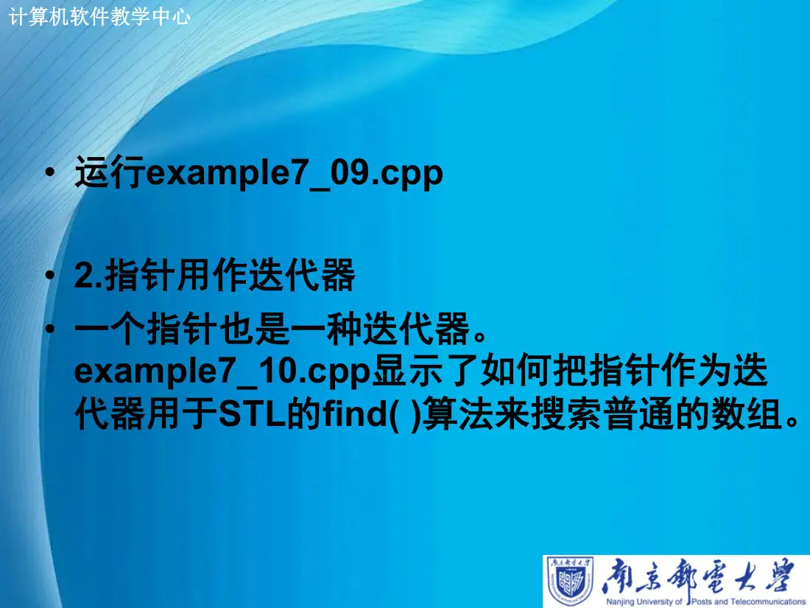

原文：

\- 运行example7\_09.cpp

2. 指针用作迭代器

一个指针也是一种迭代器。

example7\_10.cpp显示了如何把指针作为迭代器用于STL的find()算法来搜索普通的数组。

计算机软件教学中心

南京邮电大学
Nanjing University of Posts and Telecommunications

### 计算机软件教学中心

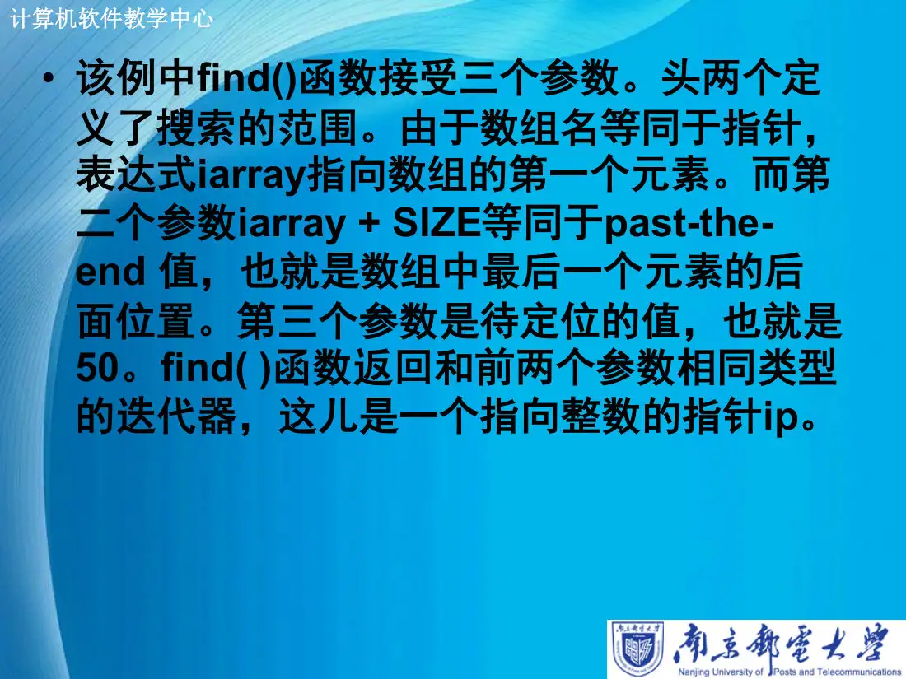

原文：

计算机软件教学中心

\- 该例中find()函数接受三个参数。头两个定义了搜索的范围。由于数组名等同于指针，表达式iarray指向数组的第一个元素。而第二个参数iarray + SIZE等同于past-the-end值，也就是数组中最后一个元素的后面位置。第三个参数是待定位的值，也就是50。find()函数返回和前两个参数相同类型的迭代器，这儿是一个指向整数的指针ip。

南京邮电大学
Nanjing University of Posts and Telecommunications

### • 3.容器中的迭代器

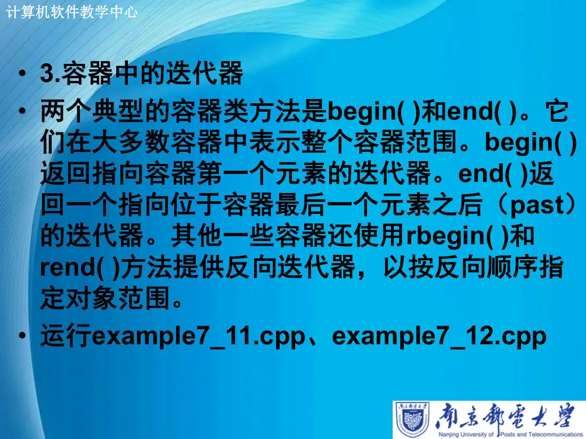

原文：

• 3.容器中的迭代器

\- 两个典型的容器类方法是begin()和end()。它们在大多数容器中表示整个容器范围。begin()返回指向容器第一个元素的迭代器。end()返回一个指向位于容器最后一个元素之后（past）的迭代器。其他一些容器还使用rbegin()和rend()方法提供反向迭代器，以按反向顺序指定对象范围。

\- 运行example7\_11.cpp、example7\_12.cpp

计算机软件教学中心

南京邮电大学
Nanjing University of Posts and Telecommunications

### 计算机软件教学中心

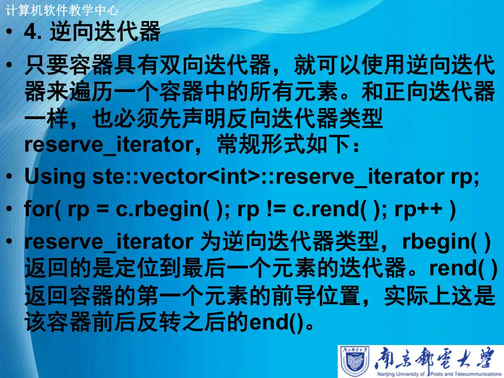

原文：

计算机软件教学中心

• 4. 逆向迭代器

\- 只要容器具有双向迭代器，就可以使用逆向迭代器来遍历一个容器中的所有元素。和正向迭代器一样，也必须先声明反向迭代器类型
reserve\_iterator，常规形式如下：

\- Using ste::vector<int>::reserve\_iterator rp;

\- for( rp = c.rbegin( ); rp != c.rend( ); rp++)

\- reserve\_iterator 为逆向迭代器类型，rbegin()返回的是定位到最后一个元素的迭代器。rend()返回容器的第一个元素的前导位置，实际上这是该容器前后反转之后的end()。

南京邮电大学
Nanjing University of Posts and Telecommunications

### • 5. 常量迭代器

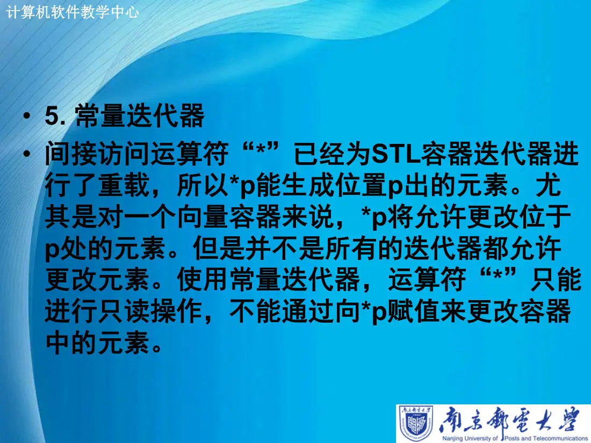

原文：

• 5. 常量迭代器

\- 间接访问运算符“\*”已经为STL容器迭代器进行了重载，所以\*p能生成位置p出的元素。尤其是对一个向量容器来说，\*p将允许更改位于p处的元素。但是并不是所有的迭代器都允许更改元素。使用常量迭代器，运算符“\*”只能进行只读操作，不能通过向\*p赋值来更改容器中的元素。

计算机软件教学中心

南京邮电大学
Nanjing University of Posts and Telecommunications

### 计算机软件教学中心

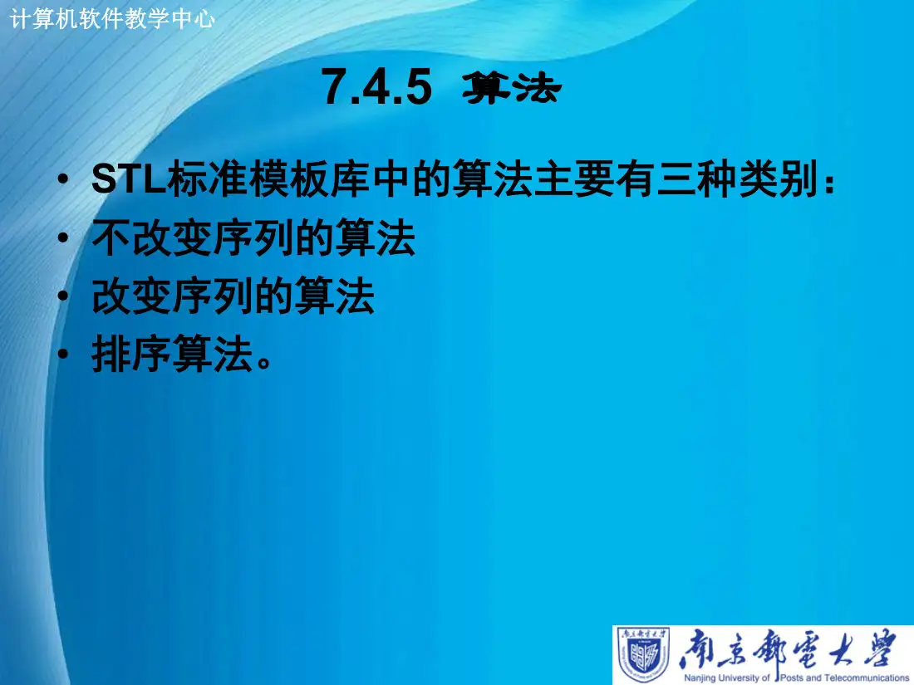

原文：

计算机软件教学中心

7.4.5 算法

\- STL标准模板库中的算法主要有三种类别：

\- 不改变序列的算法

\- 改变序列的算法

\- 排序算法。

南京邮电大学
Nanjing University of Posts and Telecommunications

### • 1. 不改变序列的操作

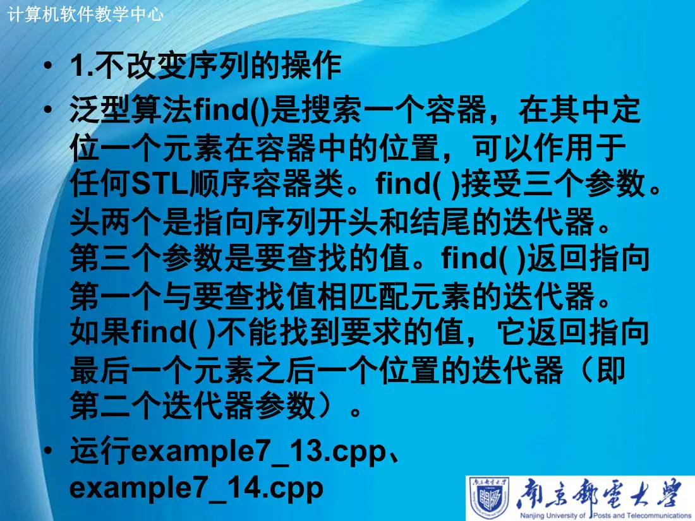

原文：

• 1. 不改变序列的操作

\- 泛型算法find()是搜索一个容器，在其中定位一个元素在容器中的位置，可以作用于任何STL顺序容器类。find()接受三个参数。头两个是指向序列开头和结尾的迭代器。第三个参数是要查找的值。find()返回指向第一个与要查找值相匹配元素的迭代器。如果find()不能找到要求的值，它返回指向最后一个元素之后一个位置的迭代器（即第二个迭代器参数）。

\- 运行example7\_13.cpp、example7\_14.cpp

计算机软件教学中心

南京邮电大学
Nanjing University of Posts and Telecommunications

### 计算机软件教学中心

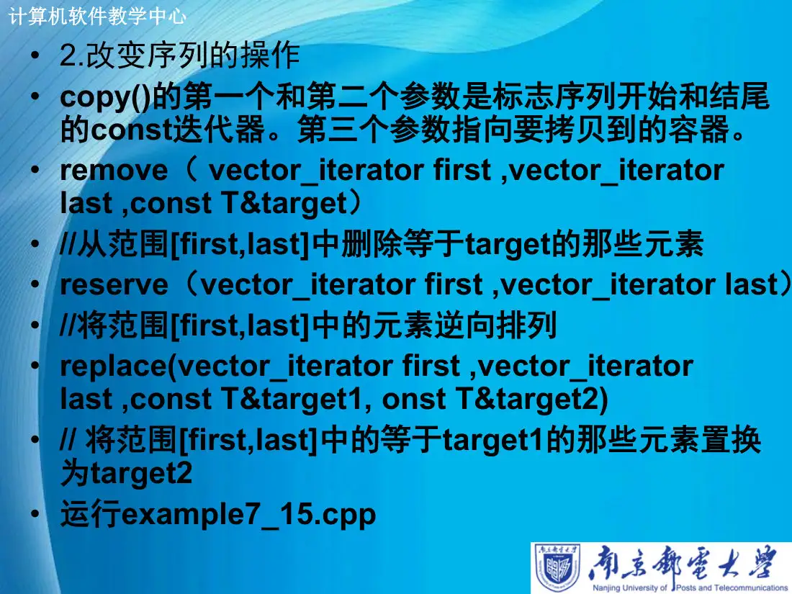

原文：

计算机软件教学中心

• 2. 改变序列的操作

\- copy()的第一个和第二个参数是标志序列开始和结尾的const迭代器。第三个参数指向要拷贝到的容器。

\- remove (vector\_iterator first ,vector\_iterator last ,const T&target)

\- //从范围[first,last]中删除等于target的那些元素

\- reserve (vector\_iterator first ,vector\_iterator last)

\- //将范围[first, last]中的元素逆向排列

\- replace(vector\_iterator first ,vector\_iterator last ,const T&target1, onst T&target2)

\- // 将范围[first, last]中的等于target1的那些元素置换为target2

\- 运行example7\_15.cpp

南京邮电大学
Nanjing University of Posts and Telecommunications

### 计算机软件教学中心

原文：

计算机软件教学中心

3. 排序操作

\- 4个排序算法：sort()、partial\_sort()、partial\_sort(\_copy()和stable\_sort();

• 4个二分查找算法：binary\_search()、lower\_bound()、uper\_bound()、和equal\_range();

\- 2个用于合并有序区间的通用算法：merge()和inplace\_merge();

• 4个最值算法：min()、max()、min\_element()、max\_element();

\- 3个与排列方式有关的算法：lexicographical\_compare()、next\_permutation()和prev\_permutation();

\- 5个用于有序序列上的集合操作的算法：includes()、set\_union()、set\_intersection()、set\_defference()和set\_symmetric\_difference();

• 4个为堆的创建和操作提供的算法：make\_heap(); pop\_heap()、push\_heap()和sort\_heap()。

\- 运行example7\_16.cpp

南京邮电大学
Nanjing University of Posts and Telecommunications

### 7.4.6 string类型

原文：

7.4.6 string类型

\- string类在名称同样为<string>的一个库中定义，定义放在std命名空间。所以，要想使用string类，代码中必须包含以下语句（或其他等价的语句）：

\- #include<string>

using namespace std;

\- 使用string类，可以采取与处理简单类型的值极为相似的方式来处理string值和string表达式。可以用“=”为string变量赋值，可用“+”来连接两个字符串。

计算机软件教学中心

南京邮电大学
Nanjing University of Posts and Telecommunications

### 计算机软件教学中心

原文：

计算机软件教学中心

• 1.标准类string

\- string有一个默认构造函数和多个重载构造函数。默认构造函数将string对象初始化成空字符串。

\- string(); //默认构造函数，建立一个长度为0的串。

\- string(const string& str); // 拷贝构造函数

\- string(const char \*s); // 用指针s所指向的字符串初始化string类的对象

\- string(const string& str, unsigned int pos, unsigned int n); //将对象str中的串从位置pos开始取n个字符，初始化string类的对象- string(const char \*s, unsigned int n);

南京邮电大学
Nanjing University of Posts and Telecommunication

### \- //用指针s所指向的字符串中的前那个字符初始化string类的对象

原文：

\- //用指针s所指向的字符串中的前那个字符初始化string类的对象

\- string(unsigned int n, char c);

\- //将参数c中的字符重复n次，初始化string类的对象

\- 换句话说，string可以通过C字符串、通过其他string对象、通过C字符串的部分、通过字符序列、通过其他string的部分来初始化。

运行example7\_17.cpp，演示字符串的初始化

计算机软件教学中心

南京邮电大学
Nanjing University of Posts and Telecommunications

### - 2.string类的I/O

原文：

- 2.string类的I/O

\- 可以用流插入操作符<<和cout来输出string对象，这和处理其他类型的数据是一样的。string类的输入则麻烦一些，因为在用流提取运算符>>和cin时，会忽略最初的空白符号，并在接受输入字符后遇到第一个空白字符就停止读入。

\- 运行example7\_18.cpp

计算机软件教学中心

南京邮电大学
Nanjing University of Posts and Telecommunications

### 计算机软件教学中心

原文：

计算机软件教学中心

• 3.常用成员函数功能简介

\- 大小和容量函数

\- 一个C++字符串存在三种大小：

\- a)现有的字符数，函数是size()和length()，他们等效。empty()用来检查字符串是否为空。

\- b)max\_size() 这个大小是指当前C++字符串最多能包含的字符数，很可能和机器本身的限制或者字符串所在位置连续内存的大小有关系。一般情况下可以不用关心它，应该大小足够使用。但是不够用的话，会抛出length\_error异常。

南京邮电大学
Nanjing University of Posts and Telecommunications

### 计算机软件教学中心

原文：

计算机软件教学中心

• c)capacity()重新分配内存之前 string所能包含的最大字符数。前文中的reserve()函数在此也起作用，为string重新分配内存。重新分配的大小由其参数决定，默认参数为0，这时候会对string进行非强制性缩减。

\- 元素存取

\- 可以使用下标操作符[]和函数at()对元素包含的字符进行访问。但是应该注意的是操作符[]并不检查索引是否有效（有效索引0\~str.length()），如果索引失效，会引起未定义的行为。而at()会检查，如果使用 at()的时候索引无效，会抛出out\_of\_range异常。

### - 比较函数

原文：

- 比较函数

• C++字符串支持常见的比较操作符(>,>=,<,<=,==,!=)，甚至支持string与C-string的比较(如 str<"hello")。在使用>,>=,<,<=这些操作符的时候是根据“当前字符特性”将字符按字典顺序进行逐一比较。字典排序靠前的字符小，比较的顺序是从前向后比较，遇到不相等的字符就按这个位置上的两个字符的比较结果确定两个字符串的大小。

计算机软件教学中心

南京邮电大学
Nanjing University of Posts and Telecommunications

### - 修改内容

原文：

- 修改内容

\- 修改内容在字符串的操作中占了很大一部分。比如赋值，第一个赋值方法当然是使用操作符“=”，新值可以是string(如：s=ns)、c\_string(如：s="gaint")甚至单一字符（如：s='x'）。还可以使用成员函数assign()，这个成员函数可以更灵活地对字符串赋值

计算机软件教学中心

南京邮电大学
Nanjing University of Posts and Telecommunications

### 7.5 程序实例：学生信息管理系统

原文：

7.5 程序实例：学生信息管理系统

\- 整个程序分为3个文件： example7\_19\_Student.h是类定义头文件， example7\_19\_Student.cpp是类实现文件， example7\_19.cpp是主函数文件。

\- 在VC下运行和讲解该综合举例

计算机软件教学中心

南京邮电大学
Nanjing University of Posts and Telecommunications

### 本章小结

原文：

本章小结

- 本章主要有以下内容:

(1) 模板有函数模板和类模板两种, 其共同特征是将类型参数化, 用template<class T>的形式声明一个类型参数T。

\- （2）对函数模板中类型参数的实例化是系统在调用函数时根据实在参数的类型自动进行的。

\- （3）函数模板的使用可以减少函数的重载，一类同名函数，如果函数代码完全相同，形式参数的个数、顺序、返回值类型也相同，只是形式参数的类型不同的时候可以用函数模板将这一类函数进行抽象。

计算机软件教学中心

返回 南京郵電大學 Nanjing University of Posts and Telecommunications

### 计算机软件教学中心

原文：

• (4) 对类模板中类型参数的实例化将得到一个具体的模板类。类模板不可以有对象，而只有模板类才可以定义对象。

(5) 泛型程序设计是以类型需求为中心的程序设计方法。本章中介绍了与C++STL有关的几个基本术语：容器、迭代器、通用算法、string类型等。并通过实例介绍向量容器、迭代器、通用算法的应用，更多的用法在MSDN联机帮助系统和SGI关于STL的网站上有详细说明，读者可以参考。

计算机软件教学中心

南京邮电大学
Nanjing University of Posts and Telecommunications

### • The End

原文：

• The End

计算机软件教学中心

南京邮电大学
Nanjing University of Posts and Telecommunications
