# 《面向对象程序设计及C++》第8章 C++的流类库与输入/输出控制（课件）

原件的每一页，下面附识别出的文字。

### 面向对象程序设计及C++

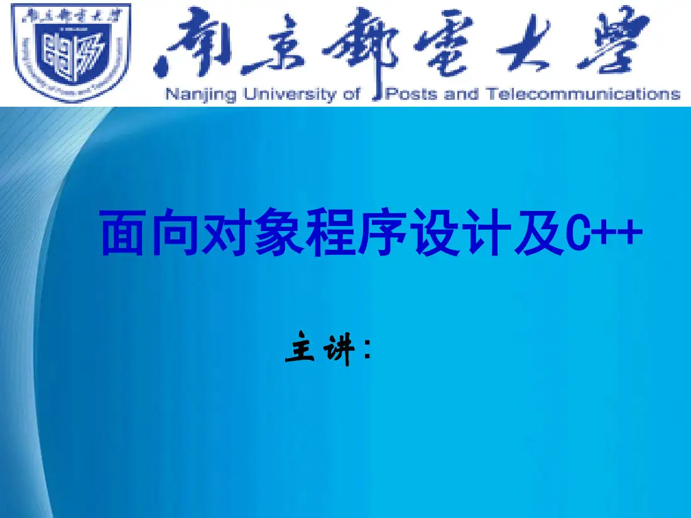

原文：

面向对象程序设计及C++

主讲：

### 面向对象程序设计及C++

原文：

Nanjing University of JPosts and Telecommunications

面向对象程序设计及C++

第8章 C++的流类库与输入/输出控制

南京郵電大學

### 计算机软件教学中心

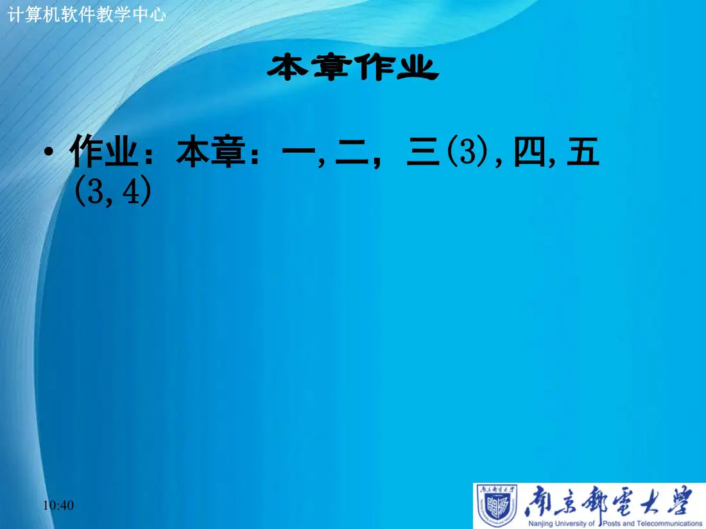

原文：

计算机软件教学中心

本章作业

• 作业: 本章: 一, 二, 三(3), 四, 五(3, 4)

10:40

南京邮电大学
Nanjing University of Posts and Telecommunications

### 本章内容提要

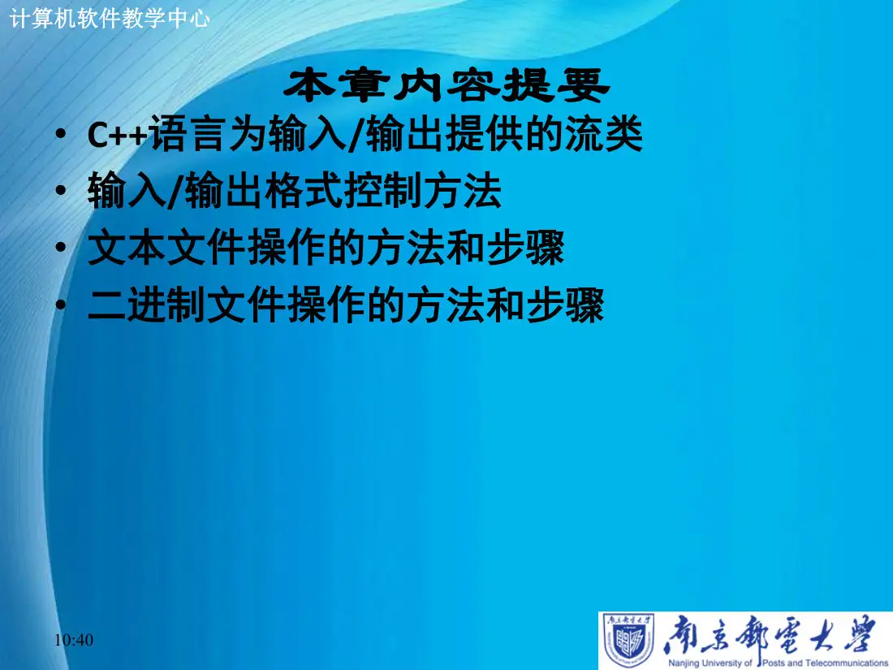

原文：

本章内容提要

• C++语言为输入/输出提供的流类

\- 输入/输出格式控制方法

\- 文本文件操作的方法和步骤

二进制文件操作的方法和步骤

计算机软件教学中心

10:40

南京邮电大学
Nanjing University of Posts and Telecommunications

### 本章内容安排

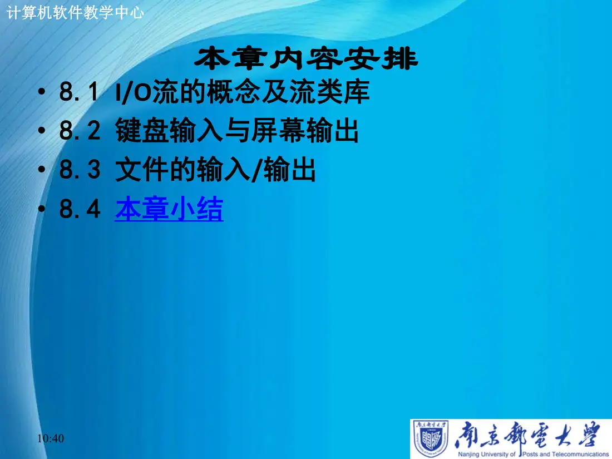

原文：

本章内容安排

• 8.1 I/O流的概念及流类库

• 8.2 键盘输入与屏幕输出

• 8.3 文件的输入/输出

8.4 本章小结

计算机软件教学中心

10:40

南京邮电大学
Nanjing University of Posts and Telecommunications

### 8.1 I/O流的概念及流类库

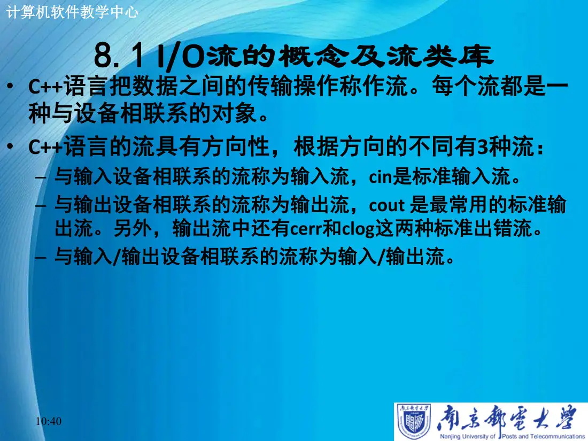

原文：

8.1 I/O流的概念及流类库

• C++语言把数据之间的传输操作称作流。每个流都是一种与设备相联系的对象。

• C++语言的流具有方向性，根据方向的不同有3种流：

\- 与输入设备相联系的流称为输入流，cin是标准输入流。

\- 与输出设备相联系的流称为输出流，cout是最常用的标准输出流。另外，输出流中还有cerr和clog这两种标准出错流。

\- 与输入/输出设备相联系的流称为输入/输出流。

计算机软件教学中心

10:40

南京邮电大学
Nanjing University of Posts and Telecommunication

### 8.1 I/O流的概念及流类库

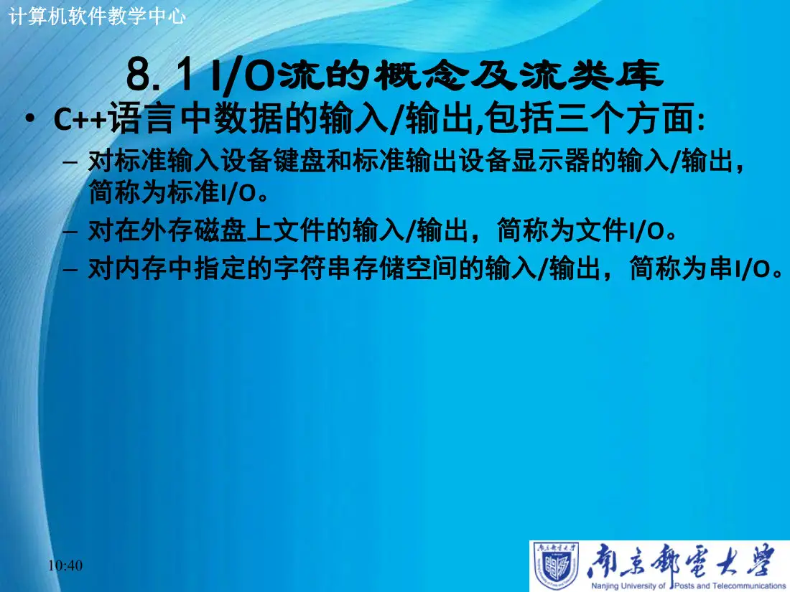

原文：

8.1 I/O流的概念及流类库

• C++语言中数据的输入/输出,包括三个方面:

\- 对标准输入设备键盘和标准输出设备显示器的输入/输出，简称为标准I/O。

\- 对在外存磁盘上文件的输入/输出，简称为文件I/O。

\- 对内存中指定的字符串存储空间的输入/输出，简称为串I/O。

计算机软件教学中心

10:40

南京邮电大学
Nanjing University of Posts and Telecommunications

### 8.1 I/O流的概念及流类库

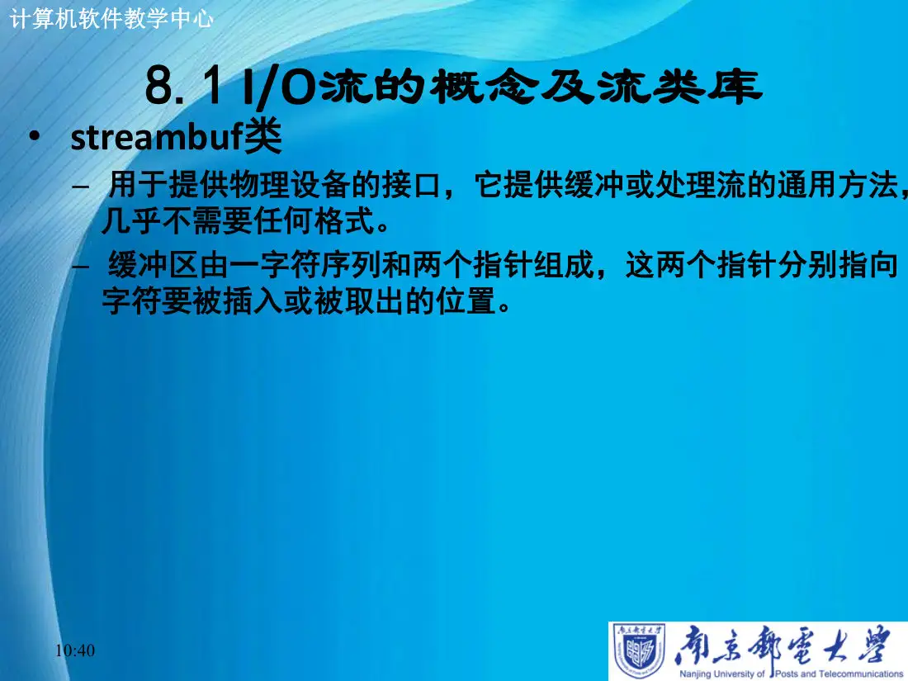

原文：

8.1 I/O流的概念及流类库

- streambuf类

\- 用于提供物理设备的接口，它提供缓冲或处理流的通用方法，几乎不需要任何格式。

\- 缓冲区由一字符序列和两个指针组成，这两个指针分别指向字符要被插入或被取出的位置。

计算机软件教学中心

10:40

南京邮电大学
Nanjing University of Posts and Telecommunications

### 8.1 I/O流的概念及流类库

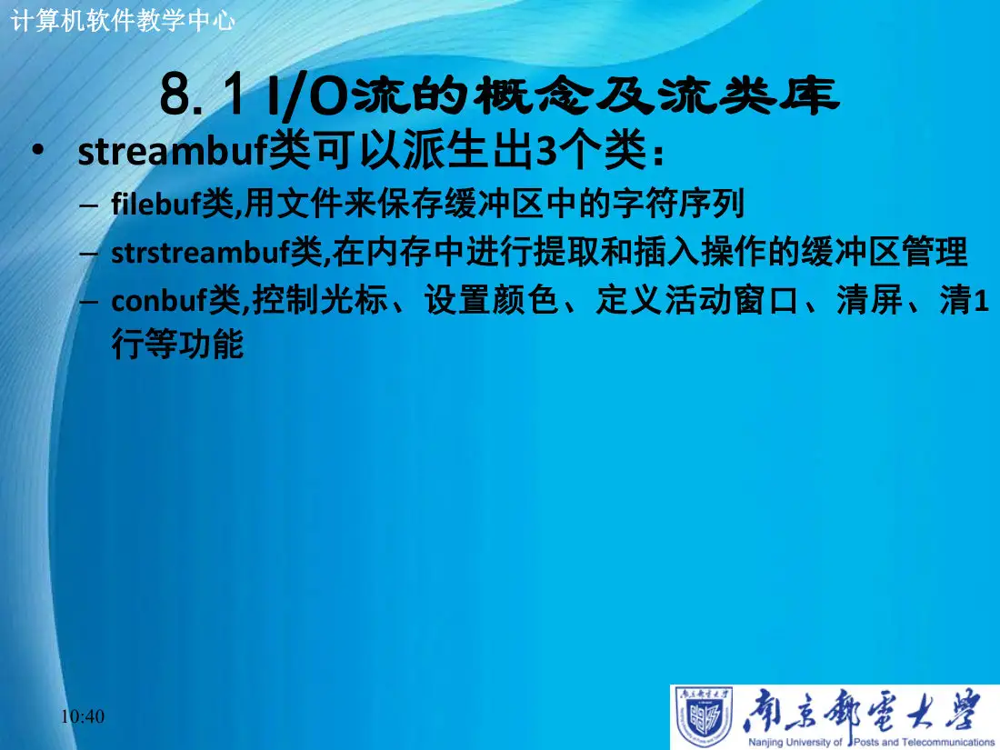

原文：

8.1 I/O流的概念及流类库

\- streambuf类可以派生出3个类:

\- filebuf类,用文件来保存缓冲区中的字符序列

\- strstreambuf类,在内存中进行提取和插入操作的缓冲区管理
- conbuf类,控制光标、设置颜色、定义活动窗口、清屏、清1行等功能

计算机软件教学中心

10:40

南京邮电大学
Nanjing University of Posts and Telecommunications

### 8.1 I/O流的概念及流类库

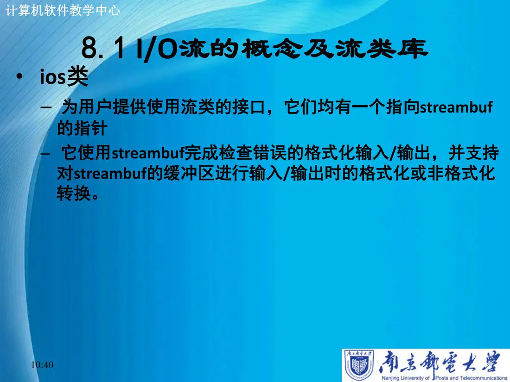

原文：

8.1 I/O流的概念及流类库

- ios类

\- 为用户提供使用流类的接口，它们均有一个指向streambuf的指针

\- 它使用streambuf完成检查错误的格式化输入/输出，并支持对streambuf的缓冲区进行输入/输出时的格式化或非格式化转换。

计算机软件教学中心

10:40

南京邮电大学
Nanjing University of Posts and Telecommunications

### 8.1 I/O流的概念及流类库

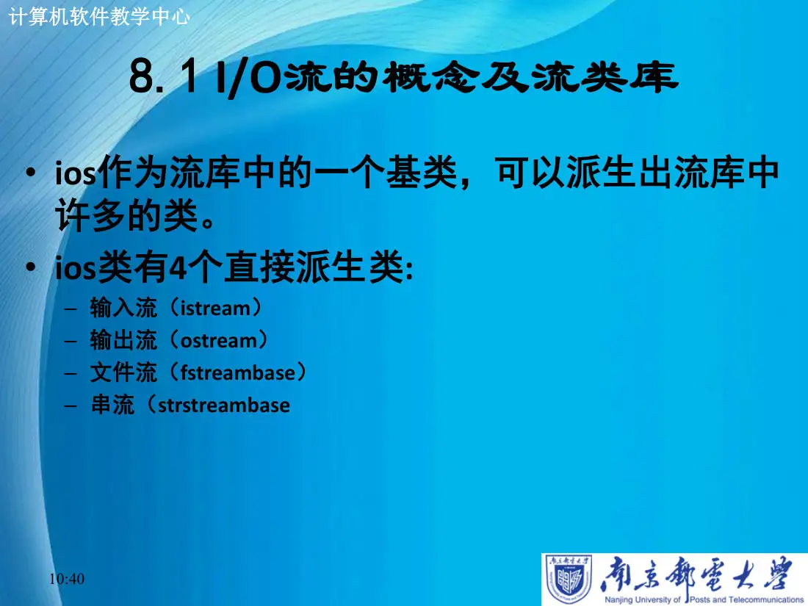

原文：

8.1 I/O流的概念及流类库

\- ios作为流库中的一个基类，可以派生出流库中许多的类。

\- ios类有4个直接派生类:

\- 输入流（istream）

\- 输出流（ostream）

\- 文件流（fstreambase）

\- 串流（strstreambase

计算机软件教学中心

10:40

南京邮电大学
Nanjing University of Posts and Telecommunications

### 8.1 I/O流的概念及流类库

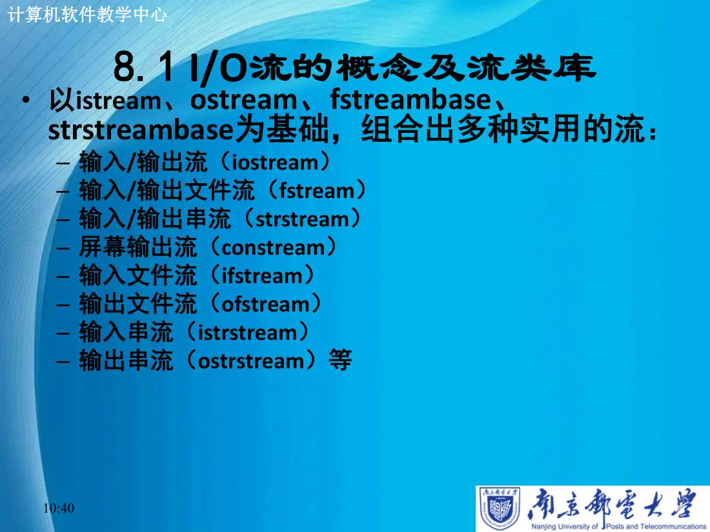

原文：

8.1 I/O流的概念及流类库

\- 以istream、ostream、fstreambase、strstreambase为基础，组合出多种实用的流：

\- 输入/输出流（iostream）

\- 输入/输出文件流（fstream）

\- 输入/输出串流（strstream）

\- 屏幕输出流（constexpr）

\- 输入文件流（ifstream）

\- 输出文件流（ofstream）

\- 输入串流（istrstream）

\- 输出串流（ostrstream）等

计算机软件教学中心

10:40

南京邮电大学
Nanjing University of Posts and Telecommunications

### 8.1 I/O流的概念及流类库

原文：

8.1 I/O流的概念及流类库

\- I/O文件操作一般流程为三个步骤:

\- 首先打开操作，使流和文件发生联系。

\- 建立联系后的文件才允许数据流入或流出。

\- 输入或输出结束后，使用关闭操作使文件与流断开联系。

计算机软件教学中心

10:40

南京邮电大学
Nanjing University of Posts and Telecommunications

### 8.2 键盘输入与屏幕输出

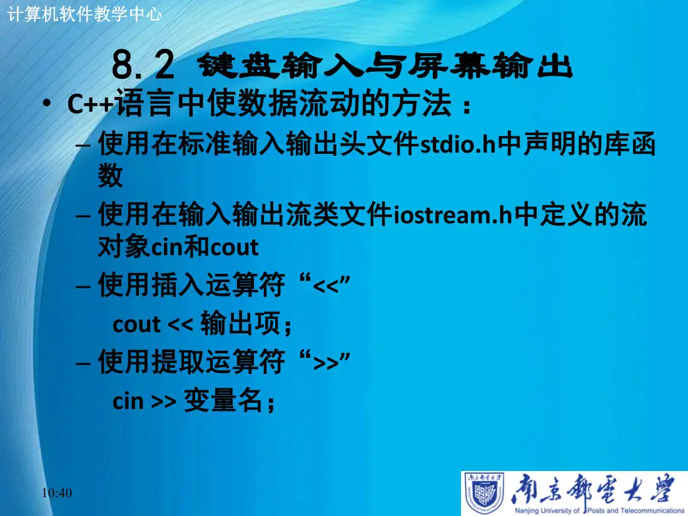

原文：

8.2 键盘输入与屏幕输出

• C++语言中使数据流动的方法：

\- 使用在标准输入输出头文件stdio.h中声明的库函数

\- 使用在输入输出流类文件iostream.h中定义的流对象cin和cout

\- 使用插入运算符“<<”

cout << 输出项；

\- 使用提取运算符“>>”

cin >> 变量名；

计算机软件教学中心

10:40

南京邮电大学
Nanjing University of Posts and Telecommunications

### \- 输入/输出类的定义

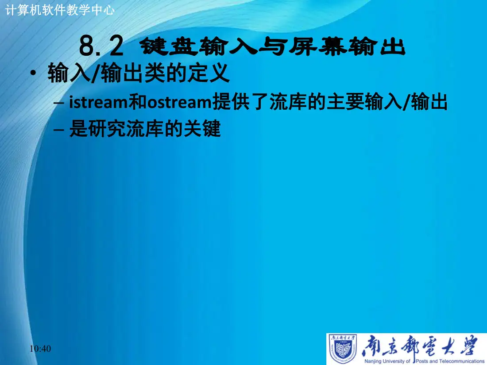

原文：

\- 输入/输出类的定义

\- istream和ostream提供了流库的主要输入/输出

\- 是研究流库的关键

计算机软件教学中心

10:40

南京邮电大学
Nanjing University of Posts and Telecommunications

### 8.2 键盘输入与屏幕输出

原文：

8.2 键盘输入与屏幕输出

\- istream类

\- istream类重载了get函数。

例如：istream & istream::get(

signed char \*,int len,char=' \n');

从流中将字符输入到给定的char \*，直到遇到分界符、文件结尾或已读完（len-1）个字节为止。

计算机软件教学中心

10:40

南京邮电大学
Nanjing University of Posts and Telecommunications

### 8.1 I/O流的概念及流类库

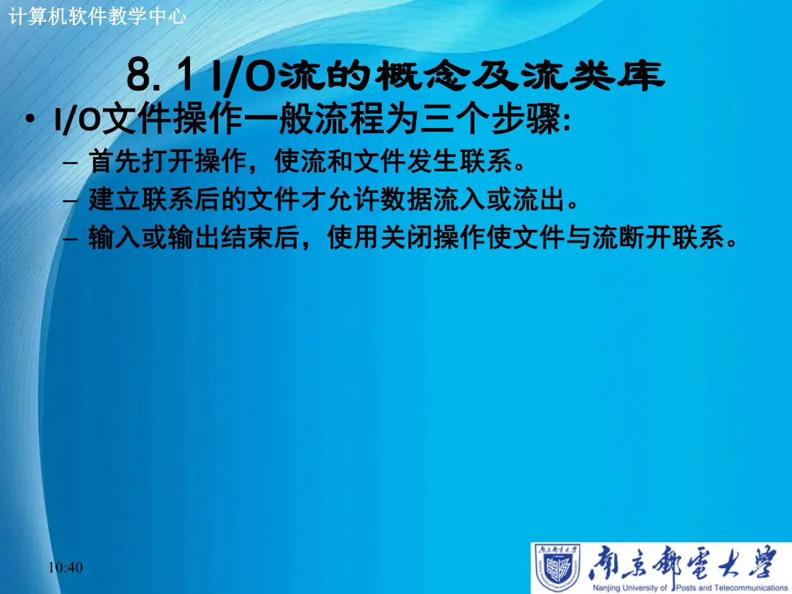

原文：

8.1 I/O流的概念及流类库

\- I/O文件操作一般流程为三个步骤:

\- 首先打开操作，使流和文件发生联系。

\- 建立联系后的文件才允许数据流入或流出。

\- 输入或输出结束后，使用关闭操作使文件与流断开联系。

计算机软件教学中心

10:40

南京邮电大学
Nanjing University of Posts and Telecommunications

### 8.2 键盘输入与屏幕输出

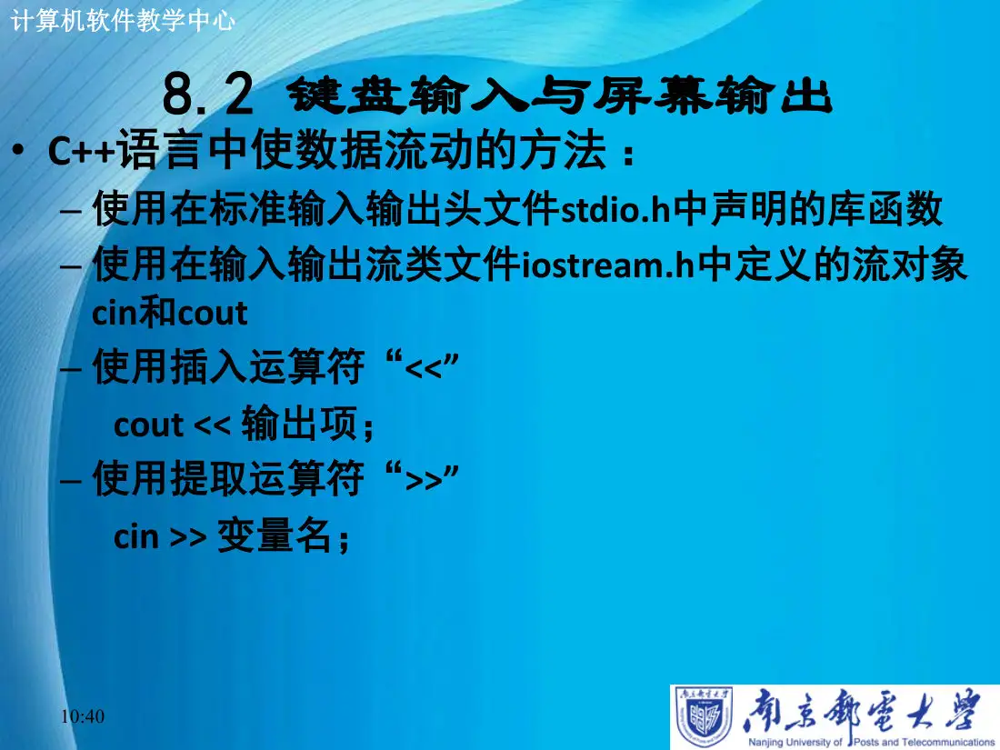

原文：

8.2 键盘输入与屏幕输出

• C++语言中使数据流动的方法：

\- 使用在标准输入输出头文件stdio.h中声明的库函数

\- 使用在输入输出流类文件iostream.h中定义的流对象cin和cout

\- 使用插入运算符“<<”

cout << 输出项；

\- 使用提取运算符“>>”

cin >> 变量名；

计算机软件教学中心

10:40

南京邮电大学
Nanjing University of Posts and Telecommunications

### \- 输入/输出类的定义

原文：

\- 输入/输出类的定义

\- istream和ostream提供了流库的主要输入/输出

\- 是研究流库的关键

计算机软件教学中心

10:40

南京邮电大学
Nanjing University of Posts and Telecommunications

### 8.2 键盘输入与屏幕输出

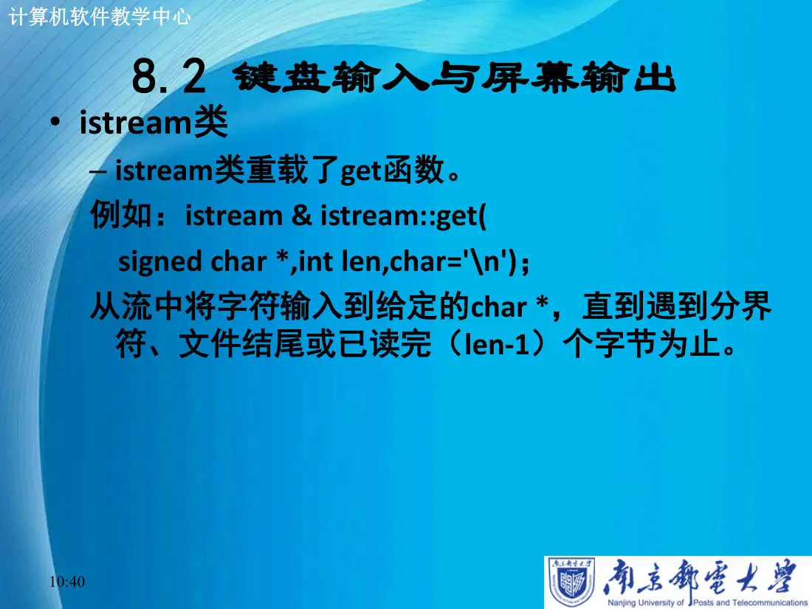

原文：

8.2 键盘输入与屏幕输出

\- istream类

\- istream类重载了get函数。

例如：istream & istream::get(

signed char \*,int len,char=' \n');

从流中将字符输入到给定的char \*，直到遇到分界符、文件结尾或已读完（len-1）个字节为止。

计算机软件教学中心

10:40

南京邮电大学
Nanjing University of Posts and Telecommunications

### 8.2 键盘输入与屏幕输出

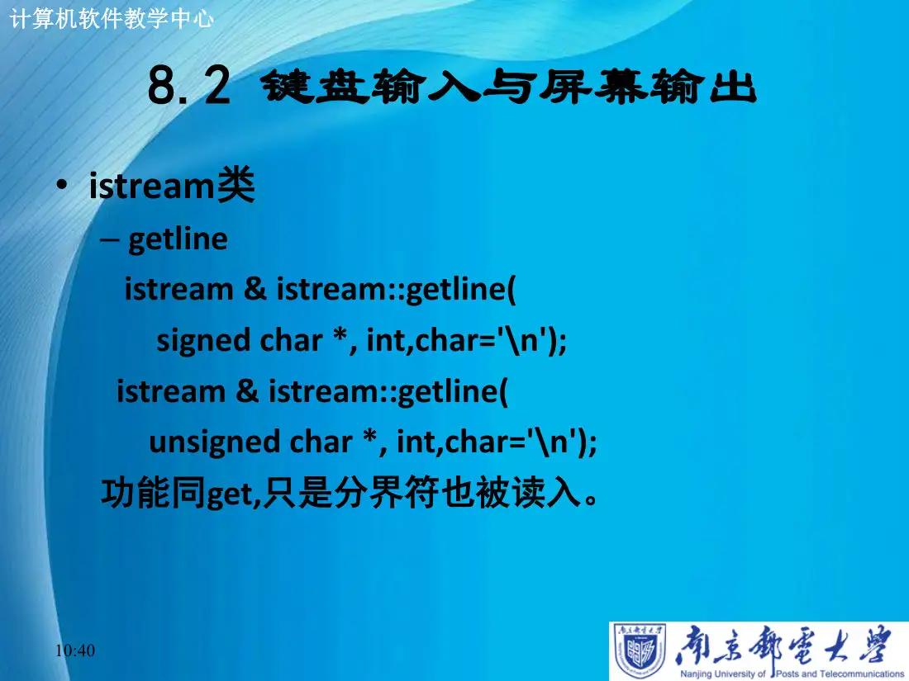

原文：

8.2 键盘输入与屏幕输出

\- istream类

\- getline

istream & istream::getline(

signed char \*, int,char='\\n');

istream & istream::getline(

unsigned char \*, int,char='\\n');

功能同get,只是分界符也被读入。

计算机软件教学中心

10:40

南京邮电大学
Nanjing University of Posts and Telecommunications

### 8.2 键盘输入与屏幕输出

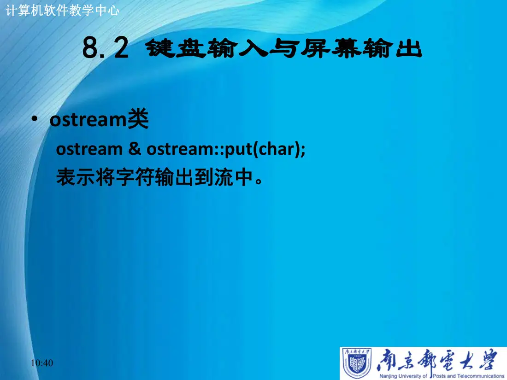

原文：

8.2 键盘输入与屏幕输出

\- ostream类

ostream & ostream::put(char);

表示将字符输出到流中。

计算机软件教学中心

10:40

南京邮电大学
Nanjing University of Posts and Telecommunications

### 8.2 键盘输入与屏幕输出

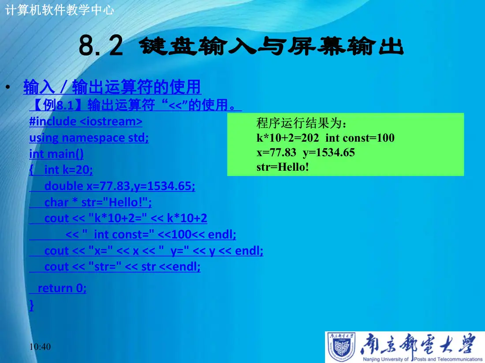

原文：

8.2 键盘输入与屏幕输出

\- 输入 / 输出运算符的使用
【例8.1】输出运算符“<<”的使用。

int k=20;
double x=77.83,y=1534.65;
char \* str="Hello!";
cout << "k\*10+2=" << k\*10+2
<< " int const=" <<100<< endl;
cout << "x=" << x << " y=" << y << endl;
cout << "str=" << str <<endl;

return 0;

$$
\begin{array}{l} \text {程序运行结果为:} \\ \mathrm{k*10+2=202 int const=100} \\ \mathrm{x=77.83 y=1534.65} \\ \mathrm{str=Hello!} \end{array}
$$

计算机软件教学中心

10:40

南京邮电大学
Nanjing University of Posts and Telecommunications

### 8.2 键盘输入与屏幕输出

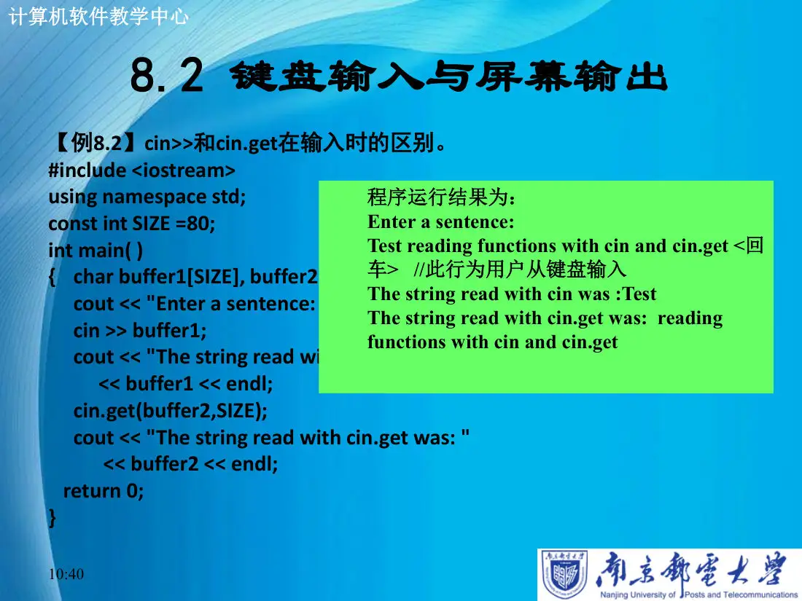

原文：

8.2 键盘输入与屏幕输出

计算机软件教学中心

### 8.2 键盘输入与屏幕输出

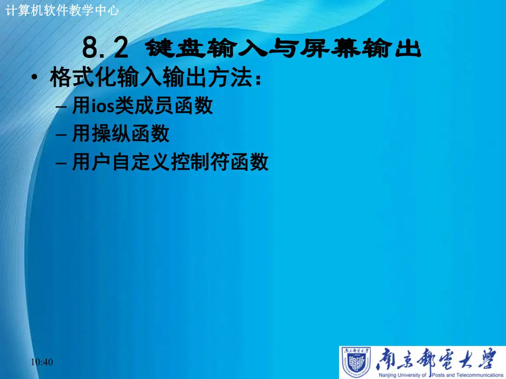

原文：

8.2 键盘输入与屏幕输出

\- 格式化输入输出方法:

\- 用ios类成员函数

\- 用操纵函数

\- 用户自定义控制符函数

计算机软件教学中心

10:40

南京邮电大学
Nanjing University of Posts and Telecommunications

### 8.2 键盘输入与屏幕输出

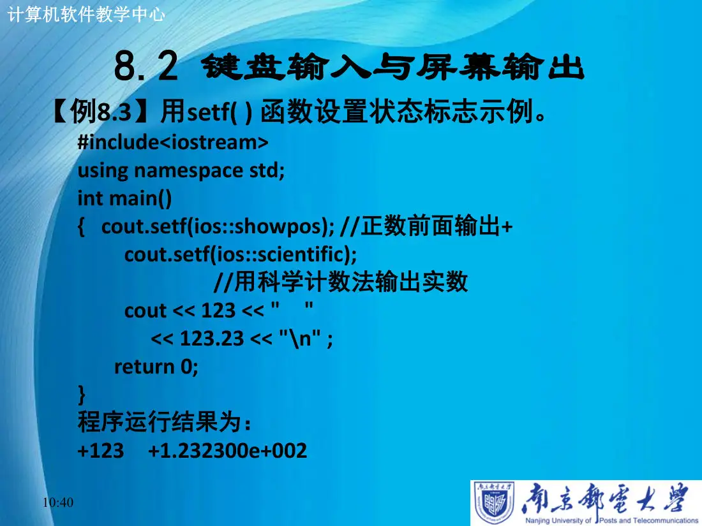

原文：

8.2 键盘输入与屏幕输出

【例8.3】用setf()函数设置状态标志示例。

程序运行结果为:

+123 +1.232300e+002

计算机软件教学中心

10:40

南京邮电大学
Nanjing University of Posts and Telecommunications

### 8.2 键盘输入与屏幕输出

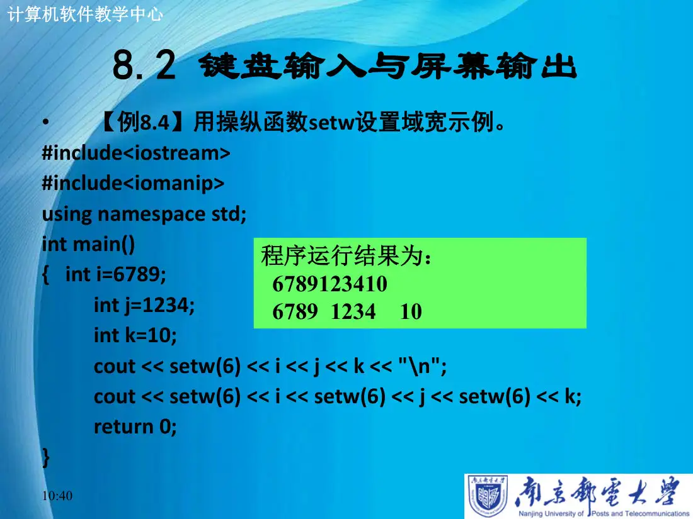

原文：

8.2 键盘输入与屏幕输出

【例8.4】用操纵函数setw设置域宽示例。

计算机软件教学中心

10:40

南京邮电大学
Nanjing University of Posts and Telecommunications

### 计算机软件教学中心

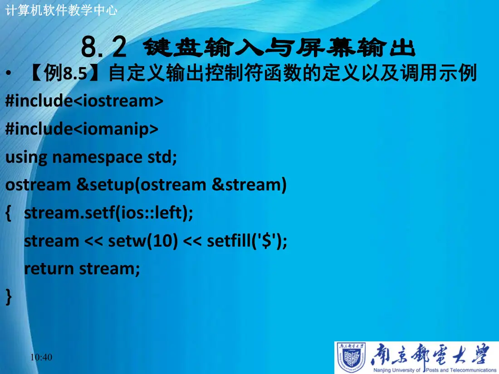

原文：

计算机软件教学中心

include<iostream>

include<iomanip>

using namespace std;

ostream &setup(ostream &stream)

return stream;

南京邮电大学
Nanjing University of Posts and Telecommunications

### int main()

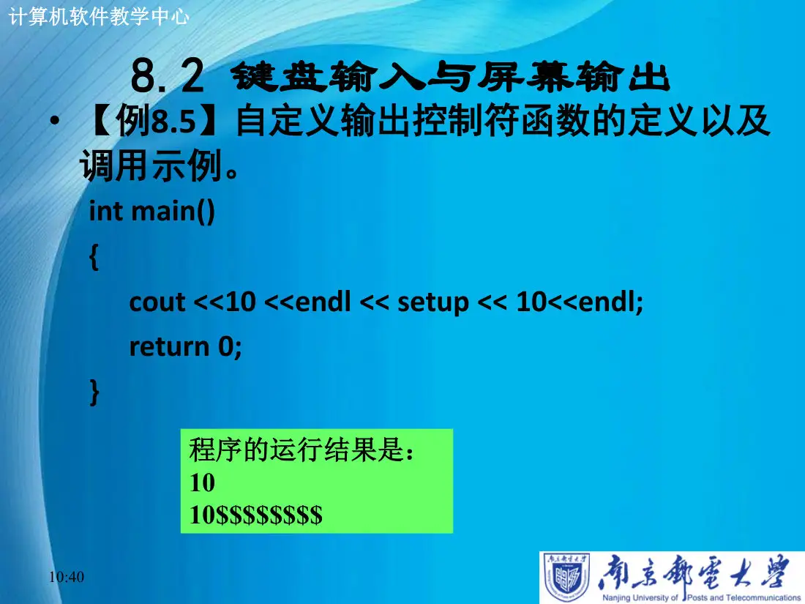

原文：

8.2 键盘输入与屏幕输出 • 【例8.5】自定义输出控制符函数的定义以及调用示例。

int main()

cout <<10 <<endl << setup << 10<<endl;
return 0;

程序的运行结果是:

10

10\$\$\$\$\$\$\$

计算机软件教学中心

10:40

南京邮电大学
Nanjing University of Posts and Telecommunications

### 8.2 键盘输入与屏幕输出

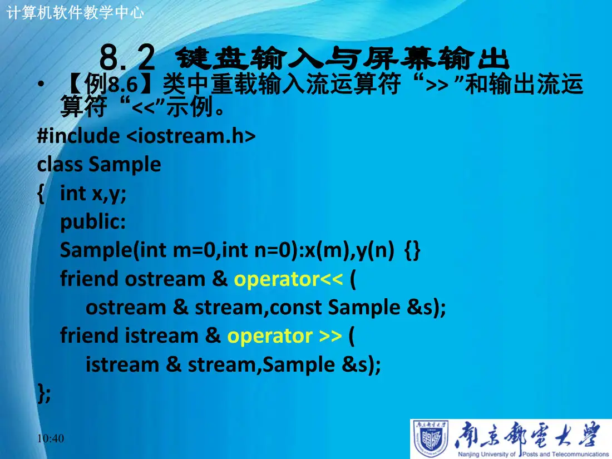

原文：

8.2 键盘输入与屏幕输出
• 【例8.6】类中重载输入流运算符“>>”和输出流运算符“<<”示例。

include <iostream.h>

class Sample

{ int x,y;
public:
Sample(int m=0,int n=0):x(m),y(n) {} 
friend ostream & operator<< ( 
ostream & stream,const Sample &s);
friend istream & operator >> ( 
istream & stream,Sample &s);

计算机软件教学中心

10:40

南京邮电大学
Nanjing University of Posts and Telecommunications

### 8.2 键盘输入与屏幕输出

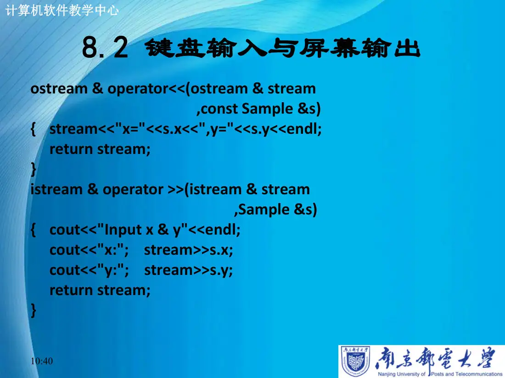

原文：

8.2 键盘输入与屏幕输出

istream & operator >> (istream & stream ,Sample &s)

计算机软件教学中心

10:40

南京邮电大学
Nanjing University of Posts and Telecommunications

### 8.2 键盘输入与屏幕输出

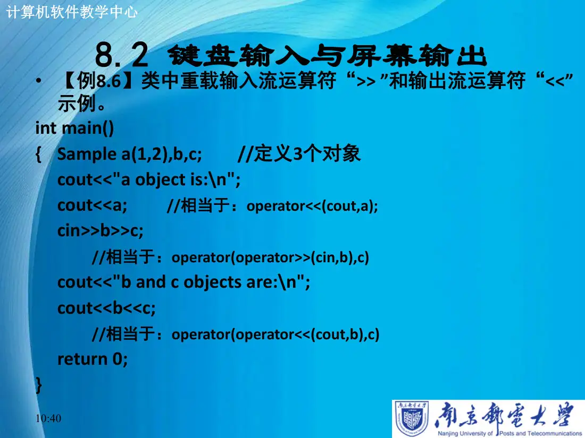

原文：

8.2 键盘输入与屏幕输出

\- 【例8.6】类中重载输入流运算符“>>”和输出流运算符“<<”示例。

int main()

{ Sample a(1,2),b,c; //定义3个对象

cout<<"a object is:\n";

cout<<a; //相当于：operator<<(cout,a);

cin>>b>>c;

//相当于： operator(operator>>(cin,b),c)
cout<<"b and c objects are:\n";
cout<<b<<c;

//相当于：operator(operator<<(cout,b),c)
return 0;

计算机软件教学中心

10:40

南京邮电大学
Nanjing University of Posts and Telecommunications

### 8.2 键盘输入与屏幕输出

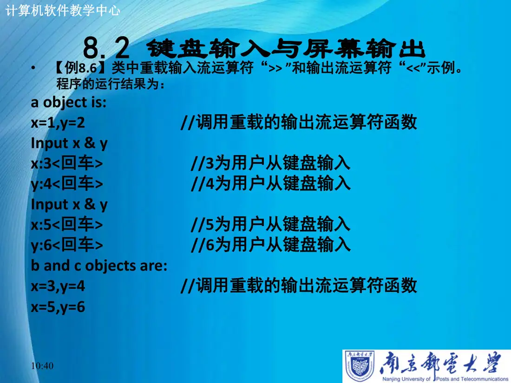

原文：

8.2 键盘输入与屏幕输出

• 【例8.6】类中重载输入流运算符“>>”和输出流运算符“<<”示例。程序的运行结果为：

a object is:

$$
x = 1, y = 2
$$

Input x & y

x:3<回车>

y:4<回车>

Input x & y

x:5<回车>

y:6<回车>

b and c objects are:

$$
x = 3, y = 4
$$

$$
x = 5, y = 6
$$

//调用重载的输出流运算符函数

//3为用户从键盘输入

//4为用户从键盘输入

//5为用户从键盘输入

//6为用户从键盘输入

//调用重载的输出流运算符函数

计算机软件教学中心

10:40

南京邮电大学
Nanjing University of Posts and Telecommunication

### 8.3 文件的输入/输出

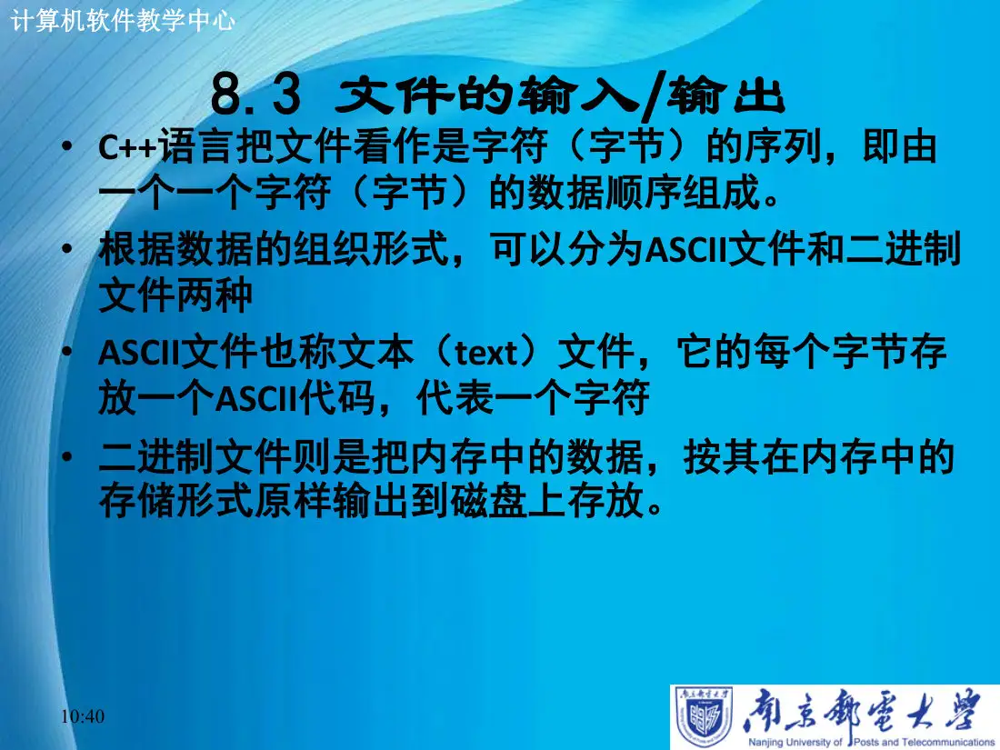

原文：

8.3 文件的输入/输出

• C++语言把文件看作是字符（字节）的序列，即由一个一个字符（字节）的数据顺序组成。

\- 根据数据的组织形式，可以分为ASCII文件和二进制文件两种

\- ASCII文件也称文本（text）文件，它的每个字节存放一个ASCII代码，代表一个字符

\- 二进制文件则是把内存中的数据，按其在内存中的存储形式原样输出到磁盘上存放。

计算机软件教学中心

10:40

南京邮电大学
Nanjing University of Posts and Telecommunication

### 8.3 文件的输入/输出

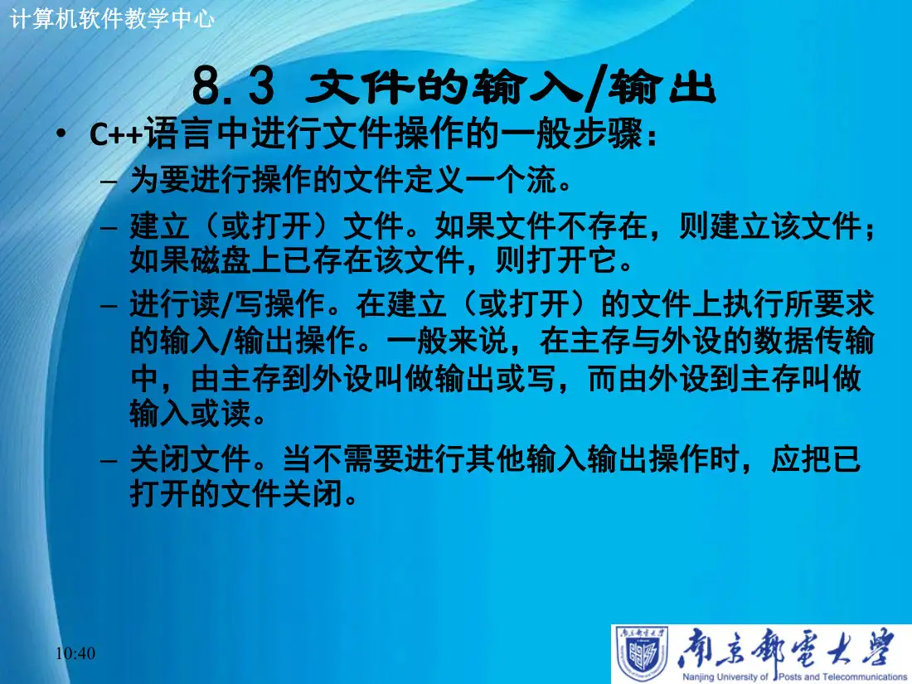

原文：

8.3 文件的输入/输出

• C++语言中进行文件操作的一般步骤:

\- 为要进行操作的文件定义一个流。

\- 建立（或打开）文件。如果文件不存在，则建立该文件；如果磁盘上已存在该文件，则打开它。

\- 进行读/写操作。在建立（或打开）的文件上执行所要求的输入/输出操作。一般来说，在主存与外设的数据传输中，由主存到外设叫做输出或写，而由外设到主存叫做输入或读。

\- 关闭文件。当不需要进行其他输入输出操作时，应把已打开的文件关闭。

计算机软件教学中心

10:40

南京邮电大学
Nanjing University of Posts and Telecommunication

### \- 包含头文件fstream.h或名字空间std的文件fstream。

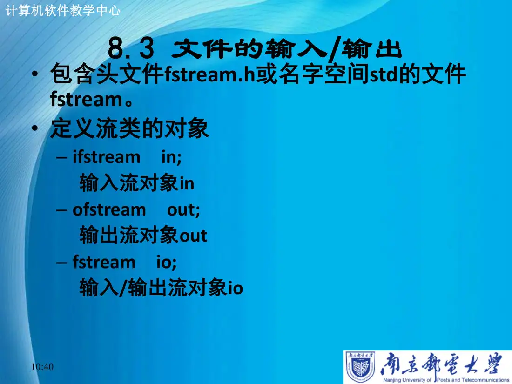

原文：

\- 包含头文件fstream.h或名字空间std的文件fstream。

\- 定义流类的对象

\- ifstream in;

输入流对象in

\- ofstream out;

输出流对象out

\- fstream io;

输入/输出流对象io

计算机软件教学中心

10:40

南京邮电大学
Nanjing University of Posts and Telecommunications

### 8.3 文件的输入/输出

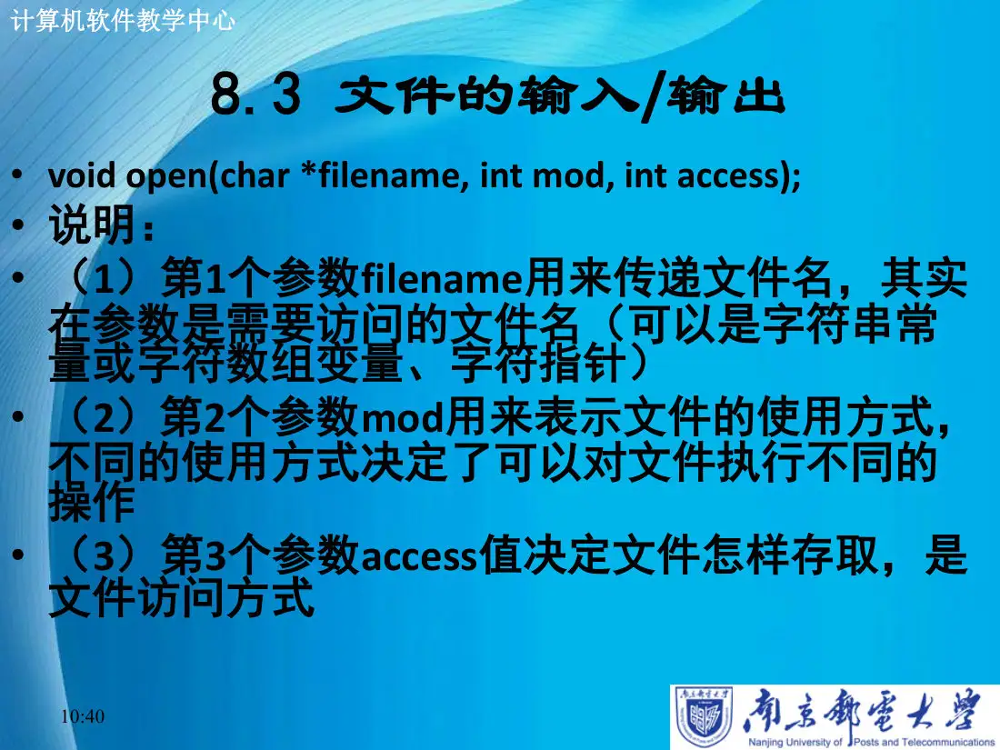

原文：

8.3 文件的输入/输出

\- void open(char \*filename, int mod, int access);

\- 说明:

• （1）第1个参数filename用来传递文件名，其实在参数是需要访问的文件名（可以是字符串常量或字符数组变量、字符指针）

• (2) 第2个参数mod用来表示文件的使用方式,不同的使用方式决定了可以对文件执行不同的操作

• (3) 第3个参数access值决定文件怎样存取, 是文件访问方式

计算机软件教学中心

10:40

南京邮电大学
Nanjing University of Posts and Telecommunications

### 8.3 文件的输入/输出

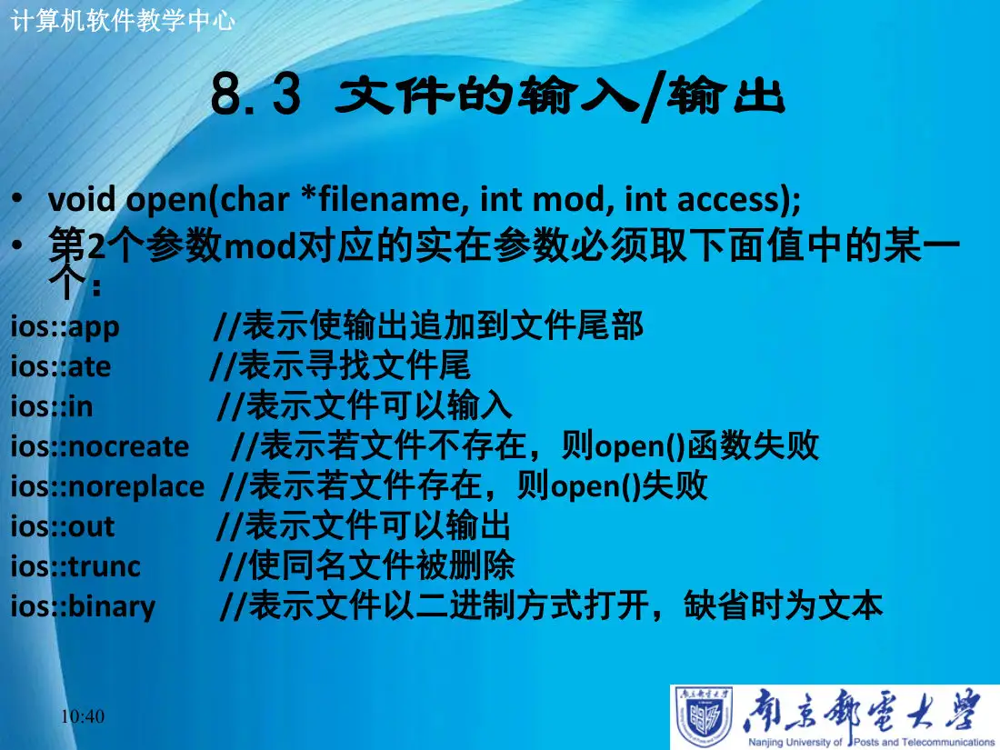

原文：

8.3 文件的输入/输出

\- void open(char \*filename, int mod, int access);

\- 第2个参数mod对应的实在参数必须取下面值中的某一个:

ios::app //表示使输出追加到文件尾部

ios::ate //表示寻找文件尾

ios::in //表示文件可以输入

ios::nocreate //表示若文件不存在，则open()函数失败

ios::noreplace //表示若文件存在，则open()失败

ios::out //表示文件可以输出

ios::trunc //使同名文件被删除

ios::binary //表示文件以二进制方式打开，缺省时为文本

计算机软件教学中心

10:40

南京邮电大学
Nanjing University of Posts and Telecommunications

### 8.3 文件的输入/输出

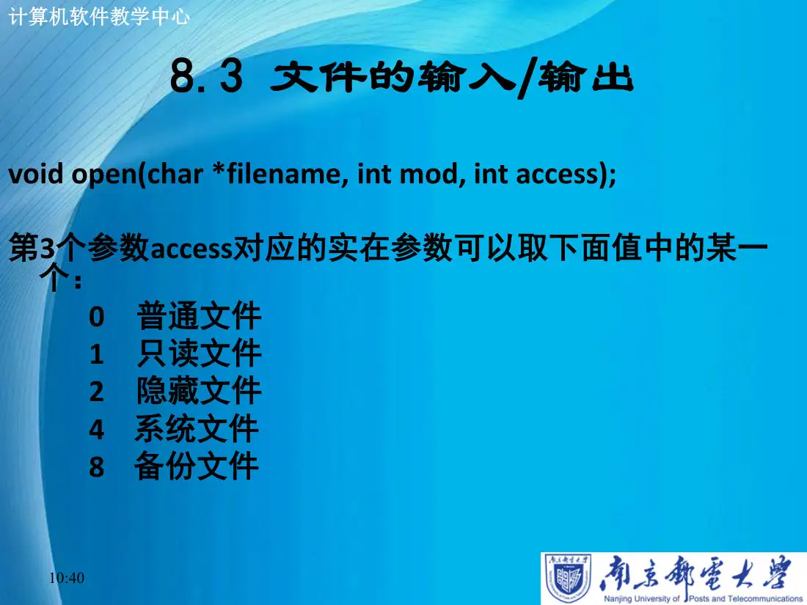

原文：

8.3 文件的输入/输出

void open(char \*filename, int mod, int access);

第3个参数access对应的实在参数可以取下面值中的某一

0 普通文件

1 只读文件

2 隐藏文件

4 系统文件

8 备份文件

计算机软件教学中心

10:40

南京邮电大学
Nanjing University of Posts and Telecommunications

### 8.3 文件的输入/输出

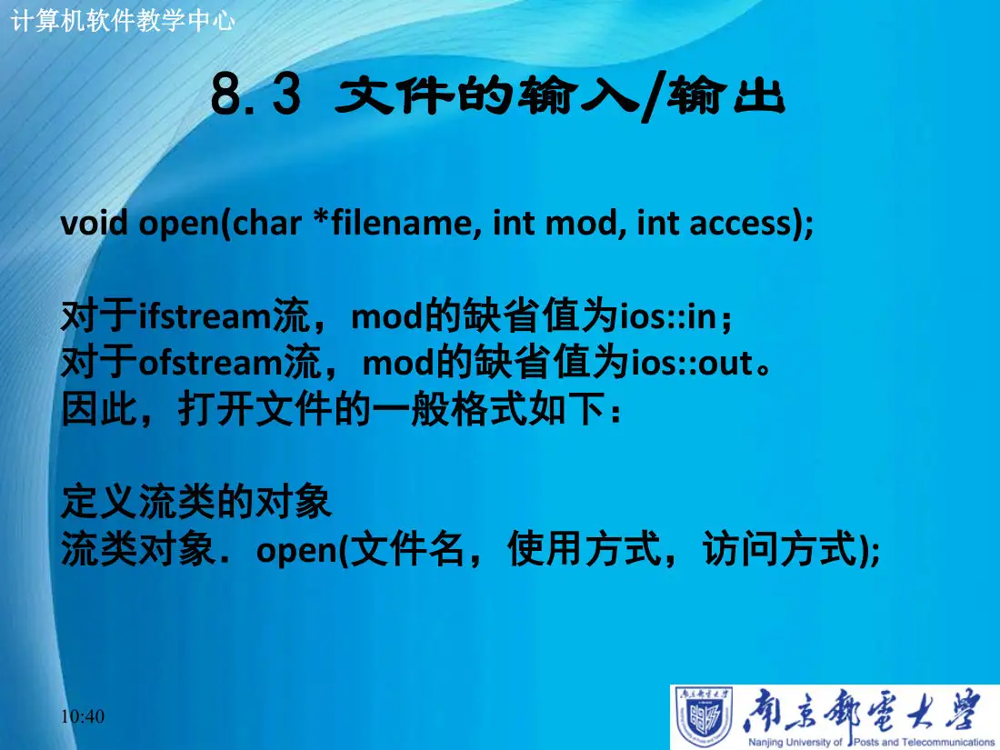

原文：

8.3 文件的输入/输出

void open(char \*filename, int mod, int access);

对于ifstream流，mod的缺省值为ios::in；对于ofstream流，mod的缺省值为ios::out。因此，打开文件的一般格式如下：

定义流类的对象
流类对象．open(文件名，使用方式，访问方式);

计算机软件教学中心

10:40

南京邮电大学
Nanjing University of Posts and Telecommunications

### 8.3 文件的输入/输出

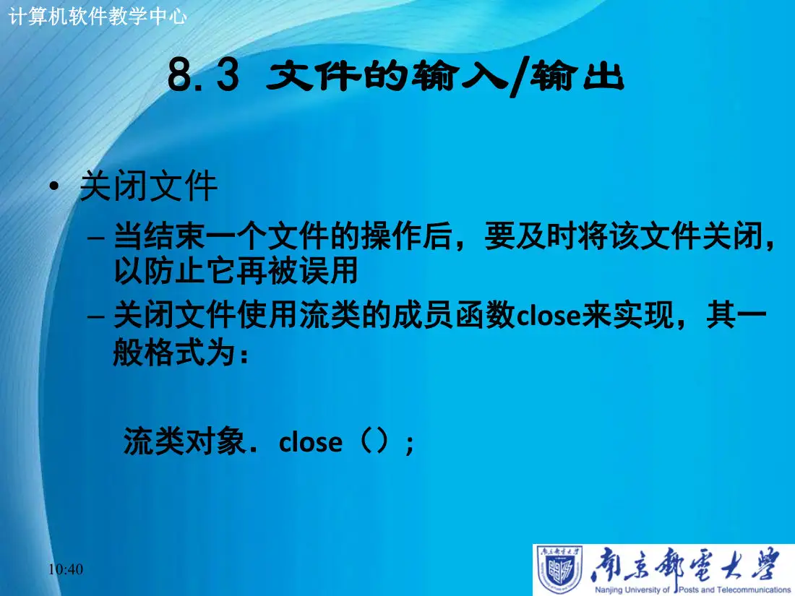

原文：

8.3 文件的输入/输出

- 关闭文件

\- 当结束一个文件的操作后，要及时将该文件关闭，以防止它再被误用

\- 关闭文件使用流类的成员函数close来实现，其一般格式为：

流类对象．close（）；

计算机软件教学中心

10:40

南京邮电大学
Nanjing University of Posts and Telecommunications

### 8.3 文件的输入/输出

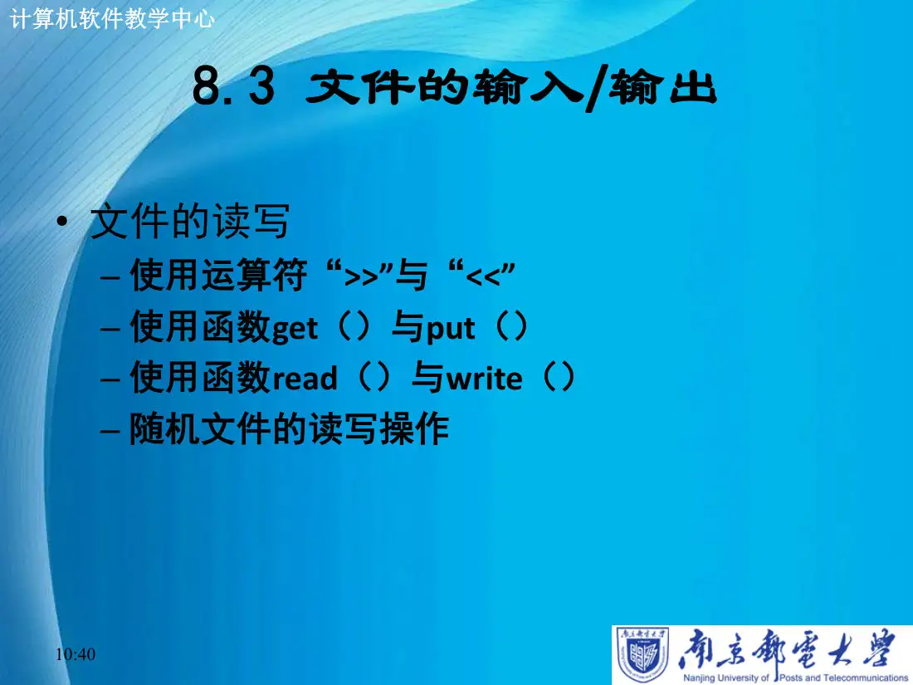

原文：

8.3 文件的输入/输出

\- 文件的读写

\- 使用运算符“>>”与“<<”

\- 使用函数get（）与put（）

\- 使用函数read（）与write（）

\- 随机文件的读写操作

计算机软件教学中心

10:40

南京邮电大学
Nanjing University of Posts and Telecommunications

### 8.3 文件的输入/输出 【例8.7】使用流运算符“>”对文本文件操作示例

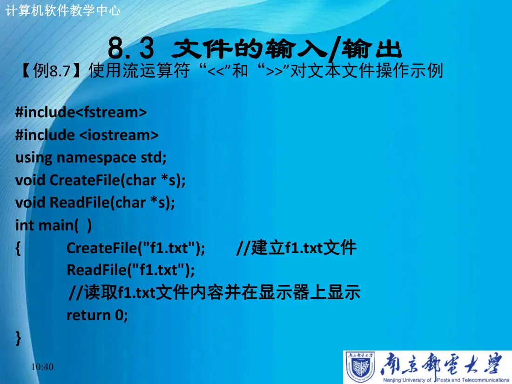

原文：

8.3 文件的输入/输出 【例8.7】使用流运算符“<<”和“>>”对文本文件操作示例

include <iostream>

using namespace std;

void CreateFile(char \*s);

计算机软件教学中心

南京邮电大学
Nanjing University of Posts and Telecommunications

### 8.3 文件的输入/输出

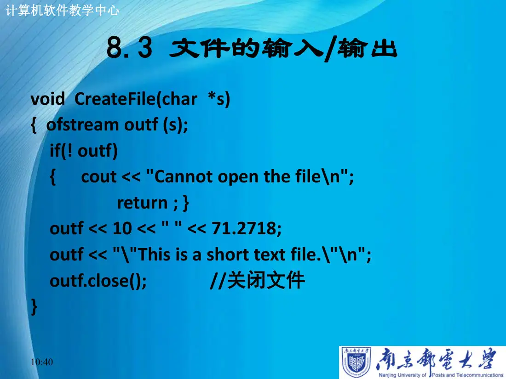

原文：

8.3 文件的输入/输出

计算机软件教学中心

10:40

南京邮电大学
Nanjing University of Posts and Telecommunications

### 8.3 文件的输入/输出

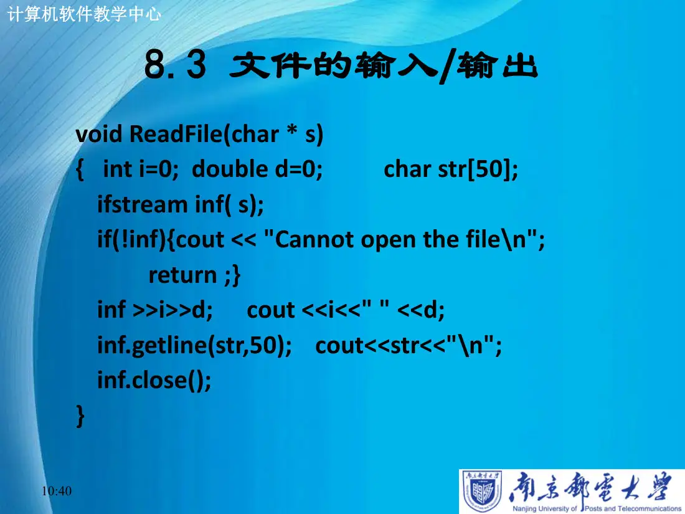

原文：

8.3 文件的输入/输出

计算机软件教学中心

10:40

南京邮电大学
Nanjing University of Posts and Telecommunications

### 8.3 文件的输入/输出

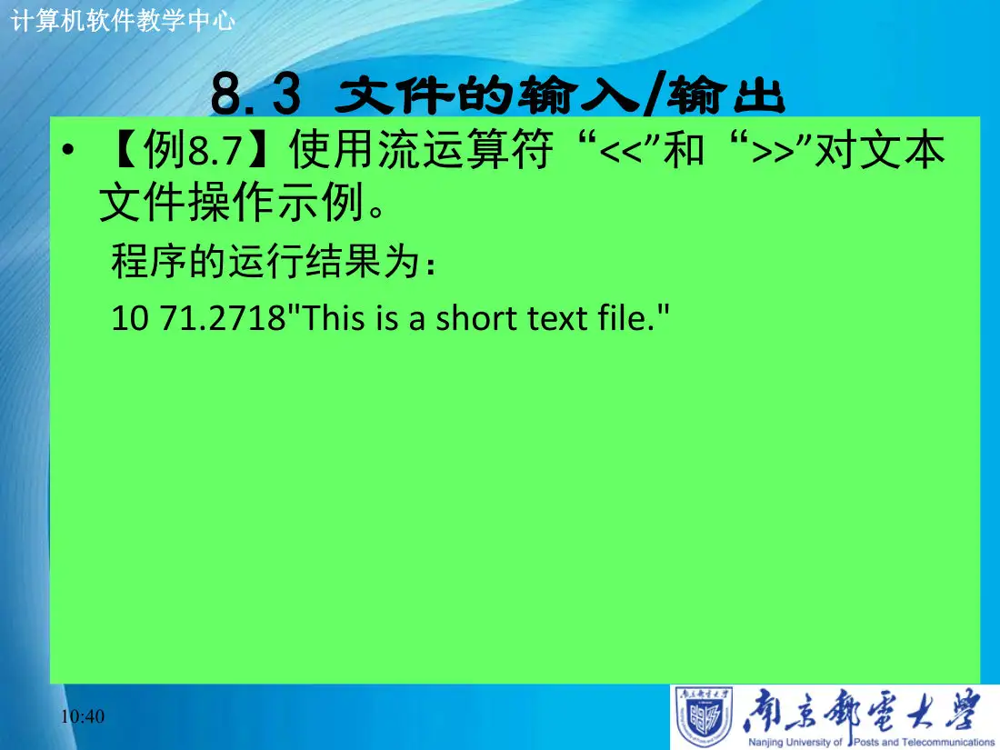

原文：

8.3 文件的输入/输出

\- 【例8.7】使用流运算符“<<”和“>>”对文本文件操作示例。

程序的运行结果为:

10 71.2718"This is a short text file."

计算机软件教学中心

10:40

南京邮电大学
Nanjing University of Posts and Telecommunication

### 8.3 文件的输入/输出

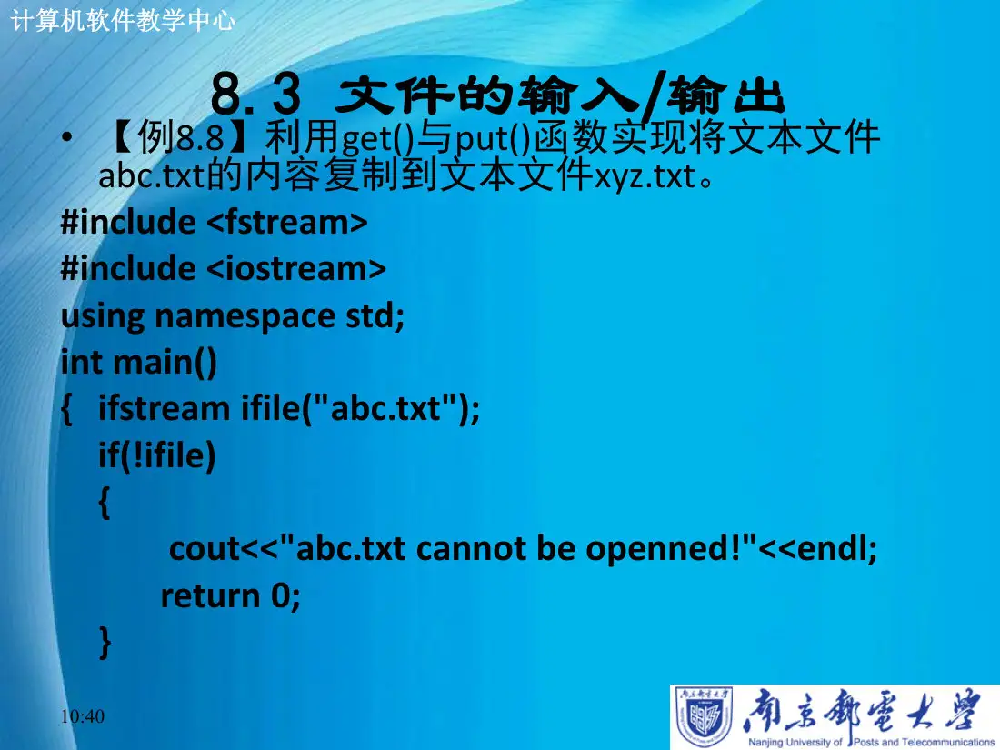

原文：

8.3 文件的输入/输出

• 【例8.8】利用get()与put()函数实现将文本文件abc.txt的内容复制到文本文件xyz.txt。

include <fstream>

include <iostream>

using namespace std;

int main()

{ ifstream ifile("abc.txt"); if(!ifile)

cout<<"abc.txt cannot be opened!"<<endl; return 0;

计算机软件教学中心

10:40

南京邮电大学
Nanjing University of Posts and Telecommunications

### 8.3 文件的输入/输出

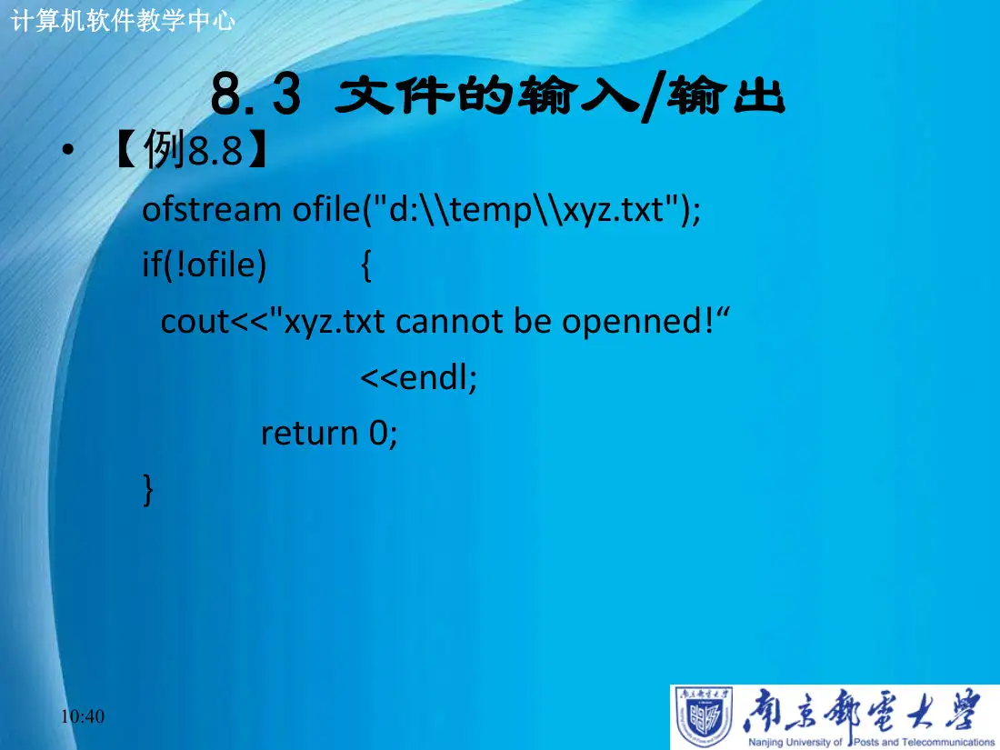

原文：

8.3 文件的输入/输出

• 【例8.8】

ofstream ofile("d:\\temp\\xyz.txt");

if(!ofile) {

cout<<"xyz.txt cannot be opened!"

<<endl;

return 0;

计算机软件教学中心

10:40

南京邮电大学
Nanjing University of Posts and Telecommunications

### 8.3 文件的输入/输出

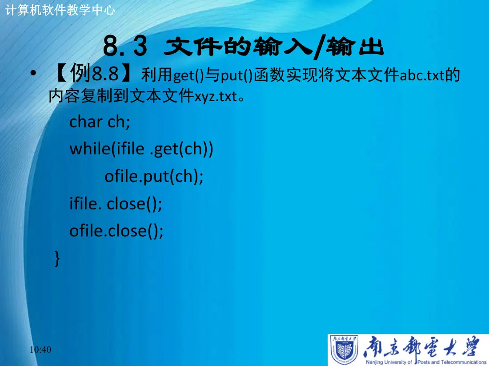

原文：

8.3 文件的输入/输出

\- 【例8.8】利用get()与put()函数实现将文本文件abc.txt的内容复制到文本文件xyz.txt。

char ch;

while(ifile .get(ch))

ofile.put(ch);

ifile. close();

ofile.close();

计算机软件教学中心

10:40

南京邮电大学
Nanjing University of Posts and Telecommunications

### 8.3 文件的输入/输出

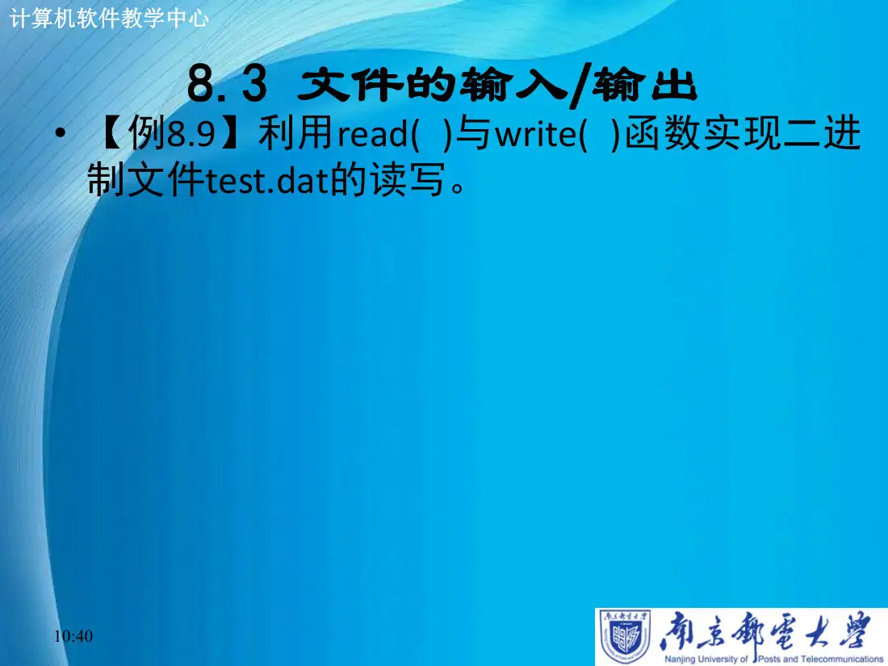

原文：

8.3 文件的输入/输出

• 【例8.9】利用read()与write()函数实现二进制文件test.dat的读写。

计算机软件教学中心

10:40

南京邮电大学
Nanjing University of Posts and Telecommunications

### 8.3 文件的输入/输出

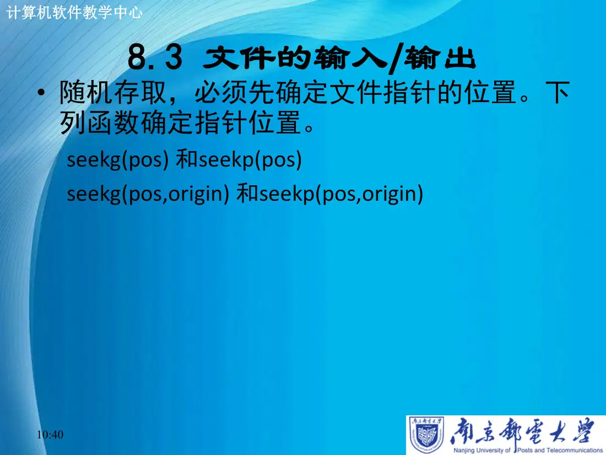

原文：

8.3 文件的输入/输出

\- 随机存取，必须先确定文件指针的位置。下列函数确定指针位置。

seekg(pos) 和 seekp(pos)

seekg(pos,origin) 和 seekp(pos,origin)

计算机软件教学中心

10:40

南京邮电大学
Nanjing University of Posts and Telecommunications

### 8.3 文件的输入/输出

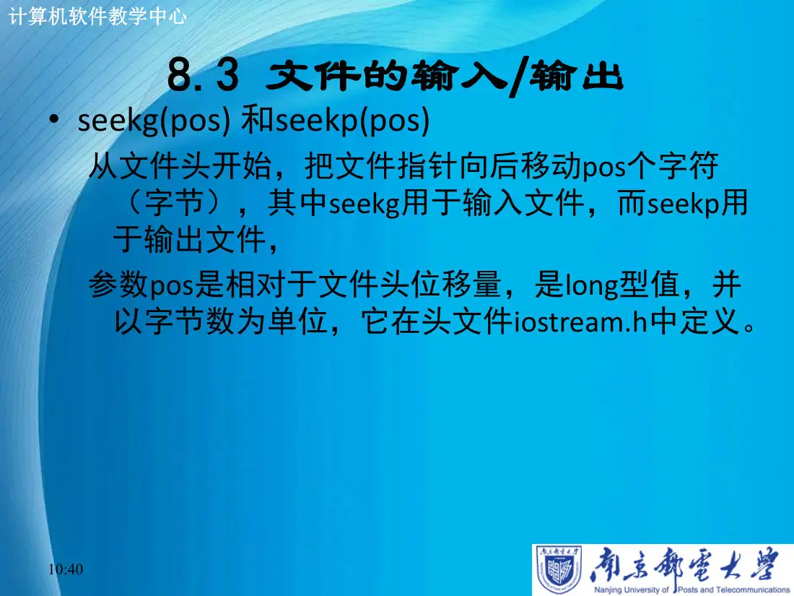

原文：

8.3 文件的输入/输出

\- seekg(pos) 和 seekp(pos)

从文件头开始，把文件指针向后移动pos个字符（字节），其中seekg用于输入文件，而seekp用于输出文件，

参数pos是相对于文件头位移量，是long型值，并以字节数为单位，它在头文件iostream.h中定义。

计算机软件教学中心

10:40

南京邮电大学
Nanjing University of Posts and Telecommunications

### 8.3 文件的输入/输出

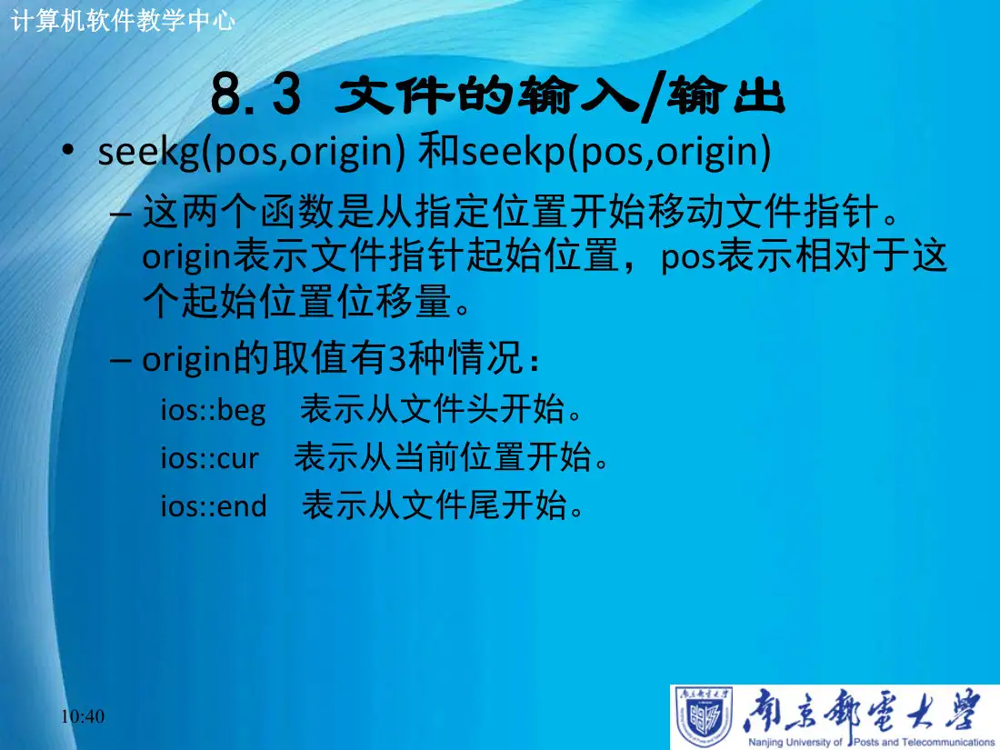

原文：

8.3 文件的输入/输出

\- seekg(pos,origin) 和 seekp(pos,origin)

\- 这两个函数是从指定位置开始移动文件指针。origin表示文件指针起始位置，pos表示相对于这个起始位置位移量。

\- origin的取值有3种情况：

ios::beg 表示从文件头开始。

ios::cur 表示从当前位置开始。

ios::end 表示从文件尾开始。

计算机软件教学中心

10:40

南京邮电大学
Nanjing University of Posts and Telecommunications

### 8 3 文件的输入/输出

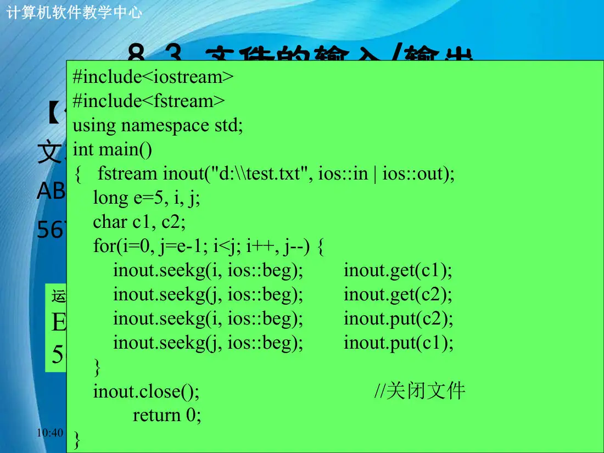

原文：

8 3 文件的输入/输出

计算机软件教学中心

### 计算机软件教学中心

原文：

计算机软件教学中心

本章小结

• C++语言的I/O流库有：streambuf和ios，ios类有4个直接派生类

\- C++语言提供使用ios类中的有关格式控制的成员函数；使用操纵函数控制格式。

\- 用户可以使用运算符“>>”和“<<”进行IO。用户可以重载运算符“>>”和“<<”的方法，实现IO。

• C++语言可以将程序产生的数据信息以磁盘文件的形式长久保存。

\- 使用 “>>”和 “<<”直接对文件进行读写操作，也可用get（）与put（）函数或read（）与write（）函数进行文件的读写操作。

\- 文件不仅可以顺序访问，还可以随机读写

10:40

南京邮电大学
Nanjing University of Posts and Telecommunications

### 本章小结

原文：

本章小结

\- 进行文件操作一般经过以下4个步骤。

\- 为要进行操作的文件定义一个流。

\- 建立（或打开）文件。如果文件不存在，则建立该文件；如果磁盘上已存在该文件，则打开它。

\- 进行读写操作。在建立（或打开）的文件上执行所要求的输入或输出操作。一般来说，在主存与外设的数据传输中，由主存到外设叫做输出或写，而由外设到主存叫做输入或读。

\- 关闭文件。

计算机软件教学中心

10:40

南京邮电大学
Nanjing University of Posts and Telecommunications
