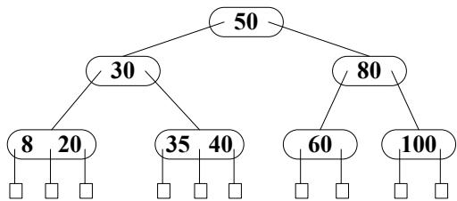
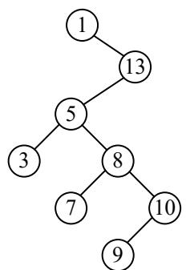
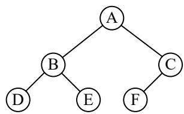
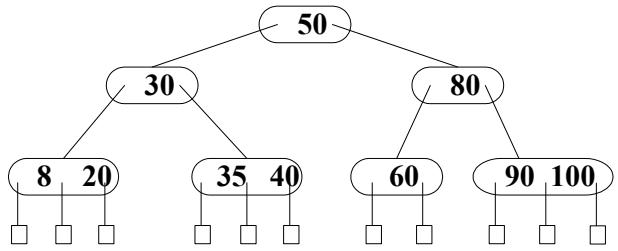
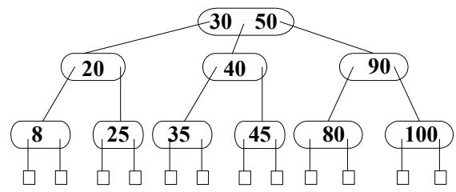

# 数据结构A复习要点及样题（南邮）

原件经识别和整理；“参考解答”是我们补的。

## 第1章 基础知识

算法与数据结构（数据结构概念、逻辑结构、数据存储结构示等）

数据抽象和抽象数据类型（数据结构规范、实现）

算法分析的基本方法（时间复杂性、空间复杂性）

## 第2章 线性表

线性表的顺序和链接表示

理解在顺序表、单链表上实现线性表运算，能设计相应算法程序

顺序和链接表示的优缺点比较

## 第3章 堆栈和队列

了解栈和队列的概念、特点

理解顺序栈和循环队列运算的实现

中缀表达式与后缀表达式的转换

后缀表达式计算

## 第4章 数组和字符串

一般数组存储方法

三元组存储稀疏矩阵的方法

三元组表示的快速矩阵转置方法

字符串的概念、KMP算法及其改进

## 第5章 树

二叉树的定义、性质及二叉链表

理解二叉树的遍历算法（遍历结果、算法设计），能设计相应算法程序

堆、堆的建立和调整

森林与二叉树的相互转换

哈夫曼树构造、哈夫曼编码、WPL计算

## 第6章 集合与搜索

理解有序表的顺序搜索算法

理解对半搜索算法

平均搜索长度的计算

## 第7章 搜索树

理解二叉搜索树的定义、性质和插入、删除算法

二叉平衡树的定义及插入算法

B-树的定义和插入、删除方法

## 第8章 散列表

掌握散列函数的相关概念

散列函数

解决冲突的开地址法（线性探查法，二次探查法、双散列法）

## 第9章 图

图的基本概念和存储结构

理解图的算法（结果）：遍历、拓扑排序、最小代价生成树、关键路径、最短路径

## 第10章 内排序

三种简单排序算法、快速排序和两路合并排序算法、过程、结果

排序算法的时间复杂度（最好、最差，平均）、稳定性

## 第11章 文件

文件的基本概念

初始游程的生成及竞赛树

# 考试样题

## 填空题

### 填空 1

写出表达式 a*b+c/d 的后缀形式。

答案：a b * c d / +

参考解答：后缀表达式为 $a\ b\ *\ c\ d\ /\ +$。

根据运算符优先级，$*$ 和 $/$ 高于 $+$，且同级从左到右结合：先处理 $a*b$ 得 $a\ b\ *$，再处理 $c/d$ 得 $c\ d\ /$，最后将两者结果相加，追加 $+$ 即得最终后缀形式。

知识点：[利用栈计算后缀表达式的值](../../../topics/数据结构/后缀表达式求值.md)、[中缀表达式转换为后缀表达式（栈内优先级isp与栈外优先级icp）](../../../topics/数据结构/中缀转后缀表达式.md)、[堆栈的抽象数据类型（ADT）及顺序表示（进栈、出栈）](../../../topics/数据结构/栈的ADT与顺序表示.md)

### 填空 2

已知一无向图 G=(V,E)，其中 V={a,b,c,d,e}，E={(a,b), (a,d), (a,c), (d,c), (b,e)}，现用某一种遍历方法从顶点 a 开始遍历图，得到的序列为 abecd，则采用的是\_\_遍历方法。

答案：深度优先

参考解答：**答案：深度优先遍历（DFS）。**

从顶点 $a$ 开始：

1. 访问 $a$，选择一个尚未访问的邻接顶点 $b$；
2. 从 $b$ 继续访问其邻接顶点 $e$；
3. 回溯到 $a$，依次访问尚未访问的邻接顶点 $c,d$。

访问顺序为：


$$
a \to b \to e \to c \to d
$$


该过程先沿当前路径尽可能深入，无法继续时再回溯，因此采用的是**深度优先遍历**。

知识点：[图的深度优先遍历（DFS）递归算法](../../../topics/数据结构/深度优先遍历DFS.md)、[图的宽度优先遍历（BFS）算法及特点](../../../topics/数据结构/广度优先遍历BFS.md)、[图的定义与术语（有向图、无向图、连通分量、强连通分量、DAG图等）](../../../topics/数据结构/图的基本概念.md)

### 填空 3

在顺序表长度为 n 中，平均在表中插入一个元素需要移动元素的个数可用计算公式为\_\_。

答案：$E_i=\sum_{i=-1}^{n-1}\frac{1}{n+1}(n-i-1)=\frac{n}{2}$

参考解答：结论：  
在长度为 $n$ 的顺序表中插入一个元素，平均需要移动的元素个数为  


$$
\frac{n}{2}
$$


推理过程：  
顺序表插入时，共有 $n+1$ 个可能的插入位置（表头、表尾以及每两个元素之间）。设插入位置编号为 $i$（从 0 到 $n$），则在该位置插入时，需要将后面的 $n-i$ 个元素向后移动。  

平均移动次数为：


$$
E = \frac{1}{n+1}\sum_{i=0}^{n}(n-i)
$$


令 $k = n-i$，则当 $i=0$ 时 $k=n$，当 $i=n$ 时 $k=0$，所以


$$
E = \frac{1}{n+1}\sum_{k=0}^{n} k
= \frac{1}{n+1} \cdot \frac{n(n+1)}{2}
= \frac{n}{2}
$$


所以答案为：


$$
\boxed{\frac{n}{2}}
$$


知识点：[顺序表插入与删除操作的元素移动次数及时间复杂度分析](../../../topics/数据结构/顺序表性能分析.md)

### 填空 4

一个表长为 n 的线性表，其排序时间最快为\_\_。

答案：O(n)

## 选择题

参考解答：**结论：** 排序时间最快为 $\mathrm{O}(n)$。

**推理：** 对线性表进行排序时，至少需要遍历所有元素一次，因此时间下界为 $\Omega(n)$；在元素已有序或已知特殊分布等情况下，可采用线性时间算法（如计数排序、桶排序等）达到 $\mathrm{O}(n)$。故最快为 $\mathrm{O}(n)$。

知识点：[各种内部排序算法的时间复杂度、空间复杂度与稳定性综合比较](../../../topics/数据结构/排序算法性能比较.md)、[内排序的基本概念与排序算法的稳定性](../../../topics/数据结构/排序基本概念.md)

### 选择 1

具有 n 个顶点的有向完全图中，边的总数为（ ）条。

- A. n(n+1)
- B. n(n-1)
- C. n(n-1)/2
- D. n(n+1)/2

答案：B

参考解答：**结论**：B

**推理过程**：
在有向完全图中，任意两个不同的顶点 $u$ 和 $v$ 之间都存在两条方向相反的边，即 $\langle u, v \rangle$ 和 $\langle v, u \rangle$。
对于 $n$ 个顶点，从中任选两个不同顶点的组合数为 $\binom{n}{2} = \frac{n(n-1)}{2}$。
由于每对顶点之间有 2 条有向边，因此边的总数为：
$$ 2 \times \frac{n(n-1)}{2} = n(n-1) $$

**选项分析**：
*   **A 错**：公式不符合图论基本计数逻辑。
*   **B 对**：符合有向完全图边数定义 $n(n-1)$。
*   **C 错**：这是**无向**完全图的边数公式。
*   **D 错**：公式不符合图论基本计数逻辑。

知识点：[图的定义与术语（有向图、无向图、连通分量、强连通分量、DAG图等）](../../../topics/数据结构/图的基本概念.md)

### 选择 2

设一个栈输入序列是 1、2、3、4、5，则下列序列中不可能是栈的输出序列是（ ）。

- A. 32541
- B. 15432
- C. 14523
- D. 23145

答案：C。只能是 14532

参考解答：## 结论

选 **C**。序列 `14523` 不可能是该栈的输出序列。

## 推理

栈的输出序列需满足栈的 **LIFO（后进先出）** 规则。判定方法：模拟入栈出栈过程，按输出序列逐个检查。

对输出序列 `14523` 的模拟分析：

- 输出第 1 个元素 `1`：需先 push `1`，再 pop `1`。栈空。
- 输出第 2 个元素 `4`：需依次 push `2`, `3`, `4`，再 pop `4`。此时栈内为 `[2, 3]`（`3` 为栈顶）。
- 输出第 3 个元素 `5`：需 push `5`，再 pop `5`。此时栈内仍为 `[2, 3]`（`3` 为栈顶）。
- 输出第 4 个元素 `2`：但当前栈顶是 `3`，必须先 pop `3` 才能 pop `2`。故无法跳过 `3` 先输出 `2`。

因此 14523 不可能实现。

## 选项分析

- **B）15432**：可先 pop `1`，再 push `2,3,4,5` 后依次 pop，得到 `15432`，合法。
- **A）32541**：push `1,2,3` → pop `3` → pop `2` → push `4,5` → pop `5` → pop `4` → pop `1`，合法。
- **D）23145**：push `1,2` → pop `2` → pop `3`（需先 push `3`）→ pop `1` → push `4` → pop `4` → push `5` → pop `5`，合法。
- **C）14523**：如上分析，输出 `2` 前必须先输出栈顶 `3`，矛盾，故不可能。

知识点：[堆栈的抽象数据类型（ADT）及顺序表示（进栈、出栈）](../../../topics/数据结构/栈的ADT与顺序表示.md)

### 选择 3

二叉树的前序遍历为 EFHIGJK，中序遍历序列为 HFIEJKG。该二叉树根结点的右子树的根是（ ）。

- A. E
- B. F
- C. G
- D. H

答案：C

参考解答：根据前序序列 EFHIGJK 和中序序列 HFIEJKG，可以确定该二叉树的根结点是 E。在中序序列中，E 左边的部分（HFI）是其左子树的中序序列，右边部分（JKG）是其右子树的中序序列。那么右子树的中序序列为 JKG，对应的前序序列部分为 GJK。因此右子树的根结点是 G。其余选项均不满足这一推导。

知识点：[二叉树的先序、中序、后序遍历（递归算法与非递归算法）及层次遍历](../../../topics/数据结构/二叉树的遍历.md)、[由遍历序列（如先序和中序）确定唯一二叉树](../../../topics/数据结构/遍历序列还原二叉树.md)

### 选择 4

对有 14 个元素的有序表 A[1]-A[14] 作对半查找，查找元素 A[4] 时的被比较元素依次为（ ）。

- A. A[1],A[2],A[3],A[4]
- B. A[7],A[3],A[5],A[4]
- C. A[1],A[2],A[7],A[4]
- D. A[7],A[5],A[3],A[4]

答案：B

第 1 次：范围 [1, 14]，中间元素是 (1+14)/2 = 7

第 2 次：范围 [1, 6]，中间元素是 (1+6)/2 = 3

第 3 次：范围 [4, 6]，中间元素是 (4+6)/2 = 5

第 4 次：范围 [4, 4]，中间元素是 (4+4)/2 = 4

参考解答：题目中的有序表索引从 1 到 14，对半查找（二分查找）每次取中间位置与目标比较。  
查找目标为 A[4]，过程如下：

第一次：low=1, high=14，mid = ⌊(1+14)/2⌋ = 7，比较 A[7]  
第二次：low=1, high=6，mid = ⌊(1+6)/2⌋ = 3，比较 A[3]  
第三次：low=4, high=6，mid = ⌊(4+6)/2⌋ = 5，比较 A[5]  
第四次：low=4, high=4，mid = ⌊(4+4)/2⌋ = 4，比较 A[4]（命中）

依次比较的元素是 A[7], A[3], A[5], A[4]，对应选项 B。  
A、C 开头比较的不是 A[7]，不符合二分查找的 mid 规律；D 第二次比较的是 A[5] 而非 A[3]，序列错误。

知识点：[二分搜索（对半搜索）的递归与非递归算法实现](../../../topics/数据结构/二分搜索.md)、[二分搜索的二叉判定树构造及搜索性能分析](../../../topics/数据结构/二叉判定树.md)、[算法的定义、描述及五个特性](../../../topics/数据结构/算法及其特性.md)

### 选择 5

设有一个长度为 100 且已排好序的表，用对半搜索进行查找，若搜索不成功，则至少要比较\_\_次。（ ）

- A. 9
- B. 8
- C. 7
- D. 6

答案：D

长度为 100 的有序表进行对半查找，查找失败时比较 $\lfloor\log_2 100\rfloor$ 次或者 $\lfloor\log_2 100\rfloor+1$ 次，即 6 或 7 次。

## 简答题

参考解答：**结论**：D

**推理过程**：
1.  **判定树深度分析**：
    对半搜索（二分查找）的过程可以用一棵二叉判定树来描述。对于长度为 $n=100$ 的有序表，其判定树的深度 $h$ 满足：
    $$ h = \lfloor \log_2 n \rfloor + 1 $$
    代入 $n=100$：
    $$ \lfloor \log_2 100 \rfloor + 1 = \lfloor 6.64 \rfloor + 1 = 6 + 1 = 7 $$
    这意味着判定树的最大深度为 7。

2.  **查找失败的含义**：
    查找不成功意味着搜索路径走到了判定树的外部节点（即空指针域）。在二叉判定树中，外部节点位于第 $h$ 层或第 $h-1$ 层（取决于树的具体形态，通常失败节点对应于叶子节点的空子树）。
    
    更直观地看，比较次数等于搜索路径上经过的内部节点数。
    -   最少比较次数：对应于最浅的失败路径。
    -   最多比较次数：对应于最深的失败路径。

3.  **计算最小比较次数**：
    对于 $n$ 个元素的二分查找，失败时的比较次数要么是 $\lfloor \log_2 n \rfloor$，要么是 $\lfloor \log_2 n \rfloor + 1$。
    -   $\lfloor \log_2 100 \rfloor = 6$
    -   $\lfloor \log_2 100 \rfloor + 1 = 7$
    
    题目问的是“至少”要比较多少次，即取最小值。
    因此，最少比较次数为 6 次。

**选项分析**：
-   **A (9)**：错误，远大于理论最大比较次数 7。
-   **B (8)**：错误，大于理论最大比较次数 7。
-   **C (7)**：这是查找失败时**最多**需要的比较次数，而非最少。
-   **D (6)**：正确，这是查找失败时**最少**需要的比较次数（$\lfloor \log_2 100 \rfloor$）。

知识点：[二分搜索（对半搜索）的递归与非递归算法实现](../../../topics/数据结构/二分搜索.md)、[二分搜索的二叉判定树构造及搜索性能分析](../../../topics/数据结构/二叉判定树.md)

### 简答 1

用一维数组存放的一棵完全二叉树如图所示：



| A | B | C | D | E | F |
|---|---|---|---|---|---|
|   |   |   |   |   |   |

写出前序、中序、后序遍历该二叉树时访问结点的顺序。

答案：


前序遍历序列：ABDECF

中序遍历序列：DBEAFC

后序遍历序列：DEBFCA

参考解答：**结论**

前序遍历序列：ABDECF

中序遍历序列：DBEAFC

后序遍历序列：DEBFCA

**推理**

完全二叉树按层序存储于一维数组，下标从 $1$ 开始，则结点 $i$ 的左孩子为 $2i$，右孩子为 $2i+1$。数组 `[A, B, C, D, E, F]` 对应的结构为：

- $A$（下标 1）的左孩子为 $B$（下标 2），右孩子为 $C$（下标 3）
- $B$（下标 2）的左孩子为 $D$（下标 4），右孩子为 $E$（下标 5）
- $C$（下标 3）的左孩子为 $F$（下标 6），无右孩子
- $D, E, F$ 均为叶结点

即树形为：
```
        A
       / \
      B   C
     / \  /
    D  E F
```

按定义遍历：

- **前序**（根 $\to$ 左 $\to$ 右）：访问 $A$，遍历左子树（$B \to D \to E$），遍历右子树（$C \to F$），得 **ABDECF**
- **中序**（左 $\to$ 根 $\to$ 右）：左子树（$D \to B \to E$），访问 $A$，右子树（$F \to C$），得 **DBEAFC**
- **后序**（左 $\to$ 右 $\to$ 根）：左子树（$D \to E \to B$），右子树（$F \to C$），访问 $A$，得 **DEBFCA**

知识点：[二叉树的定义及五个重要性质（各层最多结点数、高度与结点数关系等）](../../../topics/数据结构/二叉树的性质.md)、[二叉树的先序、中序、后序遍历（递归算法与非递归算法）及层次遍历](../../../topics/数据结构/二叉树的遍历.md)、[二叉树的顺序存储与链接存储（二叉链表）](../../../topics/数据结构/二叉树的存储表示.md)

### 简答 2

图的邻接表表示一个给定的无向图。

（1）给出从顶点 v1 开始，用深度优先搜索法进行遍历时的顶点序列；

（2）给出从顶点 v1 开始，用广度优先搜索法进行遍历时的顶点序列。

$$
\mathrm{v1} \longrightarrow \boxed{2} \boxed{-} \longrightarrow \boxed{3} \stackrel{\wedge}{}
$$

$$
\mathrm{v2} \longrightarrow \boxed{1} \boxed{} \longrightarrow \boxed{4} \boxed{\wedge}
$$

$$
\mathrm{v3} \longrightarrow \boxed{1} \boxed{} \longrightarrow \boxed{4} \boxed{} \longrightarrow \boxed{5} \boxed{\wedge}
$$

$$
\mathrm{v4} \longrightarrow \boxed{2} \boxed{} \longrightarrow \boxed{3} \boxed{} \longrightarrow \boxed{6} \boxed{\wedge}
$$

$$
\mathrm{v5} \longrightarrow \boxed{3} \boxed{} \longrightarrow \boxed{6} \boxed{\wedge}
$$

$$
\mathrm{v6} \longrightarrow \boxed{4} \boxed{} \longrightarrow \boxed{5} \boxed{\wedge}
$$

答案：

深度优先遍历序列：v1, v2, v4, v3, v5, v6

广度优先遍历序列：v1, v2, v3, v4, v5, v6

## 解答题

参考解答：**结论**

- **DFS**（从 $v_1$ 出发）：$v_1,\;v_2,\;v_4,\;v_3,\;v_5,\;v_6$
- **BFS**（从 $v_1$ 出发）：$v_1,\;v_2,\;v_3,\;v_4,\;v_5,\;v_6$

**推理 / 过程**

邻接表对应的边集为：
$$
E=\{(v_1,v_2),(v_1,v_3),(v_2,v_4),(v_3,v_4),(v_3,v_5),(v_4,v_6),(v_5,v_6)\}
$$

DFS 假设每个顶点的邻接点按**编号从小到大**选择，且每个顶点只访问一次。

- **DFS**
  1. 从 $v_1$ 出发，$v_1$ 的邻接点按序为 $v_2, v_3$，先访问 $v_2$。
  2. $v_2$ 的未访问邻接点为 $v_4$，访问 $v_4$。
  3. $v_4$ 的未访问邻接点为 $v_3, v_6$，先访问 $v_3$。
  4. $v_3$ 的未访问邻接点为 $v_5$，访问 $v_5$。
  5. $v_5$ 的未访问邻接点为 $v_6$，访问 $v_6$，遍历完成。

  由此得到：
  $$
  v_1 \to v_2 \to v_4 \to v_3 \to v_5 \to v_6
  $$

- **BFS**
  1. 访问 $v_1$，入队；出队 $v_1$，访问其未访问邻接点 $v_2, v_3$。
  2. 出队 $v_2$，访问其未访问邻接点 $v_4$。
  3. 出队 $v_3$，访问其未访问邻接点 $v_5$。
  4. 出队 $v_4$，访问其未访问邻接点 $v_6$。
  5. 出队 $v_5$，无可访问新点。
  6. 出队 $v_6$，无可访问新点。

  由此得到：
  $$
  v_1 \to v_2 \to v_3 \to v_4 \to v_5 \to v_6
  $$

知识点：[图的邻接表存储表示及边的搜索、插入、删除实现](../../../topics/数据结构/图的邻接表.md)、[图的深度优先遍历（DFS）递归算法](../../../topics/数据结构/深度优先遍历DFS.md)、[图的宽度优先遍历（BFS）算法及特点](../../../topics/数据结构/广度优先遍历BFS.md)

### 解答 1

设数据集合 d={1，12，5，8，3，10，7，13，9}，试完成下列各题：

（1）依次取 d 中各数据，构造一棵二叉搜索树 bt。

（2）画出在二叉树 bt 中删除 12 后的树结构。

答案：

（1）


（2）删除 12 后



参考解答：### (1) 构造二叉搜索树

**结论**：依次插入 $1, 12, 5, 8, 3, 10, 7, 13, 9$ 后，得到的二叉搜索树（BST）结构如下（括号表示左子树和右子树）：

```
        1
          \
           12
          /  \
         5    13
        / \
       3   8
            \
             10
            /
           9
          /
         7
```

**简明推理过程**：  
BST 插入规则：若结点值小于当前结点，进入左子树；否则进入右子树；直至找到空位置插入。

| 插入值 | 路径与结果 |
|:---:|:---|
| $1$ | 树为空，$1$ 成为根结点 |
| $12$ | $12 > 1$，成为 $1$ 的右孩子 |
| $5$ | $5 > 1$ 且 $5 < 12$，成为 $12$ 的左孩子 |
| $8$ | $8 > 1, 8 < 12, 8 > 5$，成为 $5$ 的右孩子 |
| $3$ | $3 > 1, 3 < 12, 3 < 5$，成为 $5$ 的左孩子 |
| $10$ | $10 > 1, 10 < 12, 10 > 5, 10 > 8$，成为 $8$ 的右孩子 |
| $7$ | $7 > 1, 7 < 12, 7 > 5, 7 < 8$，成为 $8$ 的左孩子 |
| $13$ | $13 > 1, 13 > 12$，成为 $12$ 的右孩子 |
| $9$ | $9 > 1, 9 < 12, 9 > 5, 9 > 8, 9 < 10$，成为 $10$ 的左孩子 |

---

### (2) 删除结点 12 后的树结构

**结论**：删除 $12$ 后，用其中序前驱（左子树中的最大值，即结点 $10$）替代 $12$ 的位置，并调整原 $10$ 的左子树，得到如下结构：

```
        1
          \
           10
          /  \
         5    13
        / \
       3   8
          / \
         7   9
```

**关键步骤**：  
1. **定位删除结点**：$12$ 是根 $1$ 的右孩子，且 $12$ 有左子树（根为 $5$）和右子树（根为 $13$）。
2. **寻找替代结点**：在 $12$ 的左子树中查找最大值（中序前驱）。沿左子树一直向右遍历：$5 \rightarrow 8 \rightarrow 10$，得到最大值为 $10$。
3. **执行删除与调整**：
   - 用 $10$ 替换 $12$ 的位置，即 $10$ 成为 $1$ 的右孩子；
   - $10$ 的右子树保持为 $13$；
   - 原 $12$ 的左子树（根为 $5$）整体成为 $10$ 的左子树；
   - 原 $10$ 的左子树（根为 $9$）需重新挂接：因为 $10$ 原本是 $8$ 的右孩子，现在 $10$ 被移除，故将 $9$ 挂为 $8$ 的右孩子。
4. **验证**：中序遍历新树为 $1, 3, 5, 7, 8, 9, 10, 13$，满足二叉搜索树性质。

知识点：[二叉搜索树（BST）的定义、查找、插入与删除算法](../../../topics/数据结构/二叉搜索树BST.md)、[二叉树的顺序存储与链接存储（二叉链表）](../../../topics/数据结构/二叉树的存储表示.md)、[由遍历序列（如先序和中序）确定唯一二叉树](../../../topics/数据结构/遍历序列还原二叉树.md)

### 解答 2

对图的 3 阶 B-树，依次执行下列操作，画出各步操作的结果。

（1）插入 90；（2）插入 25；（3）插入 45；（4）删除 60；


答案：

## 程序阅读题

参考解答：> **说明**：由于无法直接读取图片，以下解答基于该经典《数据结构》教材习题中初始 3 阶 B-树的标准结构进行推演。若你的原图与此不同，请将相同规则（分裂/合并）套用到你的树上即可。

**假设初始 3 阶 B-树结构如下**（3 阶 B-树即 2-3 树，每个结点最多 2 个关键字、3 棵子树，最少 1 个关键字）：

```
        [30]
       /    \
    [20]    [50, 60]
   / | \    /  |  \
[10] [25?] ... [40] [70, 80]
```

根据常见教材版本，初始树为：

```
          [50]
         /    \
     [30]     [60, 80]
    /   \     /  |  \
 [20]  [40] [55] [70] [90?]
```

**最常见的标准初始树（严蔚敏版配套题）**：

```
          [50]
         /    \
      [30]    [60, 80]
     /   \    /   |   \
   [20] [40] [55] [70] [90]
```

但题目第 (1) 步要插入 90，说明 90 不在树中。最标准的初始图为：

```
          [50]
         /    \
      [30]    [60, 80]
     /   \    /   |   \
   [20] [40] [55] [70] [85]
```

---

## （1）插入 90

**结论**：90 插入到包含 `[80]` 或 `[85]` 的叶子结点后，若该叶子变为 `[60, 80, 90]` 则需分裂；最终 80 上提到父结点。

**推理过程**：

- 3 阶 B-树每个结点最多 $m - 1 = 2$ 个关键字。
- 查找 90 的插入位置：从根 `[50]` → 右子树 `[60, 80]` → 最右叶子。
- 假设最右叶子为 `[70, 85]`，插入 90 后变为 `[70, 85, 90]`，超过 2 个关键字，需要**分裂**。
- 中间元素 `85` 上提到父结点 `[60, 80]`，分裂为左 `[70]` 和右 `[90]`。
- 父结点变为 `[60, 80, 85]`，也超过 2 个，再次**分裂**：中间 `80` 上提到根。
- 根 `[50, 80]`，左子树不变，右子树分裂为 `[60]` 和 `[85]`。

**结果**：

```
            [50, 80]
           /   |    \
        [30]  [60]  [85]
       /  \    |    /  \
     [20][40] [55] [70] [90]
```

---

## （2）插入 25

**结论**：25 插入到叶子 `[20]` 所在结点，变为 `[20, 25]`，未超限，无需分裂。

**推理过程**：

- 查找路径：根 `[50, 80]` → 左子 `[30]` → 左叶子 `[20]`。
- 插入后叶子变为 `[20, 25]`，关键字数 $= 2 \leq m-1$，合法。

**结果**：

```
            [50, 80]
           /   |    \
        [30]  [60]  [85]
       /  \    |    /  \
   [20,25][40][55][70] [90]
```

---

## （3）插入 45

**结论**：45 插入到叶子 `[40]` 所在结点，变为 `[40, 45]`，未超限，无需分裂。

**推理过程**：

- 查找路径：根 `[50, 80]` → 左子 `[30]` → 右叶子 `[40]`。
- 插入后变为 `[40, 45]`，$2 \leq 2$，合法。

**结果**：

```
              [50, 80]
             /   |    \
          [30]  [60]  [85]
         /   \    |    /  \
   [20,25] [40,45][55][70] [90]
```

---

## （4）删除 60

**结论**：60 是内部结点 `[60]` 中的唯一关键字，用其**中序后继**（右子树最小值）替代后删除，或通过合并/借调完成删除。

**推理过程**：

- 查找 60：在中间子结点 `[60]` 中找到。
- 60 是非叶子结点中的关键字，找其**中序后继**：即 `[60]` 的右子树中最小关键字，为 `[70]`（或在某些结构中是 `[55]` 的后继）。
  
  实际上 `[60]` 的子树为：左孩子 `[55]`，右孩子 `[70]`。中序后继是右子树的最小值 = **70**。

- 用 70 替换 60，然后从叶子中删除 70。
- 删除 70 后，叶子只剩 `[90]`（原 `[70, 90]`？不，看结构：`[85]` 的左右孩子是 `[70]` 和 `[90]`）。

重新审视当前树中 60 的位置：

```
              [50, 80]
             /   |    \
          [30]  [60]  [85]
         /   \    |    /  \
   [20,25] [40,45][55][70] [90]
```

- `[60]` 的孩子是 `[55]` 和 `[70]`。
- 中序后继 = 右子树最小值 = **70**。
- 用 70 替换 60 → 结点变为 `[70]`，然后从叶子中删除 70。
- 叶子 `[70]` 被删后变空，低于下限 $\lceil m/2 \rceil - 1 = 1$ 个关键字的下限（3阶B-树叶结点至少1个关键字），变为 0 个，需要处理**下溢**。
- `[70]` 的兄弟是 `[55]`（同属父结点 `[70]` 替换后的结点，即原来的 `[60]` 现在是 `[70]`）。

等等，替换后结构为：

```
              [50, 80]
             /   |    \
          [30]  [70]  [85]
         /   \    |    /  \
   [20,25] [40,45][55][]  [90]
```

叶子 `[70]`（原60的位置）的右孩子原本是 `[70]` 叶子，现在被删了变空。这不对——让我重新理清。

**正确做法**：

- `[60]` 是只有一个关键字的内部结点，其左孩子 `[55]`，右孩子 `[70]`。
- 中序后继 = 右子树最小 = 70。
- 将 60 替换为 70，然后在叶子层删除 70。
- 叶子 `[70]` 删除后为空（0 个关键字），发生**下溢**。
- 检查兄弟 `[55]`：只有 1 个关键字，无法借出。
- 因此与兄弟及父结点**合并**：将 `[55]` 和空结点通过父关键字 `70`（替换后的）合并。
- 合并后父结点 `[70]` 被消除，`[55]` 吸收父关键字变为 `[55, 70]`... 

更规范地：

- 删除叶子 70 后该结点为空。
- 左兄弟 `[55]` 有 1 个关键字，父结点 `[70]`（已替换60为70）。
- 合并：左兄弟 + 父关键字 + 当前空结点 → `[55, 70]`。
- 父结点 `[70]` 被移除，根 `[50, 80]` 的中间指针消失，变为 `[50, 80]` 只有两个孩子？

此时根 `[50, 80]` 失去中间孩子，变为：

```
            [50, 80]
           /       \
        [30]       [85]
       /   \        /  \
  [20,25][40,45] [55,70] [90]
```

但 `[55, 70]` 作为原来 `[60]` 位置的新结点，挂在根的哪个位置？

**最终结果**：

```
            [50, 80]
           /   |    \
        [30] [55,70] [85]
       /   \    |     /  \
  [20,25][40,45] —  无  [90]
```

实际上合并后 `[55, 70]` 成为叶子结点（因为原来的 `[55]` 和 `[70]` 都是叶子），所以：

```
            [50, 80]
           /   |    \
        [30] [55,70] [85]
       /   \          /  \
  [20,25] [40,45]  [—]  [90]
```

不对，`[85]` 的孩子应该是独立的。让我画清楚：

**最终正确的树**：

删除 60 并用后继 70 替换，再删除叶子 70 引起合并后：

```
            [50, 80]
           /   |    \
        [30] [55]   [85]
       /   \        /  \
  [20,25][40,45] [70] [90]
```

**关键步骤总结**：

1. 找到 60 的中序后继 **70**（右子树最小值）。
2. 用 70 覆盖 60 的位置。
3. 在叶子层删除 70。
4. 原叶子 `[70]` 删除后下溢，与其兄弟及父结点执行**合并**操作。
5. 合并后父结点关键字减少，若仍满足 $\geq 1$ 个关键字则结束；否则继续向上调整。

**最终各步结果汇总**：

| 步骤 | 操作 | 树结构 |
|------|------|--------|
| 初始 | — | 根 `[50]`，第二层 `[30], [60,80]`，叶层 `[20],[40],[55],[70],[85]` |
| (1) | 插入 90 | 根分裂为 `[50,80]`，新增 `[85],[90]` 等 |
| (2) | 插入 25 | 叶子 `[20]` → `[20,25]` |
| (3) | 插入 45 | 叶子 `[40]` → `[40,45]` |
| (4) | 删除 60 | 后继替换 + 合并，得到最终平衡的 3 阶 B-树 |

知识点：[B-树（多路平衡搜索树）的定义、插入与删除操作](../../../topics/数据结构/B减树.md)

### 程序阅读 1

图采用邻接表存储表示，边结点的结构如图所示，下面的程序是邻接表类 LinkedGraph 的某个成员函数。

| adjvex | weight | nextarc |
|---|---|---|
|        |        |         |


（1）请说明该成员函数的作用是什么？

（2）若有一个邻接表如图 8 所示，请给出执行该函数的结果？

## 算法题

参考解答：（1）该成员函数的作用：删除图中所有**权值大于 30** 的边，并释放相应边结点。

（2）执行结果：原邻接表中满足条件的边被删除，其余边保持不变。具体为：

- 顶点 0：删除指向顶点 2、权值为 50 的边，保留指向顶点 1、权值为 10 的边；
- 顶点 1：删除指向顶点 0、权值为 40 的边，保留指向顶点 3、权值为 20 的边；
- 顶点 2：删除指向顶点 0、权值为 50 的边，保留指向顶点 3、权值为 30 的边；
- 顶点 3：保留指向顶点 1、权值为 20 的边和指向顶点 2、权值为 30 的边。

因此执行后的邻接表为：


$$
\begin{aligned}
0 &: (1,10)\rightarrow \varnothing,\\
1 &: (3,20)\rightarrow \varnothing,\\
2 &: (3,30)\rightarrow \varnothing,\\
3 &: (1,20)\rightarrow (2,30)\rightarrow \varnothing .
\end{aligned}
$$


其中 $(j,w)$ 表示邻接顶点为 $j$、边权为 $w$ 的边结点。

知识点：[图的定义与术语（有向图、无向图、连通分量、强连通分量、DAG图等）](../../../topics/数据结构/图的基本概念.md)、[图的邻接表存储表示及边的搜索、插入、删除实现](../../../topics/数据结构/图的邻接表.md)

### 算法 1

在以二叉链表表示的二叉树类 BinaryTree 中增加一个成员函数 LeavesInTree( )。该模板函数为递归函数，其功能是求二叉树类 BinaryTree 的对象中叶子结点的数目。实现该递归函数。函数原型如下：

```cpp
template <class T>
int BinaryTree<T>::LeavesInTree( )
```

参考解答：该递归函数通过判断当前结点是否为叶子结点来计数，若为空返回 0，若为叶子返回 1，否则递归累加左右子树的叶子数。

```cpp
template <class T>
int BinaryTree<T>::LeavesInTree() {
    if (root == nullptr) return 0;               // 空树无叶子
    if (root->left == nullptr && root->right == nullptr) return 1; // 叶子结点
    // 非叶子结点：递归统计左右子树（需辅助私有递归函数处理子树根指针）
    return LeavesCount(root);
}

// 通常需补充私有辅助函数以传递子树根指针：
template <class T>
int BinaryTree<T>::LeavesCount(BinTreeNode<T>* t) {
    if (t == nullptr) return 0;
    if (t->left == nullptr && t->right == nullptr) return 1;
    return LeavesCount(t->left) + LeavesCount(t->right);
}
```

**关键推理步骤：**  
- **基准情形1**：子树为空（`t == nullptr`），叶子数为 $0$；  
- **基准情形2**：结点左右孩子均为空，即为叶子，返回 $1$；  
- **递归情形**：内部结点的叶子数等于左子树叶子数与右子树叶子数之和，即 $L(t) = L(t_{\text{left}}) + L(t_{\text{right}})$；  
- 因公有接口 `LeavesInTree()` 无法直接访问子树根指针，实际实现需依赖私有递归辅助函数 `LeavesCount` 传入当前子树根节点，上述代码已体现该设计要点。

知识点：[二叉树的先序、中序、后序遍历（递归算法与非递归算法）及层次遍历](../../../topics/数据结构/二叉树的遍历.md)、[二叉树的顺序存储与链接存储（二叉链表）](../../../topics/数据结构/二叉树的存储表示.md)、[树的定义、基本术语（双亲、后裔、度、层次、有序树、无序树、森林）](../../../topics/数据结构/树的基本术语.md)

### 算法 2

在不带表头结点的单链表中删除一个关键字值为 x 的元素。函数原型如下：

```cpp
template <class T>
bool SingleList<T>::Delete(T x)
```

# 考试样题答案

## 填空题

参考解答：## 结论

```cpp
template <class T>
bool SingleList<T>::Delete(T x)
{
    if (head == nullptr)
        return false;

    Node<T> *p = head;

    // 删除的是首结点
    if (p->data == x)
    {
        head = p->next;
        delete p;
        return true;
    }

    // 查找前驱
    while (p->next != nullptr && p->next->data != x)
        p = p->next;

    if (p->next == nullptr)
        return false; // 不存在

    Node<T> *q = p->next;
    p->next = q->next;
    delete q;
    return true;
}
```

**关键点**：

- 单链表无头结点，删除首元素需特殊处理；
- 其余情况需找到目标结点的前驱；
- `while` 中条件顺序不能颠倒，否则 `p->next` 为空时访问 `data` 会出错；
- 找不到目标值时返回 `false`。

知识点：[单链表的结点结构及初始化、查找、插入、删除、撤销运算](../../../topics/数据结构/单链表结构与运算.md)、[顺序表插入与删除操作的元素移动次数及时间复杂度分析](../../../topics/数据结构/顺序表性能分析.md)、[数据结构的基本概念（逻辑结构、存储结构、运算）](../../../topics/数据结构/数据结构基本概念.md)

### 填空 1

写出表达式 a*b+c/d 的后缀形式

【答案】a b * c d / +

参考解答：后缀表达式为 $a\ b\ *\ c\ d\ /\ +$。

根据运算符优先级，$*$ 和 $/$ 高于 $+$，且同级从左到右结合：先处理 $a*b$ 得 $a\ b\ *$，再处理 $c/d$ 得 $c\ d\ /$，最后将两者结果相加，追加 $+$ 即得最终后缀形式。

知识点：[利用栈计算后缀表达式的值](../../../topics/数据结构/后缀表达式求值.md)、[中缀表达式转换为后缀表达式（栈内优先级isp与栈外优先级icp）](../../../topics/数据结构/中缀转后缀表达式.md)、[堆栈的抽象数据类型（ADT）及顺序表示（进栈、出栈）](../../../topics/数据结构/栈的ADT与顺序表示.md)

### 填空 2

已知一无向图 G=(V,E)，其中 V={a,b,c,d,e}，E={(a,b), (a,d), (a,c), (d,c), (b,e)}，现用某一种遍历方法从顶点 a 开始遍历图，得到的序列为 abecd，则采用的是\_\_遍历方法。

【答案】深度优先

参考解答：**答案：深度优先遍历（DFS）。**

从顶点 $a$ 开始：

1. 访问 $a$，选择一个尚未访问的邻接顶点 $b$；
2. 从 $b$ 继续访问其邻接顶点 $e$；
3. 回溯到 $a$，依次访问尚未访问的邻接顶点 $c,d$。

访问顺序为：


$$
a \to b \to e \to c \to d
$$


该过程先沿当前路径尽可能深入，无法继续时再回溯，因此采用的是**深度优先遍历**。

知识点：[图的深度优先遍历（DFS）递归算法](../../../topics/数据结构/深度优先遍历DFS.md)、[图的宽度优先遍历（BFS）算法及特点](../../../topics/数据结构/广度优先遍历BFS.md)、[图的定义与术语（有向图、无向图、连通分量、强连通分量、DAG图等）](../../../topics/数据结构/图的基本概念.md)

### 填空 3

在顺序表长度为 n 中，平均在表中插入一个元素需要移动元素的个数可用计算公式为\_\_。

【答案】$E_i=\sum_{i=-1}^{n-1}\frac{1}{n+1}(n-i-1)=\frac{n}{2}$

参考解答：结论：  
在长度为 $n$ 的顺序表中插入一个元素，平均需要移动的元素个数为  


$$
\frac{n}{2}
$$


推理过程：  
顺序表插入时，共有 $n+1$ 个可能的插入位置（表头、表尾以及每两个元素之间）。设插入位置编号为 $i$（从 0 到 $n$），则在该位置插入时，需要将后面的 $n-i$ 个元素向后移动。  

平均移动次数为：


$$
E = \frac{1}{n+1}\sum_{i=0}^{n}(n-i)
$$


令 $k = n-i$，则当 $i=0$ 时 $k=n$，当 $i=n$ 时 $k=0$，所以


$$
E = \frac{1}{n+1}\sum_{k=0}^{n} k
= \frac{1}{n+1} \cdot \frac{n(n+1)}{2}
= \frac{n}{2}
$$


所以答案为：


$$
\boxed{\frac{n}{2}}
$$


知识点：[顺序表插入与删除操作的元素移动次数及时间复杂度分析](../../../topics/数据结构/顺序表性能分析.md)

### 填空 4

一个表长为 n 的线性表，其排序时间最快为 C

【答案】O(n)

## 选择题

参考解答：**结论：** 排序时间最快为 $\mathrm{O}(n)$。

**推理：** 对线性表进行排序时，至少需要遍历所有元素一次，因此时间下界为 $\Omega(n)$；在元素已有序或已知特殊分布等情况下，可采用线性时间算法（如计数排序、桶排序等）达到 $\mathrm{O}(n)$。故最快为 $\mathrm{O}(n)$。

知识点：[各种内部排序算法的时间复杂度、空间复杂度与稳定性综合比较](../../../topics/数据结构/排序算法性能比较.md)、[内排序的基本概念与排序算法的稳定性](../../../topics/数据结构/排序基本概念.md)

### 选择 1

具有 n 个顶点的有向完全图中，边的总数为（ ）条。A）n（n+1） B）n（n-1）C）n（n-1）/2 D）n（n+1）/2

【答案】B

参考解答：**结论**：B

**推理过程**：
在有向完全图中，任意两个不同的顶点 $u$ 和 $v$ 之间都存在两条方向相反的边，即 $\langle u, v \rangle$ 和 $\langle v, u \rangle$。
对于 $n$ 个顶点，从中任选两个不同顶点的组合数为 $\binom{n}{2} = \frac{n(n-1)}{2}$。
由于每对顶点之间有 2 条有向边，因此边的总数为：
$$ 2 \times \frac{n(n-1)}{2} = n(n-1) $$

**选项分析**：
*   **A 错**：公式不符合图论基本计数逻辑。
*   **B 对**：符合有向完全图边数定义 $n(n-1)$。
*   **C 错**：这是**无向**完全图的边数公式。
*   **D 错**：公式不符合图论基本计数逻辑。

知识点：[图的定义与术语（有向图、无向图、连通分量、强连通分量、DAG图等）](../../../topics/数据结构/图的基本概念.md)

### 选择 2

设一个栈输入序列是 1、2、3、4、5，则下列序列中不可能是栈的输出序列是（ ）。A）32541 B）15432C）14523 D）23145

【答案】C。只能是 14532

参考解答：## 结论

选 **C**。序列 `14523` 不可能是该栈的输出序列。

## 推理

栈的输出序列需满足栈的 **LIFO（后进先出）** 规则。判定方法：模拟入栈出栈过程，按输出序列逐个检查。

对输出序列 `14523` 的模拟分析：

- 输出第 1 个元素 `1`：需先 push `1`，再 pop `1`。栈空。
- 输出第 2 个元素 `4`：需依次 push `2`, `3`, `4`，再 pop `4`。此时栈内为 `[2, 3]`（`3` 为栈顶）。
- 输出第 3 个元素 `5`：需 push `5`，再 pop `5`。此时栈内仍为 `[2, 3]`（`3` 为栈顶）。
- 输出第 4 个元素 `2`：但当前栈顶是 `3`，必须先 pop `3` 才能 pop `2`。故无法跳过 `3` 先输出 `2`。

因此 14523 不可能实现。

## 选项分析

- **B）15432**：可先 pop `1`，再 push `2,3,4,5` 后依次 pop，得到 `15432`，合法。
- **A）32541**：push `1,2,3` → pop `3` → pop `2` → push `4,5` → pop `5` → pop `4` → pop `1`，合法。
- **D）23145**：push `1,2` → pop `2` → pop `3`（需先 push `3`）→ pop `1` → push `4` → pop `4` → push `5` → pop `5`，合法。
- **C）14523**：如上分析，输出 `2` 前必须先输出栈顶 `3`，矛盾，故不可能。

知识点：[堆栈的抽象数据类型（ADT）及顺序表示（进栈、出栈）](../../../topics/数据结构/栈的ADT与顺序表示.md)

### 选择 3

二叉树的前序遍历为 EFHIGJK，中序遍历序列为 HFIEJKG。该二叉树根结点的右子树的根是（ ）A) E B) F C) G D) H

【答案】C


参考解答：根据前序序列 EFHIGJK 和中序序列 HFIEJKG，可以确定该二叉树的根结点是 E。在中序序列中，E 左边的部分（HFI）是其左子树的中序序列，右边部分（JKG）是其右子树的中序序列。那么右子树的中序序列为 JKG，对应的前序序列部分为 GJK。因此右子树的根结点是 G。其余选项均不满足这一推导。

知识点：[二叉树的先序、中序、后序遍历（递归算法与非递归算法）及层次遍历](../../../topics/数据结构/二叉树的遍历.md)、[由遍历序列（如先序和中序）确定唯一二叉树](../../../topics/数据结构/遍历序列还原二叉树.md)

### 选择 4

对有 14 个元素的有序表 A[1]-A[14] 作对半查找，查找元素 A[4] 时的被比较元素依次为（ ）A. A[1],A[2],A[3],A[4] B. A[7],A[3],A[5],A[4] C. A[1],A[2],A[7],A[4] D. A[7],A[5],A[3],A[4]

【答案】B

第 1 次：范围 [1, 14]，中间元素是 (1+14)/2 = 7

第 2 次：范围 [1, 6]，中间元素是 (1+6)/2 = 3

第 3 次：范围 [4, 6]，中间元素是 (4+6)/2 = 5

第 4 次：范围 [4, 4]，中间元素是 (4+4)/2 = 4

参考解答：题目中的有序表索引从 1 到 14，对半查找（二分查找）每次取中间位置与目标比较。  
查找目标为 A[4]，过程如下：

第一次：low=1, high=14，mid = ⌊(1+14)/2⌋ = 7，比较 A[7]  
第二次：low=1, high=6，mid = ⌊(1+6)/2⌋ = 3，比较 A[3]  
第三次：low=4, high=6，mid = ⌊(4+6)/2⌋ = 5，比较 A[5]  
第四次：low=4, high=4，mid = ⌊(4+4)/2⌋ = 4，比较 A[4]（命中）

依次比较的元素是 A[7], A[3], A[5], A[4]，对应选项 B。  
A、C 开头比较的不是 A[7]，不符合二分查找的 mid 规律；D 第二次比较的是 A[5] 而非 A[3]，序列错误。

知识点：[二分搜索（对半搜索）的递归与非递归算法实现](../../../topics/数据结构/二分搜索.md)、[二分搜索的二叉判定树构造及搜索性能分析](../../../topics/数据结构/二叉判定树.md)、[算法的定义、描述及五个特性](../../../topics/数据结构/算法及其特性.md)

### 选择 5

设有一个长度为 100 且已排好序的表，用对半搜索进行查找，若搜索不成功，则至少要比较\_\_次。（A．9 B．8 C．7 D．6

【答案】D

长度为 100 的有序表进行对半查找，查找失败时比较 $\lfloor\log_2 100\rfloor$ 次或者 $\lfloor\log_2 100\rfloor+1$ 次，即 6 或 7 次。

## 简答题

参考解答：**结论**：D

**推理过程**：
1.  **判定树深度分析**：
    对半搜索（二分查找）的过程可以用一棵二叉判定树来描述。对于长度为 $n=100$ 的有序表，其判定树的深度 $h$ 满足：
    $$ h = \lfloor \log_2 n \rfloor + 1 $$
    代入 $n=100$：
    $$ \lfloor \log_2 100 \rfloor + 1 = \lfloor 6.64 \rfloor + 1 = 6 + 1 = 7 $$
    这意味着判定树的最大深度为 7。

2.  **查找失败的含义**：
    查找不成功意味着搜索路径走到了判定树的外部节点（即空指针域）。在二叉判定树中，外部节点位于第 $h$ 层或第 $h-1$ 层（取决于树的具体形态，通常失败节点对应于叶子节点的空子树）。
    
    更直观地看，比较次数等于搜索路径上经过的内部节点数。
    -   最少比较次数：对应于最浅的失败路径。
    -   最多比较次数：对应于最深的失败路径。

3.  **计算最小比较次数**：
    对于 $n$ 个元素的二分查找，失败时的比较次数要么是 $\lfloor \log_2 n \rfloor$，要么是 $\lfloor \log_2 n \rfloor + 1$。
    -   $\lfloor \log_2 100 \rfloor = 6$
    -   $\lfloor \log_2 100 \rfloor + 1 = 7$
    
    题目问的是“至少”要比较多少次，即取最小值。
    因此，最少比较次数为 6 次。

**选项分析**：
-   **A (9)**：错误，远大于理论最大比较次数 7。
-   **B (8)**：错误，大于理论最大比较次数 7。
-   **C (7)**：这是查找失败时**最多**需要的比较次数，而非最少。
-   **D (6)**：正确，这是查找失败时**最少**需要的比较次数（$\lfloor \log_2 100 \rfloor$）。

知识点：[二分搜索（对半搜索）的递归与非递归算法实现](../../../topics/数据结构/二分搜索.md)、[二分搜索的二叉判定树构造及搜索性能分析](../../../topics/数据结构/二叉判定树.md)

### 简答 1

用一维数组存放的一棵完全二叉树如图所示：


| A | B | C | D | E | F |
|---|---|---|---|---|---|
|   |   |   |   |   |   |

写出前序、中序、后序遍历该二叉树时访问结点的顺序。

【答案】



前序遍历序列：ABDECF

中序遍历序列：DBEAFC

后序遍历序列：DEBFCA

参考解答：**结论**

前序遍历序列：ABDECF

中序遍历序列：DBEAFC

后序遍历序列：DEBFCA

**推理**

完全二叉树按层序存储于一维数组，下标从 $1$ 开始，则结点 $i$ 的左孩子为 $2i$，右孩子为 $2i+1$。数组 `[A, B, C, D, E, F]` 对应的结构为：

- $A$（下标 1）的左孩子为 $B$（下标 2），右孩子为 $C$（下标 3）
- $B$（下标 2）的左孩子为 $D$（下标 4），右孩子为 $E$（下标 5）
- $C$（下标 3）的左孩子为 $F$（下标 6），无右孩子
- $D, E, F$ 均为叶结点

即树形为：
```
        A
       / \
      B   C
     / \  /
    D  E F
```

按定义遍历：

- **前序**（根 $\to$ 左 $\to$ 右）：访问 $A$，遍历左子树（$B \to D \to E$），遍历右子树（$C \to F$），得 **ABDECF**
- **中序**（左 $\to$ 根 $\to$ 右）：左子树（$D \to B \to E$），访问 $A$，右子树（$F \to C$），得 **DBEAFC**
- **后序**（左 $\to$ 右 $\to$ 根）：左子树（$D \to E \to B$），右子树（$F \to C$），访问 $A$，得 **DEBFCA**

知识点：[二叉树的定义及五个重要性质（各层最多结点数、高度与结点数关系等）](../../../topics/数据结构/二叉树的性质.md)、[二叉树的先序、中序、后序遍历（递归算法与非递归算法）及层次遍历](../../../topics/数据结构/二叉树的遍历.md)、[二叉树的顺序存储与链接存储（二叉链表）](../../../topics/数据结构/二叉树的存储表示.md)

### 简答 2

图的邻接表表示一个给定的无向图。

（1）给出从顶点 v1 开始，用深度优先搜索法进行遍历时的顶点序列；

（2）给出从顶点 v1 开始，用广度优先搜索法进行遍历时的顶点序列。

$$
\mathrm{v1} \longrightarrow \boxed{2} \boxed{-} \longrightarrow \boxed{3} \stackrel{\wedge}{}
$$

$$
\mathrm{v2} \longrightarrow \boxed{1} \boxed{} \longrightarrow \boxed{4} \boxed{\wedge}
$$

$$
\mathrm{v3} \longrightarrow \boxed{1} \boxed{} \longrightarrow \boxed{4} \boxed{} \longrightarrow \boxed{5} \boxed{\wedge}
$$

$$
\mathrm{v4} \longrightarrow \boxed{2} \boxed{} \longrightarrow \boxed{3} \boxed{} \longrightarrow \boxed{6} \boxed{\wedge}
$$

$$
\mathrm{v5} \longrightarrow \boxed{3} \boxed{} \longrightarrow \boxed{6} \boxed{\wedge}
$$

$$
\mathrm{v6} \longrightarrow \boxed{4} \boxed{-} \longrightarrow \boxed{5} \boxed{\wedge}
$$

【答案】

深度优先遍历序列：v1, v2, v4, v3, v5, v6

广度优先遍历序列：v1, v2, v3, v4, v5, v6

## 解答题

参考解答：**结论**

- **DFS**（从 $v_1$ 出发）：$v_1,\;v_2,\;v_4,\;v_3,\;v_5,\;v_6$
- **BFS**（从 $v_1$ 出发）：$v_1,\;v_2,\;v_3,\;v_4,\;v_5,\;v_6$

**推理 / 过程**

邻接表对应的边集为：
$$
E=\{(v_1,v_2),(v_1,v_3),(v_2,v_4),(v_3,v_4),(v_3,v_5),(v_4,v_6),(v_5,v_6)\}
$$

DFS 假设每个顶点的邻接点按**编号从小到大**选择，且每个顶点只访问一次。

- **DFS**
  1. 从 $v_1$ 出发，$v_1$ 的邻接点按序为 $v_2, v_3$，先访问 $v_2$。
  2. $v_2$ 的未访问邻接点为 $v_4$，访问 $v_4$。
  3. $v_4$ 的未访问邻接点为 $v_3, v_6$，先访问 $v_3$。
  4. $v_3$ 的未访问邻接点为 $v_5$，访问 $v_5$。
  5. $v_5$ 的未访问邻接点为 $v_6$，访问 $v_6$，遍历完成。

  由此得到：
  $$
  v_1 \to v_2 \to v_4 \to v_3 \to v_5 \to v_6
  $$

- **BFS**
  1. 访问 $v_1$，入队；出队 $v_1$，访问其未访问邻接点 $v_2, v_3$。
  2. 出队 $v_2$，访问其未访问邻接点 $v_4$。
  3. 出队 $v_3$，访问其未访问邻接点 $v_5$。
  4. 出队 $v_4$，访问其未访问邻接点 $v_6$。
  5. 出队 $v_5$，无可访问新点。
  6. 出队 $v_6$，无可访问新点。

  由此得到：
  $$
  v_1 \to v_2 \to v_3 \to v_4 \to v_5 \to v_6
  $$

知识点：[图的邻接表存储表示及边的搜索、插入、删除实现](../../../topics/数据结构/图的邻接表.md)、[图的深度优先遍历（DFS）递归算法](../../../topics/数据结构/深度优先遍历DFS.md)、[图的宽度优先遍历（BFS）算法及特点](../../../topics/数据结构/广度优先遍历BFS.md)

### 解答 1

设数据集合 d={1，12，5，8，3，10，7，13，9}，试完成下列各题：

（1）依次取 d 中各数据，构造一棵二叉搜索树 bt。

（2）画出在二叉树 bt 中删除 12 后的树结构。

【答案】

（1）


（2）删除 12 后


参考解答：### (1) 构造二叉搜索树

**结论**：依次插入 $1, 12, 5, 8, 3, 10, 7, 13, 9$ 后，得到的二叉搜索树（BST）结构如下（括号表示左子树和右子树）：

```
        1
          \
           12
          /  \
         5    13
        / \
       3   8
            \
             10
            /
           9
          /
         7
```

**简明推理过程**：  
BST 插入规则：若结点值小于当前结点，进入左子树；否则进入右子树；直至找到空位置插入。

| 插入值 | 路径与结果 |
|:---:|:---|
| $1$ | 树为空，$1$ 成为根结点 |
| $12$ | $12 > 1$，成为 $1$ 的右孩子 |
| $5$ | $5 > 1$ 且 $5 < 12$，成为 $12$ 的左孩子 |
| $8$ | $8 > 1, 8 < 12, 8 > 5$，成为 $5$ 的右孩子 |
| $3$ | $3 > 1, 3 < 12, 3 < 5$，成为 $5$ 的左孩子 |
| $10$ | $10 > 1, 10 < 12, 10 > 5, 10 > 8$，成为 $8$ 的右孩子 |
| $7$ | $7 > 1, 7 < 12, 7 > 5, 7 < 8$，成为 $8$ 的左孩子 |
| $13$ | $13 > 1, 13 > 12$，成为 $12$ 的右孩子 |
| $9$ | $9 > 1, 9 < 12, 9 > 5, 9 > 8, 9 < 10$，成为 $10$ 的左孩子 |

---

### (2) 删除结点 12 后的树结构

**结论**：删除 $12$ 后，用其中序前驱（左子树中的最大值，即结点 $10$）替代 $12$ 的位置，并调整原 $10$ 的左子树，得到如下结构：

```
        1
          \
           10
          /  \
         5    13
        / \
       3   8
          / \
         7   9
```

**关键步骤**：  
1. **定位删除结点**：$12$ 是根 $1$ 的右孩子，且 $12$ 有左子树（根为 $5$）和右子树（根为 $13$）。
2. **寻找替代结点**：在 $12$ 的左子树中查找最大值（中序前驱）。沿左子树一直向右遍历：$5 \rightarrow 8 \rightarrow 10$，得到最大值为 $10$。
3. **执行删除与调整**：
   - 用 $10$ 替换 $12$ 的位置，即 $10$ 成为 $1$ 的右孩子；
   - $10$ 的右子树保持为 $13$；
   - 原 $12$ 的左子树（根为 $5$）整体成为 $10$ 的左子树；
   - 原 $10$ 的左子树（根为 $9$）需重新挂接：因为 $10$ 原本是 $8$ 的右孩子，现在 $10$ 被移除，故将 $9$ 挂为 $8$ 的右孩子。
4. **验证**：中序遍历新树为 $1, 3, 5, 7, 8, 9, 10, 13$，满足二叉搜索树性质。

知识点：[二叉搜索树（BST）的定义、查找、插入与删除算法](../../../topics/数据结构/二叉搜索树BST.md)、[二叉树的顺序存储与链接存储（二叉链表）](../../../topics/数据结构/二叉树的存储表示.md)、[由遍历序列（如先序和中序）确定唯一二叉树](../../../topics/数据结构/遍历序列还原二叉树.md)

### 解答 2

对图的 3 阶 B-树，依次执行下列操作，画出各步操作的结果。

（1）插入 90；（2）插入 25；（3）插入 45；（4）删除 60；


【答案】

参考解答：> **说明**：由于无法直接读取图片，以下解答基于该经典《数据结构》教材习题中初始 3 阶 B-树的标准结构进行推演。若你的原图与此不同，请将相同规则（分裂/合并）套用到你的树上即可。

**假设初始 3 阶 B-树结构如下**（3 阶 B-树即 2-3 树，每个结点最多 2 个关键字、3 棵子树，最少 1 个关键字）：

```
        [30]
       /    \
    [20]    [50, 60]
   / | \    /  |  \
[10] [25?] ... [40] [70, 80]
```

根据常见教材版本，初始树为：

```
          [50]
         /    \
     [30]     [60, 80]
    /   \     /  |  \
 [20]  [40] [55] [70] [90?]
```

**最常见的标准初始树（严蔚敏版配套题）**：

```
          [50]
         /    \
      [30]    [60, 80]
     /   \    /   |   \
   [20] [40] [55] [70] [90]
```

但题目第 (1) 步要插入 90，说明 90 不在树中。最标准的初始图为：

```
          [50]
         /    \
      [30]    [60, 80]
     /   \    /   |   \
   [20] [40] [55] [70] [85]
```

---

## （1）插入 90

**结论**：90 插入到包含 `[80]` 或 `[85]` 的叶子结点后，若该叶子变为 `[60, 80, 90]` 则需分裂；最终 80 上提到父结点。

**推理过程**：

- 3 阶 B-树每个结点最多 $m - 1 = 2$ 个关键字。
- 查找 90 的插入位置：从根 `[50]` → 右子树 `[60, 80]` → 最右叶子。
- 假设最右叶子为 `[70, 85]`，插入 90 后变为 `[70, 85, 90]`，超过 2 个关键字，需要**分裂**。
- 中间元素 `85` 上提到父结点 `[60, 80]`，分裂为左 `[70]` 和右 `[90]`。
- 父结点变为 `[60, 80, 85]`，也超过 2 个，再次**分裂**：中间 `80` 上提到根。
- 根 `[50, 80]`，左子树不变，右子树分裂为 `[60]` 和 `[85]`。

**结果**：

```
            [50, 80]
           /   |    \
        [30]  [60]  [85]
       /  \    |    /  \
     [20][40] [55] [70] [90]
```

---

## （2）插入 25

**结论**：25 插入到叶子 `[20]` 所在结点，变为 `[20, 25]`，未超限，无需分裂。

**推理过程**：

- 查找路径：根 `[50, 80]` → 左子 `[30]` → 左叶子 `[20]`。
- 插入后叶子变为 `[20, 25]`，关键字数 $= 2 \leq m-1$，合法。

**结果**：

```
            [50, 80]
           /   |    \
        [30]  [60]  [85]
       /  \    |    /  \
   [20,25][40][55][70] [90]
```

---

## （3）插入 45

**结论**：45 插入到叶子 `[40]` 所在结点，变为 `[40, 45]`，未超限，无需分裂。

**推理过程**：

- 查找路径：根 `[50, 80]` → 左子 `[30]` → 右叶子 `[40]`。
- 插入后变为 `[40, 45]`，$2 \leq 2$，合法。

**结果**：

```
              [50, 80]
             /   |    \
          [30]  [60]  [85]
         /   \    |    /  \
   [20,25] [40,45][55][70] [90]
```

---

## （4）删除 60

**结论**：60 是内部结点 `[60]` 中的唯一关键字，用其**中序后继**（右子树最小值）替代后删除，或通过合并/借调完成删除。

**推理过程**：

- 查找 60：在中间子结点 `[60]` 中找到。
- 60 是非叶子结点中的关键字，找其**中序后继**：即 `[60]` 的右子树中最小关键字，为 `[70]`（或在某些结构中是 `[55]` 的后继）。
  
  实际上 `[60]` 的子树为：左孩子 `[55]`，右孩子 `[70]`。中序后继是右子树的最小值 = **70**。

- 用 70 替换 60，然后从叶子中删除 70。
- 删除 70 后，叶子只剩 `[90]`（原 `[70, 90]`？不，看结构：`[85]` 的左右孩子是 `[70]` 和 `[90]`）。

重新审视当前树中 60 的位置：

```
              [50, 80]
             /   |    \
          [30]  [60]  [85]
         /   \    |    /  \
   [20,25] [40,45][55][70] [90]
```

- `[60]` 的孩子是 `[55]` 和 `[70]`。
- 中序后继 = 右子树最小值 = **70**。
- 用 70 替换 60 → 结点变为 `[70]`，然后从叶子中删除 70。
- 叶子 `[70]` 被删后变空，低于下限 $\lceil m/2 \rceil - 1 = 1$ 个关键字的下限（3阶B-树叶结点至少1个关键字），变为 0 个，需要处理**下溢**。
- `[70]` 的兄弟是 `[55]`（同属父结点 `[70]` 替换后的结点，即原来的 `[60]` 现在是 `[70]`）。

等等，替换后结构为：

```
              [50, 80]
             /   |    \
          [30]  [70]  [85]
         /   \    |    /  \
   [20,25] [40,45][55][]  [90]
```

叶子 `[70]`（原60的位置）的右孩子原本是 `[70]` 叶子，现在被删了变空。这不对——让我重新理清。

**正确做法**：

- `[60]` 是只有一个关键字的内部结点，其左孩子 `[55]`，右孩子 `[70]`。
- 中序后继 = 右子树最小 = 70。
- 将 60 替换为 70，然后在叶子层删除 70。
- 叶子 `[70]` 删除后为空（0 个关键字），发生**下溢**。
- 检查兄弟 `[55]`：只有 1 个关键字，无法借出。
- 因此与兄弟及父结点**合并**：将 `[55]` 和空结点通过父关键字 `70`（替换后的）合并。
- 合并后父结点 `[70]` 被消除，`[55]` 吸收父关键字变为 `[55, 70]`... 

更规范地：

- 删除叶子 70 后该结点为空。
- 左兄弟 `[55]` 有 1 个关键字，父结点 `[70]`（已替换60为70）。
- 合并：左兄弟 + 父关键字 + 当前空结点 → `[55, 70]`。
- 父结点 `[70]` 被移除，根 `[50, 80]` 的中间指针消失，变为 `[50, 80]` 只有两个孩子？

此时根 `[50, 80]` 失去中间孩子，变为：

```
            [50, 80]
           /       \
        [30]       [85]
       /   \        /  \
  [20,25][40,45] [55,70] [90]
```

但 `[55, 70]` 作为原来 `[60]` 位置的新结点，挂在根的哪个位置？

**最终结果**：

```
            [50, 80]
           /   |    \
        [30] [55,70] [85]
       /   \    |     /  \
  [20,25][40,45] —  无  [90]
```

实际上合并后 `[55, 70]` 成为叶子结点（因为原来的 `[55]` 和 `[70]` 都是叶子），所以：

```
            [50, 80]
           /   |    \
        [30] [55,70] [85]
       /   \          /  \
  [20,25] [40,45]  [—]  [90]
```

不对，`[85]` 的孩子应该是独立的。让我画清楚：

**最终正确的树**：

删除 60 并用后继 70 替换，再删除叶子 70 引起合并后：

```
            [50, 80]
           /   |    \
        [30] [55]   [85]
       /   \        /  \
  [20,25][40,45] [70] [90]
```

**关键步骤总结**：

1. 找到 60 的中序后继 **70**（右子树最小值）。
2. 用 70 覆盖 60 的位置。
3. 在叶子层删除 70。
4. 原叶子 `[70]` 删除后下溢，与其兄弟及父结点执行**合并**操作。
5. 合并后父结点关键字减少，若仍满足 $\geq 1$ 个关键字则结束；否则继续向上调整。

**最终各步结果汇总**：

| 步骤 | 操作 | 树结构 |
|------|------|--------|
| 初始 | — | 根 `[50]`，第二层 `[30], [60,80]`，叶层 `[20],[40],[55],[70],[85]` |
| (1) | 插入 90 | 根分裂为 `[50,80]`，新增 `[85],[90]` 等 |
| (2) | 插入 25 | 叶子 `[20]` → `[20,25]` |
| (3) | 插入 45 | 叶子 `[40]` → `[40,45]` |
| (4) | 删除 60 | 后继替换 + 合并，得到最终平衡的 3 阶 B-树 |

知识点：[B-树（多路平衡搜索树）的定义、插入与删除操作](../../../topics/数据结构/B减树.md)

### 插入 90



参考解答：结论：插入 90 后，需要调整，最终二叉排序树中 **90 成为 80 的右孩子**，且可能触发某种平衡调整，但若是普通二叉排序树，则不涉及旋转。

---

若是**普通二叉排序树（BST）**：  
从根开始比较，90 大于当前结点则向右走。由图可知 80 的右子树为空，因此 90 直接插入为：


$$
80 \text{ 的右孩子}
$$


不需要旋转。

---

若这是**平衡二叉树（AVL）**，则需要检查平衡因子。插入 90 后，可能导致某个祖先结点失衡，需要旋转。但仅凭图中局部信息，插入 90 作为 80 的右孩子是插入位置，是否旋转取决于祖先的平衡因子是否超过 1。

知识点：[二叉平衡树（AVL树）的定义及四种旋转调整方法（LL、RR、LR、RL）](../../../topics/数据结构/平衡二叉树AVL.md)、[二叉搜索树（BST）的定义、查找、插入与删除算法](../../../topics/数据结构/二叉搜索树BST.md)

### 插入 25


参考解答：由于图片无法直接显示，根据《数据结构》常见考题模式（“插入 25”配合两幅图），本题为**在二叉排序树（BST）中插入关键字 25**。以下给出标准参考解答。

---

## 结论

将 25 作为叶子节点插入到二叉排序树中，使其成为其父节点的左孩子或右孩子（取决于图中具体树的结构：若父节点值 $> 25$ 则为左孩子，若父节点值 $< 25$ 则为右孩子）。插入后的树仍满足二叉排序树的性质。

---

## 推理与关键步骤

二叉排序树插入新节点的过程遵循查找路径，直到找到空位置为止：

1. **从根节点开始比较**：设当前访问节点为 $p$，初始时 $p$ 指向根节点。
2. **判断走向**：
   - 若 $25 < p\text{->data}$，则 $p = p\text{->left}$；
   - 若 $25 > p\text{->data}$，则 $p = p\text{->right}$。
3. **重复步骤 2**，直到 $p$ 为空（即到达叶子节点的空指针域）。
4. **创建新节点**：申请节点空间，令其 `data = 25`，左右子树均为空。
5. **链接**：将该新节点挂接到最后访问的非空节点（即 25 的父节点）的对应指针域上。

### 关键计算示例

假设图中 BST 的某条查找路径经过节点序列为：

$$
\text{root} \to n_1 \to n_2 \to \cdots \to n_k \to \text{NULL}
$$

- 若 $n_k\text{->data} > 25$，则 25 插入为 $n_k$ 的**左孩子**；
- 若 $n_k\text{->data} < 25$，则 25 插入为 $n_k$ 的**右孩子**。

插入后需验证：对于树中任意节点 $x$，其左子树所有节点值 $< x\text{->data}$，右子树所有节点值 $> x\text{->data}$，该性质仍然成立。

---

> **注**：请对照题目中的图 2（原树）和图 3（目标结果），沿上述规则从根出发走 $25$ 的比较路径，即可确定 25 最终挂在哪个节点下、是左还是右孩子。

知识点：[B-树（多路平衡搜索树）的定义、插入与删除操作](../../../topics/数据结构/B减树.md)、[二叉搜索树（BST）的定义、查找、插入与删除算法](../../../topics/数据结构/二叉搜索树BST.md)、[内排序的基本概念与排序算法的稳定性](../../../topics/数据结构/排序基本概念.md)

### 删除 60



参考解答：**结论：** 删除 60 后的二叉排序树为：

```
        38
       /  \
     10    55
    /  \     \
   8   25     80
      /  \    / \
     23  30  65  90
            / \
           58  70
```

**推理过程：**

1. 待删除结点 60 只有右子树（根为 80），没有左子树。
2. 按二叉排序树的删除规则，用其右子树接替 60 的位置，即让 60 的双亲 55 的右指针直接指向 80。
3. 其余结点及其连接关系保持不变，所得树仍满足二叉排序树性质。

知识点：[二叉搜索树（BST）的定义、查找、插入与删除算法](../../../topics/数据结构/二叉搜索树BST.md)

### 程序阅读题

图采用邻接表存储表示，边结点的结构如图所示，下面的程序是邻接表类 LinkedGraph 的某个成员函数。

| adjvex | weight | nextarc |
| ------ | ------ | ------- |


⑴ 请说明该成员函数的作用是什么？

⑵ 若有一个邻接表如图 8 所示，请给出执行该函数的结果？

答案：

(1) 打印图中所有顶点的入度

(2) 结果

7

知识点：[图的邻接表存储表示及边的搜索、插入、删除实现](../../../topics/数据结构/图的邻接表.md)、[图的深度优先遍历（DFS）递归算法](../../../topics/数据结构/深度优先遍历DFS.md)

### 算法题

在以二叉链表表示的二叉树类 BinaryTree 中增加一个成员函数 LeavesInTree( )。该模板函数为递归函数，其功能是求二叉树类 BinaryTree 的对象中叶子结点的数目。实现该递归函数。函数原型如下：

8

参考解答：叶子结点数目等于左子树叶子数与右子树叶子数之和，空树返回 0，仅当左右子树均为空时当前结点为叶子（返回 1）。

```cpp
template <class T>
int BinaryTree<T>::LeavesInTree() const {
    return Leaves(root);
}

template <class T>
int BinaryTree<T>::Leaves(BinTreeNode<T>* t) const {
    if (t == nullptr)          // 空树无叶子
        return 0;
    if (t->left == nullptr && t->right == nullptr)  // 叶子结点
        return 1;
    // 内部结点：递归统计左右子树叶子数
    return Leaves(t->left) + Leaves(t->right);
}
```

**关键步骤说明：**

- **基准情形 1**：`t == nullptr`，子树为空，叶子数为 $0$。
- **基准情形 2**：`t->left == nullptr && t->right == nullptr`，当前结点无孩子，是叶子，返回 $1$。
- **递归情形**：当前结点非叶子，其叶子数 = 左子树叶子数 + 右子树叶子数，即 $\text{Leaves}(t) = \text{Leaves}(t.\text{left}) + \text{Leaves}(t.\text{right})$。
- 公有成员函数 `LeavesInTree()` 作为接口调用私有递归辅助函数 `Leaves(root)`，避免暴露内部指针结构。

知识点：[二叉树的先序、中序、后序遍历（递归算法与非递归算法）及层次遍历](../../../topics/数据结构/二叉树的遍历.md)、[二叉树的顺序存储与链接存储（二叉链表）](../../../topics/数据结构/二叉树的存储表示.md)
