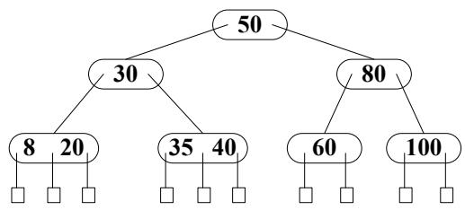
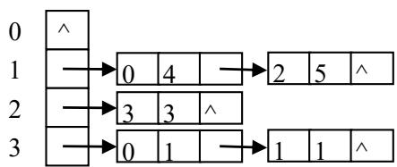
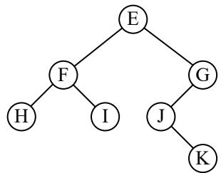
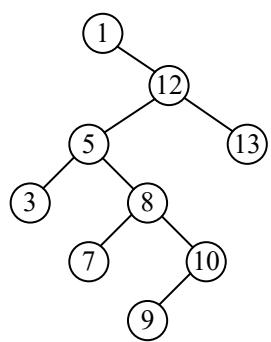
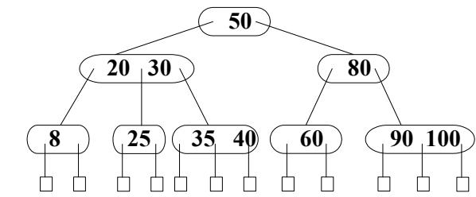
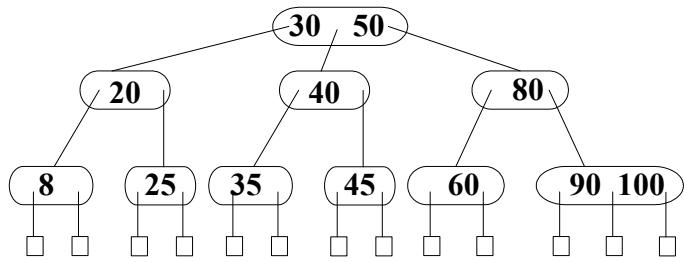
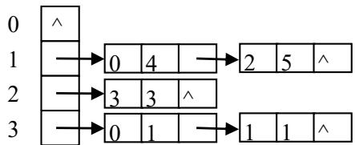

# 数据结构A复习要点及样题（南邮）

原件经识别和整理；“参考解答”是我们补的。

## 第1章 基础知识

算法与数据结构（数据结构概念、逻辑结构、数据存储结构示等）

数据抽象和抽象数据类型（数据结构规范、实现）

算法分析的基本方法（时间复杂性、空间复杂性）

## 第2章 线性表

线性表的顺序和链接表示

理解在顺序表、单链表上实现线性表运算，能设计相应算法程序

顺序和链接表示的优缺点比较

## 第3章 堆栈和队列

了解栈和队列的概念、特点

理解顺序栈和循环队列运算的实现

中缀表达式与后缀表达式的转换

后缀表达式计算

## 第4章 数组和字符串

一般数组存储方法

三元组存储稀疏矩阵的方法

三元组表示的快速矩阵转置方法

字符串的概念、KMP算法及其改进

## 第5章 树

二叉树的定义、性质及二叉链表

理解二叉树的遍历算法（遍历结果、算法设计），能设计相应算法程序

堆、堆的建立和调整

森林与二叉树的相互转换

哈夫曼树构造、哈夫曼编码、WPL计算

## 第6章 集合与搜索

理解有序表的顺序搜索算法

理解对半搜索算法

平均搜索长度的计算

## 第7章 搜索树

理解二叉搜索树的定义、性质和插入、删除算法

二叉平衡树的定义及插入算法

B-树的定义和插入、删除方法

## 第8章 散列表

掌握散列函数的相关概念

散列函数

解决冲突的开地址法（线性探查法，二次探查法、双散列法）

## 第9章 图

图的基本概念和存储结构

理解图的算法（结果）：遍历、拓扑排序、最小代价生成树、关键路径、最短路径

## 第10章 内排序

三种简单排序算法、快速排序和两路合并排序算法、过程、结果

排序算法的时间复杂度（最好、最差，平均）、稳定性

## 第11章 文件

文件的基本概念

初始游程的生成及竞赛树

# 考试样题

## 填空题

### 填空 1

写出表达式 a*b+c/d 的后缀形式。

答案：a b * c d / +

知识点：[利用栈计算后缀表达式的值](../../../topics/数据结构/后缀表达式求值.md)、[中缀表达式转换为后缀表达式（栈内优先级isp与栈外优先级icp）](../../../topics/数据结构/中缀转后缀表达式.md)、[堆栈的抽象数据类型（ADT）及顺序表示（进栈、出栈）](../../../topics/数据结构/栈的ADT与顺序表示.md)

### 填空 2

已知一无向图 G=(V,E)，其中 V={a,b,c,d,e}，E={(a,b), (a,d), (a,c), (d,c), (b,e)}，现用某一种遍历方法从顶点 a 开始遍历图，得到的序列为 abecd，则采用的是\_\_遍历方法。

答案：深度优先

知识点：[图的深度优先遍历（DFS）递归算法](../../../topics/数据结构/深度优先遍历DFS.md)、[图的宽度优先遍历（BFS）算法及特点](../../../topics/数据结构/广度优先遍历BFS.md)、[图的定义与术语（有向图、无向图、连通分量、强连通分量、DAG图等）](../../../topics/数据结构/图的基本概念.md)

### 填空 3

在顺序表长度为 n 中，平均在表中插入一个元素需要移动元素的个数可用计算公式为\_\_。

答案：$E_i=\sum_{i=-1}^{n-1}\frac{1}{n+1}(n-i-1)=\frac{n}{2}$

知识点：[顺序表插入与删除操作的元素移动次数及时间复杂度分析](../../../topics/数据结构/顺序表性能分析.md)

### 填空 4

一个表长为 n 的线性表，其排序时间最快为\_\_。

答案：O(n)

## 选择题

知识点：[各种内部排序算法的时间复杂度、空间复杂度与稳定性综合比较](../../../topics/数据结构/排序算法性能比较.md)、[内排序的基本概念与排序算法的稳定性](../../../topics/数据结构/排序基本概念.md)

### 选择 1

具有 n 个顶点的有向完全图中，边的总数为（ ）条。

- A. n(n+1)
- B. n(n-1)
- C. n(n-1)/2
- D. n(n+1)/2

答案：B

知识点：[图的定义与术语（有向图、无向图、连通分量、强连通分量、DAG图等）](../../../topics/数据结构/图的基本概念.md)

### 选择 2

设一个栈输入序列是 1、2、3、4、5，则下列序列中不可能是栈的输出序列是（ ）。

- A. 32541
- B. 15432
- C. 14523
- D. 23145

答案：C。只能是 14532

知识点：[堆栈的抽象数据类型（ADT）及顺序表示（进栈、出栈）](../../../topics/数据结构/栈的ADT与顺序表示.md)

### 选择 3

二叉树的前序遍历为 EFHIGJK，中序遍历序列为 HFIEJKG。该二叉树根结点的右子树的根是（ ）。

- A. E
- B. F
- C. G
- D. H

答案：C

知识点：[二叉树的先序、中序、后序遍历（递归算法与非递归算法）及层次遍历](../../../topics/数据结构/二叉树的遍历.md)、[由遍历序列（如先序和中序）确定唯一二叉树](../../../topics/数据结构/遍历序列还原二叉树.md)

### 选择 4

对有 14 个元素的有序表 A[1]-A[14] 作对半查找，查找元素 A[4] 时的被比较元素依次为（ ）。

- A. A[1],A[2],A[3],A[4]
- B. A[7],A[3],A[5],A[4]
- C. A[1],A[2],A[7],A[4]
- D. A[7],A[5],A[3],A[4]

答案：B

第 1 次：范围 [1, 14]，中间元素是 (1+14)/2 = 7

第 2 次：范围 [1, 6]，中间元素是 (1+6)/2 = 3

第 3 次：范围 [4, 6]，中间元素是 (4+6)/2 = 5

第 4 次：范围 [4, 4]，中间元素是 (4+4)/2 = 4

知识点：[二分搜索（对半搜索）的递归与非递归算法实现](../../../topics/数据结构/二分搜索.md)、[二分搜索的二叉判定树构造及搜索性能分析](../../../topics/数据结构/二叉判定树.md)、[算法的定义、描述及五个特性](../../../topics/数据结构/算法及其特性.md)

### 选择 5

设有一个长度为 100 且已排好序的表，用对半搜索进行查找，若搜索不成功，则至少要比较\_\_次。（ ）

- A. 9
- B. 8
- C. 7
- D. 6

答案：D

长度为 100 的有序表进行对半查找，查找失败时比较 $\lfloor\log_2 100\rfloor$ 次或者 $\lfloor\log_2 100\rfloor+1$ 次，即 6 或 7 次。

## 简答题

知识点：[二分搜索（对半搜索）的递归与非递归算法实现](../../../topics/数据结构/二分搜索.md)、[二分搜索的二叉判定树构造及搜索性能分析](../../../topics/数据结构/二叉判定树.md)

### 简答 1

用一维数组存放的一棵完全二叉树如图所示：


| A | B | C | D | E | F |
|---|---|---|---|---|---|
|   |   |   |   |   |   |

写出前序、中序、后序遍历该二叉树时访问结点的顺序。

答案：


前序遍历序列：ABDECF

中序遍历序列：DBEAFC

后序遍历序列：DEBFCA

知识点：[二叉树的定义及五个重要性质（各层最多结点数、高度与结点数关系等）](../../../topics/数据结构/二叉树的性质.md)、[二叉树的先序、中序、后序遍历（递归算法与非递归算法）及层次遍历](../../../topics/数据结构/二叉树的遍历.md)、[二叉树的顺序存储与链接存储（二叉链表）](../../../topics/数据结构/二叉树的存储表示.md)

### 简答 2

图的邻接表表示一个给定的无向图。

（1）给出从顶点 v1 开始，用深度优先搜索法进行遍历时的顶点序列；

（2）给出从顶点 v1 开始，用广度优先搜索法进行遍历时的顶点序列。

$$
\mathrm{v1} \longrightarrow \boxed{2} \boxed{-} \longrightarrow \boxed{3} \stackrel{\wedge}{}
$$

$$
\mathrm{v2} \longrightarrow \boxed{1} \boxed{} \longrightarrow \boxed{4} \boxed{\wedge}
$$

$$
\mathrm{v3} \longrightarrow \boxed{1} \boxed{} \longrightarrow \boxed{4} \boxed{} \longrightarrow \boxed{5} \boxed{\wedge}
$$

$$
\mathrm{v4} \longrightarrow \boxed{2} \boxed{} \longrightarrow \boxed{3} \boxed{} \longrightarrow \boxed{6} \boxed{\wedge}
$$

$$
\mathrm{v5} \longrightarrow \boxed{3} \boxed{} \longrightarrow \boxed{6} \boxed{\wedge}
$$

$$
\mathrm{v6} \longrightarrow \boxed{4} \boxed{} \longrightarrow \boxed{5} \boxed{\wedge}
$$

答案：

深度优先遍历序列：v1, v2, v4, v3, v5, v6

广度优先遍历序列：v1, v2, v3, v4, v5, v6

## 解答题

知识点：[图的邻接表存储表示及边的搜索、插入、删除实现](../../../topics/数据结构/图的邻接表.md)、[图的深度优先遍历（DFS）递归算法](../../../topics/数据结构/深度优先遍历DFS.md)、[图的宽度优先遍历（BFS）算法及特点](../../../topics/数据结构/广度优先遍历BFS.md)

### 解答 1

设数据集合 d={1，12，5，8，3，10，7，13，9}，试完成下列各题：

（1）依次取 d 中各数据，构造一棵二叉搜索树 bt。

（2）画出在二叉树 bt 中删除 12 后的树结构。

答案：

（1）


（2）删除 12 后


知识点：[二叉搜索树（BST）的定义、查找、插入与删除算法](../../../topics/数据结构/二叉搜索树BST.md)、[二叉树的顺序存储与链接存储（二叉链表）](../../../topics/数据结构/二叉树的存储表示.md)、[由遍历序列（如先序和中序）确定唯一二叉树](../../../topics/数据结构/遍历序列还原二叉树.md)

### 解答 2

对图的 3 阶 B-树，依次执行下列操作，画出各步操作的结果。

（1）插入 90；（2）插入 25；（3）插入 45；（4）删除 60；



答案：

## 程序阅读题

知识点：[B-树（多路平衡搜索树）的定义、插入与删除操作](../../../topics/数据结构/B减树.md)

### 程序阅读 1

图采用邻接表存储表示，边结点的结构如图所示，下面的程序是邻接表类 LinkedGraph 的某个成员函数。

| adjvex | weight | nextarc |
|---|---|---|
|        |        |         |



（1）请说明该成员函数的作用是什么？

（2）若有一个邻接表如图 8 所示，请给出执行该函数的结果？

## 算法题

知识点：[图的定义与术语（有向图、无向图、连通分量、强连通分量、DAG图等）](../../../topics/数据结构/图的基本概念.md)、[图的邻接表存储表示及边的搜索、插入、删除实现](../../../topics/数据结构/图的邻接表.md)

### 算法 1

在以二叉链表表示的二叉树类 BinaryTree 中增加一个成员函数 LeavesInTree( )。该模板函数为递归函数，其功能是求二叉树类 BinaryTree 的对象中叶子结点的数目。实现该递归函数。函数原型如下：

```cpp
template <class T>
int BinaryTree<T>::LeavesInTree( )
```

知识点：[二叉树的先序、中序、后序遍历（递归算法与非递归算法）及层次遍历](../../../topics/数据结构/二叉树的遍历.md)、[二叉树的顺序存储与链接存储（二叉链表）](../../../topics/数据结构/二叉树的存储表示.md)、[树的定义、基本术语（双亲、后裔、度、层次、有序树、无序树、森林）](../../../topics/数据结构/树的基本术语.md)

### 算法 2

在不带表头结点的单链表中删除一个关键字值为 x 的元素。函数原型如下：

```cpp
template <class T>
bool SingleList<T>::Delete(T x)
```

# 考试样题答案

## 填空题

知识点：[单链表的结点结构及初始化、查找、插入、删除、撤销运算](../../../topics/数据结构/单链表结构与运算.md)、[顺序表插入与删除操作的元素移动次数及时间复杂度分析](../../../topics/数据结构/顺序表性能分析.md)、[数据结构的基本概念（逻辑结构、存储结构、运算）](../../../topics/数据结构/数据结构基本概念.md)

### 填空 1

写出表达式 a*b+c/d 的后缀形式

【答案】a b * c d / +

知识点：[利用栈计算后缀表达式的值](../../../topics/数据结构/后缀表达式求值.md)、[中缀表达式转换为后缀表达式（栈内优先级isp与栈外优先级icp）](../../../topics/数据结构/中缀转后缀表达式.md)、[堆栈的抽象数据类型（ADT）及顺序表示（进栈、出栈）](../../../topics/数据结构/栈的ADT与顺序表示.md)

### 填空 2

已知一无向图 G=(V,E)，其中 V={a,b,c,d,e}，E={(a,b), (a,d), (a,c), (d,c), (b,e)}，现用某一种遍历方法从顶点 a 开始遍历图，得到的序列为 abecd，则采用的是\_\_遍历方法。

【答案】深度优先

知识点：[图的深度优先遍历（DFS）递归算法](../../../topics/数据结构/深度优先遍历DFS.md)、[图的宽度优先遍历（BFS）算法及特点](../../../topics/数据结构/广度优先遍历BFS.md)、[图的定义与术语（有向图、无向图、连通分量、强连通分量、DAG图等）](../../../topics/数据结构/图的基本概念.md)

### 填空 3

在顺序表长度为 n 中，平均在表中插入一个元素需要移动元素的个数可用计算公式为\_\_。

【答案】$E_i=\sum_{i=-1}^{n-1}\frac{1}{n+1}(n-i-1)=\frac{n}{2}$

知识点：[顺序表插入与删除操作的元素移动次数及时间复杂度分析](../../../topics/数据结构/顺序表性能分析.md)

### 填空 4

一个表长为 n 的线性表，其排序时间最快为 C

【答案】O(n)

## 选择题

知识点：[各种内部排序算法的时间复杂度、空间复杂度与稳定性综合比较](../../../topics/数据结构/排序算法性能比较.md)、[内排序的基本概念与排序算法的稳定性](../../../topics/数据结构/排序基本概念.md)

### 选择 1

具有 n 个顶点的有向完全图中，边的总数为（ ）条。A）n（n+1） B）n（n-1）C）n（n-1）/2 D）n（n+1）/2

【答案】B

知识点：[图的定义与术语（有向图、无向图、连通分量、强连通分量、DAG图等）](../../../topics/数据结构/图的基本概念.md)

### 选择 2

设一个栈输入序列是 1、2、3、4、5，则下列序列中不可能是栈的输出序列是（ ）。A）32541 B）15432C）14523 D）23145

【答案】C。只能是 14532

知识点：[堆栈的抽象数据类型（ADT）及顺序表示（进栈、出栈）](../../../topics/数据结构/栈的ADT与顺序表示.md)

### 选择 3

二叉树的前序遍历为 EFHIGJK，中序遍历序列为 HFIEJKG。该二叉树根结点的右子树的根是（ ）A) E B) F C) G D) H

【答案】C



知识点：[二叉树的先序、中序、后序遍历（递归算法与非递归算法）及层次遍历](../../../topics/数据结构/二叉树的遍历.md)、[由遍历序列（如先序和中序）确定唯一二叉树](../../../topics/数据结构/遍历序列还原二叉树.md)

### 选择 4

对有 14 个元素的有序表 A[1]-A[14] 作对半查找，查找元素 A[4] 时的被比较元素依次为（ ）A. A[1],A[2],A[3],A[4] B. A[7],A[3],A[5],A[4] C. A[1],A[2],A[7],A[4] D. A[7],A[5],A[3],A[4]

【答案】B

第 1 次：范围 [1, 14]，中间元素是 (1+14)/2 = 7

第 2 次：范围 [1, 6]，中间元素是 (1+6)/2 = 3

第 3 次：范围 [4, 6]，中间元素是 (4+6)/2 = 5

第 4 次：范围 [4, 4]，中间元素是 (4+4)/2 = 4

知识点：[二分搜索（对半搜索）的递归与非递归算法实现](../../../topics/数据结构/二分搜索.md)、[二分搜索的二叉判定树构造及搜索性能分析](../../../topics/数据结构/二叉判定树.md)、[算法的定义、描述及五个特性](../../../topics/数据结构/算法及其特性.md)

### 选择 5

设有一个长度为 100 且已排好序的表，用对半搜索进行查找，若搜索不成功，则至少要比较\_\_次。（A．9 B．8 C．7 D．6

【答案】D

长度为 100 的有序表进行对半查找，查找失败时比较 $\lfloor\log_2 100\rfloor$ 次或者 $\lfloor\log_2 100\rfloor+1$ 次，即 6 或 7 次。

## 简答题

知识点：[二分搜索（对半搜索）的递归与非递归算法实现](../../../topics/数据结构/二分搜索.md)、[二分搜索的二叉判定树构造及搜索性能分析](../../../topics/数据结构/二叉判定树.md)

### 简答 1

用一维数组存放的一棵完全二叉树如图所示：


| A | B | C | D | E | F |
|---|---|---|---|---|---|
|   |   |   |   |   |   |

写出前序、中序、后序遍历该二叉树时访问结点的顺序。

【答案】


前序遍历序列：ABDECF

中序遍历序列：DBEAFC

后序遍历序列：DEBFCA

知识点：[二叉树的定义及五个重要性质（各层最多结点数、高度与结点数关系等）](../../../topics/数据结构/二叉树的性质.md)、[二叉树的先序、中序、后序遍历（递归算法与非递归算法）及层次遍历](../../../topics/数据结构/二叉树的遍历.md)、[二叉树的顺序存储与链接存储（二叉链表）](../../../topics/数据结构/二叉树的存储表示.md)

### 简答 2

图的邻接表表示一个给定的无向图。

（1）给出从顶点 v1 开始，用深度优先搜索法进行遍历时的顶点序列；

（2）给出从顶点 v1 开始，用广度优先搜索法进行遍历时的顶点序列。

$$
\mathrm{v1} \longrightarrow \boxed{2} \boxed{-} \longrightarrow \boxed{3} \stackrel{\wedge}{}
$$

$$
\mathrm{v2} \longrightarrow \boxed{1} \boxed{} \longrightarrow \boxed{4} \boxed{\wedge}
$$

$$
\mathrm{v3} \longrightarrow \boxed{1} \boxed{} \longrightarrow \boxed{4} \boxed{} \longrightarrow \boxed{5} \boxed{\wedge}
$$

$$
\mathrm{v4} \longrightarrow \boxed{2} \boxed{} \longrightarrow \boxed{3} \boxed{} \longrightarrow \boxed{6} \boxed{\wedge}
$$

$$
\mathrm{v5} \longrightarrow \boxed{3} \boxed{} \longrightarrow \boxed{6} \boxed{\wedge}
$$

$$
\mathrm{v6} \longrightarrow \boxed{4} \boxed{-} \longrightarrow \boxed{5} \boxed{\wedge}
$$

【答案】

深度优先遍历序列：v1, v2, v4, v3, v5, v6

广度优先遍历序列：v1, v2, v3, v4, v5, v6

## 解答题

知识点：[图的邻接表存储表示及边的搜索、插入、删除实现](../../../topics/数据结构/图的邻接表.md)、[图的深度优先遍历（DFS）递归算法](../../../topics/数据结构/深度优先遍历DFS.md)、[图的宽度优先遍历（BFS）算法及特点](../../../topics/数据结构/广度优先遍历BFS.md)

### 解答 1

设数据集合 d={1，12，5，8，3，10，7，13，9}，试完成下列各题：

（1）依次取 d 中各数据，构造一棵二叉搜索树 bt。

（2）画出在二叉树 bt 中删除 12 后的树结构。

【答案】

（1）



（2）删除 12 后


知识点：[二叉搜索树（BST）的定义、查找、插入与删除算法](../../../topics/数据结构/二叉搜索树BST.md)、[二叉树的顺序存储与链接存储（二叉链表）](../../../topics/数据结构/二叉树的存储表示.md)、[由遍历序列（如先序和中序）确定唯一二叉树](../../../topics/数据结构/遍历序列还原二叉树.md)

### 解答 2

对图的 3 阶 B-树，依次执行下列操作，画出各步操作的结果。

（1）插入 90；（2）插入 25；（3）插入 45；（4）删除 60；


【答案】

知识点：[B-树（多路平衡搜索树）的定义、插入与删除操作](../../../topics/数据结构/B减树.md)

### 插入 90


知识点：[二叉平衡树（AVL树）的定义及四种旋转调整方法（LL、RR、LR、RL）](../../../topics/数据结构/平衡二叉树AVL.md)、[二叉搜索树（BST）的定义、查找、插入与删除算法](../../../topics/数据结构/二叉搜索树BST.md)

### 插入 25





知识点：[B-树（多路平衡搜索树）的定义、插入与删除操作](../../../topics/数据结构/B减树.md)、[二叉搜索树（BST）的定义、查找、插入与删除算法](../../../topics/数据结构/二叉搜索树BST.md)、[内排序的基本概念与排序算法的稳定性](../../../topics/数据结构/排序基本概念.md)

### 删除 60


知识点：[二叉搜索树（BST）的定义、查找、插入与删除算法](../../../topics/数据结构/二叉搜索树BST.md)

### 程序阅读题

图采用邻接表存储表示，边结点的结构如图所示，下面的程序是邻接表类 LinkedGraph 的某个成员函数。

| adjvex | weight | nextarc |
| ------ | ------ | ------- |



⑴ 请说明该成员函数的作用是什么？

⑵ 若有一个邻接表如图 8 所示，请给出执行该函数的结果？

答案：

(1) 打印图中所有顶点的入度

(2) 结果

7

知识点：[图的邻接表存储表示及边的搜索、插入、删除实现](../../../topics/数据结构/图的邻接表.md)、[图的深度优先遍历（DFS）递归算法](../../../topics/数据结构/深度优先遍历DFS.md)

### 算法题

在以二叉链表表示的二叉树类 BinaryTree 中增加一个成员函数 LeavesInTree( )。该模板函数为递归函数，其功能是求二叉树类 BinaryTree 的对象中叶子结点的数目。实现该递归函数。函数原型如下：

8

知识点：[二叉树的先序、中序、后序遍历（递归算法与非递归算法）及层次遍历](../../../topics/数据结构/二叉树的遍历.md)、[二叉树的顺序存储与链接存储（二叉链表）](../../../topics/数据结构/二叉树的存储表示.md)
