# 《数据结构A》第3章 堆栈和队列（课件）

原件的每一页，下面附识别出的文字。

### 数据结构

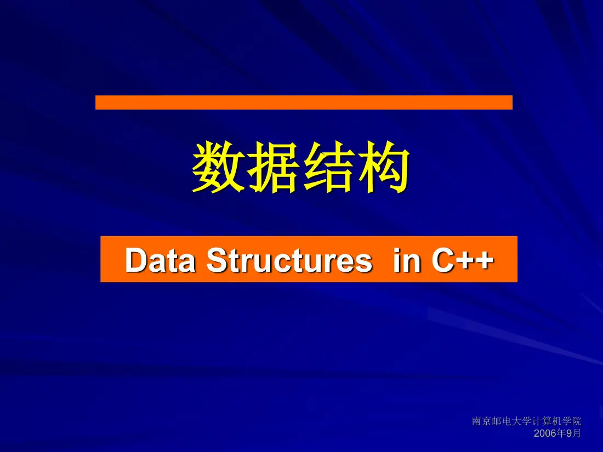

原文：

数据结构

Data Structures in C++

南京邮电大学计算机学院
2006年9月

### 第3章 堆栈和队列

原文：

第3章 堆栈和队列

南京邮电大学计算机学院
2006年9月

### 3.1 堆栈

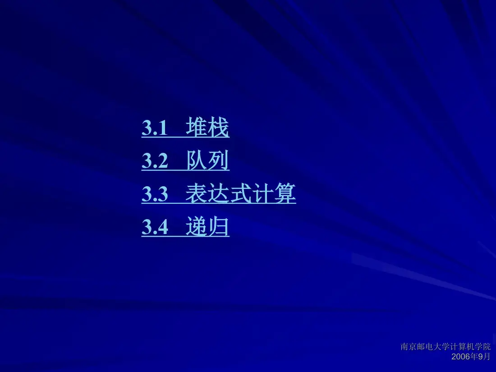

原文：

3.1 堆栈
3.2 队列
3.3 表达式计算
3.4 递归

南京邮电大学计算机学院
2006年9月

### 3.1 堆栈

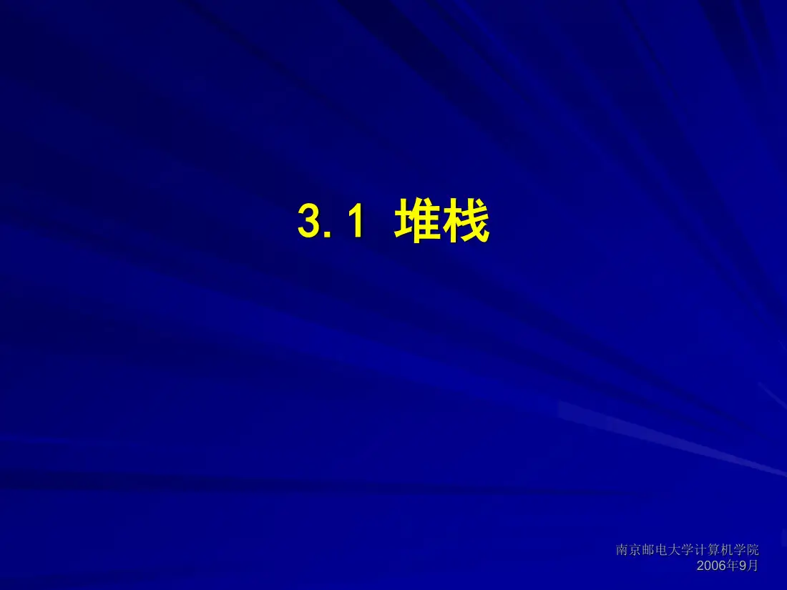

原文：

3.1 堆栈

南京邮电大学计算机学院
2006年9月

### 3.1.1 堆栈ADT

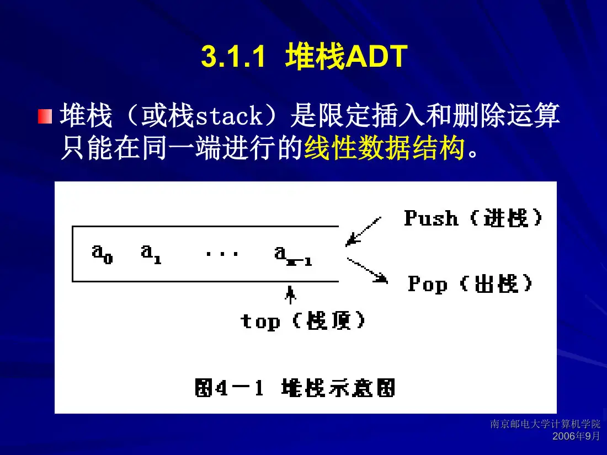

原文：

3.1.1 堆栈ADT

■ 堆栈（或栈stack）是限定插入和删除运算只能在同一端进行的线性数据结构。

南京邮电大学计算机学院

2006年9月

### 允许插入和删除元素的一端称为栈顶，另一端称为栈底。

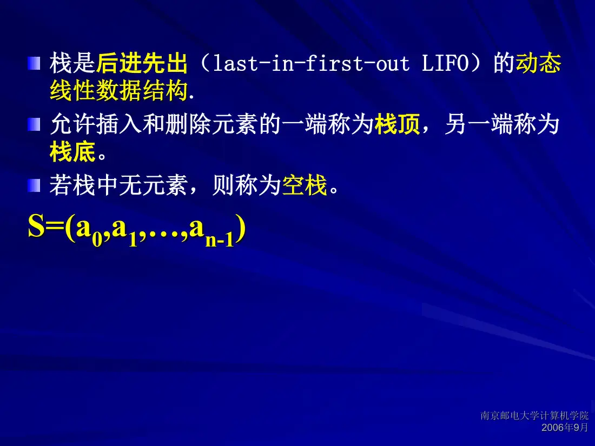

原文：

■ 栈是后进先出（last-in-first-out LIFO）的动态线性数据结构.

允许插入和删除元素的一端称为栈顶，另一端称为栈底。

若栈中无元素，则称为空栈。

$$
\mathrm{S} = \left(\mathrm{a} _ {0}, \mathrm{a} _ {1}, \dots , \mathrm{a} _ {\mathrm{n-1}}\right)
$$

南京邮电大学计算机学院
2006年9月

### 允许插入和删除元素的一端称为栈顶，另一端称为栈底。

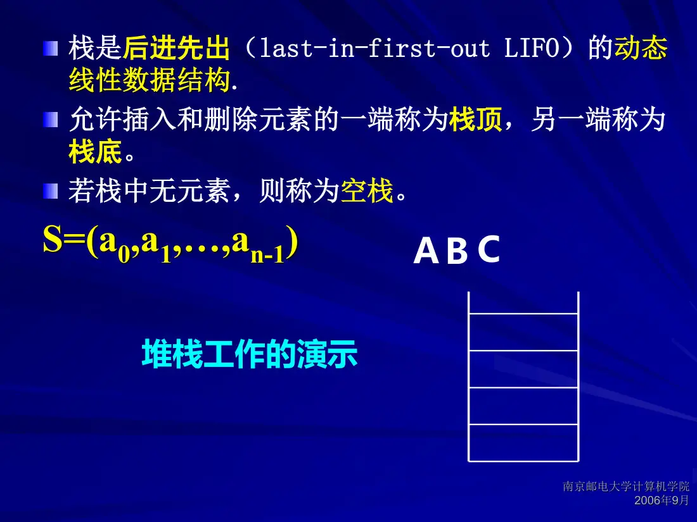

原文：

■ 栈是后进先出（last-in-first-out LIFO）的动态线性数据结构.

允许插入和删除元素的一端称为栈顶，另一端称为栈底。

若栈中无元素，则称为空栈。

$$
\mathrm{S} = \left(\mathrm{a} _ {0}, \mathrm{a} _ {1}, \dots , \mathrm{a} _ {\mathrm{n-1}}\right)
$$

堆栈工作的演示

南京邮电大学计算机学院
2006年9月

### 允许插入和删除元素的一端称为栈顶，另一端称为栈底。

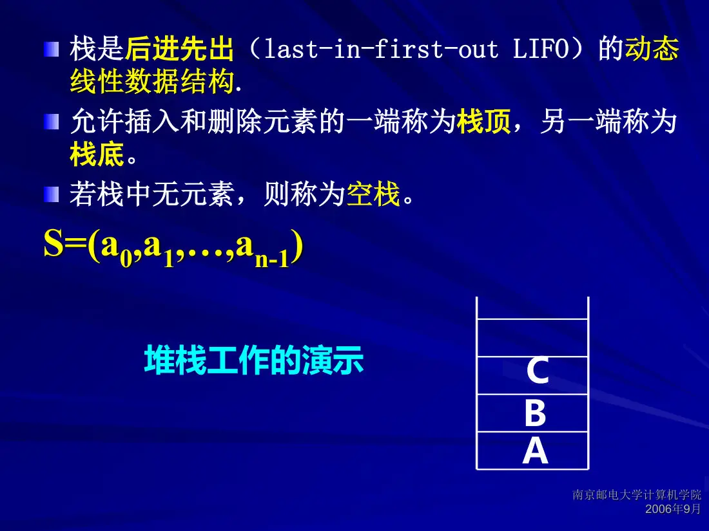

原文：

■ 栈是后进先出（last-in-first-out LIFO）的动态线性数据结构.

允许插入和删除元素的一端称为栈顶，另一端称为栈底。

若栈中无元素，则称为空栈。

$$
\mathrm{S} = \left(\mathrm{a} _ {0}, \mathrm{a} _ {1}, \dots , \mathrm{a} _ {\mathrm{n-1}}\right)
$$

堆栈工作的演示

南京邮电大学计算机学院
2006年9月

### ADT Stack {

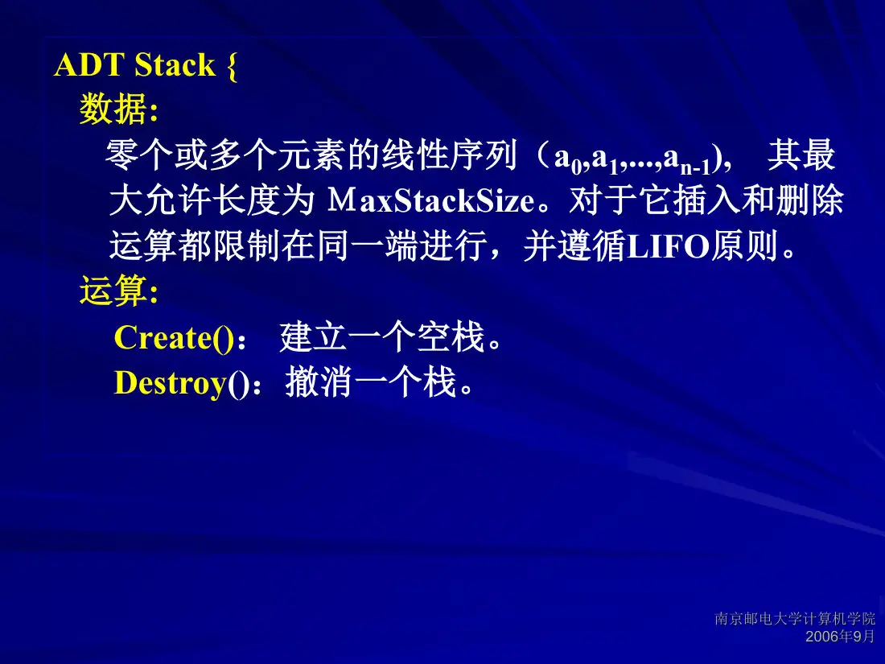

原文：

ADT Stack {

数据:

零个或多个元素的线性序列（ $a_0, a_1, \ldots, a_{n-1}$ ），其最大允许长度为 MaxStackSize。对于它插入和删除运算都限制在同一端进行，并遵循LIFO原则。

Create(): 建立一个空栈。

Destroy(): 撤消一个栈。

南京邮电大学计算机学院

2006年9月

### IsEmpty(): 若栈空，则返回true; 否则返回 false。

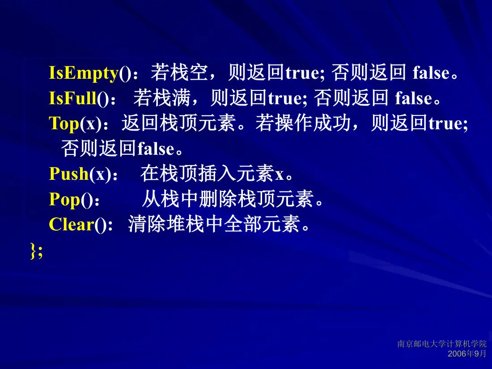

原文：

IsEmpty(): 若栈空，则返回true; 否则返回 false。
IsFull(): 若栈满，则返回true; 否则返回 false。
Top(x): 返回栈顶元素。若操作成功，则返回true; 否则返回false。

Push(x): 在栈顶插入元素x。

Pop(): 从栈中删除栈顶元素。

Clear(): 清除堆栈中全部元素。

南京邮电大学计算机学院

2006年9月

### 程序3-1 栈的C++类

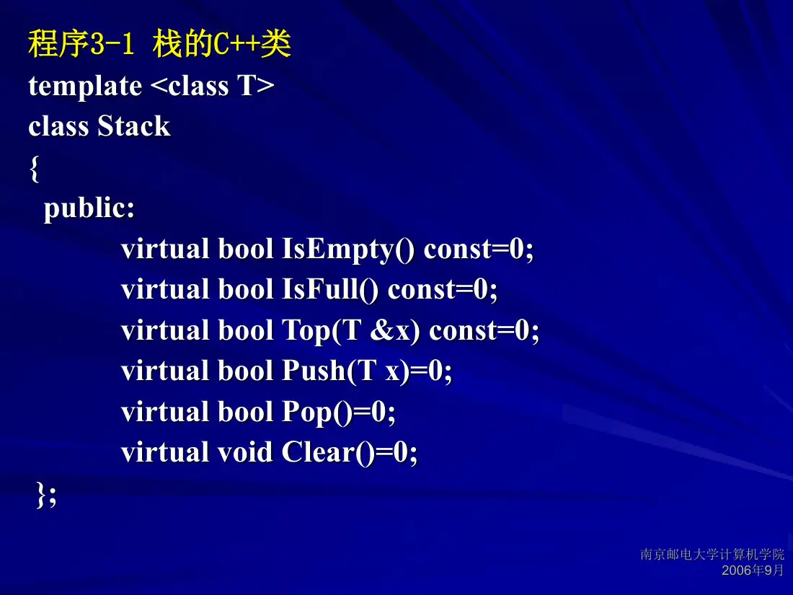

原文：

程序3-1 栈的C++类
template <class T>
class Stack

public:

virtual bool IsEmpty() const=0;
virtual bool IsFull() const=0;
virtual bool Top(T &x) const=0;
virtual bool Push(T x)=0;
virtual bool Pop()=0;
virtual void Clear()=0;

南京邮电大学计算机学院
2006年9月

### 3.1.2 堆栈的顺序表示

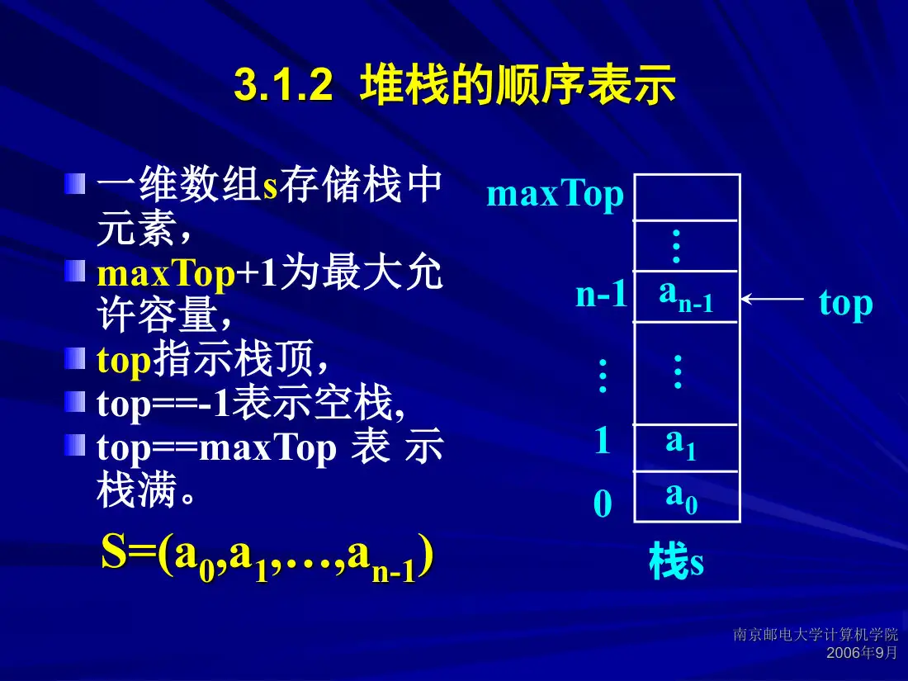

原文：

3.1.2 堆栈的顺序表示

一维数组s存储栈中元素，

maxTop+1为最大允许容量，

top指示栈顶，top==-1表示空栈,top==maxTop 表示栈满。

$$
\mathrm{S} = \left(\mathrm{a} _ {0}, \mathrm{a} _ {1}, \dots , \mathrm{a} _ {\mathrm{n-1}}\right)
$$

maxTop

top

栈s

南京邮电大学计算机学院

2006年9月

### template class SeqStack:public Stack

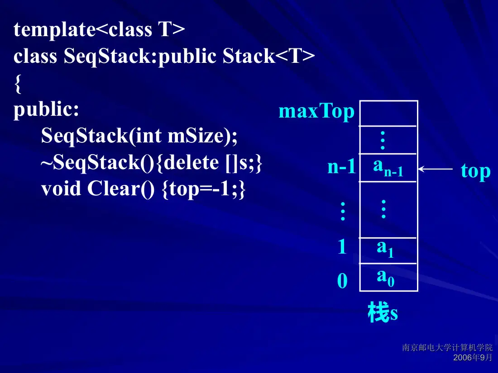

原文：

template<class T> class SeqStack:public Stack<T>

public:

SeqStack(int mSize);
\~SeqStack() {delete []s;}
void Clear() {top=-1;}

maxTop

栈s

南京邮电大学计算机学院

2006年9月

### bool IsEmpty()const{ return (top==-1); }

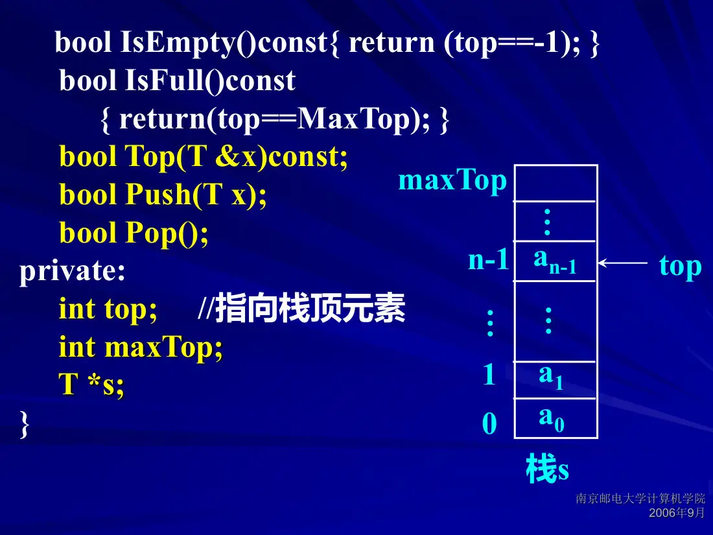

原文：

bool IsEmpty()const{ return (top==-1); }
bool IsFull()const

bool Top(T &x)const;

bool Push(T x);

maxTop

bool Pop();

private:

int top; //指向栈顶元素
int maxTop;

T \*s;

top

栈s

南京邮电大学计算机学院

2006年9月

### template  SeqStack::SeqStack(int mSize)

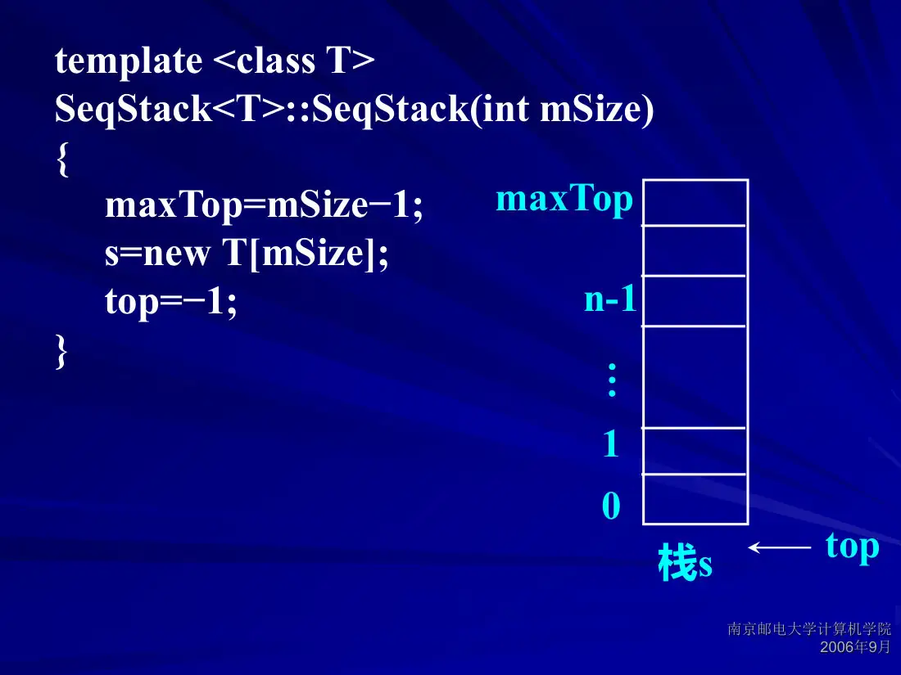

原文：

template <class T> SeqStack<T>::SeqStack(int mSize)

maxTop=mSize-1; s=new T[mSize]; top=-1;

南京邮电大学计算机学院

2006年9月

### template

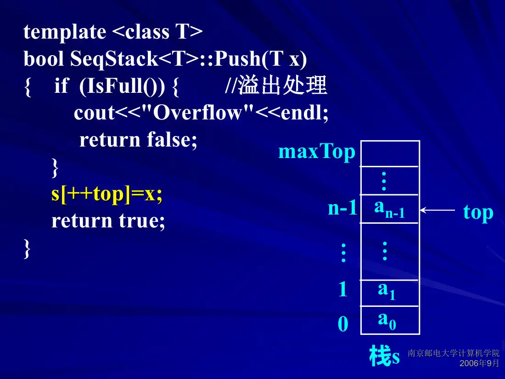

原文：

template <class T>
bool SeqStack<T>::Push(T x)
{ if (IsFull()) { // 溢出处理
    cout<<"Overflow"<<endl;
    return false;

s[++top]=x;

return true;

maxTop

top

栈s

南京邮电大学计算机学院
2006年9月

### template

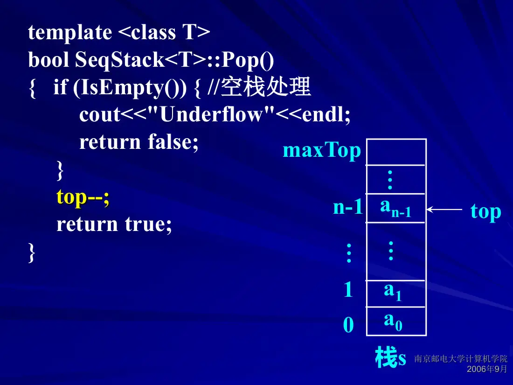

原文：

template <class T>
bool SeqStack<T>::Pop()
{ if (IsEmpty()) { //空栈处理
    cout<<"Underflow"<<endl;
    return false;

maxTop

top--;

return true;

top

栈s

南京邮电大学计算机学院

2006年9月

### return false;

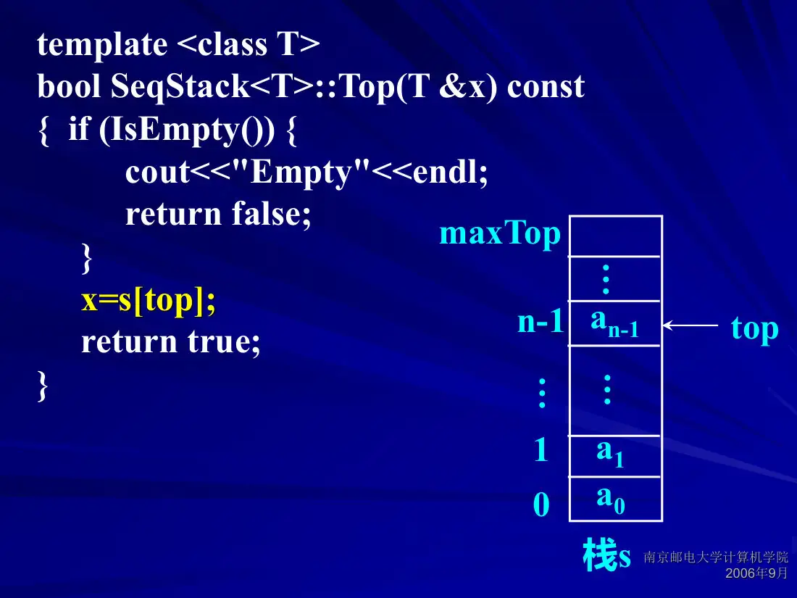

原文：

template <class T> bool SeqStack<T>::Top(T &x) const { if (IsEmpty()) { cout<<"Empty"<<endl;

return false;

x=s[top];

return true;

$$
\begin{array}{c c} \text {maxTop} & \\ & \vdots \\ n - 1 & a _ {n - 1} \\ \vdots & \vdots \\ 1 & a _ {1} \\ 0 & a _ {0} \end{array} \xleftarrow {\text {top}}
$$

栈s

南京邮电大学计算机学院

2006年9月

### 3.1.3 堆栈的链接表示

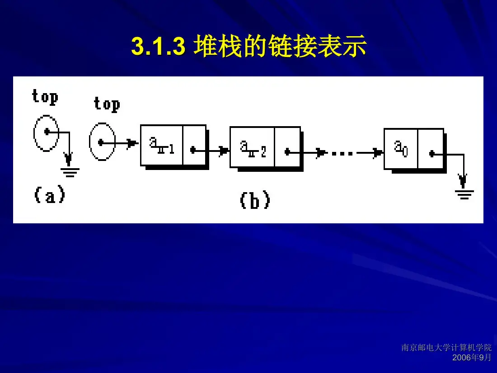

原文：

3.1.3 堆栈的链接表示

南京邮电大学计算机学院
2006年9月

### 3.2 队列

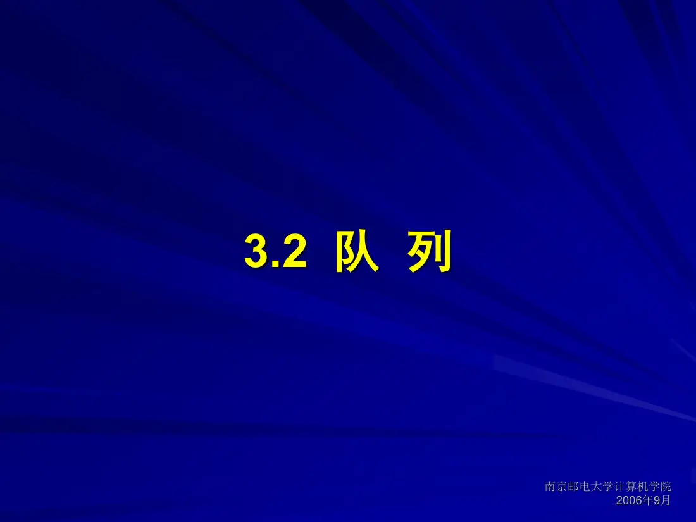

原文：

3.2 队列

南京邮电大学计算机学院
2006年9月

### 3.2.1 队列ADT

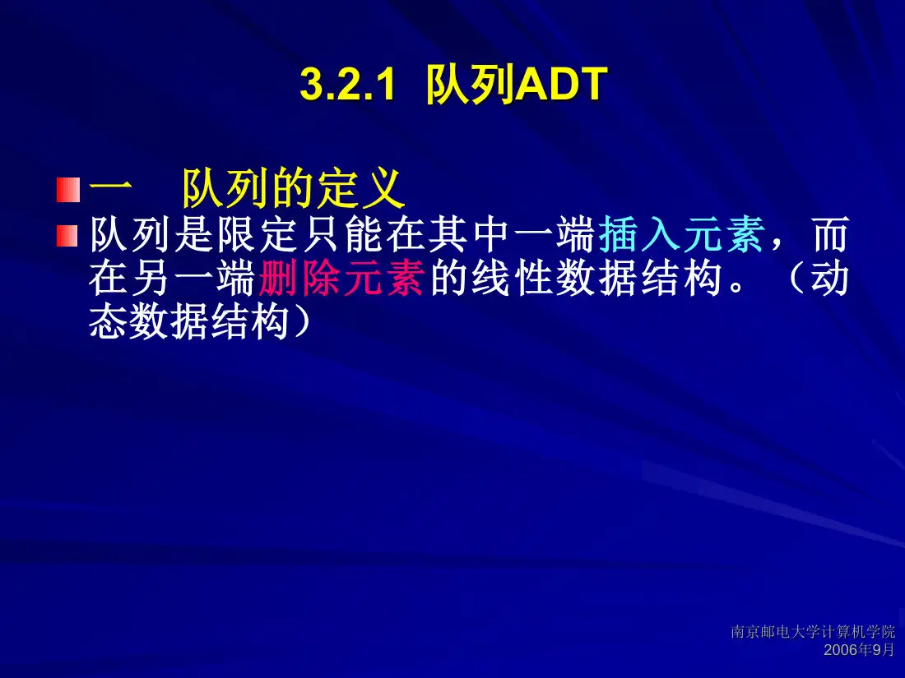

原文：

3.2.1 队列ADT

一 队列的定义

■ 队列是限定只能在其中一端插入元素，而在另一端删除元素的线性数据结构。（动态数据结构）

南京邮电大学计算机学院

2006年9月

### 允许插入元素的一端称队尾，允许删除元素的另一端称队头。

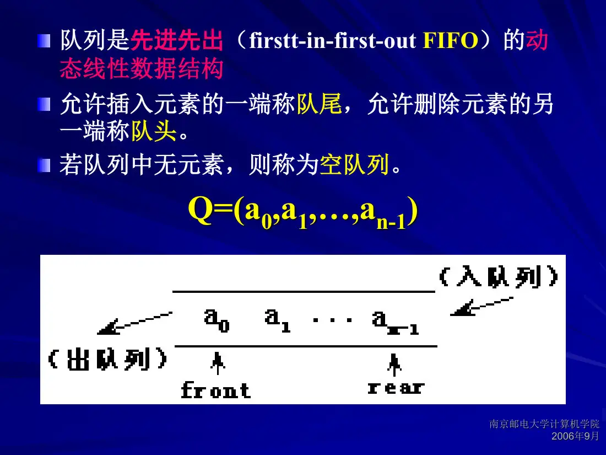

原文：

■ 队列是先进先出（firstt-in-first-out FIFO）的动态线性数据结构

允许插入元素的一端称队尾，允许删除元素的另一端称队头。

若队列中无元素，则称为空队列。

$$
Q = (a _ {0}, a _ {1}, \dots , a _ {n - 1})
$$

$$
\begin{array}{r l} & {\text {   (入队列)   }} \\ & {\text {   (出队列)   } \frac {a _ {0} \quad a _ {1} \quad \cdots \quad a _ {n - 1}}{\text {   front   }} \quad \text {   rear   }} \end{array}
$$

南京邮电大学计算机学院

2006年9月

### 队列工作的演示(入队)

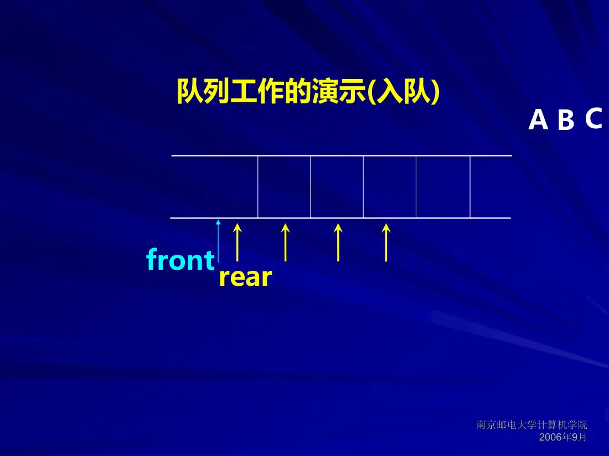

原文：

队列工作的演示(入队)

ABC

front
↑
↑
↑
↑
rear

南京邮电大学计算机学院
2006年9月

### 队列工作的演示(出队)

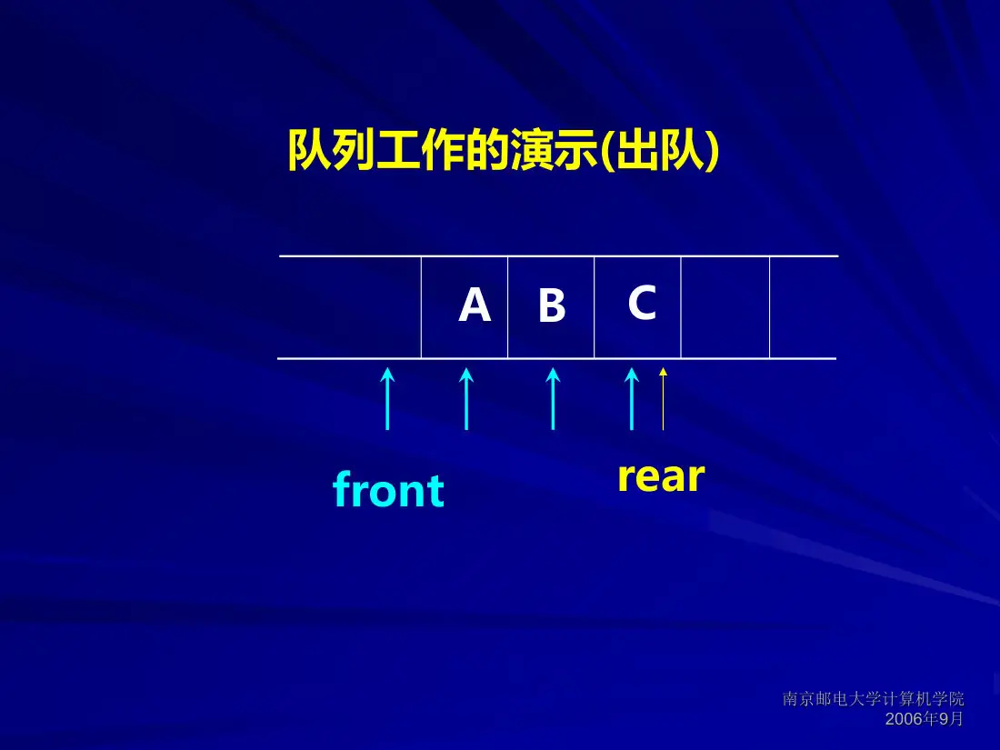

原文：

队列工作的演示(出队)

front

rear

南京邮电大学计算机学院
2006年9月

### 二 队列抽象数据类型ADT

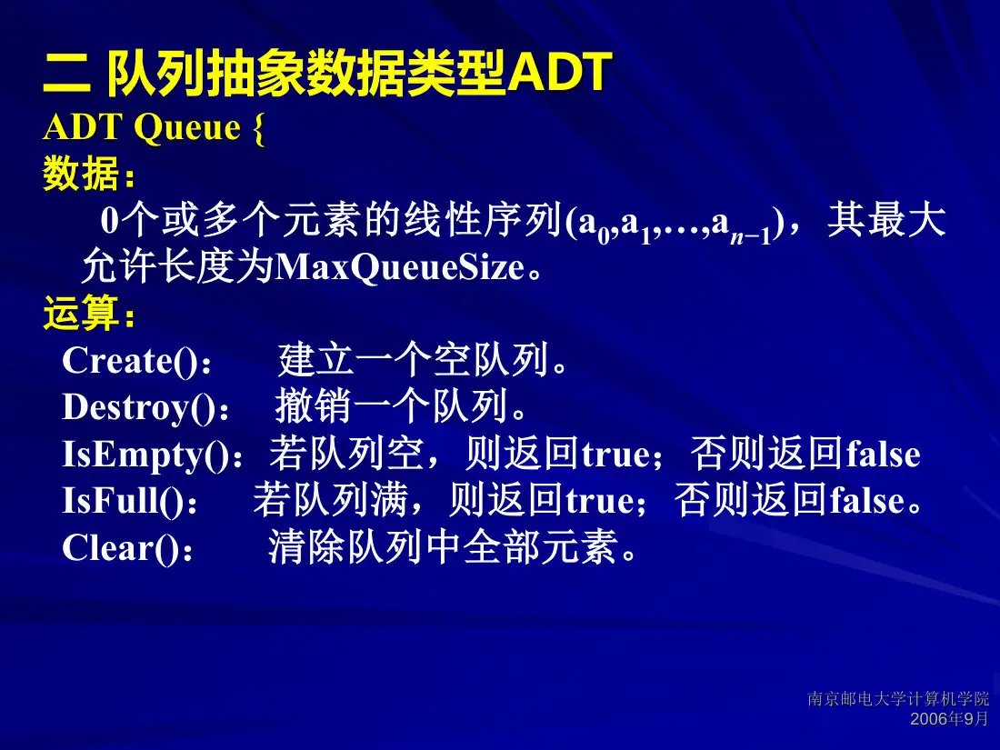

原文：

二 队列抽象数据类型ADT

ADT Queue {

数据：

0个或多个元素的线性序列 $(a_{0},a_{1},\ldots,a_{n-1})$ ，其最大允许长度为MaxQueueSize。

运算：

Create(): 建立一个空队列。

Destroy(): 撤销一个队列。

IsEmpty(): 若队列空，则返回true；否则返回false

IsFull(): 若队列满，则返回true；否则返回false。

Clear(): 清除队列中全部元素。

南京邮电大学计算机学院

2006年9月

### 南京邮电大学计算机学院

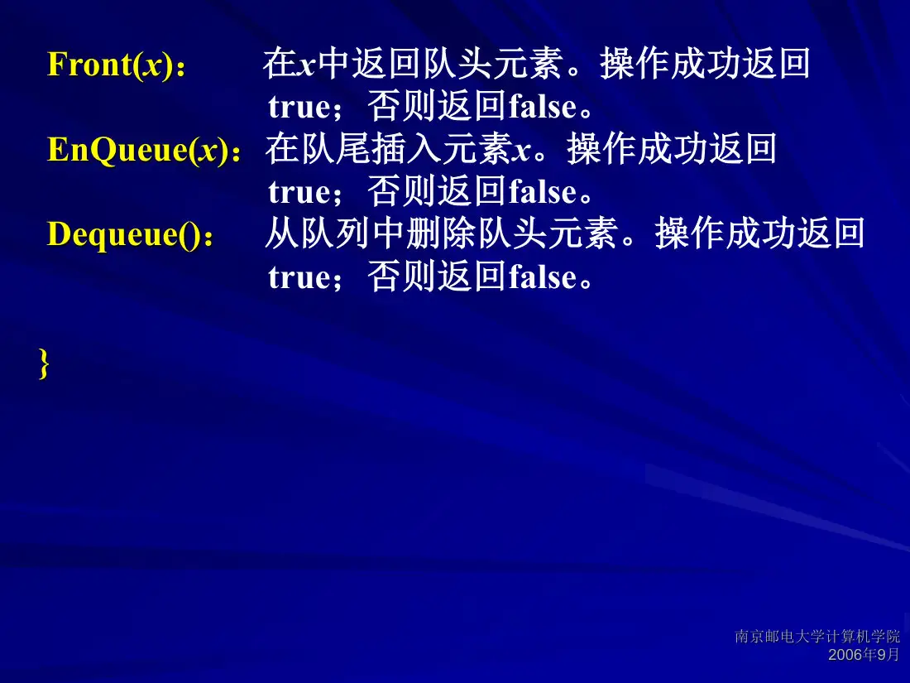

原文：

Front(x): 在x中返回队头元素。操作成功返回true；否则返回false。

EnQueue(x): 在队尾插入元素x。操作成功返回true；否则返回false。

Dequeue(): 从队列中删除队头元素。操作成功返回 true；否则返回false。

南京邮电大学计算机学院

2006年9月

### 三 队列的C++模板抽象类

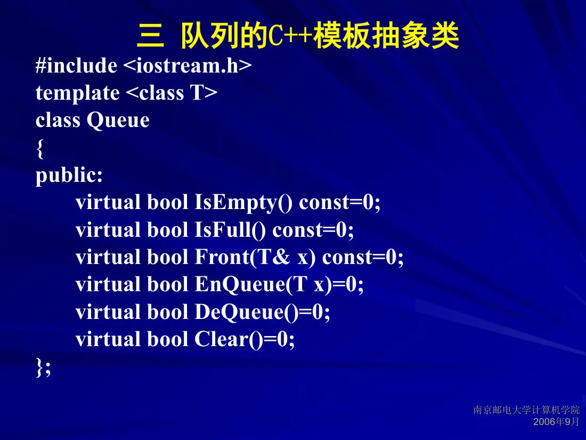

原文：

三 队列的C++模板抽象类

include <iostream.h>
template <class T>
class Queue

public:

virtual bool IsEmpty() const=0;
virtual bool IsFull() const=0;
virtual bool Front(T& x) const=0;
virtual bool EnQueue(T x)=0;
virtual bool DeQueue()=0;
virtual bool Clear()=0;

南京邮电大学计算机学院

2006年9月

### 3.2.2 队列的顺序表示

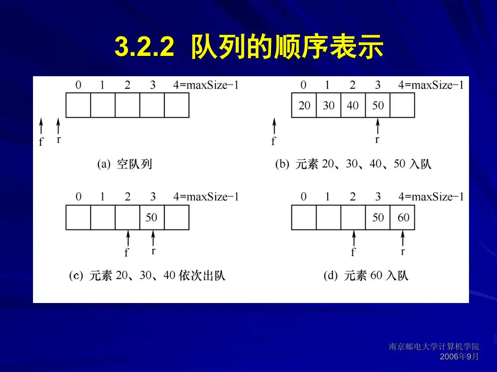

原文：

3.2.2 队列的顺序表示

(b) 元素 20、30、40、50 入队

南京邮电大学计算机学院

2006年9月

### (b) 元素 20、30、40、50 入队

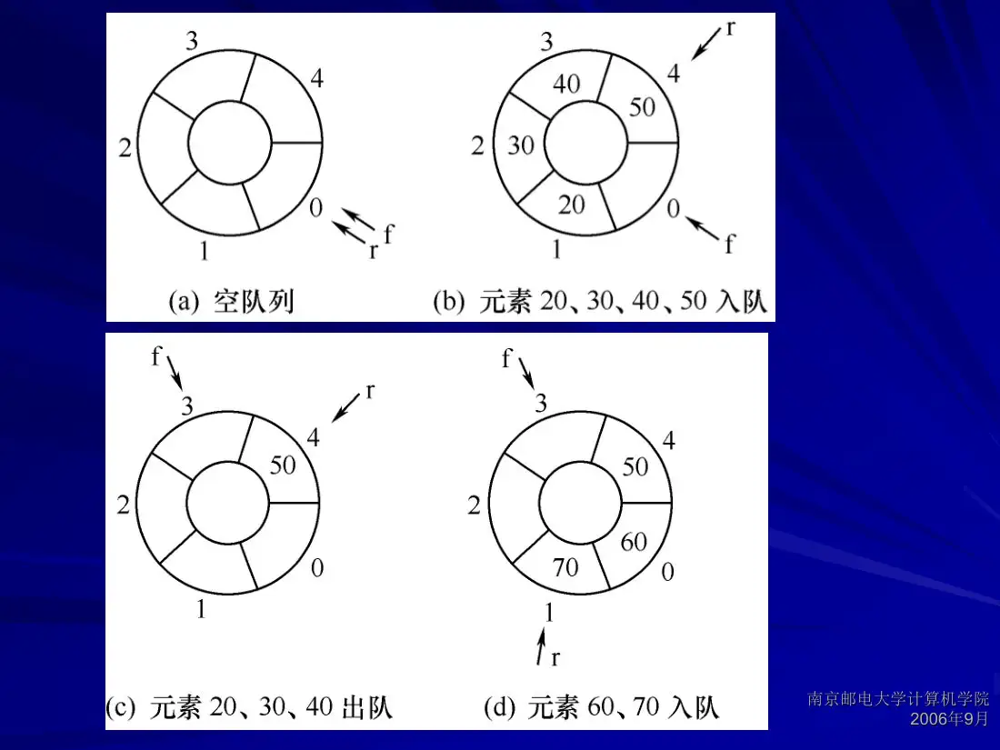

原文：

(b) 元素 20、30、40、50 入队

南京邮电大学计算机学院2006年9月

### 队头指针进一:

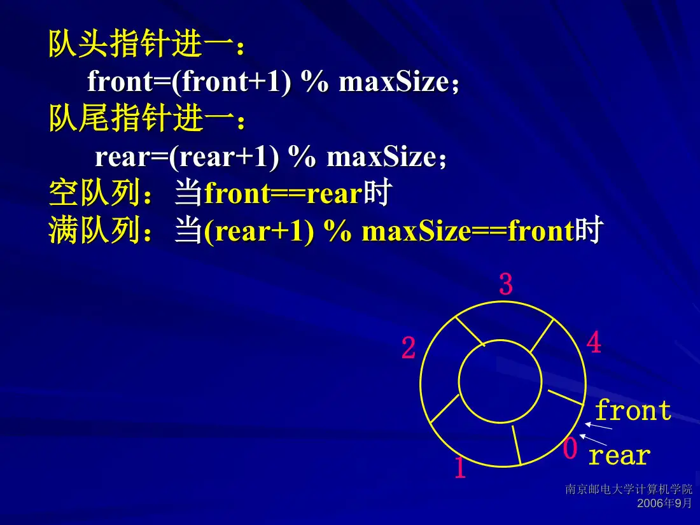

原文：

队头指针进一:
front=(front+1) % maxSize;
队尾指针进一:
rear=(rear+1) % maxSize;
空队列: 当front==rear时
满队列: 当(rear+1) % maxSize==front时

南京邮电大学计算机学院
2006年9月

### 练习

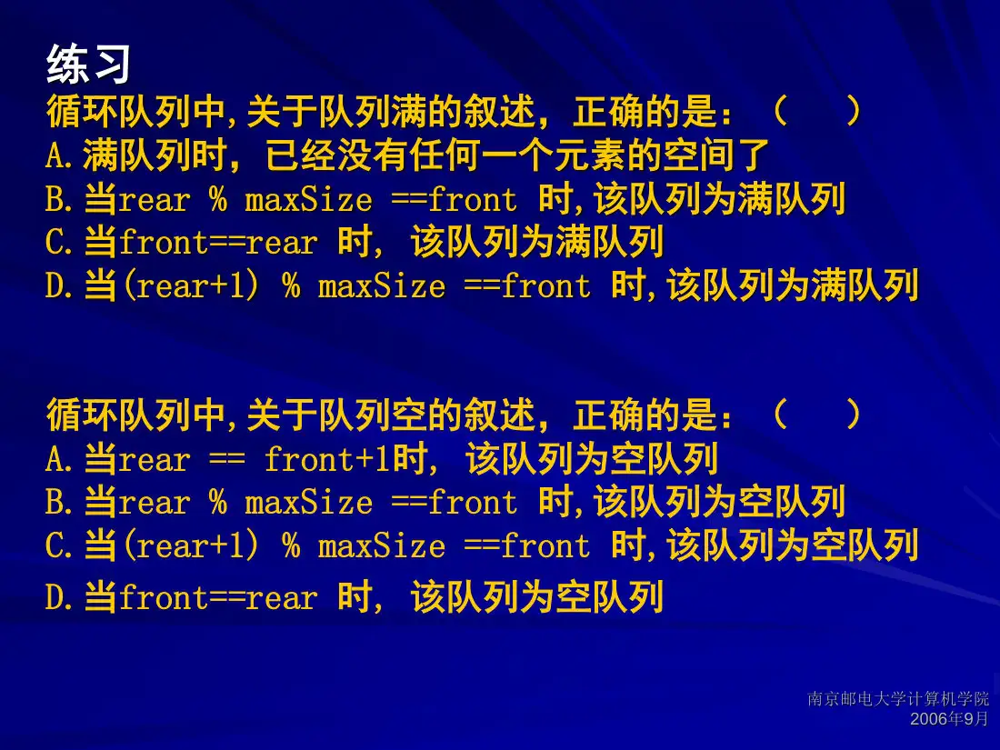

原文：

练习

循环队列中, 关于队列满的叙述, 正确的是: ( )

A. 满队列时, 已经没有任何一个元素的空间了

B. 当 rear % maxSize == front 时, 该队列为满队列

C. 当 front == rear 时, 该队列为满队列

D. 当 (rear + 1) % maxSize == front 时, 该队列为满队列

循环队列中, 关于队列空的叙述, 正确的是: ( )

A. 当 rear == front+1 时, 该队列为空队列

B. 当 rear % maxSize == front 时, 该队列为空队列

C. 当 (rear+1) % maxSize == front 时, 该队列为空队列

D. 当 front == rear 时, 该队列为空队列

南京邮电大学计算机学院
2006年9月

### template  class SeqQueue: public Queue

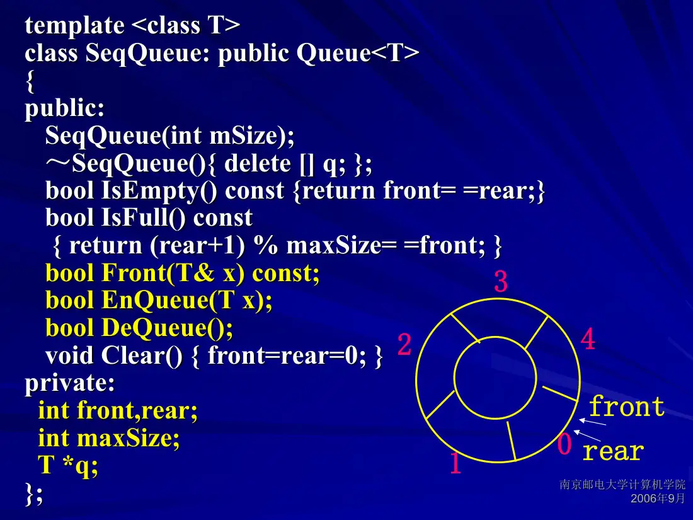

原文：

template <class T> class SeqQueue: public Queue<T>

南京邮电大学计算机学院
2006年9月

### template  SeqQueue::SeqQueue(int mSize)

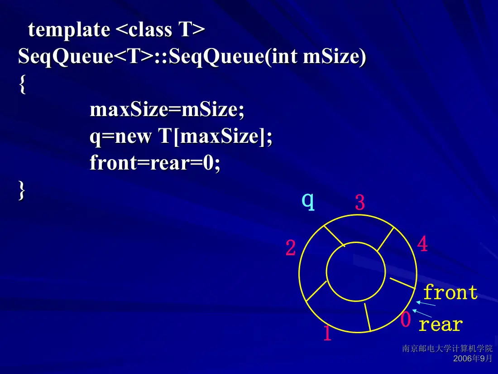

原文：

template <class T> SeqQueue<T>::SeqQueue(int mSize)

maxSize=mSize; q=new T[maxSize]; front=rear=0;

南京邮电大学计算机学院
2006年9月

### template

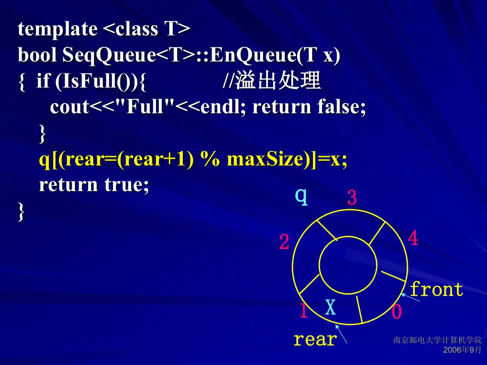

原文：

template <class T>
bool SeqQueue<T>::EnQueue(T x)
{ if (IsFull()){ // 溢出处理
    cout<<"Full"<<endl; return false;
}
q[(rear=(rear+1) % maxSize)]=x;
return true;

南京邮电大学计算机学院2006年9月

### front=(front+1) % maxSize;

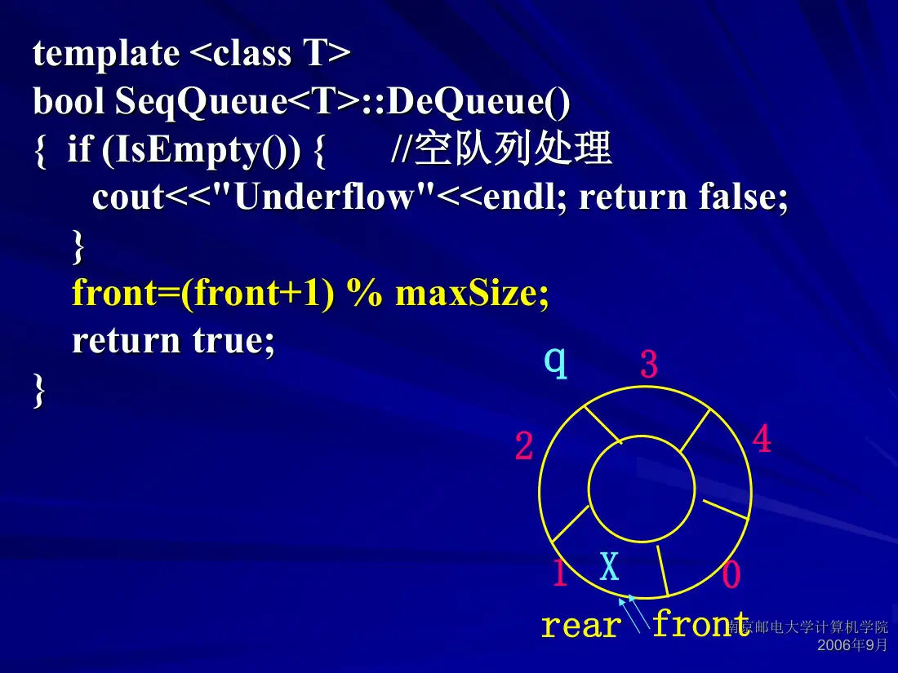

原文：

template <class T> bool SeqQueue<T>::DeQueue() { if (IsEmpty()) {    //空队列处理 cout<<"Underflow"<<endl; return false;

front=(front+1) % maxSize;

return true;

2006年9月

### template

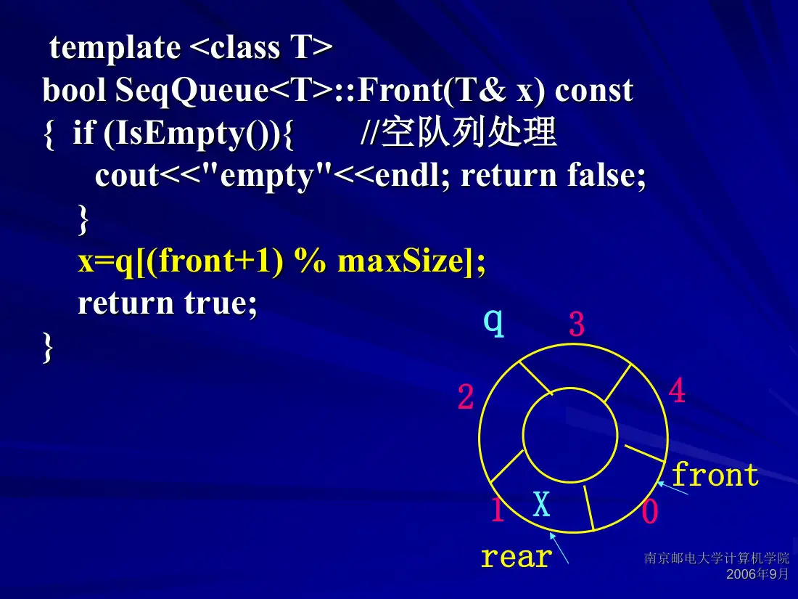

原文：

template <class T>
bool SeqQueue<T>::Front(T& x) const
{ if (IsEmpty()){ //空队列处理
    cout<<"empty"<<endl; return false;
}
x=q[(front+1)% maxSize];
return true;

南京邮电大学计算机学院2006年9月

### 3.2.3 队列的链接表示

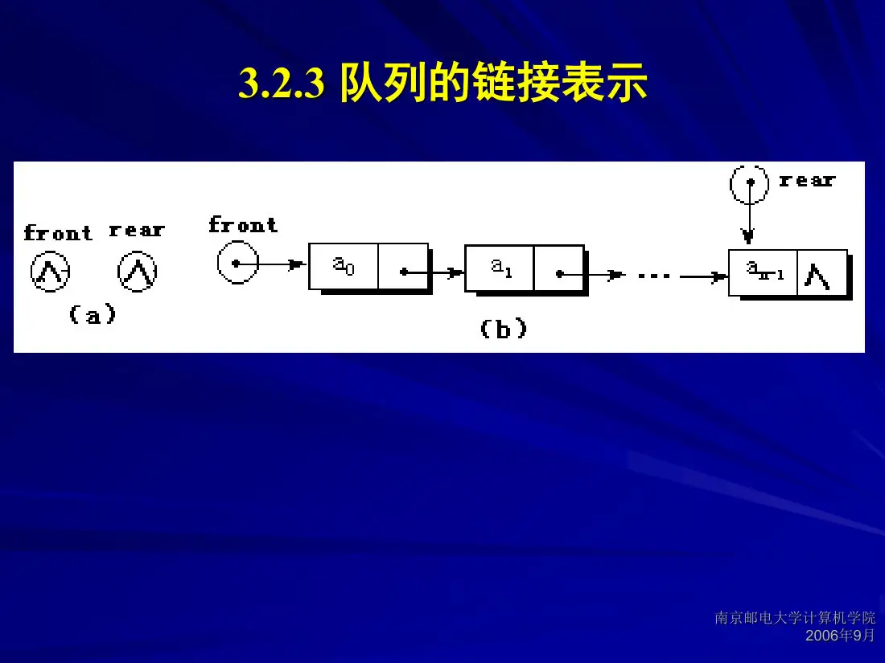

原文：

3.2.3 队列的链接表示

南京邮电大学计算机学院
2006年9月

### 3.3 表达式计算

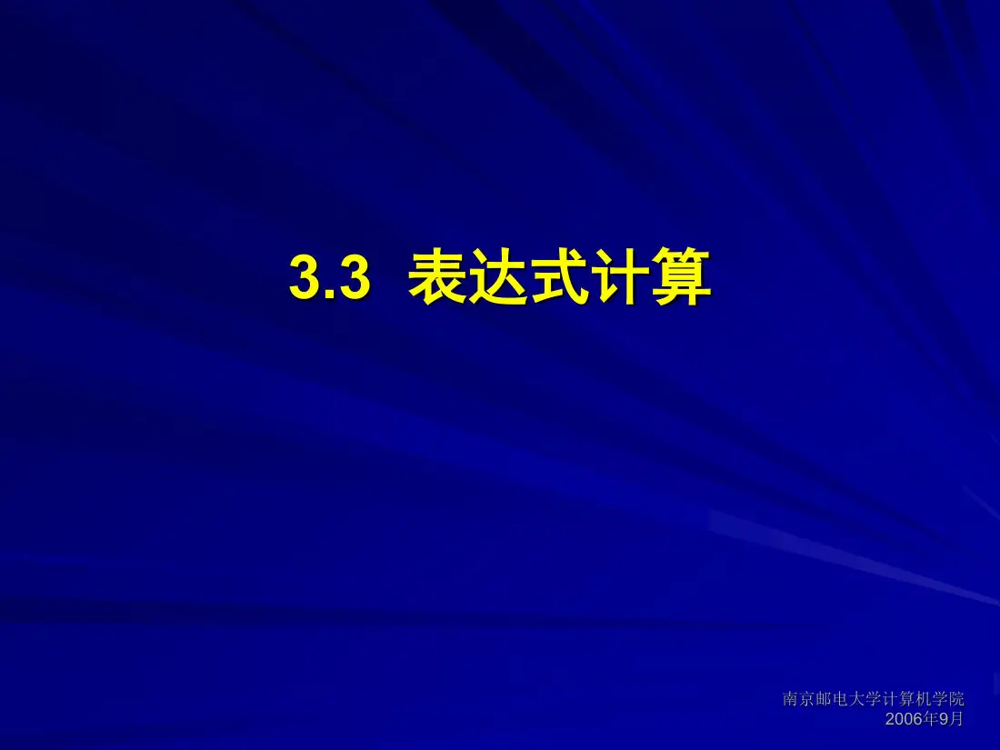

原文：

3.3 表达式计算

南京邮电大学计算机学院
2006年9月

### 3.3.1 表达式

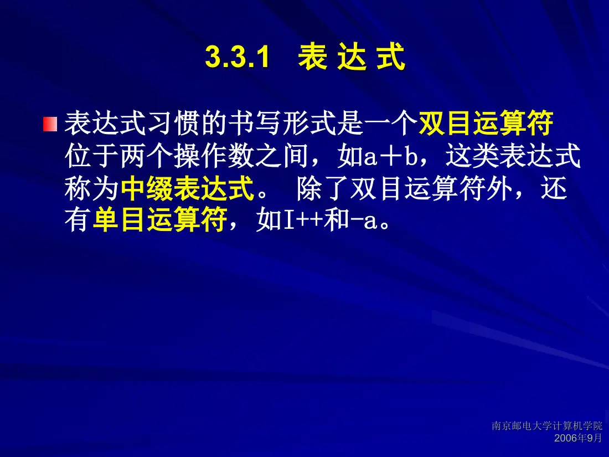

原文：

3.3.1 表达式

表达式习惯的书写形式是一个双目运算符位于两个操作数之间，如a+b，这类表达式称为中缀表达式。除了双目运算符外，还有单目运算符，如I++和-a。

南京邮电大学计算机学院
2006年9月

### 表 3-2 中缀表达式和后缀表达式

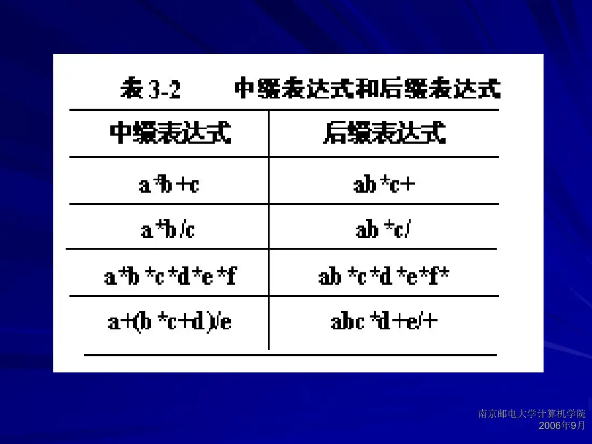

原文：

表 3-2 中缀表达式和后缀表达式
<table><tr><td>中缀表达式</td><td>后缀表达式</td></tr><tr><td>a*b+c</td><td>ab*c+</td></tr><tr><td>a*b/c</td><td>ab*c/</td></tr><tr><td>a*b*c*d*e*f</td><td>ab*c*d*e*f*</td></tr><tr><td>a+(b*c+d)/e</td><td>abc*d+e/+</td></tr></table>

南京邮电大学计算机学院

2006年9月

### 3.3.2 计算后缀表达式的值

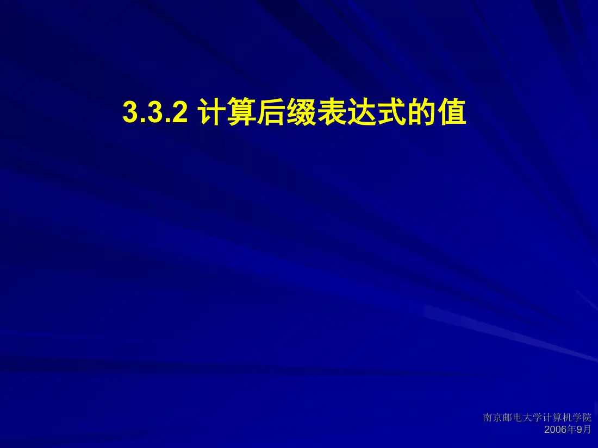

原文：

3.3.2 计算后缀表达式的值

南京邮电大学计算机学院
2006年9月

### 南京邮电大学计算机学院

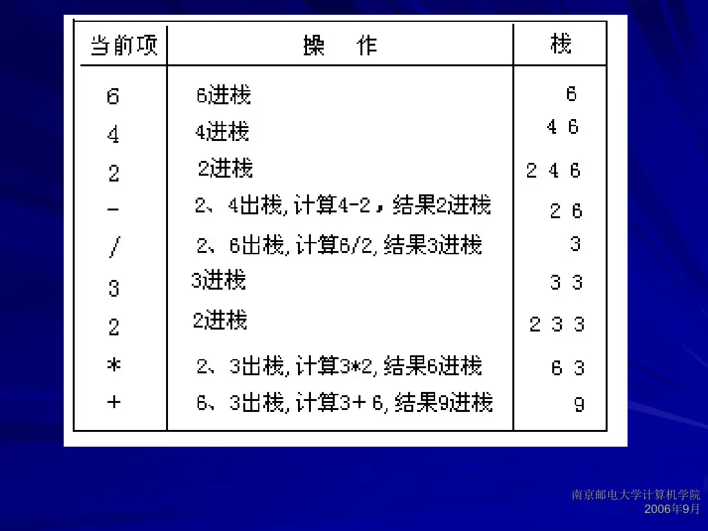

原文：

<table><tr><td>当前项</td><td>操作</td><td>栈</td></tr><tr><td>6</td><td>6进栈</td><td>6</td></tr><tr><td>4</td><td>4进栈</td><td>4 6</td></tr><tr><td>2</td><td>2进栈</td><td>2 4 6</td></tr><tr><td>-</td><td>2、4出栈,计算4-2,结果2进栈</td><td>2 6</td></tr><tr><td>/</td><td>2、6出栈,计算6/2,结果3进栈</td><td>3</td></tr><tr><td>3</td><td>3进栈</td><td>3 3</td></tr><tr><td>2</td><td>2进栈</td><td>2 3 3</td></tr><tr><td>*</td><td>2、3出栈,计算3*2,结果6进栈</td><td>6 3</td></tr><tr><td>+</td><td>6、3出栈,计算3+6,结果9进栈</td><td>9</td></tr></table>

南京邮电大学计算机学院

2006年9月

### 后缀表达式求值算法:

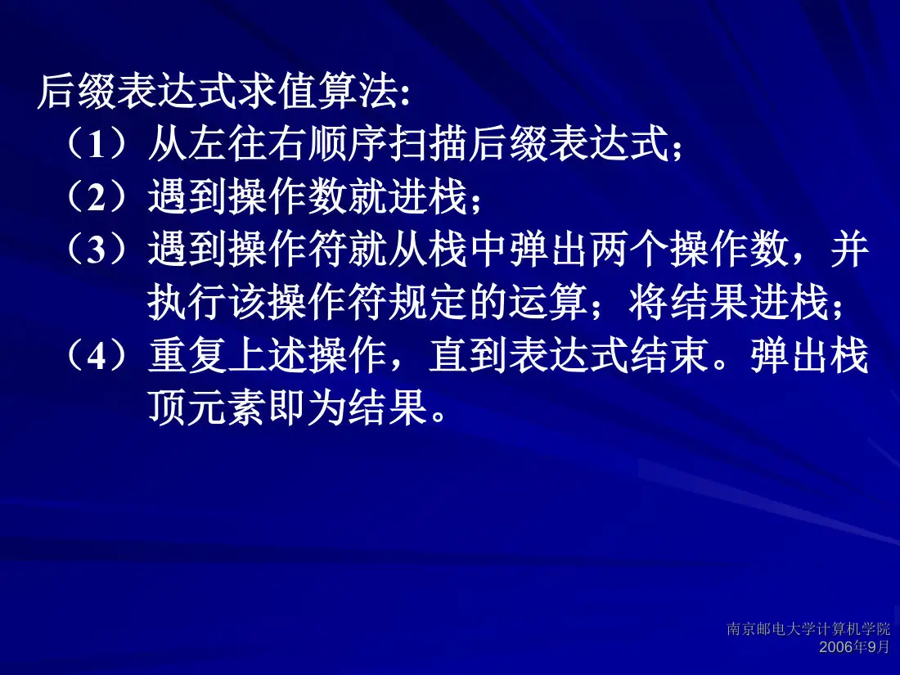

原文：

后缀表达式求值算法:

(1) 从左往右顺序扫描后缀表达式;

(2) 遇到操作数就进栈;

(3) 遇到操作符就从栈中弹出两个操作数，并执行该操作符规定的运算；将结果进栈；

(4) 重复上述操作, 直到表达式结束。弹出栈顶元素即为结果。

南京邮电大学计算机学院

2006年9月

### 利用栈计算后缀表达式值的演示：

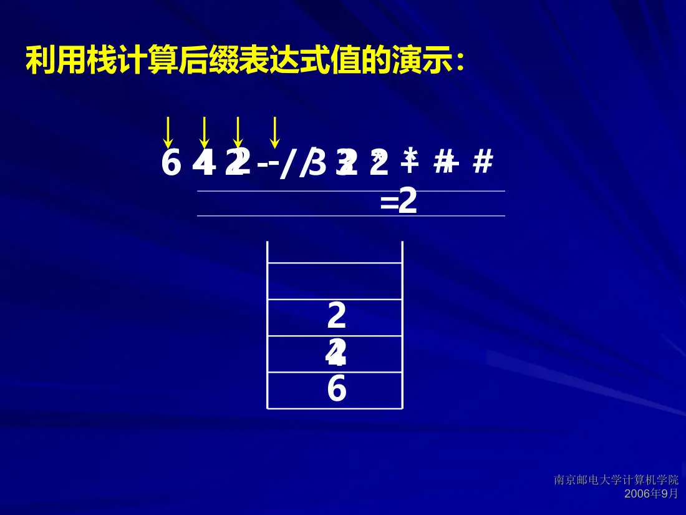

原文：

利用栈计算后缀表达式值的演示：

6 4 2 --/3 2 2 \* # # =2

南京邮电大学计算机学院
2006年9月

### 利用栈计算后缀表达式值的演示：

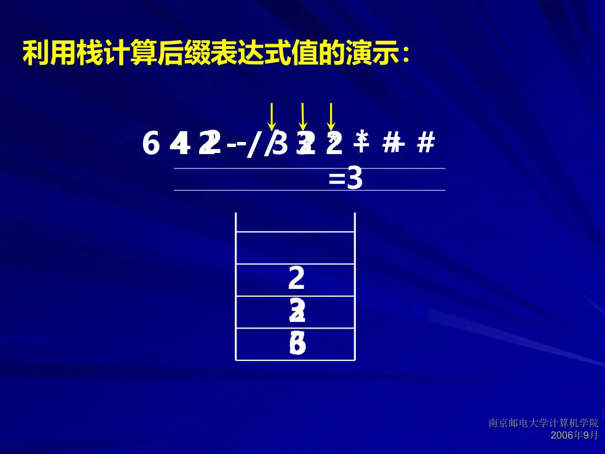

原文：

利用栈计算后缀表达式值的演示：

6 4 2 --/3 3 2 \* # # =3

南京邮电大学计算机学院
2006年9月

### 利用栈计算后缀表达式值的演示：

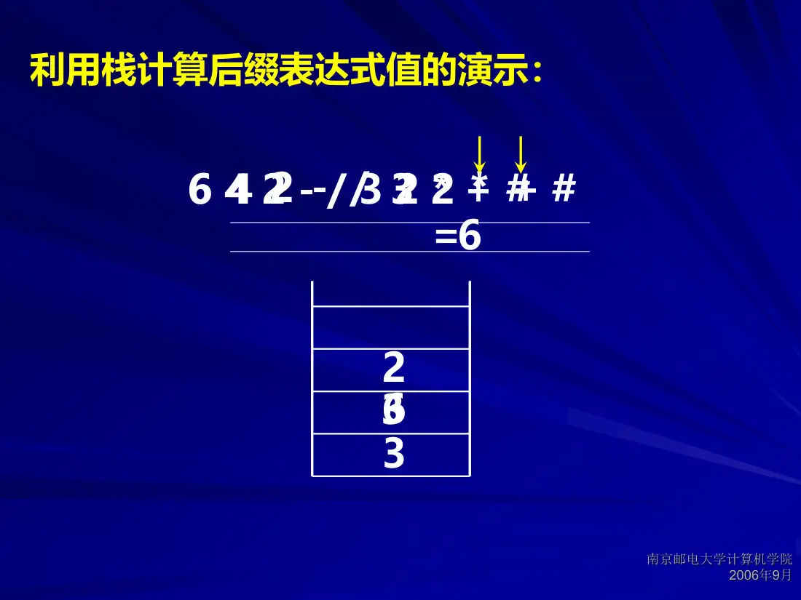

原文：

利用栈计算后缀表达式值的演示：

6 4 2 --/3 3 2 ¥ # # =6

南京邮电大学计算机学院
2006年9月

### 利用栈计算后缀表达式值的演示：

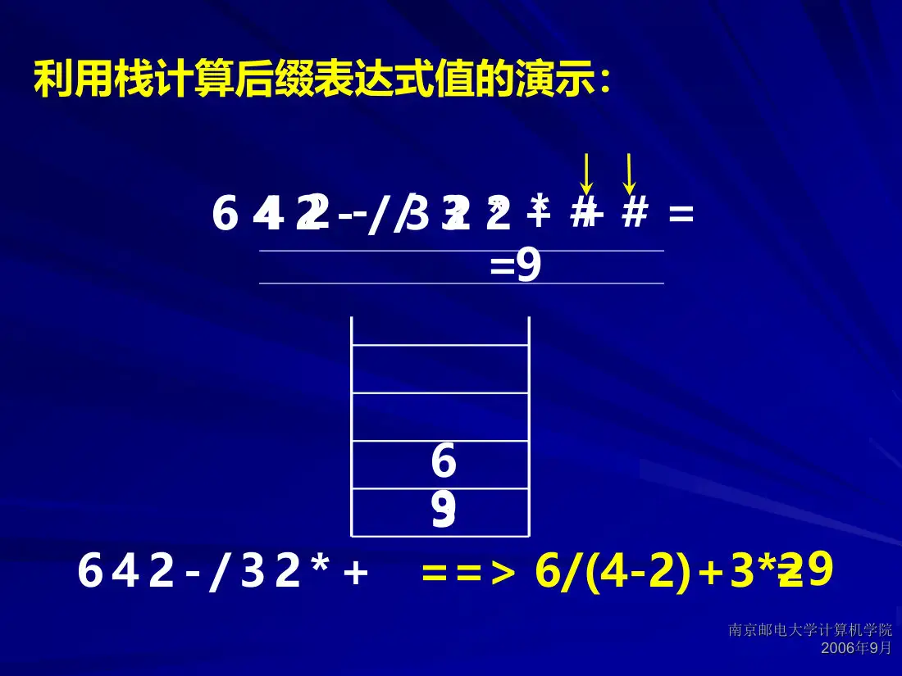

原文：

利用栈计算后缀表达式值的演示：

6 4 2 --/3 3 2 \* # # =
=9

642-/32\*+ ==>6/(4-2)+3\*29

南京邮电大学计算机学院
2006年9月

### class Calculator

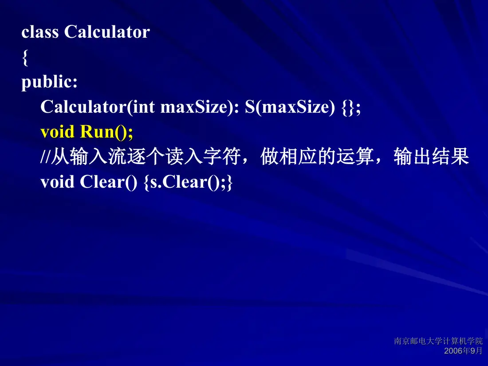

原文：

class Calculator

public:

Calculator(int maxSize): S(maxSize) {};

void Run();

//从输入流逐个读入字符，做相应的运算，输出结果

void Clear() {s.Clear();}

南京邮电大学计算机学院

2006年9月

### private:

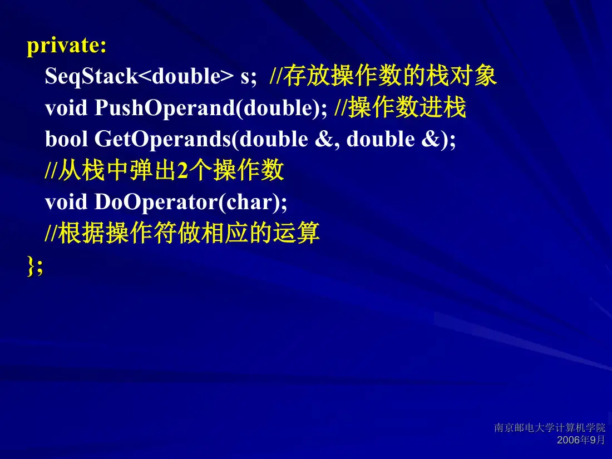

原文：

private:

SeqStack<double> s; //存放操作数的栈对象
void PushOperand(double); //操作数进栈
bool GetOperands(double &, double &);
//从栈中弹出2个操作数
void DoOperator(char);
//根据操作符做相应的运算

南京邮电大学计算机学院
2006年9月

### 南京邮电大学计算机学院

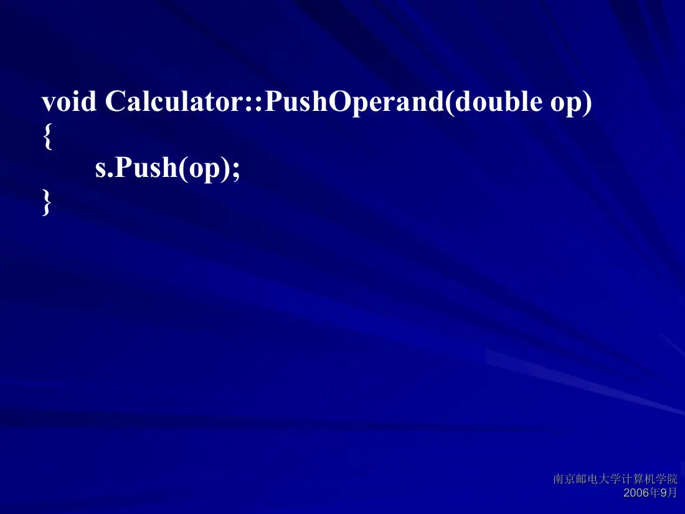

原文：

void Calculator::PushOperand(double op) { s.Push(op); }

南京邮电大学计算机学院
2006年9月

### bool Calculator::

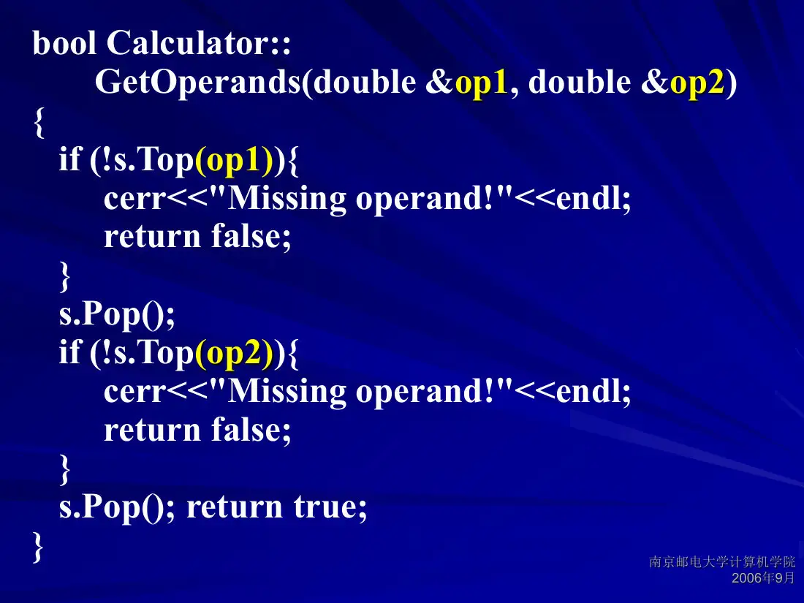

原文：

bool Calculator::
GetOperands(double &op1, double &op2)

if (!s.Top(op1)){
    cerr<<"Missing operand!"<<endl;
    return false;

s.Pop();
if (!s.Top(op2)){
    cerr<<"Missing operand!"<<endl;
    return false;

s.Pop(); return true;

南京邮电大学计算机学院

2006年9月

### void Calculator::DoOperator(char oper)

原文：

void Calculator::DoOperator(char oper)

bool result;
double oper1,oper2;
result=GetOperands(oper1,oper2); //取两个操作数 if (result) //执行操作符oper指定的运算
switch(oper){ // oper2(oper)oper1
case '+': s.Push(oper2+oper1); break;
case '-': s.Push(oper2-oper1); break;
case '\*': s.Push(oper2\*oper1); break;
case '/': if (fabs(oper1)<1e-6) { //绝对值
cerr<<"Divide by 0!"<<endl;
Clear();

南京邮电大学计算机学院

2006年9月

### else Clear();

原文：

else s.Push(oper2/oper1);break; case '^': s.Push(pow(oper2,oper1));break;

else Clear();

南京邮电大学计算机学院
2006年9月

### case '+':

原文：

void Calculator::Run() { char c;double newop; while (cin>>c,c!='#') { switch(c) { //对读入的字符做如下处理

case '+':

case '-':

case '\*' :

case '/':

case ‘^’: DoOperator(c); break; //是操作符
default: cin.putback(c); //将读入的字符
//退回输入流

cin>>newop;
PushOperand(newop); break;

南京邮电大学计算机学院

2006年9月

### 南京邮电大学计算机学院

原文：

if (S.Top(newop)) cout<<newop<<endl; //取栈顶元素，成功则输出之

南京邮电大学计算机学院

2006年9月

### 3.3.3 中缀表达式转换为后缀表达式

原文：

3.3.3 中缀表达式转换为后缀表达式

注意:

只考虑左结合的双目运算。

■ 每个表达式以 “#” 号作为其结束标记。

输入中缀表达式

由运算符、操作数、园括弧和‘#’四种不同类型的项组成的序列

输出后缀表达式

南京邮电大学计算机学院

2006年9月

### ■ 栈内优先级isp (in-stack priority)

原文：

■ 栈内优先级isp (in-stack priority)

■ 栈外优先级icp (incoming priority)

对未进栈的左括号赋以最高优先级，对已进栈的左括号赋以最低优先级。

假定表达式的语法正确性检查已在表达式转换之前完成。

表 3-5 操作符的栈内外优先级
<table><tr><td>操作符</td><td>#</td><td colspan="4">( */+- )</td></tr><tr><td>栈外 icp</td><td>0</td><td>7</td><td>4</td><td>2</td><td>1</td></tr><tr><td>栈内 isp</td><td>0</td><td>1</td><td>5</td><td>3</td><td>7</td></tr></table>

计算机学院
2006年9月

### (1) 从左到右逐个扫描中缀表达式中各项, 遇到结束符#转 (6), 否则继续;

原文：

(1) 从左到右逐个扫描中缀表达式中各项, 遇到结束符#转 (6), 否则继续;

(2) 遇到操作数直接输出;

(3) 若遇到右括号“）”，则连续出栈输出，直至遇到左括号“（”为止（注意：左括号出栈但并不输出），否则继续；

(4) 若是其他操作符, 则和栈顶的操作符比较优先级, 若小于栈顶操作符的优先级, 则连续出栈输出, 直到大于等于栈顶操作符的优先级结束, 操作符进栈;

(5) 转 (1) 继续;

(6) 输出栈中剩余操作符（#除外）。

南京邮电大学计算机学院

2006年9月

### a/(b - c) + d\* e

原文：

中缀表达式: a/(b-c)+d\*e 后缀表达式: a b c - / d e \* +

a/(b - c) + d\* e

南京邮电大学计算机学院
2006年9月

### a b c

原文：

中缀表达式: a/(b-c)+d\*e 后缀表达式: a b c - / d e \* +

a b c

+d\* e

南京邮电大学计算机学院
2006年9月

### a b c -

原文：

中缀表达式: a/(b-c)+d\*e 后缀表达式: a b c - / d e \* +

a b c -

+d\* e

南京邮电大学计算机学院
2006年9月

### a b c - / d e

原文：

中缀表达式: a/(b-c)+d\*e 后缀表达式: a b c - / d e \* +

a b c - / d e

\* + # #

南京邮电大学计算机学院
2006年9月

### case '(': priority=7; break;

原文：

case '(': priority=7; break;
case '+':

case '-': priority=2; break;
case '\*':

case '/': priority=4; break;

case '#': priority=0; break;

return priority;

南京邮电大学计算机学院

2006年9月

### void InfixToPostfix()

原文：

void InfixToPostfix()
{ SeqStack <char> s(SIZE);
char ch,y; s.Push('#');
while (cin>>ch, ch!='#') {
    if (isdigit(ch)||isalpha(ch)) cout<<ch;//输出操作数
    else if (ch==')')
    for(s.Top(y), s.Pop(); y!='(; s.Top(y), s.Pop())
    cout<<y;

else {
    for (s.Top(y), s.Pop(); icp(ch) <isp(y);
    s.Top(y), s.Pop()) cout << y;
    s.Push(y); s.Push(ch);
}

南京邮电大学计算机学院
2006年9月

### while (!s.IsEmpty())

原文：

while (!s.IsEmpty())

s.Top(y); s.Pop(); if (y!='#') cout<<y;

cout<<endl;

南京邮电大学计算机学院
2006年9月

### 3.4 递归

原文：

3.4 递归

南京邮电大学计算机学院
2006年9月

### 3.4.1 递归的概念

原文：

3.4.1 递归的概念

递归和递归定义

■ 递归定义是一种直接或间接引用自身的定义方法。

一个合法的递归定义包括两部分：基础情况和递归部分。

基础情况以直接形式明确列举新事物的若干简单对象，递归部分给出由简单（或较简单）对象定义新对象的条件和方法。

南京邮电大学计算机学院

2006年9月

### 斐波那契数列递归定义

原文：

斐波那契数列递归定义

$$
\left\{ \begin{array}{l l} \mathbf {F _ {0}} = \mathbf {0}, \quad \mathbf {F _ {1}} = \mathbf {1} \\ \mathbf {F _ {n}} = \mathbf {F _ {n - 1}} + \mathbf {F _ {n - 2}} & \quad \mathbf {n} > \mathbf {1} \end{array} \right.
$$

斐波那契数列直接计算式

$$
\mathrm {F_ {n}} = \frac {1}{\sqrt {5}} (\varphi^ {\mathrm{n}} - \hat {\varphi} ^ {\mathrm{n}})
$$

$$
\varphi = \frac {1}{2} (1 + \sqrt {5}) = 1. 6 1 8 0 3 3 9 8 \dots
$$

$$
\hat {\varphi} = 1 - \varphi = \frac {1}{2} (1 - \sqrt {5}) = - 0. 6 1 8 0 3 3 9 8 \dots
$$

南京邮电大学计算机学院

2006年9月

### 递归算法

原文：

递归算法

一个递归算法是指直接或间接调用自身的算法

long Fib( long n )

if(n<=1) return n;
else return Fib(n-2)+Fib(n-1);

\- 递归数据结构
使用递归方式定义的数据结构常称为递归数据结构。

南京邮电大学计算机学院
2006年9月

### 递归算法示例

原文：

递归算法示例

例 1 逆序输出正整数中各位

$$
\mathrm{n} = 1 2 3 4 5
$$

设k位正整数为 $d_{1}d_{2}\ldots\dots.d_{k}$ ，逆序输出

$d_{k}d_{k-1}\ldots\dots d_{1}$ ，分成两步：

(1) 首先输出最后一位数 $d_{k}$ ;

(2) 然后输出正整数 $d_{1}d_{2}\ldots\dots d_{k-1}$ 的逆序形式。

南京邮电大学计算机学院
2006年9月

### 南京邮电大学计算机学院

原文：

void PrintDigit(unsigned int n) { cout<<n%10; if(n>=10) PrintDigit(n/10);

南京邮电大学计算机学院
2006年9月

### 3.4.2 递归的实现

原文：

3.4.2 递归的实现

■ 子程序调用和系统栈
int fact (int n)

if (n==0) return 1;
else {
    int temp=n\*fact(n-1);
    return temp;

N=fact(4);

南京邮电大学计算机学院
2006年9月

### ■ 活动记录（帧）包含以下信息：

原文：

系统栈是一块特殊的存储区。当一个函数被调用时，系统为该函数的本次调用创建活动记录。

■ 活动记录（帧）包含以下信息：
形式参数
局部变量
上一帧指针
返回地址
函数返回值

南京邮电大学计算机学院

2006年9月

### (a)main函数的栈帧 (b)main调用fact(3)，最深时的系统栈

原文：

(a)main函数的栈帧 (b)main调用fact(3)，最深时的系统栈

南京邮电大学计算机学院

2006年9月

### 递归函数的性能

原文：

递归函数的性能

优点：程序结构简洁而清晰，易于正确性证明和算法分析。  
缺点：既费时又费空间。

南京邮电大学计算机学院

2006年9月

### 尾递归

原文：

尾递归

■ 尾递归：如果一个递归函数的递归调用语句是递归函数的最后一句可执行语句，则称这样的递归为尾递归。

■ 递归的消除：尾递归函数可以容易地转换为迭代函数。

南京邮电大学计算机学院

2006年9月

### 输出数组元素的尾递归

原文：

输出数组元素的尾递归
template<class T>
void RPrintArray(T list[], int n)

if(n>0){
    cout<<list[n-1]<<' ';
    RPrintArray(list,--n);

南京邮电大学计算机学院
2006年9月

### while (n>0){

原文：

while (n>0){
    cout<<list[n-1]<<' ';
    --n;
}

南京邮电大学计算机学院
2006年9月

### 作业题

原文：

作业题

1 解答题: 3.1, 3.3, 3.4 (3), (5)

2 程序设计题：3.9，3.13，3.15

南京邮电大学计算机学院

2006年9月
