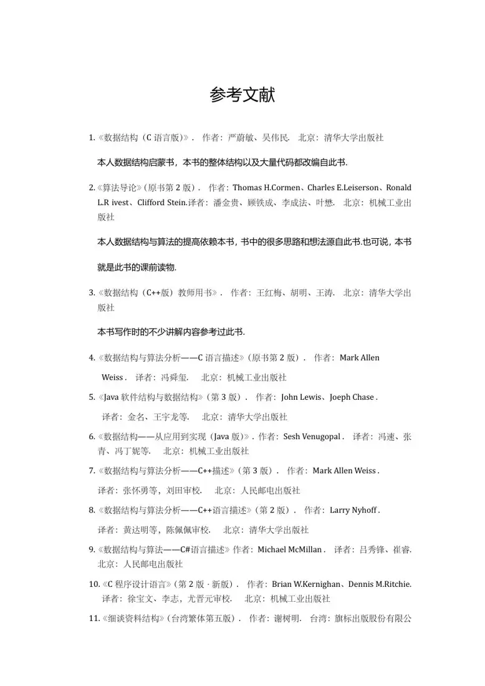
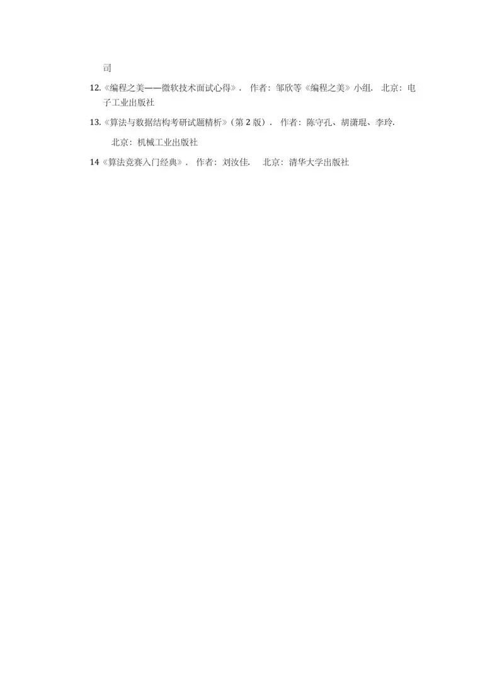

# 《数据结构》参考文献

原件的每一页，下面附识别出的文字。

### 参考文献

原文：

参考文献

1.《数据结构（C语言版）》. 作者：严蔚敏、吴伟民. 北京：清华大学出版社本人数据结构启蒙书，本书的整体结构以及大量代码都改编自此书.

2.《算法导论》（原书第 2 版）. 作者：Thomas H.Cormen、Charles E.Leiserson、RonaldL.R ivest、Clifford Stein.译者：潘金贵、顾铁成、李成法、叶懋. 北京：机械工业出版社

本人数据结构与算法的提高依赖本书，书中的很多思路和想法源自此书.也可说，本书就是此书的课前读物.

3.《数据结构（C++版）教师用书》. 作者：王红梅、胡明、王涛. 北京：清华大学出版社

本书写作时的不少讲解内容参考过此书

4.《数据结构与算法分析——C 语言描述》（原书第2 版）. 作者：Mark AllenWeiss . 译者：冯舜玺. 北京：机械工业出版社

5.《Java 软件结构与数据结构》（第 3 版）. 作者：John Lewis、Joeph Chase .译者：金名、王宇龙等. 北京：清华大学出版社

6.《数据结构——从应用到实现（Java 版）》. 作者：Sesh Venugopal . 译者：冯速、张青、冯丁妮等. 北京：机械工业出版社

7.《数据结构与算法分析——C++描述》（第 3 版）. 作者：Mark Allen Weiss .译者：张怀勇等，刘田审校. 北京：人民邮电出版社

8.《数据结构与算法分析——C++语言描述》（第2版）. 作者：Larry Nyhoff .译者：黄达明等，陈佩佩审校. 北京：清华大学出版社

9.《数据结构与算法——C#语言描述》作者：Michael McMillan . 译者：吕秀锋、崔睿.北京：人民邮电出版社

10.《C 程序设计语言》（第 2 版·新版）. 作者：Brian W.Kernighan、Dennis M.Ritchie.译者：徐宝文、李志，尤晋元审校. 北京：机械工业出版社

11.《细谈资料结构》（台湾繁体第五版）. 作者：谢树明. 台湾：旗标出版股份有限公

### 14《算法竞赛入门经典》. 作者：刘汝佳. 北京：清华大学出版社

原文：

12.《编程之美——微软技术面试心得》. 作者：邹欣等《编程之美》小组. 北京：电子工业出版社

13.《算法与数据结构考研试题精析》（第2 版）. 作者：陈守孔、胡潇琨、李玲.北京：机械工业出版社

14《算法竞赛入门经典》. 作者：刘汝佳. 北京：清华大学出版社

司
