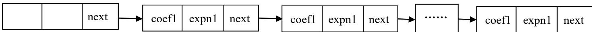
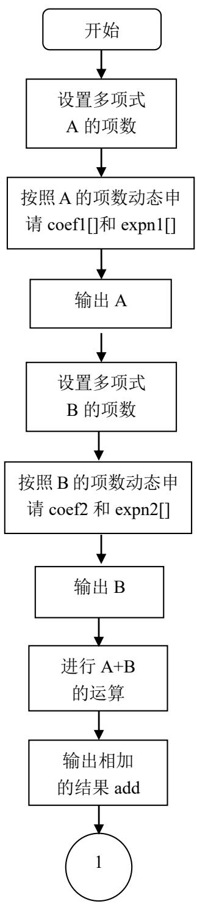
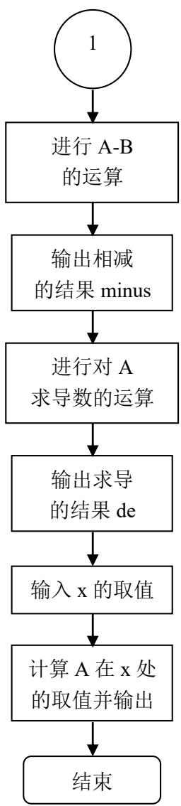
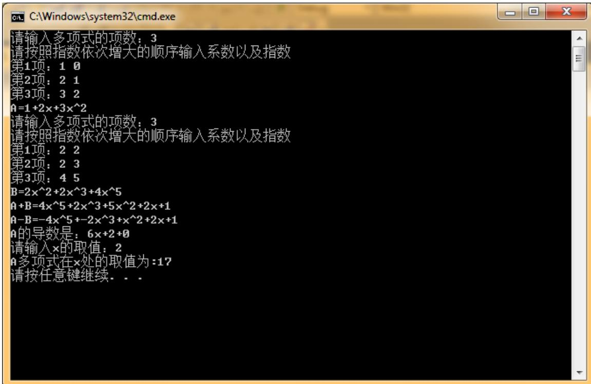

# 《数据结构》实验一——多项式的实现实验报告

原件经识别和整理；“参考解答”是我们补的。

# 1．实验要求

**实验目的：**

1. 熟悉C++语言的基本编程方法，掌握集成编译环境的调试方法
2. 学习指针、模板类、异常处理的使用
3. 掌握线性表的操作的实现方法
4. 学习使用线性表解决实际问题的能力

**实验内容：**

利用线性表实现一个一元多项式 Polynomial

$$
f(x) = a_0 + a_1 x + a_2 x^2 + a_3 x^3 + \dots + a_n x^n
$$

**要求：**

1. 能够实现一元多项式的输入和输出
2. 能够进行一元多项式相加
3. 能够进行一元多项式相减
4. 能够计算一元多项式在 $x$ 处的值
5. 能够计算一元多项式的导数（选作）
6. 能够进行一元多项式相乘（选作）
7. 编写测试 `main()` 函数测试线性表的正确性

# 2. 程序分析

由于多项式是线性结构，故选择线性表来实现。在这个程序中我采用的是单链表结构，每个结点代表一个项，多项式的每一项可以用其系数和指数唯一的表示。如果采用顺序存储，那么对于结点的插入和删除的操作会比较麻烦，而且顺序表的结点个数固定，对于可能发生的情况无法很好的处理；而采用链表就会简单许多，还能自由控制链表的长度。

两个多项式要进行多次的计算，为了保护原始的数据，方便进行以后的计算，故选择把结果存储在一个新建的链表里。

本程序完成的主要功能：

1. **输入和输出**：需要输入的信息有多项式的项数，用来向系统动态申请内存；多项式各项的系数和指数，用来构造每个结点，形成链表。输出即是将多项式的内容向屏幕输出。
2. **多项式相加与相减**：多项式的加减要指数相同即是同类项才能实现，所以在运算时要注意判断指数出现的各种不同的情况，分别写出计算方法。将每项运算得到的结果都插入到新的链表中，形成结果多项式。
3. **多项式的求导运算**：多项式的求导根据数学知识，就是将每项的系数乘以指数，将指数减1即可，将每项得到的结果插入到结果多项式的链表中。
4. **多项式在某点的值**：由用户输入 $x$ 的值，然后求出每项的值相加即可。

## 2.1 存储结构

本程序采用的存储结构是单链表结构，其定义的结点包括三部分：系数、指数以及下一个结点的地址。示意图如下：



## 2.2 关键算法分析

### 1. 输入多项式

*   **自然语言描述：**
    1.  设置多项式的项数 $n$；
    2.  按照多项式的项数申请动态数组 `coef[]` 和 `expn[]` 存储多项式的系数和指数；
    3.  按照指数递增的次序输入各项的系数以及指数，分别存入 `coef` 和 `expn`；
    4.  再将输入的系数以及指数赋给每一个结点的 `coef` 和 `expn` 域；
    5.  利用头插法将每个结点加入链表。

*   **伪代码：**
    1.  输入项数 $n$；
    ...
    4.  运用头插法将结点插入链表。

*   **时间复杂度：** （原文未填写）
*   **空间复杂度：** （原文未填写）

### 2. 输出多项式

*   **自然语言描述：**
    1.  获取头结点；
    2.  循环 $n-1$ 次（$n$ 为多项式的项数）
        2.1 将指针的指向后移；
        2.2 依照多项式的各种情况，设置输出方式
            2.2.1 系数为1且指数不为1和0，输出 `x^expn+`；
            2.2.2 系数不为0且指数为0，输出 `(coef)+`；
            2.2.3 系数不为0且指数为1，输出 `(coef)x+`；
            2.2.4 系数不为0和1，指数不为0和1，输出 `(coef)x^(expn)+`；
    3.  将指针指向移到最后一个节点。重复 2.2 中判断，但不输出 `+` 号。

*   **伪代码描述：** （原文未提供具体代码块，仅列出标题）
*   **时间复杂度：** $O(n)$
*   **空间复杂度：** $S(1)$

### 3. 多项式的相加相减

*   **自然语言描述：**
    1.  指针 `p` 和 `q` 分别指向 `a` 和 `b` 两个多项式的头结点的下一个节点；
    2.  将结果多项式的项数置为0；
    3.  只有 `p` 或 `q` 非空，进行以下循环：
        3.1 申请一个 `term*` 型的指针 `d`，将其 `next` 域赋为 `NULL`；进行判断：
            3.1.1 如果 `p` 和 `q` 均非空
                3.1.1.1 如果 `p` 和 `q` 的指数相等，将 `d` 的系数赋为 `p`、`q` 系数之和，指数不变，将 `p`、`q` 指向后移；
                ...
            3.1.2 判断后将项数++，插入新节点 `d`；
    4.  返回结果多项式的项数

*   **伪代码描述：**
    ```cpp
    // 原文此处对应图片识别出的片段
    s->coef = 0; 
    s->expn = 0; 
    p = p->next; 
    de.Insert(s);
    ```

*   **时间复杂度：** $O(n)$
*   **空间复杂度：** $S(1)$

# 3. 程序运行结果

**1. 测试主函数流程：**





**测试条件：**
问题规模 $n$ 的数量级为 1
A 多项式每项的系数和指数分别为： $\langle 1, 0 \rangle \langle 2, 1 \rangle \langle 3, 2 \rangle$
B 多项式每项的系数和指数分别为： $\langle 2, 2 \rangle \langle 2, 3 \rangle \langle 4, 5 \rangle$
$X$ 的值为：2

**运行出来的结果是：**



**测试结论：**
通过测试，本程序具有的功能有：多项式的建立、多项式的输入与输出、多项式的相加及相减，多项式求导以及多项式求值。

# 4. 总结

**1. 调试时出现的问题及解决的方法**

① 输出多项式的时候有些问题，但经过查看是由于输出时没有将各种情况考虑全面的结果。

② 相加相减操作：在刚开始的时候，只考虑了 `p`、`q` 指针均非空的情况，计算的结果就出现了问题，但逐项的运算后，会出现一个还非空但另一个已经遍历完毕的情况，故后又设计让非空的链表继续进行运算，解决了问题。

③ 在插入结点的时候出现了一些问题，经查看是尾插法运用地并不熟练，后运用头插法将结点插入链表中，编完程序后，又仔细学习了尾插法的操作。

**2. 心得体会**

通过本次实验，我熟悉了链表的相关操作，包括链表的建立、头插法；同时由于多项式的运算中会出现许多种不同的情况，在这方面也锻炼了我的思维严密性。在编写程序的过程中，编译的时候出现了一些错误，但都经过自己的钻研以及与同学探讨成功解决。

**3. 下一步的改进**

① 在输出上做一些优化：比如在输出负数时直接输出减号，不再加号和减号同时出现。还有输出的程序在0的处理上并不十分满意，会进一步优化。

② 本程序没有完成多项式的乘法功能，以后会逐步完善。
