# 《数据结构》第10章 内排序（课件）

原件的每一页，下面附识别出的文字。

### 第十章 内排序

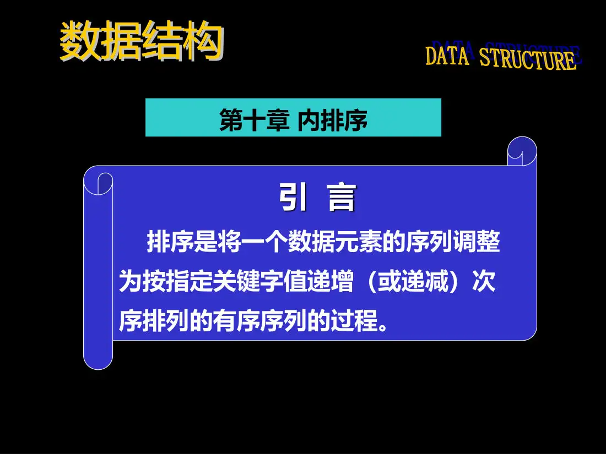

原文：

第十章 内排序

引 言

排序是将一个数据元素的序列调整为按指定关键字值递增（或递减）次序排列的有序序列的过程。

数据结构

DATA STRUCTURE

### 内容提要

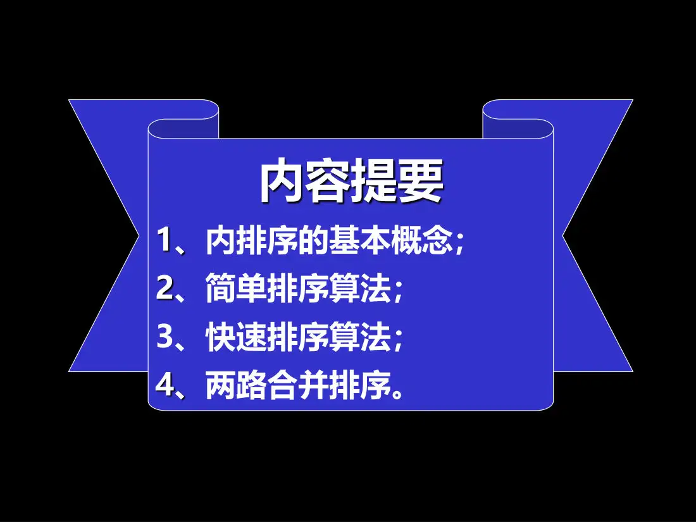

原文：

内容提要

1、内排序的基本概念；

2、简单排序算法；

3、快速排序算法；

4、两路合并排序。

### 2.1 内排序的基本概念

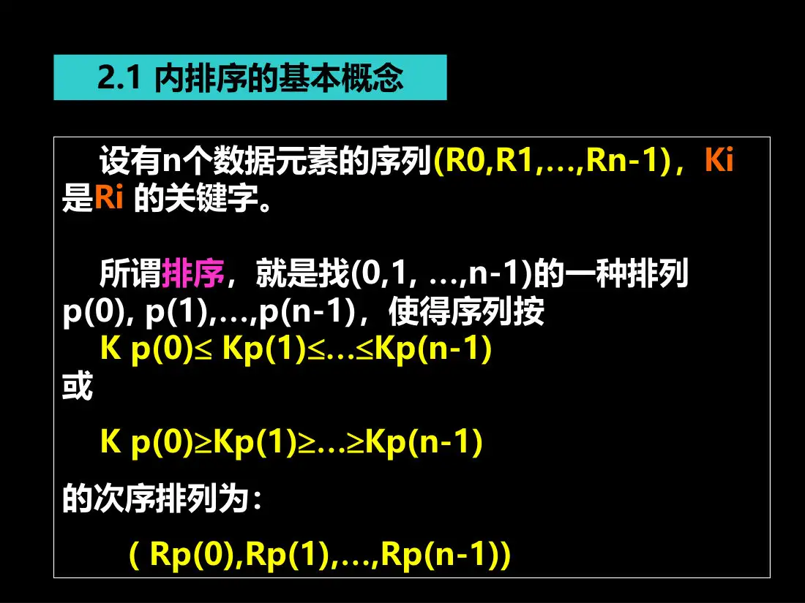

原文：

2.1 内排序的基本概念

设有n个数据元素的序列 $( [ i , [ i ] ) ] : [ ( j , i ) ] : [ ( 1 , i ) ]$ Ki是Ri 的关键字。

所谓排序，就是找 $( 0 5 0 - 0 0 0 0 - 0 ) \times 5 0 0$ 的一种排列$\bf \Pi [ \bar { \bf q } ( 0 ) ] \cdot \bf { \vec { \tau } } ^ { ( 0 ) } \cdot \bf { \vec { \tau } } ^ { ( 0 ) } \cdot \bf { \vec { \tau } } ^ { ( 0 ) } \cdot \bf { \vec { \tau } } ^ { ( 0 ) } \cdot \bf { \vec { \tau } } ^ { ( 0 ) } \cdot \bf { \vec { \tau } } ^ { ( 0 ) } \cdot \bf { \vec { \tau } } ^ { ( 0 ) } \cdot \bf { \vec { \tau } } ^ { ( 0 ) } \cdot \bf { \vec { \tau } } ^ { ( 0 ) }$ 使得序列按$[ \langle 2 | 0 \rangle ] = [ \langle 2 | 0 \rangle ] = [ \langle 2 | 0 \rangle ]$ 或

$\because \angle 2 ( 0 ) = \angle A ( 0 ) = \angle C ( 0 ) = \angle C ( 0 ) = 9 0 ^ { \circ }$ 的次序排列为：

( Rp(0),Rp(1),…,Rp(n-1))

### 序列中两个元素Ri和 Rj (i1,3,33,1,3=>1,3,3

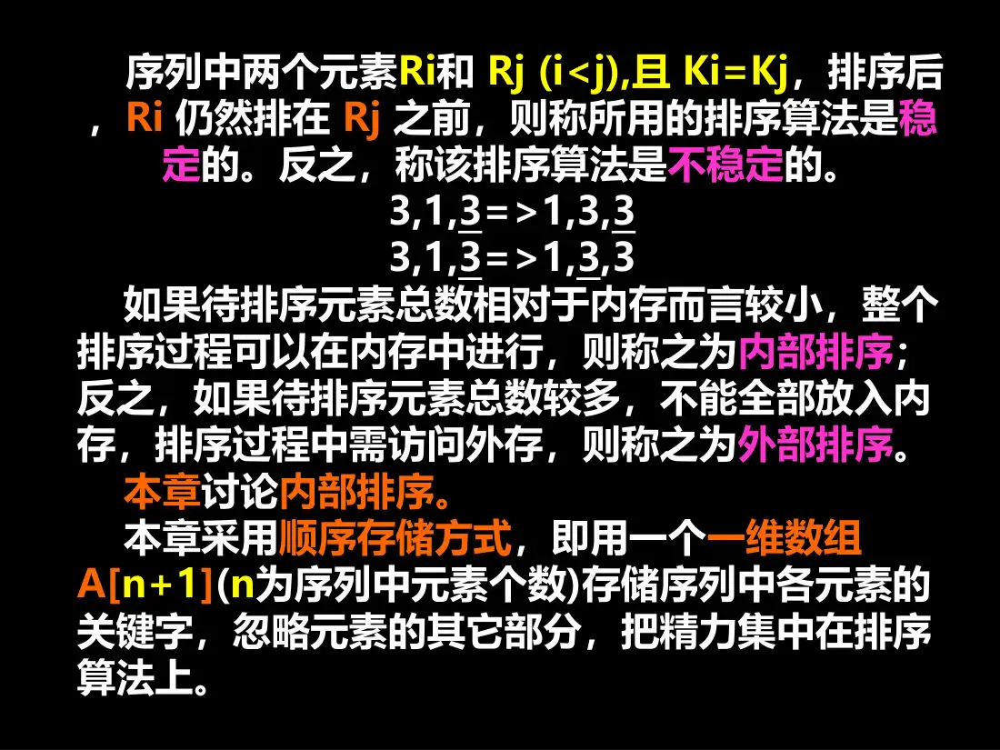

原文：

序列中两个元素Ri和 Rj (i<j),且 Ki=Kj，排序后Ri 仍然排在 Rj 之前，则称所用的排序算法是稳定的。反之，称该排序算法是不稳定的。3,1,3=>1,3,33,1,3=>1,3,3

如果待排序元素总数相对于内存而言较小，整个排序过程可以在内存中进行，则称之为内部排序；反之，如果待排序元素总数较多，不能全部放入内存，排序过程中需访问外存，则称之为外部排序。本章讨论内部排序。

本章采用顺序存储方式，即用一个一维数组`A[n+1]`（n为序列中元素个数）存储序列中各元素的关键字，忽略元素的其它部分，把精力集中在排序算法上。

### 2.1 简单排序算法

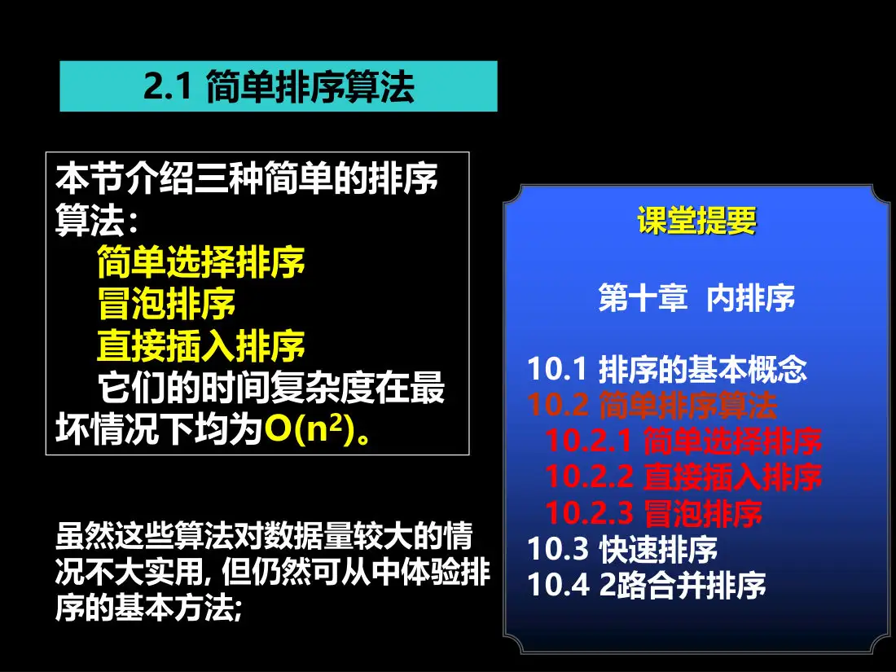

原文：

2.1 简单排序算法

本节介绍三种简单的排序算法：简单选择排序冒泡排序直接插入排序它们的时间复杂度在最坏情况下均为O(n2)。

虽然这些算法对数据量较大的情况不大实用, 但仍然可从中体验排序的基本方法;

课堂提要

第十章 内排序

10.1 排序的基本概念10.2 简单排序算法10.2.1 简单选择排序10.2.2 直接插入排序10.2.3 冒泡排序10.3 快速排序10.4 2路合并排序

### 10.2.1 简单选择排序

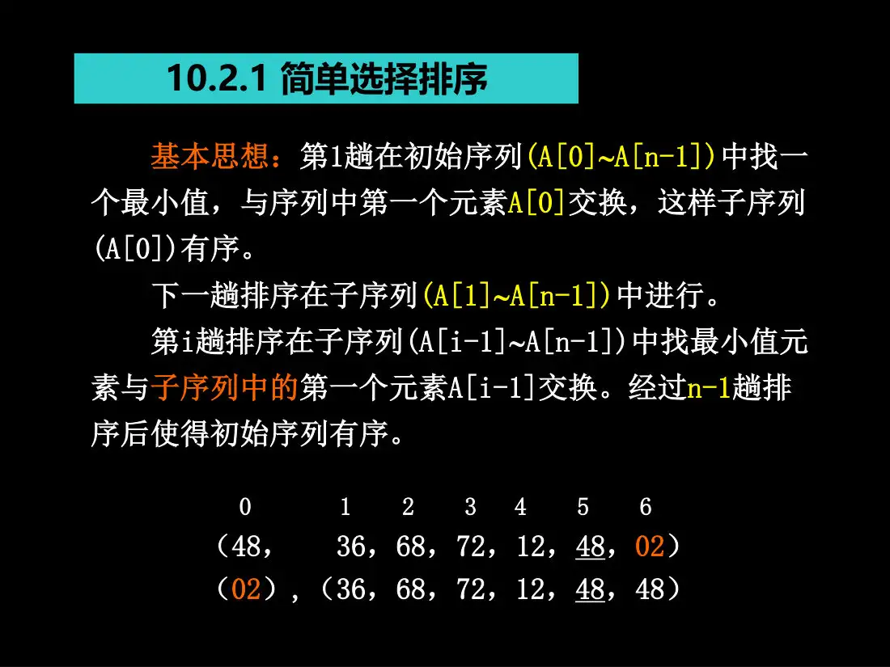

原文：

10.2.1 简单选择排序

基本思想：第1趟在初始序列(A[0]A[n-1])中找一个最小值，与序列中第一个元素A[0]交换，这样子序列(A[0])有序。

下一趟排序在子序列(A[1]A[n-1])中进行。

第i趟排序在子序列(A[i-1]A[n-1])中找最小值元素与子序列中的第一个元素A[i-1]交换。经过n-1趟排序后使得初始序列有序。

$$
\begin{array}{c c c c c c c} 0 & 1 & 2 & 3 & 4 & 5 & 6 \\ (4 8, & 3 6, & 6 8, & 7 2, & 1 2, & \underline {{4 8}}, & 0 2) \\ (0 2), & (3 6, & 6 8, & 7 2, & 1 2, & \underline {{4 8}}, & 4 8) \end{array}
$$

### 图10-1 简单选择排序示音图 稳定性如何？

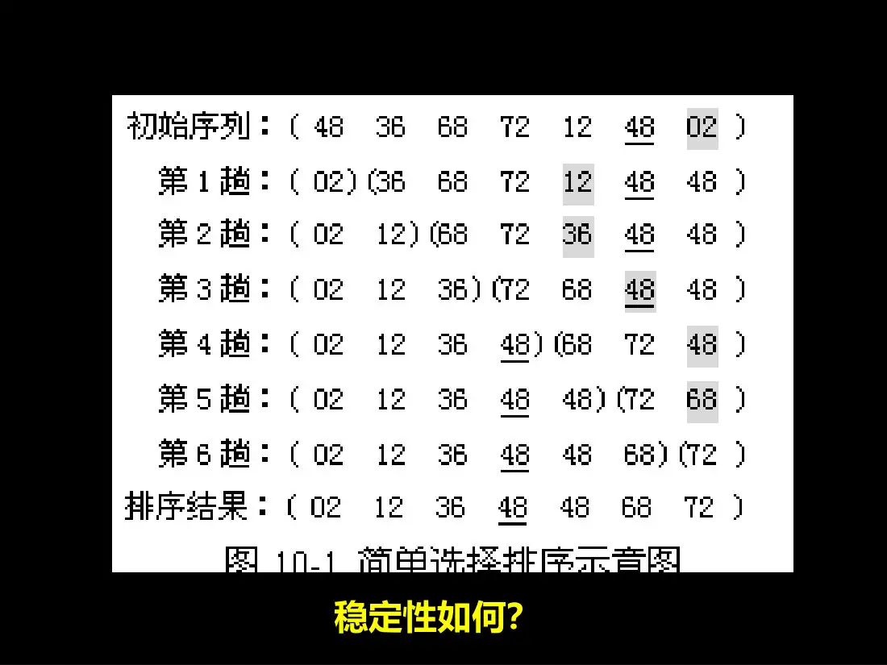

原文：

图10-1 简单选择排序示音图 稳定性如何？
<table><tr><td>初始序列: (48 36 68 72 12 48 02)</td></tr><tr><td>第1趟: (02)(36 68 72 12 48 48)</td></tr><tr><td>第2趟: (02 12)(68 72 36 48 48)</td></tr><tr><td>第3趟: (02 12 36)(72 68 48 48)</td></tr><tr><td>第4趟: (02 12 36 48)(68 72 48)</td></tr><tr><td>第5趟: (02 12 36 48 48)(72 68)</td></tr><tr><td>第6趟: (02 12 36 48 48 68)(72)</td></tr><tr><td>排序结果: (02 12 36 48 48 68 72)</td></tr></table>

### 第 8 页

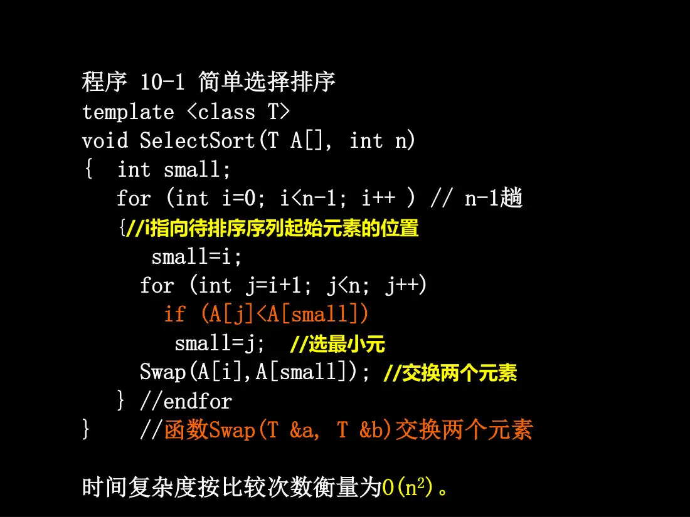

原文：

程序 10-1 简单选择排序template <class T>void SelectSort(T A[], int n){ int small;for (int i=0; i<n-1; i++ ) // n-1趟{//i指向待排序序列起始元素的位置small=i;for (int j=i+1; j<n; j++)if (A[j]<A[small])small=j; //选最小元Swap(A[i],A[small]); //交换两个元素} //endfor} //函数Swap(T &a, T &b)交换两个元素时间复杂度按比较次数衡量为O(n2)。

### i指向待排序区的开始位置small变量记录待排序区中当前最小元素的下标值;

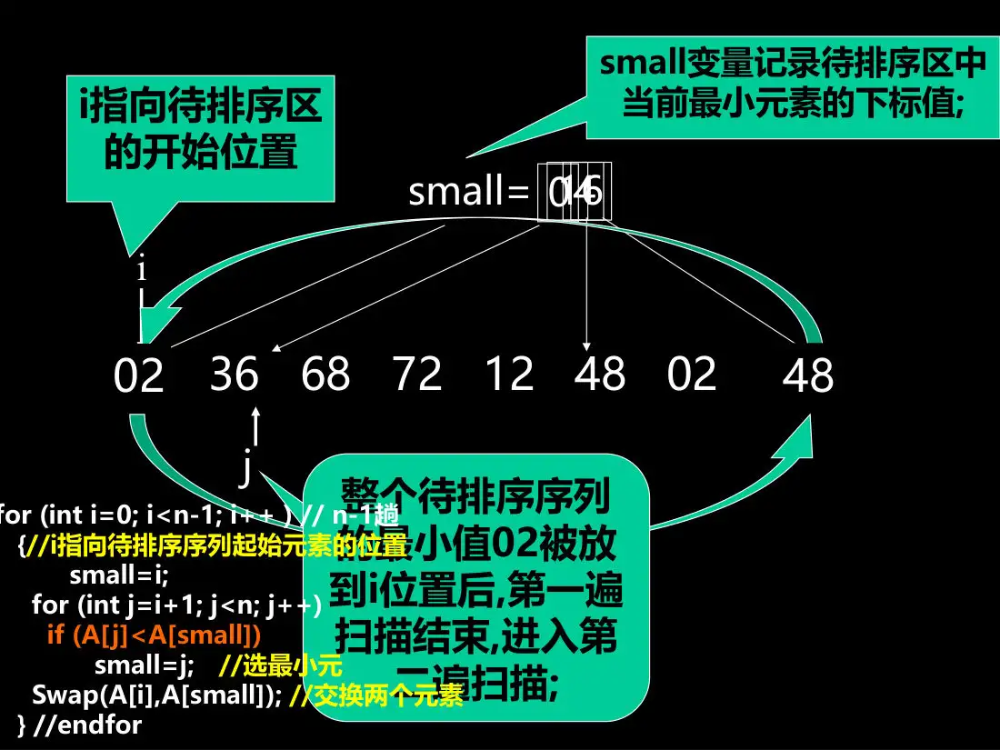

原文：

i指向待排序区的开始位置small变量记录待排序区中当前最小元素的下标值;

small= 0146

4802 36 68 72 12 48 02 48

for (int j=i+1; j<n; j+ if (A[j]<A[small])

整个待排序序列 n-1趟的最小值02被放的位置到i位置后,第一遍j为扫描“指针扫描结束,进入第”;二遍扫描;交换两个元素

} //endfor

### 该算法必须进行n-1趟，每趟进行n-i-1次比较，这样总的比较次数为

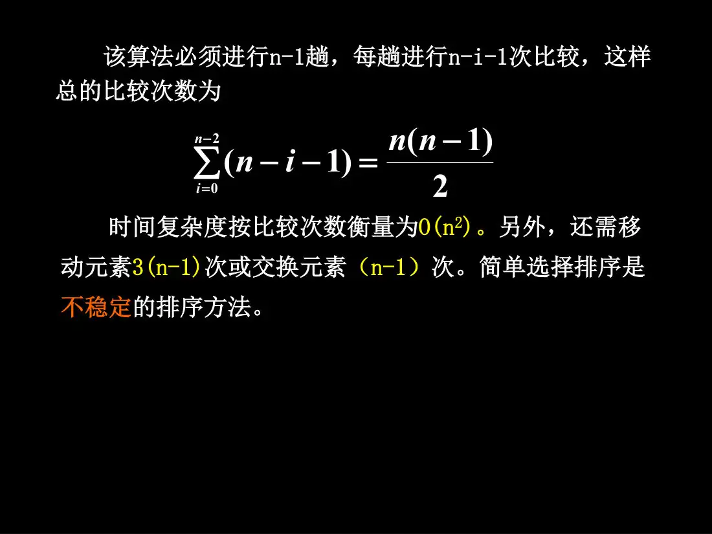

原文：

该算法必须进行n-1趟，每趟进行n-i-1次比较，这样总的比较次数为

$$
\sum_ {i = 0} ^ {n - 2} (n - i - 1) = \frac {n (n - 1)}{2}
$$

时间复杂度按比较次数衡量为O(n2)。另外，还需移动元素3(n-1)次或交换元素（n-1）次。简单选择排序是不稳定的排序方法。

### 10.2.2 直接插入排序

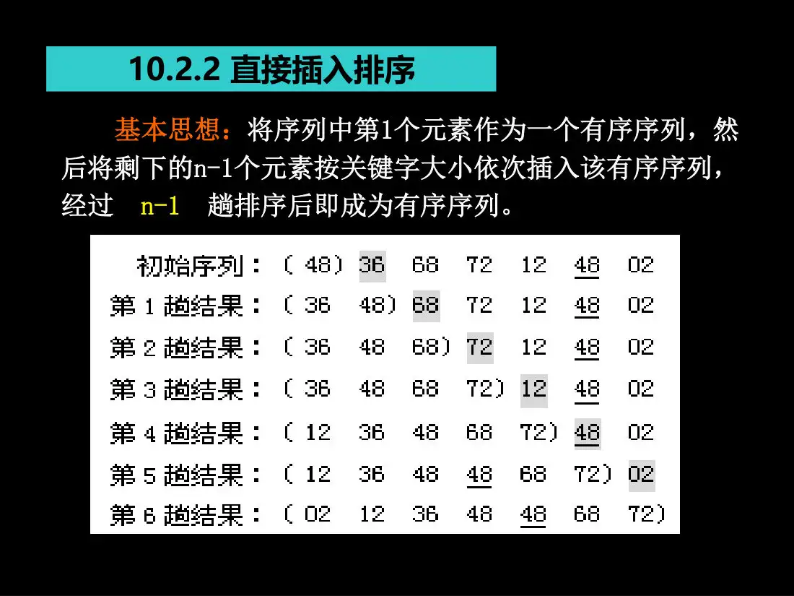

原文：

10.2.2 直接插入排序

基本思想：将序列中第1个元素作为一个有序序列，然后将剩下的n-1个元素按关键字大小依次插入该有序序列，经过 n-1 趟排序后即成为有序序列。

<table><tr><td colspan="8">初始序列: (48) 36 68 72 12 48 02</td></tr><tr><td colspan="8">第1趟结果: (36 48) 68 72 12 48 02</td></tr><tr><td colspan="8">第2趟结果: (36 48 68) 72 12 48 02</td></tr><tr><td colspan="8">第3趟结果: (36 48 68 72) 12 48 02</td></tr><tr><td colspan="8">第4趟结果: (12 36 48 68 72) 48 02</td></tr><tr><td colspan="8">第5趟结果: (12 36 48 48 68 72) 02</td></tr><tr><td colspan="8">第6趟结果: (02 12 36 48 48 68 72)</td></tr></table>

### 第 12 页

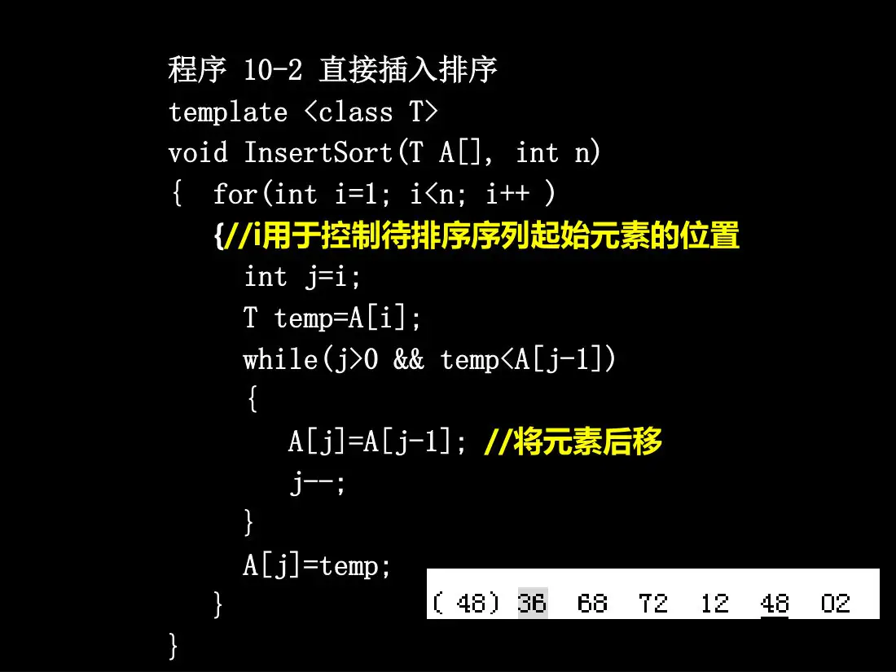

原文：

程序 10-2 直接插入排序template <class T>void InsertSort(T A[], int n){ for(int i=1; i<n; i++ ){//i用于控制待排序序列起始元素的位置int j=i;T temp=A[i];while(j>0 && temp<A[j-1])A[j]=A[j-1]; //将元素后移j--;A[j]=temp;} ( 48) 36 68 72 12temp = 6872136i之前是有序区;排序开始的时候i=1;

### 36 68 72 12 480248temp中存放新的欲处理元素；

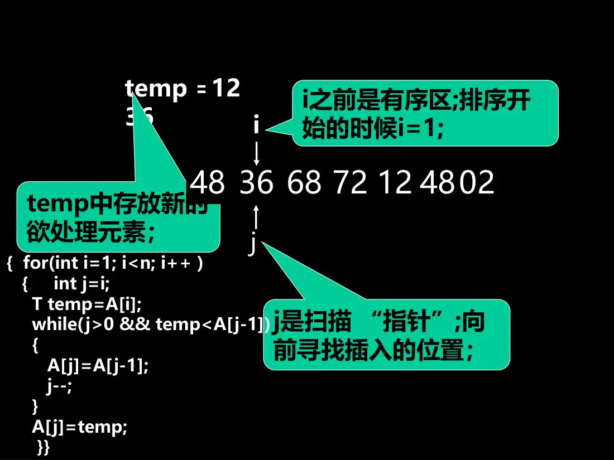

原文：

36 68 72 12 480248temp中存放新的欲处理元素；

{ for(int i=1; i<n; i++ ) { int j=i; T temp=A[i]; while(j>0 && temp<A[j-1 A[j]=A[j-1]; j--; A[j]=temp; }}

j是扫描 “指针”;向前寻找插入的位置；

### 在最坏情况下需要比较

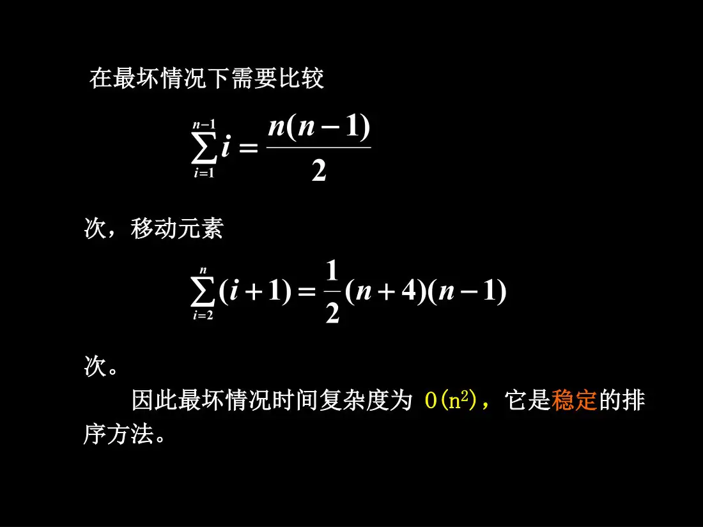

原文：

在最坏情况下需要比较

$$
\sum_ {i = 1} ^ {n - 1} i = \frac {n (n - 1)}{2}
$$

次，移动元素

$$
\sum_ {i = 2} ^ {n} (i + 1) = \frac {1}{2} (n + 4) (n - 1)
$$

因此最坏情况时间复杂度为 $\textcircled { 1 } \textcircled { 6 } \textcircled { 2 }$ ，它是稳定的排序方法。

### 10.2.3 冒泡排序

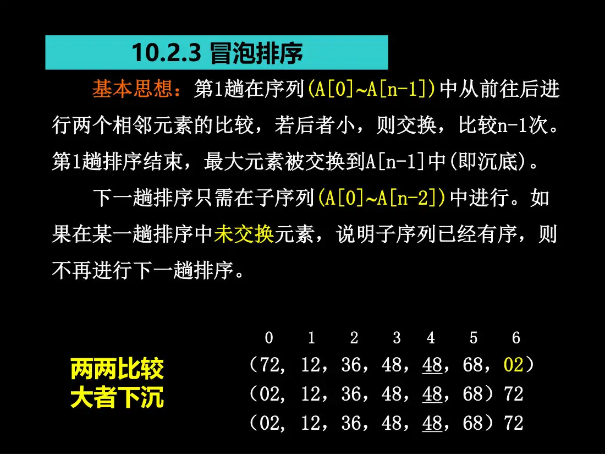

原文：

10.2.3 冒泡排序

基本思想：第1趟在序列(A[0]A[n-1])中从前往后进行两个相邻元素的比较，若后者小，则交换，比较n-1次。第1趟排序结束，最大元素被交换到A[n-1]中(即沉底)。

下一趟排序只需在子序列(A[0]A[n-2])中进行。如果在某一趟排序中未交换元素，说明子序列已经有序，则不再进行下一趟排序。

两两比较大者下沉

$$
\begin{array}{c c c c c c c} 0 & 1 & 2 & 3 & 4 & 5 & 6 \\ (7 2, & 1 2, & 3 6, & 4 8, & \underline {{4 8}}, & 6 8, & 0 2) \\ (0 2, & 1 2, & 3 6, & 4 8, & \underline {{4 8}}, & 6 8) & 7 2 \\ (0 2, & 1 2, & 3 6, & 4 8, & \underline {{4 8}}, & 6 8) & 7 2 \end{array}
$$

### A[j+1]<A[j]?

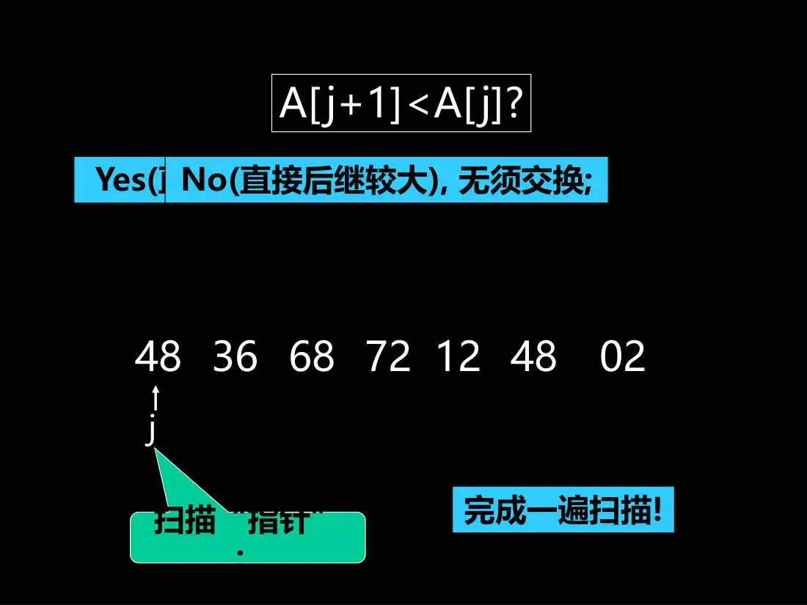

原文：

A[j+1]<A[j]?

Yes(直接后继较小 No(直接后继较大 ), 交换之), 无须交换 ; ;

48 36 68 72 12 48 02

扫描“指针”

完成一遍扫描!

### （48，36，68，72，12，48，02）

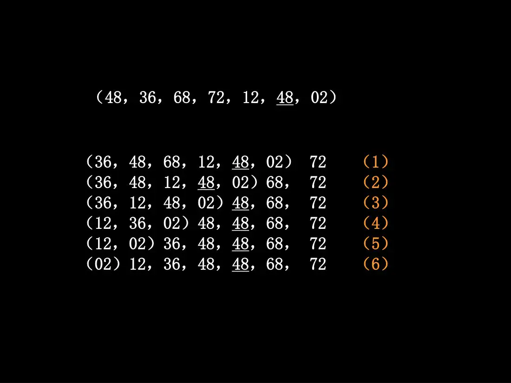

原文：

（48，36，68，72，12，48，02）

<table><tr><td>(36, 48, 68, 12, 48, 02)</td><td>72</td><td>(1)</td></tr><tr><td>(36, 48, 12, 48, 02)</td><td>68, 72</td><td>(2)</td></tr><tr><td>(36, 12, 48, 02)</td><td>48, 68, 72</td><td>(3)</td></tr><tr><td>(12, 36, 02)</td><td>48, 48, 68, 72</td><td>(4)</td></tr><tr><td>(12, 02)</td><td>36, 48, 48, 68, 72</td><td>(5)</td></tr><tr><td>(02)</td><td>12, 36, 48, 48, 68, 72</td><td>(6)</td></tr></table>

### （48，36，68，72，12，48，02

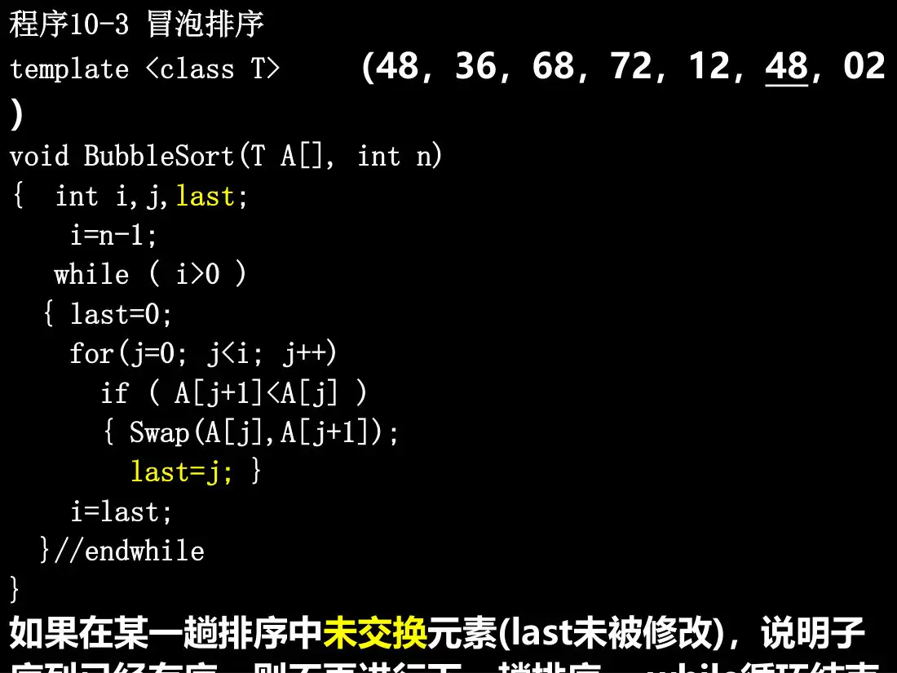

原文：

（48，36，68，72，12，48，02

void BubbleSort(T A[], int n) { int i,j,last; i=n-1; while ( i>0 ) { last=0; for(j=0; j<i; j++) if ( A[j+1]<A[j] ) { Swap(A[j],A[j+1]); last=j; } i=last; }//endwhile

如果在某一趟排序中未交换元素(last未被修改)，说明子

### $$

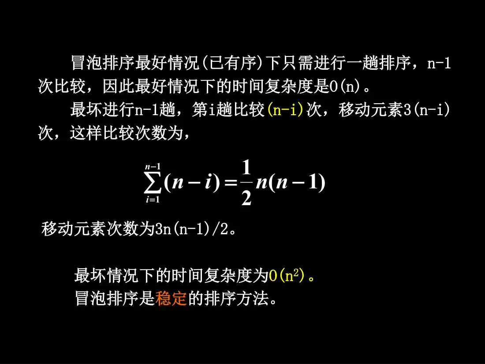

原文：

冒泡排序最好情况(已有序)下只需进行一趟排序，n-1次比较，因此最好情况下的时间复杂度是O(n)。

最坏进行n-1趟，第i趟比较(n-i)次，移动元素3(n-i)次，这样比较次数为，

$$
\sum_ {i = 1} ^ {n - 1} (n - i) = \frac {1}{2} n (n - 1)
$$

移动元素次数为 $3 0 0 - 1 0 0 = 1 0 0$ 0

最坏情况下的时间复杂度为 $\textcircled { 1 } \textcircled { 6 } \textcircled { 7 }$ 0

冒泡排序是稳定的排序方法。

### 10.3 快速排序

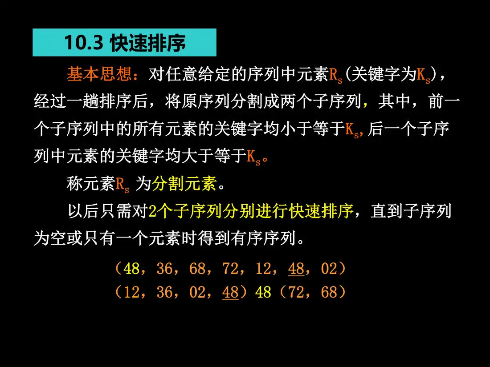

原文：

10.3 快速排序

基本思想：对任意给定的序列中元素 $1 0 \%$ (关键字为K )，经过一趟排序后，将原序列分割成两个子序列，其中，前一个子序列中的所有元素的关键字均小于等于 $1 1 \div 3 = 1 \cdots 1$ 后一个子序列中元素的关键字均大于等于 $1 5 .$ 。

称元素 $1 0 \%$ 为分割元素。

以后只需对2个子序列分别进行快速排序，直到子序列为空或只有一个元素时得到有序序列。

（48，36，68，72，12，48，02）

（12，36，02，48）48（72，68）

### left ↓

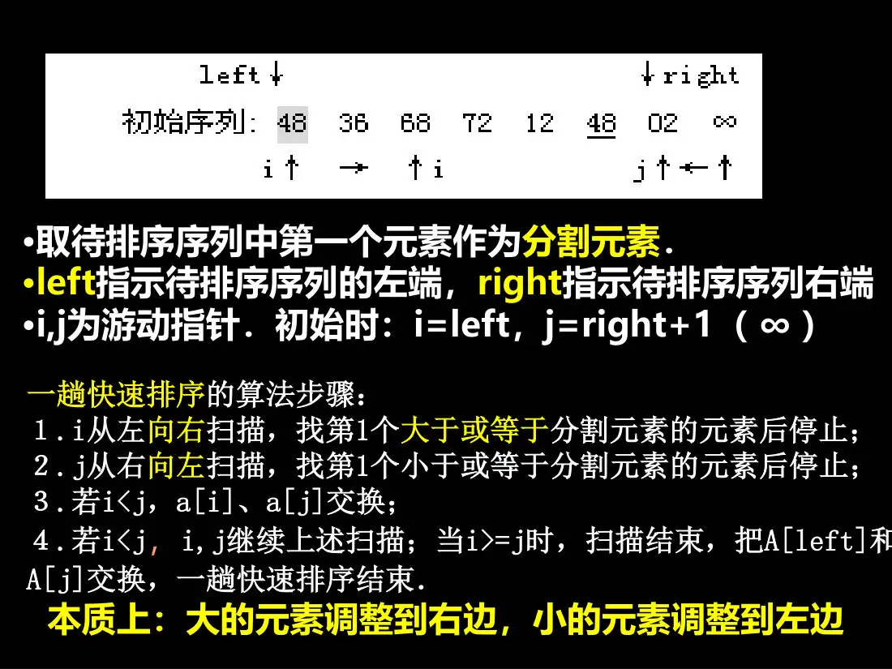

原文：

left ↓

初始序列：

68

72

↓right

48

j↑←↑

•取待排序序列中第一个元素作为分割元素•left指示待排序序列的左端，right指示待排序序列右端•i,j为游动指针．初始时：i=left，j=right+1（ ∞ ）

一趟快速排序的算法步骤：

1.i从左向右扫描，找第1个大于或等于分割元素的元素后停止；

2.j从右向左扫描，找第1个小于或等于分割元素的元素后停止；

3.若i<j，a[i]、a[j]交换；

4.若i<j，i,j继续上述扫描；当i>=j时，扫描结束，把A[left]和

A[j]交换，一趟快速排序结束本质上：大的元素调整到右边，小的元素调整到左边

### “指针”，向 找 <= 元素;

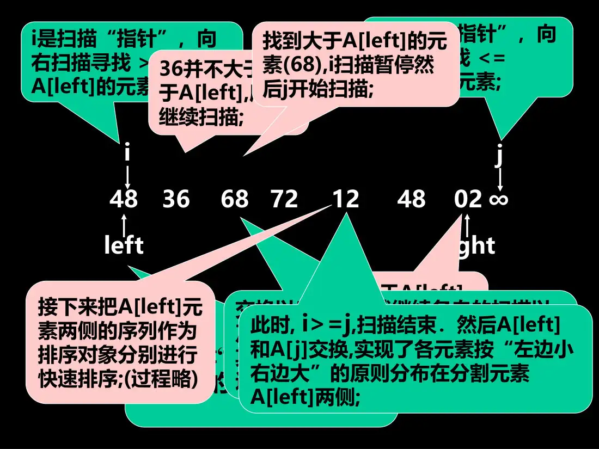

原文：

i是扫描“指针 右扫描寻找 A[left]的元素 = 36并不大于 ;于A[left], 继续扫描;

j是扫描找到大于A[left]的元 左扫描等素(68),i扫描暂停然 以后j开始扫描;

“指针”，向 找 <= 元素;

48 36 48 68 72 12 48 02 ∞

left

接下来把A[left]元 素两侧的序列作为 和rig排序对象分别进行 待排序快速排序;(过程略)

ight

的元素(02), 扫描此时, i>=j,扫描结束．然后A[left] 停止;和A[j]交换,实现了各元素按“左边小 右边大”的原则分布在分割元素 A[left]两侧;

### 第 23 页

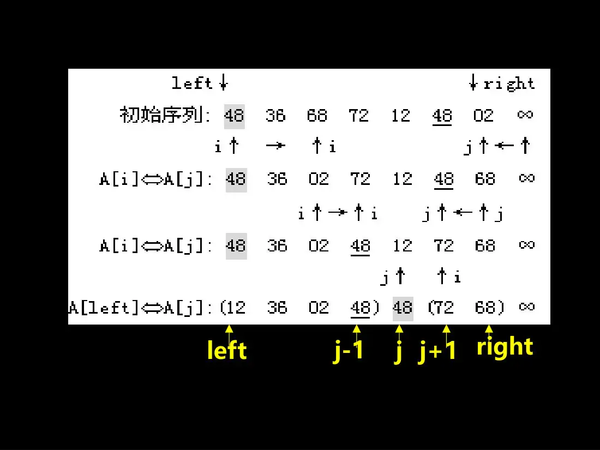

原文：

<table><tr><td colspan="6">left↓</td><td colspan="2">↓ right</td></tr><tr><td>初始序列: 48</td><td>36</td><td>68</td><td>72</td><td>12</td><td>48</td><td>02</td><td>∞</td></tr><tr><td>i↑</td><td>→</td><td>↑i</td><td></td><td></td><td>j↑←↑</td><td></td><td></td></tr><tr><td>A[i]⇔A[j]: 48</td><td>36</td><td>02</td><td>72</td><td>12</td><td>48</td><td>68</td><td>∞</td></tr><tr><td></td><td></td><td>i↑→↑i</td><td></td><td>j↑←↑j</td><td></td><td></td><td></td></tr><tr><td>A[i]⇔A[j]: 48</td><td>36</td><td>02</td><td>48</td><td>12</td><td>72</td><td>68</td><td>∞</td></tr><tr><td></td><td></td><td></td><td>j↑</td><td>↑i</td><td></td><td></td><td></td></tr><tr><td>A[left]⇔A[j]: (12</td><td>36</td><td>02</td><td>48)</td><td>48</td><td>(72</td><td>68)</td><td>∞</td></tr></table>

left j-1 j j+1 right 程序10-4 快速排序 template <class T> void QSort(T A[],int left,int right) { int i,j; if ( left<right ) { i=left; j=right+1; do { do i++; while (A[i]<A[left]); do j--; while (A[j]>A[left]); if (i<j) Swap(A[i],A[j]); }while (i<j); Swap(A[left],A[j]); QSort(A,left,j-1);//对左侧序列快递排序 QSort(A,j+1,right); //对右侧序列快递排序 }//endif

### 第 24 页

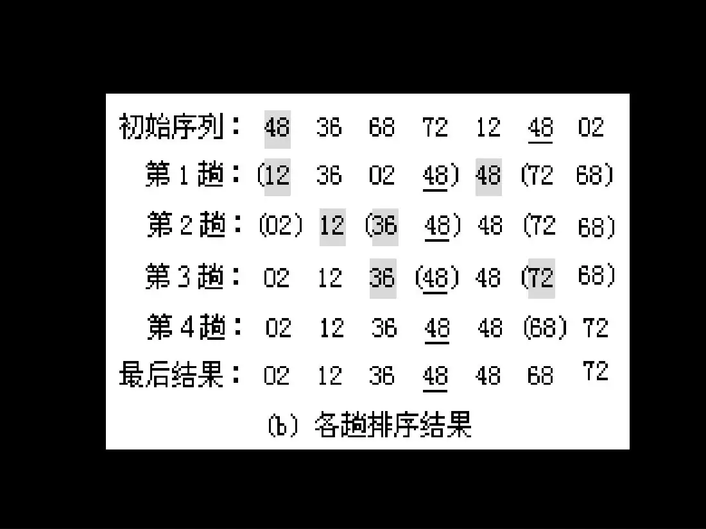

原文：

<table><tr><td>初始序列:</td><td>48</td><td>36</td><td>68</td><td>72</td><td>12</td><td>48</td><td>02</td></tr><tr><td>第1趟:</td><td>(12</td><td>36</td><td>02</td><td>48)</td><td>48</td><td>(72</td><td>68)</td></tr><tr><td>第2趟:</td><td>(02)</td><td>12</td><td>(36</td><td>48)</td><td>48</td><td>(72</td><td>68)</td></tr><tr><td>第3趟:</td><td>02</td><td>12</td><td>36</td><td>(48)</td><td>48</td><td>(72</td><td>68)</td></tr><tr><td>第4趟:</td><td>02</td><td>12</td><td>36</td><td>48</td><td>48</td><td>(68)</td><td>72</td></tr><tr><td>最后结果:</td><td>02</td><td>12</td><td>36</td><td>48</td><td>48</td><td>68</td><td>72</td></tr><tr><td colspan="8">(b)各趟排序结果</td></tr></table>

### 继续

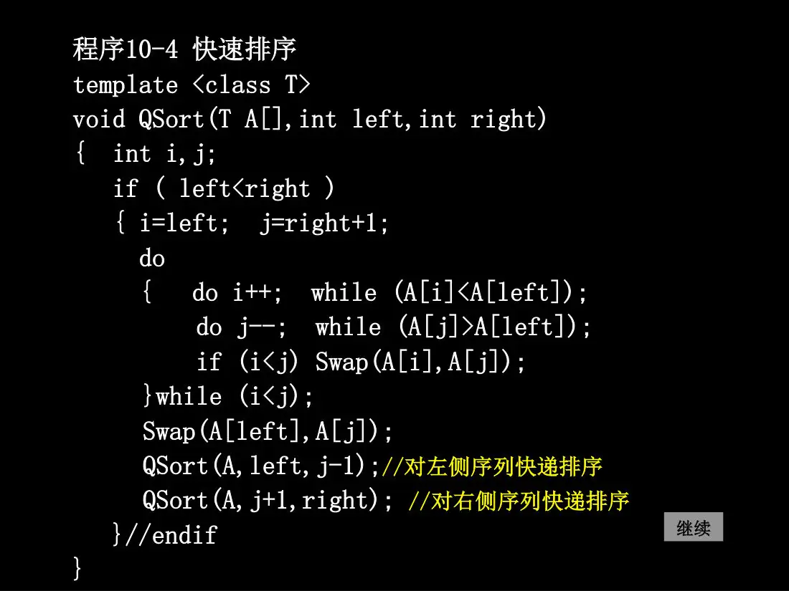

原文：

继续

### 快速排序是不稳定的排序方法。

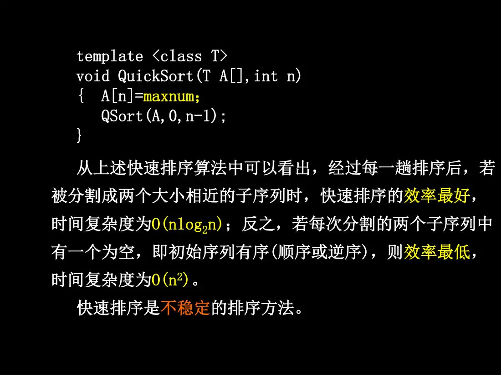

原文：

template <class T> void QuickSort(T A[],int n) { A[n]=maxnum； QSort(A,0,n-1); 1

从上述快速排序算法中可以看出，经过每一趟排序后，若被分割成两个大小相近的子序列时，快速排序的效率最好，时间复杂度为O(nlog n)；反之，若每次分割的两个子序列中有一个为空，即初始序列有序(顺序或逆序)，则效率最低，时间复杂度为O(n2)。

快速排序是不稳定的排序方法。

### 为避免发生最坏情况，选择分割元素时可作三种处理：

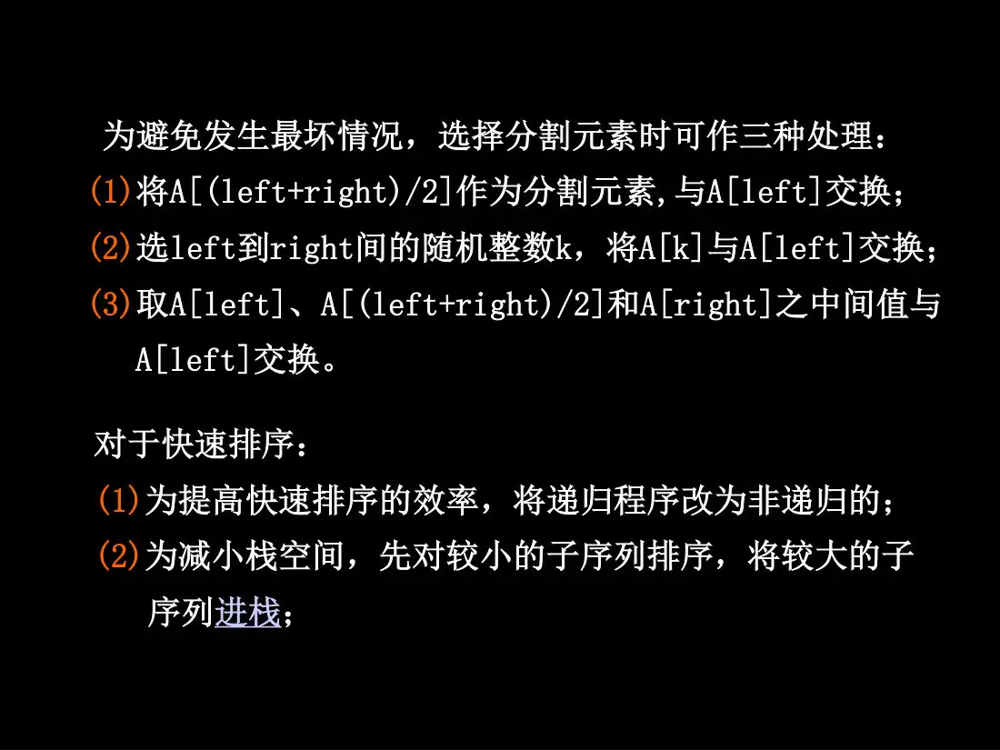

原文：

为避免发生最坏情况，选择分割元素时可作三种处理：

(1)将A[(left+right)/2]作为分割元素,与A[left]交换；

(2)选left到right间的随机整数k，将A[k]与A[left]交换；

(3)取A[left]、A[(left+right)/2]和A[right]之中间值与A[left]交换。

对于快速排序：

(1)为提高快速排序的效率，将递归程序改为非递归的；

(2)为减小栈空间，先对较小的子序列排序，将较大的子序列进栈；

### 10.4 两路合并排序

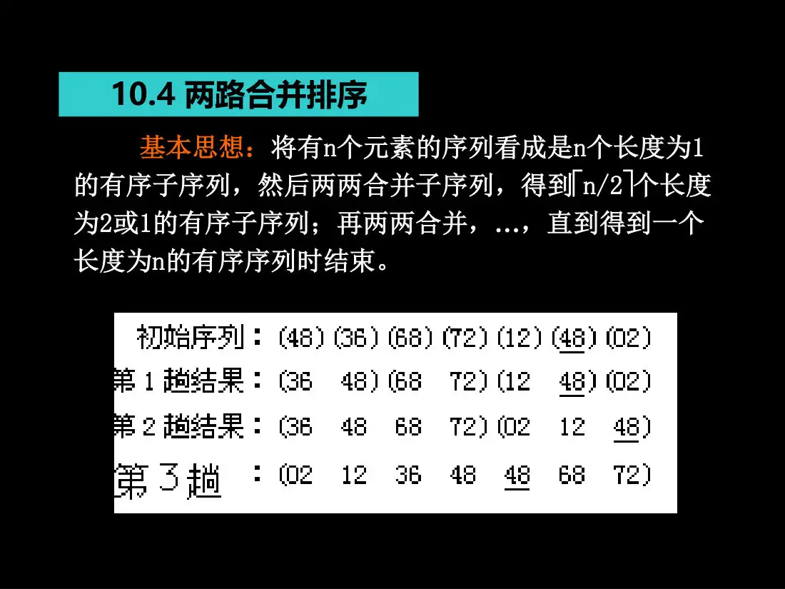

原文：

<table><tr><td colspan="7">初始序列: (48) (36) (68) (72) (12) (48) (02)</td></tr><tr><td colspan="7">第1趟结果: (36 48) (68 72) (12 48) (02)</td></tr><tr><td colspan="7">第2趟结果: (36 48 68 72) (02 12 48)</td></tr><tr><td colspan="7">第3趟: (02 12 36 48 48 68 72)</td></tr></table>

10.4 两路合并排序

基本思想：将有n个元素的序列看成是n个长度为1的有序子序列，然后两两合并子序列，得到n/2个长度为2或1的有序子序列；再两两合并，…，直到得到一个长度为n的有序序列时结束。

### 第 29 页

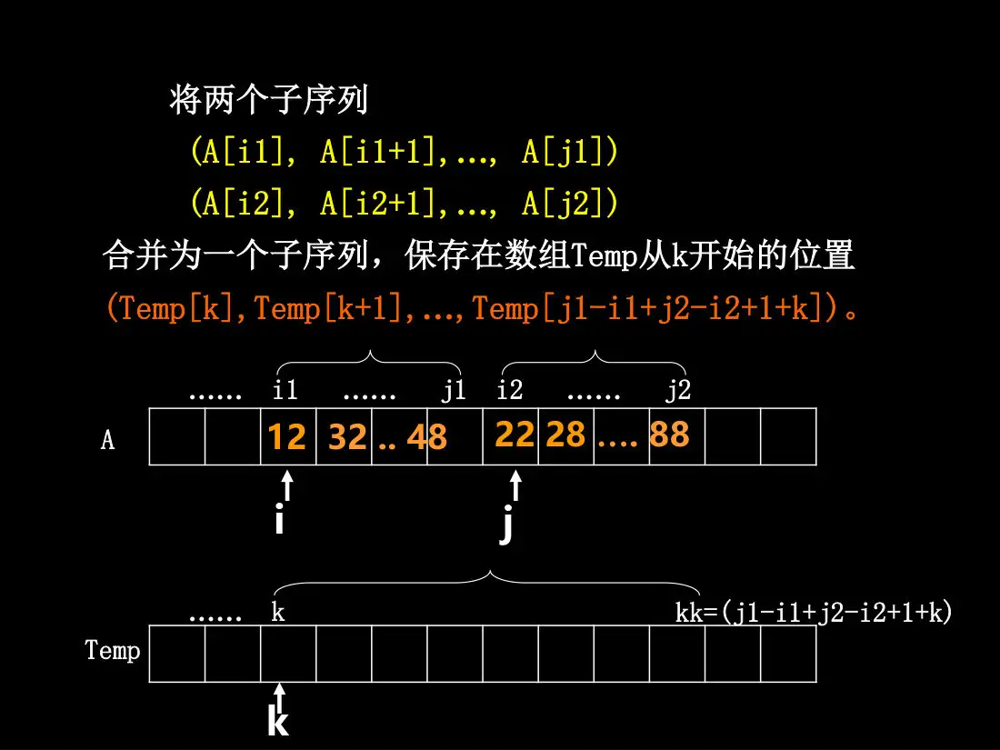

原文：

将两个子序列(A[i1], A[i1+1],…, A[j1])(A[i2], A[i2+1],…, A[j2])合并为一个子序列，保存在数组Temp从k开始的位置(Temp[k],Temp[k+1],…,Temp[j1-i1+j2-i2+1+k])。

### 第 30 页

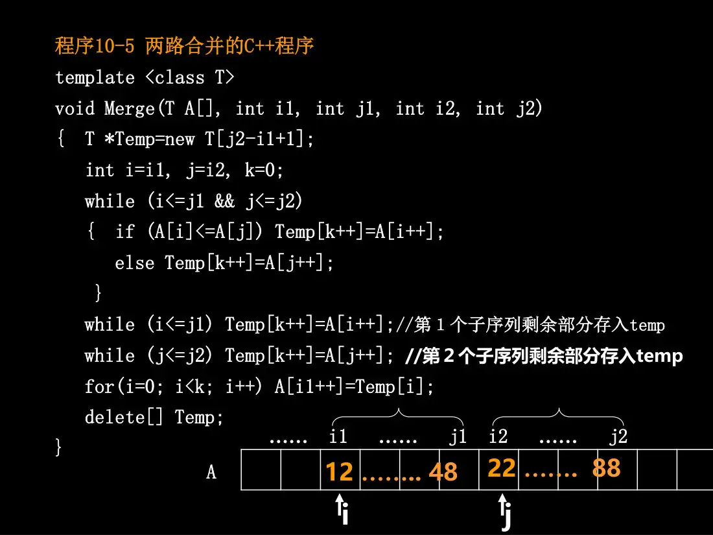

原文：

template <class T> void Merge(T A[], int i1, int j1, int i2, int j2) { T \*Temp=new T[j2-i1+1]; int i=i1, j=i2, k=0; while (i<=j1 && j<=j2) { if (A[i]<=A[j]) Temp[k++]=A[i++]; else Temp[k++]=A[j++];

while (i<=j1) Temp[k++]=A[i++];//第1个子序列剩余部分存入tempwhile (j<=j2) Temp[k++]=A[j++]; //第2个子序列剩余部分存入tempfor(i=0; i<k; i++) A[i1++]=Temp[i];

### size \*=2; //子序列长度扩大1倍

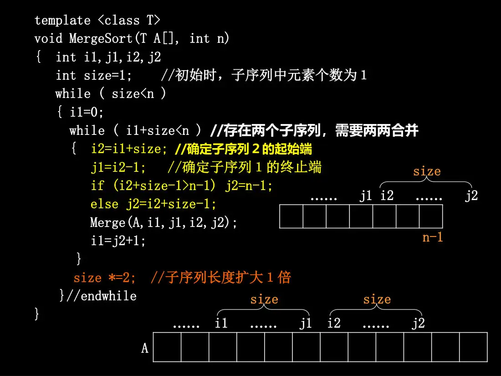

原文：

size \*=2; //子序列长度扩大1倍

### 两路合并排序是一种稳定的排序方法。

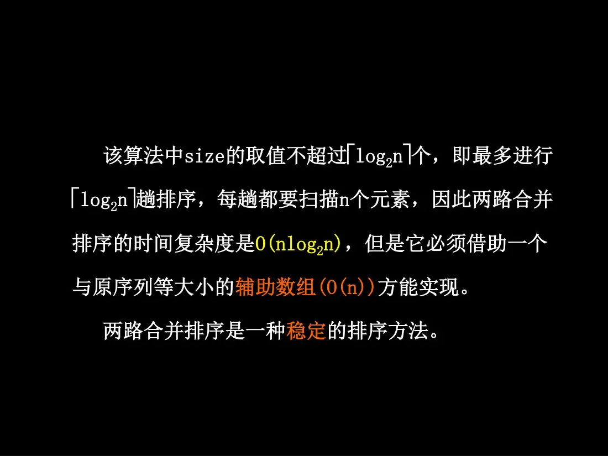

原文：

该算法中size的取值不超过 $1 1 0 \times 3 0 = 1 1 0$ 个，即最多进行$\boxed { 1 } \boxed { 6 } \boxed { 3 } \boxed { 7 }$ 趟排序，每趟都要扫描n个元素，因此两路合并排序的时间复杂度是O $( 0 . 1 1 0 2 3 0 )$ )，但是它必须借助一个与原序列等大小的辅助数组(O(n))方能实现。

两路合并排序是一种稳定的排序方法。

### 10.5 堆排序

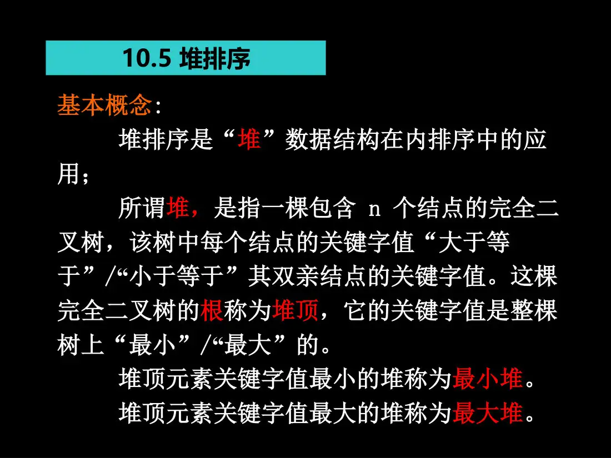

原文：

10.5 堆排序

基本概念:

堆排序是“堆”数据结构在内排序中的应用；

所谓堆，是指一棵包含 n 个结点的完全二叉树，该树中每个结点的关键字值“大于等于”/“小于等于”其双亲结点的关键字值。这棵完全二叉树的根称为堆顶，它的关键字值是整棵树上“最小”/“最大”的。

堆顶元素关键字值最小的堆称为最小堆。

堆顶元素关键字值最大的堆称为最大堆。

### 基本思想：

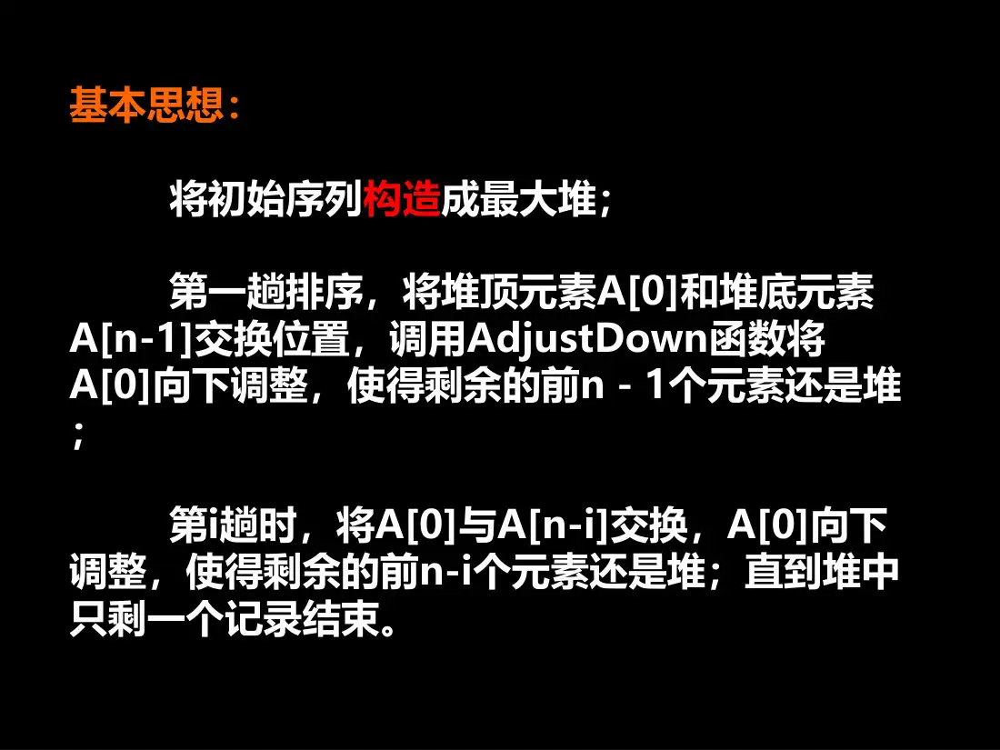

原文：

基本思想：

将初始序列构造成最大堆；

第一趟排序，将堆顶元素A[0]和堆底元素A[n-1]交换位置，调用AdjustDown函数将A[0]向下调整，使得剩余的前n－1个元素还是堆；

第i趟时，将A[0]与A[n-i]交换，A[0]向下调整，使得剩余的前n-i个元素还是堆；直到堆中只剩一个记录结束。

### 第一步,也就是第趟排序,首先将初序列构造成堆;

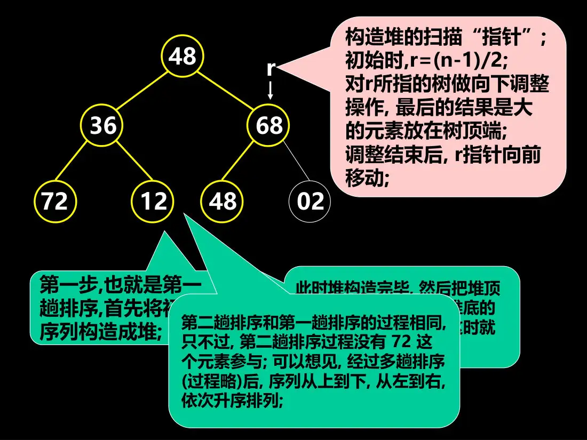

原文：

第一步,也就是第趟排序,首先将初序列构造成堆;

构造堆的扫描“指针”;初始时,r=(n-1)/2;对r所指的树做向下调整操作, 最后的结果是大的元素放在树顶端;调整结束后, r指针向前移动;

此时堆构造完毕, 然后把堆顶

第二趟排序和第一趟排序的过程相同,只不过, 第二趟排序过程没有 72 这个元素参与; 可以想见, 经过多趟排序(过程略)后, 序列从上到下, 从左到右,依次升序排列;

### 第 36 页

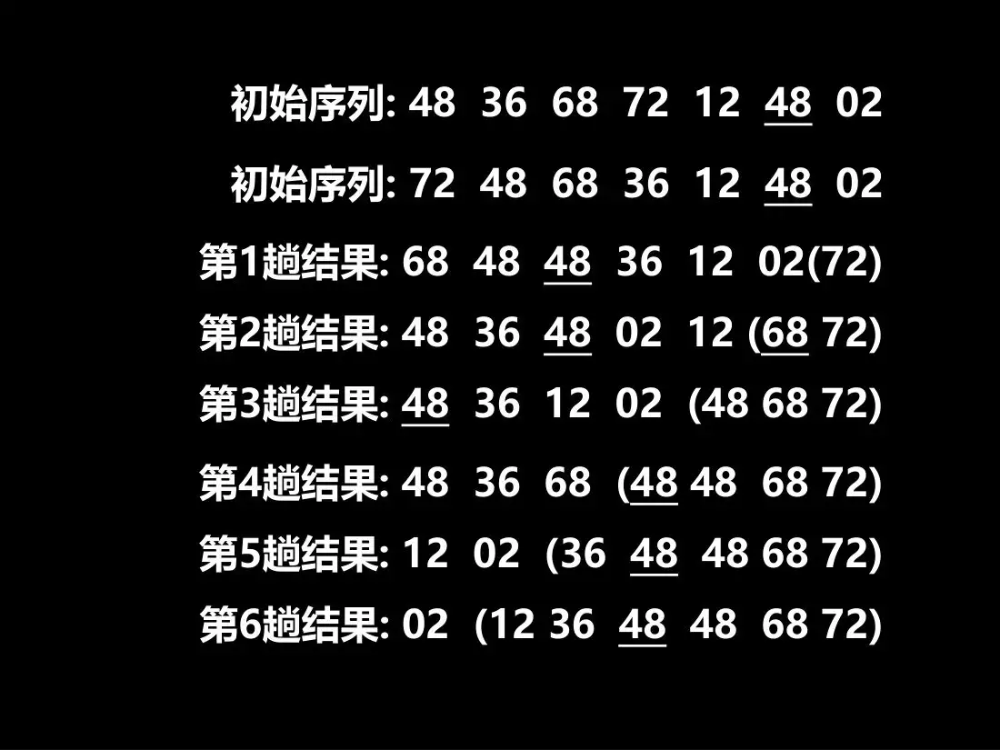

原文：

<table><tr><td>初始序列: 48</td><td>36</td><td>68</td><td>72</td><td>12</td><td>48</td><td>02</td></tr><tr><td>初始序列: 72</td><td>48</td><td>68</td><td>36</td><td>12</td><td>48</td><td>02</td></tr><tr><td>第1趟结果: 68</td><td>48</td><td>48</td><td>36</td><td>12</td><td colspan="2">02(72)</td></tr><tr><td>第2趟结果: 48</td><td>36</td><td>48</td><td>02</td><td>12</td><td>(68</td><td>72)</td></tr><tr><td>第3趟结果: 48</td><td>36</td><td>12</td><td>02</td><td>(48</td><td>68</td><td>72)</td></tr><tr><td>第4趟结果: 48</td><td>36</td><td>68</td><td>(48</td><td>48</td><td>68</td><td>72)</td></tr><tr><td>第5趟结果: 12</td><td>02</td><td>(36</td><td>48</td><td>48</td><td>68</td><td>72)</td></tr><tr><td>第6趟结果: 02</td><td>(12</td><td>36</td><td>48</td><td>48</td><td>68</td><td>72)</td></tr></table>

### 第 37 页

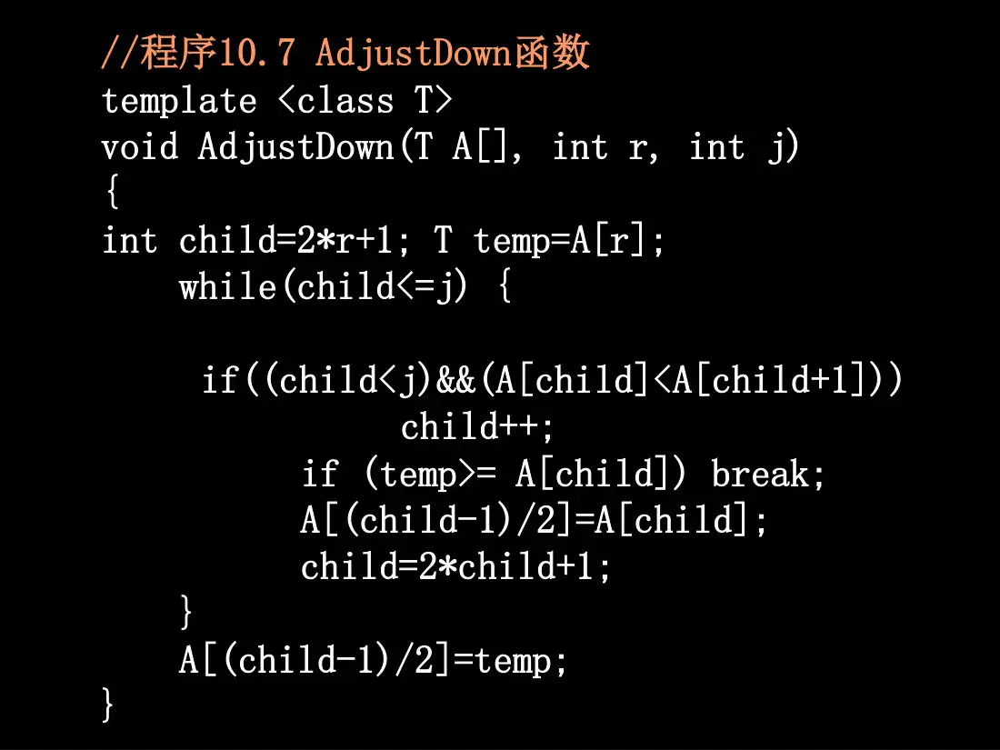

原文：

//程序10.7 AdjustDown函数 template <class T> void AdjustDown(T A[], int r, int j)

int child=2\*r+1; T temp=A[r]; while(child<=j) {

if((child<j)&&(A[child]<A[child+1])) child++; if (temp>= A[child]) break; A[(child-1)/2]=A[child]; child=2\*child+1; } A[(child-1)/2]=temp;

### 第 38 页

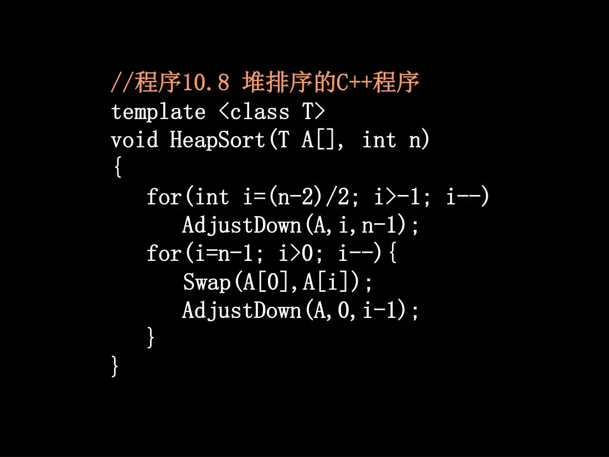

原文：

//程序10.8 堆排序的C++程序template <class T>void HeapSort(T A[], int n)

for(int i=(n-2)/2; i>-1; i--) AdjustDown(A,i,n-1); for(i=n-1; i>0; i--){ Swap(A[0],A[i]); AdjustDown(A,0,i-1);

### 总结:

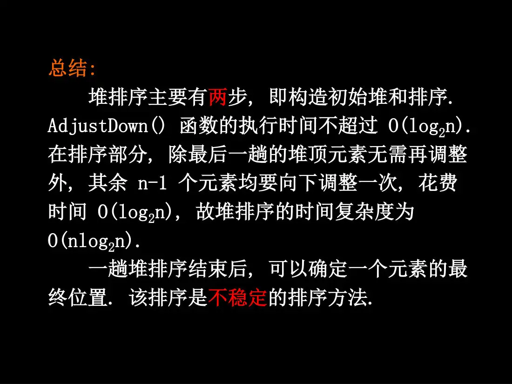

原文：

总结:

堆排序主要有两步, 即构造初始堆和排序.AdjustDown() 函数的执行时间不超过 $( 0 . 1 6 1 0 2 5 0 )$ 在排序部分, 除最后一趟的堆顶元素无需再调整外, 其余 n-1 个元素均要向下调整一次, 花费时间 $\textcircled { 1 } \textcircled { 4 } \textcircled { 6 } \textcircled { 2 } \textcircled { 1 }$ , 故堆排序的时间复杂度为$\textcircled { 1 } \textcircled { 1 0 } \textcircled { 1 0 } \textcircled { 2 } \textcircled { 1 } \textcircled { 1 }$

一趟堆排序结束后, 可以确定一个元素的最终位置. 该排序是不稳定的排序方法.

### 排序要求掌握(比较各种排序)：

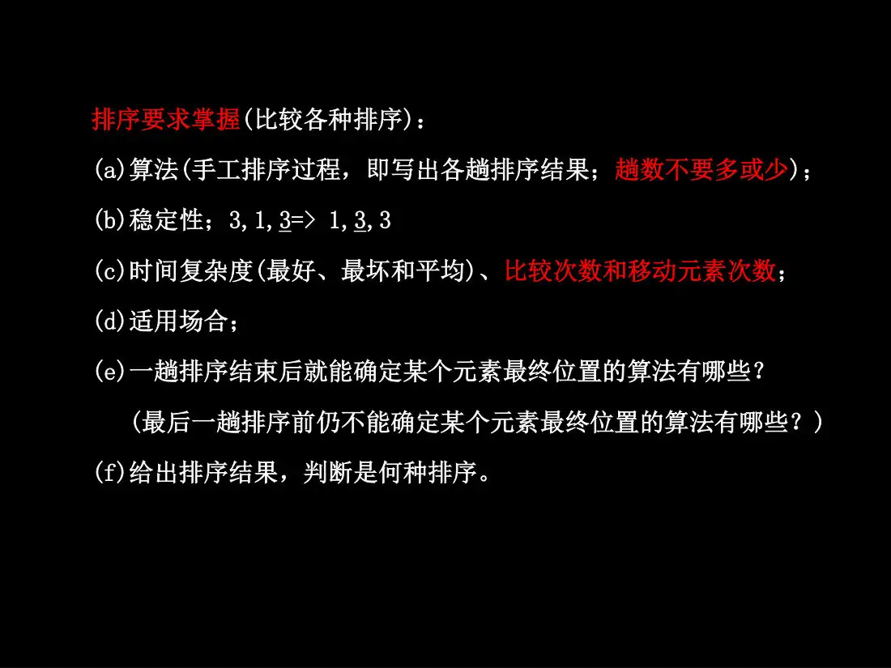

原文：

排序要求掌握(比较各种排序)：

(a)算法(手工排序过程，即写出各趟排序结果；趟数不要多或少)；

(b)稳定性；3,1,3=> 1,3,3

(c)时间复杂度(最好、最坏和平均)、比较次数和移动元素次数；

(d)适用场合；

(e)一趟排序结束后就能确定某个元素最终位置的算法有哪些？

(最后一趟排序前仍不能确定某个元素最终位置的算法有哪些？)

(f)给出排序结果，判断是何种排序。

### 已经有序：冒泡排序：只比较1趟，n-1次，不用移动元素。

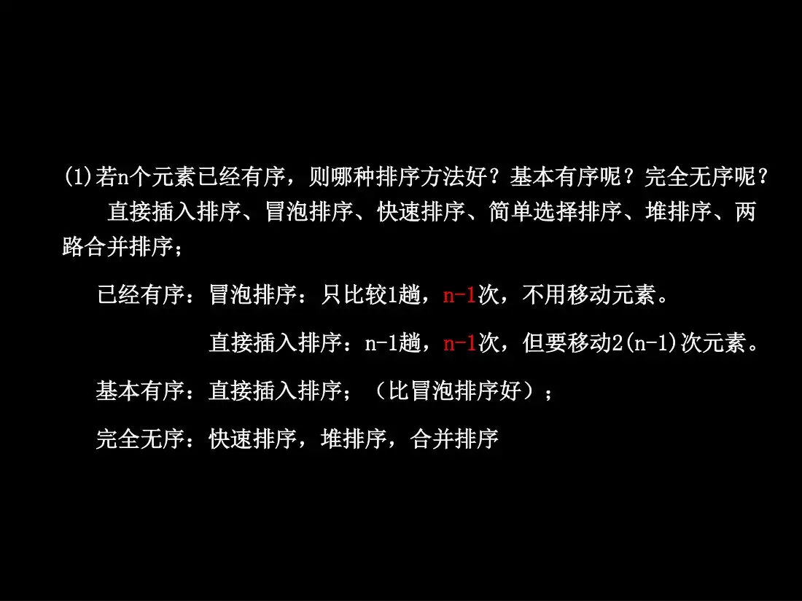

原文：

(1)若n个元素已经有序，则哪种排序方法好？基本有序呢？完全无序呢？直接插入排序、冒泡排序、快速排序、简单选择排序、堆排序、两路合并排序；

已经有序：冒泡排序：只比较1趟，n-1次，不用移动元素。

直接插入排序：n-1趟，n-1次，但要移动2(n-1)次元素。

基本有序：直接插入排序；（比冒泡排序好）；

完全无序：快速排序，堆排序，合并排序

### 第 42 页

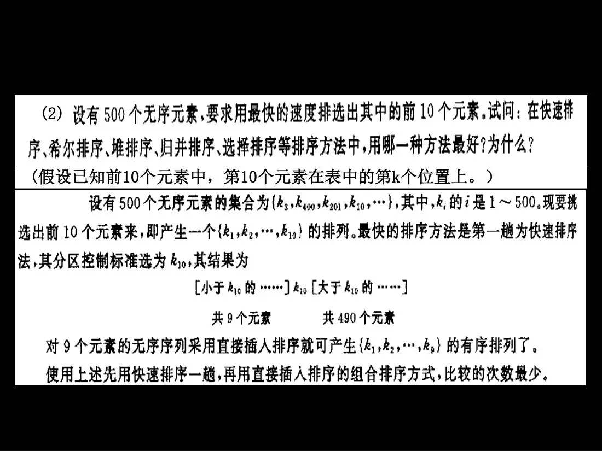

原文：

(2) 设有500个无序元素，要求用最快的速度排选出其中的前10个元素。试问：在快速排序、希尔排序、堆排序、归并排序、选择排序等排序方法中，用哪一种方法最好？为什么？(假设已知前10个元素中，第10个元素在表中的第k个位置上。）

设有500个无序元素的集合为 $\left\{ k _ { 3 } , k _ { 4 0 0 } , k _ { 2 0 1 } , k _ { 1 0 } , \cdots \right\}$ ,其中， $k _ { i }$ 的i是1\~500。现要挑选出前10个元素来，即产生一个 $\{ \pmb { k } _ { 1 } , \pmb { k } _ { 2 } , \cdots , \pmb { k } _ { 1 0 } \}$ 的排列。最快的排序方法是第一趟为快速排序法，其分区控制标准选为 $k _ { 1 0 }$ ,其结果为[小于 $k _ { 1 0 }$ 的……] $k _ { 1 0 }$ 大于 $k _ { 1 0 }$ 的……]共9个元素 共490个元素对9个元素的无序序列采用直接插人排序就可产生 $\left\{ { / k } _ { 1 } , { / k } _ { 2 } , \cdots , { / k } _ { 9 } \right\}$ 的有序排列了。使用上述先用快速排序一趟，再用直接插入排序的组合排序方式，比较的次数最少。
