# 《数据结构》第1章 算法与数据结构（课件）

原件的每一页，下面附识别出的文字。

### 数据结构

原文：

数据结构

汪莹

wying@njupt.edu.cn

QQ群：313663750

手机: 13815890482

### •“数据结构”是设计系统软件及大型应用软件的重要基础。

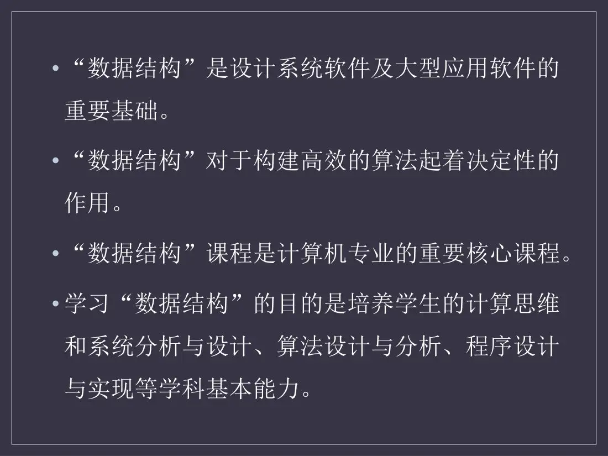

原文：

•“数据结构”是设计系统软件及大型应用软件的重要基础。

•“数据结构”对于构建高效的算法起着决定性的作用。

•“数据结构”课程是计算机专业的重要核心课程。

学习“数据结构”的目的是培养学生的计算思维和系统分析与设计、算法设计与分析、程序设计与实现等学科基本能力。

### 课时计划成绩评定及考核

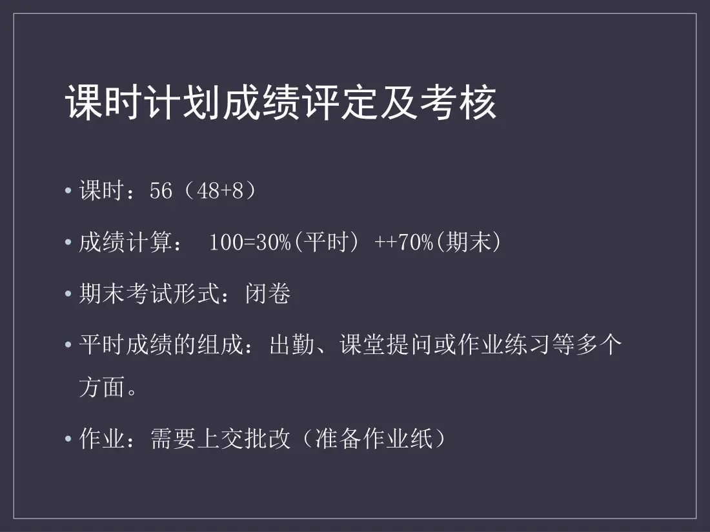

原文：

课时计划成绩评定及考核

• 课时：56（48+8）

• 成绩计算： 100=30%(平时) ++70%(期末)

• 期末考试形式：闭卷

平时成绩的组成：出勤、课堂提问或作业练习等多个方面。

• 作业：需要上交批改（准备作业纸）

### 上课时间：

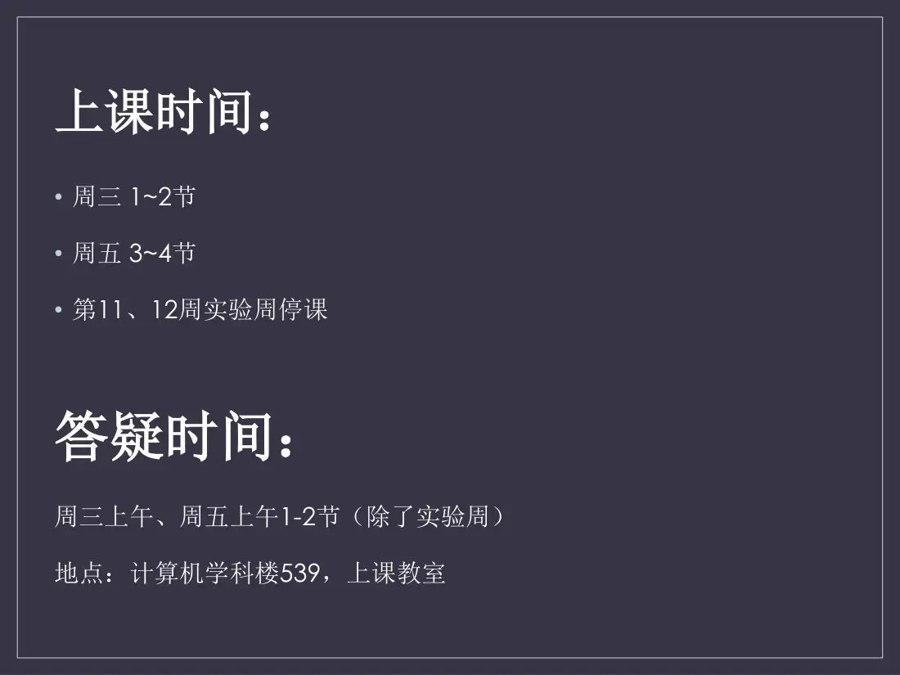

原文：

上课时间：

• 周三 1\~2节

• 周五 3\~4节

• 第11、12周实验周停课

答疑时间：

周三上午、周五上午1-2节（除了实验周）

地点：计算机学科楼539，上课教室

### 几点建议：

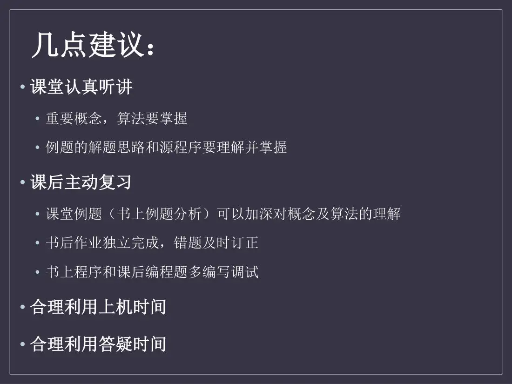

原文：

几点建议：

•课堂认真听讲

重要概念，算法要掌握

例题的解题思路和源程序要理解并掌握

• 课后主动复习

• 课堂例题（书上例题分析）可以加深对概念及算法的理解

• 书后作业独立完成，错题及时订正

书上程序和课后编程题多编写调试

•合理利用上机时间

合理利用答疑时间

### 课程学时分配表

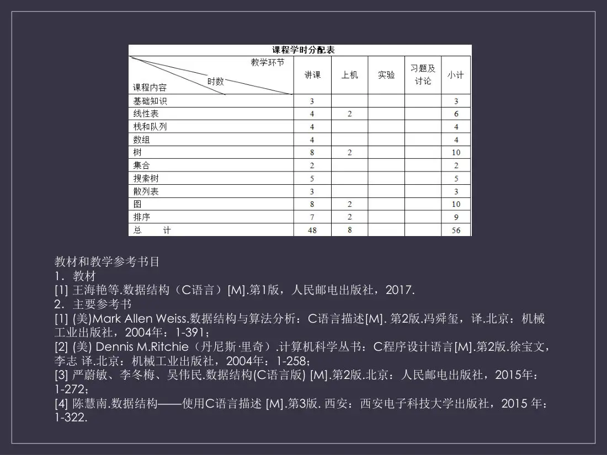

原文：

课程学时分配表
<table><tr><td>课程内容\时数\教学环节</td><td>讲课</td><td>上机</td><td>实验</td><td>习题及讨论</td><td>小计</td></tr><tr><td>基础知识</td><td>3</td><td></td><td></td><td></td><td>3</td></tr><tr><td>线性表</td><td>4</td><td>2</td><td></td><td></td><td>6</td></tr><tr><td>栈和队列</td><td>4</td><td></td><td></td><td></td><td>4</td></tr><tr><td>数组</td><td>4</td><td></td><td></td><td></td><td>4</td></tr><tr><td>树</td><td>8</td><td>2</td><td></td><td></td><td>10</td></tr><tr><td>集合</td><td>2</td><td></td><td></td><td></td><td>2</td></tr><tr><td>搜索树</td><td>5</td><td></td><td></td><td></td><td>5</td></tr><tr><td>散列表</td><td>3</td><td></td><td></td><td></td><td>3</td></tr><tr><td>图</td><td>8</td><td>2</td><td></td><td></td><td>10</td></tr><tr><td>排序</td><td>7</td><td>2</td><td></td><td></td><td>9</td></tr><tr><td>总计</td><td>48</td><td>8</td><td></td><td></td><td>56</td></tr></table>

教材和教学参考书目

1．教材

[1] 王海艳等.数据结构（C语言）[M].第1版，人民邮电出版社，2017.

2．主要参考书

[1] (美)Mark Allen Weiss.数据结构与算法分析：C语言描述[M]. 第2版.冯舜玺，译.北京：机械工业出版社，2004年：1-391；

[2] (美) Dennis M.Ritchie（丹尼斯·里奇）.计算机科学丛书：C程序设计语言[M].第2版.徐宝文，李志 译.北京：机械工业出版社，2004年：1-258；

[3] 严蔚敏、李冬梅、吴伟民.数据结构(C语言版) [M].第2版.北京：人民邮电出版社，2015年：1-272；

[4] 陈慧南.数据结构— 使用C语言描述 [M].第3版. 西安：西安电子科技大学出版社，2015 年：1-322.

### 目录

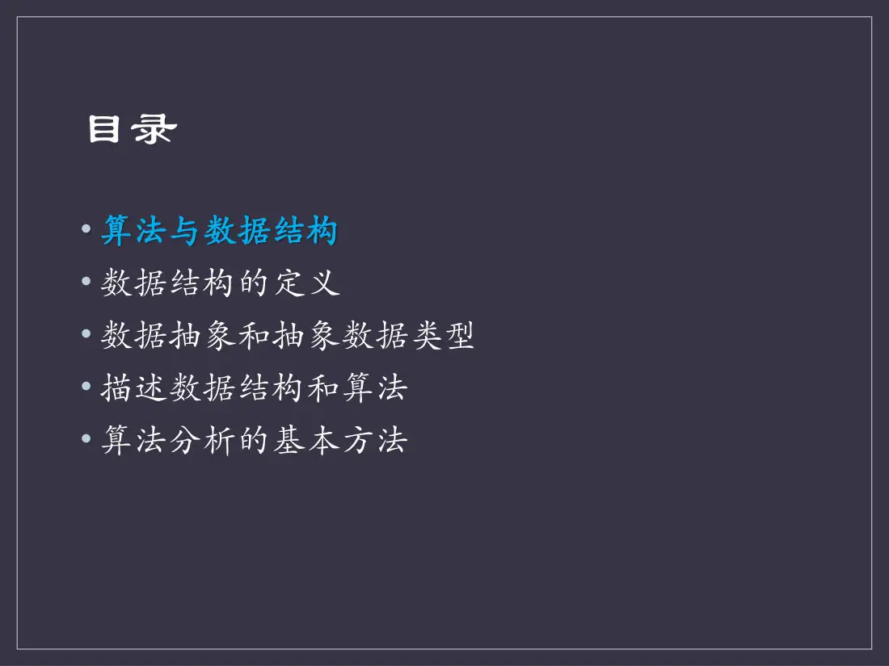

原文：

目录

算法与数据结构

数据结构的定义

数据抽象和抽象数据类型

描述数据结构和算法

•算法分析的基本方法

### 算法和数据结构

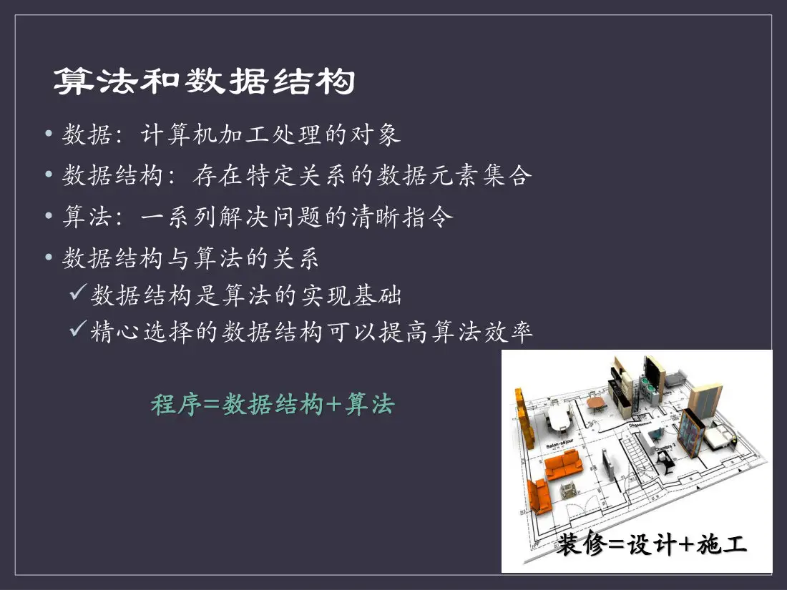

原文：

算法和数据结构

• 数据：计算机加工处理的对象

• 数据结构：存在特定关系的数据元素集合

• 算法：一系列解决问题的清晰指令

• 数据结构与算法的关系

✓数据结构是算法的实现基础

✓精心选择的数据结构可以提高算法效率

程序=数据结构+算法

### 目录

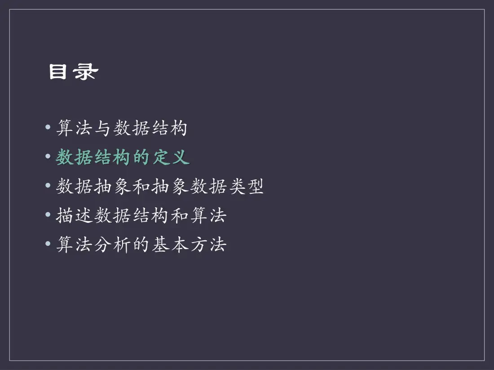

原文：

目录

算法与数据结构

•数据结构的定义

数据抽象和抽象数据类型

描述数据结构和算法

•算法分析的基本方法

### 数据结构的基本概念

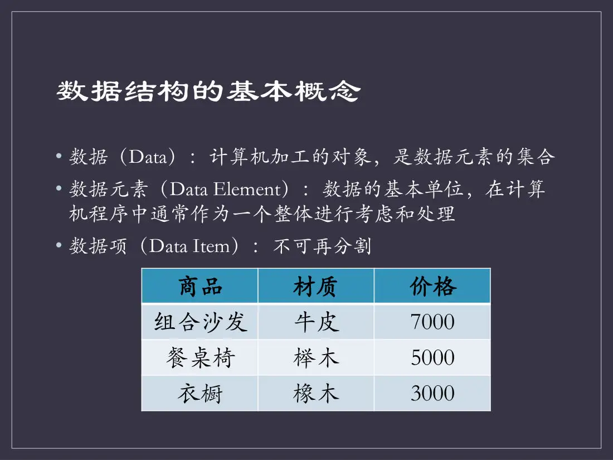

原文：

数据结构的基本概念

• 数据（Data）：计算机加工的对象，是数据元素的集合

数据元素（Data Element）：数据的基本单位，在计算机程序中通常作为一个整体进行考虑和处理

• 数据项（Data Item）：不可再分割

<table><tr><td>商品</td><td>材质</td><td>价格</td></tr><tr><td>组合沙发</td><td>牛皮</td><td>7000</td></tr><tr><td>餐桌椅</td><td>榉木</td><td>5000</td></tr><tr><td>衣橱</td><td>橡木</td><td>3000</td></tr></table>

### 数据结构定义

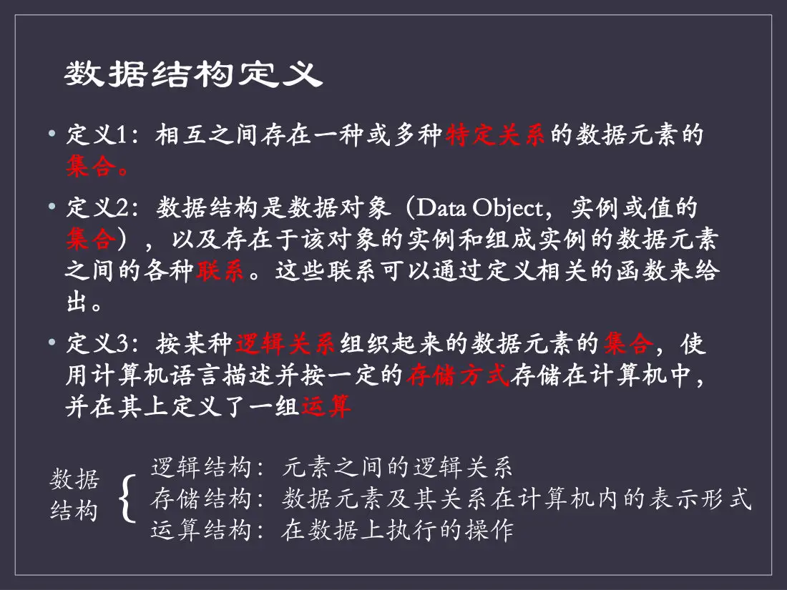

原文：

数据结构定义

•定义1：相互之间存在一种或多种特定关系的数据元素的集合。

定义2：数据结构是数据对象（Data Object，实例或值的集合），以及存在于该对象的实例和组成实例的数据元素之间的各种联系。这些联系可以通过定义相关的函数来给出。

定义3：按某种逻辑关系组织起来的数据元素的集合，使用计算机语言描述并按一定的存储方式存储在计算机中，并在其上定义了一组运算

数据

逻辑结构：元素之间的逻辑关系

结构

存储结构：数据元素及其关系在计算机内的表示形式

运算结构：在数据上执行的操作

### 数据的逻辑结构

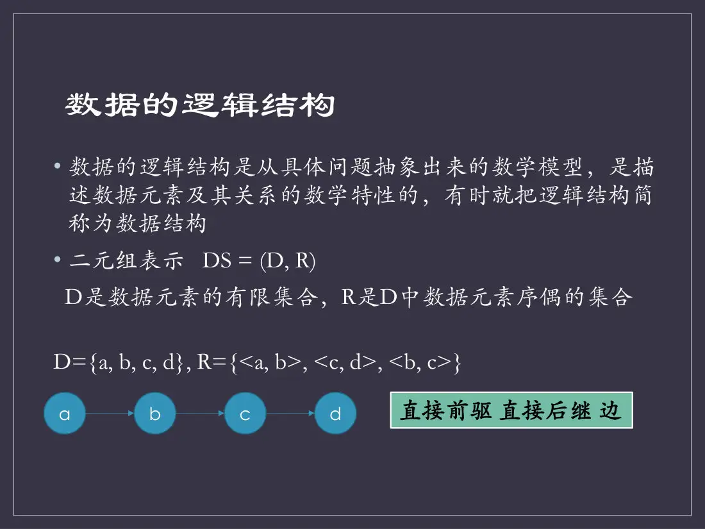

原文：

数据的逻辑结构

数据的逻辑结构是从具体问题抽象出来的数学模型，是描述数据元素及其关系的数学特性的，有时就把逻辑结构简称为数据结构

二元组表示 $1 0 8 - 1 0 0 = 1 0$ D是数据元素的有限集合，R是D中数据元素序偶的集合

$$
D = \{a, b, c, d \}, R = \{\langle a, b \rangle , \langle c, d \rangle , \langle b, c \rangle \}
$$

直接前驱直接后继边

### 基本逻辑结构

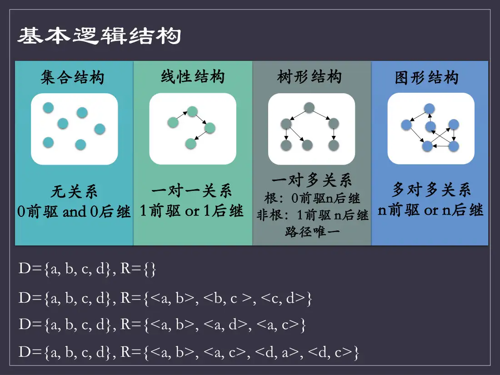

原文：

基本逻辑结构

集合结构

无关系0前驱 and 0后继线性结构

一对一关系1前驱 or 1后继树形结构

一对多关系

根：0前驱n后继

图形结构

非根：1前驱 n后继路径唯一

多对多关系n前驱 or n后继

$$
\mathrm{D} = \{a, b, c, d \}, \mathrm{R} = \{\}
$$

$$
\mathrm{D} = \{a, b, c, d \}, R = \{\langle a, b \rangle , \langle b, c \rangle , \langle c, d \rangle \}
$$

$$
\mathrm{D} = \{a, b, c, d \}, R = \{\langle a, b \rangle , \langle a, d \rangle , \langle a, c \rangle \}
$$

$$
D = \{a, b, c, d \}, R = \{\langle a, b \rangle , \langle a, c \rangle , \langle d, a \rangle , \langle d, c \rangle \}
$$

### 数据结构示例

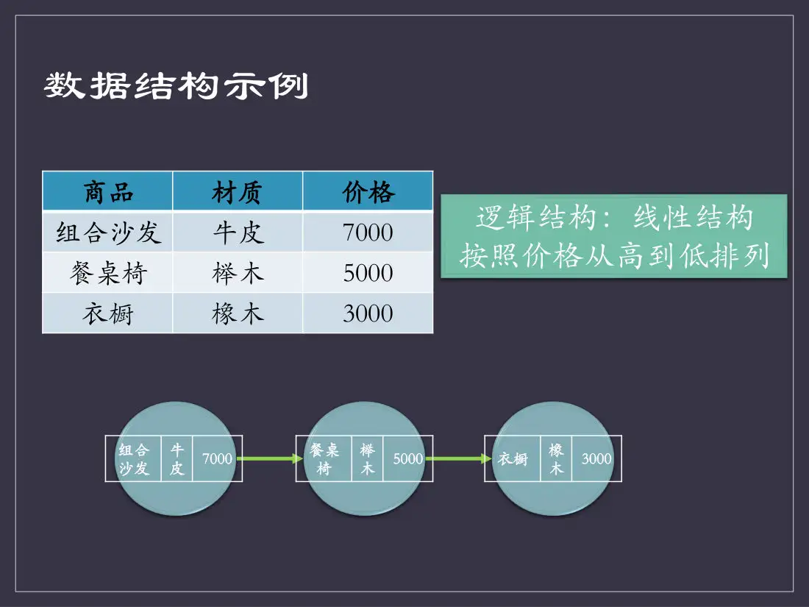

原文：

数据结构示例

<table><tr><td>商品</td><td>材质</td><td>价格</td></tr><tr><td>组合沙发</td><td>牛皮</td><td>7000</td></tr><tr><td>餐桌椅</td><td>榉木</td><td>5000</td></tr><tr><td>衣橱</td><td>橡木</td><td>3000</td></tr></table>

逻辑结构：线性结构按照价格从高到低排列

组合沙发 牛皮 7000 餐桌 椅 榉木

5000

衣橱

橡木

3000

### 数据的存储表示

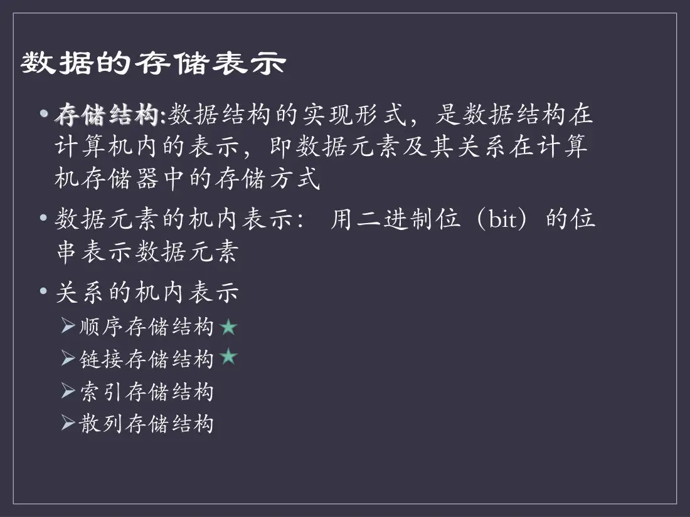

原文：

数据的存储表示

存储结构:数据结构的实现形式，是数据结构在计算机内的表示，即数据元素及其关系在计算机存储器中的存储方式

数据元素的机内表示： 用二进制位（bit）的位串表示数据元素

•关系的机内表示

顺序存储结构

➢链接存储结构

➢索引存储结构

散列存储结构

### 顺序存储结构

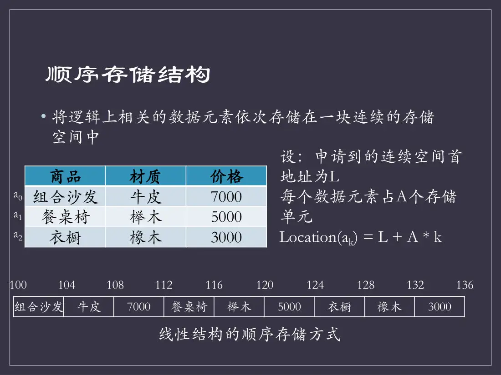

原文：

顺序存储结构

将逻辑上相关的数据元素依次存储在一块连续的存储空间中

<table><tr><td></td><td>商品</td><td>材质</td><td>价格</td></tr><tr><td> $a_0$ </td><td>组合沙发</td><td>牛皮</td><td>7000</td></tr><tr><td> $a_1$ </td><td>餐桌椅</td><td>榉木</td><td>5000</td></tr><tr><td> $a_2$ </td><td>衣橱</td><td>橡木</td><td>3000</td></tr></table>

设：申请到的连续空间首地址为L每个数据元素占A个存储单元

Location(ak) = L + A \* k

100 104 108 112 116 120 124 128 132 136

组合沙发 牛皮 7000 餐桌椅 榉木 5000 衣橱 橡木 3000

线性结构的顺序存储方式

### 链接存储结构

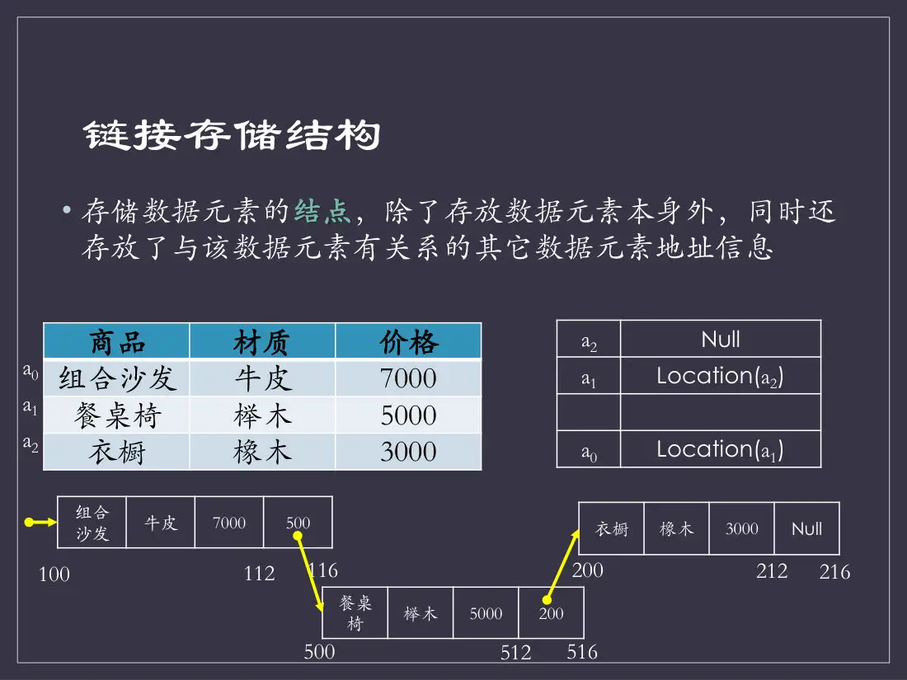

原文：

链接存储结构

• 存储数据元素的结点，除了存放数据元素本身外，同时还存放了与该数据元素有关系的其它数据元素地址信息

<table><tr><td></td><td>商品</td><td>材质</td><td>价格</td></tr><tr><td> $a_0$ </td><td>组合沙发</td><td>牛皮</td><td>7000</td></tr><tr><td> $a_1$ </td><td>餐桌椅</td><td>榉木</td><td>5000</td></tr><tr><td> $a_2$ </td><td>衣橱</td><td>橡木</td><td>3000</td></tr></table>

<table><tr><td> $a_{2}$ </td><td>Null</td></tr><tr><td> $a_{1}$ </td><td>Location( $a_{2}$ )</td></tr><tr><td></td><td></td></tr><tr><td> $a_{0}$ </td><td>Location( $a_{1}$ )</td></tr></table>

### 索引 散列存储结构

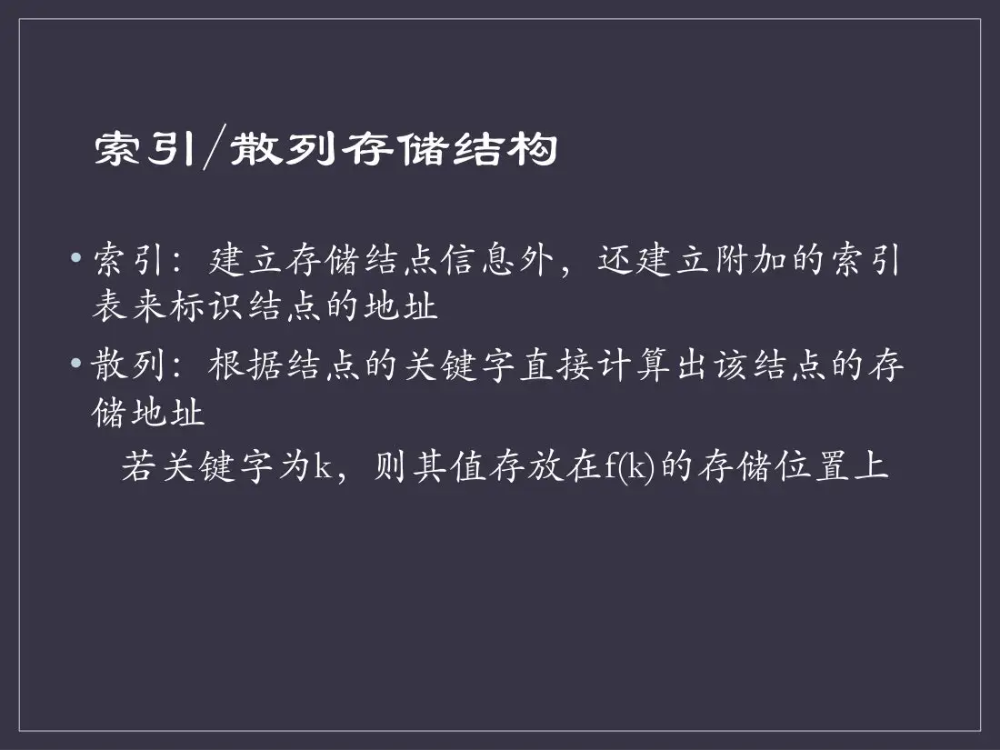

原文：

索引 散列存储结构

•索引：建立存储结点信息外，还建立附加的索引表来标识结点的地址

•散列：根据结点的关键字直接计算出该结点的存储地址

若关键字为k，则其值存放在f(k)的存储位置上

### 商品材质价格组合沙发牛皮7000餐桌椅榉木5000

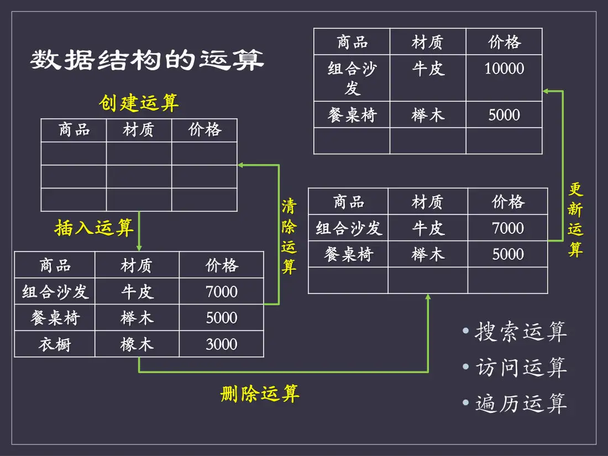

原文：

<table><tr><td>商品</td><td>材质</td><td>价格</td></tr><tr><td>组合沙发</td><td>牛皮</td><td>7000</td></tr><tr><td>餐桌椅</td><td>榉木</td><td>5000</td></tr></table>

数据结构的运算

创建运算

<table><tr><td>商品</td><td>材质</td><td>价格</td></tr><tr><td></td><td></td><td></td></tr><tr><td></td><td></td><td></td></tr><tr><td></td><td></td><td></td></tr></table>

<table><tr><td>商品</td><td>材质</td><td>价格</td></tr><tr><td>组合沙发</td><td>牛皮</td><td>10000</td></tr><tr><td>餐桌椅</td><td>榉木</td><td>5000</td></tr><tr><td></td><td></td><td></td></tr></table>

更

新

运

算

清

除

运

算

插入运算

<table><tr><td>商品</td><td>材质</td><td>价格</td></tr><tr><td>组合沙发</td><td>牛皮</td><td>7000</td></tr><tr><td>餐桌椅</td><td>榉木</td><td>5000</td></tr><tr><td>衣橱</td><td>橡木</td><td>3000</td></tr></table>

删除运算

搜索运算

访问运算

•遍历运算

### 数据结构的运算

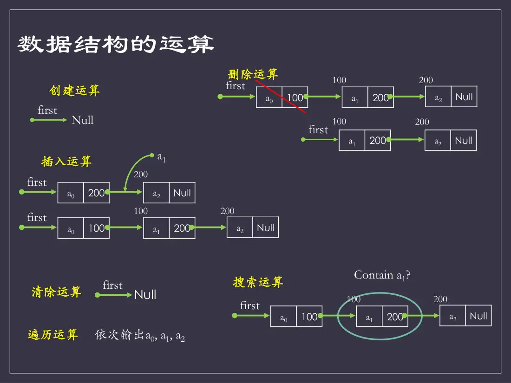

原文：

数据结构的运算

创建运算

清除运算

遍历运算 依次输出a0, a1, a2

### 数据结构的运算

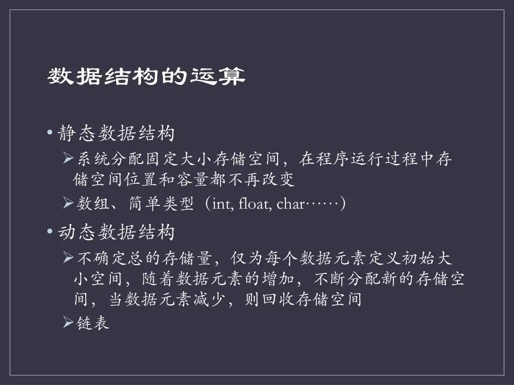

原文：

数据结构的运算

静态数据结构➢系统分配固定大小存储空间，在程序运行过程中存储空间位置和容量都不再改变➢数组、简单类型（int, float, char……）

动态数据结构

不确定总的存储量，仅为每个数据元素定义初始大小空间，随着数据元素的增加，不断分配新的存储空间，当数据元素减少，则回收存储空间

➢链表

### 目录

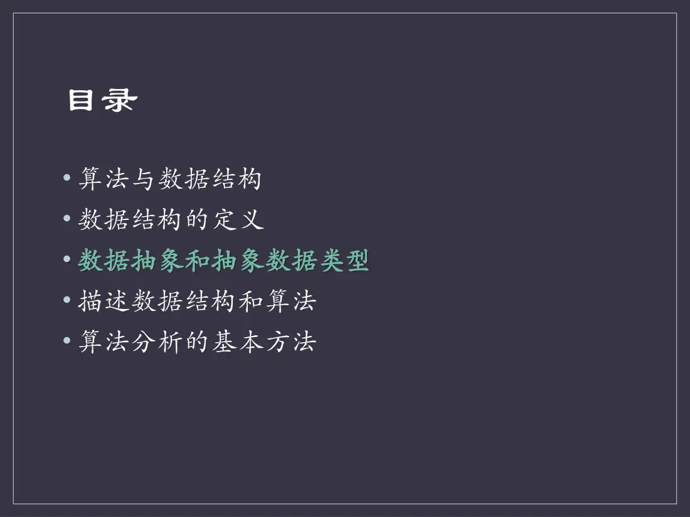

原文：

目录

算法与数据结构

数据结构的定义

•数据抽象和抽象数据类型

描述数据结构和算法

•算法分析的基本方法

### 从过程抽象到数据抽象

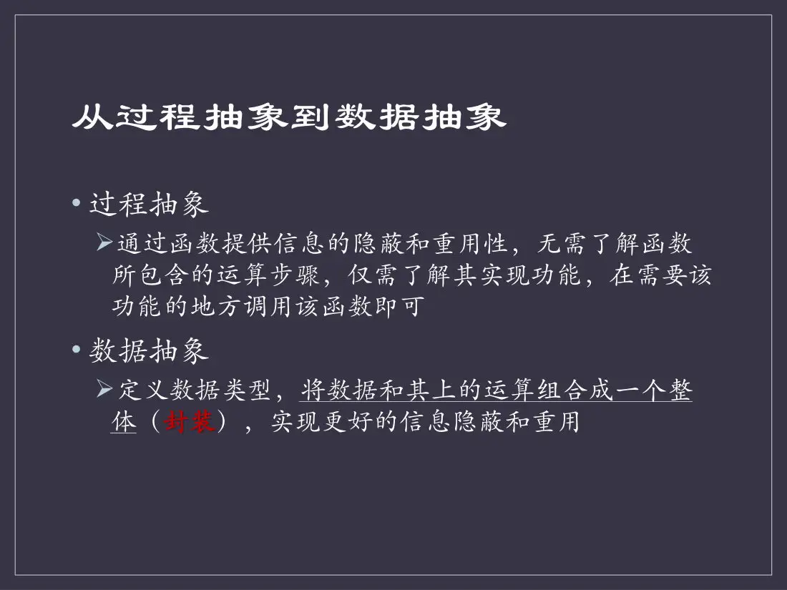

原文：

从过程抽象到数据抽象

•过程抽象

通过函数提供信息的隐蔽和重用性，无需了解函数所包含的运算步骤，仅需了解其实现功能，在需要该功能的地方调用该函数即可

数据抽象

定义数据类型，将数据和其上的运算组合成一个整体（封装），实现更好的信息隐蔽和重用

### 数据类型

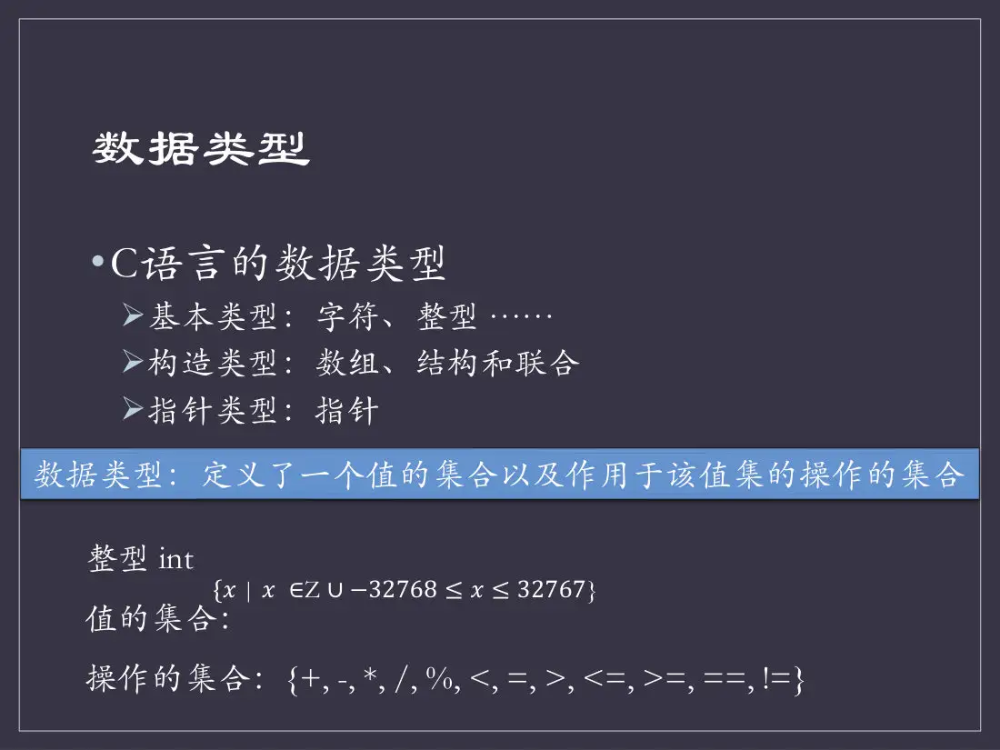

原文：

数据类型

•C语言的数据类型

➢基本类型：字符、整型 ……

➢构造类型：数组、结构和联合

指针类型：指针

数据类型：定义了一个值的集合以及作用于该值集的操作的集合

整型 int

{� | � ∈Z ∪ −32768 ≤ � ≤ 32767}

值的集合：

操作的集合：{+, -, \*, /, %, <, =, >, <=, >=, ==, !=}

### 抽象数据类型

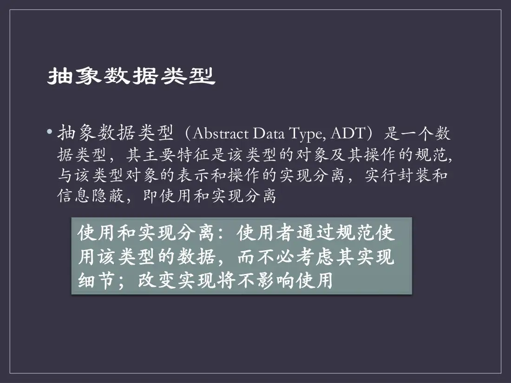

原文：

抽象数据类型

抽象数据类型（Abstract Data Type, ADT）是一个数据类型，其主要特征是该类型的对象及其操作的规范与该类型对象的表示和操作的实现分离，实行封装和信息隐蔽，即使用和实现分离

使用和实现分离：使用者通过规范使用该类型的数据，而不必考虑其实现细节；改变实现将不影响使用

### 数据结构与抽象数据类型

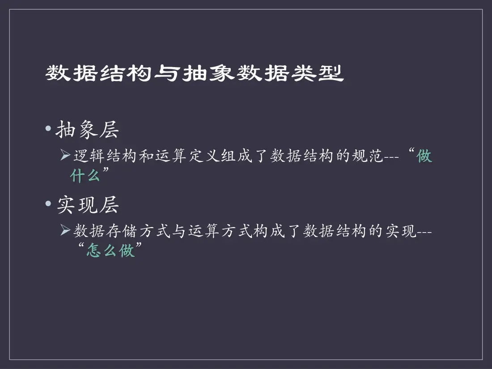

原文：

数据结构与抽象数据类型

•抽象层

逻辑结构和运算定义组成了数据结构的规范---“做什么”

•实现层

➢数据存储方式与运算方式构成了数据结构的实现---“怎么做”

### 目录

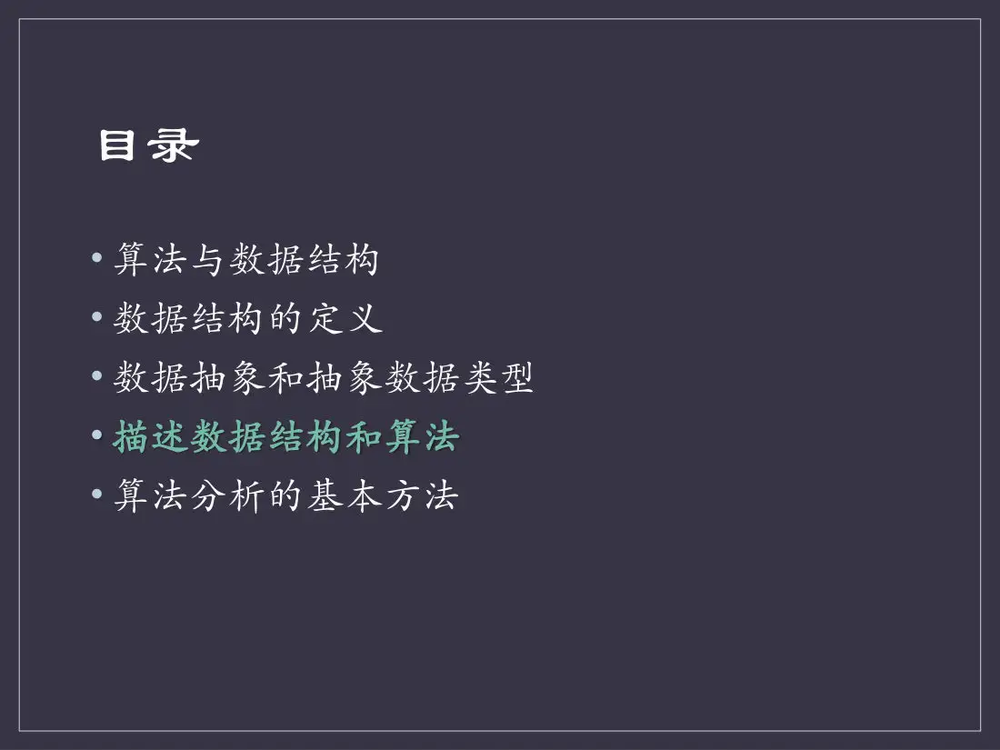

原文：

目录

算法与数据结构

数据结构的定义

数据抽象和抽象数据类型

•描述数据结构和算法

•算法分析的基本方法

### 描述数据结构与算法

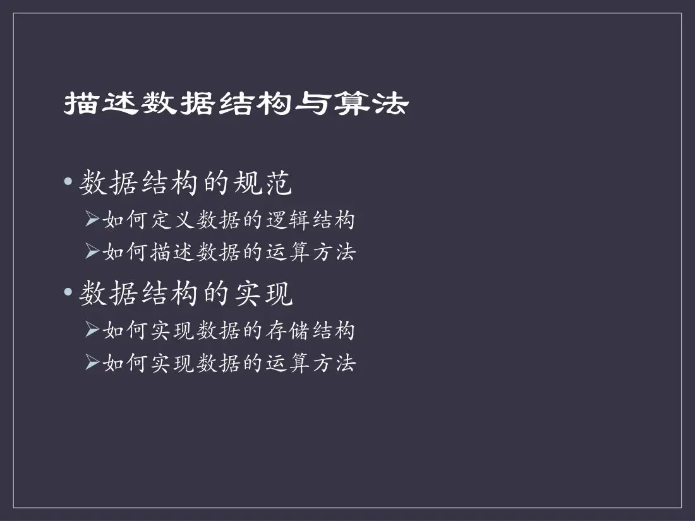

原文：

描述数据结构与算法

•数据结构的规范

➢如何定义数据的逻辑结构

➢如何描述数据的运算方法

•数据结构的实现

➢如何实现数据的存储结构

➢如何实现数据的运算方法

### 数据结构的描述方法

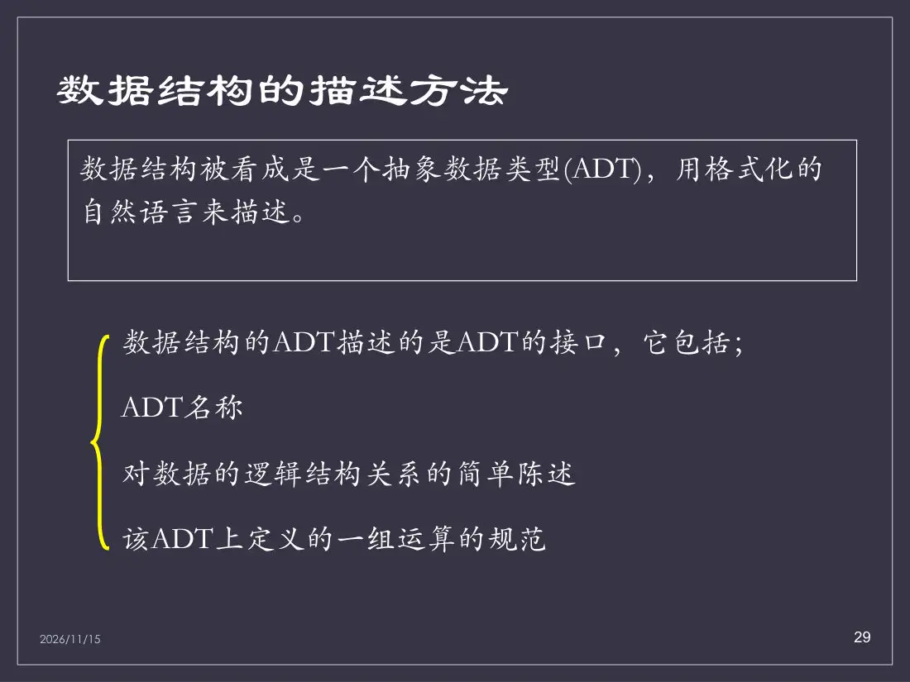

原文：

数据结构的描述方法

数据结构被看成是一个抽象数据类型(ADT)，用格式化的自然语言来描述。

数据结构的ADT描述的是ADT的接口，它包括；

ADT名称

对数据的逻辑结构关系的简单陈述

该ADT上定义的一组运算的规范

2026/11/15

29

### ADT 1－1 Complex{

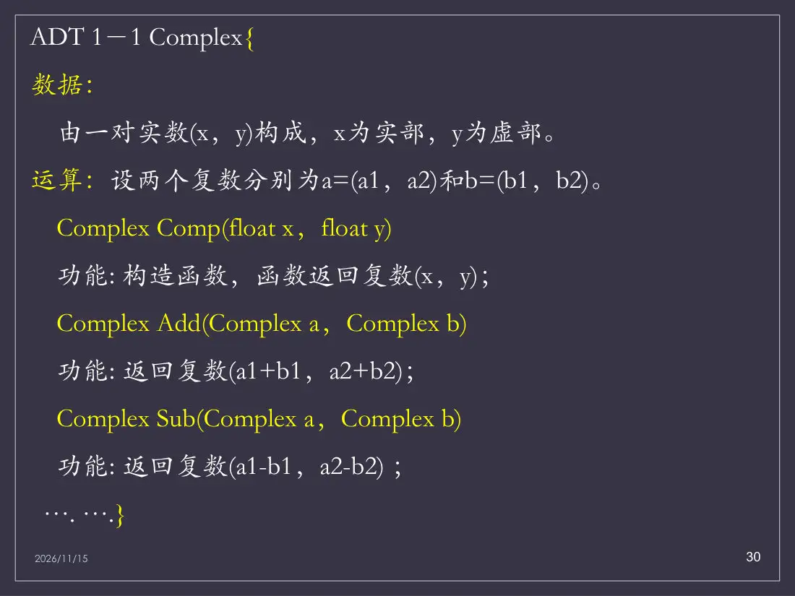

原文：

ADT 1－1 Complex{

数据：

由一对实数(x，y)构成，x为实部，y为虚部。

运算：设两个复数分别为a=(a1，a2)和b=(b1，b2)。

Complex Comp(float x，float y)

功能: 构造函数，函数返回复数(x，y)；

Complex Add(Complex a，Complex b)

功能: 返回复数(a1+b1，a2+b2)；

Complex Sub(Complex a，Complex b)

功能: 返回复数(a1-b1，a2-b2) ；

2026/11/15

30

### 假定C语言的数组和结构都是顺序存储的：

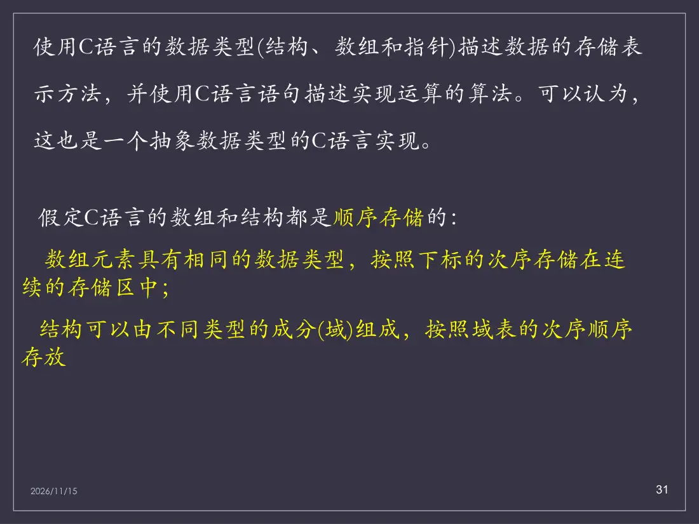

原文：

使用C语言的数据类型(结构、数组和指针)描述数据的存储表示方法，并使用C语言语句描述实现运算的算法。可以认为，这也是一个抽象数据类型的C语言实现。

假定C语言的数组和结构都是顺序存储的：

数组元素具有相同的数据类型，按照下标的次序存储在连续的存储区中；

结构可以由不同类型的成分(域)组成，按照域表的次序顺序存放

2026/11/15

31

### 2026/11/15

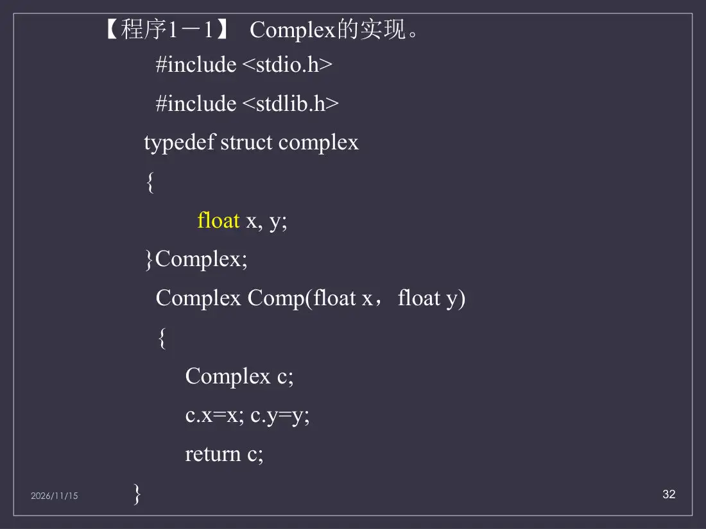

原文：

}

2026/11/15

32

### 2026/11/15

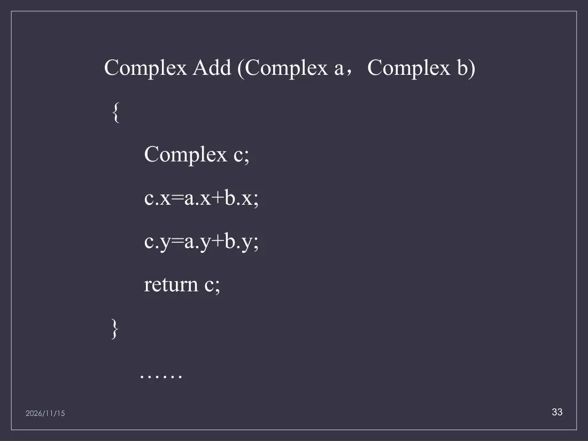

原文：

Complex Add (Complex a，Complex b) Complex c; c.x=a.x+b.x; c.y=a.y+b.y; return c;

2026/11/15

33

### 目录

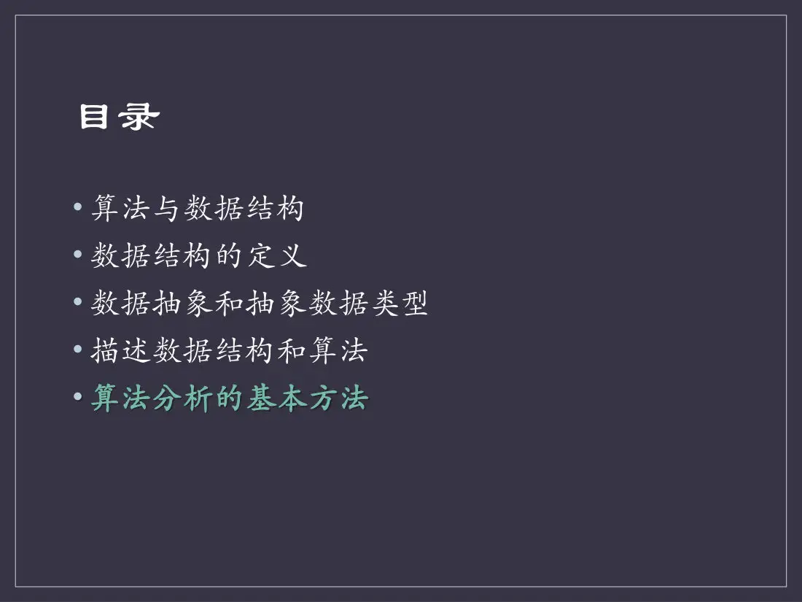

原文：

目录

算法与数据结构

数据结构的定义

数据抽象和抽象数据类型

描述数据结构和算法

•算法分析的基本方法

### 算法及其性能标准

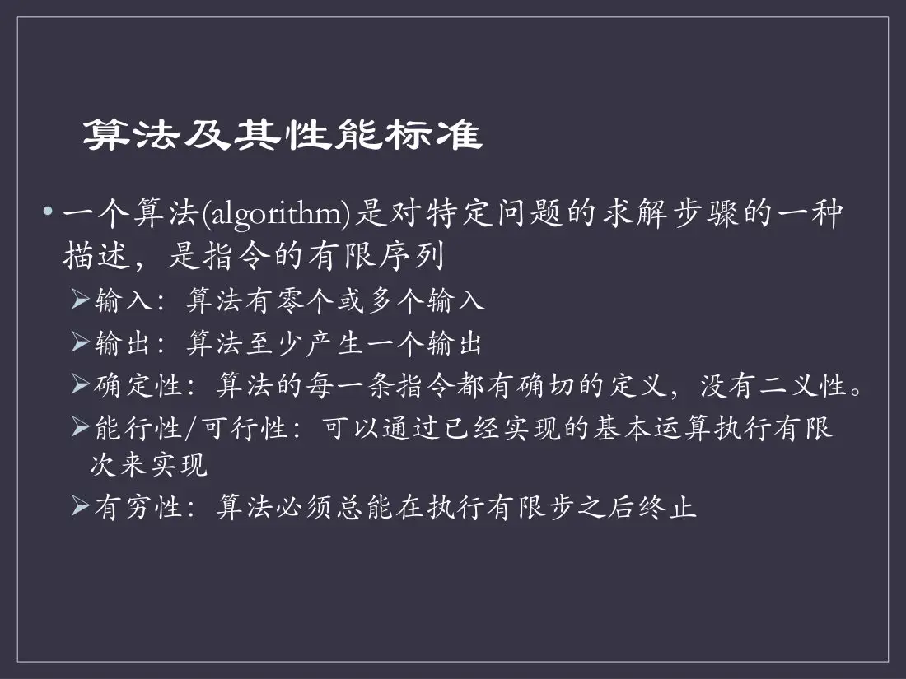

原文：

算法及其性能标准

一个算法(algorithm)是对特定问题的求解步骤的一种描述，是指令的有限序列

➢输入：算法有零个或多个输入

➢输出：算法至少产生一个输出

➢确定性：算法的每一条指令都有确切的定义，没有二义性。

➢能行性/可行性：可以通过已经实现的基本运算执行有限次来实现

➢有穷性：算法必须总能在执行有限步之后终止

### 下列算法有什么问题？

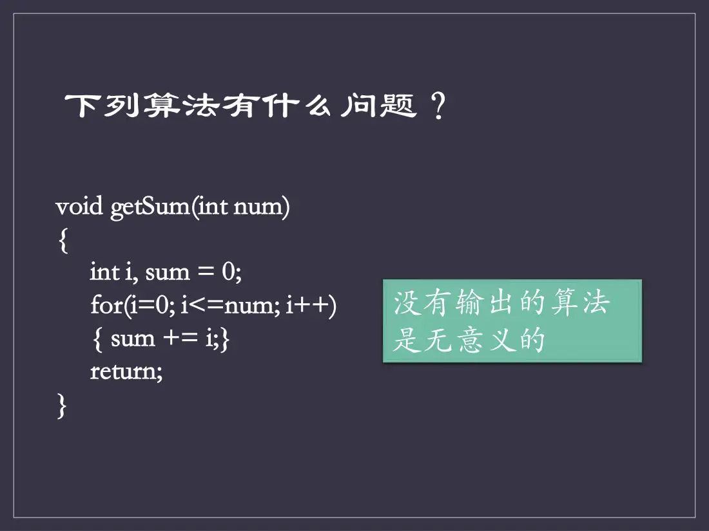

原文：

下列算法有什么问题？

void getSum(int num)

int i, sum = 0; $( 0 ) ( 1 - 0 . 0 5 < 0 . 0 0 1 0 0 5 < 0 . 0 0 1 0 0 1 < 0 . 0 0 1 1 < 0 . 0 0 1 1 < 0 . 0 0 1 1 < 0 . 0 0 1 1 < 0 . 0 0 1 1 < 0 . 0 0 1 1 < 0 . 0 0 1 1 < 0 . 0 1 1 1 < 0 . 0 1 1 1 < 0 . 0 1 1 1 < 0 . 0 1 1 1 < 0 . 0 1 1 1 < 0 . 0 1 1 1 < 0 . 0 1 1 1 < 0 . 0 1 1 1 < 0 . 0 1 1 1 < 0 . 0 1 1 1 < 0 . 0 1 1 1 < 0 . 0 1 1 1 < 0 . 0 1 1 1 < 0 . 0 1 1 1 < 0 . 0 1 1 1 < 0 . 0 1 1 1 < 0 . 0 1 1 1 < 0 . 0 1 1 1 < . 0 1 1 1 < 0 . 0 1 1 1 < . 0 1 1 1 1$ { sum += i;} return;

没有输出的算法是无意义的

### 下列算法有什么问题？

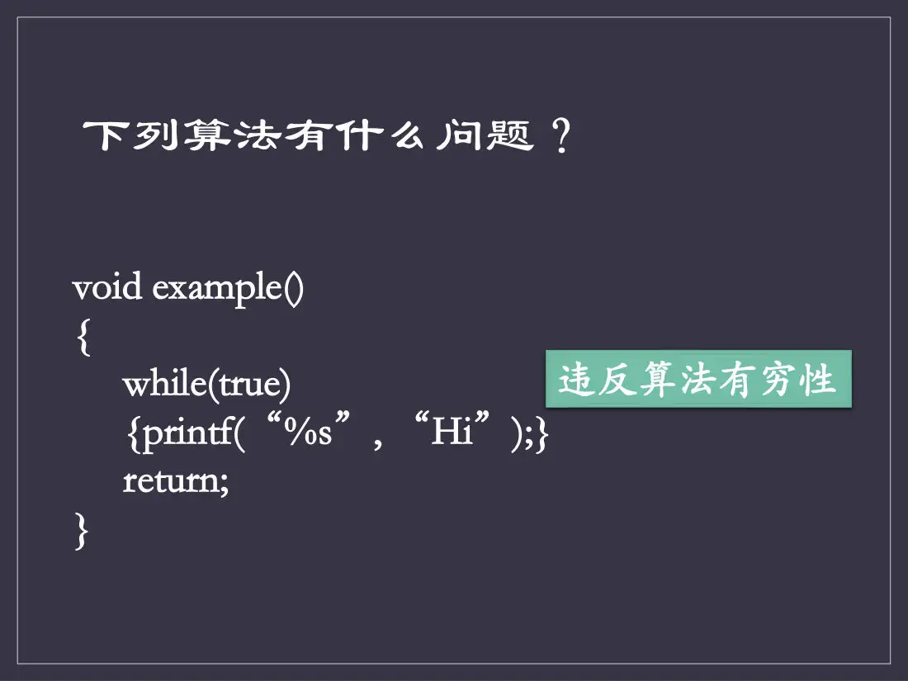

原文：

下列算法有什么问题？

void example()

while(true) {printf(“%s” “Hi”);} return;

违反算法有穷性

### 下列算法有什么问题？

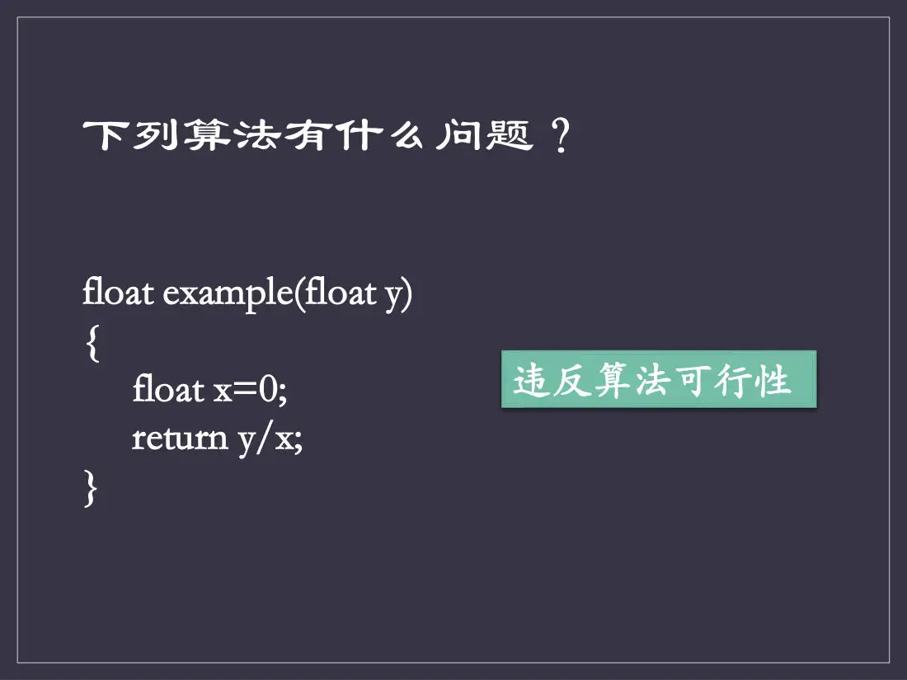

原文：

下列算法有什么问题？

float example(float y) float $v = 0$ return $1 7 - 9 = 1 7$

违反算法可行性

### 算法的描述

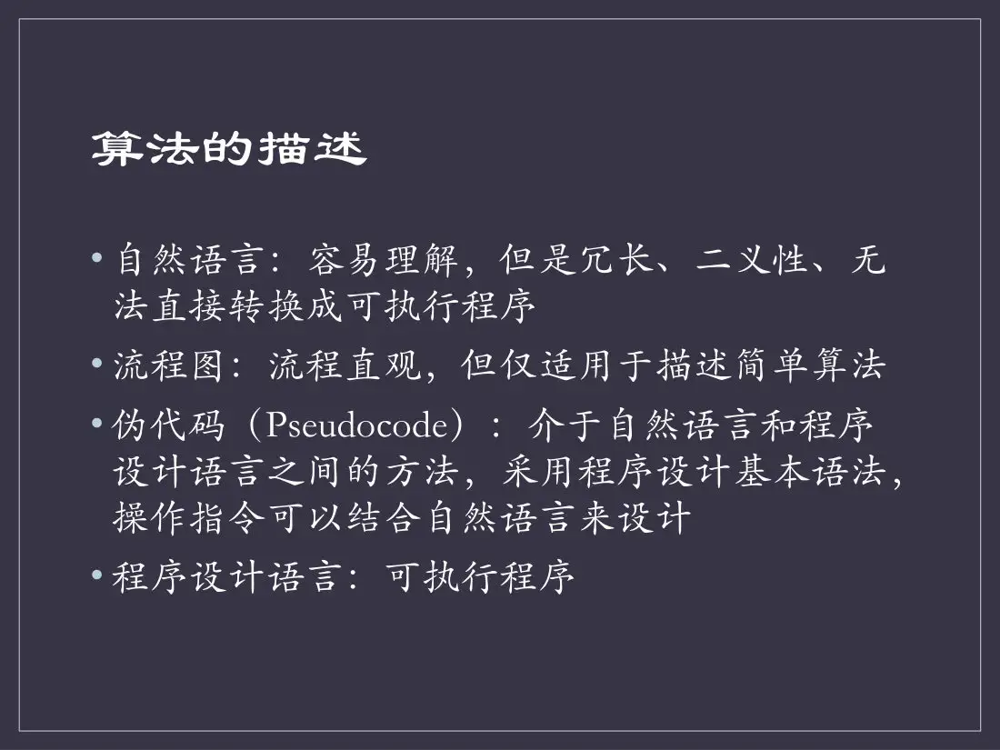

原文：

算法的描述

自然语言：容易理解，但是冗长、二义性、无法直接转换成可执行程序

•流程图：流程直观，但仅适用于描述简单算法

伪代码（Pseudocode）：介于自然语言和程序设计语言之间的方法，采用程序设计基本语法，操作指令可以结合自然语言来设计

•程序设计语言：可执行程序

### 算法性能标准

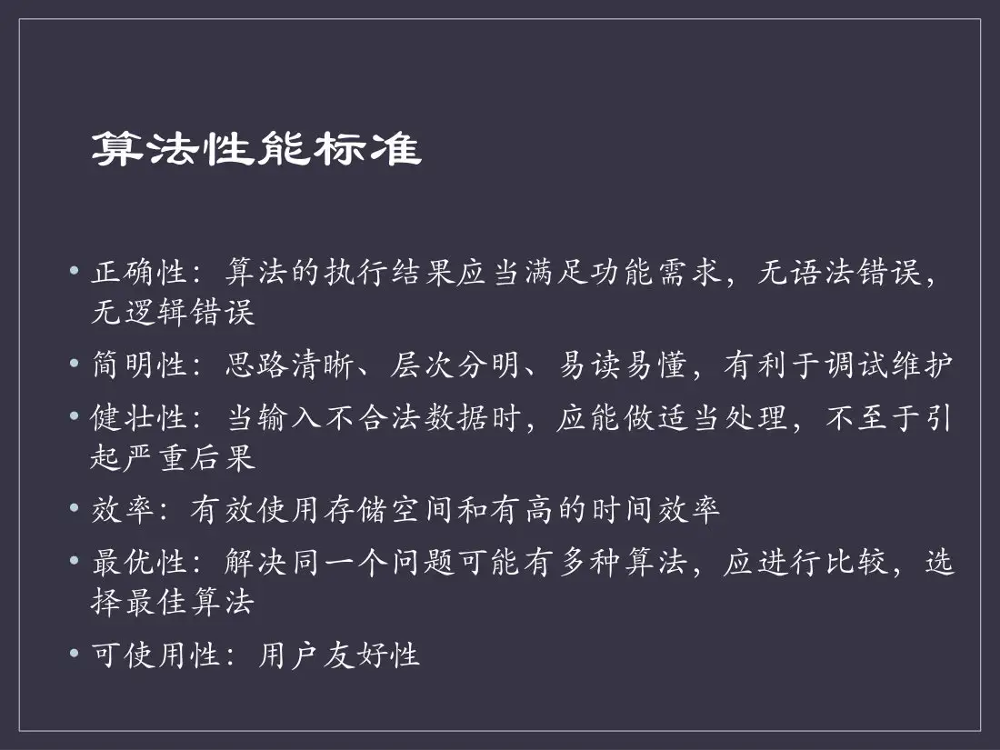

原文：

算法性能标准

•正确性：算法的执行结果应当满足功能需求，无语法错误， 无逻辑错误

•简明性：思路清晰、层次分明、易读易懂，有利于调试维护

•健壮性：当输入不合法数据时，应能做适当处理，不至于引起严重后果

•效率：有效使用存储空间和有高的时间效率

• 最优性：解决同一个问题可能有多种算法，应进行比较，选择最佳算法

• 可使用性：用户友好性

### 算法分析

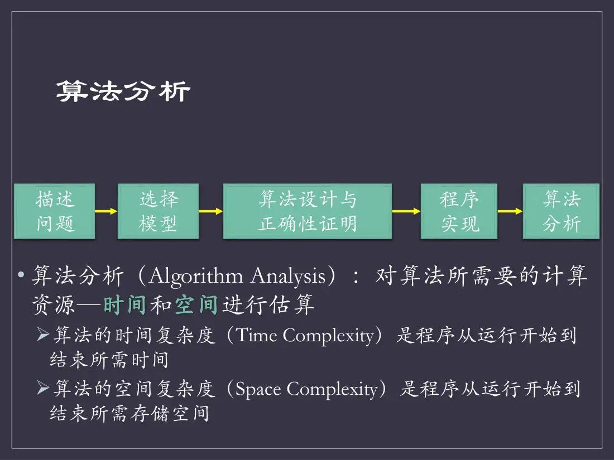

原文：

算法分析

描述问题

选模 择型

算法设计与正确性证明

程实 序现

算分 法析

算法分析（Algorithm Analysis）：对算法所需要的计算资源—时间和空间进行估算

➢算法的时间复杂度（Time Complexity）是程序从运行开始到结束所需时间

➢算法的空间复杂度（Space Complexity）是程序从运行开始到结束所需存储空间

### 算法的执行时间

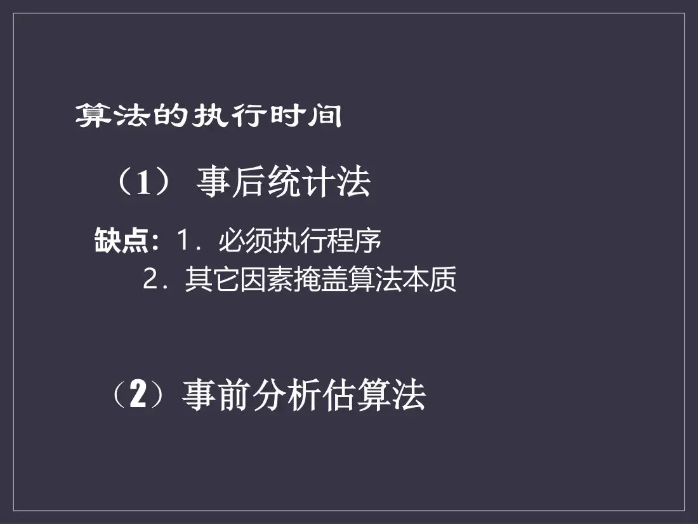

原文：

算法的执行时间

（1） 事后统计法缺点：1．必须执行程序2．其它因素掩盖算法本质

（2）事前分析估算法

### 和算法执行时间相关的因素：

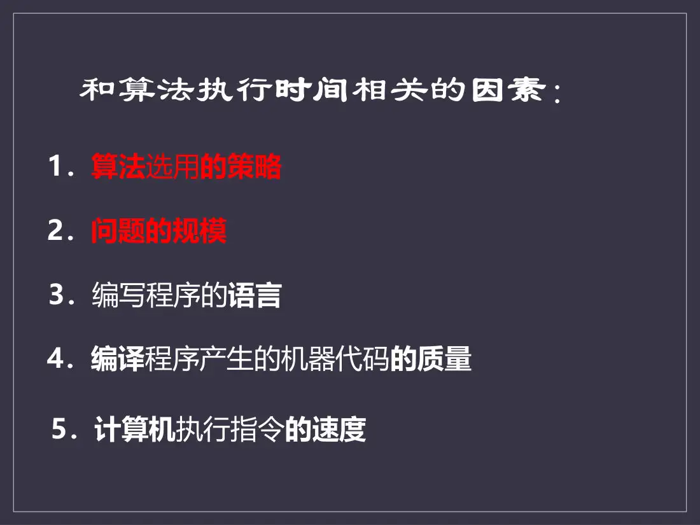

原文：

和算法执行时间相关的因素：

1．算法选用的策略

2．问题的规模

3．编写程序的语言

4．编译程序产生的机器代码的质量

5．计算机执行指令的速度

### 算法的时间复杂度

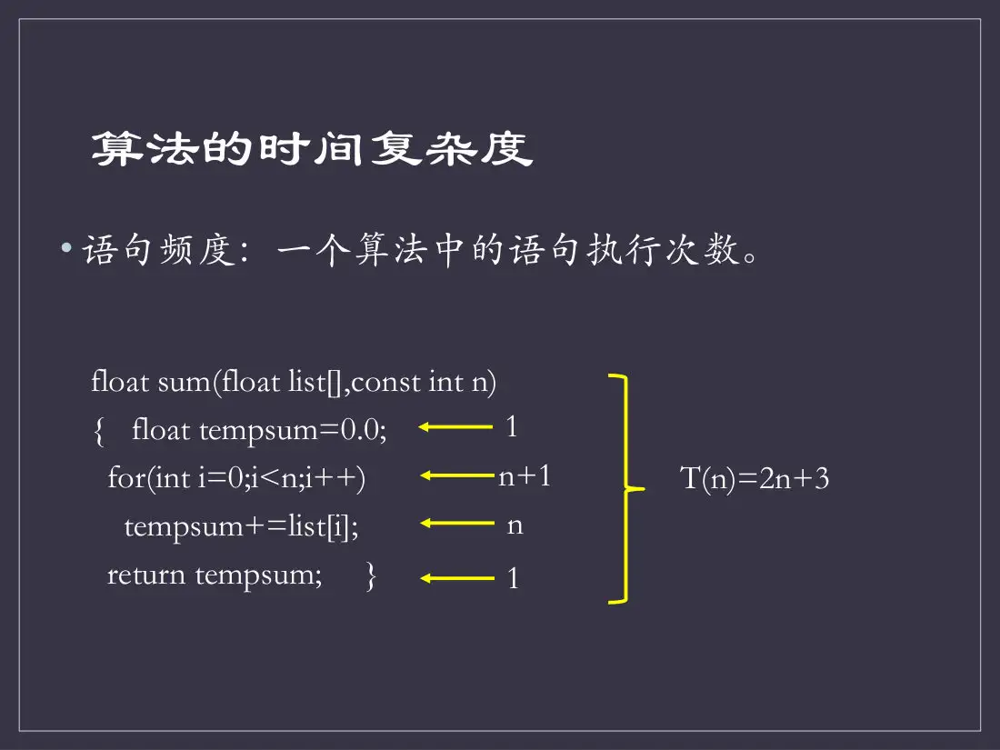

原文：

算法的时间复杂度

•语句频度：一个算法中的语句执行次数。

$$
\left. \begin{array}{l} \text {float sum(float list[], const int n)} \\ \{\quad \text {float tempsum = 0.0;} \quad \xleftarrow {} \quad 1 \\ \text {for(int i = 0;i <   n;i++)} \quad \xleftarrow {} \quad n + 1 \\ \text {tempsum+ = list[i] ;} \quad \xleftarrow {} \quad n \\ \text {return tempsum;} \quad \} \quad \xleftarrow {} \quad 1 \end{array} \right\} T (n) = 2 n + 3
$$

### 算法的时间复杂度

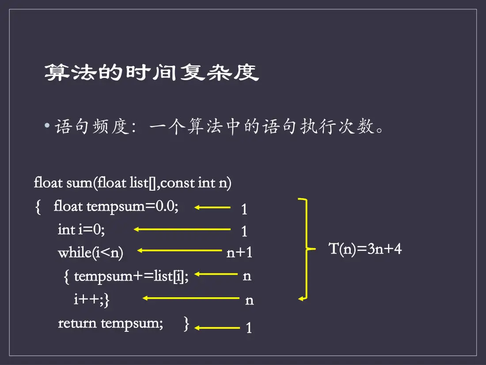

原文：

算法的时间复杂度

•语句频度：一个算法中的语句执行次数。

float sum(float list[],const int n)

$$
\begin{array}{l} \{\text {   float   tempsum = 0.0;   } \leftarrow 1 \\ \text {   int   i = 0;   } \leftarrow 1 \\ \text {   while(i <   n)   } \leftarrow n + 1 \\ \{\text {   tempsum+ = list[i];   } \leftarrow n \\ \text {   i++;   } \} \leftarrow n \end{array}
$$

$$
\mathrm{T(n)} = 3 \mathrm{n} + 4
$$

return tempsum; } 1

### 算法的渐近时间复杂度

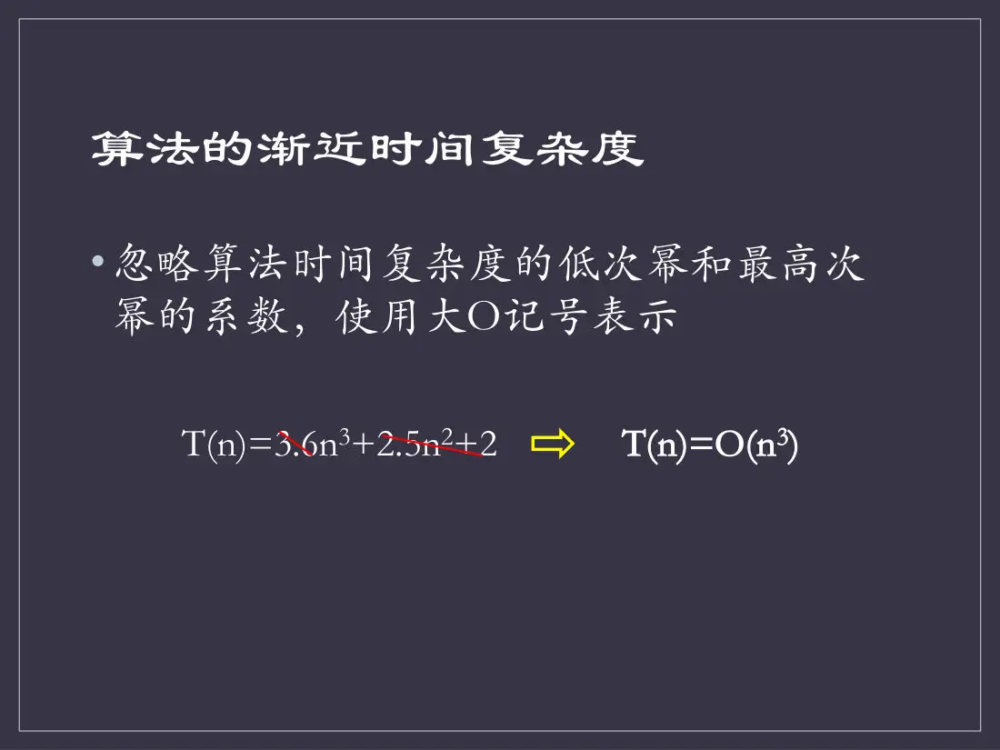

原文：

算法的渐近时间复杂度

忽略算法时间复杂度的低次幂和最高次幂的系数，使用大O记号表示

T(n)=3.6n3+2.5n2+2 T(n)=O(n3)

### 算法的渐近时间复杂度

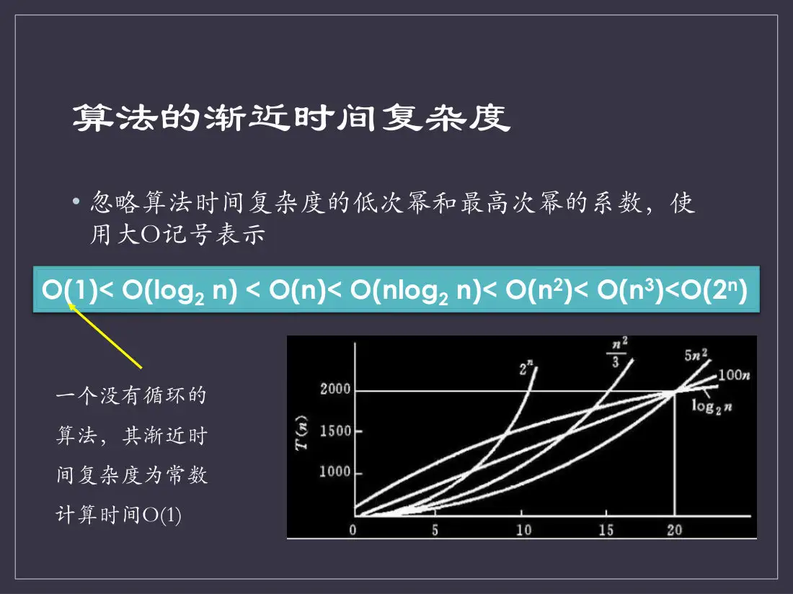

原文：

算法的渐近时间复杂度

• 忽略算法时间复杂度的低次幂和最高次幂的系数，使用大O记号表示

O(1)< O(log2 n) < O(n)< O(nlog2 n)< O(n2)< O(n3)<O(2n)

一个没有循环的算法，其渐近时间复杂度为常数计算时间O(1)

### 算法的渐近时间复杂度

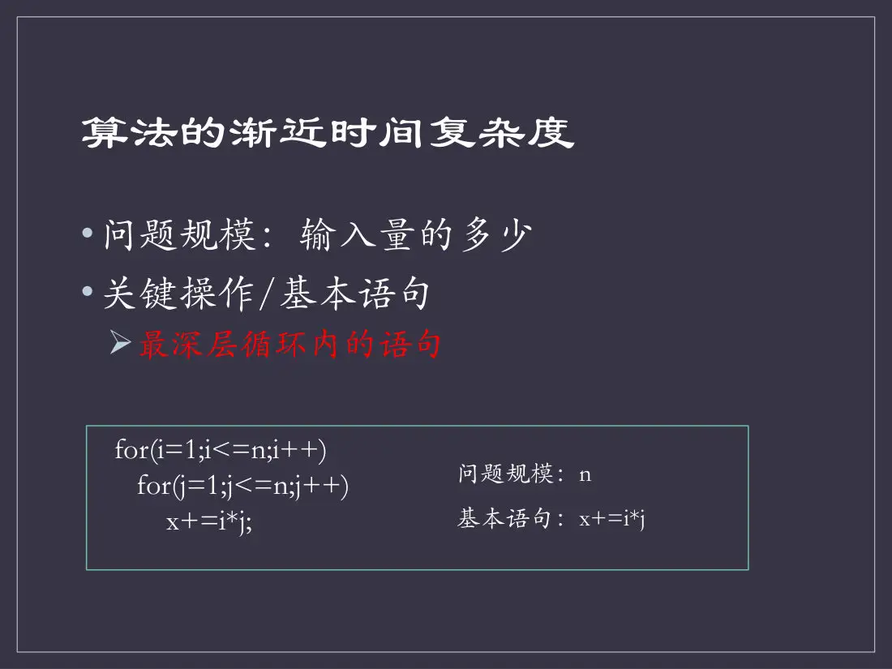

原文：

算法的渐近时间复杂度

•问题规模：输入量的多少

关键操作/基本语句最深层循环内的语句

$$
\operatorname{for} (i = 1; i <   = n; i + +)
$$

for(j=1;j<=n;j++)

问题规模：n

x+=i\*j;

基本语句：x+=i\*j

### 算法的渐近时间复杂度

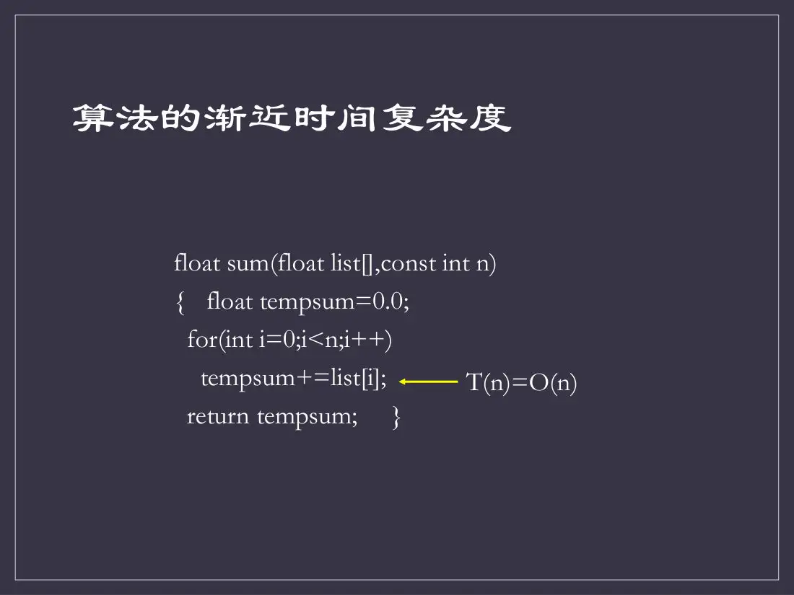

原文：

算法的渐近时间复杂度

float sum(float list[],const int n) float tempsum=0.0; $\mathrm  | i ( 0 ) a ( 6 0 0 0 0 0 0 0 0 0 0 0 0 0 0 0 0 0 0 0 0 0 0 0 0 0 0 0 0 0 0 0 0 0 0 0 0 0 0 0 0 0 0 0 0 0 0 0 0 0 0 0 0 0 0 0 0 0 0 0 0 0 0 0 0 0 0 0 0 0 0 0 0 0 0 0 0 0 0 0 0 0 0 0 0 0 0 0 0 0 0 0 0 0 0 0 0 0 0 0 0 0 0 0 0 0 0 0 0 0 0 0 0 0 0 0 0 0 0 0 0 0 0 0 0 0 0 0 0 0 0 0 0 0 0 0 0 0 0 0 0 0 0 0 0 0 0 0 0 0 0 0 0 0 0 0 0 0 0 0 0 0 0 0 0 0 0 0 0 0 0 0 0 0 0 0 0 0 0 0 0 0 0 0 0$ tempsum+=list[i]; T(n)=O(n) return tempsum; }

### 算法的渐近时间复杂度

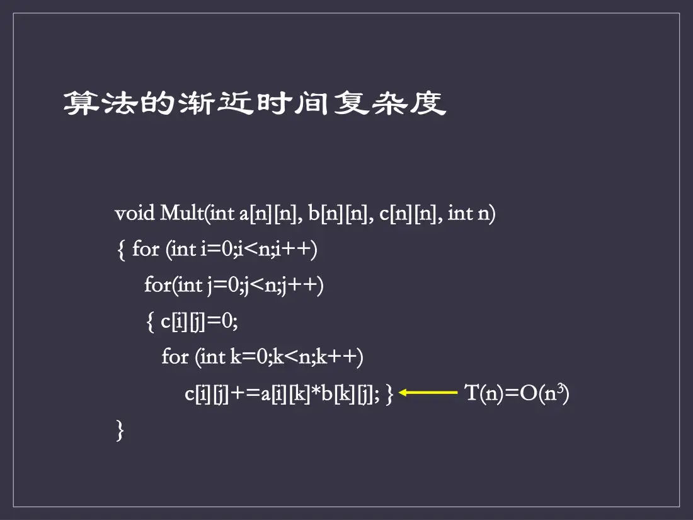

原文：

算法的渐近时间复杂度

void Mult(int a[n][n], b[n][n], c[n][n], int n) $( 1 0 0 0 \times ( 1 0 1 0 0 0 - 0 ) + 1 0 0 0 0 \times 2 0 0 0 )$ $1 0 ) \times ( \frac { 1 } { 1 0 } + 1 0 \times \frac { 1 } { 3 } ) = ( 1 5 ) \times ( \frac { 1 } { 3 } - 1 5 ) = ( 1 5 ) ( \frac { 1 } { 3 } - 1 5 )$ $\{ | { \bf \nabla } | \langle { \bf \nabla } | | | { \bf \nabla } | | = \langle 0 | |$ for $( ( 1 ) 1 1 0 - ( 1 ) 1 0 - ( 2 ) 1 0 ) \div ( 2 ) = ( 1 )$ $( \mathrm { e } \| \mathrm { H } ) = \mathrm { e } \| \mathrm { H } \| \mathrm { S } = \mathrm { e } \| \mathrm { H } \| \mathrm { H } \| \mathrm { H } \| \mathrm { H } \| \mathrm { H } \| \mathrm { H } \| \mathrm { H } \| \mathrm { H } \| \mathrm { H } \| \mathrm { H } \| \mathrm { H } \| \mathrm { H } \| \mathrm { H } \| \mathrm { H } \| \mathrm { H } \| \mathrm { H } \| \mathrm { H } \| \mathrm { H } \| \mathrm { H } \| \mathrm { H } \| \mathrm { H } \| \mathrm { H } \| \mathrm { H } \| \mathrm { H } \| \mathrm { H } \| \mathrm { H } \| \mathrm { H } \| \mathrm { H } \| \mathrm { H } \| \mathrm { H } \| \mathrm { H } \| \mathrm { H } \| \mathrm { H } \| \mathrm { H } \| \mathrm { H } \| \mathrm { H } \| \mathrm { H } \| \mathrm { H } \| \mathrm { H } \| \mathrm { H } \| \mathrm { H } \| \mathrm { H } \| \mathrm { H } \| \mathrm { H } \| \mathrm { H } \| \mathrm { H } \| \mathrm { H } \| \mathrm { H } \| \mathrm { H } \| \mathrm { H } \| \mathrm { H } \| \mathrm { H } \| \mathrm { H } \| \mathrm { H } \| \mathrm { H } \| \mathrm { H } \| \mathrm { H } \| \mathrm { H } \| \mathrm { H } \| \mathrm { H } \| \mathrm { H } \| \mathrm { H } \| \mathrm { H } \| \mathrm { H } \| \mathrm { H } \| \mathrm { H } \| \mathrm { H } \| \mathrm { H } \| \mathrm { H } \| \mathrm { H } \| \mathrm { H } \| \mathrm { H } \| \mathrm { H } \| \mathrm { H } \mathrm { H } \| \mathrm { H } \mathrm { H } \| \mathrm { H } \mathrm { H } \| \mathrm { H } \mathrm { H } \mathrm { H } \| \mathrm { H } \mathrm { H } \mathrm { H } \mathrm { H } \mathrm { H } \mathrm { H } \mathrm { H } \mathrm  H \mathrm { H } \mathrm { H } \mathrm { H } \mathrm \mathrm { H } \mathrm { H ~ H } \mathrm { H } \mathrm \mathrm  H \mathrm { H } \mathrm { H } \mathrm \mathrm  H ~ H \mathrm { H } \mathrm \mathrm { H ~ H } \mathrm \mathrm { H \Omega \Omega \Omega } $

### 最好、最坏和平均时间复杂度

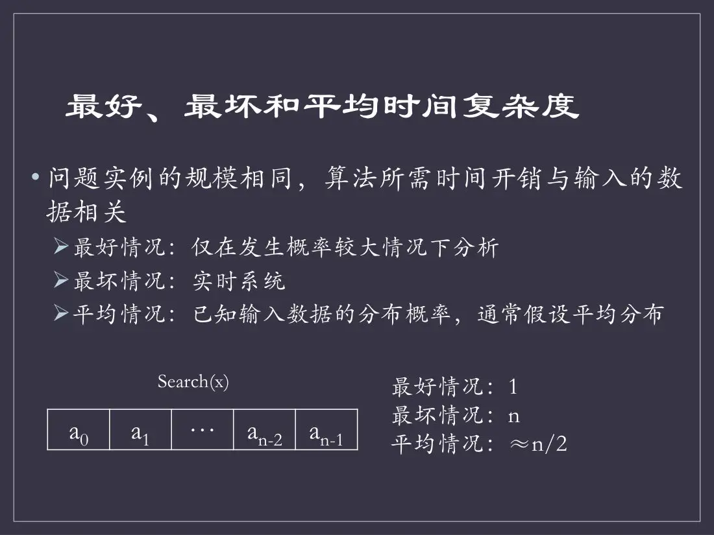

原文：

最好、最坏和平均时间复杂度

问题实例的规模相同，算法所需时间开销与输入的数据相关

➢最好情况：仅在发生概率较大情况下分析

➢最坏情况：实时系统

➢平均情况：已知输入数据的分布概率，通常假设平均分布

Search(x)

$$
a _ {0}
$$

$$
a _ {1}
$$

$$
a _ {\mathrm{n-2}}
$$

$$
a _ {\mathrm{n-1}}
$$

最好情况：1

最坏情况：n

平均情况：≈n/2

### 例1：

原文：

例1：

$$
(i = 1; i <   n; i + +)
$$

$$
y = y + 1
$$

$$
(j = 0; j <   = (2 ^ {*} n); j + +)
$$

### 例2：

原文：

例2：

$$
\begin{array}{c} \text {for(k = 0;k <   j;k + + )} \\ x = x + 2; \end{array}
$$

解：当i=m, j=p的时候,内层循环的次数为p。当i=m时, j 可以取 $\bf { 0 . 1 m m / u } = \bf { 0 . 1 }$ , 所以这里最内循环共进行了$( 1 ) 1 \div ( \cdots ) \cdots 1 1 5 ( 1 1 5 - 1 ) \cdots 1 0$ 所以,i从0取到n, 则循环共进行了:$( 1 ) ( 1 5 . 5 \times 1 0 . 5 \times 1 0 . 5 \times 1 0 . 5 \times 1 0 . 5 \times 1 0 . 5 \times 1 0 . 5 \times 1 0 . 5 \times 1 0 . 5 \times 1 0 . 5 \times 1 0 . 5 \times 1 0 . 5 \times 1 0 . 5 \times 1 0 . 5 \times 1 0 . 5 \times 1 0 . 5 \times 1 0 . 5 \times 1 0 . 5 \times 1 0 . 5 \times 1 0 . 5 \times 1 0 . 5 \times 1 0 . 5 \times 1 0 . 5 \times 1 0 . 5 \times 1 0 . 5 \times 1 0 . 5 \times 1 0 . 5 \times 1 0 . 5 \times 1 0 . 5 \times 1 0 . 5 \times 1 0 . 5 \times 1 0 . 5 \times 1 0 . 5 \times 1 0 . 5 \times 1 0 . 5 \times 1 0 . 5 \times 1 0 . 5 \times 1 0 . 5 \times 1 0 . 5 \times 1 0 . 5 \times 1 0 . 5 \times 1 0 . 5 \times 1 0 . 5 \times 1 0 . 5 \times 1 0 . 5 \times 1 0 . 5 \times 1 0 . 5 \times 1 0 . 5 \times 1 0 . 5 \times 1 0 . 5 \times 1 0 .$ 所以时间复杂度为 $\mathbb { G } ( \mathbf { \overline { { u } } } ^ { \mathrm { { s } } } )$ 。

### 例6：

原文：

例6：

i=1; ① while (i<=n) i=i\*2; ②

解： 语句1的频度是1,设语句2的频度是f(n), 则：

$$
2 ^ {f (n)} <   = n; f (n) <   = \log_ {2} n
$$

取最大值f(n)= log2n,

T(n)=O(log2n )

### 算法的空间复杂度

原文：

算法的空间复杂度

•固定部分：

➢与问题规模无关，主要包括程序代码、常量、简单变量、定长成分的结构变量所占的空间

可变部分—空间复杂度 S(n)

➢这部分空间大小与算法在某次执行中处理的特定数据的大

小和规模有关

➢一般按最坏情况分析

### 作业

原文：

作业

•扩展题 8 （只需确定划线语句的执行次数并计算渐进时间复杂度）
