# 《数据结构》第2章 线性表（课件）

原件的每一页，下面附识别出的文字。

### 第二章 线性表

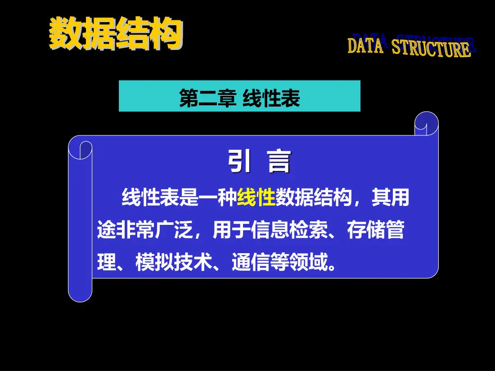

原文：

第二章 线性表

引 言

线性表是一种线性数据结构，其用途非常广泛，用于信息检索、存储管理、模拟技术、通信等领域。

数据结构

DATAA STRUCTURE

### 内容提要

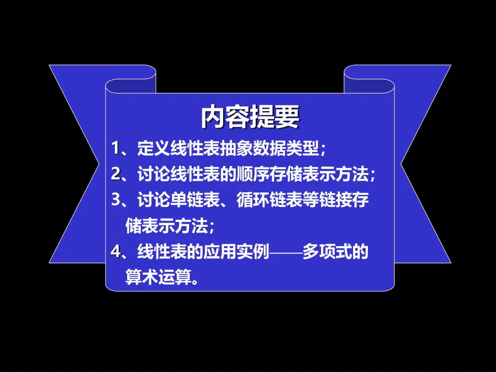

原文：

内容提要

1、定义线性表抽象数据类型；

2、讨论线性表的顺序存储表示方法；

3、讨论单链表、循环链表等链接存储表示方法；

4、线性表的应用实例— 多项式的 算术运算。

### 2.1 线性表抽象数据类型

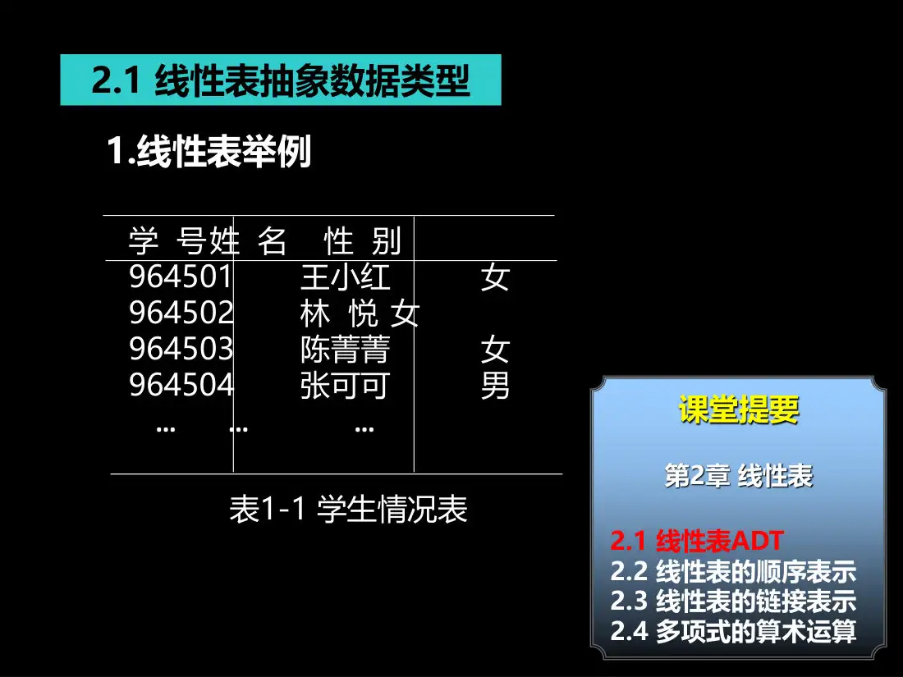

原文：

2.1 线性表抽象数据类型

1.线性表举例

女女男

学 号姓 学号姓名性别 性 别

964501964502964503964504王小红林 悦 女陈菁菁张可可

表1-1 学生情况表

课堂提要

第2章 线性表

2.1 线性表ADT

2.2 线性表的顺序表示

2.3 线性表的链接表示

2.4 多项式的算术运算

### (a)集合结构

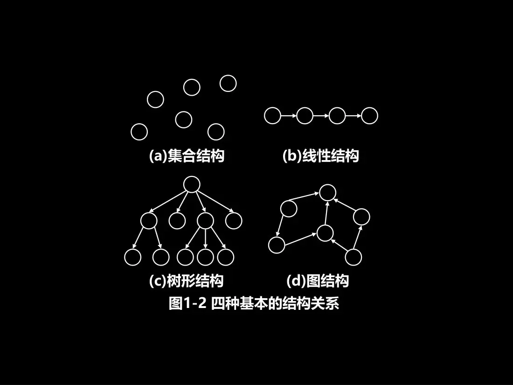

原文：

(a)集合结构

(b)线性结构

(c)树形结构

(d)图结构

图1-2 四种基本的结构关系

### 2.线性表的定义

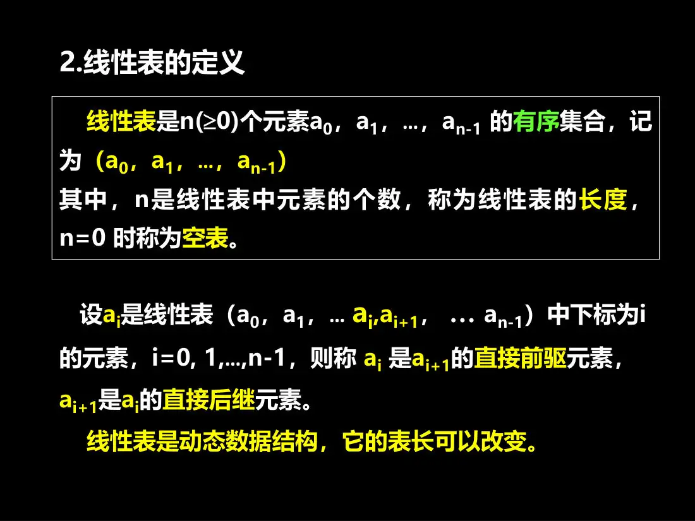

原文：

2.线性表的定义

线性表是n(0)个元素a ， $\mathbf { \hat { c } } _ { 1 } \mathbf { m } - \mathbf { m } \mathbf { n } \mathbf { \hat { c } } _ { 2 } \mathbf { m } \mathbf { n } \mathbf { m }$ 的有序集合，记为 $\left( \left( \mathsf { E } \left[ 0 \right] - \mathsf { E } \left[ 0 \right] - \left[ 0 \right] - \mathsf { E } \left[ 0 \right] \right) \right)$ 其中，n是线性表中元素的个数，称为线性表的长度，$\bf \Pi ^ { \mathrm { [ i l ] } } \Theta ^ { \mathrm { [ i l ] } }$ 时称为空表。

设a是线性表 $( \in [ 0 , T ] = \operatorname { I n } ( \operatorname { I n } ( 0 . 5 ) ) = \operatorname { I n } ( 0 . 5 ) = \operatorname { I n } ( 0 . 5 ) = \operatorname { I n } ( 0 . 5 )$ 中下标为i的元素， $\mathbf { \bar { E 0 } } \mathbf { \bar { \Pi } }$ 则称 $\mathsf { E }$ 是 $E F = \sqrt { 5 }$ 的直接前驱元素，$\mathsf { E } \mathsf { H } \breve { \mathbf { z } } = \mathsf { I }$ 是 $E F / / C F$ 的直接后继元素。线性表是动态数据结构，它的表长可以改变。

### 3.线性表抽象数据类型（描述规范）

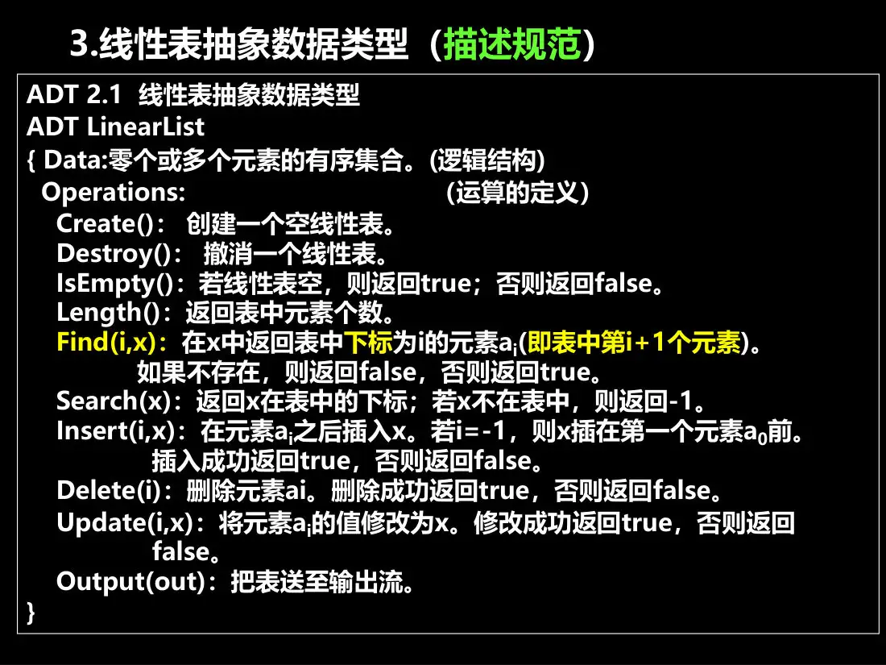

原文：

3.线性表抽象数据类型（描述规范）

ADT 2.1 线性表抽象数据类型

ADT LinearList

{ Data:零个或多个元素的有序集合。(逻辑结构)Operations: （运算的定义）

Create()： 创建一个空线性表。

Destroy()： 撤消一个线性表。

IsEmpty()：若线性表空，则返回true；否则返回false。

Length()：返回表中元素个数。

Find(i,x)：在x中返回表中下标为i的元素a(即表中第i+1个元素)。如果不存在，则返回false，否则返回true。

Search(x)：返回x在表中的下标；若x不在表中，则返回-1。

Insert(i,x)：在元素a之后插入x。若i=-1，则x插在第一个元素a 前。插入成功返回true，否则返回false。

Delete(i)：删除元素ai。删除成功返回true，否则返回false。

Update(i,x)：将元素a的值修改为x。修改成功返回true，否则返回false。

Output(out)：把表送至输出流。

### 4.线性表的C++模板抽象类（描述规范）

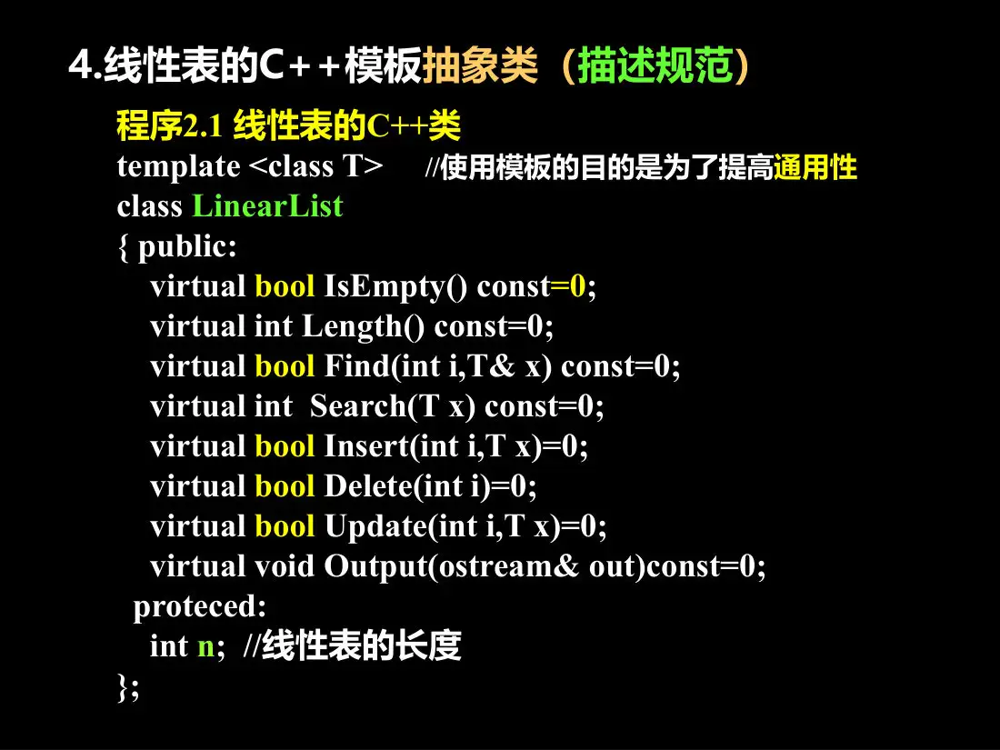

原文：

4.线性表的C++模板抽象类（描述规范）

程序2.1 线性表的C++类template <class T> //使用模板的目的是为了提高通用性class LinearList

{ public: virtual bool IsEmpty() const=0; virtual int Length() const=0; virtual bool Find(int i,T& x) const=0; virtual int Search(T x) const=0; virtual bool Insert(int i,T x)=0; virtual bool Delete(int i)=0; virtual bool Update(int i,T x)=0; virtual void Output(ostream& out)const=0;

proteced: int n; //线性表的长度

};

### 2.2 线性表的顺序表示

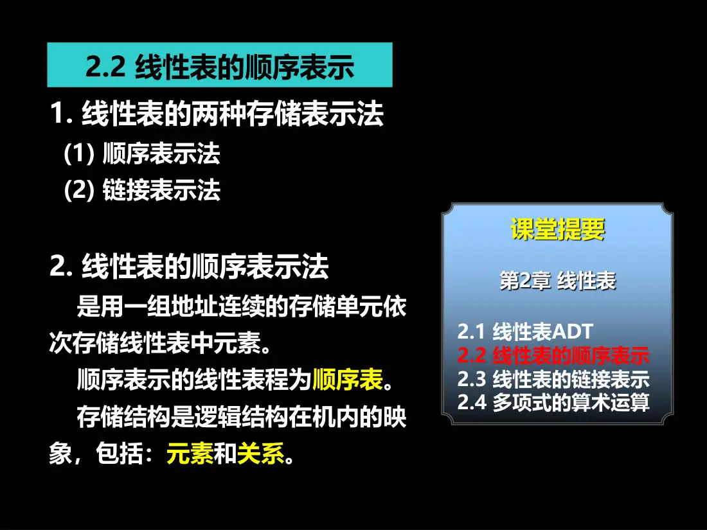

原文：

2.2 线性表的顺序表示

1. 线性表的两种存储表示法

(1) 顺序表示法

(2) 链接表示法

2. 线性表的顺序表示法是用一组地址连续的存储单元依次存储线性表中元素。

顺序表示的线性表程为顺序表。

存储结构是逻辑结构在机内的映象，包括：元素和关系。

课堂提要

第2章 线性表

2.1 线性表ADT

2.2 线性表的顺序表示

2.3 线性表的链接表示

2.4 多项式的算术运算

### （1）线性表的顺序表示法

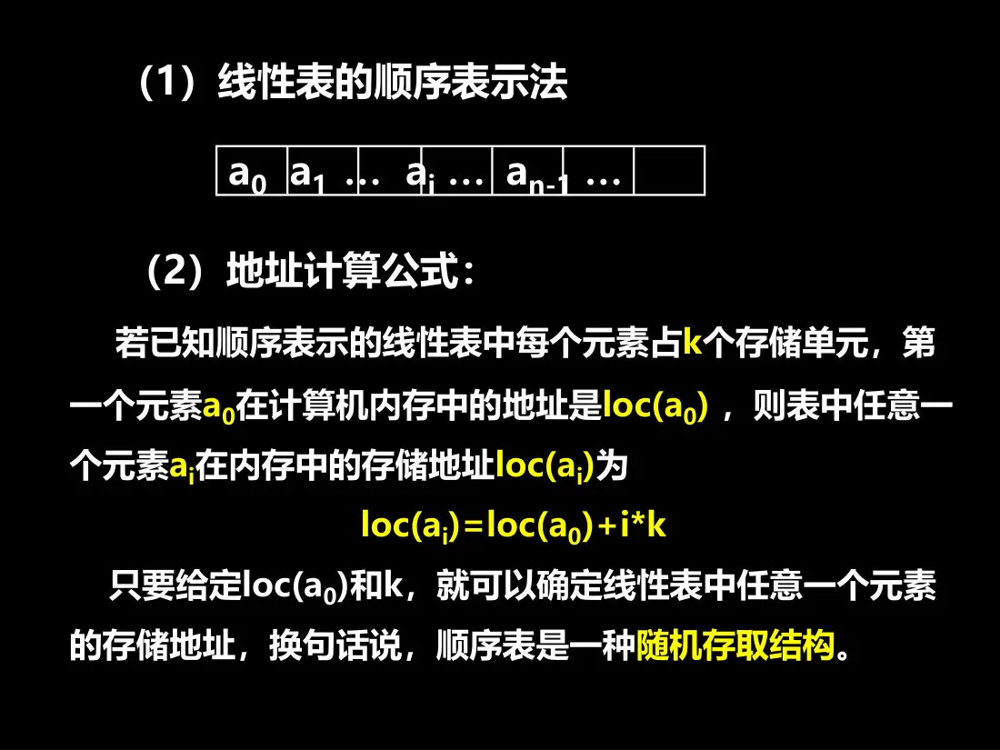

原文：

（1）线性表的顺序表示法

$$
\boxed {a _ {0} a _ {1} \dots a _ {i} \dots a _ {n - 1} \dots}
$$

若已知顺序表示的线性表中每个元素占k个存储单元，第个元素 $\mathbf { \delta E }$ 在计算机内存中的地址是 $\boxed { \bullet \bullet \bullet }$ 则表中任意一个元素a在内存中的存储地址l $\tt c m ( 0 . 7 , 0 . 7 )$ 为

$$
\operatorname{loc} \left(a _ {i}\right) = \operatorname{loc} \left(a _ {0}\right) + i ^ {*} k
$$

只要给定 $\mathrm { I m }$ 和k，就可以确定线性表中任意一个元素的存储地址，换句话说，顺序表是一种随机存取结构。

### LinearList

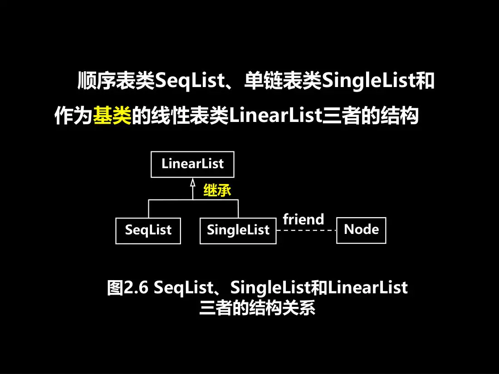

原文：

顺序表类SeqList、单链表类SingleList和作为基类的线性表类LinearList三者的结构

LinearList

继承

SeqList

SingleList

friend

Node

图2.6 SeqList、SingleList和LinearList三者的结构关系

### 3. 顺序表类

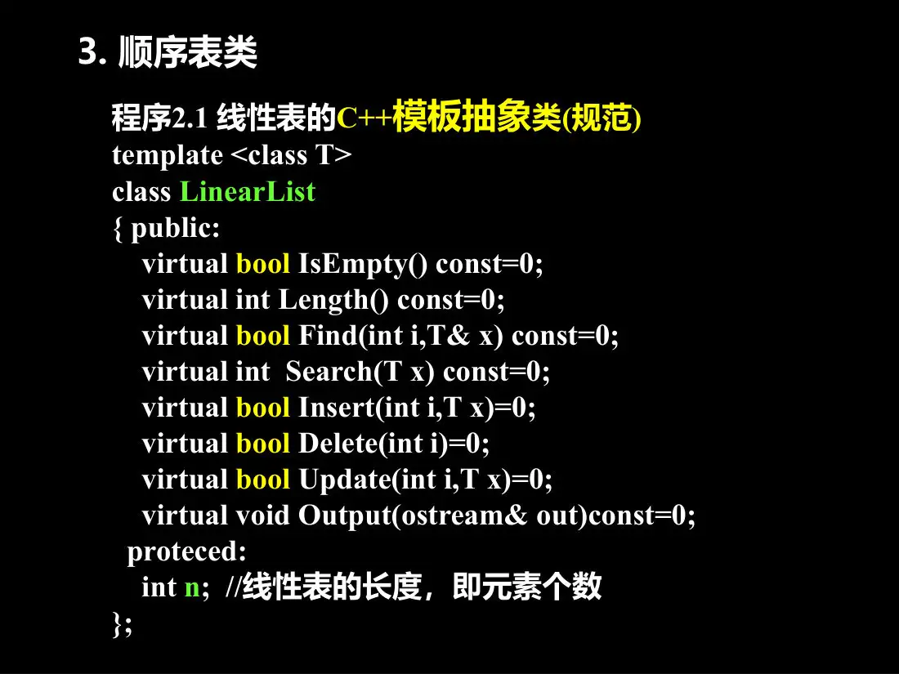

原文：

3. 顺序表类

程序2.1 线性表的C++模板抽象类(规范)template <class T>class LinearList

virtual bool IsEmpty() const=0; virtual int Length() const=0; virtual bool Find(int i,T& x) const=0; virtual int Search(T x) const=0; virtual bool Insert(int i,T x)=0; virtual bool Delete(int i)=0; virtual bool Update(int i,T x)=0; virtual void Output(ostream& out)const=0; proteced:

### 程序2.2 线性表的顺序实现

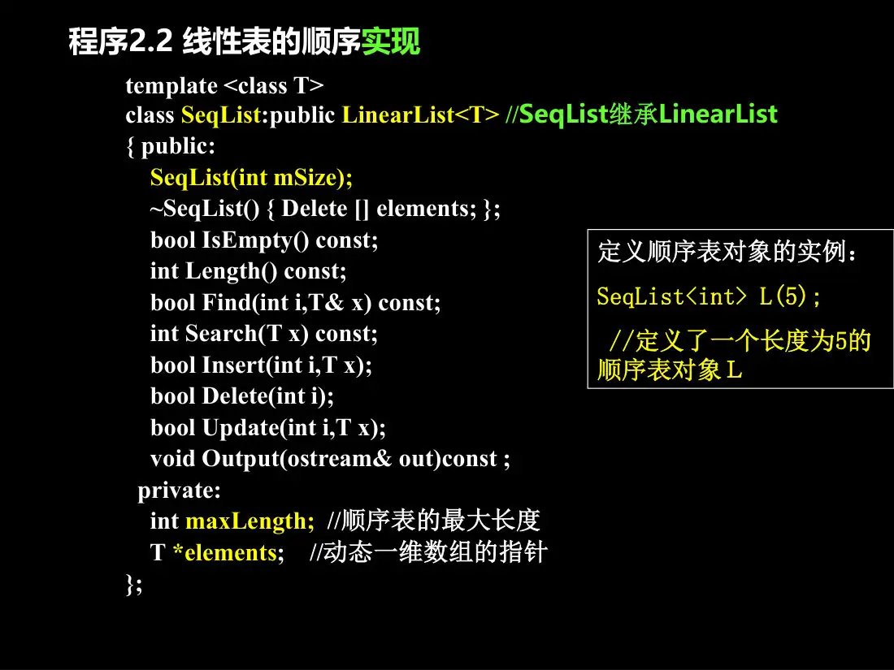

原文：

程序2.2 线性表的顺序实现

template <class T> class SeqList:public LinearList<T> //SeqList继承LinearList { public: SeqList(int mSize); \~SeqList() { Delete [] elements; }; bool IsEmpty() const; int Length() const; bool Find(int i,T& x) const; int Search(T x) const; bool Insert(int i,T x); bool Delete(int i); bool Update(int i,T x); void Output(ostream& out)const ;

private: int maxLength; //顺序表的最大长度 T \*elements; //动态一维数组的指针 }; iら

定义顺序表对象的实例：SeqList<int> L(5);//定义了一个长度为5的顺序表对象L

### public: SeqList(int mSize);

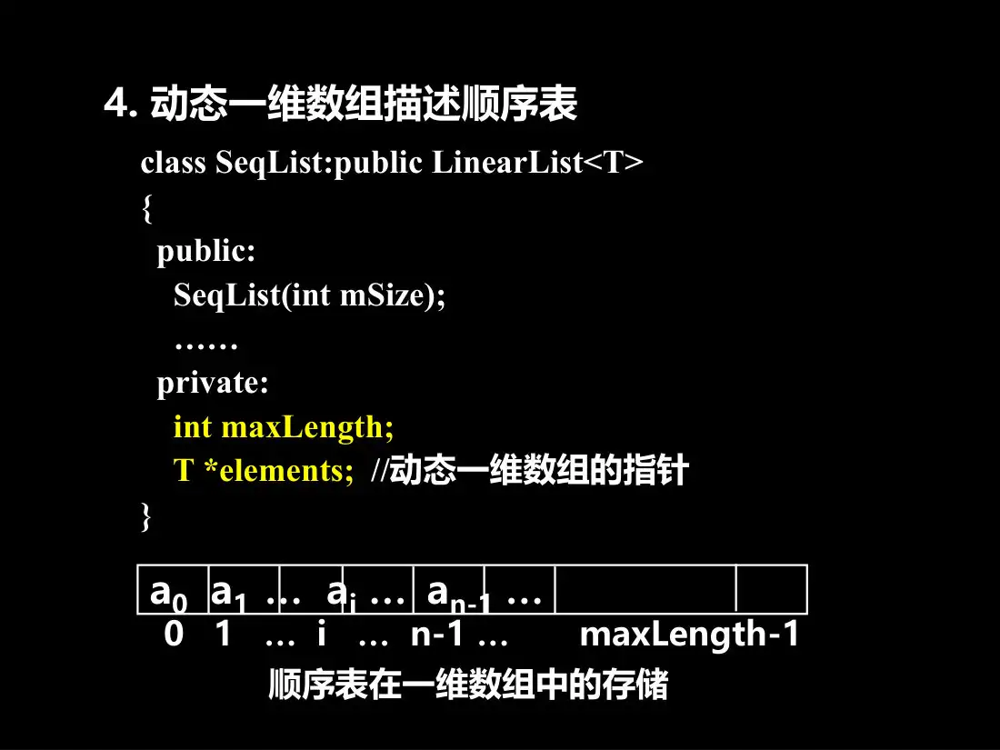

原文：

4. 动态一维数组描述顺序表 class SeqList:public LinearList<T> {

public: SeqList(int mSize);

private: int maxLength; T \*elements; //动态一维数组的指针

顺序表在一维数组中的存储

### 运算的实现

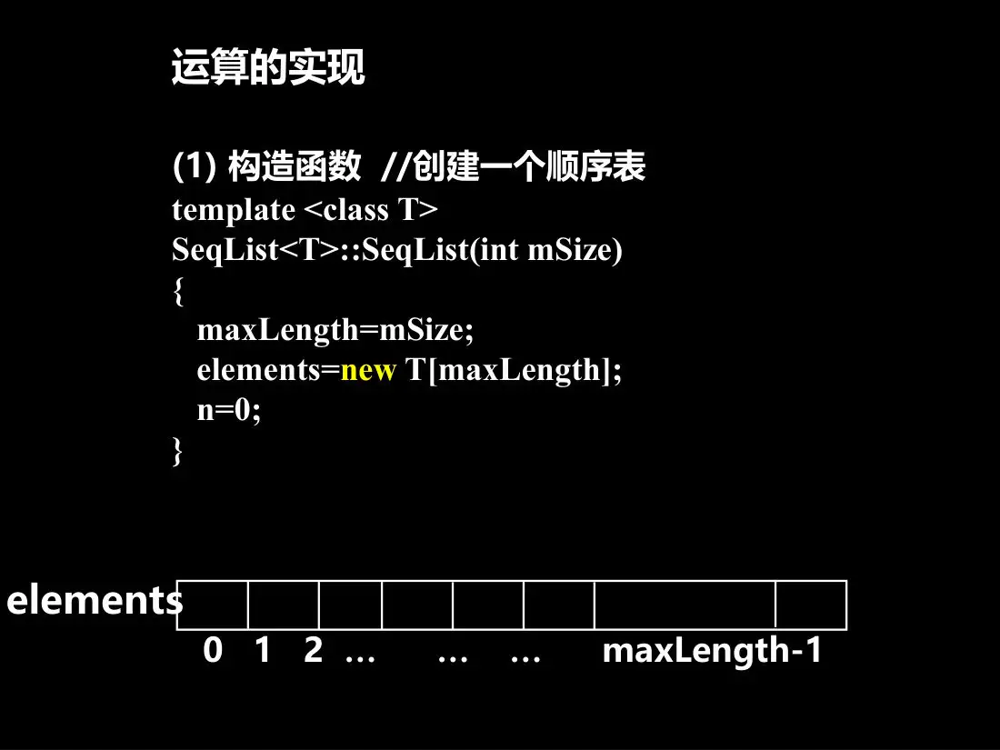

原文：

运算的实现

(1) 构造函数 //创建一个顺序表template <class T>SeqList<T>::SeqList(int mSize)

maxLength=mSize; elements=new T[maxLength]; n=0;

elements

maxLength-1

### delete [] elements;

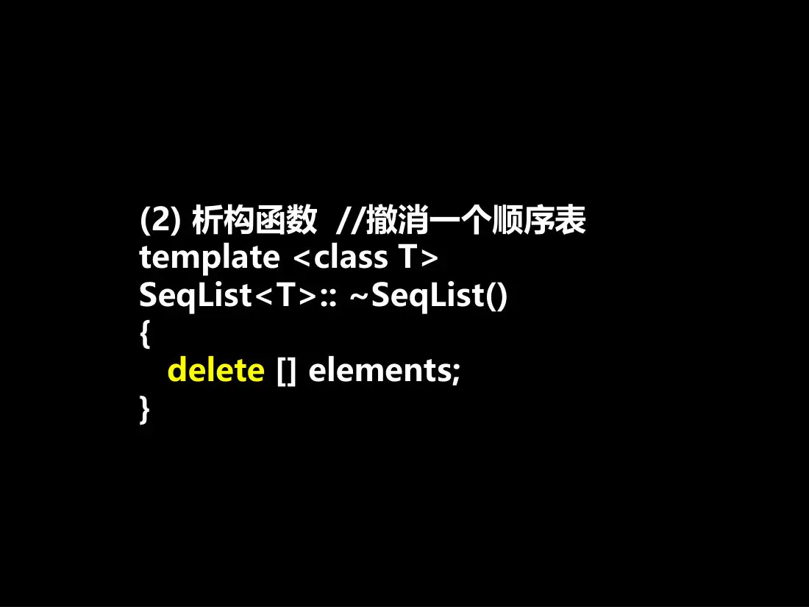

原文：

(2) 析构函数 //撤消一个顺序表template <class T>SeqList<T>:: \~SeqList()

delete [] elements;

### 5. 在顺序存储表示下实现线性表上定义的操作

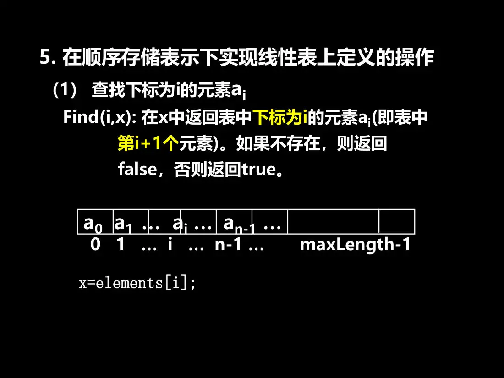

原文：

5. 在顺序存储表示下实现线性表上定义的操作

（1） 查找下标为i的元素aFind(i,x): 在x中返回表中下标为i的元素 $\tt E R$ (即表中第i+1个元素)。如果不存在，则返回false，否则返回true。

$$
\begin{array}{c c c c c c} \hline a _ {0} & a _ {1} & \ldots & a _ {i} & \ldots & a _ {n - 1} \\ \hline 0 & 1 & \ldots & i & \ldots & n - 1 \\ \hline \end{array}
$$

maxLength-1

x=elements[i];

### 第 17 页

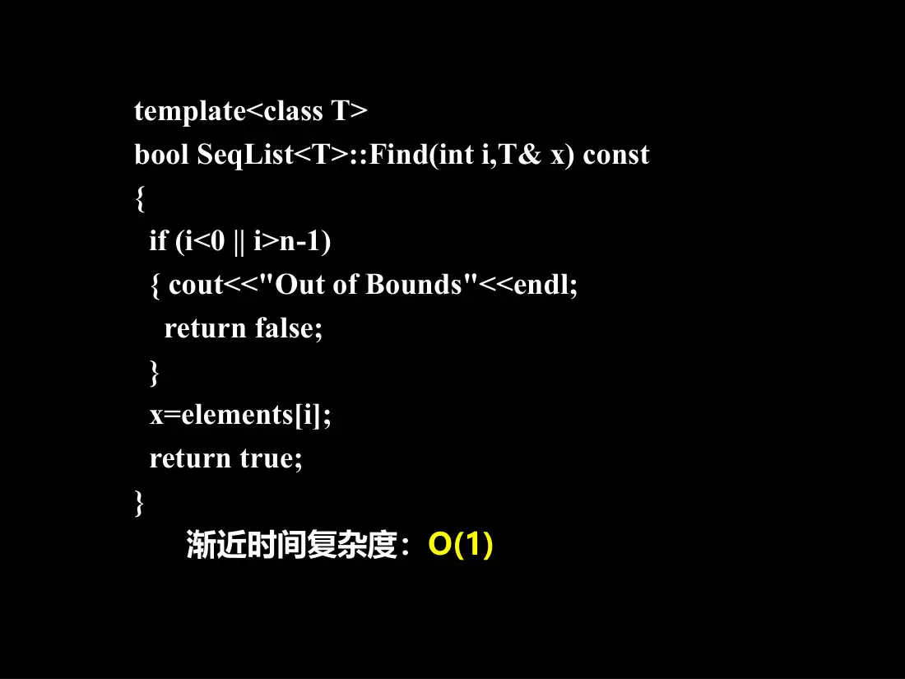

原文：

template<class T> bool SeqList<T>::Find(int i,T& x) const if (i<0 || i>n-1) { cout<<"Out of Bounds"<<endl; return false; } x=elements[i]; return true; } 渐近时间复杂度：O(1)

### （2）插入操作

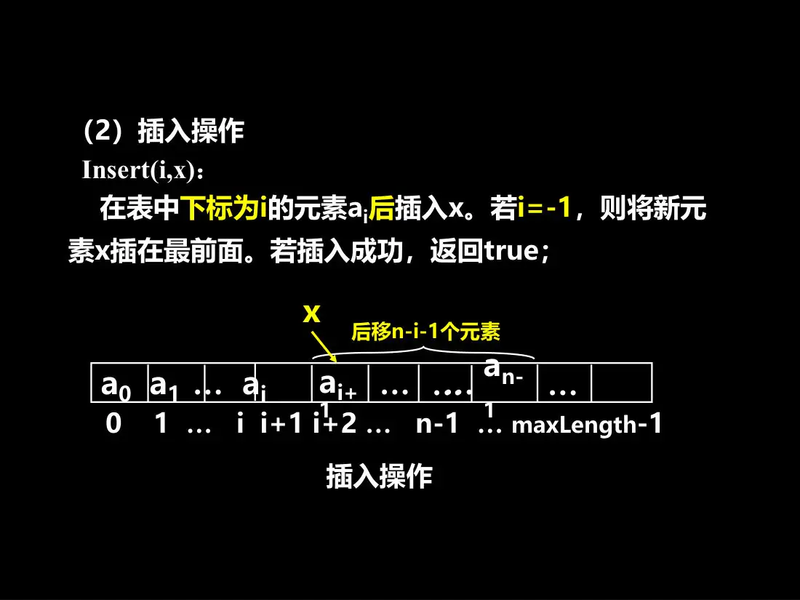

原文：

（2）插入操作

Insert(i,x)：

在表中下标为i的元素a后插入x。若i=-1，则将新元素x插在最前面。若插入成功，返回true；

x 后移n-i-1个元素 a0 a1 … ai … an-ai+ …… 0 1 … i i+1 i+2 … n-1 … maxLength-111 插入操作

### 后移n-i-1个元素

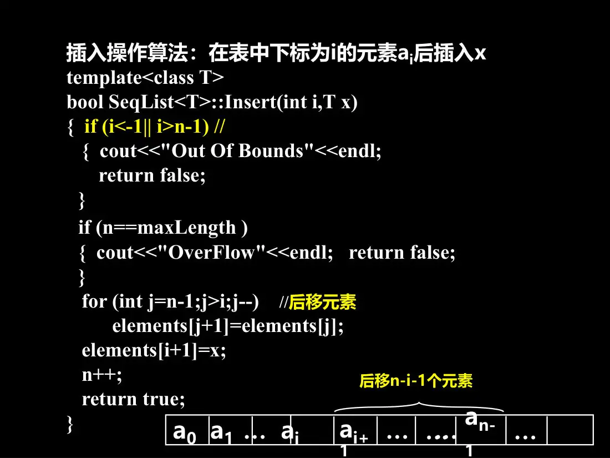

原文：

插入操作算法：在表中下标为i的元素a后插入x template<class T> bool SeqList<T>::Insert(int i,T x) { if (i<-1|| i>n-1) // { cout<<"Out Of Bounds"<<endl; return false;

if (n==maxLength ) { cout<<"OverFlow"<<endl; return false;

for (int j=n-1;j>i;j--) //后移元素 elements[j+1]=elements[j]; elements[i+1]=x; n++; return true;

后移n-i-1个元素

### 分析：

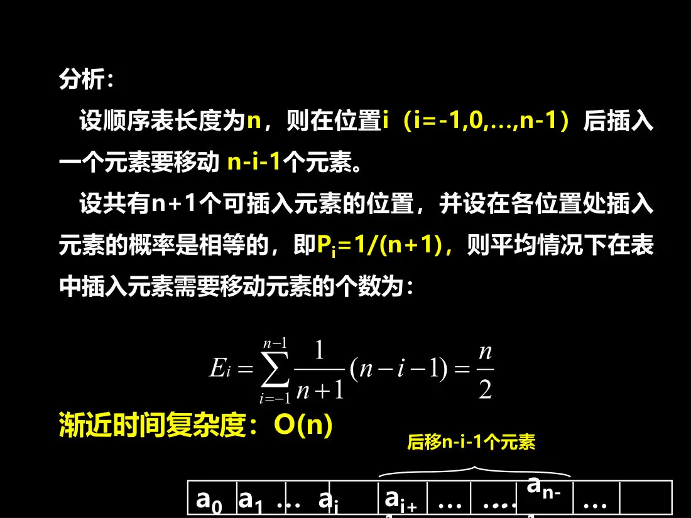

原文：

分析：

设顺序表长度为n，则在位置i $( 0 - 1 1 0 ) \times ( 1 1 0 - 1 1 ) \times ( 1 1 0 )$ 后插入一个元素要移动 n-i-1个元素。

设共有n+1个可插入元素的位置，并设在各位置处插入元素的概率是相等的，即 $\infty . 0 2 \times 1 0 = 1 0$ ，则平均情况下在表中插入元素需要移动元素的个数为：

$$
E _ {i} = \sum_ {i = - 1} ^ {n - 1} \frac {1}{n + 1} (n - i - 1) = \frac {n}{2}
$$

渐近时间复杂度： $\textcircled { \bullet } \textcircled { \bullet } \textcircled { }$

后移n-i-1个元素

### 删除它

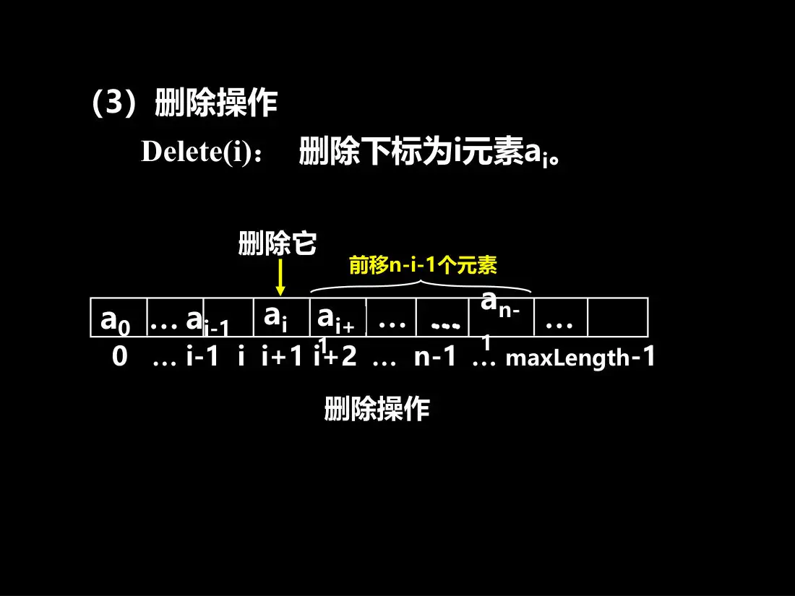

原文：

（3）删除操作Delete(i)： 删除下标为i元素 $\mathsf { E H z }$

删除它

前移n-i-1个元素

a0 … a aii-1 … …an-… …ai+ 0 … i-1 i i+1 i+2 … n-1 … maxLength-111

删除操作

### n--; return true;

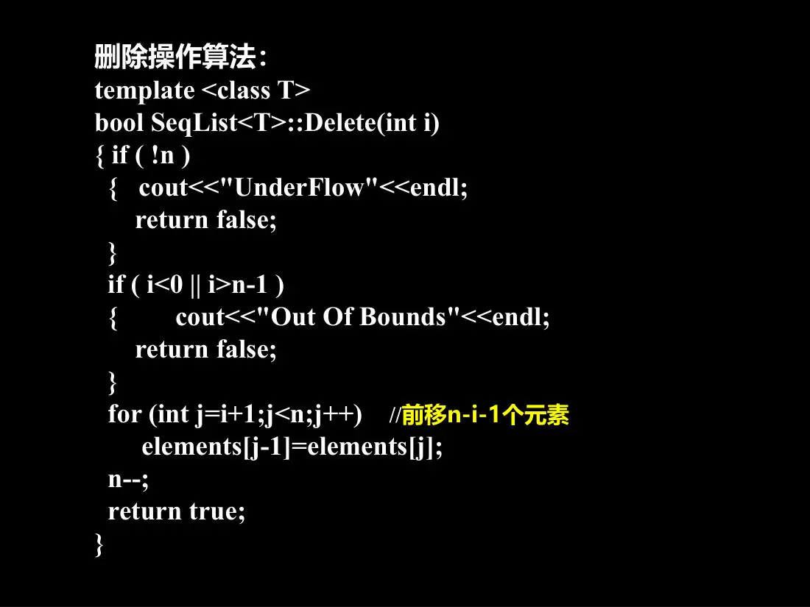

原文：

删除操作算法： template <class T> bool SeqList<T>::Delete(int i) { if ( !n ) { cout<<"UnderFlow"<<endl; return false;

if ( i<0 || i>n-1 ) cout<<"Out Of Bounds"<<endl; return false;

for (int j=i+1;j<n;j++) //前移n-i-1个元素 elements[j-1]=elements[j];

n--; return true;

### 分析:

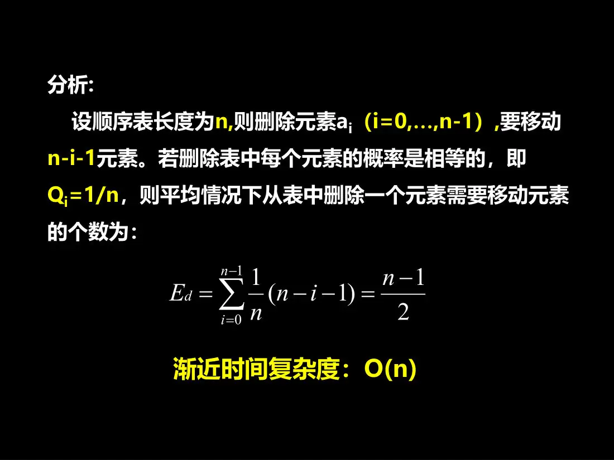

原文：

分析:

设顺序表长度为n,则删除元素a $( 0 - 0 ) \div ( 0 - 0 ) = ( 0 - 0 )$ ,要移动$\mathbb { m } \mathbb { n }$ 元素。若删除表中每个元素的概率是相等的，即$\odot \sharp \sharp \mathbb { W } ^ { \sharp }$ ，则平均情况下从表中删除一个元素需要移动元素的个数为：

$$
E _ {d} = \sum_ {i = 0} ^ {n - 1} \frac {1}{n} (n - i - 1) = \frac {n - 1}{2}
$$

渐近时间复杂度： $\odot$ （4）顺序表的应用——集合求“并”例2.1 求集合A和B的并 $\pmb  \mathrm { \langle \pmb { \mathrm { A } } \pmb { \mathrm { \langle \pmb { \mathrm { A } } \pmb { \mathrm { \langle \pmb { \mathrm { A } } \pmb { \mathrm { \langle \pmb { \mathrm { A } } \pmb { \mathrm { \langle \pmb { \mathrm { A } } \pmb { \mathrm { \langle \pmb { \mathrm { A } } \pmb { \mathrm { \langle \pmb { \mathrm { A } } \pmb { \mathrm { \langle \pmb { \mathrm { A } } \pmb { \mathrm { \langle \pmb { \delta } } \pmb { \mathrm { \langle \pmb { \mathrm { A } } \pmb { \mathrm { \langle \pmb { \delta } } \pmb { \mathrm { \langle \pmb { \mathrm { \delta } } \pmb { \mathrm } \pmb { \langle \pmb { \mathrm { \delta } } \pmb } } } } } } } } } } } } } } } } } } } } } }$ B分析：集合可以看成是线性表，用顺序表LA和LB分别表示集合A和B，“并”的结果放在LA中。

### 两集合求并的算法思想是：

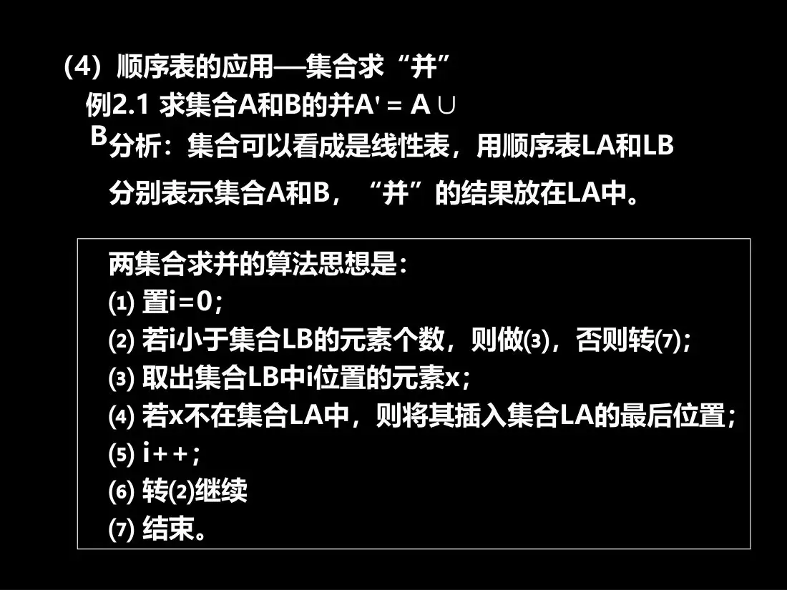

原文：

两集合求并的算法思想是：

⑴ 置i=0；

⑵ 若i小于集合LB的元素个数，则做⑶，否则转⑺；

⑶ 取出集合LB中i位置的元素x；

⑷ 若x不在集合LA中，则将其插入集合LA的最后位置；

⑸ i++；

⑹ 转⑵继续

⑺ 结束。

### include "seqlist.h"

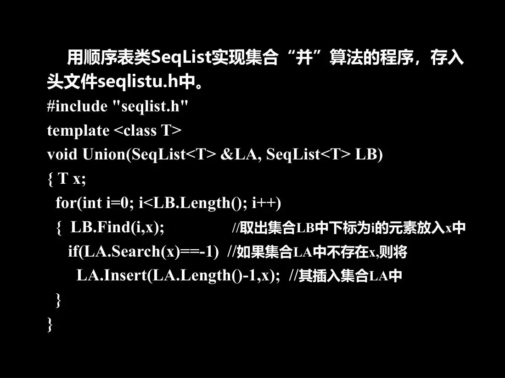

原文：

用顺序表类SeqList实现集合“并”算法的程序，存入头文件seqlistu.h中。

include "seqlist.h"

template <class T>

void Union(SeqList<T> &LA, SeqList<T> LB)

for(int i=0; i<LB.Length(); i++)

{ LB.Find(i,x);

//取出集合LB中下标为i的元素放入x中

if(LA.Search(x)==-1) //如果集合LA中不存在x,则将

LA.Insert(LA.Length()-1,x); //其插入集合LA中

### include "seqlistu.h"

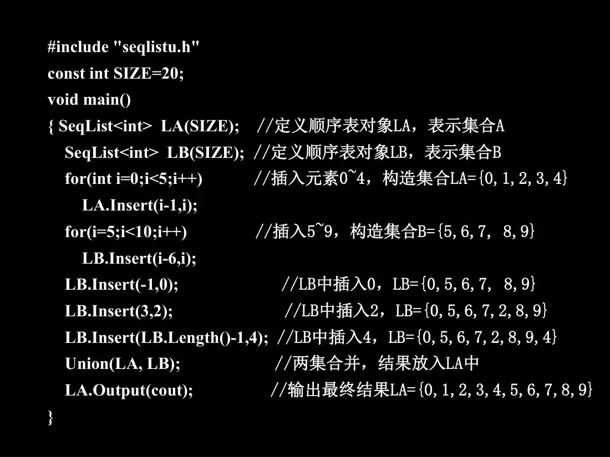

原文：

include "seqlistu.h"

const int SIZE=20;

void main()

{ SeqList<int> LA(SIZE); //定义顺序表对象LA，表示集合A

SeqList<int> LB(SIZE); //定义顺序表对象LB，表示集合B

for(int i=0;i<5;i++)

//插入元素0\~4，构造集合LA={0,1,2,3,4}

LA.Insert(i-1,i);

for(i=5;i<10;i++)

//插入5\~9，构造集合B={5,6,7, 8,9}

LB.Insert(i-6,i);

LB.Insert(-1,0);

//LB中插入0，LB={0,5,6,7, 8,9}

LB.Insert(3,2);

//LB中插入2，LB={0,5,6,7,2,8,9}

LB.Insert(LB.Length()-1,4); //LB中插入4，LB={0,5,6,7,2,8,9,4}

Union(LA, LB);

//两集合并，结果放入LA中

LA.Output(cout);

//输出最终结果LA={0,1,2,3,4,5,6,7,8,9}

### 6. 线性表的顺序存储表示的优缺点：

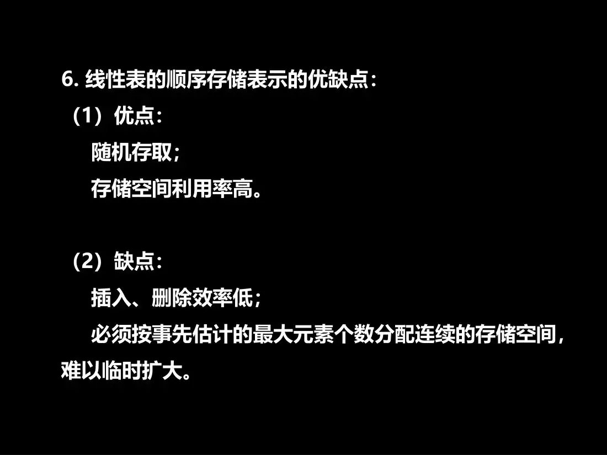

原文：

6. 线性表的顺序存储表示的优缺点：

（1）优点：随机存取；存储空间利用率高。

（2）缺点：插入、删除效率低；

必须按事先估计的最大元素个数分配连续的存储空间，难以临时扩大。

### 2.3 线性表的链接表示

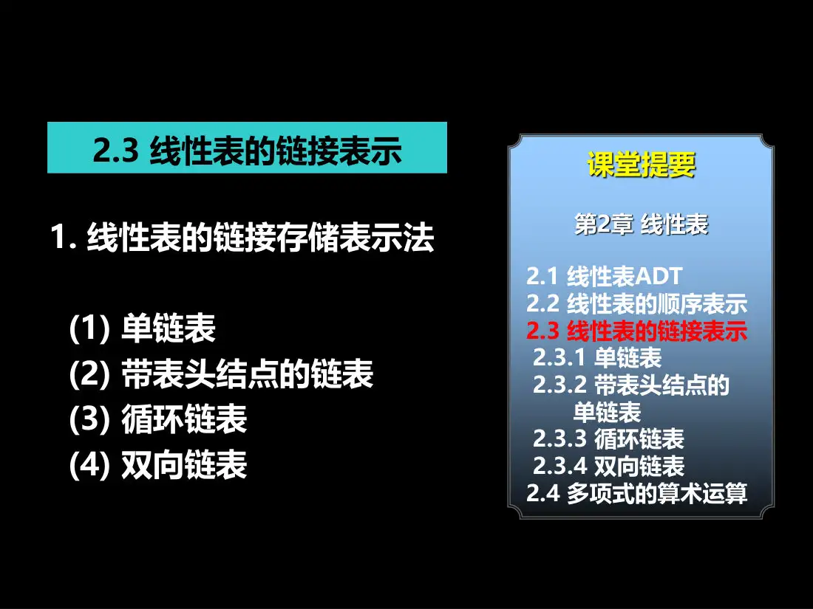

原文：

2.3 线性表的链接表示

1. 线性表的链接存储表示法

(1) 单链表

(2) 带表头结点的链表

(3) 循环链表

(4) 双向链表

课堂提要

第2章 线性表

2.1 线性表ADT

2.2 线性表的顺序表示

2.3 线性表的链接表示

2.3.1 单链表

2.3.2 带表头结点的单链表

2.3.3 循环链表

2.3.4 双向链表

2.4 多项式的算术运算

### 2.3.1 单链表

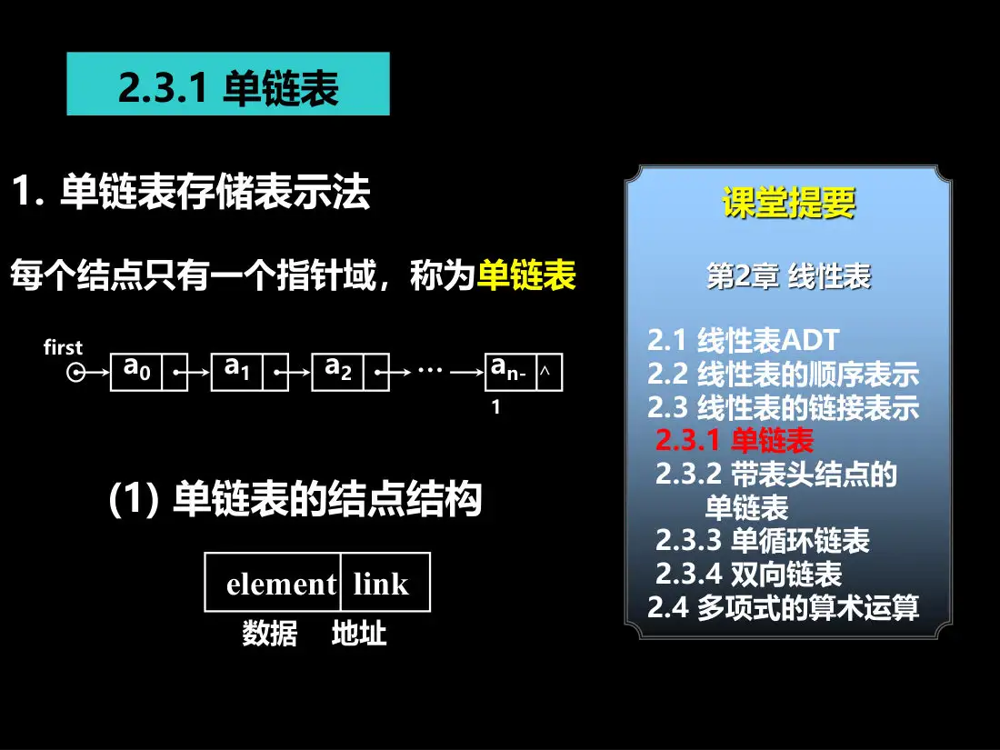

原文：

2.3.1 单链表

1. 单链表存储表示法

每个结点只有一个指针域，称为单链表

$$
\text {   first   } \quad \textcircled {\bullet} \longrightarrow \boxed {a _ {0}} \quad \bullet \longrightarrow \boxed {a _ {1}} \quad \bullet \longrightarrow \boxed {a _ {2}} \quad \bullet \longrightarrow \dots \longrightarrow \boxed {a _ {n -}} \wedge
$$

(1) 单链表的结点结构

element link

课堂提要

数据 地址

第2章 线性表

2.1 线性表ADT

2.2 线性表的顺序表示

2.3 线性表的链接表示

2.3.1 单链表

2.3.2 带表头结点的单链表

2.3.3 单循环链表

2.3.4 双向链表

2.4 多项式的算术运算

### (2) 单链表结构

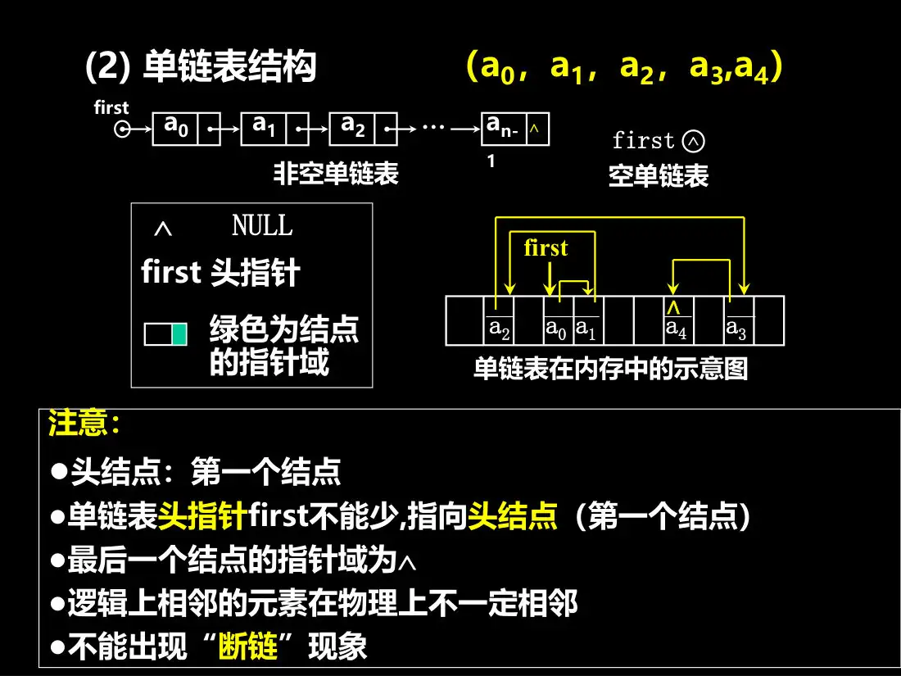

原文：

(2) 单链表结构

（a0，a1，a2，a3,a4）

first a0 a1 a2 an-… ∧ 非空单链表 1

first 头指针

绿色为结点的指针域first空单链表

单链表在内存中的示意图

注意：

●头结点：第一个结点

●单链表头指针first不能少,指向头结点（第一个结点）

●最后一个结点的指针域为

●逻辑上相邻的元素在物理上不一定相邻

●不能出现“断链”现象

### 2. 单链表结点类

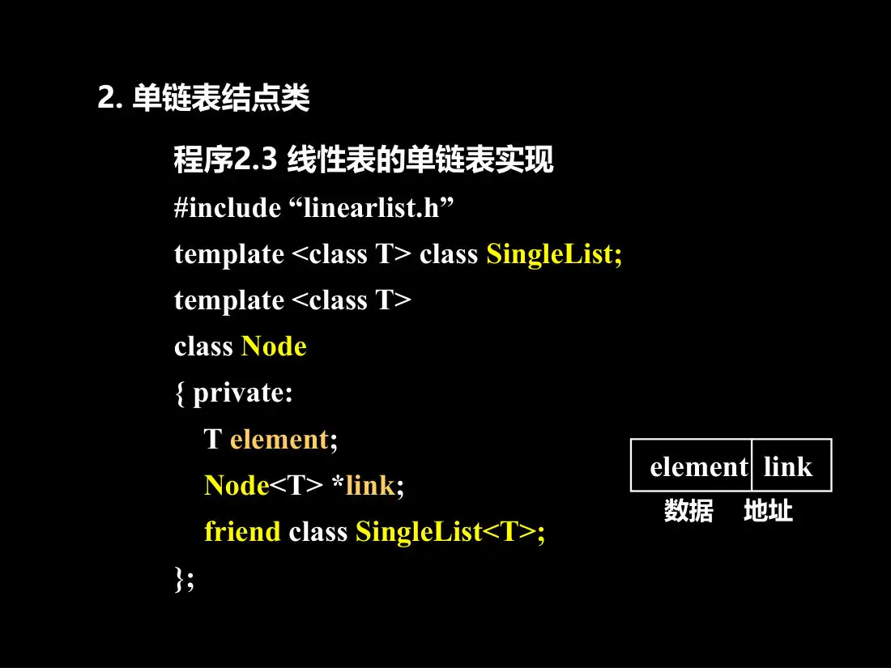

原文：

2. 单链表结点类

程序2.3 线性表的单链表实现

include “linearlist.h”

template <class T> class SingleList;

template <class T>

class Node

{ private:

T element;

Node<T> \*link;

element link

friend class SingleList<T>;

数据 地址

};

### 3. 单链表类 程序2.3 线性表的单链表实现

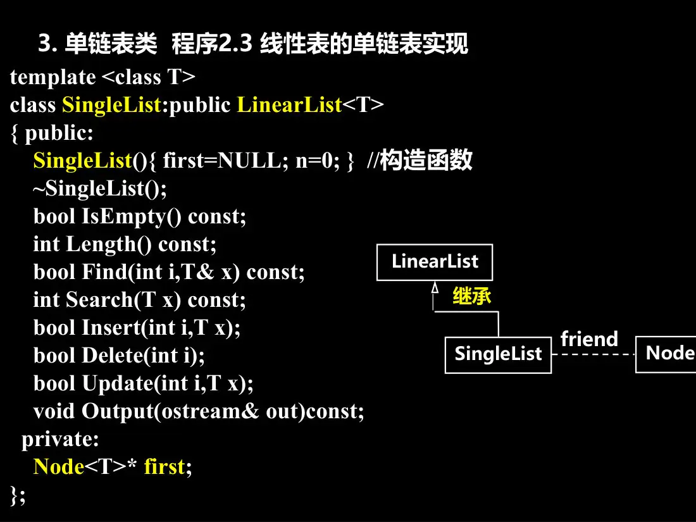

原文：

3. 单链表类 程序2.3 线性表的单链表实现

template <class T> class SingleList:public LinearList<T>

{ public: SingleList(){ first=NULL; n=0; } / \~SingleList(); bool IsEmpty() const; int Length() const; bool Find(int i,T& x) const; int Search(T x) const; bool Insert(int i,T x); bool Delete(int i); bool Update(int i,T x); void Output(ostream& out)const;

private: Node<T>\* first;

LinearList

继承

SingleList

friend

Node

### 单链表

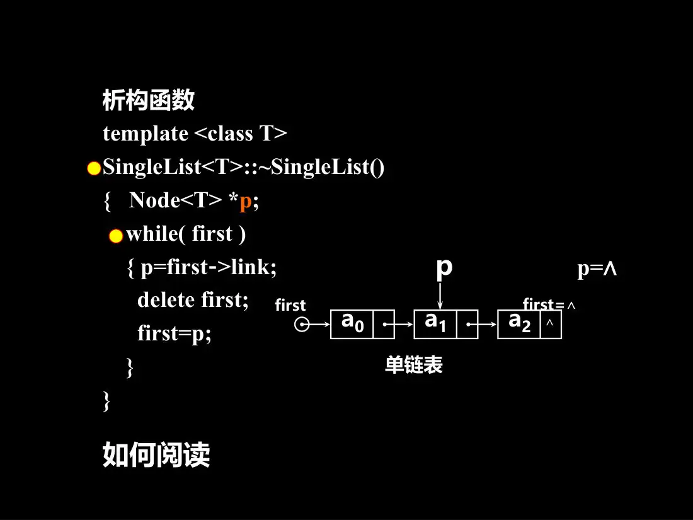

原文：

析构函数 template <class T> SingleList<T>::\~SingleList() { Node<T> \*p; while( first ) { p=first->link; delete first; first a0 first=p;

单链表

如何阅读

### 4. 在单链表上实现线性表规范中所定义的操作

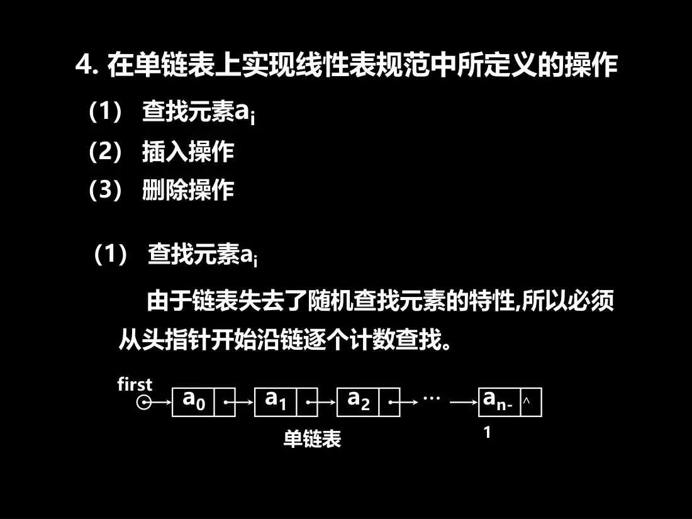

原文：

4. 在单链表上实现线性表规范中所定义的操作

（1） 查找元素 $\mathsf { E }$

（2） 插入操作

（3） 删除操作

（1） 查找元素ai

由于链表失去了随机查找元素的特性,所以必须从头指针开始沿链逐个计数查找。

first a0 a1 a2 an- … ∧

单链表

### p first a0 a1 a2 an-… ∧

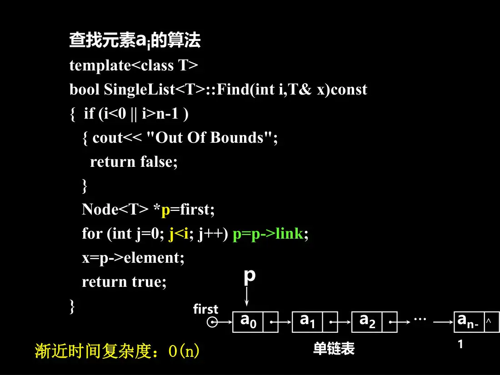

原文：

查找元素a的算法 template<class T> bool SingleList<T>::Find(int i,T& x)const { if (i<0 || i>n-1 ) { cout<< "Out Of Bounds"; return false;

Node<T> \*p=first; for (int j=0; j<i; j++) p=p->link; x=p->element;

p first a0 a1 a2 an-… ∧

单链表

渐近时间复杂度：O(n)

### （2） 插入操作在给定元素ai之后插入值为x的元素。

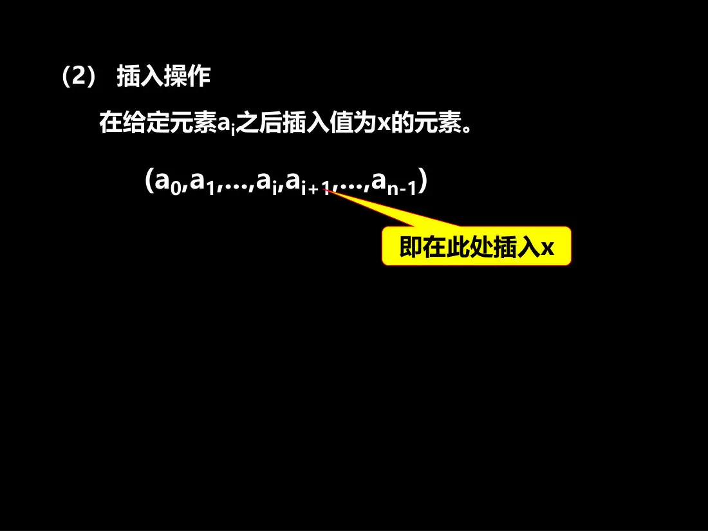

原文：

（2） 插入操作在给定元素ai之后插入值为x的元素。

$$
(a _ {0}, a _ {1}, \dots , a _ {i}, a _ {i + 1}, \dots , a _ {n - 1})
$$

即在此处插入x

### 插入算法步骤为：

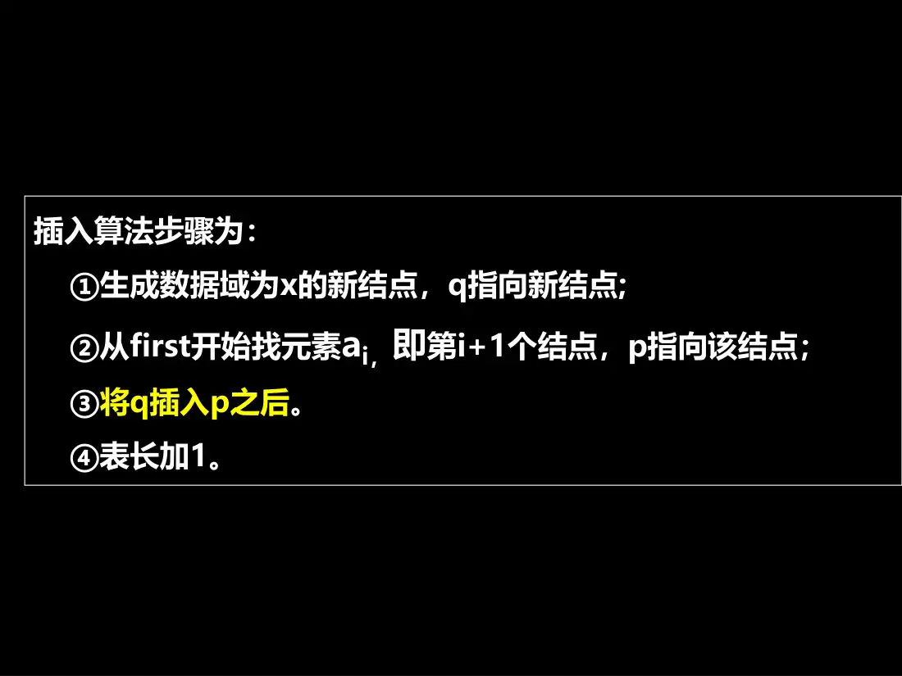

原文：

插入算法步骤为：

①生成数据域为x的新结点，q指向新结点;

②从first开始找元素ai，即第i+1个结点，p指向该结点；

③将q插入p之后。

④表长加1。

### i>-1時，将q插入p之后: 单链表

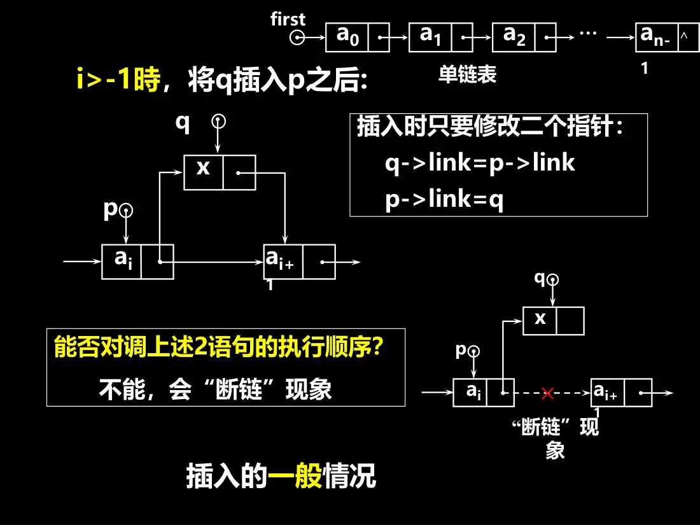

原文：

i>-1時，将q插入p之后: 单链表

插入时只要修改二个指针： q->link=p->link p->link=q

能否对调上述2语句的执行顺序？不能，会“断链”现象

插入的一般情况

“断链” 现象

a0 a1 a2 an-first … ∧

### i==1時，插入在頭結點之前

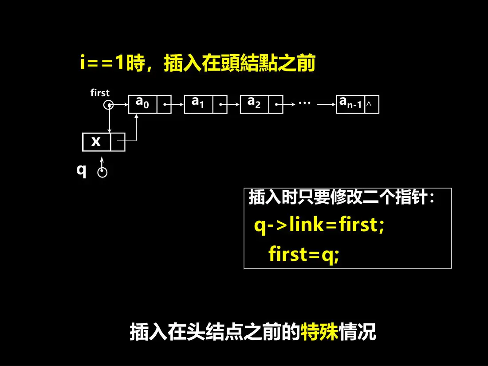

原文：

i==1時，插入在頭結點之前

插入时只要修改二个指针： q->link=first； first=q;

插入在头结点之前的特殊情况 template<class T> bool SingleList<T>::Insert(int i,T x) { if ( i<-1 || i>n-1 ) { cout<< "Out Of Bounds"; return false;

### //在p之后插入q

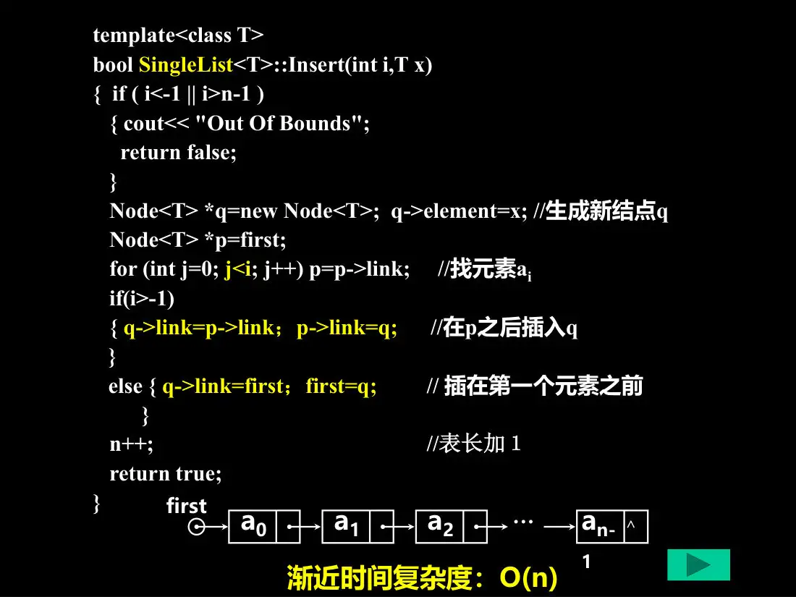

原文：

//在p之后插入q

// 插在第一个元素之前

//表长加1

return true;

first a0 a1 a2 an-… ∧

渐近时间复杂度：O(n)

### （3）删除操作

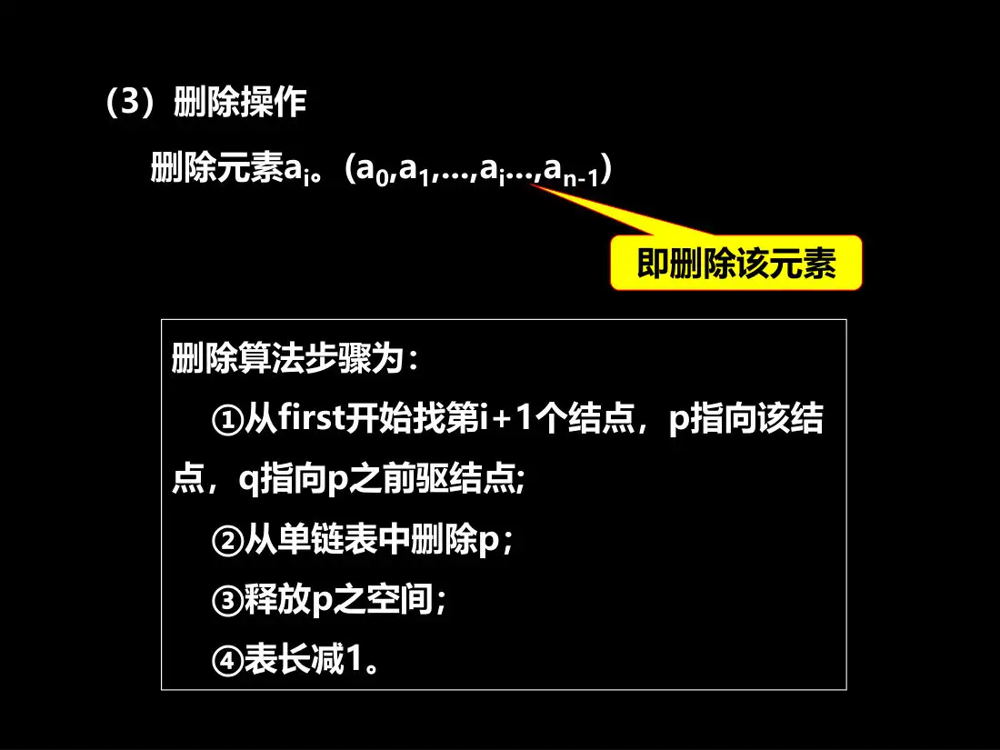

原文：

（3）删除操作

删除元素 $E _ { \mathrm { { P G } } }$ $\scriptstyle ( \in [ 0 , 1 ] = \lceil 1 , \tau \rceil ) = \lceil \tau \rceil \leq \tau \lceil 1 \rceil \leq 1 \rceil$

即删除该元素

删除算法步骤为：

①从first开始找第i+1个结点，p指向该结点，q指向p之前驱结点;

②从单链表中删除p；

③释放p之空间；

④表长减1。

### 删除p:

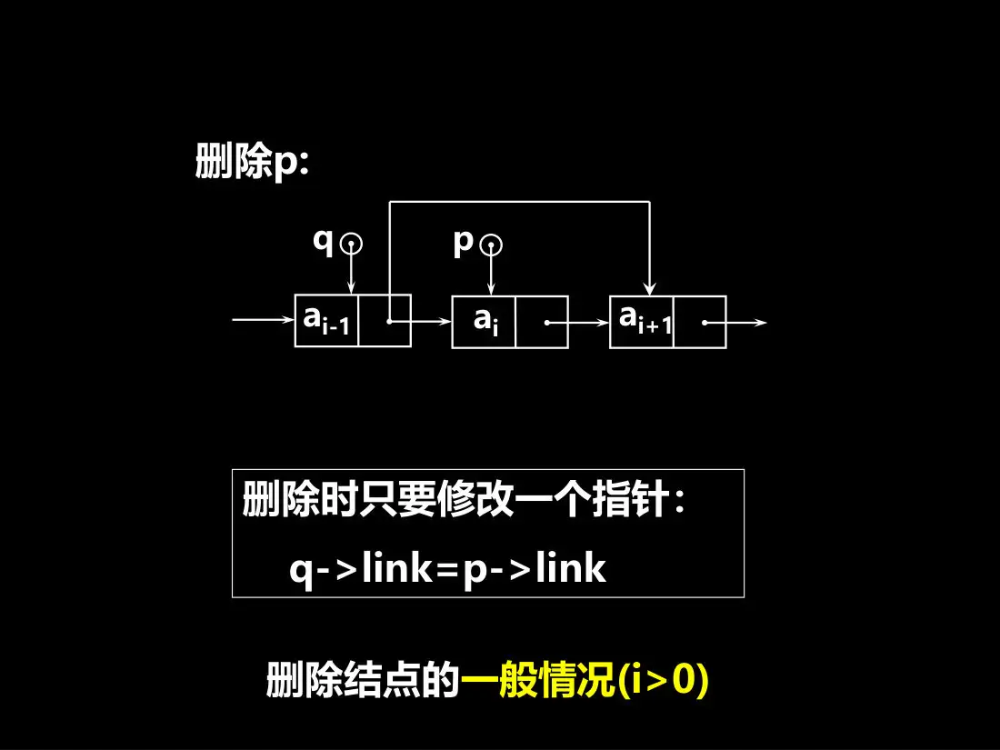

原文：

删除p:

删除时只要修改一个指针：$0 . 0 2 \times 1 0 ^ { 3 } k g / m ^ { 3 } = 0 . 0 2 m / s$

删除结点的 般情况(i>0)

### 删除时只要修改一个指针：first=first->link

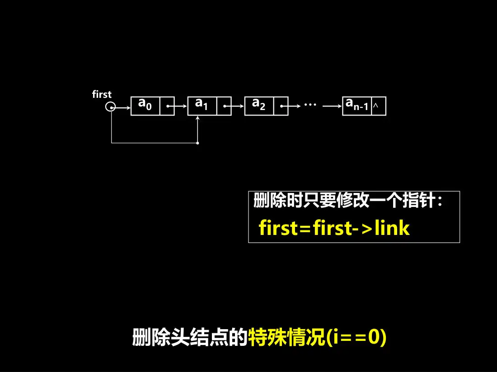

原文：

删除时只要修改一个指针：first=first->link

删除头结点的特殊情况 $\mathbb { R } \mathbb { = } \mathbb { 0 }$ template<class T> bool SingleList<T>::Delete(int i)

### { p=q->link; q->link=p->link;

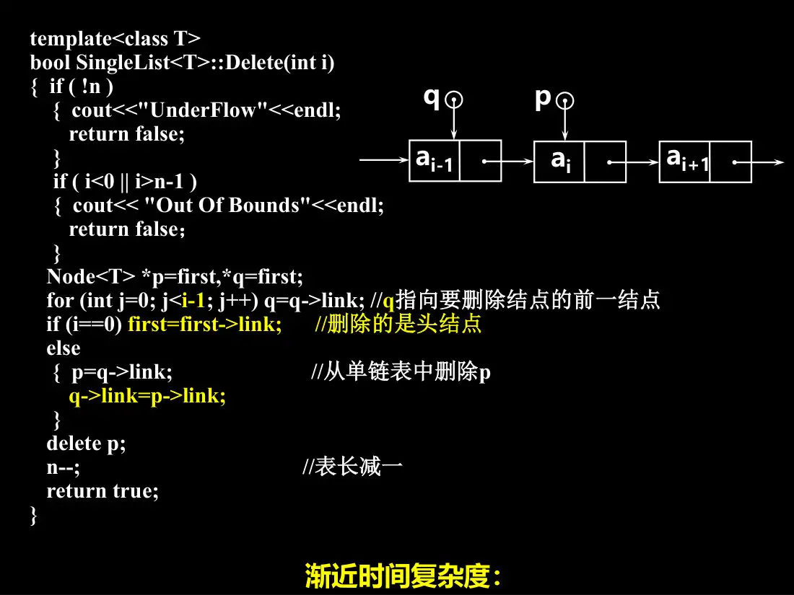

原文：

{ if ( !n ) { cout<<"UnderFlow"<<endl; return false;

if ( i<0 || i>n-1 ) { cout<< "Out Of Bounds"<<endl; return false；

Node<T> \*p=first,\*q=first;for (int j=0; j<i-1; j++) q=q->link; //q指向要删除结点的前一结点if (i==0) first=first->link; //删除的是头结点

{ p=q->link; q->link=p->link;

//从单链表中删除p

//表长减一

渐近时间复杂度：

### 两集合求交的算法思想是：

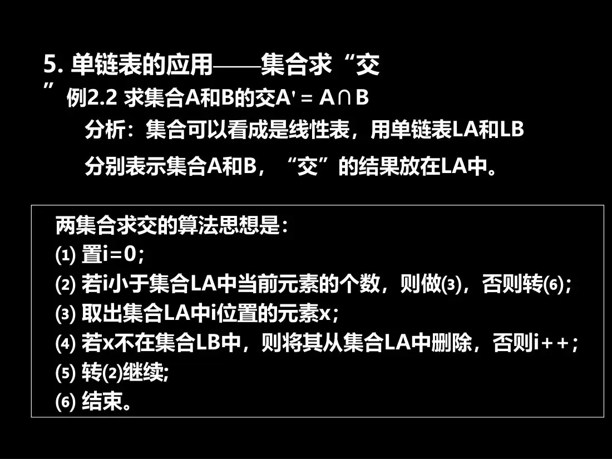

原文：

5. 单链表的应用— 集合求“交例2.2 求集合A和B的交 $\mathrm { \Delta \mathrm { \underline { { A } } \mathbf { \underline { { V } } = \underline { { V } } \mathbf { \underline { { A } } } \mathbf { \overline { { U } } } \mathbf { \overline { { \delta } } } } } }$ 分析：集合可以看成是线性表，用单链表LA和LB分别表示集合A和B，“交”的结果放在LA中。

两集合求交的算法思想是：

⑴ 置i=0；

⑵ 若i小于集合LA中当前元素的个数，则做⑶，否则转⑹；

⑶ 取出集合LA中i位置的元素x；

⑷ 若x不在集合LB中，则将其从集合LA中删除，否则i++；

⑸ 转⑵继续;

⑹ 结束。

### include "singlelist.h"

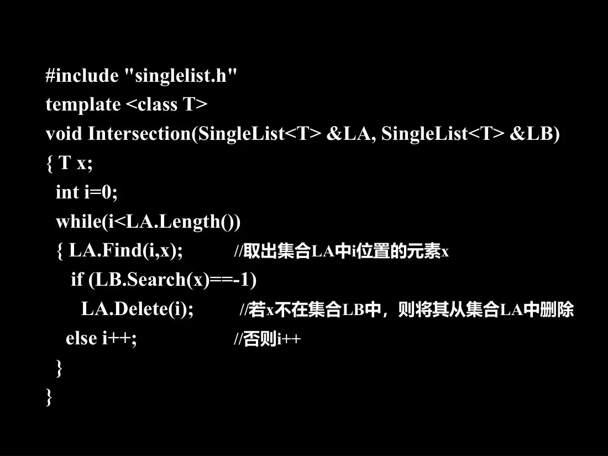

原文：

include "singlelist.h"

template <class T>

void Intersection(SingleList<T> &LA, SingleList<T> &LB)

{ T x;

int i=0;

while(i<LA.Length())

{ LA.Find(i,x);

//取出集合LA中i位置的元素x

if (LB.Search(x)==-1)

LA.Delete(i);

//若x不在集合LB中，则将其从集合LA中删除

else i++;

//否则i++

### 2.3.2 带表头结点的单链表

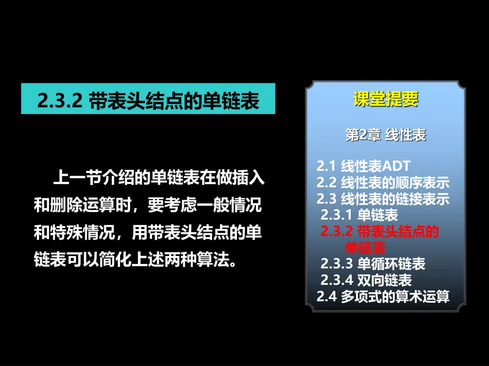

原文：

2.3.2 带表头结点的单链表

上一节介绍的单链表在做插入和删除运算时，要考虑一般情况和特殊情况，用带表头结点的单链表可以简化上述两种算法。

课堂提要

第2章 线性表

2.1 线性表ADT

2.2 线性表的顺序表示

2.3 线性表的链接表示2.3.1 单链表

2.3.2 带表头结点的单链表

2.3.3 单循环链表

2.3.4 双向链表

2.4 多项式的算术运算

### 1. 带表头结点的单链表

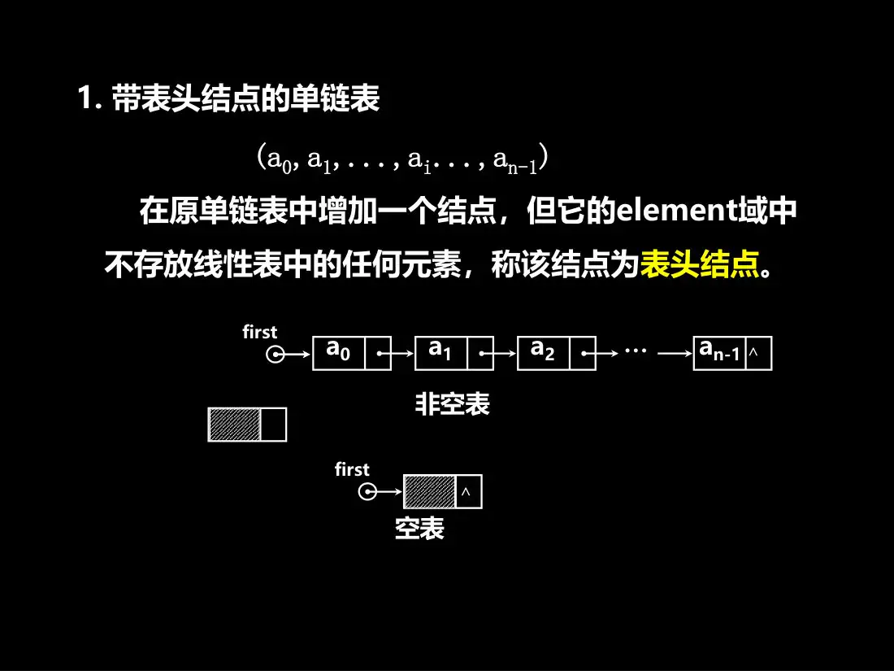

原文：

1. 带表头结点的单链表

$$
(a _ {0}, a _ {1}, \ldots , a _ {i} \ldots , a _ {n - 1})
$$

在原单链表中增加一个结点，但它的element域中不存放线性表中的任何元素，称该结点为表头结点。

非空表

### 2. 带表头结点单链表HeaderList的构造、插入和删除

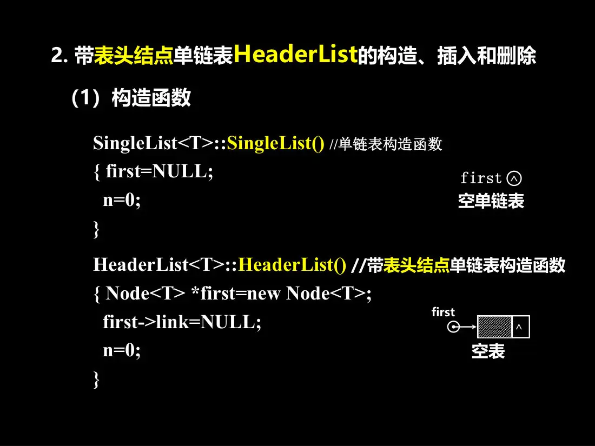

原文：

2. 带表头结点单链表HeaderList的构造、插入和删除

（1）构造函数

SingleList<T>::SingleList() //单链表构造函数 { first=NULL; n=0; }

first空单链表

HeaderList<T>::HeaderList() //带表头结点单链表构造函数 { Node<T> \*first=new Node<T>; first first->link=NULL; n=0; 空表 }

### 第 50 页

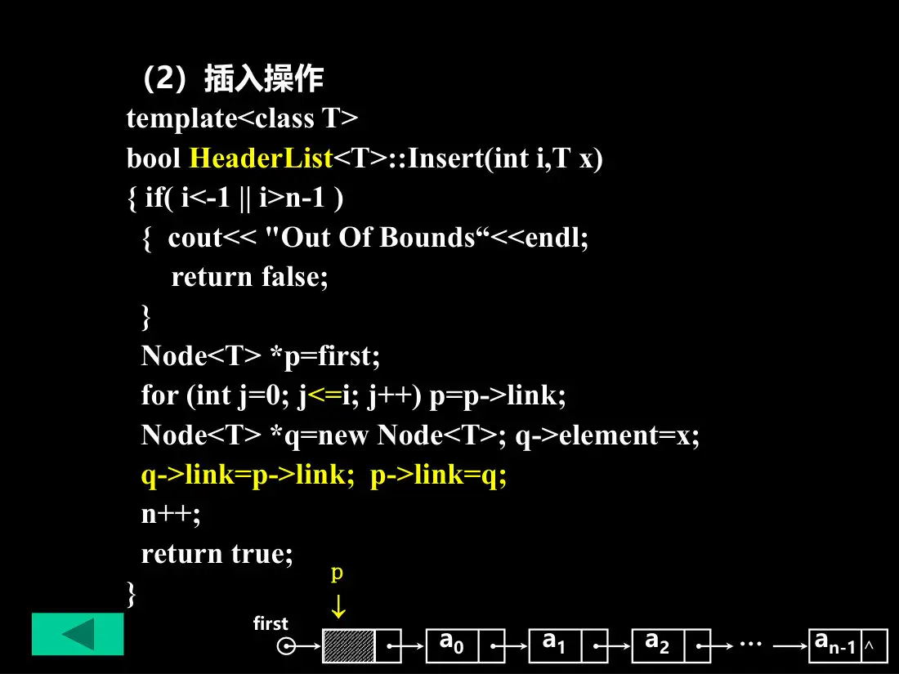

原文：

（2）插入操作 template<class T> bool HeaderList<T>::Insert(int i,T x) { if( i<-1 || i>n-1 ) { cout<< "Out Of Bounds“<<endl; return false;

Node<T> \*p=first; for (int j=0; j<=i; j++) p=p->link; Node<T> \*q=new Node<T>; q->element=x; q->link=p->link; p->link=q;

### 例如删除a2

原文：

（3） 删除操作template<class T>bool HeaderList<T>::Delete(int i){ if ( !n ){ cout<<"UnderFlow"<<endl;return false;

if ( i<0 || i>n-1 ) { cout<< "Out Of Bounds"<<endl; return false;

Node<T> \*q=first,\*p; for (int j=0; j<i; j++) q=q->link; p=q->link; q->link=p->link; delete p; n--; return true;

例如删除a2

first   a0 a1 a2 … an-1 ∧

### 2.3.3 单循环链表

原文：

2.3.3 单循环链表

1. 单循环链表

单循环链表可以从表中任 结点出发访问表中所有结点。

课堂提要

第2章 线性表

2.1 线性表ADT

2.2 线性表的顺序表示

2.3 线性表的链接表示

2.3.1 单链表

2.3.2 带表头结点的单链表

2.3.3 单循环链表

2.3.4 双向链表

2.4 多项式的算术运算

### 不带表头结点的单循环链表

原文：

不带表头结点的单循环链表

非空表first∧空表

带表头结点的单循环链表

非空表

first

空表

### 2.3.4 双向链表

原文：

2.3.4 双向链表

1. 双向链表

(1) 双向链表的结点结构

lLink element rLink

课堂提要

第2章 线性表

2.1 线性表ADT

2.2 线性表的顺序表示

2.3 线性表的链接表示2.3.1 单链表

2.3.2 带表头结点的单链表

2.3.3 单循环链表

2.3.4 双向链表

2.4 多项式的算术运算

### (2) 带表头结点的双向循环链表

原文：

(2) 带表头结点的双向循环链表

### 22.3 .3.3 线性表的双向链表

原文：

22.3 .3.3 线性表的双向链表

3. 双向链表的插入

插入操作：在p所指示的结点前插入值为x新结点

插入操作的核心步骤：

(1) DNode<T> \*q=new DNode<T>; q->element=x;

(2) ① $( 1 5 2 1 1 1 1 ) : 5 : 1 5 = 1 1 1 1 1 : 9$

② q->rlink=p;

③ $1 0 0 - 2 0 0 0 = 2 0 0 0 0 0 ( m ) = 0 . 0 0 0$

④ p->llink=q;

③ $1 0 0 - 2 0 0 0 = 2 0 0 0 0 0 ( m ) = 0 . 0 8$

能否颠倒顺序？

① q->llink=p->llink;

② $0 = 2 0 / \min = 1 2$

④ $| 0 | = | | \sin | = | | \cdot$

### 2.3 线性表的链接表示

原文：

2.3 线性表的链接表示

4. 双向链表的删除

删除操作: 删除p所指示的结点

删除操作的核心步骤是：

(1) ① $1 2 2 1 1 1 1 0 2 2 0 1 1 1 1 1 1 0 1 1 1 0 1 1 0 1 1 0 1 1 0 1 0 1 0 1 0 1 0 0 1 0 0 1 0 0 1 0 0 0 1 0 0 0 0 1 0 0 0 0 0 0 0 0 0 0 0 0 0 0 0 0 0 0 0 0 0 0 0 0 0 0 0 0 0 0 0 0 0 0 0 0 0 0 0 0 0 0 0 0 0 0 0 0 0 0 0 0 0 0 0 0 0 0 0 0 0 0 0 0 0 0 0 0 0 0 0 0 0 0 0 0 0 0 0 0 0 0 0 0 0 0 0 0 0 0 0 0 0 0 0 0 0 0 0 0 0 0 0 0 0 0 0 0 0 0 0 0 0 0 0 0 0 0 0 0 0 0 0 0 0 0 0 0 0 0 0 0 0 0 0 0 0 0 0 0 0 0 0 0 0 0 0 0 0 0 0 0 0 0 0 0 0 0 0 0 0 0 0 0 0 0 0 0 0 0 0 0 0 0 0 0 0 0 0 0 0 0 0 0 0 0 0 0 0 0 0 0 0 0 0 0 0 0 0 0 0 0 0 0 0 0 0 0 0 0 0 0 0 0 0 0 0 0 0 0 0 0 0 0 0 0 0 0 0 0 0 0 0 0 0 0 0 0 0 0 0 0 0 0 0 0 0 0 0 0 0 0 0 0 0 0 0 0 0 0 0 0 0 0 0 0 0 0 0 0 0 0 0 0 0 0 0 0 0 0 0 0 0 0 0 0 0 0 0 0 0 0 0 0 0 0 0 0 0 0 0 0 0 0 0 0 0 0 0 0 0 0 0 0 0 0 0 0 0 0 0 0 0 0 0 0 0 0 0 0 0 0 0 0 0 0 0 0 0 0 0 0 0 0 0 0 0 0 0 0 0 0 0 0 0 0 0 0 0 0 0 0 0 0 0 0 0 0 0 0 0 0 0 0 0 0 0 0 0 0 0 0 0 0 0 0 0 0 0 0 0 0 0 0 0 0 0 0 0 0 0 0 0 0 0 0 0 0 0 0 0 0 0 0 0 0 0 0 0 0 0 0 0 0 0 0 0 0 0 0 0 0 0 0 0 0 0 0 0 0 0 0 0 0 0 0 0 0 0 0 0 0 0 0 0 0 0 0 0 0 0 0 0 0 0 0 0 0 0 0 0 0 0 0 0 0 0 0 0 0 0 0 0 0 0 0 0 0 0 0 0 0 0 0 0 0 0 0 0 0 0 0 0 0 0 0 0 0 0 0 0 0 0 0 0 0 0 0 0 0$

② p->rlink->llink=p->llink;

能否颠倒顺序？

(2) delete p;

### 2.4 多项式的算术运算

原文：

2.4 多项式的算术运算

线性表是一种最简单、最基本，也是最常用的数据结构，其用途十分广泛。作为线性表应用的一个例子，下面讨论一元整系数多项式的算术运算。从该例中，要学会如何分析元素间的关系、结构的描述、存储方式的选择，如何描述和实现算法。

课堂提要

第2章 线性表

2.1 线性表ADT

2.2 线性表的顺序表示

2.3 线性表的链接表示

2.4 多项式的算术运算

### 1. 数据元素

原文：

元整系数多项式 p(x)=3x14-8x8+6x2+2 要求:(1)按降幂排列 (2)做 $\mathbf { \dot { \gamma } } ( \mathbf { e } ) = \mathbf { \dot { \gamma } } ( \mathbf { e } ) = \mathbf { \dot { \gamma } } ( \mathbf { e } )$ 分析:

1. 数据元素

该多项式是由一项一项组成的。我们忽略掉各项具体数字的细节，即每一项就是由系数(coef)和指数(exp)组成的： $\mathrm { c c o z } = \mathrm { i } \overrightarrow { \mathrm { e a s } } ( \mathrm { = } \mathbf { \vec { \mathrm { z } } } \mathbf { \cdot } \mathbf { \vec { \mathrm { z } } }$ o

每一项就是一个要处理的数据元素，即(coef,exp) 。

### 2. 元素间的逻辑关系

原文：

2. 元素间的逻辑关系

由于多项式按降幂排列，因此每一项都有一个指数比它高的项，有一个比它低的项，除了最高项没有比它高的项，最后一项没有比踏低的项外。这样，多项式的每一项就组成了一个线性表，线性表中的每个数据元素是多项式的一项(coef,exp)。

因此，一元整系数多项式可以视为线性表。

### 3. 存储表示

原文：

3. 存储表示

$( 1 ) 1 0 0 0 0 \div ( 1 0 0 0 \div 2 ) = 1 0 0 0 0 ( c m )$ 做 $\mathrm { \Omega } ^ { \mathrm { 0 } } ( \mathrm { e } ^ { \mathrm { 0 } } ) = \mathrm { 0 } ^ { \mathrm { \Omega } } ( \mathrm { e } ^ { \mathrm { 0 } } ) = \mathrm { 0 } ^ { \mathrm { \Omega } } ( \mathrm { e } ^ { \mathrm { 0 } } )$ 结果为： $\begin{array} { r } { \langle \mathcal { O } _ { 2 } \vert (  { \mathcal { O } } ) \vert = 3 ,  { \mathcal { O } } ( 2 , 5 ) ,  { \mathcal { O } } ( 2 , 5 ) ,  { \mathcal { O } } ( 2 , 5 ) ,  { \mathcal { O } } ( 2 , 5 ) ,  { \mathcal { O } } ( 2 , 5 ) , } \end{array}$

1.用顺序存储：q(x) (2,10) (4,8) (-6,2)

p(x) (3,14) (-8,8) (6,2) (2,0)

结果q(x) (3,14) (2,10)(-4,8) (2,0)

从结果中可以发现，在q(x)上做了插入和删除运算，因此不宜采用顺序存储。

### 2.用带表头结点的单循环链表表示一元多项式

原文：

2.用带表头结点的单循环链表表示一元多项式

3 140 -1 -8 8 6 2 2 0

$$
\mathrm{p(x)} = 3 \mathrm{x} ^ {1 4} - 8 \mathrm{x} ^ {8} + 6 \mathrm{x} ^ {2} + 2
$$

多项式的项coefxexp结点结构： coef exp link

### 2.4.1 项结点的C++类

原文：

2.4.1 项结点的C++类

(1) 项结点的C++类： class Term

(2) 多项式的C++类：class Polynominal

(3) 类Polynominal是 类Term的友元类。

课堂提要

第2章 线性表

2.1 线性表ADT

2.2 线性表的顺序表示

2.3 线性表的链接表示

2.4 多项式的算术运算2.4.1 项结点的C++类

2.4.2 多项式的C++类

2.4.3 多项式的实现

### 程序2.6 多项式项结点的C++类

原文：

程序2.6 多项式项结点的C++类

class Polynominal；

class Term

{ public:

Term(int c,int e); Term(int c,int e,Term\* nxt); Term \*InsertAfter(int c,int e);//在this指 //针指示的项后插入新项

private:

int coef;

int exp;

Term \*link;

friend ostream & operator<<(ostream &,

const Term &); //输出项

friend class Polynominal;

### 项结点类的两种构造函数

原文：

项结点类的两种构造函数

Term::Term(int c,int e):coef(c),exp(e)

Term::Term(int c,int e,Term \*nxt) :coef(c),exp(e) { link=nxt;

项结点类的InsertAfter函数

Term\* Term::InsertAfter(int c,int e)

{ //函数功能：在调用该函數的项结点对象后插入新的结点link=new Term(c,e,link);

return link;

### 关于项结点类的InsertAfter函数的执行过程

原文：

关于项结点类的InsertAfter函数的执行过程

例如：执行q1->InsertAfter(3,14)3 14 //结点q1后面插入新结点

Term\* Term::InsertAfter(int c,int e) { 先 做

link= ;new Term(c,e,link)new return link;

申请新项结点存储单元

这里要搞清楚 个问题：

新项结点

上述函数中，link是指哪个结点的指针域？

q1的指针域！存放的是指向q1后继的q的地址!

### 关于项结点类的InsertAfter函数的执行过程

原文：

关于项结点类的InsertAfter函数的执行过程

例如：执行q1->InsertAfter(3,14)3 14

Term\* Term::InsertAfter(int c,int e)

最后执行赋值运算 再做Term(33,14q,q)

link= ;new Term(c,e,link) return link;

新项结点的地址赋

值给q1的指针域-1 2 10q1 q

新项结点

### return out;

原文：

{//函数功能：输出项结点if(val.coef==0) return out;out<<val.coef;switch(val.exp){ case 0:break;case 1:out<<"X";break;default: out<<"X^"<<val.exp;

return out;

例如： -4x2 将以 -4x^2 的形式输出

### 2.4.2 多项式的C++类

原文：

2.4.2 多项式的C++类

1. 多项式类Polynominal的成员函数

(1) AddTerms 函数:通过输入流in，输入多项式的各项(c,e)构造一个多项式。

(2) Output 函数:将多项式的每一项按降幂方式送输出流。

(3) PolyAdd 函数:实现将多项式r加到指针this指示的多项式上。

课堂提要

第2章 线性表

2.1 线性表ADT

2.2 线性表的顺序表示

2.3 线性表的链接表示

2.4 多项式的算术运算2.4.1 项结点的C++类

2.4.2 多项式的C++类

2.4.3 多项式的实现

### 程序2.7 多项式的C++类

原文：

程序2.7 多项式的C++类

class Polynominal

public:

Polynominal(); \~ Polynominal(); void AddTerms(istream& in）； void Output(ostream& out)const； void PolyAdd(Polynominal& r）；

private:

Term\* theList; //头指针 friend ostream & operator << (ostream &, const Polynominal &); friend istream& operator >>(istream&, Polynominal &); friend Polynominal operator +( Polynominal &, Polynominal &);

### 2.4.3 多项式类的实现

原文：

2.4.3 多项式类的实现

1. 构造函数

Polynominal::Polynominal() {

theList=new Term(0,-1); theList->link=theList;

theList

0 -1

课堂提要

第2章 线性表

2.1 线性表ADT

2.2 线性表的顺序表示

2.3 线性表的链接表示

2.4 多项式的算术运算2.4.1 项结点的C++类

2.4.2 多项式的C++类

2.4.3 多项式的实现

### void Polynominal::AddTerms(istream & in)

原文：

2. 多项式输入、输出程序2.9 多项式类的输入和输出函数AddTerms函数从输入流in通过输入各项来构造多项式

void Polynominal::AddTerms(istream & in)

Term \*q=theList;

int c,e;

for(;;)

{ cout<<"Input a term(coef,exp):\n"<<endl; theList

in>>c>>e;

if (e<0) break;

q=q->InsertAfter(c,e);

q

### 输入多项式的项，建立多项式:

原文：

输入多项式的项，建立多项式:

p(x)=3x14-8x8+6x2+2

(3,14)

(-8,8)

(6,2)

(2,0)

theList st

Q 0 3 -8 8 6 2 2 0q 14

### cout<<"\n"<<endl;

原文：

Output函数将多项式按降幂方式送输出流。 void Polynominal::Output(ostream& out)const {//依次输出多项式的每一项

int first=1;Term \*p=theList->link;cout<<"The polynominal is:\n"<<endl;for ( ; p!=theList; p=p->link){ if (!first && (p->coef>0)) out<<"+";first=0;out<<\*p; // 调用Term类上重载的“<<”操作。

cout<<"\n"<<endl;

3 14px 0 -1 -8 8 6 2 2 0

### 3. 多项式相加— 实现q(x)q(x)+p(x)元整系数多项式相加

原文：

3. 多项式相加— 实现q(x)q(x)+p(x)元整系数多项式相加

px 3 140 -1 -8 8 6 2 2 0 p

qx 2 100 -1 4 8 -6 2q1 q

3 140 -1 2 10 -4 8 2 0

### ①p->expexp则q指示的项应成为结果多项式中的一项，所以q1和q右移一项。

原文：

3. 多项式相加——实现 $\scriptstyle ( 0 , 0 ) = 0 , ( 0 , 0 ) = 0$ 设p和q分别指向多项式p(x)和q(x)的当前正进行比较的项，初始时分别指向两多项式中最高幂次的项。q1指向q的前驱结点。对p(x)进行遍历，根据指针p、q的exp域的大小情况做相应处理：

①p->exp<q->exp则q指示的项应成为结果多项式中的一项，所以q1和q右移一项。

②p->exp==q->exp则系数相加，即q->coef=q->coef+p->coef。如果q->coef不为零，则指针q1和q 、p均右移一个结点；否则从q(x)中删除q指示的结点，重置q指针,指针p右移一项。

③p->exp>q->exp则复制p所指示的结点，并将其插在 q1之后。指针p右移一项；

### //当指数相等时，系数相加

原文：

void Polynominal::PolyAdd(Polynominal& r) //将多项式r加到this所指的多项式上

{ Term\* q,\*q1=theList,\*p;p=r.theList->link;q=q1->link;while (p->exp>=0){ while (p->exp<q->exp){ q1=q; q=q->link;}

//q1指向表头结点//p指向多项式r的第一个要处理的结点//q1是q的前驱，p和q就指向两个当前进行比较的项//对r的单循环链表遍历,直到全部结点都处理完//跳过q->exp大的项

{ q1->link=q->link; delete(q);q=q1->link;

//当指数相等时，系数相加

//若相加后系数为0 //则删除q, 释放q之空间 //重置q指针

else //若相加后系数不为0，则移动q1和q{ q1=q; q=q->link; }

else //p->exp>q->exp的情况。以p的系数和指数生成新结点，插入q1后q1=q1->InsertAfter(p->coef,p->exp);

p=p->link;

### { x.Output(out); return out;

原文：

通过重载操作符<<、>>和+，并将它们定义为多项式类的友元函数的方法，使之更符合输入输出和多项式算术运算的书写习惯。

(1) 重载输出操作符<<函数 ostream& operator <<(ostream &out,const Polynominal &x)

{ x.Output(out); return out;

(2) 重载输入操作符>>函数 istream& operator >>(istream& in, Polynominal &x) { x.AddTerms(in); return in;

(3) 重载加法操作符+ 函数Polynominal operator +(Polynominal &a, Polynominal &b){ a.PolyAdd(b);return a;

### 5. 主函数中使用多项式类实现多项式相加

原文：

5. 主函数中使用多项式类实现多项式相加

void main()

Polynominal p,q; //创建两个多项式对象p、q

cin>>p; cout<<p; //输入和显示多项式p

cin>>q; cout<<q; //输入和显示多项式q

q=q+p; cout<<q; //多项式p和q相加，显示q

### 总结

原文：

总结

• 线性表顺序存储和链式存储的优缺点

• 线性表顺序存储和链式存储的实现，其中单链表要注意区别是否带表头结点

• 双向链表的插入和删除
