# 《数据结构》第4章 数组和字符串（课件）

原件的每一页，下面附识别出的文字。

### 第4章 数组和字符串

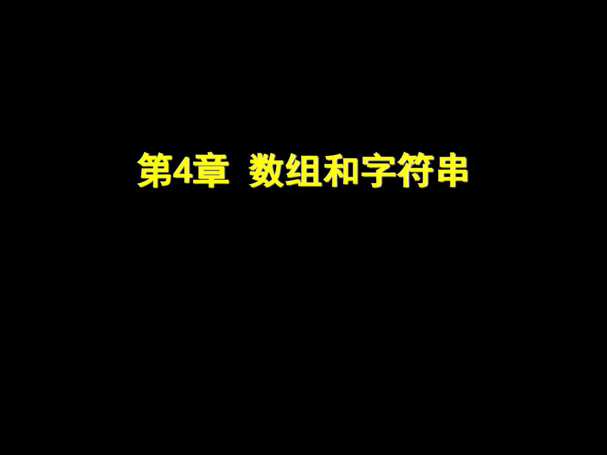

原文：

第4章 数组和字符串

### 4.1 数组

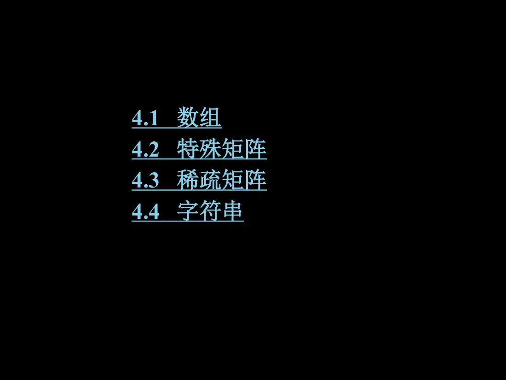

原文：

4.1 数组
4.2 特殊矩阵
4.3 稀疏矩阵
4.4 字符串

### 4.1 数组

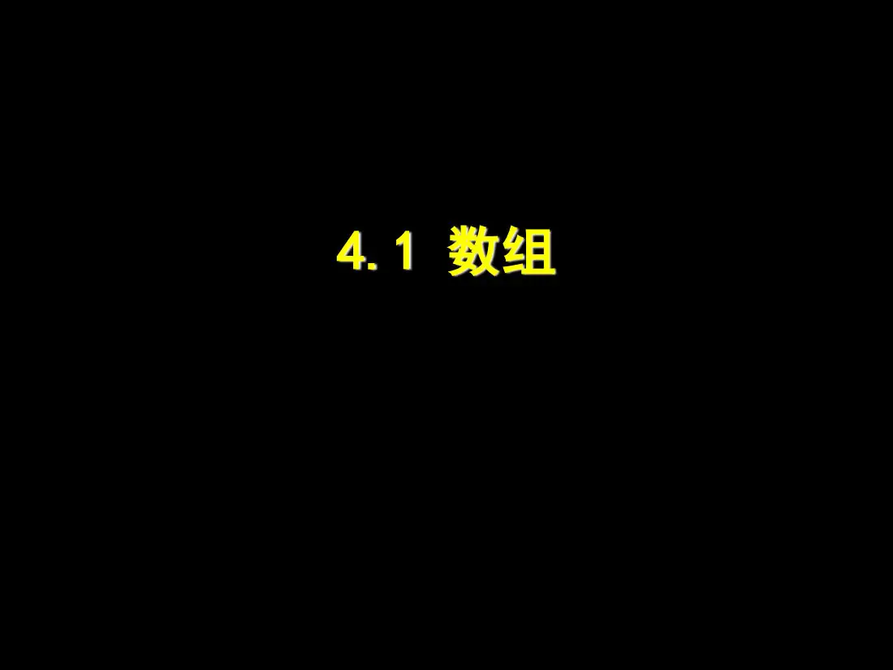

原文：

4.1 数组

### 数组是非常有用的数据结构，几乎所有的高级程序设计语言中都提供了数组类型。

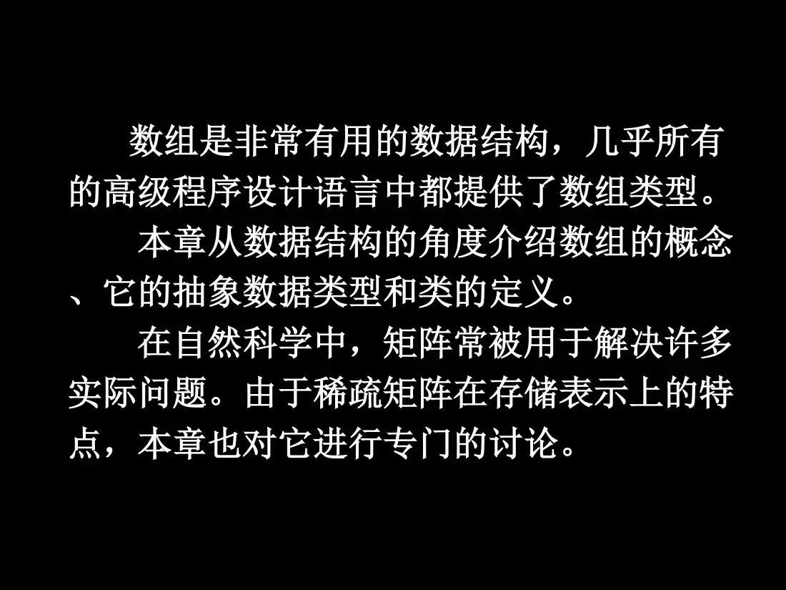

原文：

数组是非常有用的数据结构，几乎所有的高级程序设计语言中都提供了数组类型。

本章从数据结构的角度介绍数组的概念它的抽象数据类型和类的定义。

在自然科学中，矩阵常被用于解决许多实际问题。由于稀疏矩阵在存储表示上的特点，本章也对它进行专门的讨论。

### 4.1.1 数组ADT

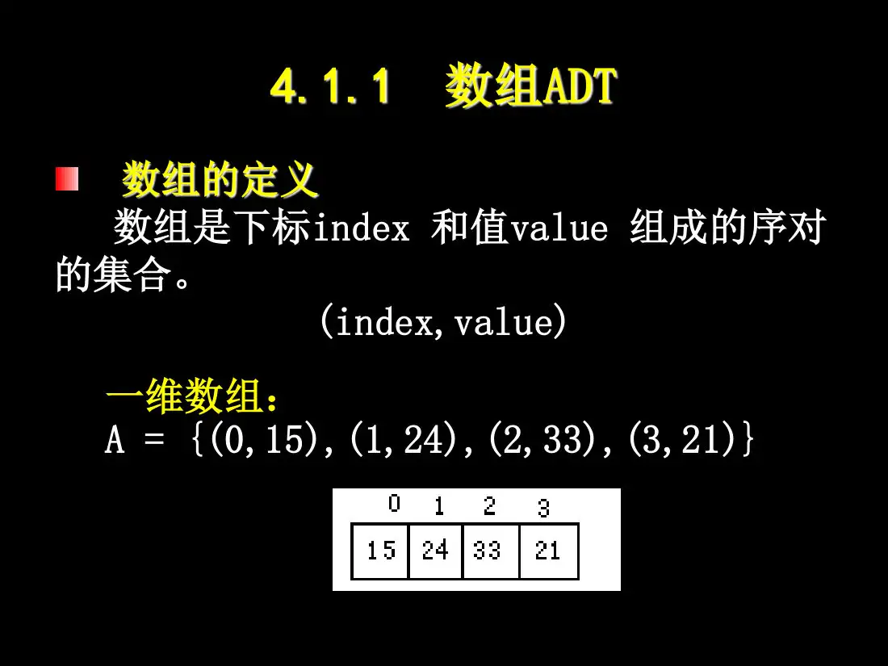

原文：

4.1.1 数组ADT

数组的定义数组是下标index 和值value 组成的序对的集合。

(index,value)

一维数组：A = {(0,15),(1,24),(2,33),(3,21)}

### 数组抽象数据类型

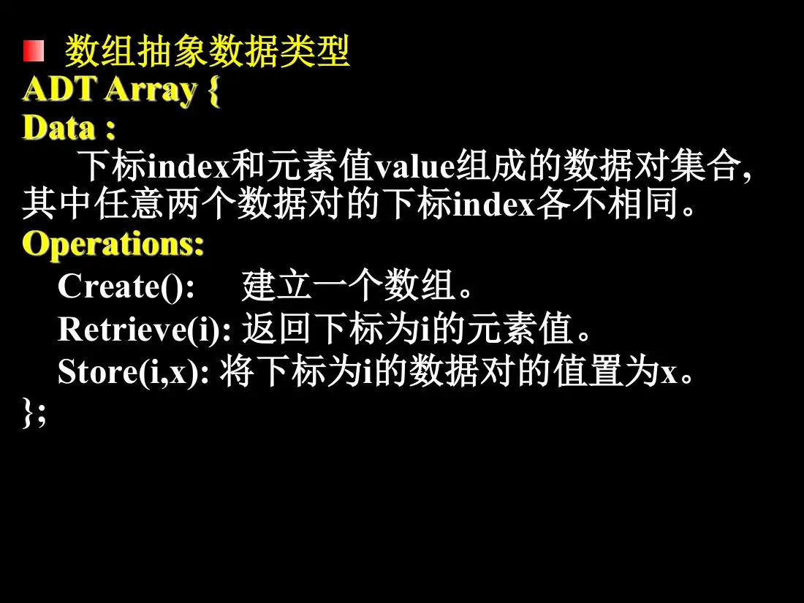

原文：

数组抽象数据类型

ADT Array {

Data :

下标index和元素值value组成的数据对集合,其中任意两个数据对的下标index各不相同。

Operations:

Create(): 建立一个数组。

Retrieve(i): 返回下标为i的元素值。

Store(i,x): 将下标为i的数据对的值置为x。

### 4.1.2 数组的顺序表示

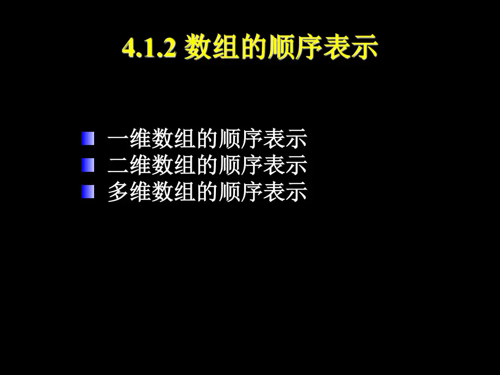

原文：

4.1.2 数组的顺序表示

一维数组的顺序表示

二维数组的顺序表示

多维数组的顺序表示

### 一维数组的顺序表示

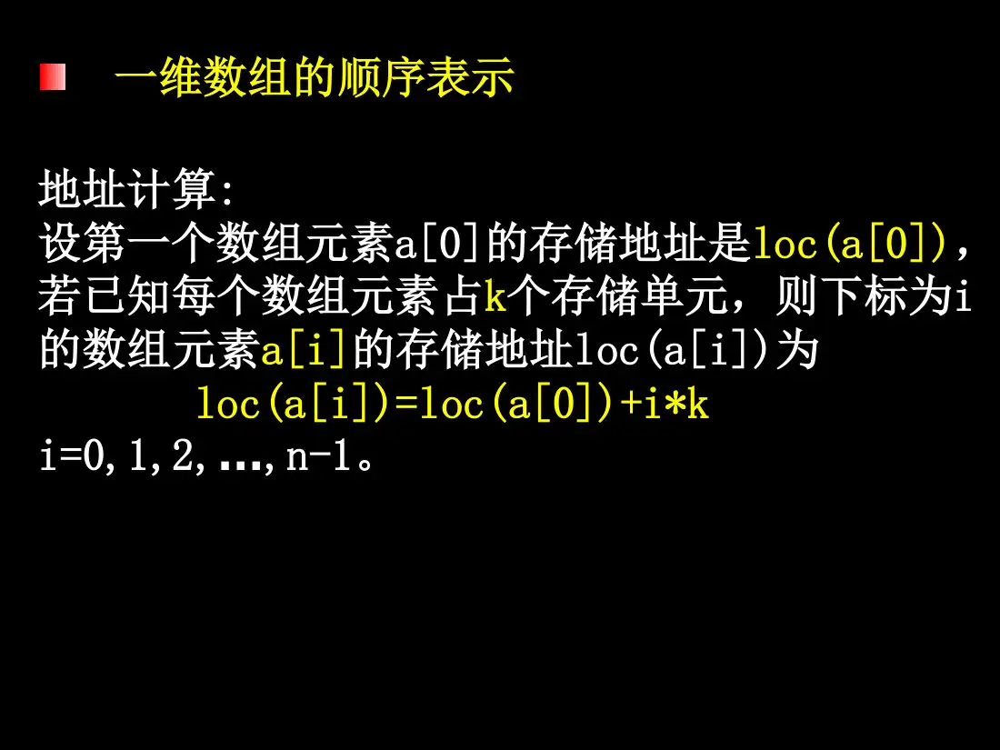

原文：

一维数组的顺序表示

设第一个数组元素a[0]的存储地址是loc(a[0])，若已知每个数组元素占k个存储单元，则下标为i的数组元素a[i]的存储地址loc(a[i])为loc(a[i])=loc(a[0])+i\*k$\scriptstyle 1 = 0 , 1 , 2 , \ldots , n - 1$

### 二维数组的顺序表示

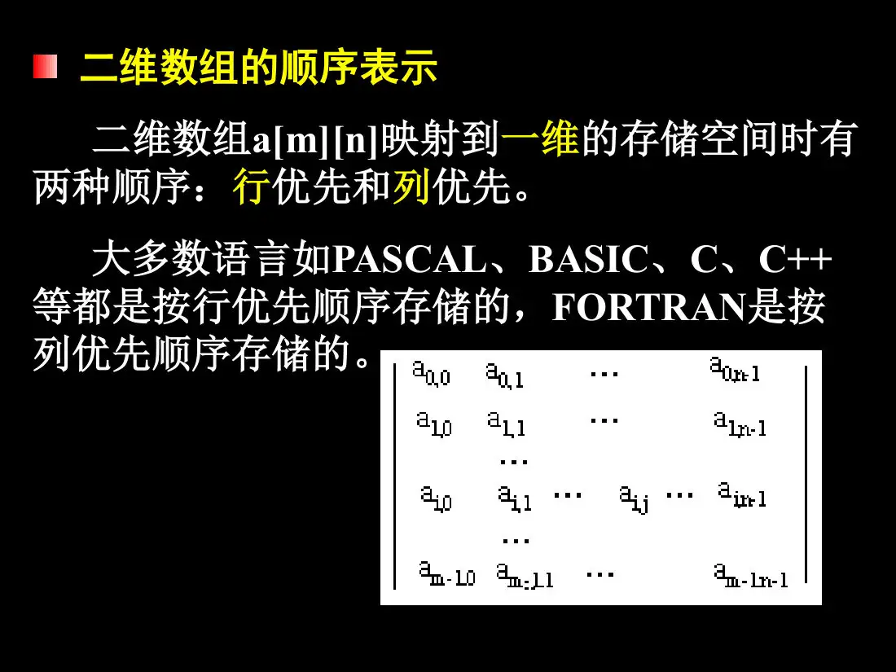

原文：

二维数组的顺序表示

二维数组a[m][n]映射到一维的存储空间时有两种顺序：行优先和列优先。

大多数语言如PASCAL、BASIC、C、C++等都是按行优先顺序存储的，FORTRAN是按列优先顺序存储的。 an a0n1

$$
\left| \begin{array}{cccc} a _ {0, 0} & a _ {0, 1} & \cdots & a _ {0 n - 1} \\ a _ {1, 0} & a _ {1, 1} & \cdots & a _ {1 n - 1} \\  & \cdots &  &  \\ a _ {i, 0} & a _ {i, 1} & \cdots & a _ {i j} & \cdots & a _ {i n - 1} \\  & \cdots &  &  \\ a _ {m - 1, 0} & a _ {m - 1, 1} & \cdots & a _ {m - 1 n - 1} \\ \end{array} \right|
$$

### $$

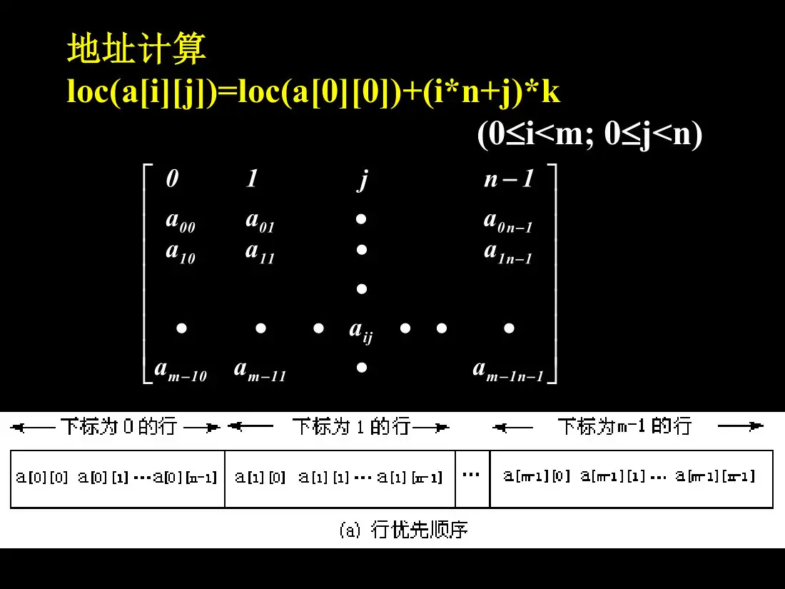

原文：

$$
\begin{array}{l} \text {地址计算} \\ \operatorname{loc} (\mathrm{a[i][j]}) = \operatorname{loc} (\mathrm{a[0][0]}) + (\mathrm{i*n+j)*k} \\ (0 \leq \mathrm{i< m}; 0 \leq \mathrm{j< n}) \\ \left[ \begin{array}{c c c c c c c c} 0 & 1 & & j & & & n - 1 \\ a _ {0 0} & a _ {0 1} & & \bullet & & & a _ {0 n - 1} \\ a _ {1 0} & a _ {1 1} & & \bullet & & & a _ {1 n - 1} \\ & & & \bullet & & \\ \bullet & \bullet & \bullet & a _ {i j} & \bullet & \bullet & \bullet \\ a _ {m - 1 0} & a _ {m - 1 1} & & \bullet & & & a _ {m - 1 n - 1} \end{array} \right] \end{array}
$$

下标为0的行下标为1的行下标为m-1的行

<table><tr><td>a[0][0] a[0][1]···a[0][n-1]</td><td>a[1][0] a[1][1]···a[1][π-1]</td><td>···</td><td>a[π-1][0] a[π-1][1]··· a[π-1][π-1]</td></tr></table>

(a) 行优先顺序

### loc(a[i][j])=loc(a[0][0])+(j\*m+i)\*k

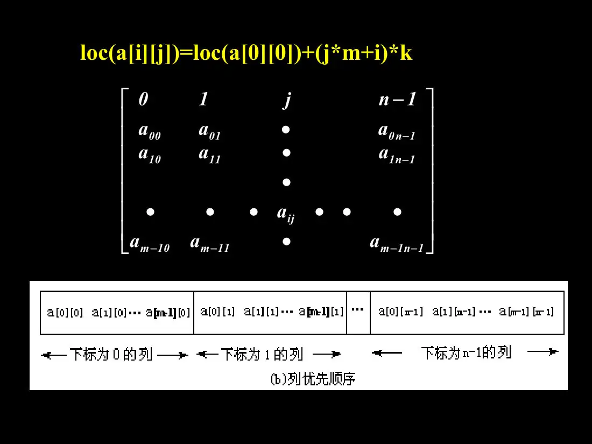

原文：

loc(a[i][j])=loc(a[0][0])+(j\*m+i)\*k

$$
\left[ \begin{array}{c c c c c c} 0 & 1 & j & & & n - 1 \\ a _ {0 0} & a _ {0 1} & \bullet & & & a _ {0 n - 1} \\ a _ {1 0} & a _ {1 1} & \bullet & & & a _ {1 n - 1} \\ & & \bullet & & \\ \bullet & \bullet & \bullet & a _ {i j} & \bullet & \bullet \\ a _ {m - 1 0} & a _ {m - 1 1} & \bullet & & & a _ {m - 1 n - 1} \end{array} \right]
$$

<table><tr><td>a[0][0] a[1][0]⋯ a[m-1][0]</td><td>a[0][1] a[1][1]⋯ a[m-1][1]</td><td>⋯</td><td>a[0][π-1] a[1][π-1]⋯ a[m-1][π-1]</td></tr></table>

下标为0的列

下标为1的列

下标为n-1的列

(b)列优先顺序

### 第 12 页

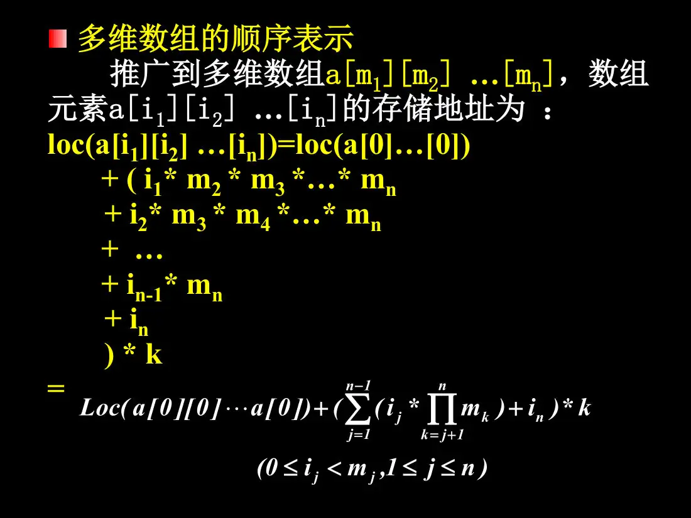

原文：

多维数组的顺序表示推广到多维数组a $\boxed { 1 1 1 5 } \boxed { 1 1 1 5 } \boxed { 1 1 1 5 }$ 9 数组元素a $\vert \overrightarrow { b } \vert \vert \overrightarrow { b } \vert \vert \cdot \vert \overrightarrow { b } \vert$ 的存储地址为loc(a[i ][i ] …[i ])=loc(a[0]…[0])+ ( i \* m \* m \*…\* m+ i \* m \* m \*…\* m+ …+ in-1\* mn+ in) \* kn-1 nLoc(a[0][0]a[0])+(∑(ii\*∏mk)+in)\*kj=1 k=j+1(0 ≤ii < m,1≤ j≤ n)

### 4.1.3 一维数组的C++类

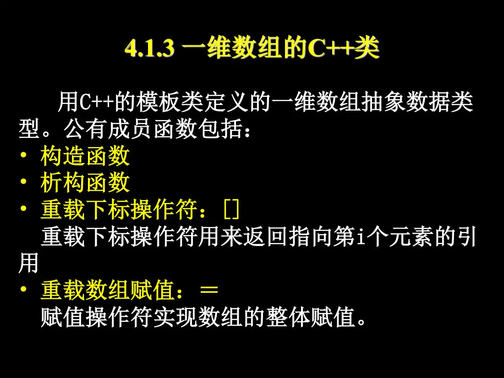

原文：

4.1.3 一维数组的C++类

用C++的模板类定义的一维数组抽象数据类型。公有成员函数包括：

构造函数

析构函数

• 重载下标操作符：[]重载下标操作符用来返回指向第i个元素的引

重载数组赋值：赋值操作符实现数组的整体赋值。

### include  template  class Array1D

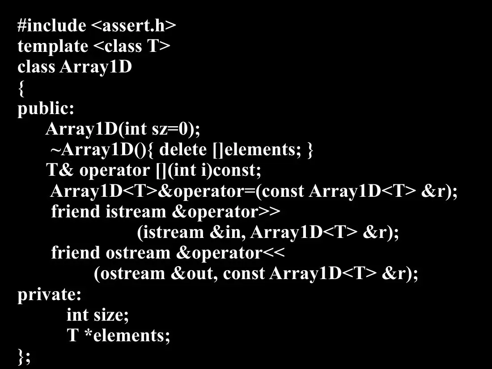

原文：

include <assert.h> template <class T> class Array1D

Array1D(int sz=0); \~Array1D(){ delete []elements; } T& operator const; Array1D<T>&operator=(const Array1D<T> &r) friend istream &operator>> (istream &in, Array1D<T> &r); friend ostream &operator<< (ostream &out, const Array1D<T> &r);

private: int size; T \*elements;

};

### 第 15 页

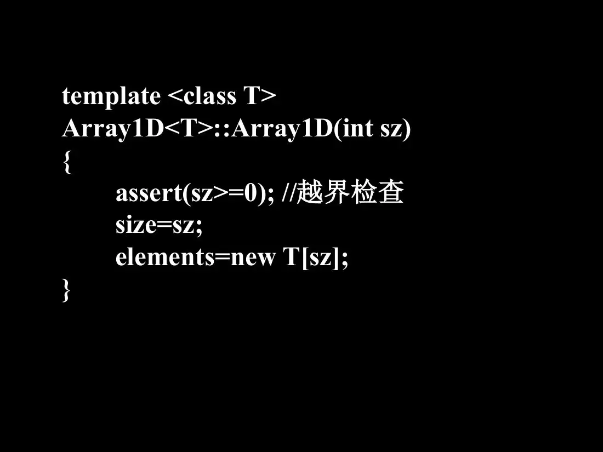

原文：

template <class T> Array1D<T>::Array1D(int sz) assert(sz>=0); //越界检查 size=sz; elements=new T[sz];

### 第 16 页

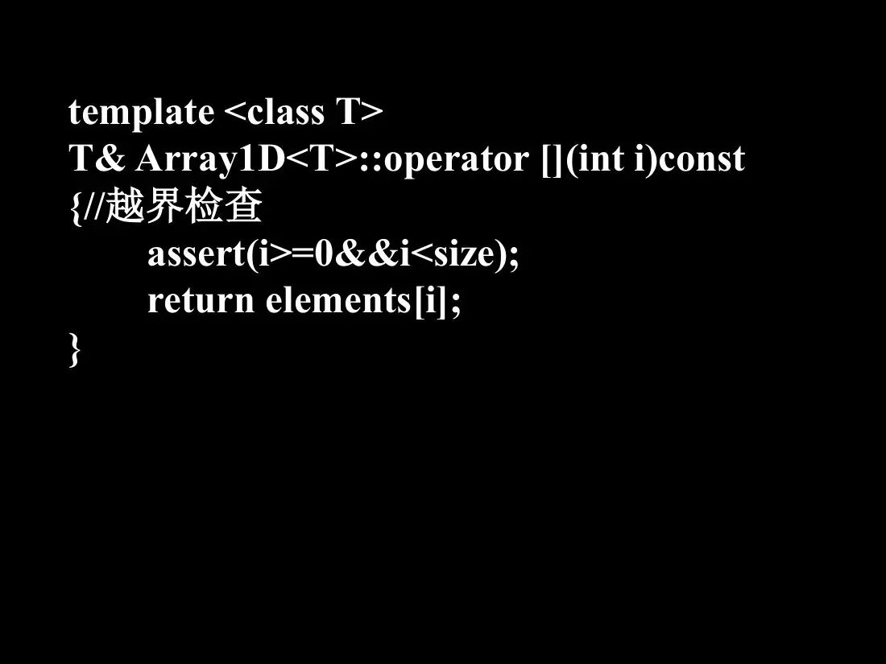

原文：

template <class T> T& Array1D<T>::operator const {//越界检查 assert(i>=0&&i<size); return elements[i];

### return \*this;

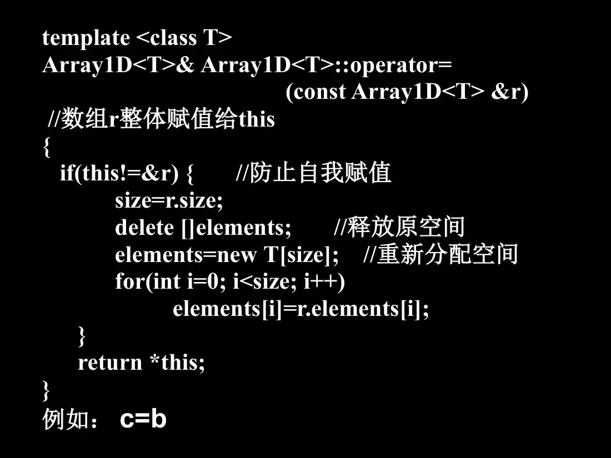

原文：

template <class T> Array1D<T>& Array1D<T>::operator= (const Array1D<T> &r) //数组r整体赋值给this

if(this!=&r) { //防止自我赋值 size=r.size; delete []elements; //释放原空间 elements=new T[size]; //重新分配空间 for(int i=0; i<size; i++) elements[i]=r.elements[i];

return \*this;

例如： c=b

### cout>r.elements[i]; return in;

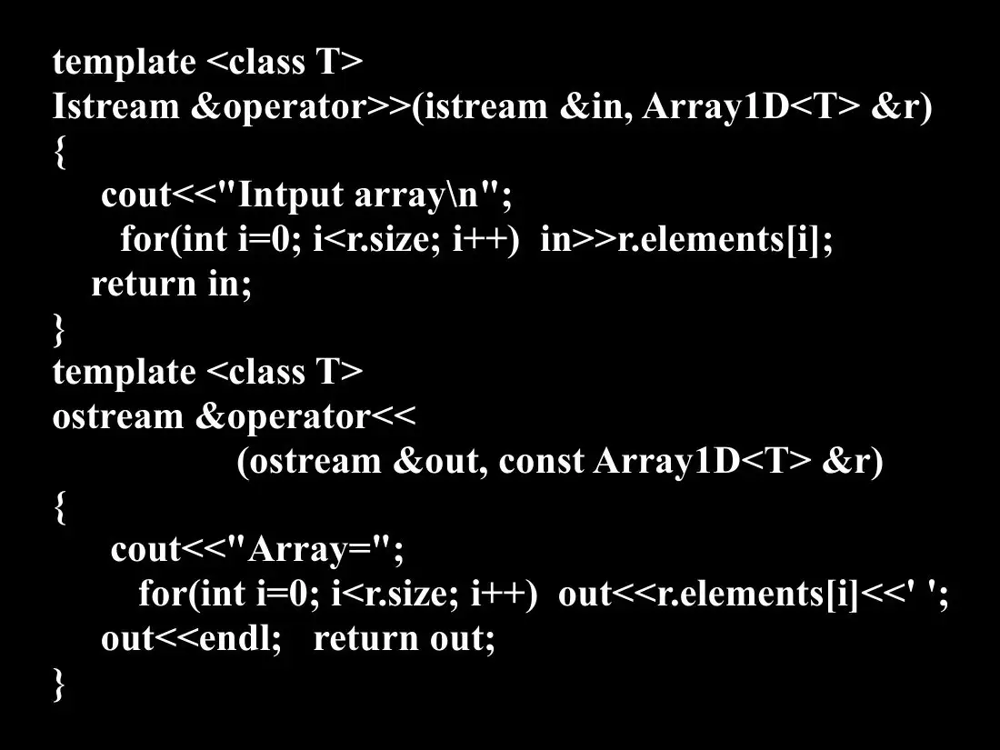

原文：

template <class T> Istream &operator>>(istream &in, Array1D<T> &r)

cout<<"Intput array\n"; for(int i=0; i<r.size; i++) in>>r.elements[i]; return in;

template <class T> ostream &operator<< (ostream &out, const Array1D<T> &r)

cout<<"Array="; for(int i=0; i<r.size; i++) out<<r.elements[i]<<' '; out<<endl; return out;

### include "array1d.h" void main()

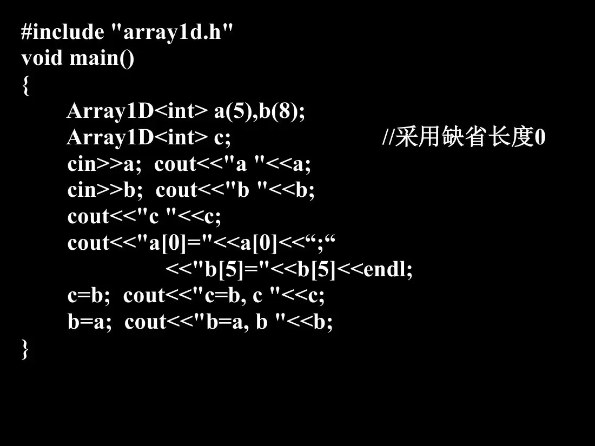

原文：

include "array1d.h" void main()

Array1D<int> a(5),b(8); Array1D<int> c; //采 cin>>a; cout<<"a "<<a; cin>>b; cout<<"b "<<b; cout<<"c "<<c; cout<<"a[0]="<<a[0]<<“;“ <<"b[5]="<<b[5]<<endl; c=b; cout<<"c=b, c "<<c; b=a; cout<<"b=a, b "<<b;

用缺省长度0

### 4.2 特殊矩阵

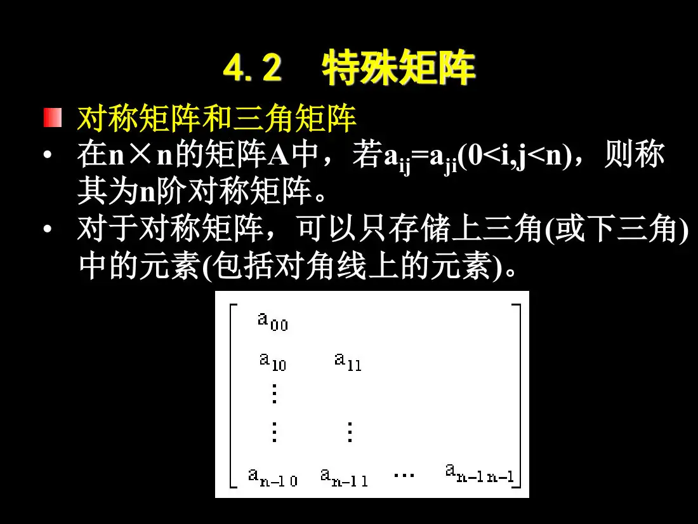

原文：

4.2 特殊矩阵

对称矩阵和三角矩阵

• 在n×n的矩阵A中，若 $: 1 4 - 9 = 1 9 ( 1 - 5 ) = 1 1 7$ ，则称其为n阶对称矩阵。

• 对于对称矩阵，可以只存储上三角(或下三角)中的元素(包括对角线上的元素)。

$$
\left[ \begin{array}{cccc} a _ {0 0} &  &  &  \\ a _ {1 0} & a _ {1 1} &  &  \\ \vdots &  &  &  \\ \vdots & \vdots &  &  \\ a _ {n - 1 0} & a _ {n - 1 1} & \dots & a _ {n - 1 n - 1} \\ \end{array} \right]
$$

### 4.2.1 对称矩阵

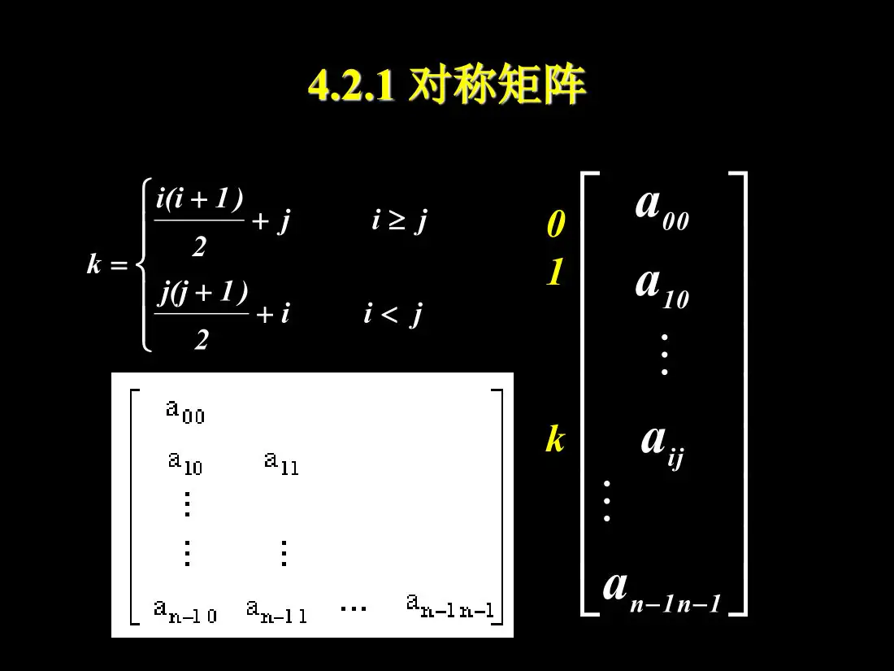

原文：

4.2.1 对称矩阵

$$
k = \left\{ \begin{array}{l l} \frac {i (i + 1)}{2} + j & i \geq j \\ \frac {j (j + 1)}{2} + i & i <   j \end{array} \right.
$$

$$
\begin{array}{l l} a _ {0 0} & \\ a _ {1 0} & a _ {1 1} \\ \vdots & \\ \vdots & \vdots \\ a _ {n - 1 0} & a _ {n - 1 1} \end{array}
$$

$$
\begin{array}{l} \text {0} \\ 1 \\ k \\ \vdots \\ a _ {n - 1 n - 1} \end{array} \left[ \begin{array}{c} a _ {0 0} \\ a _ {1 0} \\ \vdots \\ a _ {i j} \\ \vdots \\ a _ {n - 1 n - 1} \end{array} \right]
$$

### 4.3 稀疏矩阵

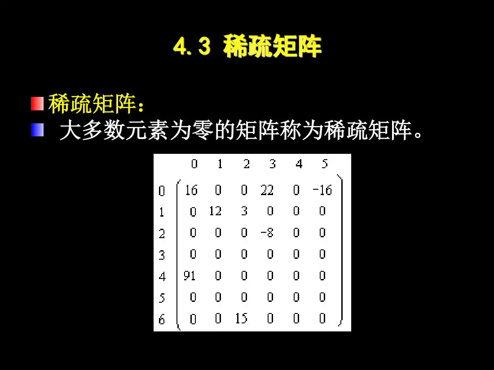

原文：

4.3 稀疏矩阵

稀疏矩阵：

1 大多数元素为零的矩阵称为稀疏矩阵。

$$
\begin{array}{c c c c c c c} & 0 & 1 & 2 & 3 & 4 & 5 \\ \hline 0 & 1 6 & 0 & 0 & 2 2 & 0 & - 1 6 \\ 1 & 0 & 1 2 & 3 & 0 & 0 & 0 \\ 2 & 0 & 0 & 0 & - 8 & 0 & 0 \\ 3 & 0 & 0 & 0 & 0 & 0 & 0 \\ 4 & 9 1 & 0 & 0 & 0 & 0 & 0 \\ 5 & 0 & 0 & 0 & 0 & 0 & 0 \\ 6 & 0 & 0 & 1 5 & 0 & 0 & 0 \end{array}
$$

### 4.3 稀疏矩阵

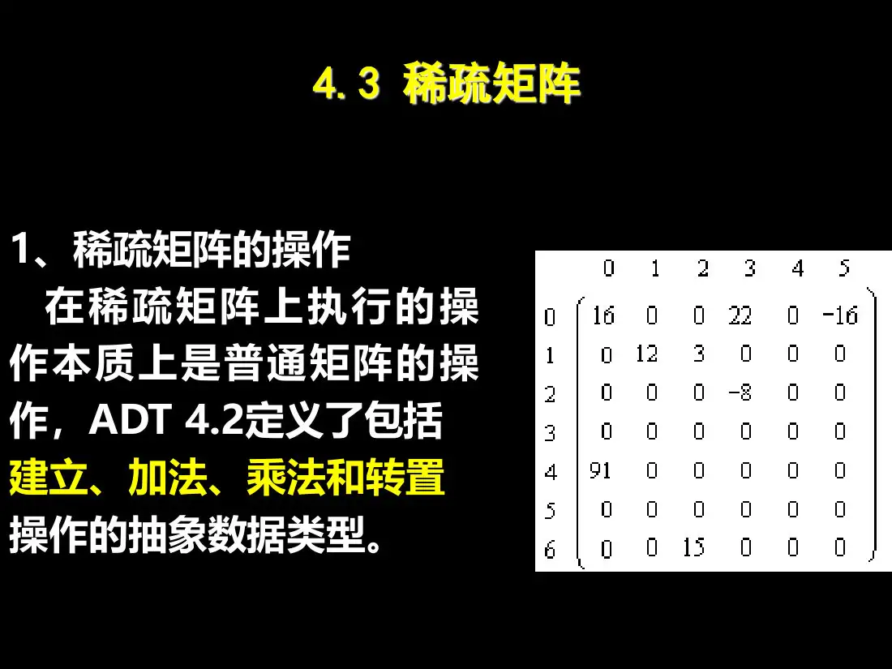

原文：

4.3 稀疏矩阵

1、稀疏矩阵的操作在稀疏矩阵上执行的操作本质上是普通矩阵的操作，ADT 4.2定义了包括建立、加法、乘法和转置操作的抽象数据类型。

$$
\begin{array}{r} \left( \begin{array}{c c c c c c} 0 & 1 & 2 & 3 & 4 & 5 \\ 0 & 1 6 & 0 & 0 & 2 2 & 0 & - 1 6 \\ 1 & 0 & 1 2 & 3 & 0 & 0 & 0 \\ 2 & 0 & 0 & 0 & - 8 & 0 & 0 \\ 3 & 0 & 0 & 0 & 0 & 0 & 0 \\ 4 & 9 1 & 0 & 0 & 0 & 0 & 0 \\ 5 & 0 & 0 & 0 & 0 & 0 & 0 \\ 6 & 0 & 0 & 1 5 & 0 & 0 & 0 \end{array} \right) \end{array}
$$

### 4.3.1 稀疏矩阵ADT

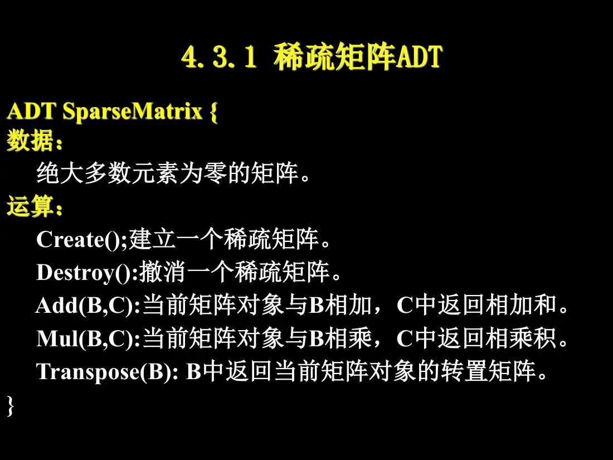

原文：

4.3.1 稀疏矩阵ADT

ADT SparseMatrix {

数据：

绝大多数元素为零的矩阵。

运算：

Create();建立一个稀疏矩阵。

Destroy():撤消一个稀疏矩阵。

Add(B,C):当前矩阵对象与B相加，C中返回相加和。

Mul(B,C):当前矩阵对象与B相乘，C中返回相乘积。

Transpose(B): B中返回当前矩阵对象的转置矩阵。

### 稀疏矩阵的C++类 template  class SparseMatrix

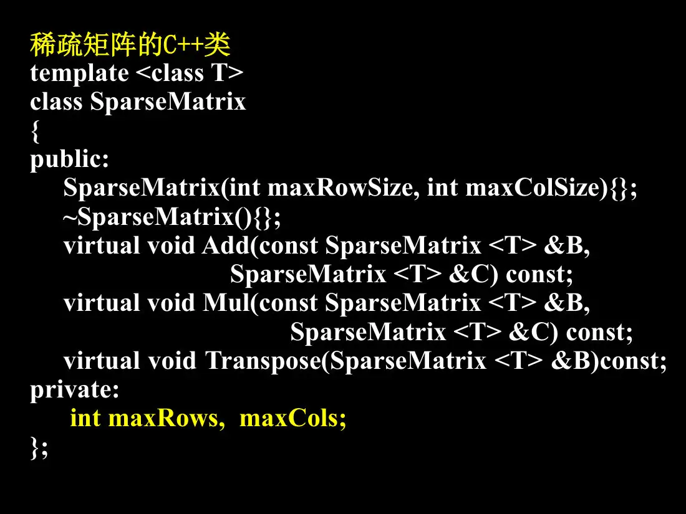

原文：

稀疏矩阵的C++类 template <class T> class SparseMatrix

SparseMatrix(int maxRowSize, int maxColSize){}; \~SparseMatrix(){};

virtual void Add(const SparseMatrix <T> &B, SparseMatrix <T> &C) const;

virtual void Mul(const SparseMatrix <T> &B, SparseMatrix <T> &C) const;

virtual void Transpose(SparseMatrix <T> &B)const; private:

int maxRows, maxCols;

### 4.3.2 稀疏矩阵的顺序表示为了节省空间，对于稀疏矩阵可只存非零元素。

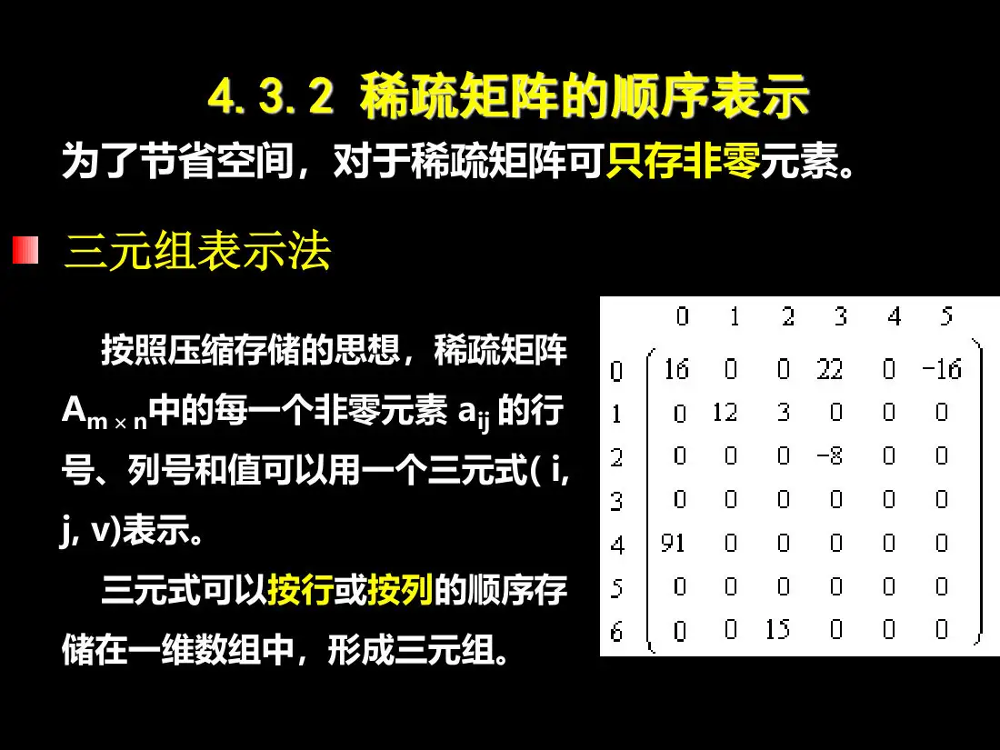

原文：

4.3.2 稀疏矩阵的顺序表示为了节省空间，对于稀疏矩阵可只存非零元素。

三元组表示法

按照压缩存储的思想，稀疏矩阵$L _ { \mathrm { { a } } } ^ { \mathrm { { a } } } = \frac { \Gamma _ { \mathrm { { a } } } } { \Gamma _ { \mathrm { { a } } } } = \frac { \Gamma _ { \mathrm { { a } } } } { \Gamma _ { \mathrm { { a } } } } = \frac { \Gamma _ { \mathrm { { a } } } } { \Gamma _ { \mathrm { { a } } } }$ 中的每一个非零元素 $\boxed { \cdot }$ 的行号、列号和值可以用一个三元式( i,j, v)表示。

三元式可以按行或按列的顺序存储在一维数组中，形成三元组。

$$
\begin{array}{r} \left( \begin{array}{c c c c c c} 0 & 1 & 2 & 3 & 4 & 5 \\ 0 & 1 6 & 0 & 0 & 2 2 & 0 & - 1 6 \\ 1 & 0 & 1 2 & 3 & 0 & 0 & 0 \\ 2 & 0 & 0 & 0 & - 8 & 0 & 0 \\ 3 & 0 & 0 & 0 & 0 & 0 & 0 \\ 4 & 9 1 & 0 & 0 & 0 & 0 & 0 \\ 5 & 0 & 0 & 0 & 0 & 0 & 0 \\ 6 & 0 & 0 & 1 5 & 0 & 0 & 0 \end{array} \right) \end{array}
$$

### 三元组按行顺序存储

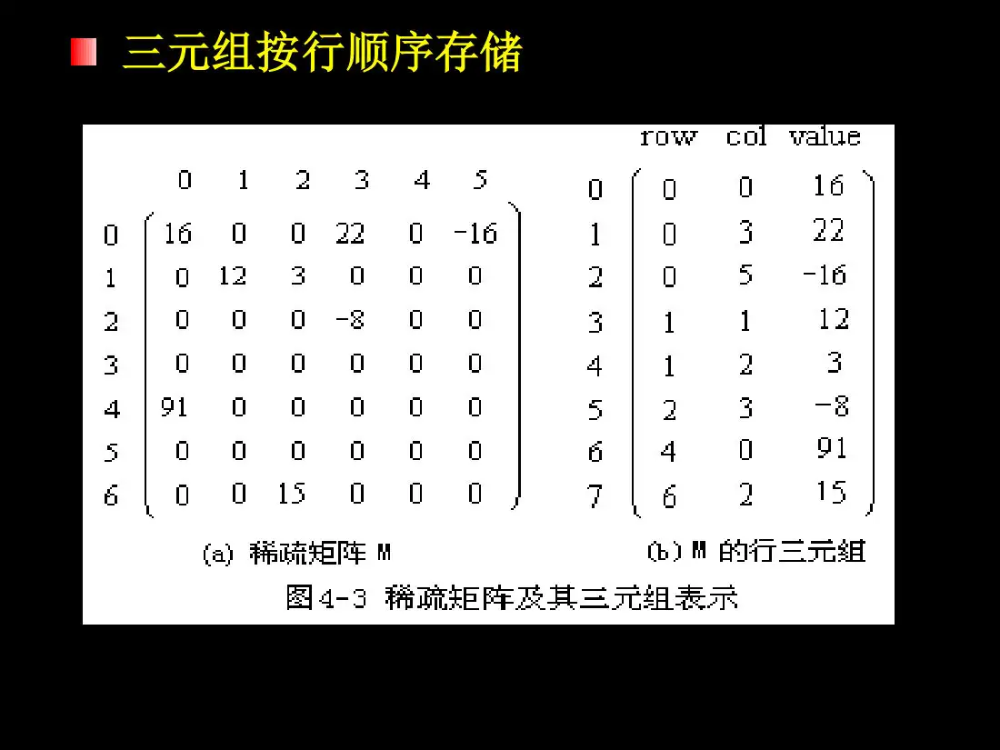

原文：

三元组按行顺序存储

$$
\begin{array}{r} \left( \begin{array}{c c c c c c} 0 & 1 & 2 & 3 & 4 & 5 \\ 0 & 1 6 & 0 & 0 & 2 2 & 0 & - 1 6 \\ 1 & 0 & 1 2 & 3 & 0 & 0 & 0 \\ 2 & 0 & 0 & 0 & - 8 & 0 & 0 \\ 3 & 0 & 0 & 0 & 0 & 0 & 0 \\ 4 & 9 1 & 0 & 0 & 0 & 0 & 0 \\ 5 & 0 & 0 & 0 & 0 & 0 & 0 \\ 6 & 0 & 0 & 1 5 & 0 & 0 & 0 \end{array} \right) \end{array}
$$

(a) 稀疏矩阵M

$$
\begin{array}{c c c c} & \text {row} & \text {col} & \text {value} \\ 0 & 0 & 0 & 1 6 \\ 1 & 0 & 3 & 2 2 \\ 2 & 0 & 5 & - 1 6 \\ 3 & 1 & 1 & 1 2 \\ 4 & 1 & 2 & 3 \\ 5 & 2 & 3 & - 8 \\ 6 & 4 & 0 & 9 1 \\ 7 & 6 & 2 & 1 5 \end{array}
$$

(b)M的行三元组

图4-3 稀疏矩阵及其三元组表示

### 三元组按列顺序存储

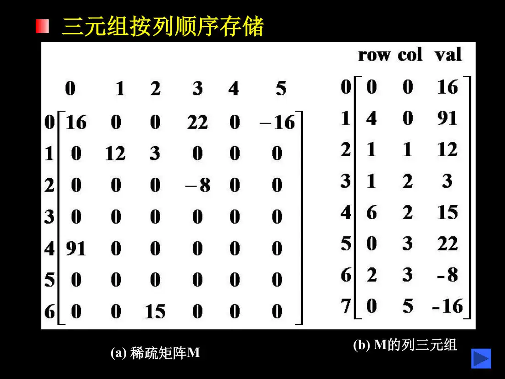

原文：

三元组按列顺序存储

$$
\left[ \begin{array}{c c c c c c} 0 & 1 & 2 & 3 & 4 & 5 \\ 0 & 1 6 & 0 & 0 & 2 2 & 0 & - 1 6 \\ 1 & 0 & 1 2 & 3 & 0 & 0 & 0 \\ 2 & 0 & 0 & 0 & - 8 & 0 & 0 \\ 3 & 0 & 0 & 0 & 0 & 0 & 0 \\ 4 & 9 1 & 0 & 0 & 0 & 0 & 0 \\ 5 & 0 & 0 & 0 & 0 & 0 & 0 \\ 6 & 0 & 0 & 1 5 & 0 & 0 & 0 \end{array} \right]
$$

row col val

$$
\left[ \begin{array}{l l l} 0 & 0 & 1 6 \\ 1 & 4 & 0 & 9 1 \\ 2 & 1 & 1 & 1 2 \\ 3 & 1 & 2 & 3 \\ 4 & 6 & 2 & 1 5 \\ 5 & 0 & 3 & 2 2 \\ 6 & 2 & 3 & - 8 \\ 7 & 0 & 5 & - 1 6 \end{array} \right]
$$

(a) 稀疏矩阵M

(b) M的列三元组

### 三元组的Term类template struct Terms

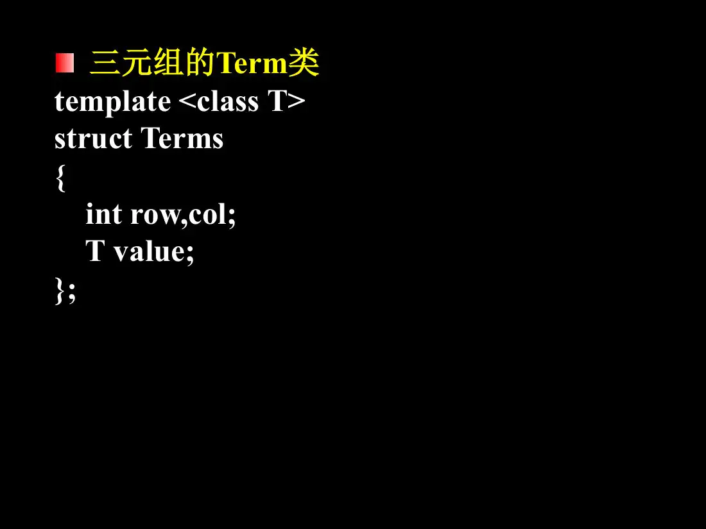

原文：

三元组的Term类template <class T>struct Terms

int row,col; T value;

### 行三元组表的C++类 template  class SeqTriple

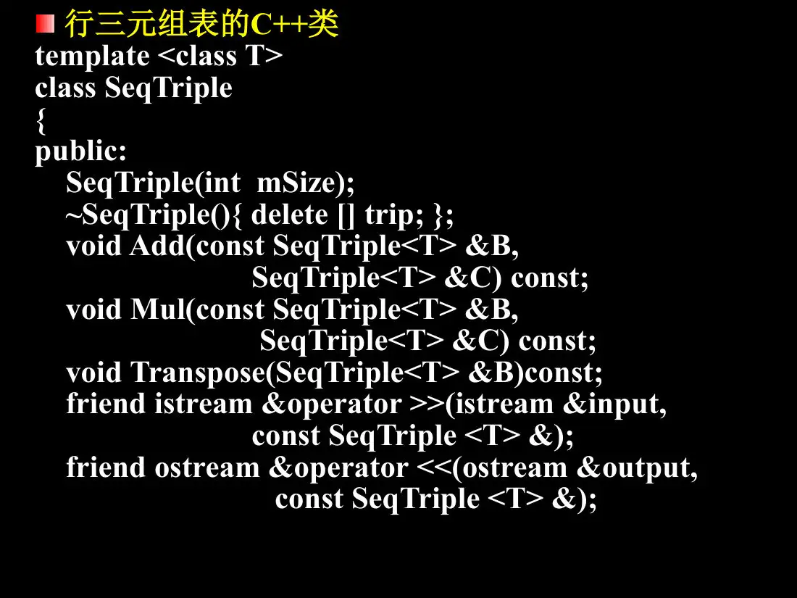

原文：

行三元组表的C++类 template <class T> class SeqTriple

SeqTriple(int mSize); \~SeqTriple(){ delete [] trip; }; void Add(const SeqTriple<T> &B, SeqTriple<T> &C) const; void Mul(const SeqTriple<T> &B, SeqTriple<T> &C) const; void Transpose(SeqTriple<T> &B)const; friend istream &operator >>(istream &input, const SeqTriple <T> &); friend ostream &operator <<(ostream &output, const SeqTriple <T> &);

### int maxSize;

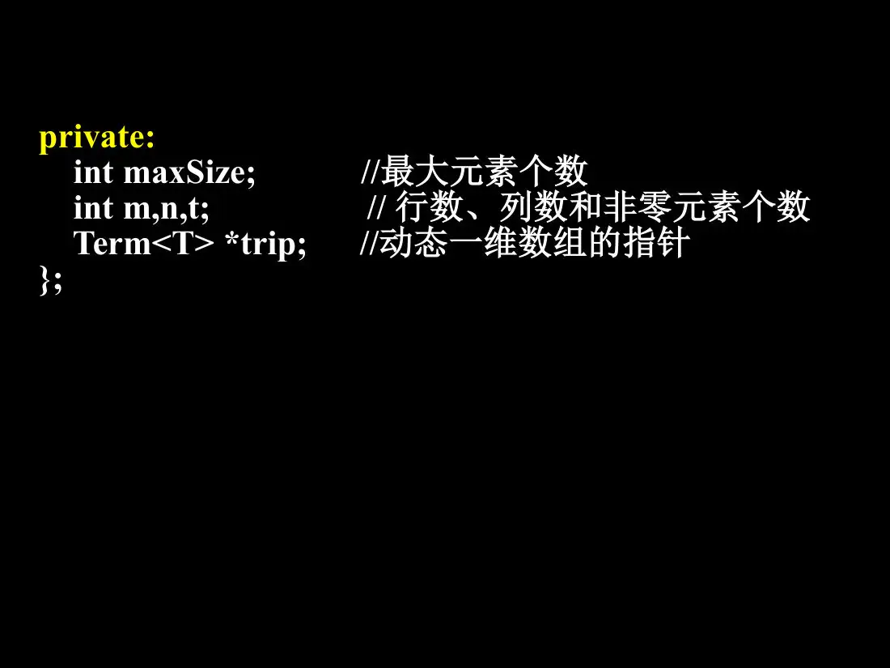

原文：

int maxSize;

//行数、列数和非零元素个数

### 矩阵转置

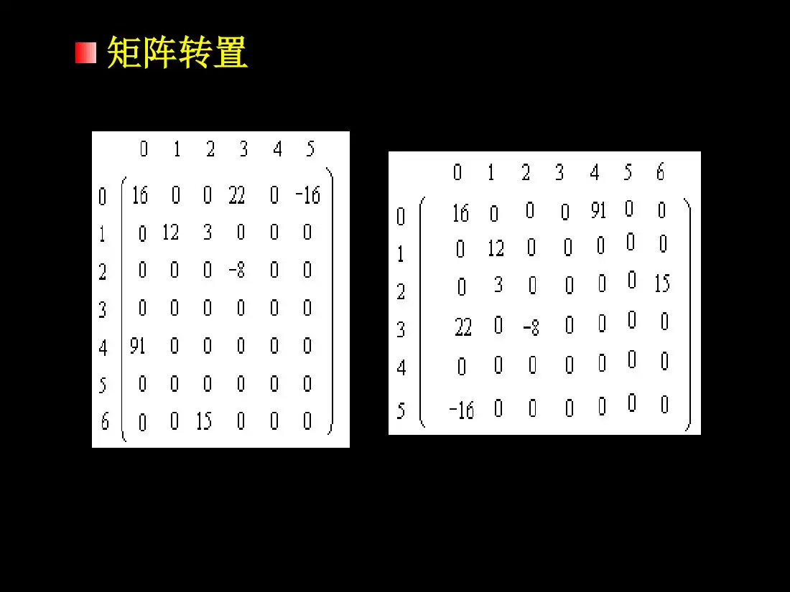

原文：

矩阵转置

$$
\begin{array}{r} \left( \begin{array}{c c c c c c} 0 & 1 & 2 & 3 & 4 & 5 \\ 0 & 1 6 & 0 & 0 & 2 2 & 0 & - 1 6 \\ 1 & 0 & 1 2 & 3 & 0 & 0 & 0 \\ 2 & 0 & 0 & 0 & - 8 & 0 & 0 \\ 3 & 0 & 0 & 0 & 0 & 0 & 0 \\ 4 & 9 1 & 0 & 0 & 0 & 0 & 0 \\ 5 & 0 & 0 & 0 & 0 & 0 & 0 \\ 6 & 0 & 0 & 1 5 & 0 & 0 & 0 \end{array} \right) \end{array}
$$

$$
\begin{array}{r l} & \left( \begin{array}{c c c c c c c} 0 & 1 & 2 & 3 & 4 & 5 & 6 \\ 0 & 1 6 & 0 & 0 & 0 & 9 1 & 0 & 0 \\ 0 & 1 2 & 0 & 0 & 0 & 0 & 0 \\ 0 & 3 & 0 & 0 & 0 & 0 & 1 5 \\ 2 2 & 0 & - 8 & 0 & 0 & 0 & 0 \\ 0 & 0 & 0 & 0 & 0 & 0 & 0 \\ - 1 6 & 0 & 0 & 0 & 0 & 0 & 0 \end{array} \right) \end{array}
$$

### 普通矩阵转置：

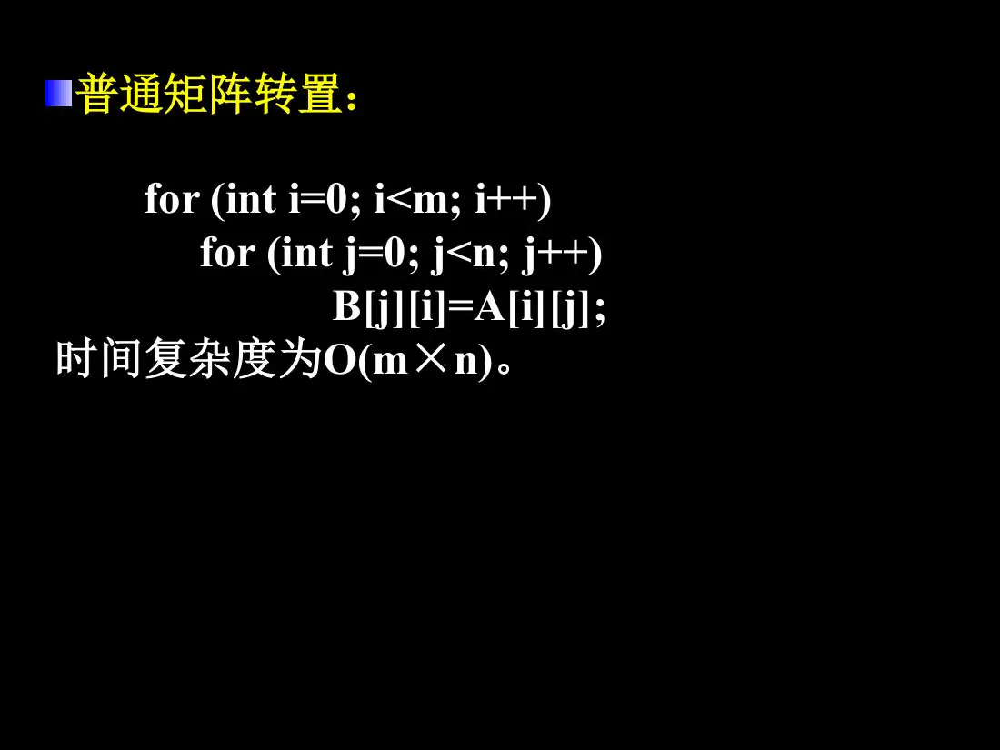

原文：

普通矩阵转置：

for (int i=0; i<m; i++)for (int j=0; j<n; j++)B[j][i]=A[i][j];时间复杂度为O(m×n)。

### 在三元组表示下实现矩阵转置

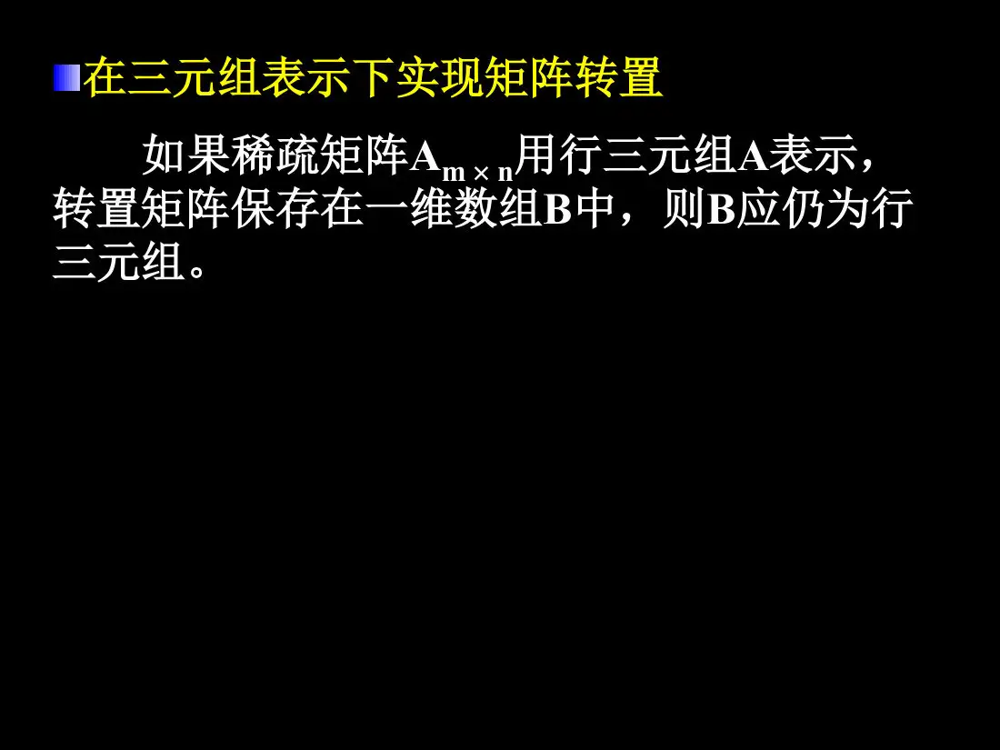

原文：

在三元组表示下实现矩阵转置

如果稀疏矩阵 $1 0 0 \times 1 0 0 = 1 0 0 0 ( c m )$ 用行三元组A表示，转置矩阵保存在一维数组B中，则B应仍为行三元组。

### row col value

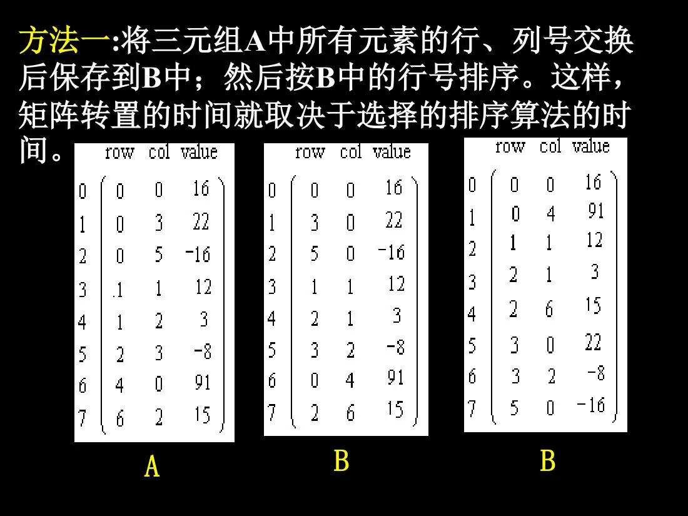

原文：

方法一:将三元组A中所有元素的行、列号交换后保存到B中；然后按B中的行号排序。这样，矩阵转置的时间就取决于选择的排序算法的时

row col value

row col value

row col value

$$
\left| \begin{array}{l l l l} 0 & 0 & 0 & 1 6 \\ 1 & 0 & 3 & 2 2 \\ 2 & 0 & 5 & - 1 6 \\ 3 & . 1 & 1 & 1 2 \\ 4 & 1 & 2 & 3 \\ 5 & 2 & 3 & - 8 \\ 6 & 4 & 0 & 9 1 \\ 7 & 6 & 2 & 1 5 \end{array} \right|
$$

$$
\left| \begin{array}{c} 0 \\ 1 \\ 2 \\ 3 \\ 4 \\ 5 \\ 6 \\ 7 \end{array} \right| \left( \begin{array}{c c c} 0 & 0 & 1 6 \\ 3 & 0 & 2 2 \\ 5 & 0 & - 1 6 \\ 1 & 1 & 1 2 \\ 2 & 1 & 3 \\ 3 & 2 & - 8 \\ 0 & 4 & 9 1 \\ 2 & 6 & 1 5 \end{array} \right)
$$

$$
\left| \begin{array}{l l l l} 0 & 0 & 0 & 1 6 \\ 1 & 0 & 4 & 9 1 \\ 2 & 1 & 1 & 1 2 \\ 3 & 2 & 1 & 3 \\ 4 & 2 & 6 & 1 5 \\ 5 & 3 & 0 & 2 2 \\ 6 & 3 & 2 & - 8 \\ 7 & 5 & 0 & - 1 6 \end{array} \right|
$$

A

B

B

### row col value

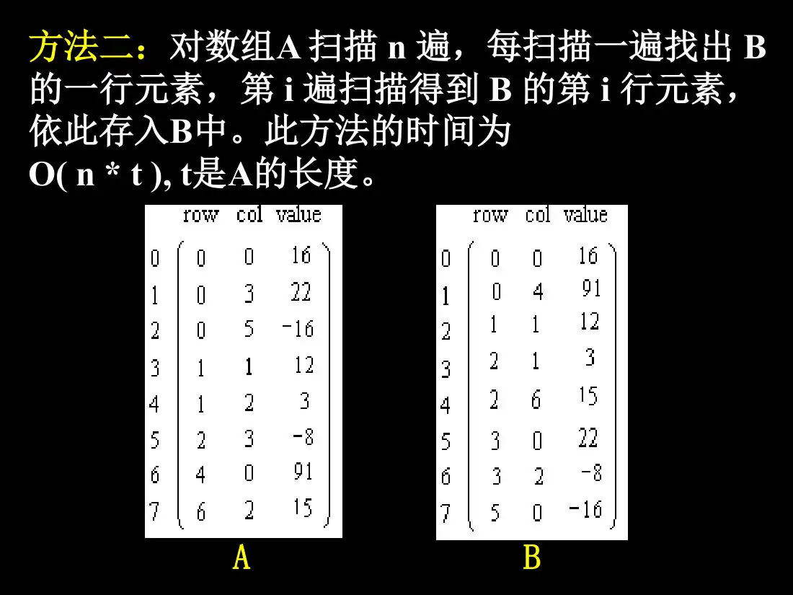

原文：

方法二：对数组A 扫描n 遍，每扫描一遍找出B的一行元素，第i 遍扫描得到B 的第 i 行元素，依此存入B中。此方法的时间为O( n \* t ), t是A的长度。

row col value

$$
\left| \begin{array}{l l l l} 0 & 0 & 0 & 1 6 \\ 1 & 0 & 3 & 2 2 \\ 2 & 0 & 5 & - 1 6 \\ 3 & 1 & 1 & 1 2 \\ 4 & 1 & 2 & 3 \\ 5 & 2 & 3 & - 8 \\ 6 & 4 & 0 & 9 1 \\ 7 & 6 & 2 & 1 5 \end{array} \right|
$$

row col value

$$
\left| \begin{array}{c} 0 \\ 1 \\ 2 \\ 3 \\ 4 \\ 5 \\ 6 \\ 7 \end{array} \right| \left( \begin{array}{c c c} 0 & 0 & 1 6 \\ 0 & 4 & 9 1 \\ 1 & 1 & 1 2 \\ 2 & 1 & 3 \\ 2 & 6 & 1 5 \\ 3 & 0 & 2 2 \\ 3 & 2 & - 8 \\ 5 & 0 & - 1 6 \end{array} \right)
$$

A

B

### 方法三：快速转置

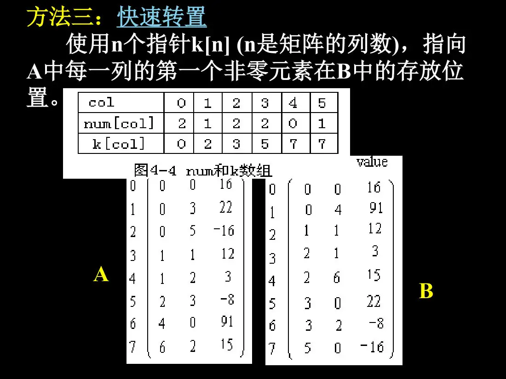

原文：

方法三：快速转置

使用n个指针k[n] (n是矩阵的列数)，指向A中每一列的第一个非零元素在B中的存放位

置。

图4-4 num和k数组
<table><tr><td>col</td><td>0</td><td>1</td><td>2</td><td>3</td><td>4</td><td>5</td></tr><tr><td>num[col]</td><td>2</td><td>1</td><td>2</td><td>2</td><td>0</td><td>1</td></tr><tr><td>k[col]</td><td>0</td><td>2</td><td>3</td><td>5</td><td>7</td><td>7</td></tr></table>
value

$$
\left[ \begin{array}{c|ccc} 0 & 0 & 0 & 1 6 \\ 1 & 0 & 3 & 2 2 \\ 2 & 0 & 5 & - 1 6 \\ 3 & 1 & 1 & 1 2 \\ 4 & 1 & 2 & 3 \\ 5 & 2 & 3 & - 8 \\ 6 & 4 & 0 & 9 1 \\ 7 & 6 & 2 & 1 5 \\ \end{array} \right]\left[ \begin{array}{c|c|cc} 0 & 0 & 1 6 \\ 1 & 0 & 4 & 9 1 \\ 2 & 1 & 1 & 1 2 \\ 3 & 2 & 1 & 3 \\ 4 & 2 & 6 & 1 5 \\ 5 & 3 & 0 & 2 2 \\ 6 & 3 & 2 & - 8 \\ 7 & 5 & 0 & - 1 6 \\ \end{array} \right]
$$

B

### 计算 k[i]k[i]可以简单地由下式计算。

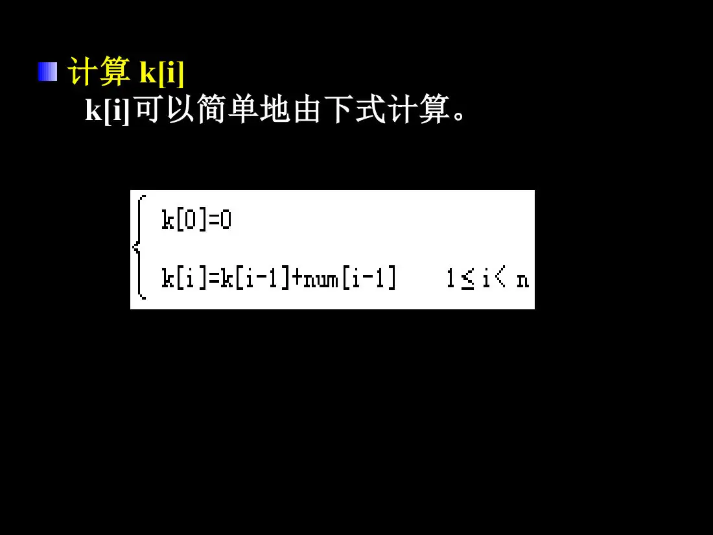

原文：

计算 k[i]k[i]可以简单地由下式计算。

### 图4-4 num和k数组

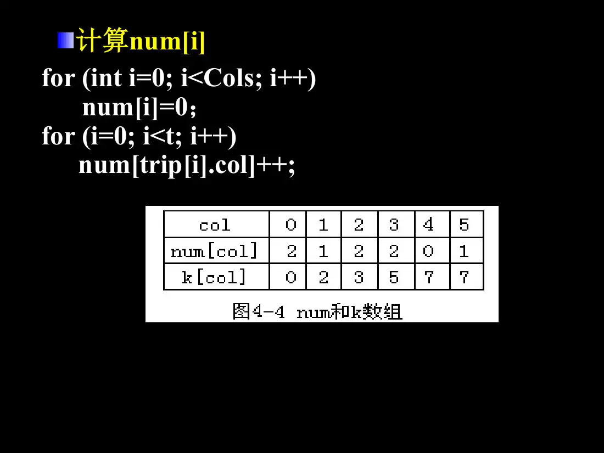

原文：

计算num[i] for (int i=0; i<Cols; i++) num[i]=0； for (i=0; i<t; i++) num[trip[i].col]++;

图4-4 num和k数组
<table><tr><td>col</td><td>0</td><td>1</td><td>2</td><td>3</td><td>4</td><td>5</td></tr><tr><td>num[col]</td><td>2</td><td>1</td><td>2</td><td>2</td><td>0</td><td>1</td></tr><tr><td>k[col]</td><td>0</td><td>2</td><td>3</td><td>5</td><td>7</td><td>7</td></tr></table>

### 第 40 页

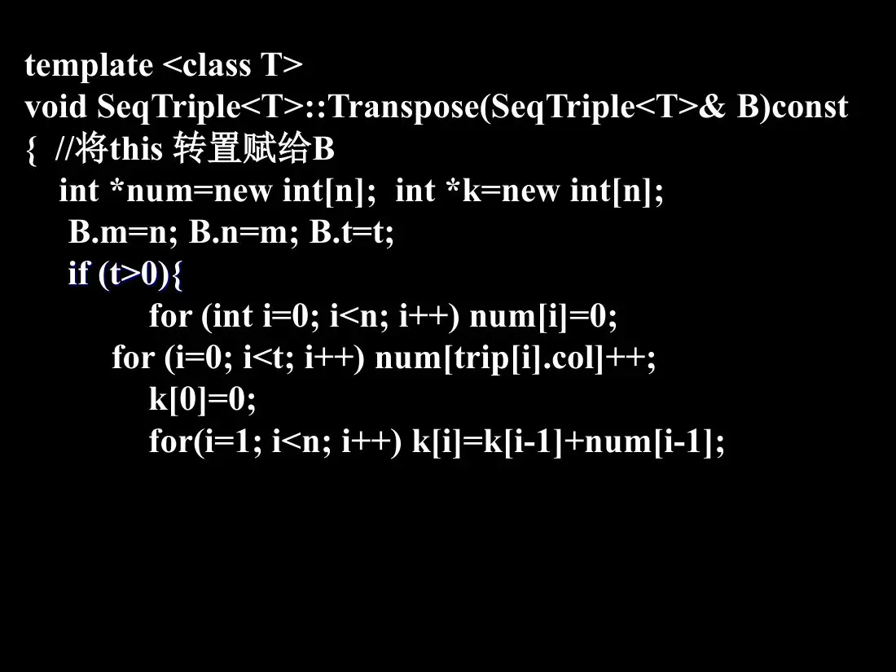

原文：

template <class T> void SeqTriple<T>::Transpose(SeqTriple<T>& B)const { //将this 转置赋给B int \*num=new int[n]; int \*k=new int[n]; B.m=n; B.n=m; B.t=t; if (t>0){ for (int i=0; i<n; i++) num[i]=0; for (i=0; i<t; i++) num[trip[i].col]++; k[0]=0; for(i=1; i<n; i++) k[i]=k[i-1]+num[i-1];

### delete [] num; delete [] k;

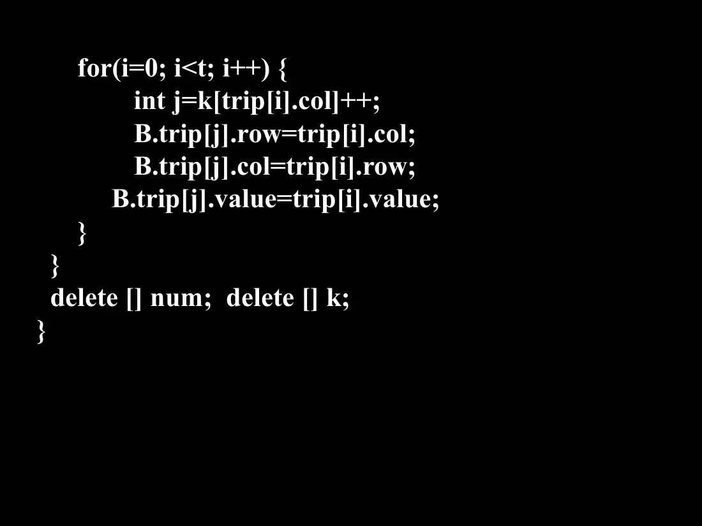

原文：

for(i=0; i<t; i++) { int j=k[trip[i].col]++; B.trip[j].row=trip[i].col; B.trip[j].col=trip[i].row; B.trip[j].value=trip[i].value;

delete [] num; delete [] k;

### 4.4 字符串

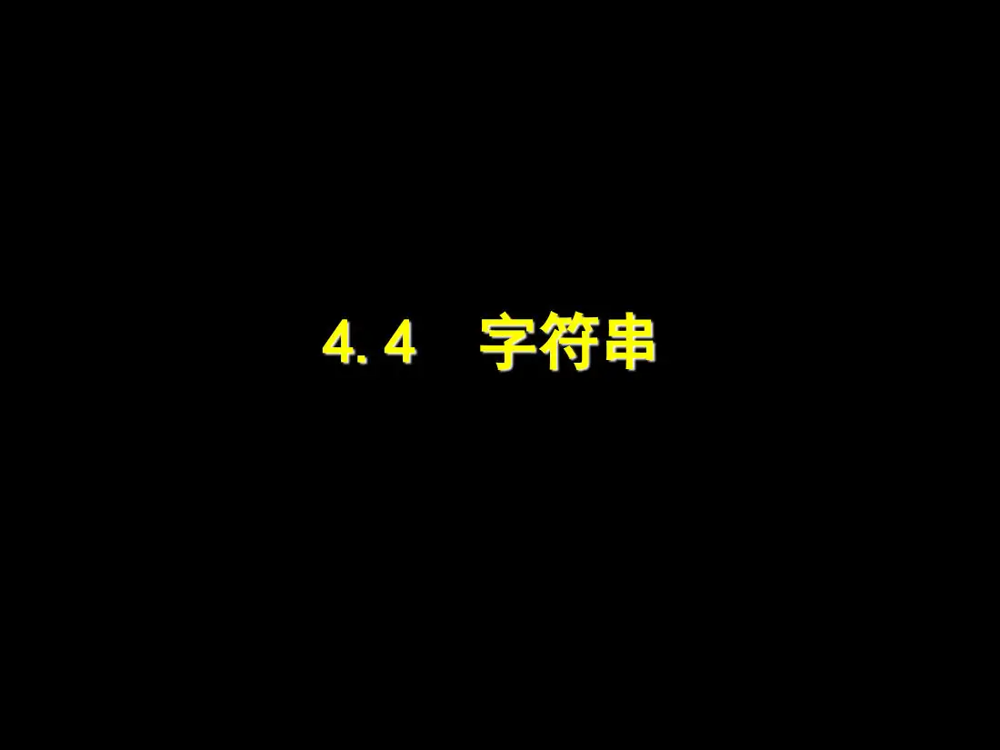

原文：

4.4 字符串

### 4.4.1 字符串ADT

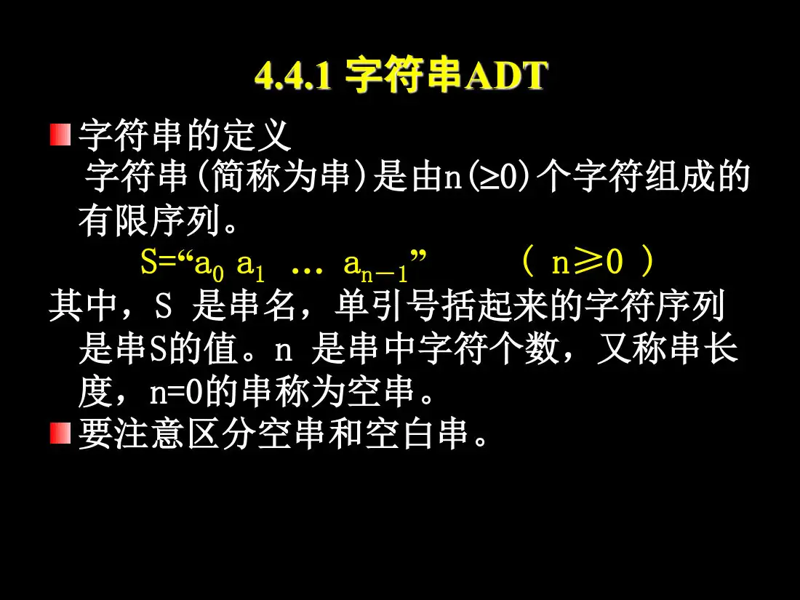

原文：

4.4.1 字符串ADT

字符串的定义字符串(简称为串)是由n(0)个字符组成的有限序列。

$$
S = “ a _ {0} a _ {1} \dots a _ {n - 1} ”
$$

其中，S 是串名，单引号括起来的字符序列是串S的值。n 是串中字符个数，又称串长度，n=0的串称为空串。要注意区分空串和空白串。

### S=‘abcabcaabcbcde’

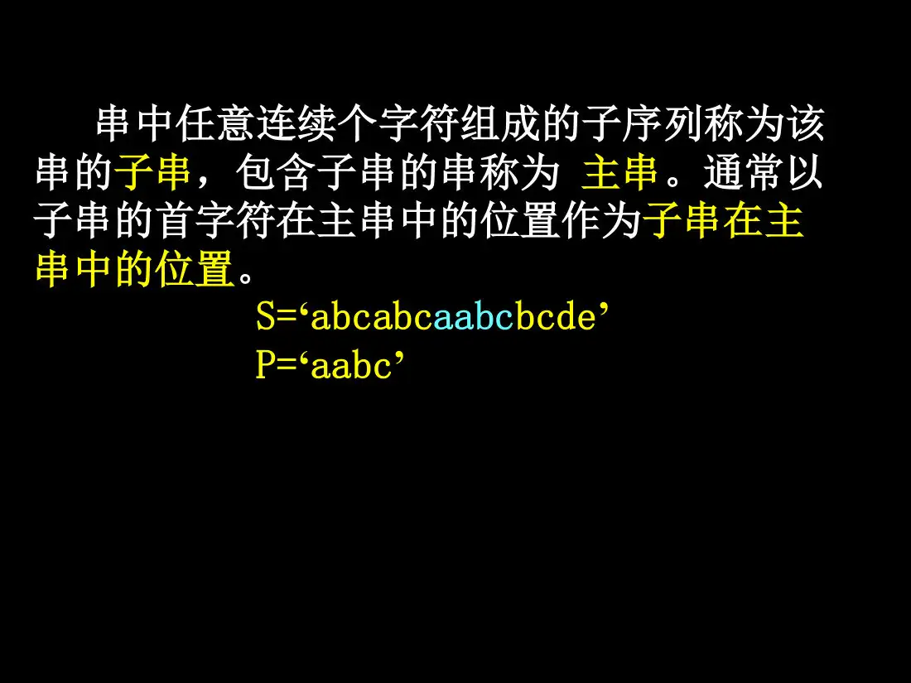

原文：

串中任意连续个字符组成的子序列称为该串的子串，包含子串的串称为 主串。通常以子串的首字符在主串中的位置作为子串在主串中的位置。

S=‘abcabcaabcbcde’

P=‘aabc’

### ADT4.3 字符串ADT

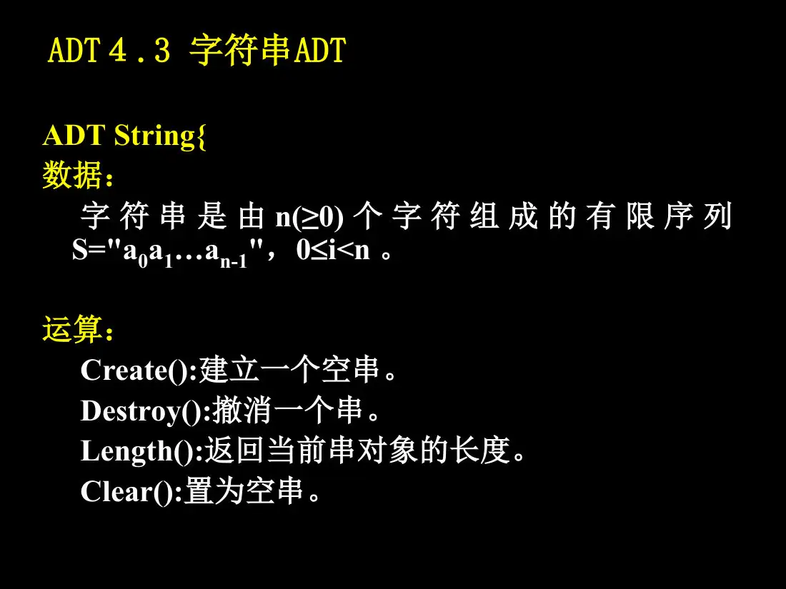

原文：

ADT4.3 字符串ADT

数据：

字 符 串 是 由 n(≥0) 个 字 符 组 成 的 有 限 序 列$\scriptstyle \mathbf { S } = { \mathbf { a } } _ { 2 } = { \mathbf { a } } _ { 3 } = \mathbf { a } _ { 4 } = \mathbf { a } _ { 4 } = \mathbf { a } _ { 4 } = \mathbf { a } _ { 4 } = \mathbf { a } _ { 4 } = \mathbf { a } _ { 4 }$ $0 . 3 7 \times 1 7$

运算：

Create():建立一个空串。Destroy():撤消一个串。Length():返回当前串对象的长度。Clear():置为空串。

### Assign(S):串S的值赋给当前串对象。

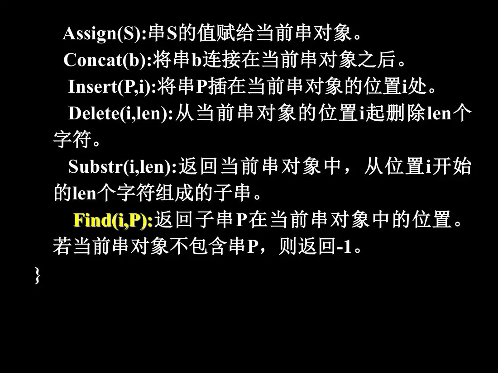

原文：

Assign(S):串S的值赋给当前串对象。

Concat(b):将串b连接在当前串对象之后。

Insert(P,i):将串P插在当前串对象的位置i处。

Delete(i,len):从当前串对象的位置i起删除len个字符。

Substr(i,len):返回当前串对象中，从位置i开始的len个字符组成的子串。

Find(i,P):返回子串P在当前串对象中的位置。若当前串对象不包含串P，则返回-1。

### 4.4.2 字符串的存储表示

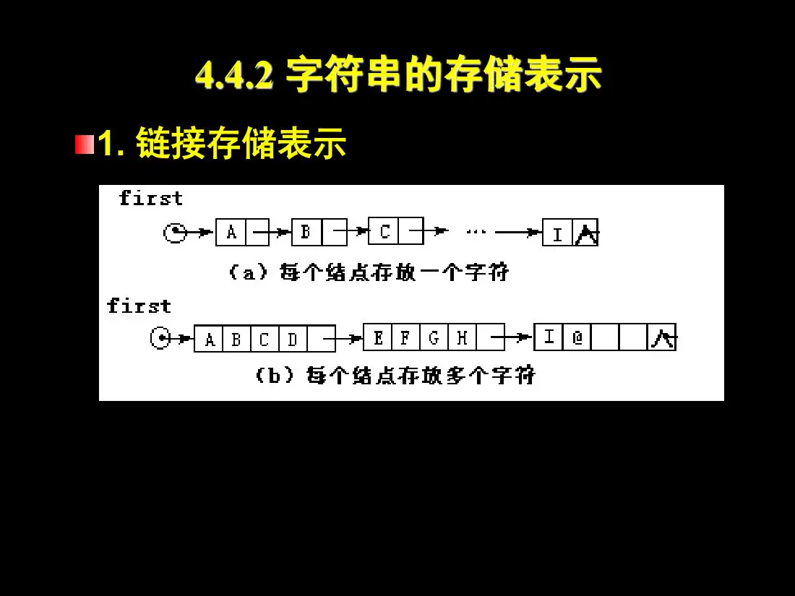

原文：

4.4.2 字符串的存储表示

1. 链接存储表示

first

(a)每个结点存放一个字符

first

### 2.顺序存储表示串的顺序表示可用C++的一维字符数组来描述。

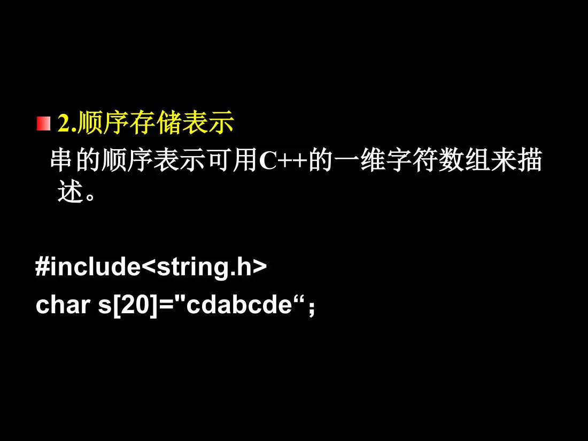

原文：

2.顺序存储表示串的顺序表示可用C++的一维字符数组来描述。

include<string.h>char s[20]="cdabcde“；

### include  class String {

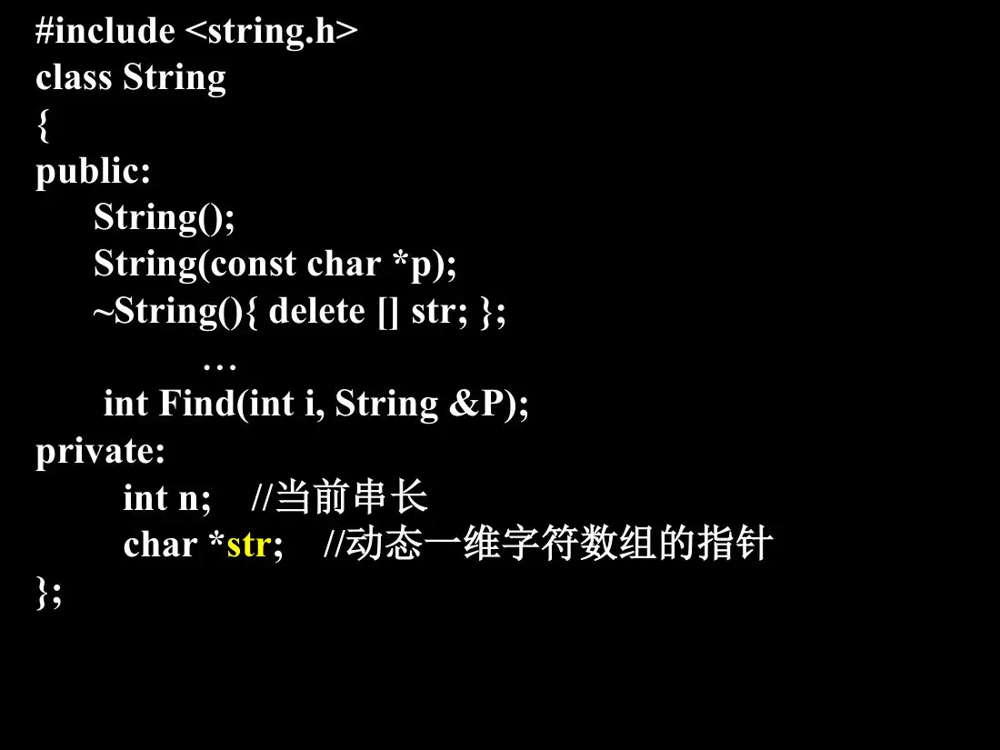

原文：

include <string.h> class String {

public: String(); String(const char \*p); \~String(){ delete [] str; };

int n; //当前串长 char \*str; //动态一维字符数组的指针

### String::String(const char \*p)

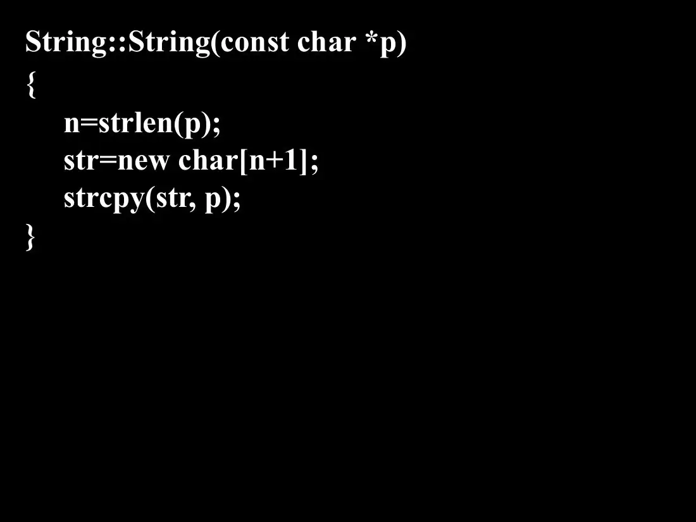

原文：

String::String(const char \*p)

n=strlen(p); str=new char[n+1]; strcpy(str, p);

### 4.4.3 简单模式匹配算法

原文：

4.4.3 简单模式匹配算法

设有两个字符串s和p，在串s中找串p的过程被称为模式匹配 。这里s为主串，p为子串，又称为模式。

模式匹配最普遍的应用是文本编辑器中查找串．如：WORD中的“Find”等命令

### 模式匹配算法思想

原文：

模式匹配算法思想

1.从主串s中下标为i的字符与模式串p的第1个字符(下标为0)开始逐个比较，遇到不相等时，即到达失配点，该趟匹配失败2.s回到i加1的位置（称为回溯），p回到第1个字符位置，开始下趟匹配直到匹配成功返回p的第1个字符在s中的位置或者 s中不存在p，匹配失败

### 简单模式匹配－匹配成功

原文：

简单模式匹配－匹配成功

s:abcabcaabca ≠

P : $\yen 123,456$

(a)第一趟

s: a b c ab c a a b c a ≠

P :

(c)第三

s: abc a b c a a b c a

P: abcaab j=0

(b)第二趟

i=3 十 s: a b c a b c a a b c a

a b c a a b 4 j=0 →

(d)匹配成功

简单匹配算祛（匹配成功）

### 简单模式匹配－匹配失败

原文：

简单模式匹配－匹配失败

中S:abc abca abc a≠

$$
\begin{array}{l} \texttt {a b b b} \\ \texttt {j = 0} \end{array}
$$

(a)第一趟

P:

$$
\begin{array}{l} \texttt {a b b b} \\ \texttt {\textup {\textup {\downarrow}}} \\ \texttt {j = 0} \end{array}
$$

(c)以后的匹配均失败

(d)匹配失败

简单匹配算祛（匹配失败）

### int String::Find(int i, String &P)

原文：

int String::Find(int i, String &P)

if (i<0 || i>n-1) { //越界检查 cout<<"Out of bounds!"<<endl; return -1;

//指针pp指向模式串

$$
^ {*} t = s t r + i;
$$

while $( \textcircled { 4 } 1 2 1 ) = ( 1 2 0 0 0 0 0 0 0 0 0 0 0 ) = ( 1 0 0 0 0 0 )$ $7 7 \div ( \textcircled { 4 } ) : 2 : 2 : 5 = : 7 : 2 : 2$

$| \bigstar \bigstar \bigstar | \bigstar | \bigstar$ //模式串回到第1个字符,为下趟匹配准备t=str+(++i); //主串回到i+1的位置，为下趟匹配准备

if (\*pp==‘\0’) return i;

//串pp已到串尾，匹配成功

return -1;

//匹配失败

### S=‘abcabcaadbcbcde P=‘aabc’

原文：

简单匹配算法的渐近时间复杂度：设主串和模式串的长度为n和m，while循环最多进行n-m+1趟，每趟最多比较m次，这样总的 比 较 次 数 最 多 是 (n-m+1)×m 。 由 于 (n-m+1)×m≤(n-m+m)×m=n×m，因此简单模式匹配算法在最坏情况下的时间复杂度是O(n×m)。

S=‘abcabcaadbcbcde P=‘aabc’

### 4.4.4 模式匹配的KMP算法

原文：

4.4.4 模式匹配的KMP算法

简单匹配算法效率不高。原因：有回溯。KMP是一种无回溯匹配算法

KMP的时间复杂度是O(n+m)。效率高的主要原因是匹配失败时在主串中不需回朔，在子串（模式串）中也不一定要回朔到第一个字符的位置。

### 图4- 串的简单匹配算法

原文：

第3趟，回溯到 S[2]、P[0]而 S[2]=P[2] ，P[0]!=P[2]第3趟没有必要

第4趟，没有必要回溯到S[3]、P[0]而 S[3]==P[3] ，P[0]==P[3],所以S[3]==P[0]因此，可从S[4]与P[1]处开始

图4- 串的简单匹配算法
<table><tr><td>第1趟</td><td>i=0 → i=4↓S: a b c a b c a a b c aP: a b c a a b↑j=0 → j=4 S[i]≠P[j]</td></tr><tr><td>第2趟</td><td>i=1↓S: a b c a b c a a b c aP: a b c a a b↑j=0 没有必要 S[i]≠P[j]</td></tr><tr><td>第3趟</td><td>i=2↓S: a b c a b c a a b c aP: a b c a a b↑j=0 没有必要 S[i]≠P[j]</td></tr><tr><td>第4趟</td><td>i=3 → i=8↓S: a b c a b c a a b c aP: a b c a a b↑j=0 → j=5</td></tr></table>

### 因此确定下趟匹配开始时，模式串回朔到什么位置，是问题的关键。

原文：

因此确定下趟匹配开始时，模式串回朔到什么位置，是问题的关键。

图4- 串的简单匹配算法
<table><tr><td>第1趟</td><td>i=0→i=4↓S:abcabcaaabc aP:abcaaab↑j=0→j=4 S[i]≠P[j]</td></tr><tr><td>第2趟</td><td>i=1↓S:abcabcaaabc aP:abcaaab↑j=0 S[i]≠P[j]</td></tr><tr><td>第3趟</td><td>i=2↓S:abcabcaaabc aP:abcaaab↑j=0 S[i]≠P[j]</td></tr><tr><td>第4趟</td><td>i=3→i=8↓S:abcaaabcaaabc aP:abcaaab↑j=0→j=5</td></tr></table>

### $$

原文：

KMP算法的关键是确定模式串p中每个字符的最大k值K是失配时j需向前回朔得最少的位置，即下趟匹配时，j的新值为k。于是下一趟应从 $\bigstar$ 和 $[ 0 , 1 ] = [ 0 , 1 ]$ 开始比较。

设主串 $: - \frac { 1 } { 2 } \times ( 2 \times 2 ) \times ( 2 \times 2 ) \times ( 2 \times 2 ) \times ( 2 \times 2 ) = 1 1 2$ ，模式串 $\vert \overrightarrow { \vert } = ( \overrightarrow { \vert } \overrightarrow { \vert } \overrightarrow { \vert } \overrightarrow { \vert } \overrightarrow { \vert } \overrightarrow { \vert } \overrightarrow { \vert } \overrightarrow { \vert } \overrightarrow { \vert } \overrightarrow { \vert } \overrightarrow { \vert } \overrightarrow { \vert } \overrightarrow { \vert } \overrightarrow { \vert } \overrightarrow { \vert } \overrightarrow { \vert } \overrightarrow { \vert } \overrightarrow { \vert } \vert \overrightarrow { \vert } \vert \overrightarrow { \vert } \vert \overrightarrow { \vert } \vert$ ”,失配点为 $\frac { 1 } { 2 } \times \frac { 1 } { 2 } = \frac { 1 } { 2 }$ 如果发现在模式串P中有 ：

$$
\mathrm{p} _ {0} \mathrm{p} _ {1} \dots \mathrm{p} _ {\mathrm{k} - 1} = \mathrm{p} _ {\mathrm{j} - \mathrm{k}} \mathrm{p} _ {\mathrm{j} - \mathrm{k} + 1} \dots \mathrm{p} _ {\mathrm{j} - 1}
$$

是串 $\textcircled { 1 } \textcircled { 9 } \textcircled { 9 } \textcircled { 1 } \textcircled { 2 } \textcircled { 2 } \textcircled { 1 } \textcircled { 2 } \textcircled { 1 }$ 中“最长的相等的前缀子串 后缀子串”

由于 $\textcircled { \times } \textcircled { \times } \textcircled { \times } \textcircled { \times } \textcircled { \times } \textcircled { \times }$ 故有：

$$
\mathrm{p} _ {\mathrm{j-k}} \dots \mathrm{p} _ {\mathrm{j-2}} \mathrm{p} _ {\mathrm{j-1}} = \mathrm{s} _ {\mathrm{i-k}} \dots \mathrm{s} _ {\mathrm{i-2}} \mathrm{s} _ {\mathrm{i-1}}
$$

因此

下一趟就可从p0 … $\angle A C D = \angle A C D = \angle A C D$ 开始比较。= si-k $0 . 0 0 0 0 0 0 0 0 0 0 0 0 0 0 0 0 0 0$ 第1趟，S[4] != P[4]，匹配失败

### 因此，下趟匹配从 $\bigcirc$ 和 $\bigstar$ 开始

原文：

在串 $( 1 1 0 - 1 0 ) \div ( 2 0 - 1 ) = 1 0$ 中, $\mathbf { \delta E }$ 是“最长的相等的前缀子串和后缀子串”，

因此，下趟匹配从 $\bigcirc$ 和 $\bigstar$ 开始

图4- 串的简单匹配算法
<table><tr><td>第1趟</td><td colspan="2">i=0 → i=4↓S: a b c a b c a a b c aP: a b c a a b↑j=0 → j=4 S[i]≠P[j]</td></tr><tr><td>第2趟</td><td colspan="2">i=4 → i=8↓S: a b c a b c a a b c aP: a b c a a b↑j=1 → j=5</td></tr><tr><td>第3趟</td><td colspan="2">i=2 没有必要S: a b c a b c a a b c aP: a b c a a b↑j=0 S[i]≠P[j]</td></tr><tr><td>第4趟</td><td colspan="2">i=3 → i=8↓S: a b c a b c a a b c aP: a b c a a b↑j=0 → j=5</td></tr></table>

### S:

原文：

S:

p:

$$
\begin{array}{c c c c c c c c} \mathbf {i} = 0 & & \longrightarrow & & \mathbf {i} = 7 \\ \downarrow & & & & \downarrow \\ \mathbf {a b c a b c a a b} & & & & \\ & & & & \neq \\ \mathbf {a b c a b c a b} & & \dots \\ \updownarrow & & \longrightarrow & & \updownarrow \\ \mathbf {j} = 0 & & & & \mathbf {j} = 7 \end{array}
$$

(b)在j=7处失配

失配点前的串“abcabca”中，相同的前、后缀子串只有$G ( \mathbf { \vec { a } } ) = \frac { \sqrt { 2 } } { 2 }$ $1 9 \div 1 0 = 1 0$ ,其中 $\frac { 1 3 } { 2 } \div 1 0 \times 2 = 1 2$ 是最长的相同的前、后缀子串，所以k为4，下一趟的匹配从s[7]和p[4]开始。

S:

p:

$$
\begin{array}{c c c c c c c c c} \hline i = 0 & & \longrightarrow & & i = 7 \\ \downarrow & & & & \downarrow \\ a b c a b c a a b \dots \\ & & & \neq & \\ & & a b c a b \dots \\ & & & \downarrow & \\ & & & j = 4 \end{array}
$$

### 第 63 页

原文：

失败函数的定义设有长度为m的模式串 $\textcircled { 1 } \textcircled { 2 } \textcircled { 1 } \textcircled { 1 } \textcircled { 2 } \textcircled { 2 } \textcircled { 1 } \textcircled { 2 } \textcircled { 1 } \textcircled { 2 } \textcircled { 1 } \textcircled { 2 } \textcircled { 1 } \textcircled { 2 } \textcircled { 1 }$ ，k为相同的前、后缀子串长，失败函数的定义为：

-1 当j=0时f(j)= max{k| 0< k < j 且 $1 2 0 0 - 2 0 0 0 = 1 2 0 0 0 ( c m ) = 1 2 0 0 0$ 存在0 其它情况 （无相同的前、后缀子串）

此函数的含义为：当 $( \frac { 1 } { 2 } , 1 ) = ( \frac { 1 } { 2 } , 1 )$ j匹配失败时，j应当回朔的f(j)。当f(j)>=0时，下趟匹配从 $\bigstar$ 和 $[ 0 ] \times ( 0 . 0 )$ 开始当f(j)=-1时，下趟匹配从 $\bigstar$ 和 $\textcircled { 9 }$ 开始

### 从定义计算失败函数

原文：

从定义计算失败函数

-1 当j=0时f(j)= max{k|0 < k < j 且 $1 2 0 0 0 0 0 0 0 0 0 0 0 0 0 0 0 0 0 0 0 0 0 0 0 0 0 0 0 0 0 0 0 0 0 0 0 0 0 0 0 0 0 0 0 0 0 0 0 0 0 0 0 0 0 0 0 0 0 0 0 0 0 0 0 0 0 0 0 0 0 0 0 0 0 0 0 0 0 0 0 0 0 0 0 0 0 0 0 0 0 0 0 0 0 0 0 0 0 0 0 0 0 0 0 0 0 0 0 0 0 0 0 0 0 0 0 0 0 0 0 0 0 0 0 0 0 0 0 0 0 0 0 0 0 0 0 0 0 0 0 0 0 0 0 0 0 0 0 0 0 0 0 0 0 0 0 0 0 0 0 0 0 0 0 0 0 0 0 0 0 0 0 0 0 0 0 0 0 0 0 0 0 0 0 0 0 0 0 0 0 0 0 0 0 0 0 0 0 0 0 0 0 0 0 0 0 0 0 0 0 0 0 0 0 0 0 0 0 0 0 0 0 0 0 0 0 0 0 0 0 0 0 0 0 0 0 0 0 0 0 0 0 0 0 0 0 0 0 0 0 0 0 0 0 0 0 0 0 0 0 0 0 0 0 0 0 0 0 0 0 0 0 0 0 0 0 0 0 0 0 0 0 0 0 0 0 0 0 0 0 0 0 0 0 0 0 0 0 0 0 0 0 0 0 0 0 0 0 0 0 0 0 0 0 0 0 0 0 0 0 0 0 0 0 0 0 0 0 0 0 0 0 0 0 0 0 0 0 0 0 0 0 0 0 0 0 0 0 0$ 存在0 其它情况

失败函数举例

<table><tr><td>j</td><td>0</td><td>1</td><td>2</td><td>3</td><td>4</td><td>5</td><td>6</td><td>7</td><td>8</td><td>9</td><td>10</td></tr><tr><td>P</td><td>a</td><td>b</td><td>c</td><td>a</td><td>b</td><td>c</td><td>a</td><td>b</td><td>b</td><td>a</td><td>c</td></tr><tr><td>f(j)</td><td>-1</td><td>0</td><td>0</td><td>0</td><td>1</td><td>2</td><td>3</td><td>4</td><td>5</td><td>0</td><td>1</td></tr></table>

KMP算法就容易实现。当 $\textcircled { 2 } \textcircled { 2 } \textcircled { 2 } \textcircled { 2 }$ 时，只需使j=f[j]，即从P[f[j]]字符开始下一趟比较；主串无需回朔。

### 第 65 页

原文：

设有主串S=“abcabcaabcabacbbacP=“abcabcabbac ”, KMP算法匹配过程如下：

### 第 66 页

### 第 67 页

原文：

if (i<0 || i>n-1) { cout<<"Out of bounds!"<<endl; return -1; }

### 第 68 页

原文：

int j=0, m=P.n; while (i<n&&j<m) if (j==-1||str[i]==P.str[j]) { i++; j++; else j=P.f[j]; return ((j==m)?i-m:-1);

### if (j==-1 || str[i]==p.str[j])

原文：

时间分析算法中语句if (j==-1 || str[i]==p.str[j])的执行次数最多，因此KMP算法的时间复杂度主要取决于该语句的执行次数。

if (j==-1 || str[i]==p.str[j])

i++; // i递增(主串)j++;

else j=p.f[j]; //j递减（子串）

因此KMP算法的时间复杂度为O(n)

### 失败函数递推计算公式

原文：

失败函数递推计算公式

f(j+1)=

-1 当j=-1时f(j)+1 若存在最小的整数m，使得 $1 2 \times ( a + 1 ) = 1 2$ 0 其它情况

其中， $( 0 ) = ( 0 , 0 ) \because ( 0 , 0 )$

失败函数举例

<table><tr><td>j</td><td>0</td><td>1</td><td>2</td><td>3</td><td>4</td><td>5</td><td>6</td><td>7</td><td>8</td><td>9</td><td>10</td></tr><tr><td>P</td><td>a</td><td>b</td><td>c</td><td>a</td><td>b</td><td>c</td><td>a</td><td>b</td><td>b</td><td>a</td><td>c</td></tr><tr><td>f(j)</td><td>-1</td><td>0</td><td>0</td><td>0</td><td>1</td><td>2</td><td>3</td><td>4</td><td>5</td><td>0</td><td>1</td></tr></table>

### 递推计算失败函数

原文：

递推计算失败函数

void String::Fail() {//计算失败函数 int j=0,k=-1; f[0]=-1; while (j<n) if ((k==-1) || (str[j]==str[k])){ j++; k++; f[j]=k; else k=f[k];

### 计算失败函数的改进方法

原文：

计算失败函数的改进方法

void String::Fail () { int j=0,k=-1;f[0]=-1; while (j<n) if ((k==-1) || (str[j]==str[k])){ j++; k++; if (str[j]==str[k]) f[j]=f[k]; else f[j]=k; else k=f[k];

### 改进的KMP算法

原文：

改进的KMP算法

KMP算法仍有缺陷。例如，当S[7]P[7]失配时，仍需用P[4]，`P[1]`（‘b’）与`S[7]`（‘a’）进行比较，而这种比较显然是毫无意义的。

<table><tr><td>S</td><td>a</td><td>b</td><td>c</td><td>a</td><td>b</td><td>c</td><td>a</td><td>a</td><td>b</td><td>c</td><td>a</td><td>...</td></tr><tr><td></td><td>0</td><td>1</td><td>2</td><td>3</td><td>4</td><td>5</td><td>6</td><td>7</td><td>8</td><td>9</td><td>10</td><td></td></tr><tr><td> $P_j$ </td><td>a</td><td>b</td><td>c</td><td>a</td><td>b</td><td>c</td><td>a</td><td>b</td><td>b</td><td>a</td><td>c</td><td></td></tr><tr><td>f(j)</td><td>-1</td><td>0</td><td>0</td><td>0</td><td>1</td><td>2</td><td>3</td><td>4</td><td>5</td><td>0</td><td>1</td><td></td></tr><tr><td></td><td></td><td></td><td></td><td></td><td></td><td></td><td></td><td></td><td></td><td></td><td></td><td></td></tr></table>

改进算法：在求出k值后，不是马上写入f[j]中，而是比较p 和pj，若不等，则k存入f[j],若相等，将f[k]存入f[j]中

<table><tr><td>j</td><td>0</td><td>1</td><td>2</td><td>3</td><td>4</td><td>5</td><td>6</td><td>7</td><td>8</td><td>9</td><td>10</td></tr><tr><td>P</td><td>a</td><td>b</td><td>c</td><td>a</td><td>b</td><td>c</td><td>a</td><td>b</td><td>b</td><td>a</td><td>c</td></tr><tr><td>f(j)</td><td>-1</td><td>0</td><td>0</td><td>-1</td><td>0</td><td>0</td><td>-1</td><td>0</td><td>5</td><td>-1</td><td>1</td></tr></table>

### 失败函数举例

原文：

失败函数举例

<table><tr><td>j</td><td>0</td><td>1</td><td>2</td><td>3</td><td>4</td><td>5</td><td>6</td><td>7</td><td>8</td><td>9</td><td>10</td></tr><tr><td>P</td><td>a</td><td>b</td><td>c</td><td>a</td><td>b</td><td>c</td><td>a</td><td>b</td><td>b</td><td>a</td><td>c</td></tr><tr><td>f(j)</td><td>-1</td><td>0</td><td>0</td><td>0</td><td>1</td><td>2</td><td>3</td><td>4</td><td>5</td><td>0</td><td>1</td></tr></table>

改进的失败函数举例

<table><tr><td>j</td><td>0</td><td>1</td><td>2</td><td>3</td><td>4</td><td>5</td><td>6</td><td>7</td><td>8</td><td>9</td><td>10</td></tr><tr><td>P</td><td>a</td><td>b</td><td>c</td><td>a</td><td>b</td><td>c</td><td>a</td><td>b</td><td>b</td><td>a</td><td>c</td></tr><tr><td>f(j)</td><td>-1</td><td>0</td><td>0</td><td>-1</td><td>0</td><td>0</td><td>-1</td><td>0</td><td>5</td><td>-1</td><td>1</td></tr></table>
