# 《数据结构》第5章 树（课件）

原件的每一页，下面附识别出的文字。

### 第5章 树

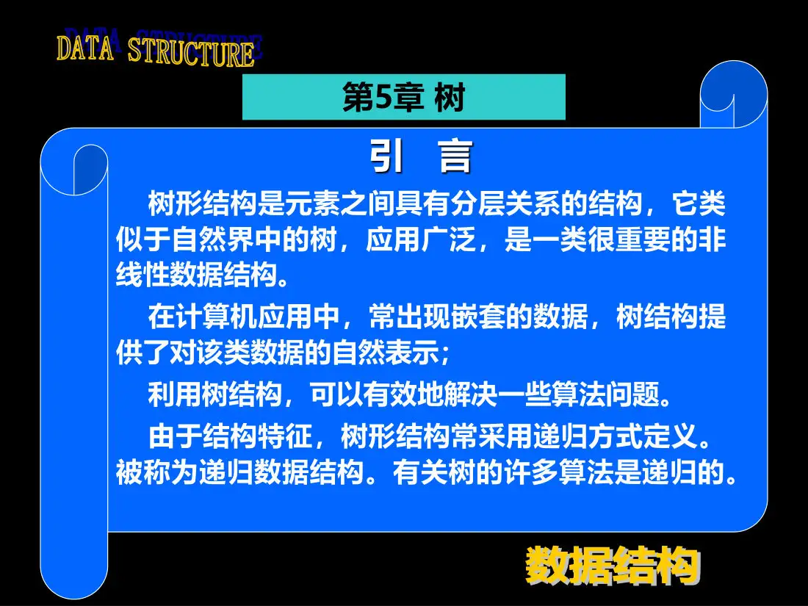

原文：

第5章 树

引 言

树形结构是元素之间具有分层关系的结构，它类似于自然界中的树，应用广泛，是一类很重要的非线性数据结构。

在计算机应用中，常出现嵌套的数据，树结构提供了对该类数据的自然表示；

利用树结构，可以有效地解决一些算法问题。

由于结构特征，树形结构常采用递归方式定义。被称为递归数据结构。有关树的许多算法是递归的。

DATA STRUCTURE

数据结构

### 内容提要

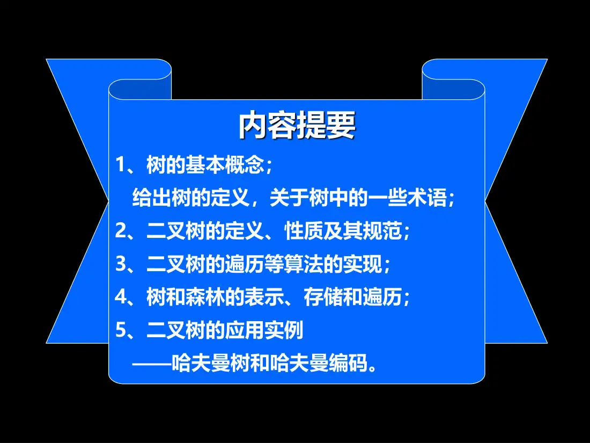

原文：

内容提要

1、树的基本概念；给出树的定义，关于树中的一些术语；

2、二叉树的定义、性质及其规范；

3、二叉树的遍历等算法的实现；

4、树和森林的表示、存储和遍历；

5、二叉树的应用实例

哈夫曼树和哈夫曼编码。

### 5.1 树的基本概念

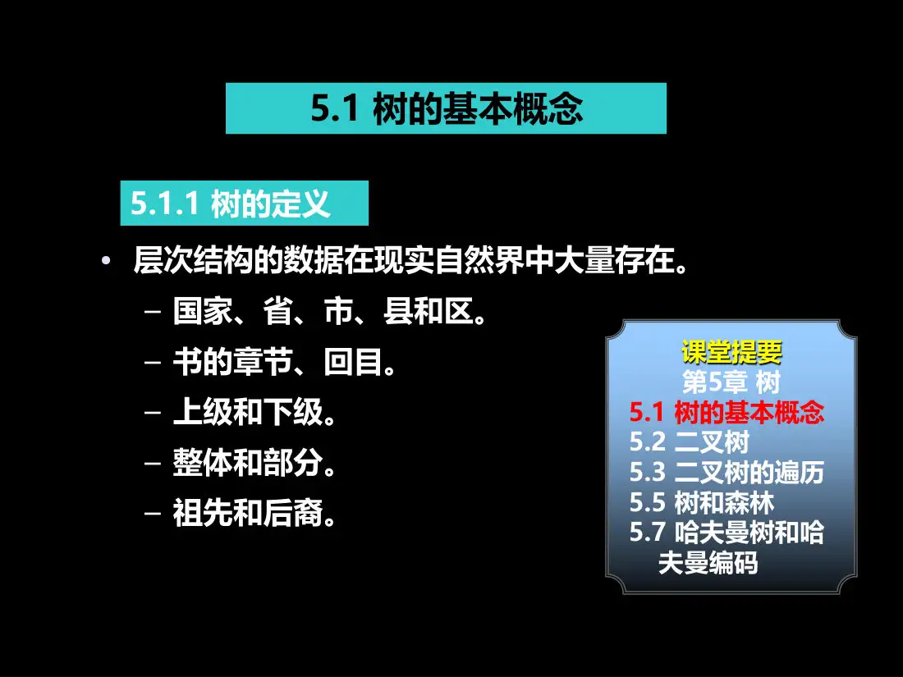

原文：

5.1 树的基本概念

5.1.1 树的定义

• 层次结构的数据在现实自然界中大量存在。

– 国家、省、市、县和区。

– 书的章节、回目。

– 上级和下级。

整体和部分。

– 祖先和后裔。

课堂提要第5章 树

5.1 树的基本概念

5.2 二叉树

5.3 二叉树的遍历

5.5 树和森林

5.7 哈夫曼树和哈夫曼编码

### 原始印欧语

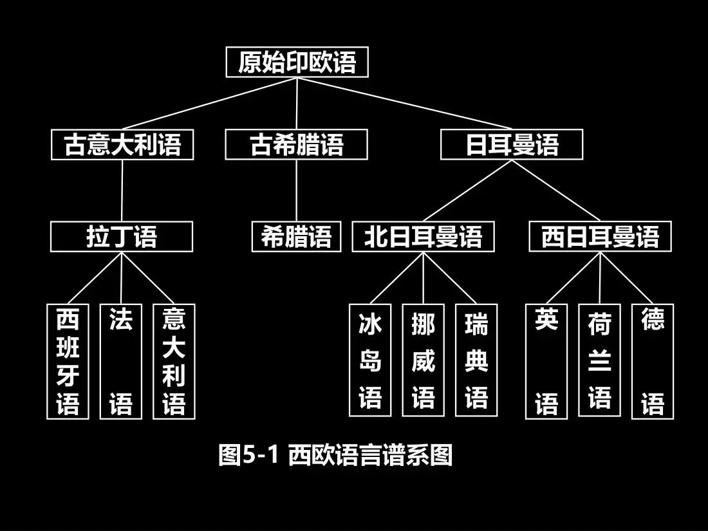

原文：

原始印欧语

古意大利语

拉丁语

古希腊语

希腊语

日耳曼语

北日耳曼语

西日耳曼语

西

班

牙

语

法

意

大

利

语

语

冰

岛

语

挪

语

瑞

语

英

荷

语

兰

德

语

语

图5-1 西欧语言谱系图

### 文件()

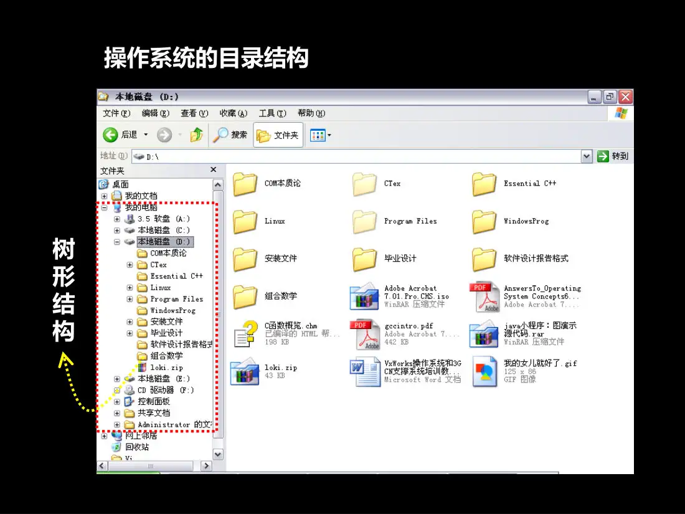

原文：

文件()

编辑(）

查看(y)

收藏(A)

工具(T)

帮助(H)

文件夹

搜索

文件夹

COM本质论

Linux

安装文件

组合数学

C函数概览. chm已编译的 HTML 帮...198 KB

CTex

Essential C++

Program Files

WindowsProg

毕业设计

软件设计报告格式

gccintro. pdf 442 KB

VxWorks操作系统和3GCN支撑系统培训教.Microsoft Word 文档

AnswersTo\_Operating System Concepts6..

我的女儿就好了. gi f125 x 86GIF 图像

操作系统的目录结构

本地磁盘 (D:)

### 1. 树的定义

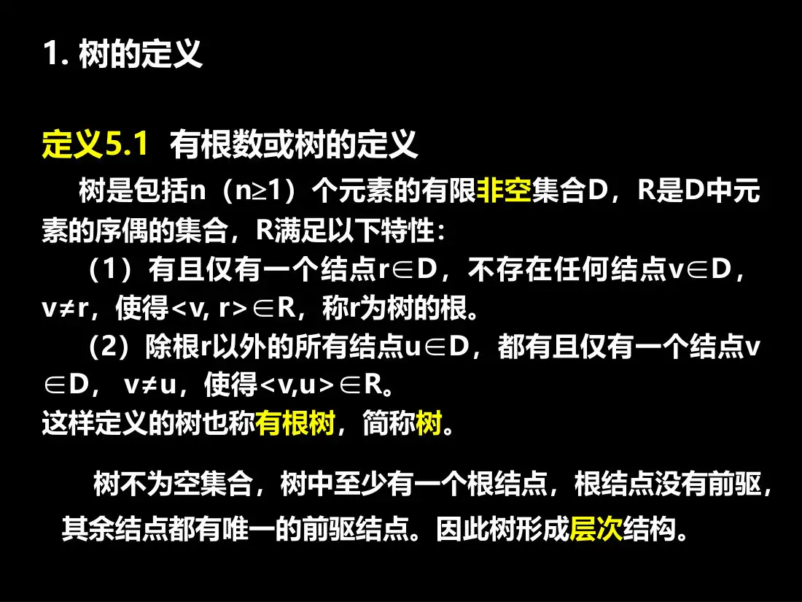

原文：

1. 树的定义

定义5.1 有根数或树的定义

树是包括n（n1）个元素的有限非空集合D，R是D中元素的序偶的集合，R满足以下特性：

（1）有且仅有一个结点r∈D，不存在任何结点 $\scriptstyle \mathtt { W } \in \mathbf { \overline { { D } } }$ $\pmb { \mathbb { { T } } } \pmb { \mathbb { { E } } } \pmb { \mathbb { { 1 } } }$ ，使得 $- 4 y - 1 = - 3$ ，称r为树的根。

（2）除根r以外的所有结点u∈D，都有且仅有一个结点v$\circledast$ $\pmb { \mathbb { W } } \pmb { \mathbb { L } } \pmb { \mathbb { M } }$ ，使得 $\mathrm { \sf { A M D E } } = \mathrm { \bf { [ 3 ] } }$ 这样定义的树也称有根树，简称树。

树不为空集合，树中至少有一个根结点，根结点没有前驱，其余结点都有唯一的前驱结点。因此树形成层次结构。

### 2. 树的递归定义

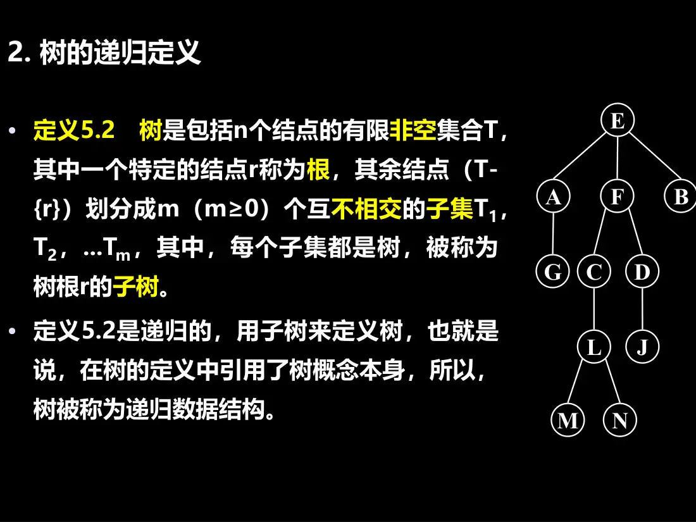

原文：

2. 树的递归定义

• 定义5.2 树是包括n个结点的有限非空集合T，其中一个特定的结点r称为根，其余结点（T-{r}）划分成m（m≥0）个互不相交的子集T ，$\boxed { | \pmb { \rho } _ { 2 m } } \boxed { | | \pmb { \rho } _ { 1 } | }$ 其中，每个子集都是树，被称为树根r的子树。

• 定义5.2是递归的，用子树来定义树，也就是说，在树的定义中引用了树概念本身，所以，树被称为递归数据结构。

### 5.1.2 基本术语

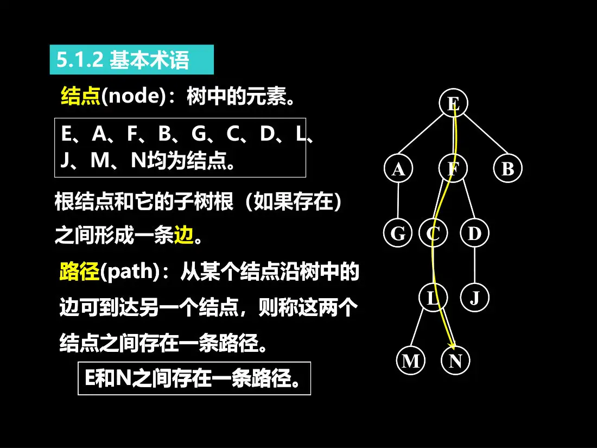

原文：

5.1.2 基本术语

结点(node)：树中的元素。

E 、A、F、B、G、C、D、L、J、M、N均为结点。

根结点和它的子树根（如果存在）之间形成一条边。

路径(path)：从某个结点沿树中的边可到达另一个结点，则称这两个结点之间存在一条路径。结点之间存在一条路径。

E和N之间存在一条路径。

### 双亲(parent)：若一个结点有子树，那么该结点称为子树根的双亲。

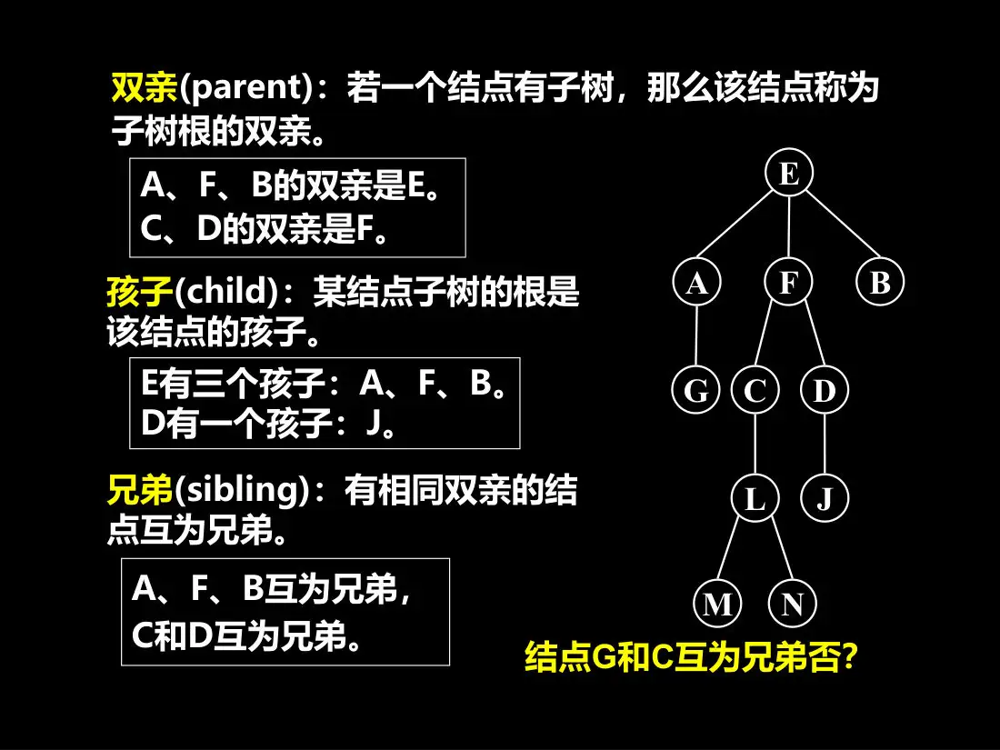

原文：

双亲(parent)：若一个结点有子树，那么该结点称为子树根的双亲。

A、F、B的双亲是E。C、D的双亲是F。

孩子(child)：某结点子树的根是该结点的孩子。

E有三个孩子：A、F、B。D有一个孩子：J。

兄弟(sibling)：有相同双亲的结点互为兄弟。

A、F、B互为兄弟，C和D互为兄弟。

结点G和C互为兄弟否？

### 后裔(decendent)：一个结点的所有子树上的任何结点都是该结点的后裔。

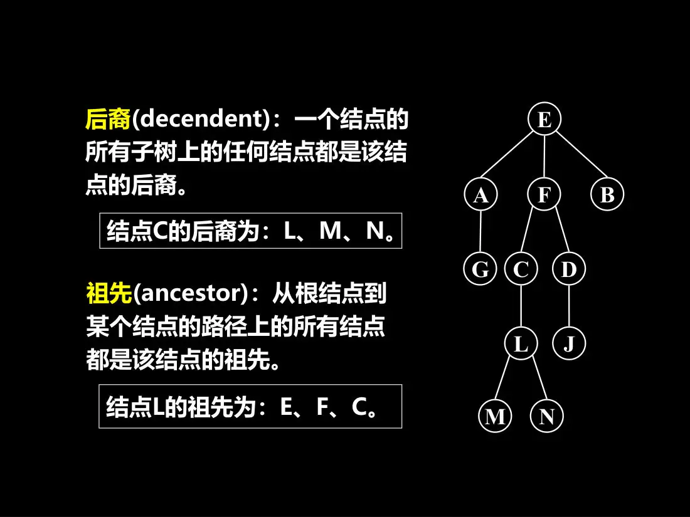

原文：

后裔(decendent)：一个结点的所有子树上的任何结点都是该结点的后裔。

结点C的后裔为：L、M、N。

祖先(ancestor)：从根结点到某个结点的路径上的所有结点都是该结点的祖先。

结点L的祖先为：E、F、C。

### 结点的度(degree)：结点拥有的子树数。

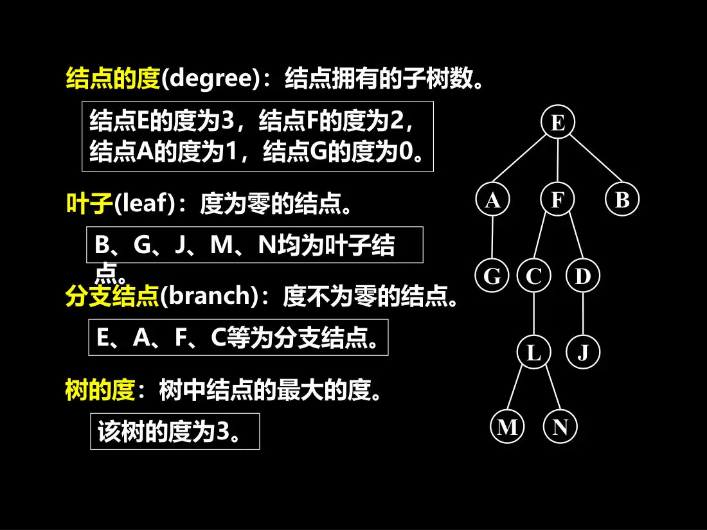

原文：

结点的度(degree)：结点拥有的子树数。

结点E的度为3，结点F的度为2，结点A的度为1，结点G的度为0。

叶子(leaf)：度为零的结点。

B、G、J、M、N均为叶子结点分支结点(branch)：度不为零的结点。

E、A、F、C等为分支结点。

树的度：树中结点的最大的度。

该树的度为3。

### 结点的层次：根结点的层次为1，其余结点的层次等于其双亲结点的层次加1。

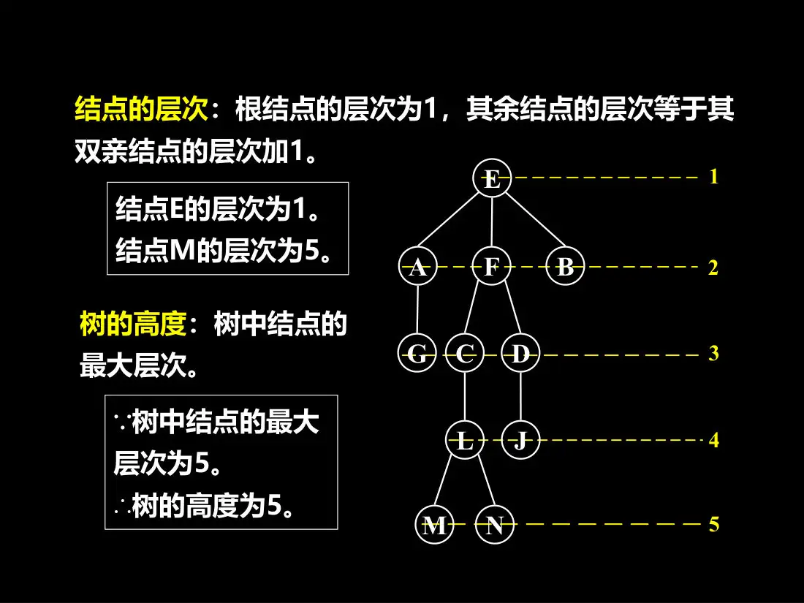

原文：

结点的层次：根结点的层次为1，其余结点的层次等于其双亲结点的层次加1。

结点E的层次为1。结点M的层次为5。

树的高度：树中结点的最大层次。

∵树中结点的最大层次为5。

∴树的高度为5。

### 无序树：如果树中结点的各子树之间的次序是不重要的，可以交换位置。

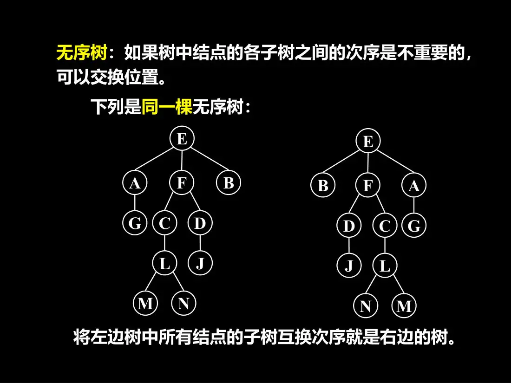

原文：

无序树：如果树中结点的各子树之间的次序是不重要的，可以交换位置。

下列是同一棵无序树：

EA F BG C DL JM N

E B F A D C G J L N M

将左边树中所有结点的子树互换次序就是右边的树。

### 有序树：如果树中结点的各棵子树看成是从左到右有次序的，则称该树为有序树。

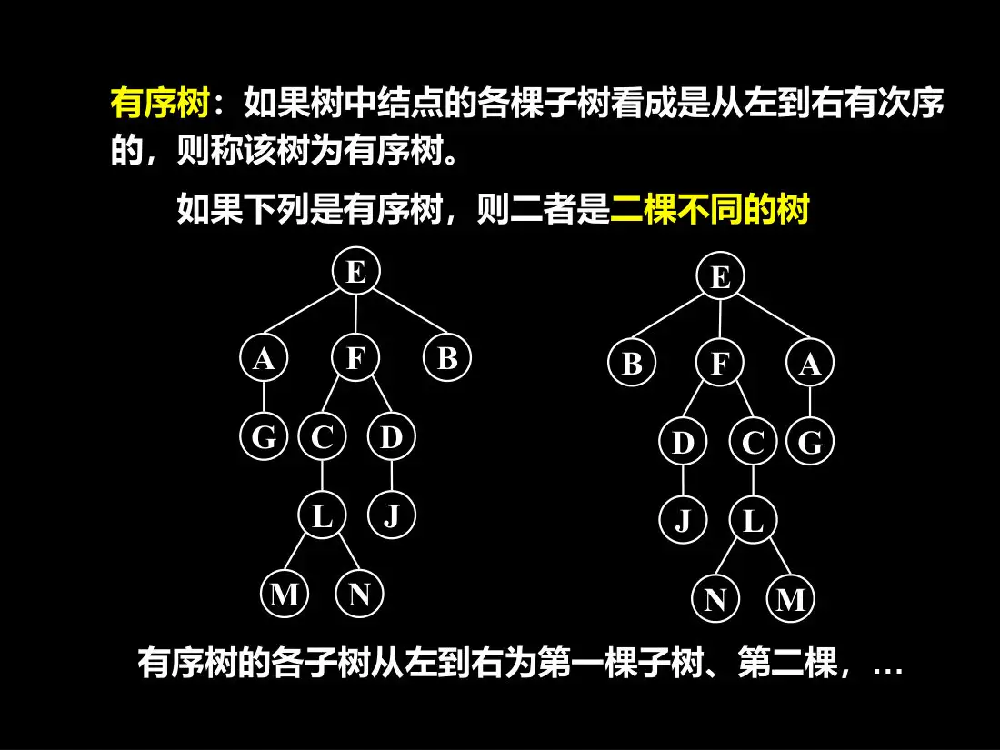

原文：

有序树：如果树中结点的各棵子树看成是从左到右有次序的，则称该树为有序树。

如果下列是有序树，则二者是二棵不同的树

有序树的各子树从左到右为第一棵子树、第二棵，…森林：是树的集合。0个或多个不相交的树组成森林。果园或有序森林：有序树的有序集合。

### 森林与树只有很小的差别，若将树中的根去掉，则得到根的子树组成的森林。

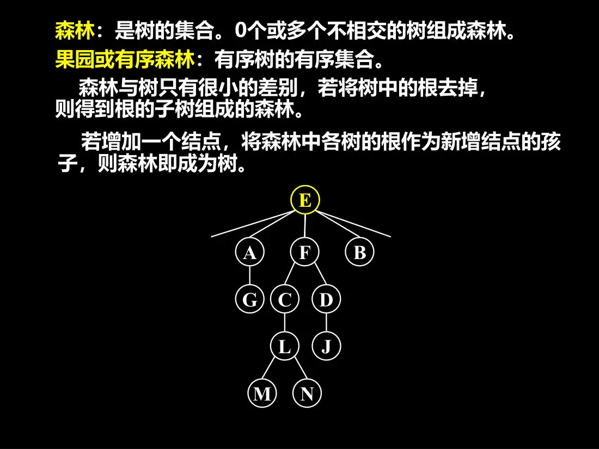

原文：

森林与树只有很小的差别，若将树中的根去掉，则得到根的子树组成的森林。

若增加一个结点，将森林中各树的根作为新增结点的孩子，则森林即成为树。

### 递归

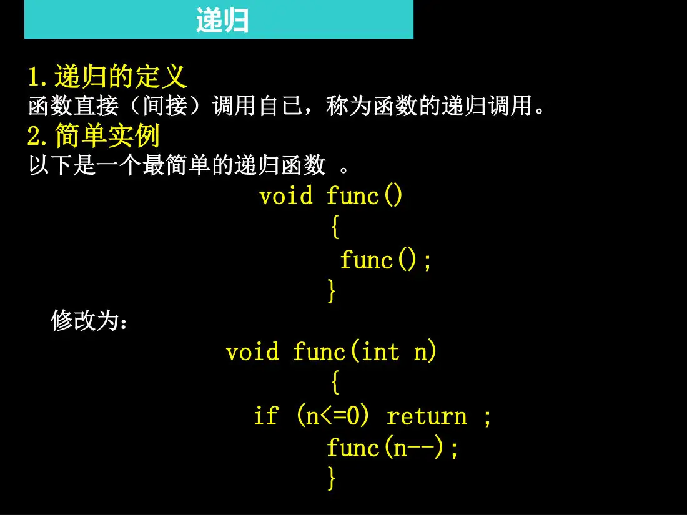

原文：

递归

1.递归的定义函数直接（间接）调用自已，称为函数的递归调用。

2.简单实例以下是一个最简单的递归函数

$$
\begin{array}{l} \text {void func()} \\ \{\quad \\ \text {func();} \\ \} \end{array}
$$

修改为：

void func(int n) if (n<=0) return ; func(n--);

### 3.递推关系

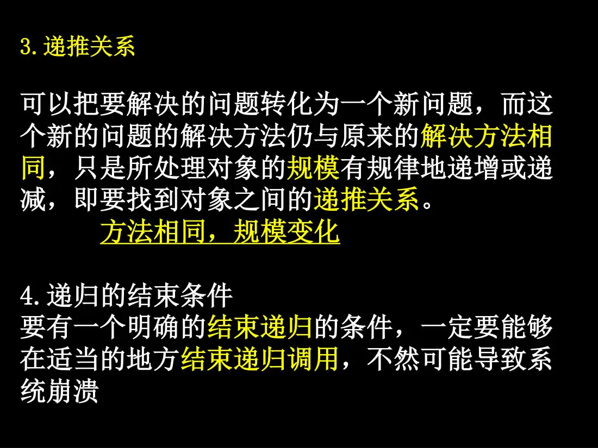

原文：

3.递推关系

可以把要解决的问题转化为一个新问题，而这个新的问题的解决方法仍与原来的解决方法相同，只是所处理对象的规模有规律地递增或递减，即要找到对象之间的递推关系。方法相同，规模变化

4.递归的结束条件要有一个明确的结束递归的条件，一定要能够在适当的地方结束递归调用，不然可能导致系统崩溃

### 例如：采用递归计算N！

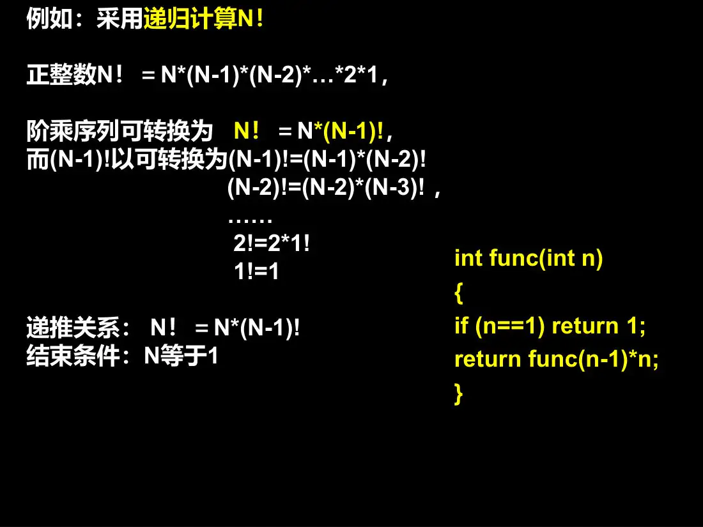

原文：

例如：采用递归计算N！

正整数N！ $\operatorname { s u s } ( \operatorname { a c o } ) \operatorname { a c o } ( \operatorname { a c o } ) \operatorname { s e c o } ( \operatorname { a c o } )$

阶乘序列可转换为 $\mathrm { | \vec { u } | = | \vec { u } ( | \vec { u } | = | \vec { u } | ) | }$ 1而(N-1)!以可转换为 $( \mathrm { a } 5 0 ) \mathrm { { z } ( \mathrm { a } 5 0 ) \mathrm { { z } ( \mathrm { a } 5 0 ) } }$ $( ( \Sigma ^ { } \Sigma ^ { } ) \Sigma ^ { } = ( \Sigma ^ { } \Sigma ^ { } ) \Sigma ^ { } ( \Sigma ^ { } \Sigma ^ { } ) )$

递推关系： N！＝N\*(N-1)!

结束条件：N等于1int func(int n){if (n==1) return 1;return func(n-1)\*n;}

### 执行过程：

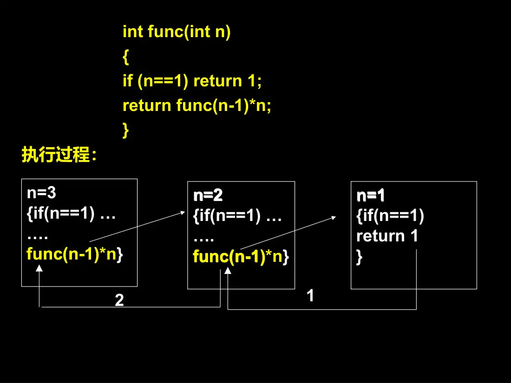

原文：

int func(int n) { if (n==1) return 1; return func(n-1)\*n; }

执行过程：

func(n-1)\*n} n=2n=2 {if(n==1) … func(n-1)\*n}func(n-1)

n=1n=1 {if(n==1) return 1 }

### 设计递归算法，求有n个元素的整数数组A中的最大值。

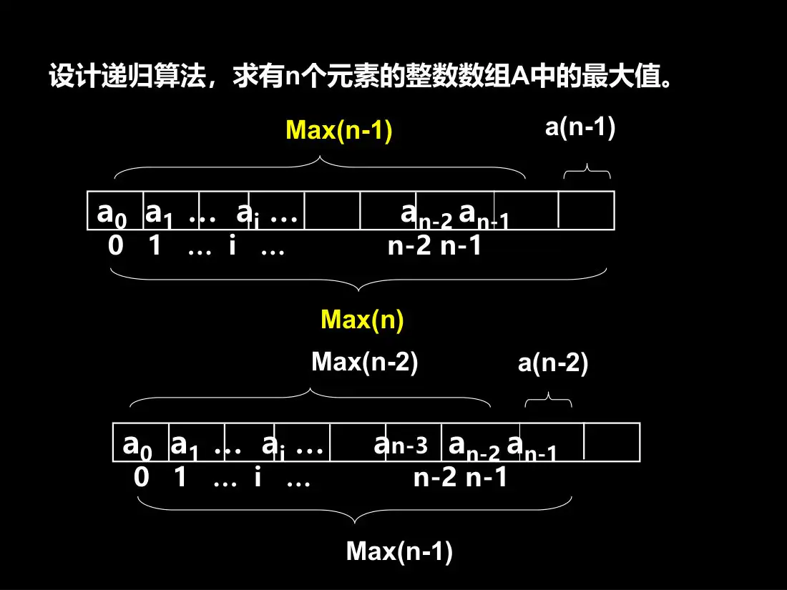

原文：

设计递归算法，求有n个元素的整数数组A中的最大值。

Max(n-1)

a(n-1)

Max(n-2)

a(n-2)

n-2 n-1

Max(n-1)

### 设计递归算法，求整数数组A[n]中的最大值。

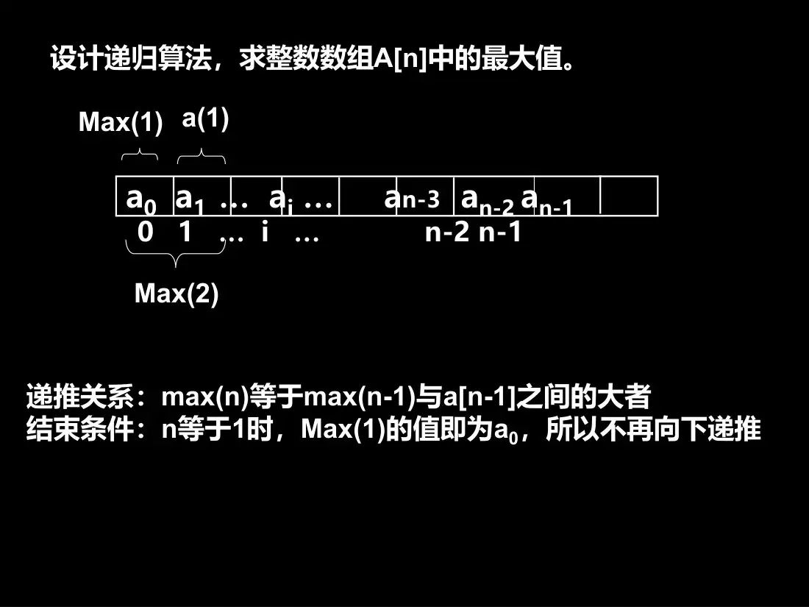

原文：

设计递归算法，求整数数组A[n]中的最大值。

a(1)Max(1)

a0 a1 … ai … an-3 an-2 an-1 0 1 … i n-2 n-1

Max(2)

递推关系：max(n)等于max(n-1)与a[n-1]之间的大者结束条件：n等于1时，Max(1)的值即为a ，所以不再向下递推递推关系：max(n)等于max(n-1)与a[n-1]之间的大者结束条件：n等于1时，Max(1)的值即为a ，所以不再向下递推

### 第 22 页

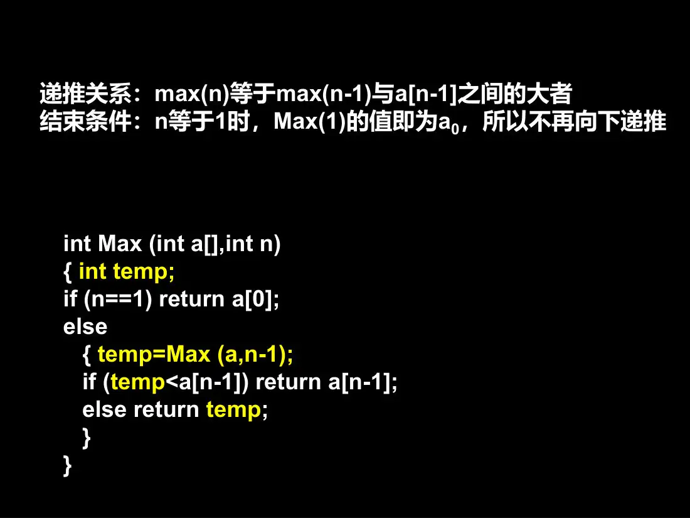

原文：

int Max (int a[],int n){ int temp;if (n==1) return a[0];else

{ temp=Max (a,n-1); if (temp<a[n-1]) return a[n-1]; else return temp;

### 8 9 10 0 1 2 n=1 {if(n==1) return a[0] }

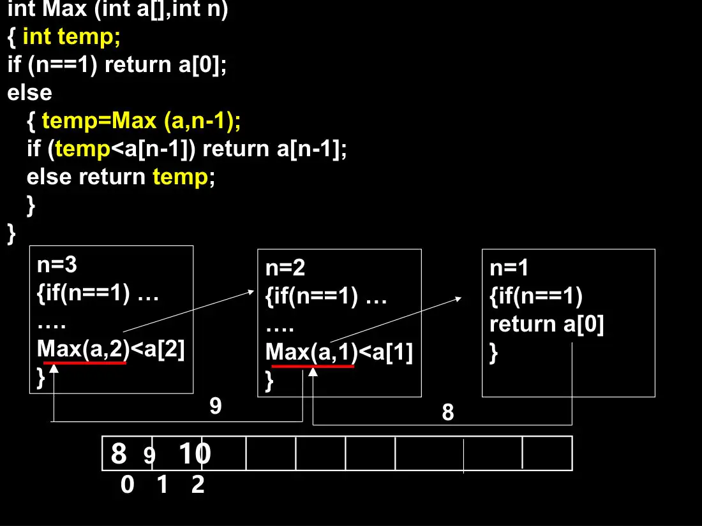

原文：

int Max (int a[],int n){ int temp;if (n==1) return a[0];else

{ temp=Max (a,n-1); if (temp<a[n-1]) return a[n-1]; else return temp;

8 9 10 0 1 2 n=1 {if(n==1) return a[0] }

### 5.2 二叉树

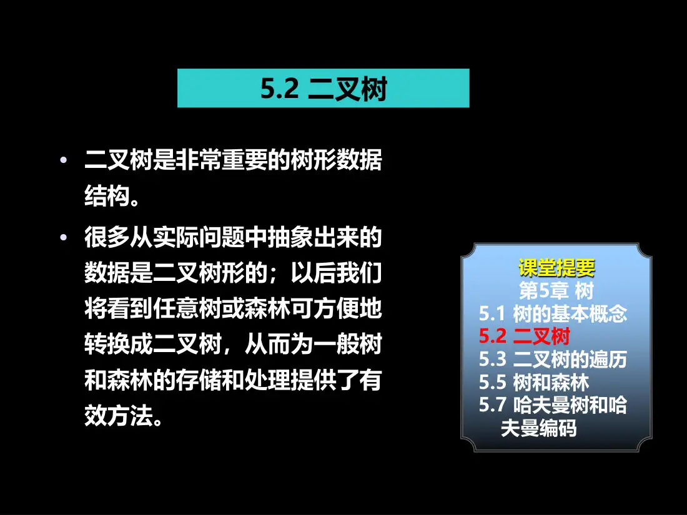

原文：

5.2 二叉树

• 二叉树是非常重要的树形数据结构。

很多从实际问题中抽象出来的数据是二叉树形的；以后我们将看到任意树或森林可方便地转换成二叉树，从而为一般树和森林的存储和处理提供了有效方法。

课堂提要第5章 树

5.1 树的基本概念

5.2 二叉树

5.3 二叉树的遍历

5.5 树和森林

5.7 哈夫曼树和哈夫曼编码

### 先看一个二叉树应用例子。

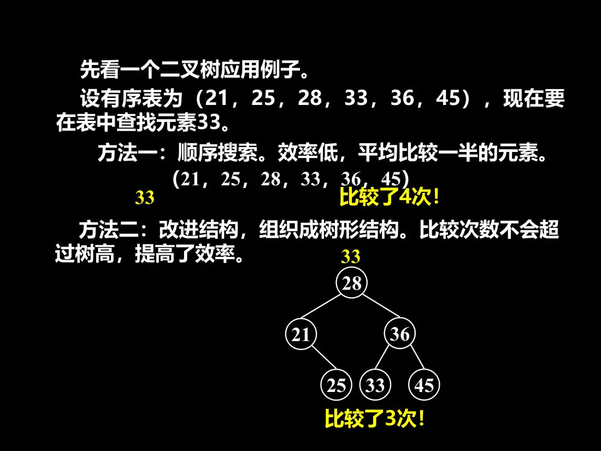

原文：

先看一个二叉树应用例子。

设有序表为（21，25，28，33，36，45），现在要在表中查找元素33。

方法一：顺序搜索。效率低，平均比较一半的元素。（21，25，28，33，36，45）33 比较了4次！

方法二：改进结构，组织成树形结构。比较次数不会超过树高，提高了效率。 33

比较了3次！

### 5.2.1 二叉树的定义

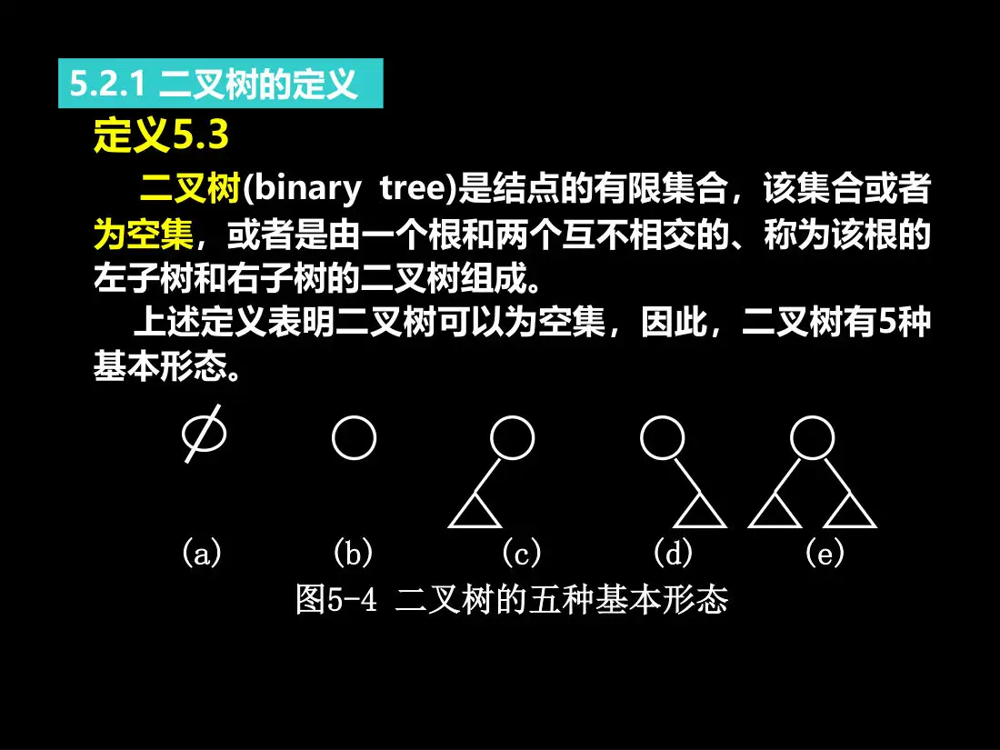

原文：

5.2.1 二叉树的定义

定义5.3

二叉树(binary tree)是结点的有限集合，该集合或者为空集，或者是由一个根和两个互不相交的、称为该根的左子树和右子树的二叉树组成。

上述定义表明二叉树可以为空集，因此，二叉树有5种基本形态。

(a)

(b)

(c)

(d)

图5-4 二叉树的五种基本形态

### 树与二叉树的区别：

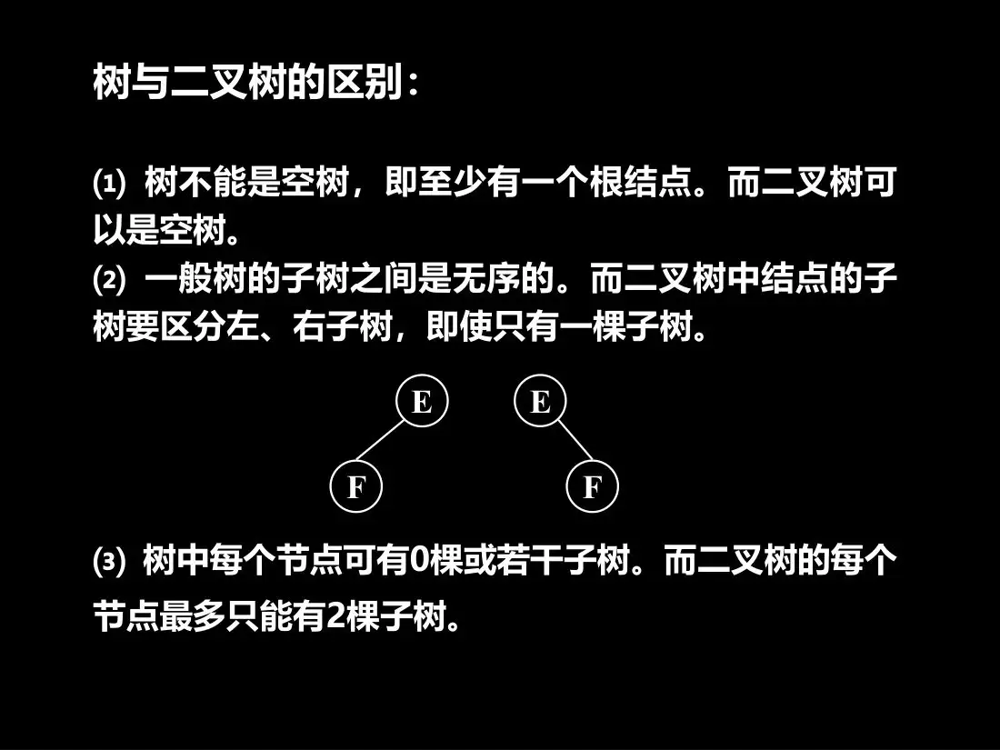

原文：

树与二叉树的区别：

⑴ 树不能是空树，即至少有一个根结点。而二叉树可以是空树。

⑵ 一般树的子树之间是无序的。而二叉树中结点的子树要区分左、右子树，即使只有一棵子树。

⑶ 树中每个节点可有0棵或若干子树。而二叉树的每个节点最多只能有2棵子树。

### 5.2.2 二叉树的性质

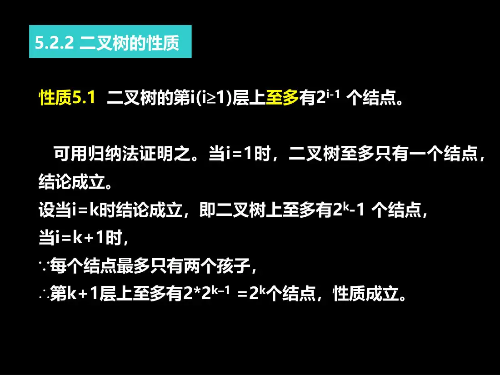

原文：

5.2.2 二叉树的性质

性质5.1 二叉树的第i(i1)层上至多有2i-1 个结点。

可用归纳法证明之。当i=1时，二叉树至多只有一个结点，结论成立。

设当i=k时结论成立，即二叉树上至多有2k-1 个结点，当i=k+1时，

∵每个结点最多只有两个孩子，

∴第k+1层上至多有2\*2k–1 =2k个结点，性质成立。

### 第 29 页

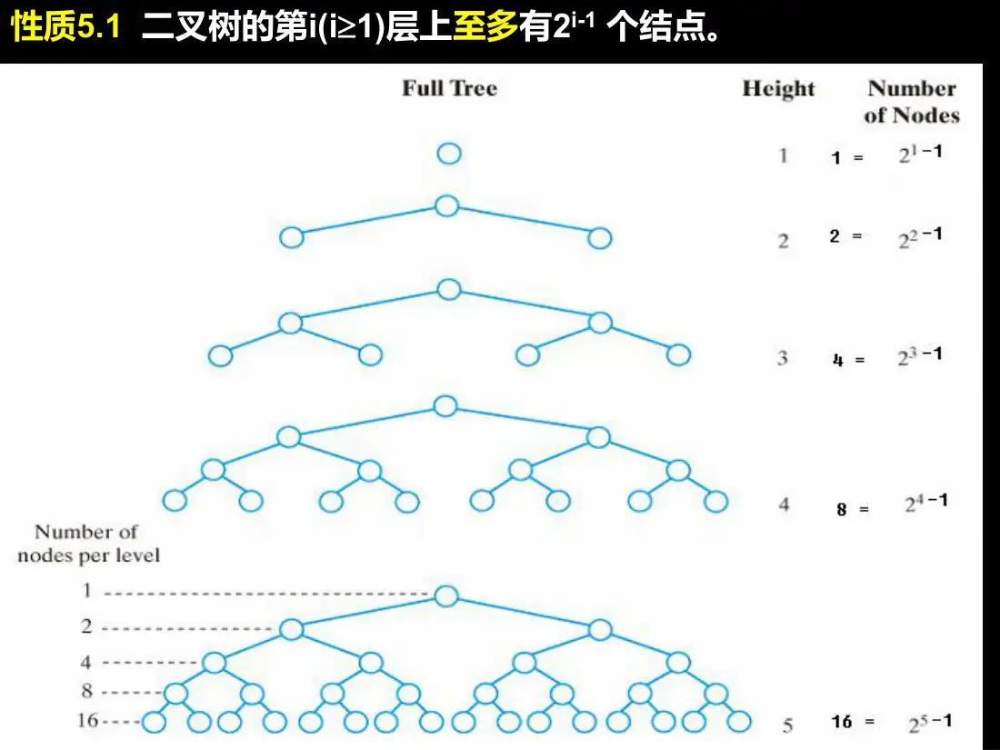

### 性质1二叉树的第i(i≥1)层上至多有2-1个结点。

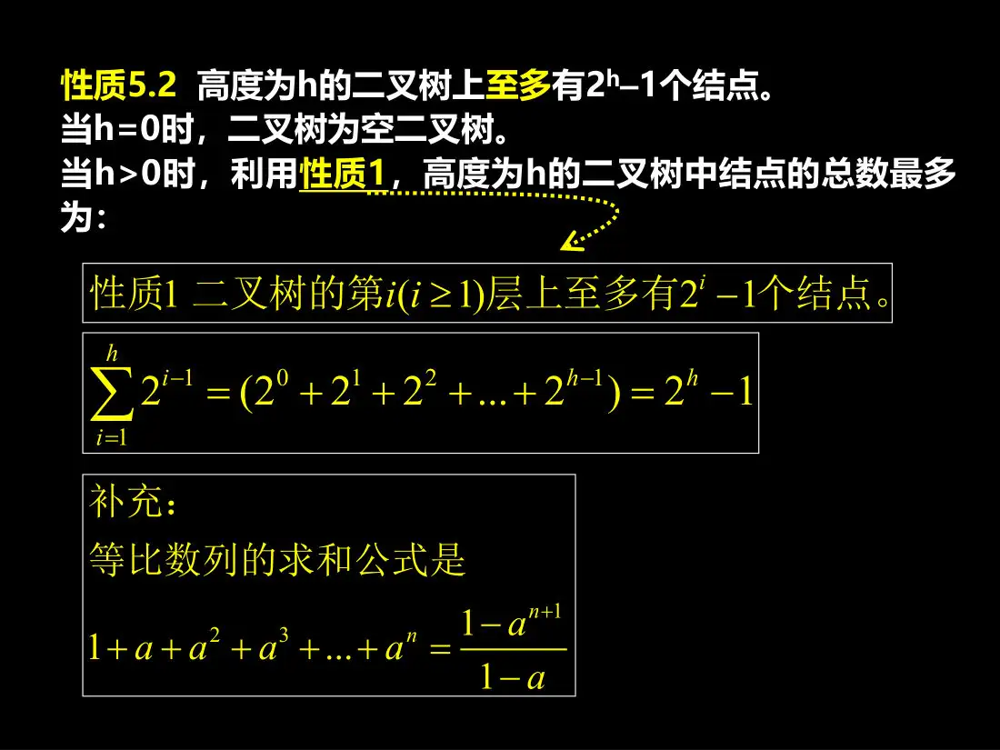

原文：

性质5.2 高度为h的二叉树上至多有2h–1个结点。当h=0时，二叉树为空二叉树。当h>0时，利用性质1，高度为h的二叉树中结点的总数最多为：

性质1二叉树的第i(i≥1)层上至多有2-1个结点。

$$
\sum_ {i = 1} ^ {h} 2 ^ {i - 1} = (2 ^ {0} + 2 ^ {1} + 2 ^ {2} + \dots + 2 ^ {h - 1}) = 2 ^ {h} - 1
$$

补充：

等比数列的求和公式是

$$
1 + a + a ^ {2} + a ^ {3} + \dots + a ^ {n} = \frac {1 - a ^ {n + 1}}{1 - a}
$$

### 性质1、2的图形解释

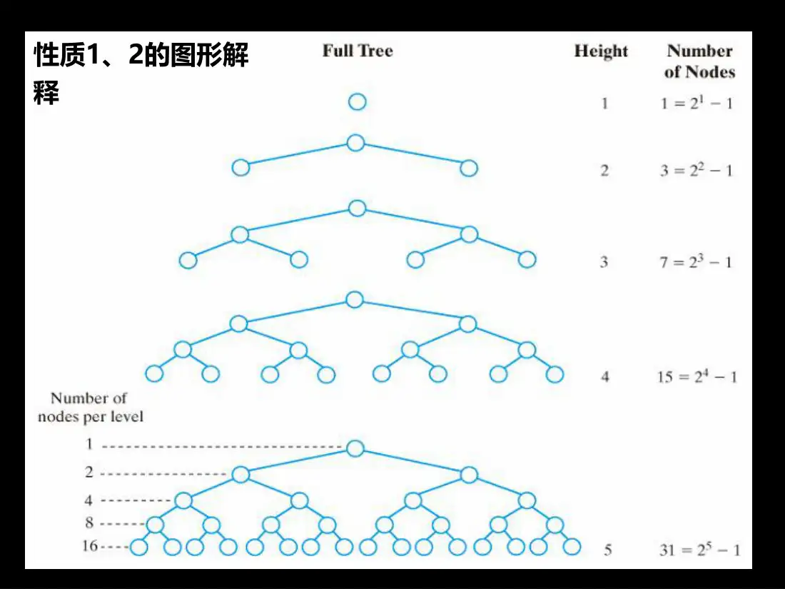

原文：

性质1、2的图形解释

Height

Number of Nodes

$$
1 = 2 ^ {1} - 1
$$

$$
3 = 2 ^ {2} - 1
$$

$$
7 = 2 ^ {3} - 1
$$

Number of nodes per level

$$
1 5 = 2 ^ {4} - 1
$$

$$
3 1 = 2 ^ {5} - 1
$$

Full Tree

### 第 32 页

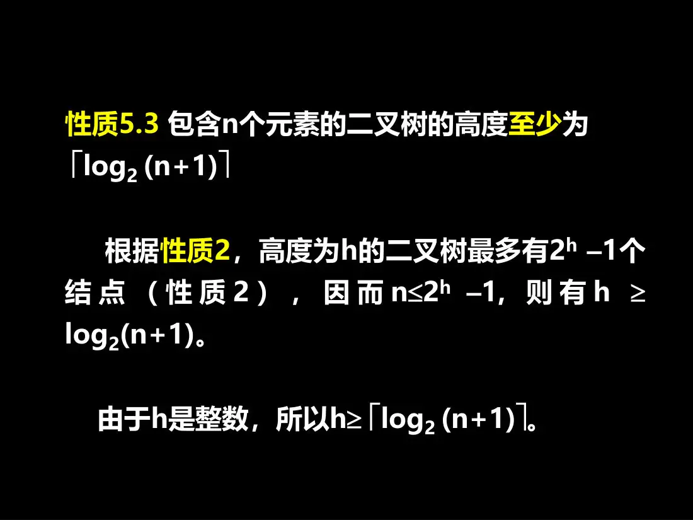

原文：

性质5.3 包含n个元素的二叉树的高度至少为$\mathrm { I m } ^ { \mathrm { ~ ~ } }$

根据性质2，高度为h的二叉树最多有 $[ 2 0 , 7 ] = 5 0$ 结点 （ 性质 2 ） ， 因而 $[ \mathbf { \nabla } ] \times 2 \mathbf { \times } [ \mathbf { \nabla } ]$ 则有 $\blacktriangle$ $\mathrm { l e f s l } ( 0 , 0 ) = \mathrm { l e f s l } ( 0 , 0 )$ 0

由于h是整数，所以 $\operatorname* { l i m } ( \operatorname { o r e } \operatorname { n } ( \operatorname { i r s o n } )$ 。

### （∵二叉树中只有度为0、1、2三种类型的结点）

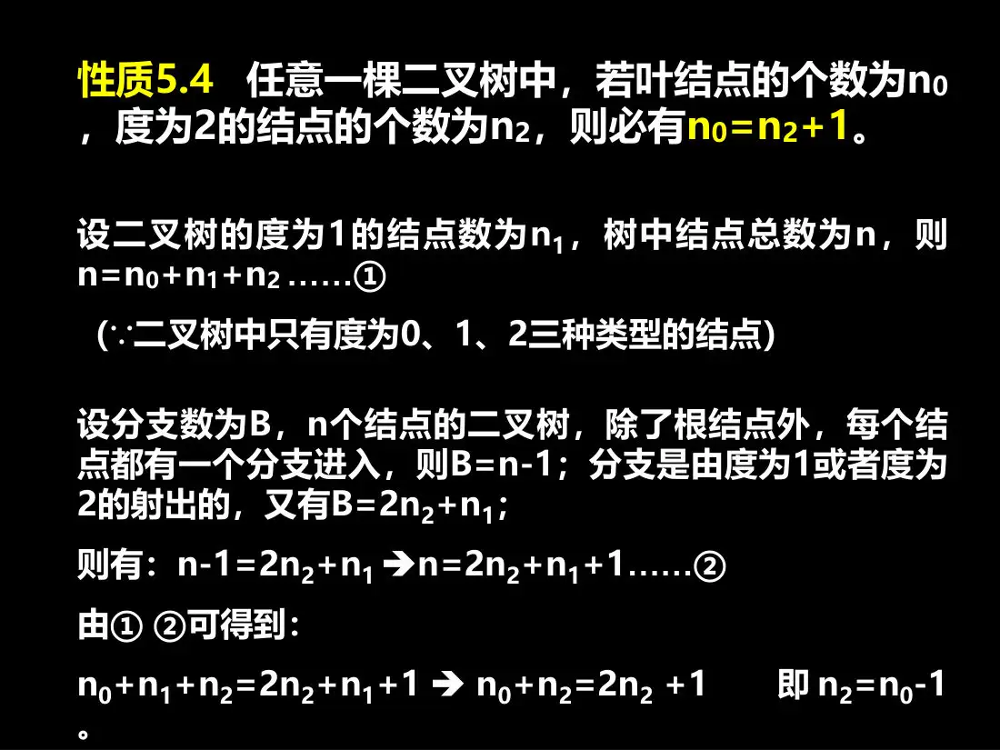

原文：

性质5.4 任意一棵二叉树中，若叶结点的个数为n0度为2的结点的个数为n2，则必有 $[ 1 0 ] [ 0 ] [ 1 0 ] [ 1 0 ]$

设二叉树的度为1的结点数为 $\bf { I I }$ ， 树中结点总数为n，则$\mathbf { \hat { \mu } _ { 1 } } \mathbf { E } | \mathbf { \hat { \mu } _ { 1 } } \mathbf { \hat { \mu } _ { 1 } } \mathbf { \hat { \mu } _ { 1 } } | \mathbf { \hat { \mu } _ { 1 } } \mathbf { E } | \mathbf { \hat { \mu } _ { 1 } } \mathbf { \hat { \mu } _ { 1 } } \mathbf { \hat { \mu } _ { 2 } } \mathbf { \hat { \mu } _ { 1 } } \mathbf { \hat { \mu } _ { 1 } } \mathbf { \hat { \mu } _ { 2 } } \mathbf { \hat { \mu } _ { 2 } }$

（∵二叉树中只有度为0、1、2三种类型的结点）

设分支数为 $B$，二叉树有 $n$ 个结点。除根结点外，每个结点恰有一个分支进入，所以 $B=n-1$；从出边计数，度为 1 的结点各产生一个分支，度为 2 的结点各产生两个分支，所以 $B=2n_2+n_1$。

则有： $1 1 5 1 - 1 1 2 - 1 1 1 - 1 1 1 = 1 1 1 1 - 1 1 1 = 1 1 1 1$

由① ②可得到：

$\mathrm  I I ( 0 ) . I I ( 0 ) . 4 \times 0 . 5 \times I ( 0 ) . 5 \times 0 . 5 \times I ( 0 ) . 5 \times I ( 0 ) . 5 \times I ( 0 ) . 5 \times I ( 0 ) . 5 \times I ( 0 ) . 5 \times I ( 0 ) . 5 \times I ( 0 ) . 5 \times I ( 0 ) . 5 \times I ( 0 ) . 5 \times I ( 0 ) . 5 \times I ( 0 ) . 5 \times I ( 0 ) . 5 \times I ( 0 ) . 5 \times I ( 0 ) . 5 \times I ( 0 ) . 5 \times I ( 0 ) . 5 \times I ( 0 ) . 5 \times I ( 0 ) . 5 \times I ( 0 ) . 5 \times I ( 0 ) . 5 \times I ( 0 ) . 5 \times I ( 0 ) . 5 \times I ( 0 ) . 5 \times I ( 0 ) \times I ( 0 ) . 5 \times I ( 0 ) . 5 \times I ( 0 ) \times I ( 0 ) . 5 \times I ( 0 ) \times I ( 0 ) . 5 \times I ( 0 ) \times I ( 0 ) . 5 \times I ( 0 ) \times I ( 0 ) . 5 \times I ( 0 ) \times I ( 0 ) . 5 \times I ( 0 ) \times I ( 0 ) . 5 \times I ( 0 ) \times I ( 0 ) . 5 \times I ( 0 ) \times I ( 0 ) . 5 \times I ( 0 ) \times I ( 0 ) . 5 \times I ( 0 ) \times I ( 0 ) . 5 \times I ( ) \times I ( 0 ) . 5 \times I ( ) \times I ( 0 ) . 5 \times I ( ) ( 0 ) . 5 \times I ( ) \times I ( 0 ) . \times 0 \times I ( ) \times I ( ) \times ( 0 ) . 0 \times I ( ) . 5 \times I ( ) \times I ( ) ( 0 ) . \times \times I ( 0 ) \times I ( ) \times \times I ( ) \times ( 0 ) . \times \times I ( ) \times \times I ( 0 ) \times I ( ) \times \times I ( \times \times \times I ( ) \times \times \times I ( \times \times )$ 即 $\bf \Pi ^ { \mathrm { m e s f i l e } }$ 定义5.4 高度为h的二叉树恰好有2h –1个结点时称为满二叉树。

### 性质5.2 高度为h的二叉树上至多有2h–1个结点。

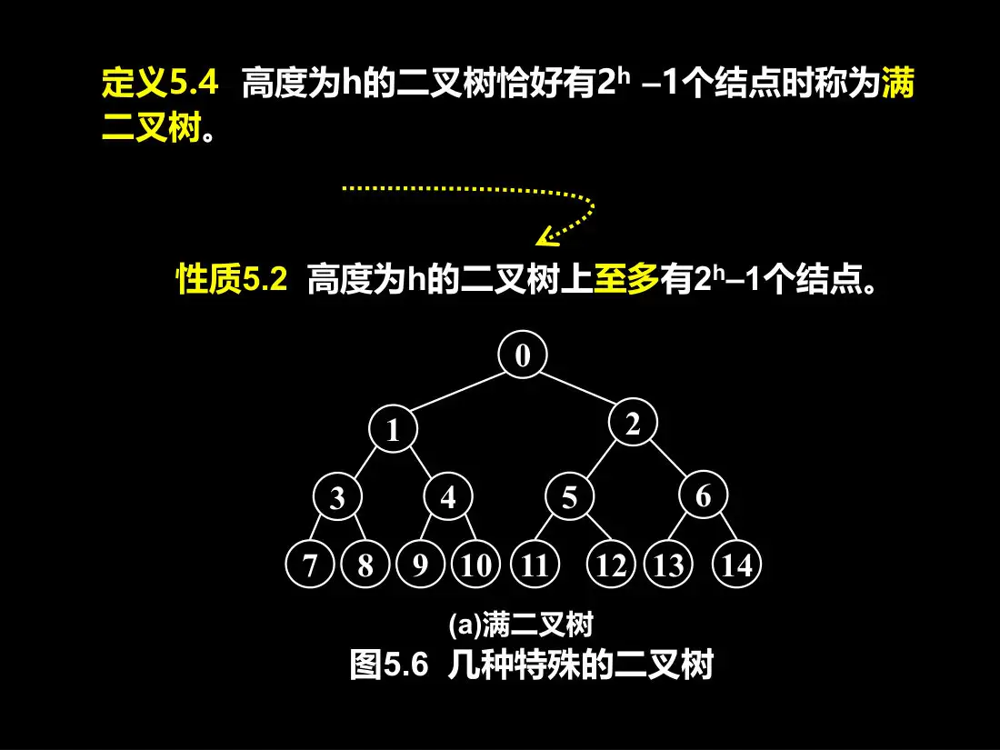

原文：

性质5.2 高度为h的二叉树上至多有2h–1个结点。

(a)满二叉树 图5.6 几种特殊的二叉树

### (b)完全二叉树

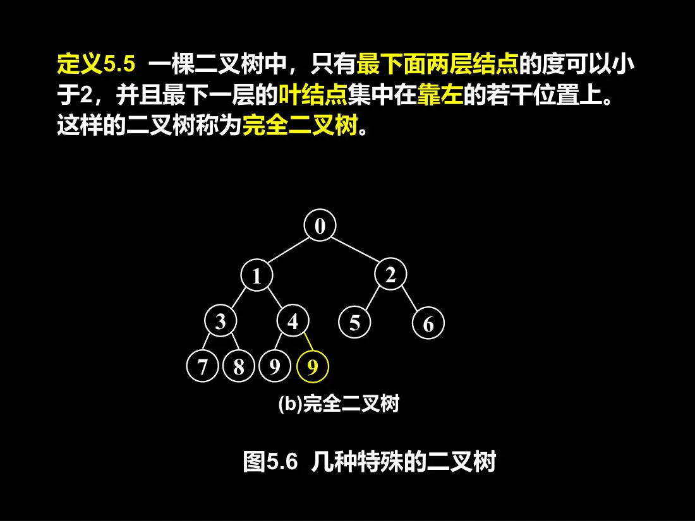

原文：

定义5.5 一棵二叉树中，只有最下面两层结点的度可以小于2，并且最下一层的叶结点集中在靠左的若干位置上。这样的二叉树称为完全二叉树。

(b)完全二叉树

图5.6 几种特殊的二叉树

### 定义5.6 扩充二叉树也称2-树，其中除叶子结点外，其余结点都必须有两个孩子。

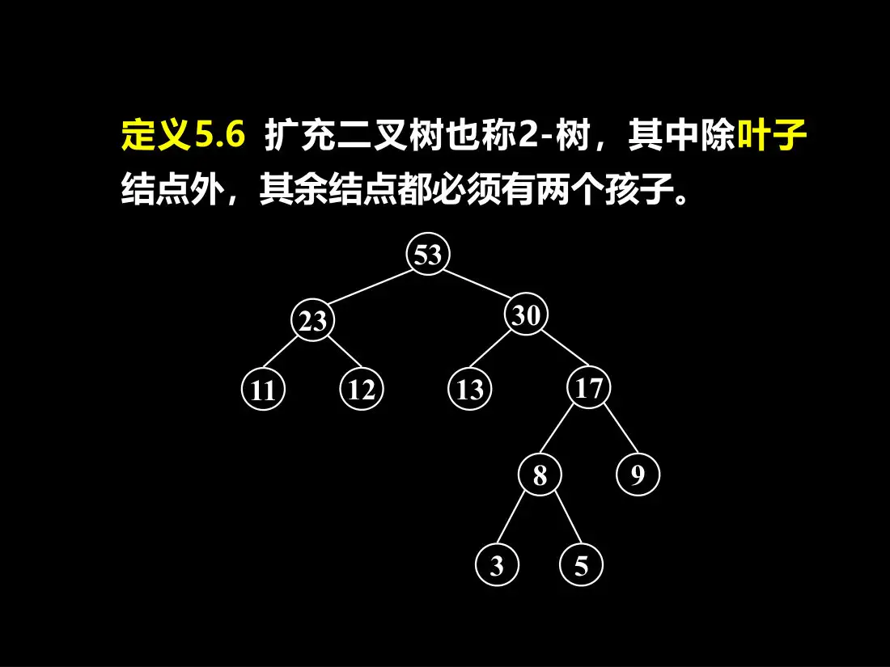

原文：

定义5.6 扩充二叉树也称2-树，其中除叶子结点外，其余结点都必须有两个孩子。

### 完全二叉树的性质

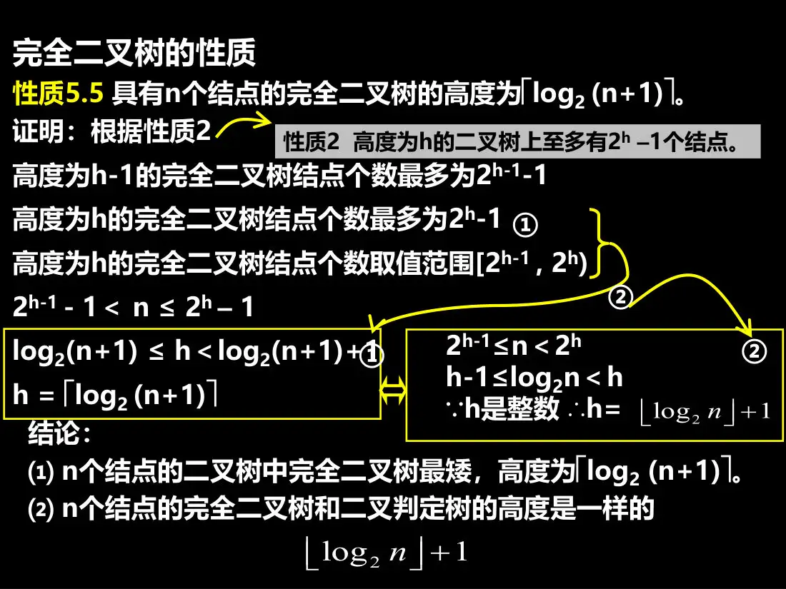

原文：

完全二叉树的性质

性质5.5 具有n个结点的完全二叉树的高度为 $[ \mathbf { o } ] \mathcal { \circ } \mathcal { P } ( \mathbf { 0 } , \mathbf { 0 } ) .$

证明：根据性质2

性质2 高度为h的二叉树上至多有2h –1个结点。

高度为h-1的完全二叉树结点个数最多为2h-1-1

高度为h的完全二叉树结点个数最多为2h-1 ①

高度为h的完全二叉树结点个数取值范围[2h-1, 2h)

$$
2 ^ {h - 1} - 1 <   n \leq 2 ^ {h} - 1
$$

$\mathrm { [ o r e f ( m , 0 ) m ] = [ 1 m o r e f a ( m , 0 ) m a ( 0 ) ] ^ { 2 } }$ $[ [ 1 , 1 ] ] = [ [ \mathrm { r e g e } ] ] ( [ 1 , 5 ] ) ]$

2h-1≤n＜2h ②h-1≤log2n＜h∵h是整数 ∴h=

结论：

(1) n个结点的二叉树中完全二叉树最矮，高度为「Iog₂(n+1)]。⑵ n个结点的完全二叉树和二叉判定树的高度是一样的

log₂ n+1

### （1）当i=0时，该结点为二叉树的根。

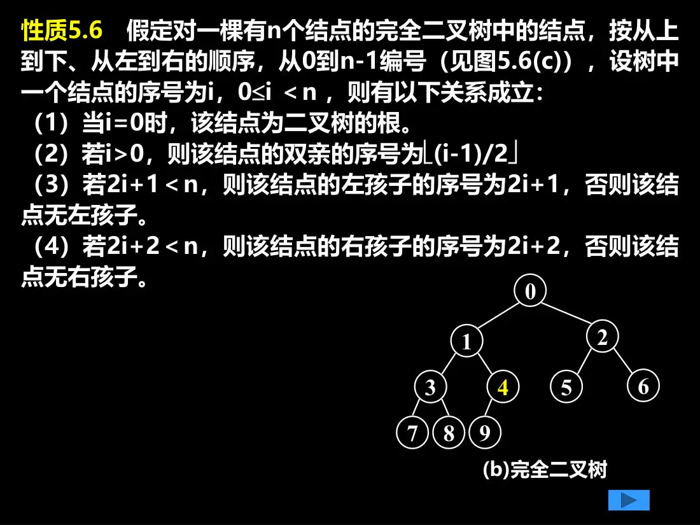

原文：

性质5.6 假定对一棵有n个结点的完全二叉树中的结点，按从上到下、从左到右的顺序，从0到n-1编号（见图5.6(c)），设树中一个结点的序号为i， $[ 0 . 5 ]$ ，则有以下关系成立：

（1）当i=0时，该结点为二叉树的根。

(2) 若i>0，则该结点的双亲的序号为L(i-1)/2」

（3）若2i+1＜n，则该结点的左孩子的序号为2i+1，否则该结点无左孩子。

（4）若2i+2＜n，则该结点的右孩子的序号为2i+2，否则该结点无右孩子。 0

(b)完全二叉树

M

### 5.2.3 二叉树ADT

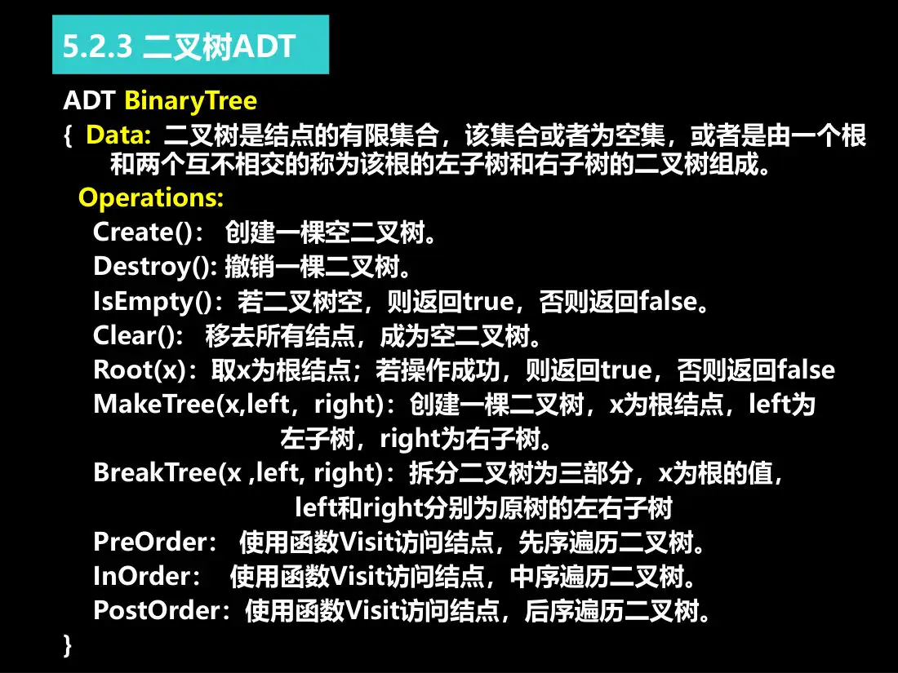

原文：

5.2.3 二叉树ADT

ADT BinaryTree

{ Data: 二叉树是结点的有限集合，该集合或者为空集，或者是由一个根和两个互不相交的称为该根的左子树和右子树的二叉树组成。

Operations:

Create()： 创建一棵空二叉树。

Destroy(): 撤销一棵二叉树。

IsEmpty()：若二叉树空，则返回true，否则返回false。

Clear(): 移去所有结点，成为空二叉树。

Root(x)：取x为根结点；若操作成功，则返回true，否则返回falseMakeTree(x,left，right)：创建一棵二叉树，x为根结点，left为左子树，right为右子树。

BreakTree(x ,left, right)：拆分二叉树为三部分，x为根的值， left和right分别为原树的左右子树

PreOrder： 使用函数Visit访问结点，先序遍历二叉树。

InOrder： 使用函数Visit访问结点，中序遍历二叉树。

PostOrder：使用函数Visit访问结点，后序遍历二叉树。

### 5.2.4 二叉树的存储表示

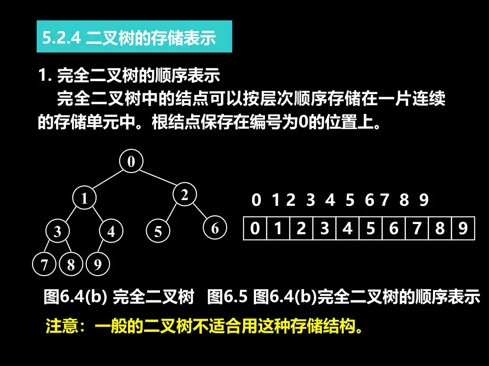

原文：

5.2.4 二叉树的存储表示

1. 完全二叉树的顺序表示完全二叉树中的结点可以按层次顺序存储在一片连续的存储单元中。根结点保存在编号为0的位置上。

0 1 2 3 4 5 6 7 8 9

0 1 2 3 4 5 6 7 8 9

图6.5 图6.4(b)完全二叉树的顺序表示图6.4(b) 完全二叉树注意：一般的二叉树不适合用这种存储结构。

### 2. 二叉树的链接表示

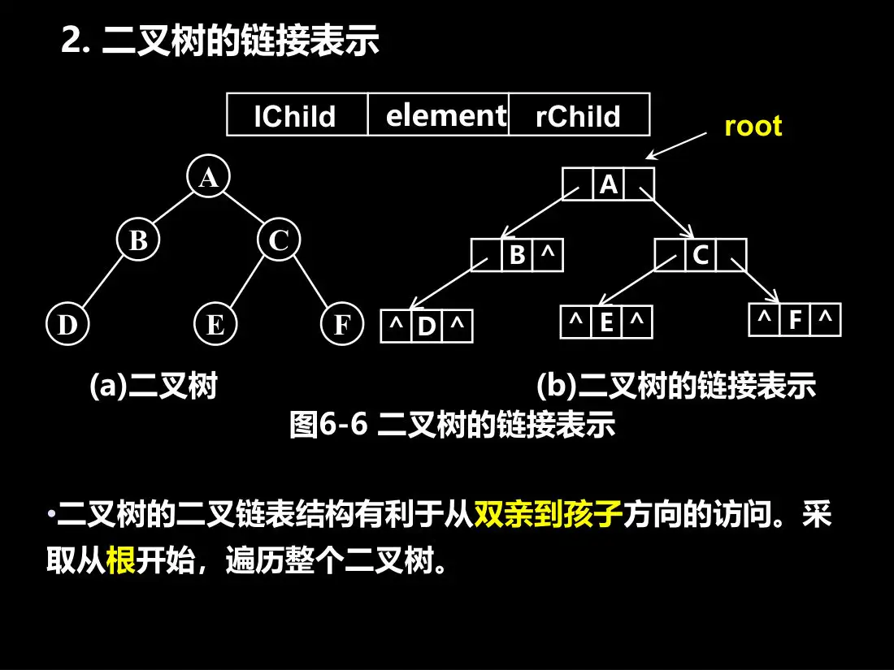

原文：

2. 二叉树的链接表示

lChild element rChild

(a)二叉树

(b)二叉树的链接表示图6-6 二叉树的链接表示

•二叉树的二叉链表结构有利于从双亲到孩子方向的访问。采取从根开始，遍历整个二叉树。

### 第 42 页

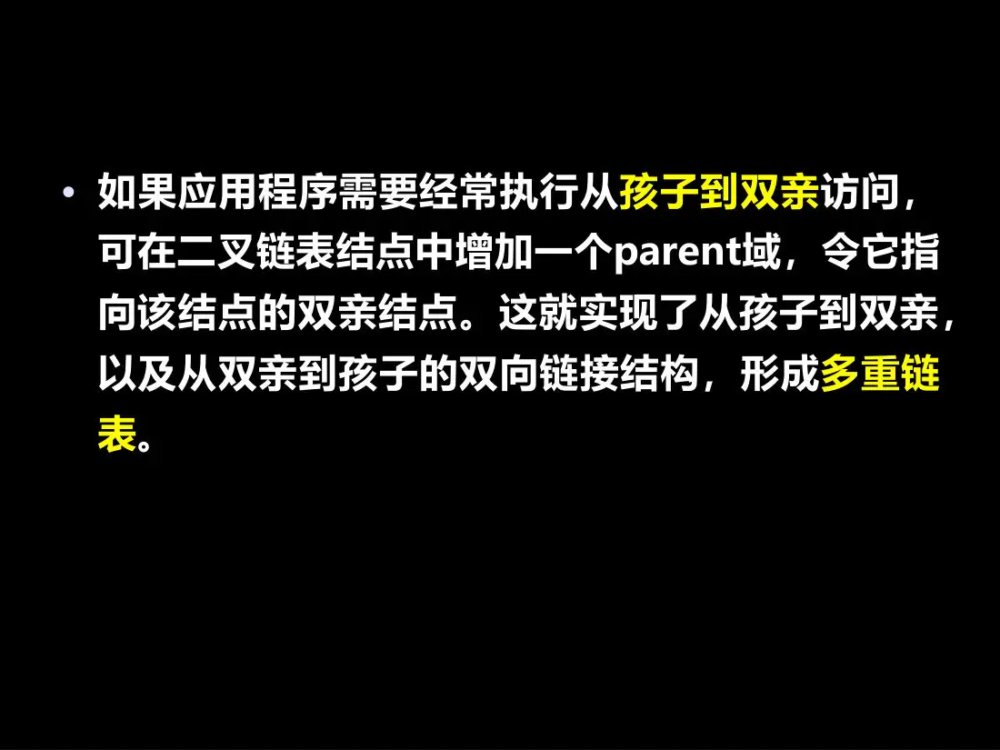

原文：

• 如果应用程序需要经常执行从孩子到双亲访问，可在二叉链表结点中增加一个parent域，令它指向该结点的双亲结点。这就实现了从孩子到双亲，以及从双亲到孩子的双向链接结构，形成多重链表。

### 5.2.5 二叉树类

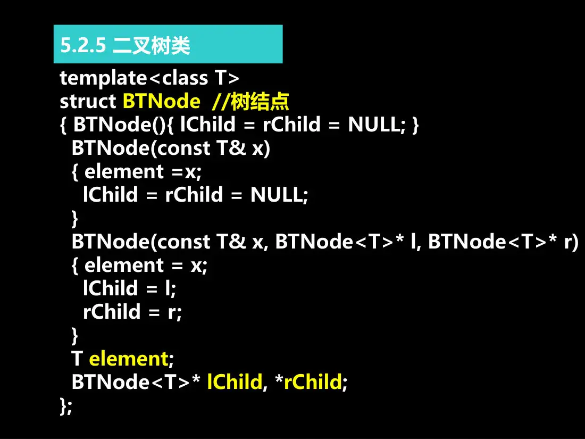

原文：

5.2.5 二叉树类

template<class T> struct BTNode //树结点 { BTNode(){ lChild = rChild = NULL; } BTNode(const T& x) { element =x; lChild = rChild = NULL;

BTNode(const T& x, BTNode<T>\* l, BTNode<T>\* r) { element = x; lChild = l; rChild = r;

T element; BTNode<T>\* lChild, \*rChild;

};

### 程序5.2 二叉树类

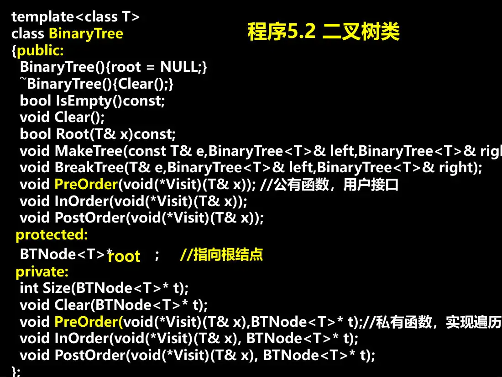

原文：

程序5.2 二叉树类

BTNode<T>\* ;root //指向根结点

int Size(BTNode<T>\* t);

void Clear(BTNode<T>\* t);

void PreOrder(void(\*Visit)(T& x),BTNode<T>\* t);//私有函数，实现遍历

void InOrder(void(\*Visit)(T& x), BTNode<T>\* t);

void PostOrder(void(\*Visit)(T& x), BTNode<T>\* t);

### 5.2.6 实现二叉树基本运算

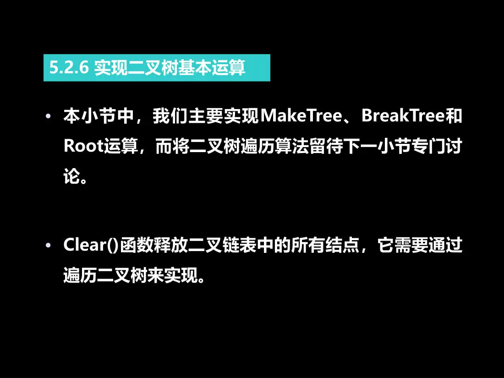

原文：

5.2.6 实现二叉树基本运算

本小节中，我们主要实现MakeTree、BreakTree和Root运算，而将二叉树遍历算法留待下一小节专门讨论。

• Clear()函数释放二叉链表中的所有结点，它需要通过遍历二叉树来实现。

### 程序5.3 部分二叉树运算

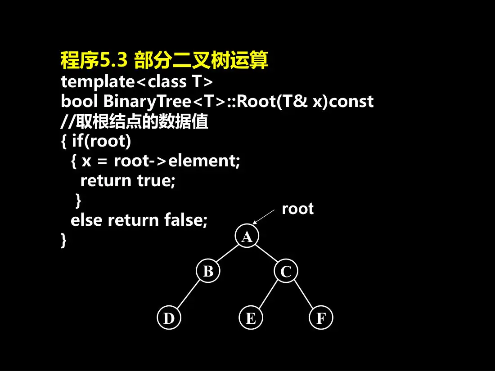

原文：

程序5.3 部分二叉树运算

template<class T> bool BinaryTree<T>::Root(T& x)const //取根结点的数据值

{ if(root) { x = root->element; return true;

else return false;

### D left

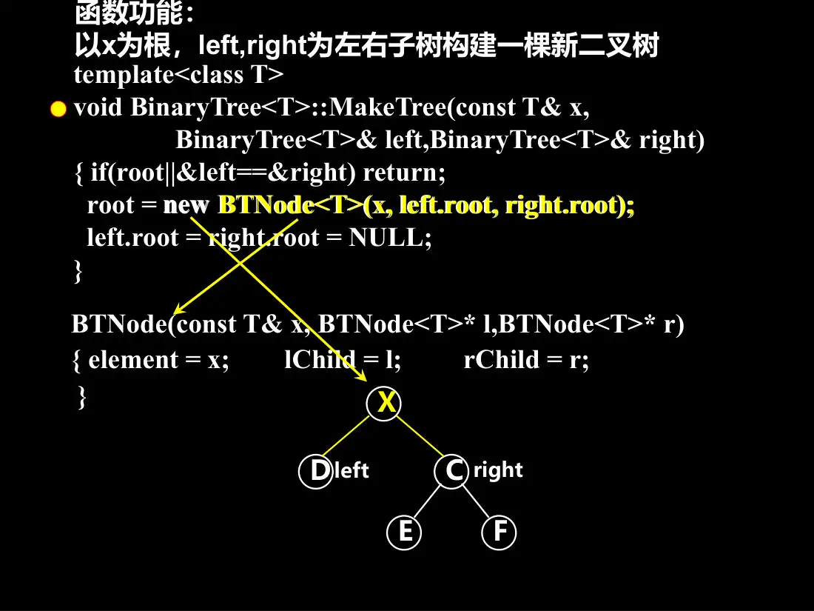

原文：

函数功能： 以x为根，left,right为左右子树构建一棵新二叉树 template<class T>

void BinaryTree<T>::MakeTree(const T& x, BinaryTree<T>& left,BinaryTree<T>& right) { if(root||&left==&right) return; root = new BTNode<T>(x, left.root, right.root);new BTNode<T>(x, left.root, right.root); left.root = right.root = NULL;

BTNode(const T& x, BTNode<T>\* l,BTNode<T>\* r) { element = x; lChild = l; rChild = r;

D left

C right

### 函数功能：将二叉树左右子树拆分成二棵新的二叉树，根结点删除template

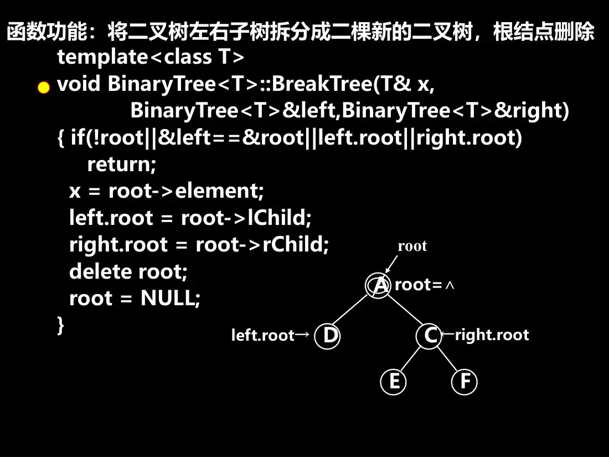

原文：

函数功能：将二叉树左右子树拆分成二棵新的二叉树，根结点删除template<class T>

void BinaryTree<T>::BreakTree(T& x, BinaryTree<T>&left,BinaryTree<T>&right) { if(!root||&left==&root||left.root||right.root) return;

x = root->element; left.root = root->lChild; right.root = root->rChild; delete root; root = NULL;

D left.root→

A root=∧

C←right.root

E F

### 程序5.4 main函数— 个测试程序

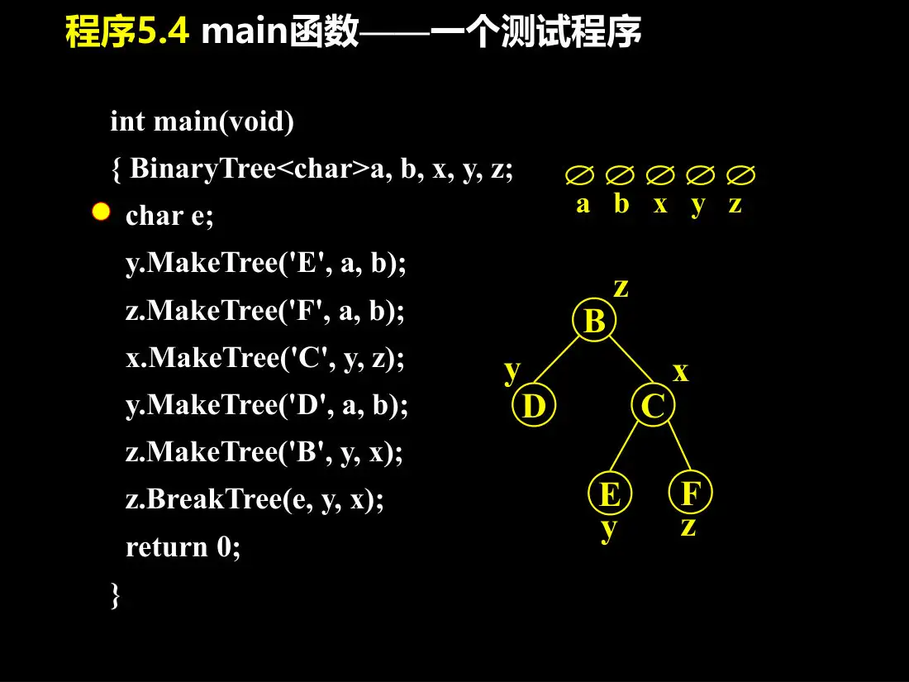

原文：

程序5.4 main函数— 个测试程序

int main(void)

{ BinaryTree<char>a, b, x, y, z;

char e;

y.MakeTree('E', a, b); z.MakeTree('F', a, b); x.MakeTree('C', y, z); y.MakeTree('D', a, b); z.MakeTree('B', y, x); z.BreakTree(e, y, x); return 0;

Q Q Q Q a b x y z

### 5.3 二叉树的遍历

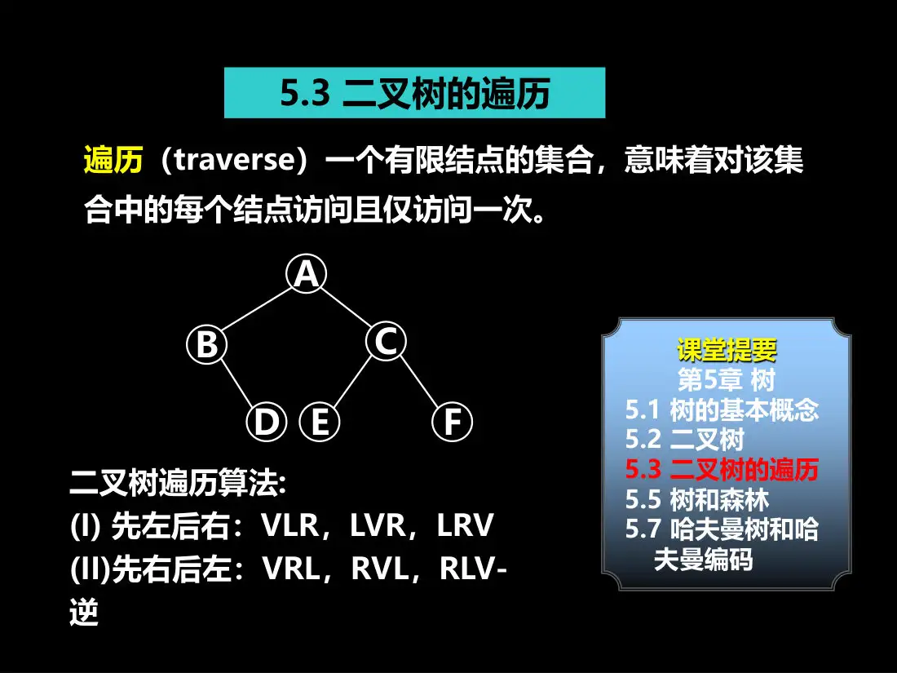

原文：

5.3 二叉树的遍历

遍历（traverse）一个有限结点的集合，意味着对该集合中的每个结点访问且仅访问一次。

二叉树遍历算法:

(I) 先左后右：VLR，LVR，LRV

(II)先右后左：VRL，RVL，RLV-逆

课堂提要第5章 树

5.1 树的基本概念

5.2 二叉树

5.3 二叉树的遍历

5.5 树和森林

5.7 哈夫曼树和哈夫曼编码

### 5.3.1 二叉树遍历算法

原文：

5.3.1 二叉树遍历算法

⑴ 先序遍历（VLR）若二叉树为空，则空操作；

否则

访问根结点；

先序遍历左子树；

先序遍历右子树。

先序遍历序列： A B D C E F若二叉树为空，则空操作；否则

### 任意一个先序遍历序列中，根结点的位置在哪里？

原文：

访问根结点； 先序遍历序列： A B D G H E C F先序遍历左子树；先序遍历右子树。

任意一个先序遍历序列中，根结点的位置在哪里？

### ⑵ 中序遍历（LVR）若二叉树为空，则空操作；

原文：

⑵ 中序遍历（LVR）若二叉树为空，则空操作；

否则中序遍历左子树；访问根结点；中序遍历右子树。

中序遍历序列：B D A E C F

### 中序遍历

原文：

中序遍历

### 后序遍历序列：D B E F C A

原文：

⑶ 后序遍历 （LRV）若二叉树为空，则空操作；否则后序遍历左子树；后序遍历右子树；访问根结点。

后序遍历序列：D B E F C A

### 后序遍历

原文：

后序遍历

### 层次遍历

原文：

层次遍历

### 5.3.2 二叉树遍历的递归算法

原文：

5.3.2 二叉树遍历的递归算法

对于遍历运算，设计了一个面向用户的公有成员函数和一个具体实现遍历操作的递归私有成员函数，两者共同完成遍历运算的功能。

公有成员函数：非递归函数，作为与用户的接

口。它调用私有的递归函数。

私有成员函数：递归函数，具体实现遍历操作。

被公有成员函数调用。

### 指向函数的指针保存一个函数的入口地址。

原文：

指向函数的指针保存一个函数的入口地址。

函数指针格式：函数返回类型 (\*函数指针名)(参数1，参数2…)

include <iostream.h> int max(int x,int y){return x > y ? x : y;} int min(int x,int y){return x < y ? x : y;} int add(int x,int y){return x + y;}

void process(int x,int y, int (\*fun) (int,int)){ int result;

result = fun(x,y); cout << result << endl;

int main(void){ int x=1,y=2; process(1,2,min); process(1,2,max); process(1,2,add); return 0;

函数返回类型 (\*函数指针名)(参数1, 参数2)

int (\*fun)(int, int)程序运行结果：

### 注：1.函数名相同，但参数不同，不是同一个函数。

原文：

程序5.5 访问元素函数template<class T>void Visit(T& x) { cout << x << "\t";}程序5.6 先序遍历template<class T>void BinaryTree<T>::PreOrder(void(\*Visit)(T& x))//非递归函数，作为与用户的接口，调用递归函数{ PreOrder(Visit,root);}

template<class T> void BinaryTree<T>::PreOrder(void(\*Visit)(T& x), BTNode<T>\* t) { if(t) //递归函数，实现遍历 { Visit(t->element); PreOrder(Visit, t->lChild); PreOrder(Visit, t->rChild);

注：1.函数名相同，但参数不同，不是同一个函数。

### 除去函数指针，以上递归的PreOrder函数可以简化为：

原文：

template<class T> void BinaryTree<T>::PreOrder(void(\*Visit)(T& x), BTNode<T>\*

{ if(t) //递归函数，实现遍历 { Visit(t->element); PreOrder(Visit, t->lChild); PreOrder(Visit, t->rChild);

除去函数指针，以上递归的PreOrder函数可以简化为：

template<class T> void BinaryTree<T>::PreOrder( BTNode<T>\* t) { if(t) { cout<<t->element ; PreOrder( t->lChild); PreOrder( t->rChild);

### 第 62 页

原文：

{if(t) {cout<<c PreOrder( t->lChild); PreOrder( t->rChild); } }

t->E {if(t) {cout<<E PreOrder( t->lChild); PreOrder( t->rChild); } }

t->F {if(t) {cout<<F PreOrder( t->lChild); PreOrder( t->rChild); } }

{if(t) {cout… PreOrder( t->lChild); PreOrder( t->rChild); } }

{if(t) {cout… PreOrder( t->lChild); PreOrder( t->rChild); } }

t->^ {if(t) {cout… PreOrder( t->lChild); PreOrder( t->rChild); } }

### 第 63 页

原文：

template<class T> void BinaryTree<T>::InOrder(void(\*Visit)(T& x)) { InOrder(Visit,root);

template<class T> void BinaryTree<T>::InOrder(void(\*Visit)(T& x), BTNode<T>\*

{ InOrder(Visit, t->lChild); Visit(t->element); InOrder(Visit, t->rChild);

### 第 64 页

原文：

补充：后序遍历 template<class T> void BinaryTree<T>::PostOrder(void(\*Visit)(T& x)) { PostOrder(Visit,root);

template<class T> void BinaryTree<T>::PostOrder(void(\*Visit)(T& x), BTNode<T>

{ PostOrder(Visit, t->lChild); PostOrder(Visit, t->rChild); Visit(t->element);

### 第 65 页

原文：

显然，二叉树遍历算法基本操作是访问结点，不论按何种次序遍历，对含有n个结点的二叉树，其时间复杂度均为O(n)。

### 关于三种遍历算法：

原文：

关于三种遍历算法：

1.给定一棵二叉树，能写出它的三种遍历序列。

2.给出二叉树的先序遍历序列和中序遍历序列可以唯一确定一棵二叉树。

3.给出二叉树的后序遍历序列和中序遍历序列可以唯一确定一棵二叉树。

4.当n>1时，给出二叉树的先序遍历序列和后序遍历序列不可以唯确定一棵二叉树。

例如：先序序列：AB，后序序列：BA注意n>1的条件！

例如：先序序列：A，后序序列：A

### (b)

原文：

(b)

• 例 已知结点的先序序列和中序序列分别为：– 前序序列 A B C D E F G– 中序序列 C B E D A F G

则可按上述分解求得整棵二叉树。其构造过程如下图所示。首先由前序序列得知二叉树的根为A，则其左子树的中序序列为（CBED），又右子树的中序序列为（FG）。反过来得知其左子树的前序序列必为（BCDE），右子树的前序序列为（FG）。类似地，可由左子树的前序序列和中序序列构造A的左子树，由右子树的前序序列和中序序列构造得A的右子树。

由前序和中序序列构造一棵二叉树的过程

### 5.3.3 二叉树遍历的应用实例

原文：

5.3.3 二叉树遍历的应用实例

利用二叉树遍历思想可以解决许多二叉树的应用问题。

1.计算二叉树的结点数 程序5.7 求二叉树的结点数 template<class T> int BinaryTree<T>::Size() { return Size(root);

template<class T> int BinaryTree<T>::Size(BTNode<T>\* t) { if(!t) return 0; return Size(t->lChild) + Size(t->rChild) + 1;

### return q;

原文：

BTNode<T>\* BinaryTree<T>::Copy(BTNode<T>\* t) { if(!root) return NULL; BTNode<T>\* q = new BTNode<T>(t->element); q->lChild = Copy(t->lChild); q->rChild = Copy(t->rChild);

return q;

### 3. 补充：Clear函数

原文：

3. 补充：Clear函数

template<class T> void BinaryTree<T>::Clear(BTNode<T>\* t) { if(t)

{ Clear(t->lChild); Clear(t->rChild); cout <<"delete"<<t->element<<"..."<<endl; delete t;

### 二叉树在很多领域都有着广泛的应用

原文：

二叉树在很多领域都有着广泛的应用

编译原理中的表达式树

专家系统中的决策树

猜谜游戏的决策树

### 编译原理中的表达式树

原文：

编译原理中的表达式树

(a) a/b

(b) a\*b+c

(c) a\*(b+c)

先序遍历→前缀表达式中序遍历→中缀表达式后序遍历→后缀表达式编译原理中还用了语法树(d) a\*(b+c\*d)/e

### • 5.4 二叉树遍历的非递归算法

原文：

• 5.4 二叉树遍历的非递归算法

### 5.5 树和森林

原文：

5.5 树和森林

前两几节中，我们已介绍了树和森林的定义和概念，并对二叉树作了详细介绍，现在再回过头来讨论森林和二叉树的转换、树或森林的存储表示及其遍历算法。

课堂提要第5章 树

5.1 树的基本概念

5.2 二叉树

5.3 二叉树的遍历

5.5 树和森林

5.7 哈夫曼树和哈夫曼编码

### 5.5.1 森林与二叉树的转换

原文：

5.5.1 森林与二叉树的转换

为什么要将森林转换为二叉树如果树和森林能够用二叉树表示，则前面对二叉树的讨论成果可应用于一般树和森林。注意：树和二叉树的区别—二叉树有左右孩子之分，而树没有左右孩子之分。

### (1)若F为空，则B为空二叉树

原文：

2. 森林(Forest)转换成二叉树(BTree)可以将任何森林唯一地表示成一棵二叉树。方法如下：

(1)若F为空，则B为空二叉树

(2)若F非空，则B的根是F中第一棵子树T1的根 $\Re$ B的左子树是 $\Re$ 的子树森林 $( 1 1 5 , 1 1 , 1 1 , 1 1 , 1 1 , 1 1 , 1 1 , 1 1 , 1 1 , 1 1 , 1 )$ ，B的右子树是森林 $( 4 4 - 1 9 ) \div ( 1 0 - 1 ) = 0$ 所对应的二叉树

最后所形成的二叉树就是森林所对应的二叉树。

### 5.5.1 森林与二叉树的转换

原文：

5.5.1 森林与二叉树的转换

1. 树(Tree)转换为二叉树(BTree)算法树可以唯一地表示成一棵二叉树：

⑴ 兄弟手拉手----将树中的兄弟用线连接；

⑵ 断绝非长子之间的父子关系----对各结点，保留最左孩子的连线，去掉其余孩子的连线；

⑶ 最后抖一抖----调整为习惯的二叉树形(水平右斜，垂直左斜)。

(a)树

(b) 对应的二叉树

### 再看 例

原文：

再看 例

⑴ 兄弟手拉手⑵ 断绝非长子之间的父子关系⑶ 最后抖一抖

C K C==

左孩子右兄弟

树转换为二叉树

### 注意：

原文：

注意：

⑴ 左孩子右兄弟。(树→二叉树)二叉树中有两个结点X和Y，且X是Y的双亲

二叉树中

树中

Y是X左孩子

Y是X孩子

Y是X右孩子

Y是X兄弟

⑵ 树的根结点没有兄弟，所以树对应的二叉树根结点没有右子树

### 5.5.1 森林与二叉树的转换

原文：

5.5.1 森林与二叉树的转换

森林转换成二叉树的具体做法：

1.将森林中各树的根用线连起来，

2.在树中，凡是兄弟用线连起来--兄弟手拉手；

3.去掉从双亲到除了第一个孩子以外的孩子的连线，只保留双亲到第一个孩子的连线--断绝非长子之间的父子关系；

4.使之稍微倾斜成习惯的二叉树形--最后抖一抖。

其实，这里讨论的森林是指有序森林，也可将一般的森林视为有序森林来对待。

### 森林转换为二叉树

原文：

森林转换为二叉树

### 3. 二叉树转换成森林(B→F)

原文：

3. 二叉树转换成森林(B→F)

左孩子右兄弟

左孩子仍是孩子，右孩子变为兄弟

### 棵二叉树B转换成的森林中有多少棵树？

原文：

棵二叉树B转换成的森林中有多少棵树？

经过3个结点， 故森林中3棵树

一棵二叉树转化成的森林中所具有的树的数目，等于二叉树从根结点开始沿右链到第一个没有右孩子的结点所经过的结点数目。

### 第 84 页

原文：

A B E C F G D H I 1 J A E G B C D F H I J

### 5.5.2 树和森林的存储表示

原文：

5.5.2 树和森林的存储表示

1. 多重链表表示法

element child1 child2 …… child

其中m是树的度。每个结点的指针域个数均为m，故又称为等长的多重链表。优点：处理简单。缺点：空指针域多，有浪费。设树中有n个结点，总共有 $\pi = 0$ 个指针域，其中，只有n-1个非空指针域，故空指针域个数为：$\mathrm { I I a m ( a 5 0 ) } \mathrm { = } \mathrm { I I ( m 5 0 ) } \mathrm { = } \mathrm { I }$

### 2. 孩子兄弟表示法

原文：

2. 孩子兄弟表示法

孩子兄弟(左子/右兄弟)表示法实质上就是树所对应的二叉树的二叉链表表示法。其每个结点为：

leftChild element rightSibling

D D D ∧ E F G E E H F ∧ H ∧ F H J J G ∧ J ∧ ∧ G ∧

### 3. 双亲表示法

原文：

3. 双亲表示法

每个结点有两个域：element和parent。parent域为指向该结点的双亲结点的下标。

可以对树中结点按自上而下、自左向右(按层次)的次序顺序存储起来。 element parent

双亲表示法顺序存储的双亲表示法

思考：如何查找结点的双亲和孩子？

### 4. 三重链表表示法

原文：

4. 三重链表表示法

leftChild element rightSibling parent

D D ∧ ∧ E F G E ∧ H ∧ F H J ∧ J ∧ 1 ∧ G ∧

优点：可以很方便地得到节点的双亲和孩子信息。

### 5. 带右链的先序表示法

原文：

5. 带右链的先序表示法

数据元素有三个数据项，element, lTag,sibling。

1.sibling 指向结点的兄弟

2.lTag为0表示有孩子，孩子存于相邻单元lTag为1表示无孩子

3.数据元素按对应二叉树的先序遍历的顺序存储结点。

### 数据元素有三个数据项，element,Itag,sibling。

原文：

数据元素有三个数据项，element,Itag,sibling。

sibling 指向结点的兄弟 Itag=0有孩子，孩子存于相邻单元Itag=1无孩子数据元素按对应二叉树的先序遍历的顺序存储结点。

<table><tr><td>sibling</td><td>4</td><td>2</td><td>-1</td><td>-1</td><td>-1</td><td>7</td><td>-1</td><td>9</td><td>-1</td><td>-1</td></tr><tr><td>element</td><td>A</td><td>B</td><td>C</td><td>K</td><td>D</td><td>E</td><td>H</td><td>F</td><td>J</td><td>G</td></tr><tr><td>ltag</td><td>0</td><td>1</td><td>0</td><td>1</td><td>0</td><td>0</td><td>1</td><td>0</td><td>1</td><td>1</td></tr><tr><td></td><td>0</td><td>1</td><td>2</td><td>3</td><td>4</td><td>5</td><td>6</td><td>7</td><td>8</td><td>9</td></tr></table>

### 5.5.3 树和森林的遍历

原文：

5.5.3 树和森林的遍历

对森林的深度遍历与二叉树类似，根据树的递归定义，可以有两种遍历次序：先序遍历和中序遍历。

<table><tr><td>森林(F)</td><td>对应</td><td>二叉树(B)</td></tr><tr><td>先序遍历</td><td>等价于</td><td>先序遍历</td></tr><tr><td>中序遍历</td><td>等价于</td><td>中序遍历</td></tr></table>

### 第 92 页

原文：

⑴先序遍历若森林为空，则遍历结束。否则a) 访问第一棵树的根；b) 按先序遍历第一棵树的根结点的子树组成的森林；c) 按先序遍历其余树组成的森林。

对上图（a)的森林的先序遍历的结果是：A B C K D E H F J G它等同于对(b)的二叉树的先序遍历。

### ⑵中序遍历 若森林为空，则遍历结束否则

原文：

⑵中序遍历 若森林为空，则遍历结束否则

a) 按中序遍历第一棵树的根结点的子树组成的森林；

b) 访问第一棵树的根；

c) 按中序遍历其余树组成的森林。

### 2．按宽度方向遍历

原文：

2．按宽度方向遍历

首先访问处于第层的结点，然后访问处于第二层的结点，再访问第三层，等，最后访问最下层的结点。

对上图的森林按宽度方向的遍历结果是：A D B C E F G K H J

### 5.6 堆和优先权队列

原文：

5.6 堆和优先权队列

堆是一种很有用的数据结构，它可以用于高效地实现优先权队列。

优先权队列中的元素，按其优先级的高低而不是按元素进入队列的次序，来确定出队列的次序。

### 堆底

原文：

堆底

5.6.1 堆

一个大小为n的堆是一棵包含n个结点的完全二叉树，该树中每个结点的关键字值大于等于其双亲结点的关键字值。

完全二叉树的根称为堆顶。它的关键字值是整棵树上最小的。这样定义的堆称为最小堆 。

• 也可构建最大堆 。

### (c)(a)的最小堆的顺序存储 图 5.17. 堆的示例

原文：

(c)(a)的最小堆的顺序存储 图 5.17. 堆的示例
<table><tr><td>18</td><td>30</td><td>24</td><td>50</td><td>46</td><td>92</td><td>70</td><td>75</td><td>62</td></tr><tr><td>0</td><td>1</td><td>2</td><td>3</td><td>4</td><td>5</td><td>6</td><td>7</td><td>8</td></tr></table>

最小堆的特点：堆顶元素是整个堆的最小元素

### 第 98 页

原文：

（2）最小堆的另一定义当完全二叉树以顺序方式存储时，实际上得到的是结点序列，所以最小堆又可以定义为：堆是n个元素的序列 $( 4 , 5 , 7 , 5 , 7 , 9 , 5 , 9 , 1 )$ 当且仅当满足$1 \leq x - 1 \leq 1 \leq x - 1 \leq 1$ 且 $1 5 0 \times 1 5 0 = 1 5 0 0 ( c m )$ $( 1 5 , 1 5 , 1 5 , 2 5 , 1 5 , 2 5 , 2 5 , 1 5 , 2 5 , 1 5 )$ 时称为最小堆。例1：判断序列（23，53，34，65，83，74）是最小堆吗

### 例2：判断序列（23，98，34，65，83，74）是最小堆吗？

原文：

例2：判断序列（23，98，34，65，83，74）是最小堆吗？

### 如何将给定的任意序列调整成最小堆？

原文：

如何将给定的任意序列调整成最小堆？

1.将序列写成堆（完全二叉树）的形式

2.将堆调整为最小堆。整个调整过程：

从下标L（n-2）/2处的元素开始，调整（n-2）/2到0的每个元素。

在每个元素调整的过程中，要逐个判断每个元素是否满足最小堆的条件，（即当前元素的值要小于等于孩子），若不满足则此元素向下调整，即此元素要与左右孩子中的小者交换，交换后再与它的左右孩子中的小者比较，若不满足条件则再交换，直到不再需要调整。

### 例1：一个元素92向下调整的过程

原文：

例1：一个元素92向下调整的过程

### 第 102 页

原文：

例2:将序列(36,91,24,12,47,30,52,85）调整为最小堆从L（n-2）/2处的元素开始，调整（n-2）/2到0的每个元素。

### 第 103 页

### 第 104 页

### heap[(child-1)/2]=temp;

原文：

template <class T>void AdjustDown (T heap[], int r, int j){ //对下标为r的元素调整，使其满足最小堆的条件int child=2\*r+1; //child是r的左孩子T temp=heap[r];while (child<=j) {if (( child <j) &&( heap[child]>heap[child+1]))child++; // child指向左右孩子中的小者if (temp<=heap[child]) break;heap[(child-1)/2]=heap[child];child=2\*child+1; U孩子上

heap[(child-1)/2]=temp;

程序中包含temp<=heap[child]的元素比较要求元素类型T已实现从元素类型T到可比较类型关键字的转换，重载类型转换符可实现这种转换

//孩子上移到双亲的位置

### heap[(child-1)/2]=temp;

原文：

template <class T>void AdjustDown (T heap[], int r, int j){ //对下标为r的元素调整，使其满足最小堆的条件int child=2\*r+1; //child是r的左孩子T temp=heap[r];while (child<=j) {if (( child <j) &&( heap[child]>heap[child+1]))child++; // child指向左右孩子中的小者if (temp<=heap[child]) break;heap[(child-1)/2]=heap[child];child=2\*child+1; U/孩子上

heap[(child-1)/2]=temp;

程序中包含temp<=heap[child]的元素比较要求元素类型T已实现从元素类型T到可比较类型关键字的转换，重载类型转换符可实现这种转换

//孩子上移到双亲的位置

### 建堆的时间为O(nlog n)。更深入分析可知，建堆时间复杂度为O(n)。

原文：

此函数功能是建立最小堆，它通过从第（n-2）/2位置开始直到第一个元素，重复调用AdjustDown函数实现之。

template <class T> void CreateHeap(T heap[],int n)

for (int i=(n-2)/2;i>-1;i--)AdjustDown(heap,i,n-1)；

建堆的时间为O(nlog n)。更深入分析可知，建堆时间复杂度为O(n)。

此例从下标（n-2）/2开始调整

### 5.6.2 优先权队列ADT

原文：

5.6.2 优先权队列ADT

• 1．优先权队列

优先权队列不同于先进先出（FIFO）队列，优先权队列中的元素，按其优先级的高低而不是按元素进入队列的次序，来确定出队列的次序。最小值为最高优先权。优先级的最高的元素放在队首，最先出队。

• 2．堆是实现优先权队列的有效的数据结构。

### 5.6.2 优先权队列ADT

原文：

5.6.2 优先权队列ADT

ADT PrioQueue{数据：n0个元素的最小堆。

运算：

Create()：建立一个空队列。

Destroy()：撤消一个队列。

IsEmpty()：若队列空，则返回true；否则返回false。

IsFull()：若队列满，则返回true；否则返回false

Append(x):元素值为x的新元素入队列。Serve(x): 在x中返回具有最高优先权的元素值,并从优先权队列中删除该元素。

• }

### 5.6.3 优先权队列类

原文：

5.6.3 优先权队列类

template<class T> class PrioQueue

PrioQueue(int mSize=20); \~PrioQueue(){delete[] q;}; bool IsEmpty() const{return n==0;} bool IsFull() const{return n==maxSize;} void Append(const T &x); void Serve(T &x);

• private:

void AdjustDown (int r, int j);

void AdjustUp (int j);

T\*q;

int n, maxSize;

### 优先权队列的构造函数和析构函数

原文：

优先权队列的构造函数和析构函数

template <class T> PriorityQueue<T>::PriorityQueue(int mQSize)

maxSize=mSize;n=0; q=new T[maxSize];

\~PriorityQueue(){ delete[] q; };

### 优先权队列中插入一个新元素的算法步骤：

原文：

优先权队列中插入一个新元素的算法步骤：

1.首先将新元素插入到优先权队列的最后

2.插入元素后，此队列应保持优先权队列的特点，所以，当新元素不满足条件时，须进行调整，调整过程是由下向上，与双亲结点比较，若双亲结点大则新元素上浮，双亲结点下沉。

注：这一过程中与5.6.1节堆中的AdjustDown相 反的比较路径

### 例1：向优先权队列中插入一个新元素24

原文：

例1：向优先权队列中插入一个新元素24

### 第 114 页

原文：

AdjustUp函数AdjustUp(int j)设数组中0到j-1，这j个位置上的元素已满足 $1 5 0 \div 5 = 1 5 0 ( c m )$ 且$: \angle B = \angle C = \angle C$ (i=0，1,2,…,L（n-2）/2」)条件，运行AdjustUp(int j)将使得增加一个元素q[j],这0-j 个元素也满足堆的特性。

### q[i]=temp;

原文：

AdjustUp函数 template <class T> void PriorityQueue<T>::AdjustUp(int j) { //将新元素q[j]向上调整 int i=j; T temp=q[i]; while(i>0 && temp<q[(i-1)/2]) q[i]=q[(i-1)/2]; //双亲下移 i=(i-1)/2; //i上移

q[i]=temp;

### 第 116 页

原文：

Append 和Serve函数 template <class T> void PriorityQueue<T>::Append(const T &x) //插入新元素到优先权队列中 { if(IsFull()) { cerr<<"OverFlow"<<endl; exit(1); q[n++]=x; AdjustUp(n-1);

### 从空队列开始，依此向队列中插入元素的过程

原文：

从空队列开始，依此向队列中插入元素的过程

### 第 118 页

原文：

设从空队列开始，依此向队列中插入元素：71，74，2，72，54，93，52，28，则每次插入后队列的状态如下表

<table><tr><td></td><td>0</td><td>1</td><td>2</td><td>3</td><td>4</td><td>5</td><td>6</td><td>7</td></tr><tr><td>1</td><td>71</td><td></td><td></td><td></td><td></td><td></td><td></td><td></td></tr><tr><td>2</td><td>71</td><td>74</td><td></td><td></td><td></td><td></td><td></td><td></td></tr><tr><td>3</td><td>2</td><td>74</td><td>71</td><td></td><td></td><td></td><td></td><td></td></tr><tr><td>4</td><td>2</td><td>72</td><td>71</td><td>74</td><td></td><td></td><td></td><td></td></tr><tr><td>5</td><td>2</td><td>54</td><td>71</td><td>74</td><td>72</td><td></td><td></td><td></td></tr><tr><td>6</td><td>2</td><td>54</td><td>71</td><td>74</td><td>72</td><td>93</td><td></td><td></td></tr><tr><td>7</td><td>2</td><td>54</td><td>52</td><td>74</td><td>72</td><td>93</td><td>71</td><td></td></tr><tr><td>8</td><td>2</td><td>28</td><td>52</td><td>54</td><td>72</td><td>93</td><td>71</td><td>74</td></tr></table>

### 第 119 页

原文：

template <class T> void PriorityQueue<T>:: Serve(T &x) { if(IsEmpty() ) { cerr<<"UnderFlow"<<endl; exit(1); x=q[0]; q[0]=q[--n]; AdjustDown(0, n-1);

### 第 120 页

原文：

Append 和Serve函数的时间容易分析优先权队列的插入和删除运算的时间复杂度。

由于具有n个结点的完全二叉树的高度为[1og₂ (n+1)7,所以AdjustDown和AdjustUp两个算法中，比较和移动元素的次数均不会超过该高度。

Append和Serve运算分别用一常数阶调用上述两个运算所以它们的时间复杂度为O(log2n)。

### 5.7 哈夫曼树和哈夫曼编码

原文：

5.7 哈夫曼树和哈夫曼编码

本节将讨论：

树的路径长度

哈夫曼树和哈夫曼算法

课堂提要第5章 树

5.1 树的基本概念

5.2 二叉树

5.3 二叉树的遍历

5.5 树和森林

5.7 哈夫曼树和哈夫曼编码

### 5.7.1 树的路径长度

原文：

5.7.1 树的路径长度

定义5.7 从根到树中任意结点的路径长度是指从根结点到该结点的路径上所包括的边的数目。

路径(path)：从某个结点沿树中的边可到达另一个结点，则称这两个结点之间存在一条路径。

E和N之间存在一条路径。

### 树的带权路径长度为树中所有叶子结点的加权路径长度之和，记作

原文：

定义5.8 如果叶子结点是带权的，则叶子结点的加权路径长度是从根到该叶子的路径长度与叶子的权的乘积。

树的带权路径长度为树中所有叶子结点的加权路径长度之和，记作

$$
W P L = \sum_ {k = 1} ^ {m} w _ {k} l _ {k}
$$

其中，m是叶子结点的个数， $\mathbb { W } _ { 2 }$ 是第k个叶子结点的权，lk是该叶子结点的路径长度。

### W={ 1, 2, 2, 6 }

原文：

W={ 1, 2, 2, 6 }

(1) $( 1 1 1 - 2 ) \div ( 2 1 1 - 2 ) = ( 2 1 1 - 2 ) \div ( 2 1 1 - 2 ) = ( 1 1 1 )$

(2) $1 1 2 1 5 2 2 2 0 2 2 0 2 2 2 0 2 0 2 2 0 2 0 2 0 2 0 2 0 2 0$

### 5.7.2 哈夫曼树和哈夫曼算法

原文：

5.7.2 哈夫曼树和哈夫曼算法

般地，权越大的叶子离根越近，则二叉树的加权路径长度越小。哈夫曼给出了求具有最小加权路径长度二叉树的算法，称为哈夫曼算法。用哈夫曼算法构造的二叉树称为哈夫曼树。

### 哈夫曼算法可以描述如下：

原文：

哈夫曼算法可以描述如下：

⑴ 用给定的一组权值{ $W _ { L } = \lambda W _ { L } = \lambda W _ { L } = \lambda W _ { L } = 0$ 生成一个森林$\vert \pm \frac { 1 } { 2 } \vert \frac { 1 } { 3 } \vert \frac { 1 } { 3 } \vert \frac { 1 } { 3 } \vert \frac { 1 } { 3 } \vert \frac { 1 } { 3 } \vert \frac { 1 } { 3 } \vert \frac { 1 } { 3 } \vert \frac { 1 } { 3 } \vert \frac { 1 } { 3 } \vert \frac { 1 } { 3 } \vert \frac { 1 } { 3 } \vert \frac { 1 } { 3 } \vert \frac { 1 } { 3 } \vert \frac { 1 } { 3 } \vert \frac { 1 } { 3 } \vert \frac { 1 } { 3 } \vert \frac { 1 } { 3 } \vert \frac { 1 } { 3 } \vert \frac { 1 } { 3 } \vert \frac { 1 } { 3 } \vert \frac { 1 } { 3 } \vert \frac { 1 } { 3 } \vert \frac { 1 } { 3 } \vert \frac { 1 } { 3 } \vert \frac { 1 } { 3 } \vert \frac { 1 } { 3 } \vert \frac { 1 } { 3 } \vert \frac { 1 } { 3 } \vert \frac { 1 } { 3 } \vert \frac { 1 } { 3 } \vert \frac { 1 } { 3 } \vert \frac { 1 } { 3 } \vert \frac { 1 } { 3 } \vert \frac { 1 } { 3 } \vert \frac { 1 } { 3 } \vert \frac { 1 } { 3 } \vert \frac { 1 } { 3 } \vert \frac { 1 } { 3 } \vert \frac { 1 } { 3 } \vert \frac { 1 } { 3 } \vert \frac { 1 } { 3 } \vert \frac { 1 } \vert \frac { 1 } { 3 } \vert \frac { 1 } { 3 } \vert \vert \frac { 1 } \frac { } { 3 } \vert \vert \frac { 1 } \vert \frac { } 1 \vert \frac { } 1  \vert \frac { 1 } \vert \frac { 1 } \frac { } 1 \vert \frac { } 1 \vert \frac { } 1 \vert \frac { } 1 \vert \frac { } \vert \frac 1 { } \vert \frac 1 \vert \vert \frac { } 1 \vert \frac { } \vert \frac 1 \vert \vert \vert \frac { } 1 \vert \frac 1 \vert \vert \vert \frac { }$ ,其中每棵二叉树T只有一个权值为 $\pmb { \mathbb { W } } _ { \pmb { \mathbb { H } } }$ 的根结点，其左、右子树均为空。

⑵ 从F中选择两棵根结点权值最小的树作为新树根的左、右子树，新树根的权值是左、右子树根结点的权值之和。(约定左子树根权值小)

⑶ 从F中删除这两棵树，另将新二叉树加入F中。

⑷ 重复⑵和⑶，直到F中只包含一棵树为止。此树即为哈夫曼树。 （重复执行几次？）

### 构造哈夫曼树的过程 (约定左小右大)

原文：

构造哈夫曼树的过程 (约定左小右大)

w = {1, 2, 2, 6}

(1)

重复执行几次？

### ⑵ W={3，5，9，11，12，13}

原文：

⑵ W={3，5，9，11，12，13}

### 构造哈夫曼树的步骤：

原文：

构造哈夫曼树的步骤：

1.准备工作：首先构造n棵哈夫曼树对象，每棵树只有一个权值为w[i]的根结点，且该对象的weight为w[i]，将它们逐一加入优先权队列。

2.构建哈夫曼树：从优先权队列中取出两棵根结点值最小和次最小的哈夫曼树x和y。以它们根的权值之和为根的权值，x和y为左、右子树构造一棵新哈夫曼树，并将新树对象进优先权队列。重复执行n-1次，此时，队列中只剩下合并完成的哈夫曼树。

3.从队列中取出构造完毕的哈夫曼树，函数返回该哈夫曼树。

⑵ W={3，5，9，11，12，13}

### 5.7.3 哈夫曼树类

原文：

5.7.3 哈夫曼树类

template <class T> class HfmTree:public BinaryTree<T> {

public:

operator T()const {return weight;} //重载类型转换运算符，为了方便优先权队列中，对象间的比较 T getW(){return weight;} void putW(const T& x){ weight=x;} SetNull(){root=NULL;}

private:

};

T weight;

(2)

### 5.7.4 构造哈夫曼树

原文：

5.7.4 构造哈夫曼树

HfmTree<T> CreateHfmTree (T w[],int n)

设数组w[]中保存n个元素类型为T的权值，函数返回一棵构造成功的哈夫曼树。

### 3 5 9 11 12 13

原文：

W={3，5，9，11，12，1template <class T>HfmTree<T> CreateHfmTree (T w[],int n)

3 5 9 11 12 13

PrioQueue <HfmTree<T> > pq(n);// 空优先权队列

HfmTree<T> x,y,z,zero;

// 空哈夫曼树

for (int i=0;i<n;i++){

//初始化

z.MakeTree(w[i],x,y);

//构造只有一个结点的哈夫曼树对象

z.putW(w[i]);

pq.Append(z);

//将W[i]的值写入wight域

z.SetNull();

//将哈夫曼树对象加入优先权队列

//将z置空

for (i=1;i<n;i++){

pq.Serve(x); //取出根结点权值最小的哈夫曼树对象pq.Serve(y); /取出根结点权值次小的哈夫曼树对象z.MakeTree(x.getW()+y.getW(),x,y);z.putW(x.getW()+y.getW());pq.Append(z);z.SetNull();

pq.Serve(z);

return z; }

### 5.7.5 哈夫曼编码

原文：

5.7.5 哈夫曼编码

2.不等长编码A:0, B:01, C:10, D:101.电文：ABACABDA. 编码：0010100011010译码：产生二义性。原因：一个字符的编码是另一个字符编码的前缀。

前缀编码：一个字符的编码不是另一个字符编码的前缀。

### 3.哈夫曼编码

原文：

3.哈夫曼编码

可以利用哈夫曼树得到前缀编码，即哈夫曼编码。方法如下：1.用权值构造哈夫曼树

2.约定左分支为0，右分支为1。 即左 0右 1

字符集 S={ A B， E， C，D， F }权值 W={ 3, 5, 9, 11, 12, 13 }

图5.22 哈夫壘编码示例

电文：ABF编码：1100 110110

### 5.8 并查集与等价关系

原文：

5.8 并查集与等价关系

首先介绍一种可以求解等价关系问题的特殊集合-并查集(即UF集合) 。

并查集可以由树和森林来表示。

### 5.8.1 并查集ADT

原文：

5.8.1 并查集ADT

◼并查集 是由一组互不相交的集合组成的一个集合结构，并在此集合上定义了运算Union和Find。这就是说，并查集中的元素本身是集合，它们是某个集合的子集，并查集是由这些集合组成的集合结构。

### 并查集

原文：

并查集

设有集合 $\because \angle B A C = \angle 1 5 ^ { \circ } , \angle B A C = \angle 1 5 ^ { \circ } , \angle B A C = \angle 1 5 ^ { \circ } , \angle B A C = \angle 1 5 ^ { \circ }$ 是V的子集， $\angle A = \angle B = \angle A C = \angle C A$ ，且 $y _ { 4 } = \textcircled { 2 }$ ，当ij， $1 5 1 - 1 5 0 0 0 0 0$ ，集合 $6 x = 1 0 0 0 0 0 0 0 0 0 0 0 0 0 0 0 0 0 0 0 0 0 0 0 0 0 0 0 0 0 0 0 0 0 0 0 0 0 0 0 0 0 0 0 0 0 0 0 0 0 0 0 0 0 0 0 0 0 0 0 0 0 0 0 0 0 0 0 0 0 0 0 0 0 0 0 0 0 0 0 0 0 0 0 0 0 0 0 0 0 0 0 0 0 0 0 0 0 0 0 0 0 0 0 0 0 0 0 0 0 0 0 0 0 0 0 0 0 0 0 0 0 0 0 0 0 0 0 0 0 0 0 0 0 0 0 0 0 0 0 0 0 0 0 0 0 0 0 0 0 0 0 0 0 0 0 0 0 0 0 0 0 0 0 0 0 0 0 0 0 0 0 0 0 0 0 0 0 0 0 0 0 0 0 0 0 0 0 0 0 0 0 0 0 0 0 0 0 0 0 0 0 0 0 0 0 0 0 0 0 0 0 0 0 0 0 0 0 0 0 0 0 0 0 0 0 0 0 0 0 0 0 0 0 0 0 0 0 0 0 0 0 0 0 0 0 0 0 0 0 0 0 0 0 0 0 0 0 0 0 0 0 0 0 0 0 0 0 0 0 0 0 0 0 0 0 0 0 0 0 0 0 0 0 0 0 0 0 0 0 0 0 0 0 0 0 0 0 0 0 0 0 0 0 0 0 0 0 0 0 0 0 0 0 0 0 0 0 0 0 0 0 0 0 0 0 0 0 0 0 0 0 0 0 0 0 0 0 0 0 0 0 0 0 0 0 0 0 0 0 0 0 0 0 0 0 0 0 0 0 0 0 0 0 0 0 0 0 0 0 0 0 0 0 0 0 0 0 0 0 0 0 0 0 0 0 0 0 0 0 0 0 0 0 0 0 0 0 0 0 0 0 0 0 0 0 0 0 0 0 0 0 0 0 0 0 0 0 0 0 0 0 0 0 0 0 0 0 0 0 0 0 0 0 0 0 0 0 0 0 0 0 0 0 0 0 0 0 0 0 0 0 0 0 0 0 0 0 0 0 0 0 0 0 0 0 0 0 0 0 0 0 0 0 0 0 0 0 0 0 0 0 0 0 0 0 0 0 0 0 0 0 0 0 0 0 0 0 0 0 0 0 0 0 0 0 0 0 0 0 0 0 0 0 0 0 0 0 0 0 0 0 0 0 0 0 0 0 0 0 0 0 0 0 0 0 0 0 0 0 0 0 0 0 0 0 0 0 0 0 0 0 0 0 0 0 0 0 0 0 0 0 0 0 0 0 0 0 0 0 0 0 0 $ 是V的一个划分，即并查集UFset。

$y = ( 1 0 0 - x ) - 3 0 0 = 1 0 0 0 0$ 其中， $\chi _ { 2 }$ $\because \angle A C E = \angle B A C = \angle C$ ，集合s 是一个并查集。

### Create():构造每个子集合只包含一个元素的并查集.

原文：

设 $v = 1 1 7 , \frac { 1 } { 2 } s = 1 1 , \frac { 1 } { 2 } s = 1 1 ,$ ，$1 0 0 0 0 0$ 个元素的集合 $\textcircled { 1 } \textcircled { 2 } \textcircled { 6 } \textcircled { 2 } \textcircled { 2 } \textcircled { 2 } \textcircled { 1 1 }$ }， 其$\because \angle A ^ { \prime } B = \angle B ^ { \prime } = \angle C ^ { \prime } = 9 0 ^ { \circ }$ 是V的子集， $\because \frac { 1 } { 2 } \times ( - 2 ) = 2 \times 2 \times 2 = 1 8$ 且 $\angle C A C = 1 0 ^ { \circ }$ ，当i j， $1 5 1 = 1 5 0 0 0 0 0$ 0

Create():构造每个子集合只包含一个元素的并查集.

Find(i):返回包含元素i的子集合标识Union(x,y):合并子集x和y。

### 5.8.2 并查集的存储表示并查集的存储表示方式：

原文：

5.8.2 并查集的存储表示并查集的存储表示方式：

一、简单的表示并查集的做法是：每个子集用个线性表表示，代表各子集的线性表组合起来成为并查集的存储结构。

线性表表示并查集时，表中元素的相对次序对集合而言是无意义的。

二、用一棵树来表示一个子集，代表各子集的树组合起来形成森林，用森林表示并查集。

树中元素的相互关系（如双亲、孩子、兄弟）对所表示的集合而言无意义。

### 5.8.2 并查集的存储表示

原文：

5.8.2 并查集的存储表示

双亲表示法：Parent域存放双亲结点的下标，值为-1时表示此结点是树的根结点。

### 5.8.3 并查集类

原文：

5.8.3 并查集类

class UFSet

public: UFSet(int mSize); \~UFSet(){delete[]parent;} int Find(int i)const; void Union(int x, int y); private: int \*parent; int size;

### UFSet::UFSet(int mSize)

原文：

UFSet::UFSet(int mSize)

size=mSize; parent=new int [size]; for (int i=0;i<size; i++) parent[i]=-1;

### 0123456-123636-1

原文：

搜索序号为i的元素所在的树的根结点。int UFSet::Find(int i)const

for (;parent[i]>=0;i=parent[i]) ; return i;

<table><tr><td>0</td><td>1</td><td>2</td><td>3</td><td>4</td><td>5</td><td>6</td></tr><tr><td>-1</td><td>2</td><td>3</td><td>6</td><td>3</td><td>6</td><td>-1</td></tr></table>

### 将代表两个集合的树合并成一棵树，方法是将其中一棵树的根连到另一棵树的根上。

原文：

将代表两个集合的树合并成一棵树，方法是将其中一棵树的根连到另一棵树的根上。

void UFSet::Union(int x,int y)

parent[x]=y; //x连到y上存在的问题：运算简单但一个代表子集合的树退化成链表，这将影响Find的搜索效率

<table><tr><td>0</td><td>1</td><td>2</td><td>3</td><td>4</td><td>5</td><td>6</td></tr><tr><td>-1</td><td>2</td><td>3</td><td>6</td><td>3</td><td>6</td><td>-1</td></tr></table>
(b)对图5.23 (b)执行Union(3,6)

### 改进规则：将结点个数少的树并入结点个数多的树中。

原文：

改进规则：将结点个数少的树并入结点个数多的树中。

为表达一棵子树中结点的个数，用根结点的parent域存放该子树中结点的个数的负值。

### 5.8.5 改进的函数Union和Find

原文：

5.8.5 改进的函数Union和Find

void UFSet::Union2( int x,int y)

int temp=parent[x]+parent[y]; if (parent[x]>parent[y]) {//y的结点多，x链至y parent[x]=y; parent[y]=temp;

else { parent[y]=x;parent[x]=temp; }

对一个有n个元素的并查集，可以证明当采用改进的Union算法后，每棵树的高度将不超过1og2n+1。

<table><tr><td>0</td><td>1</td><td>2</td><td>3</td><td>4</td><td>5</td><td>6</td></tr><tr><td>-1</td><td>2</td><td>3</td><td>-4</td><td>3</td><td>6</td><td>-2</td></tr></table>

<table><tr><td>0</td><td>1</td><td>2</td><td>3</td><td>4</td><td>5</td><td>6</td></tr><tr><td>-1</td><td>2</td><td>3</td><td>-6</td><td>3</td><td>6</td><td>3</td></tr></table>

### 将i到根的路径上的所以结点parent域，直接指现根结点

原文：

将i到根的路径上的所以结点parent域，直接指现根结点

int UFSet::Find2(int i)

$$
\begin{array}{c c c c c c c} \hline 0 & 1 & 2 & 3 & 4 & 5 & 6 \\ \hline - 1 & 3 & 3 & - 4 & 3 & 6 & - 2 \\ \hline \end{array}
$$

for (r=i;parent [r]>=0; r=parent[r]);

if (i!=r) for (t=i;parent [t]!=r; t=l){ l=parent[t]; parent[t]=r; }; return r;

$$
\begin{array}{c c c c c c c} \hline 0 & 1 & 2 & 3 & 4 & 5 & 6 \\ \hline - 1 & 3 & 3 & - 4 & 3 & 6 & - 2 \\ \hline \end{array}
$$

### 5.8.6 按等价关系分组

原文：

5.8.6 按等价关系分组

并查集的应用。利用UF集合，将元素按等价关系进行分组。

设S={0,1,2,3,4,5,6}——元素集合；R={0\~1,2\~3, 3\~0,4\~5,6\~5}—S上的等价对；{0,1,2,3}和{4,5,6}——S按等价关系分成的两个等价类。

分组算法：

(1)每个元素单独一组；

(2)输入一个等价对ij；

(3)执行x=Find(i); y=Find(j)；

(4)若xy,则执行Union(x,y)；

(5)重复(2)(4)，直到等价对输入完毕结束。

### 图5.25 核等价关系分组

原文：

元素集台S= {0, 1, 2, 3, 4, 5, 6}等价关系R={0\~1,2\~3,3\~0,4\~5,6\~5}

图5.25 核等价关系分组
