# 《数据结构》第6章 集合与搜索（课件）

原件的每一页，下面附识别出的文字。

### 数据结构

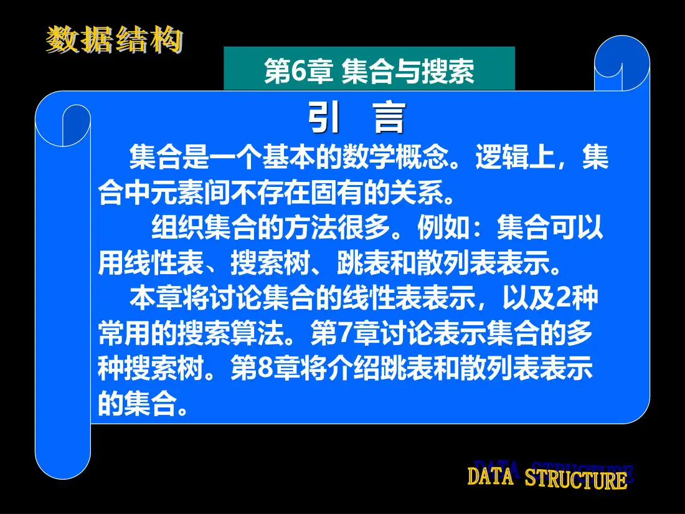

原文：

数据结构

第6章 集合与搜索

引 言

集合是一个基本的数学概念。逻辑上，集合中元素间不存在固有的关系。

组织集合的方法很多。例如：集合可以用线性表、搜索树、跳表和散列表表示。

本章将讨论集合的线性表表示，以及2种常用的搜索算法。第7章讨论表示集合的多种搜索树。第8章将介绍跳表和散列表表示的集合。

DATA STRUCTURE

### 内容提要

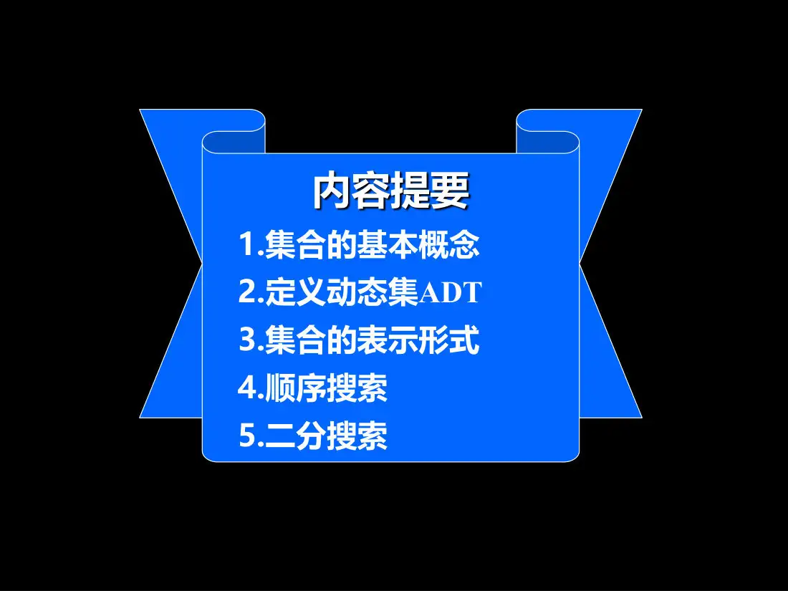

原文：

内容提要

1.集合的基本概念

2.定义动态集ADT

3.集合的表示形式

4.顺序搜索

5.二分搜索

### 6.1 基本概念

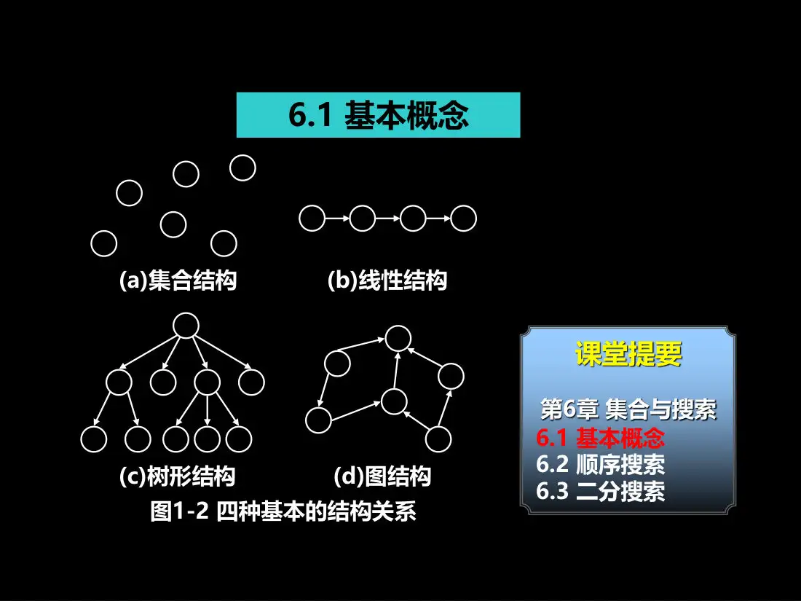

原文：

6.1 基本概念

(a)集合结构

(b)线性结构

(c)树形结构

(d)图结构

图1-2 四种基本的结构关系

课堂提要

第6章 集合与搜索

6.1 基本概念

6.2 顺序搜索

6.3 二分搜索

### 6.1.1 集合与搜索

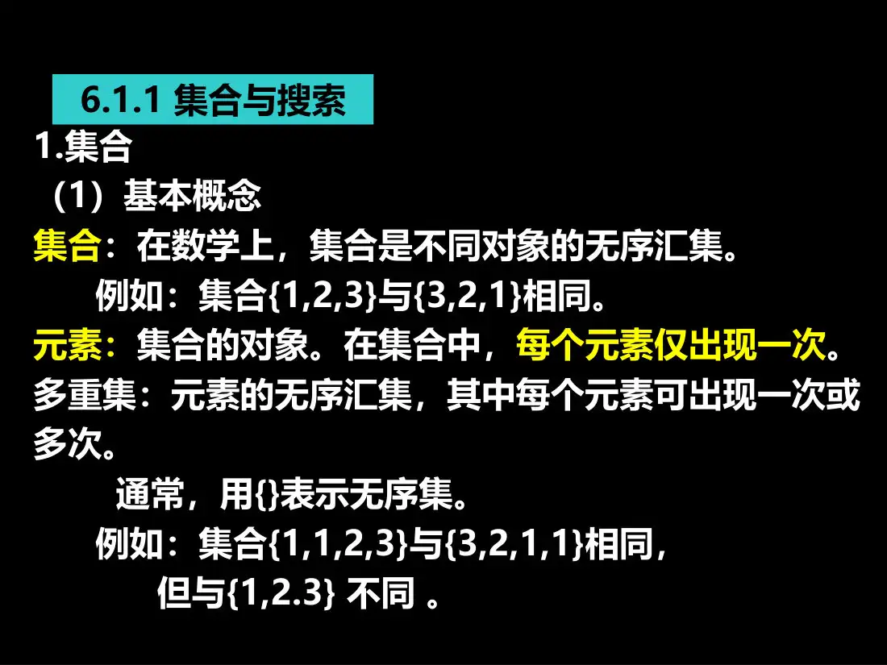

原文：

6.1.1 集合与搜索

1.集合

（1）基本概念集合：在数学上，集合是不同对象的无序汇集。例如：集合{1,2,3}与{3,2,1}相同。元素：集合的对象。在集合中，每个元素仅出现一次。多重集：元素的无序汇集，其中每个元素可出现一次或多次。

通常，用{}表示无序集。例如：集合{1,1,2,3}与{3,2,1,1}相同，但与{1,2.3} 不同 。

### （2）集合的运算数学意义上，集合运算主要有：

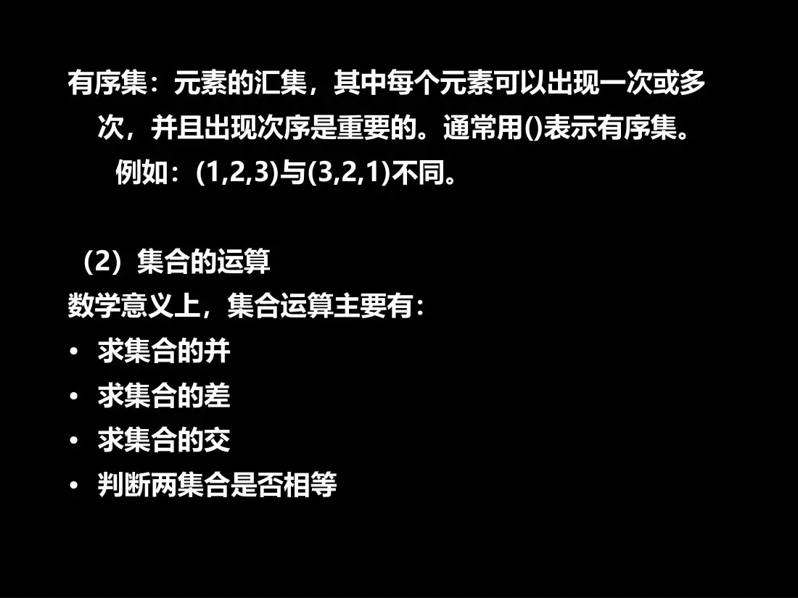

原文：

有序集：元素的汇集，其中每个元素可以出现一次或多次，并且出现次序是重要的。通常用()表示有序集。例如：(1,2,3)与(3,2,1)不同。

（2）集合的运算数学意义上，集合运算主要有：

• 求集合的并

• 求集合的差

• 求集合的交

判断两集合是否相等

### 2.动态集

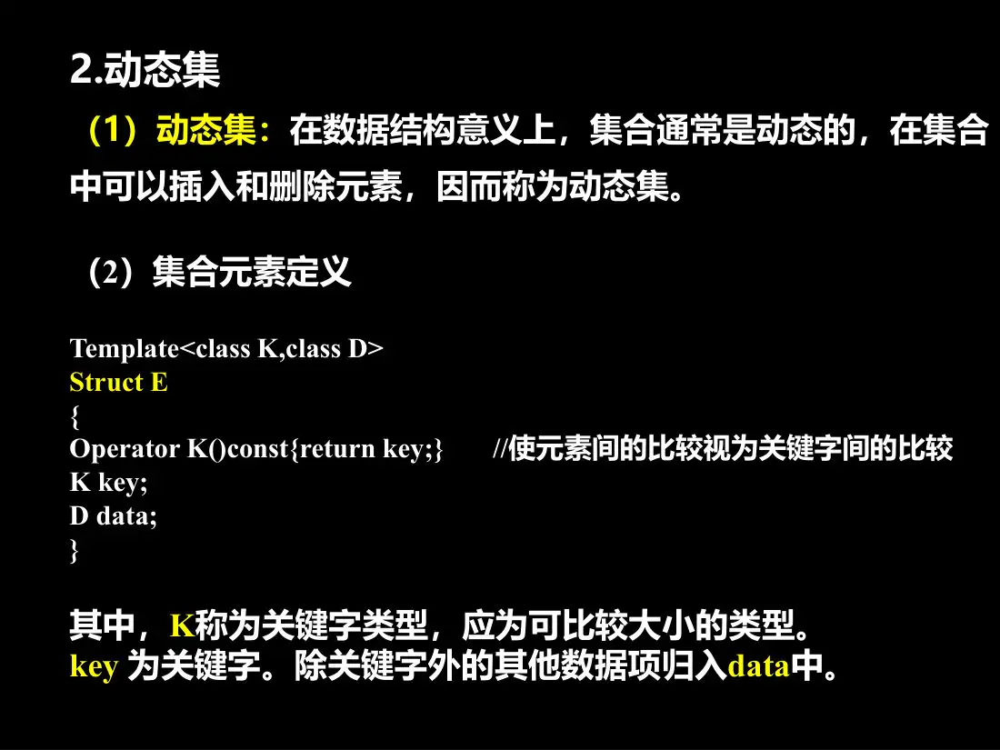

原文：

2.动态集

（1）动态集：在数据结构意义上，集合通常是动态的，在集合中可以插入和删除元素，因而称为动态集。

（2）集合元素定义

Template<class K,class D> Struct E { Operator K()const{return key;} //使元素间的比较视为关键字间的比较 K key; D data; }

其中，K称为关键字类型，应为可比较大小的类型。key 为关键字。除关键字外的其他数据项归入data中。

### 本章中，若无特殊说明，都假定被搜索的关键字是主关键字。

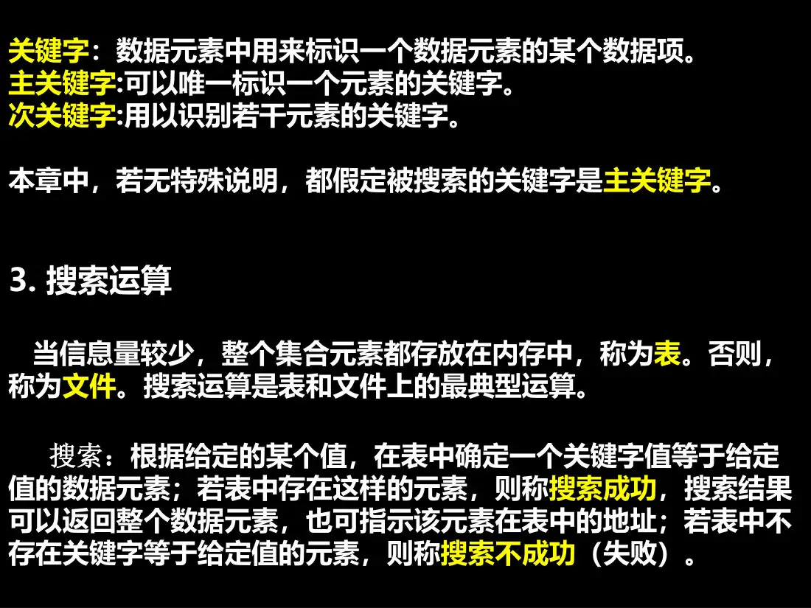

原文：

关键字：数据元素中用来标识一个数据元素的某个数据项。主关键字:可以唯一标识一个元素的关键字。次关键字:用以识别若干元素的关键字。

本章中，若无特殊说明，都假定被搜索的关键字是主关键字。

3. 搜索运算

当信息量较少，整个集合元素都存放在内存中，称为表。否则，称为文件。搜索运算是表和文件上的最典型运算。

搜索：根据给定的某个值，在表中确定一个关键字值等于给定值的数据元素；若表中存在这样的元素，则称搜索成功，搜索结果可以返回整个数据元素，也可指示该元素在表中的地址；若表中不存在关键字等于给定值的元素，则称搜索不成功（失败）

### 4. 搜索算法分类

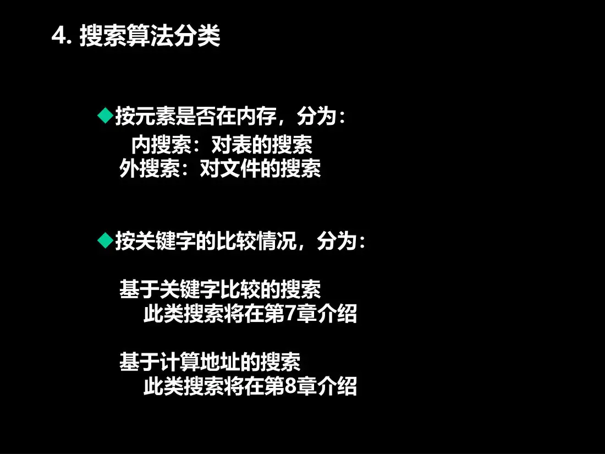

原文：

4. 搜索算法分类

按元素是否在内存，分为：内搜索：对表的搜索外搜索：对文件的搜索

按关键字的比较情况，分为：

基于关键字比较的搜索此类搜索将在第7章介绍

基于计算地址的搜索

此类搜索将在第8章介绍

### 6.1.2 动态集ADT

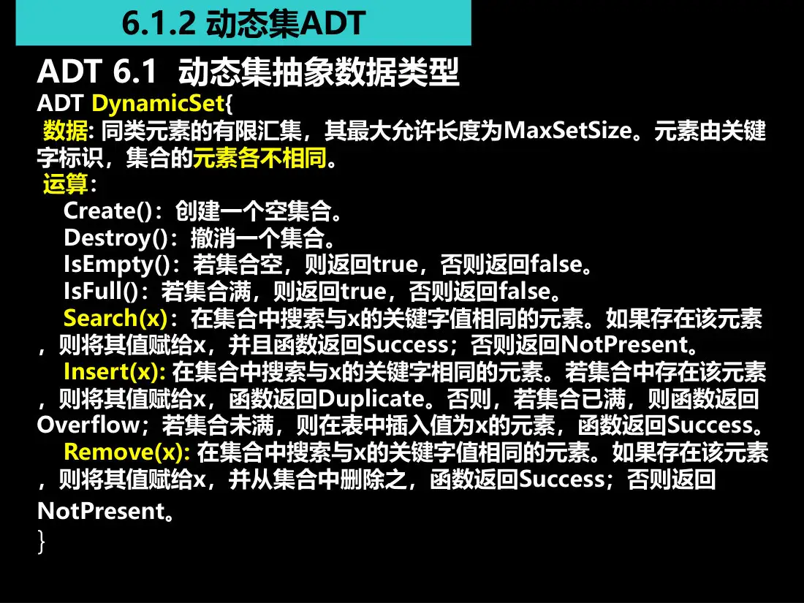

原文：

6.1.2 动态集ADT

ADT 6.1 动态集抽象数据类型

ADT DynamicSet{

数据: 同类元素的有限汇集，其最大允许长度为MaxSetSize。元素由关键字标识，集合的元素各不相同。

运算：

Create()：创建一个空集合。

Destroy()：撤消一个集合。

IsEmpty()：若集合空，则返回true，否则返回false。IsFull()：若集合满，则返回true，否则返回false。

Search(x)：在集合中搜索与x的关键字值相同的元素。如果存在该元素则将其值赋给x，并且函数返回Success；否则返回NotPresent。

Overflow；若集合未满，则在表中插入值为x的元素，函数返回Success。Remove(x): 在集合中搜索与x的关键字值相同的元素。如果存在该元素则将其值赋给x，并从集合中删除之，函数返回Success；否则返回NotPresent。

### 程序6.1 动态集的C++模板抽象类

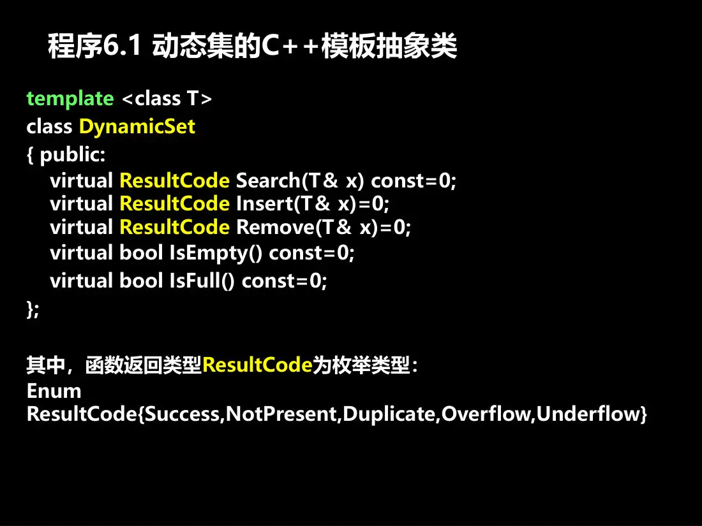

原文：

程序6.1 动态集的C++模板抽象类

template <class T>

class DynamicSet

virtual ResultCode Search(T＆ x) const=0; virtual ResultCode Insert(T＆ x)=0; virtual ResultCode Remove(T＆ x)=0; virtual bool IsEmpty() const=0; virtual bool IsFull() const=0;

其中，函数返回类型ResultCode为枚举类型：

Enum

ResultCode{Success,NotPresent,Duplicate,Overflow,Underflow}

### 6.1.3 集合的表示

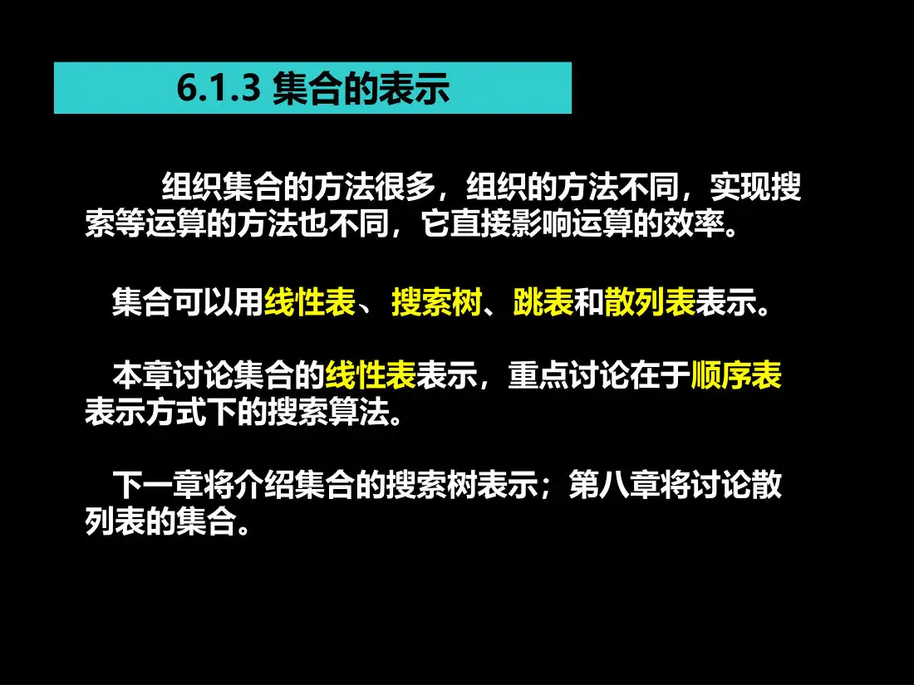

原文：

6.1.3 集合的表示

组织集合的方法很多，组织的方法不同，实现搜索等运算的方法也不同，它直接影响运算的效率。

集合可以用线性表、搜索树、跳表和散列表表示。

本章讨论集合的线性表表示，重点讨论在于顺序表表示方式下的搜索算法。

下一章将介绍集合的搜索树表示；第八章将讨论散列表的集合。

### 程序6.2 顺序表表示的动态集类

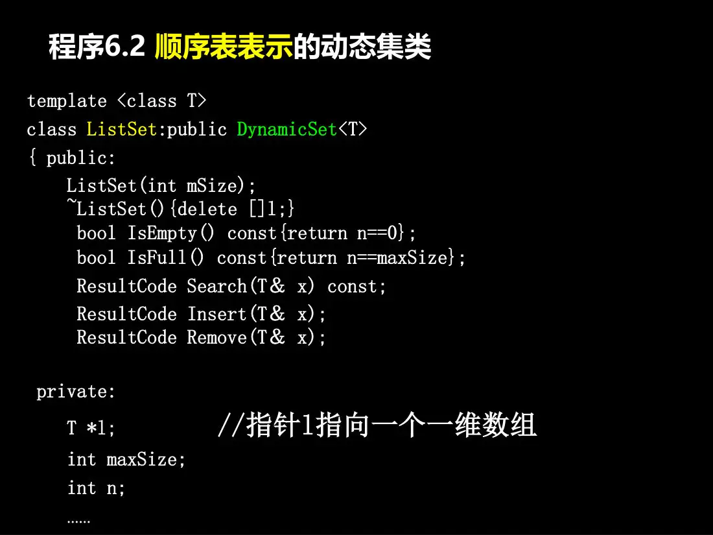

原文：

程序6.2 顺序表表示的动态集类

template <class T> class ListSet:public DynamicSet<T> { public: ListSet(int mSize); \~ListSet(){delete []l;} bool IsEmpty() const{return n==0}; bool IsFull() const{return n==maxSize}; ResultCode Search(T＆ x) const; ResultCode Insert(T＆ x); ResultCode Remove(T＆ x);

private:

T \*l;

//指针l指向一个一维数组

int maxSize;

int n;

### 6.2 顺序搜索

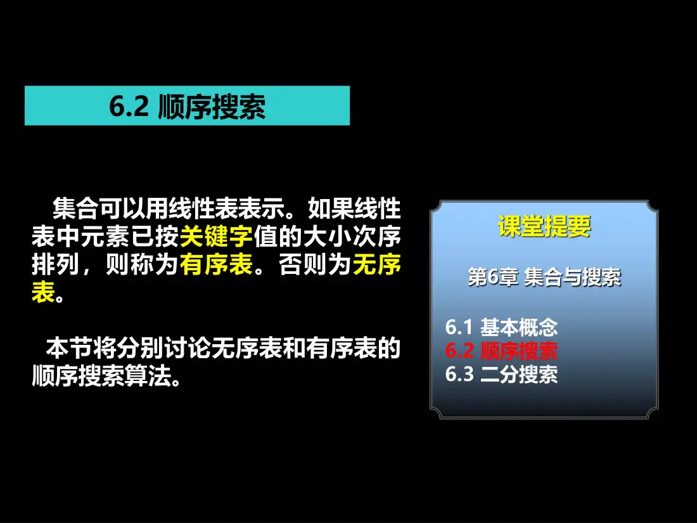

原文：

6.2 顺序搜索

集合可以用线性表表示。如果线性表中元素已按关键字值的大小次序排列，则称为有序表。否则为无序表。

本节将分别讨论无序表和有序表的顺序搜索算法。

课堂提要

第6章 集合与搜索

6.1 基本概念

6.2 顺序搜索

6.3 二分搜索

### 6.2.1 无序表的顺序搜索

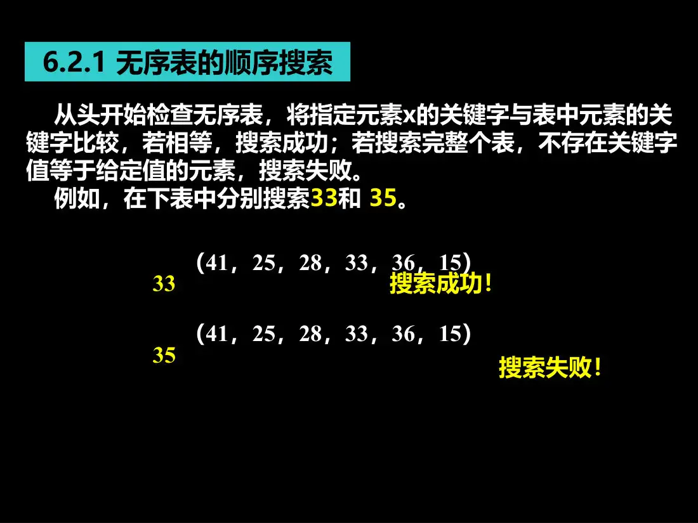

原文：

6.2.1 无序表的顺序搜索

从头开始检查无序表，将指定元素x的关键字与表中元素的关键字比较，若相等，搜索成功；若搜索完整个表，不存在关键字值等于给定值的元素，搜索失败。例如，在下表中分别搜索33和 35。

33

（41，25，28，33，36，15）搜索成功！

35

（41，25，28，33，36，15）

搜索失败！

### 程序6.3 顺序搜索无序表

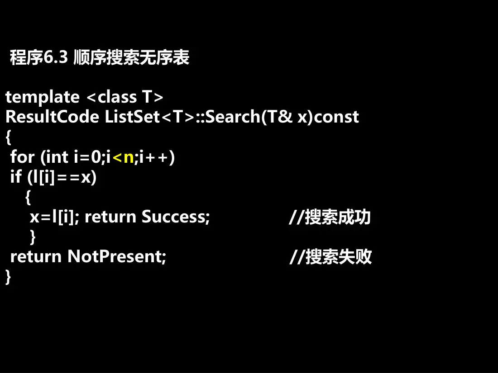

原文：

程序6.3 顺序搜索无序表

template <class T> ResultCode ListSet<T>::Search(T& x)const

for (int i=0;i<n;i++) if (l[i]==x)

x=l[i]; return Success; }

return NotPresent;

//搜索成功

//搜索失败

### 6.2.2 有序表的顺序搜索

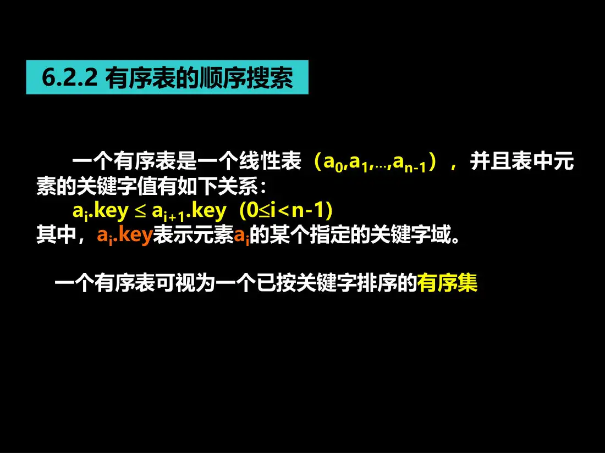

原文：

6.2.2 有序表的顺序搜索

一个有序表是一个线性表 $\mathbf { ( 6 7 0 0 ) } : \mathbf { ( 6 7 0 0 ) }$ ，并且表中元素的关键字值有如下关系：$\frac { 1 } { 2 } \times ( 2 + 1 0 0 0 - 2 ) \times ( 2 + 1 0 0 ) \times ( 2 + 1 0 0 ) \times ( 2 + 1 0 0 )$ 其中， $E F _ { 0 }$ key表示元素ai的某个指定的关键字域。

一个有序表可视为一个已按关键字排序的有序集

### 有序表的顺序搜索算法

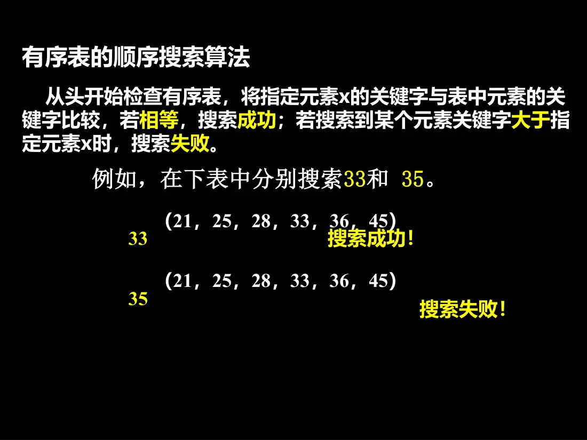

原文：

有序表的顺序搜索算法

从头开始检查有序表，将指定元素x的关键字与表中元素的关键字比较，若相等，搜索成功；若搜索到某个元素关键字大于指定元素x时，搜索失败。

例如，在下表中分别搜索33和 35。

33

（21，25，28，33，36，45）搜索成功！

35

（21，25，28，33，36，45）

搜索失败！

### x=l[i];return Success; //搜索成功

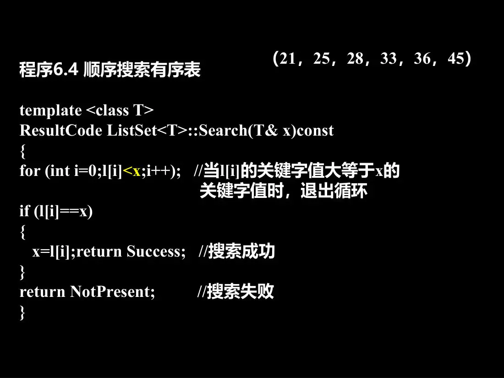

原文：

template <class T> ResultCode ListSet<T>::Search(T& x)const

for (int i=0;l[i]<x;i++); //当l[i]的关键字值大等于x的 关键字值时，退出循环

x=l[i];return Success; //搜索成功

return NotPresent; //搜索失败

程序6.4 顺序搜索有序表

（21，25，28，33，36，45）

### 6.2.3 平均搜索长度

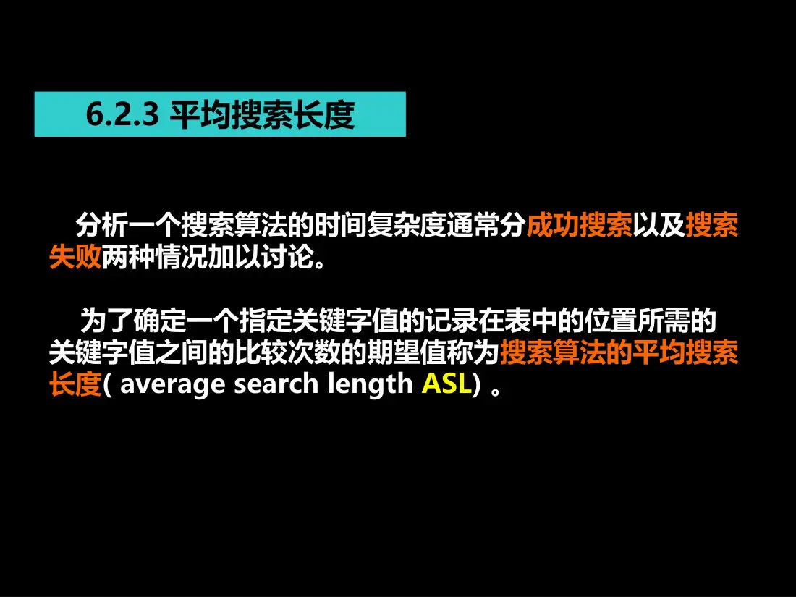

原文：

6.2.3 平均搜索长度

分析一个搜索算法的时间复杂度通常分成功搜索以及搜索失败两种情况加以讨论。

为了确定一个指定关键字值的记录在表中的位置所需的关键字值之间的比较次数的期望值称为搜索算法的平均搜索长度( average search length ASL) 。

### 1. 无序表顺序搜索

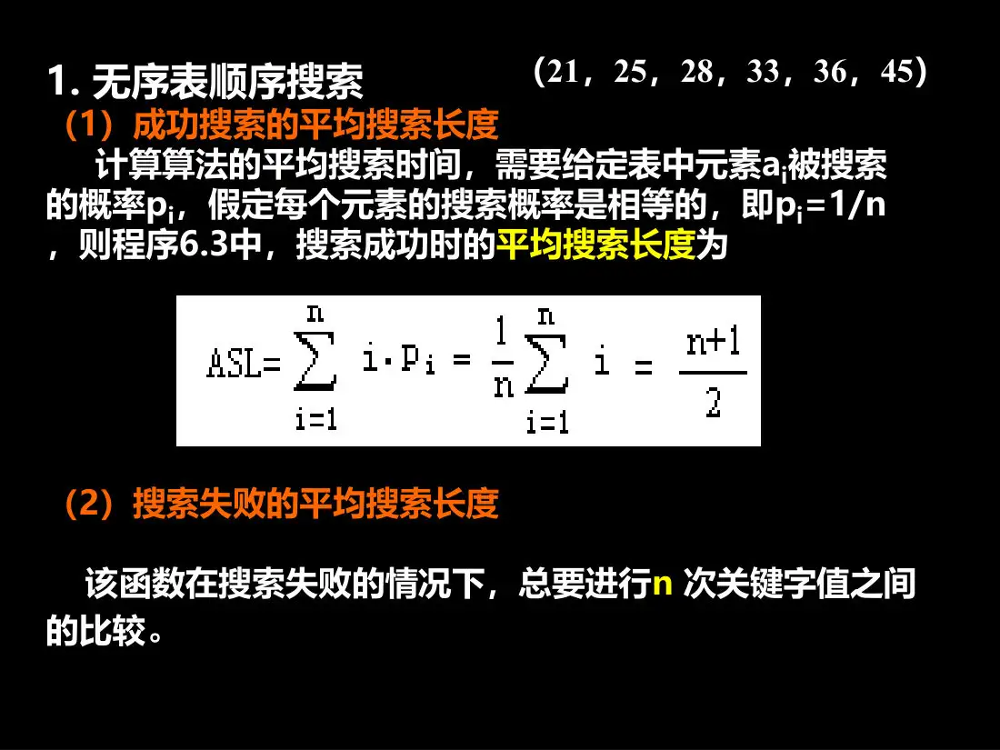

原文：

1. 无序表顺序搜索

（1）成功搜索的平均搜索长度

计算算法的平均搜索时间，需要给定表中元素a被搜索的概率 $\blacktriangle$ ，假定每个元素的搜索概率是相等的，即 $\pmb { \bigtriangledown } \mathbf { \mathcal { H } } - \pmb { \bigtriangledown } \mathbf { \bigtriangledown } | \pmb { \bigtriangledown } |$ 则程序6.3中，搜索成功时的平均搜索长度为

$$
\mathrm{ASL} = \sum_ {i = 1} ^ {n} i \cdot P _ {i} = \frac {1}{n} \sum_ {i = 1} ^ {n} i = \frac {n + 1}{2}
$$

（2）搜索失败的平均搜索长度

该函数在搜索失败的情况下，总要进行n 次关键字值之间的比较。

（21，25，28，33，36，45）

### 2. 有序表顺序搜索

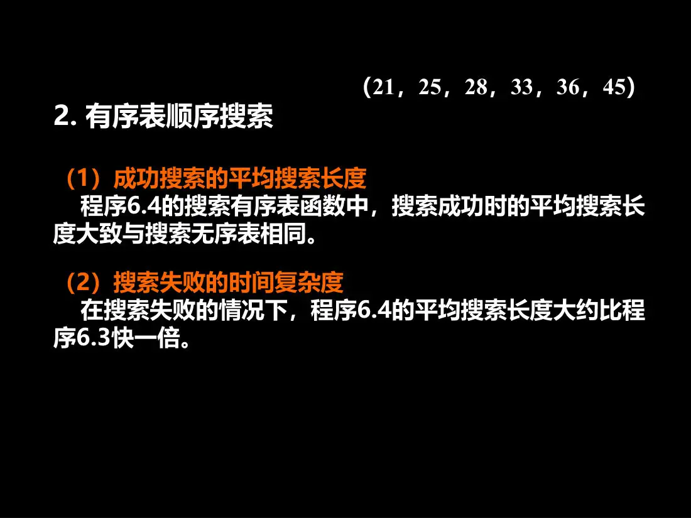

原文：

2. 有序表顺序搜索

（1）成功搜索的平均搜索长度程序6.4的搜索有序表函数中，搜索成功时的平均搜索长度大致与搜索无序表相同。

（2） 搜索失败的时间复杂度

在搜索失败的情况下，程序6.4的平均搜索长度大约比程序6.3快一倍。

（21，25，28，33，36，45）

### 6.3 二分搜索

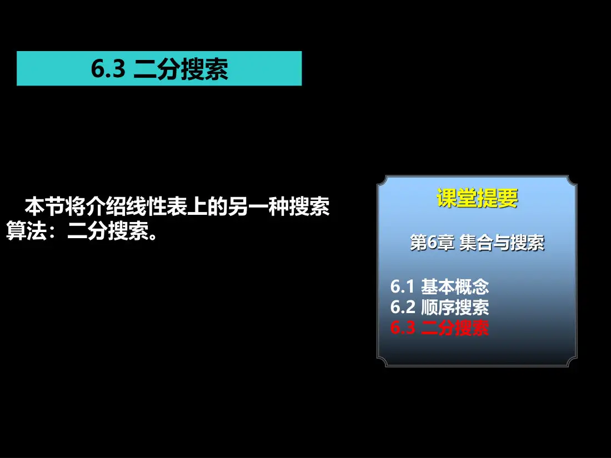

原文：

6.3 二分搜索

本节将介绍线性表上的另一种搜索算法：二分搜索。

课堂提要

第6章 集合与搜索

6.1 基本概念6.2 顺序搜索6.3 二分搜索

### 查找 TP391.4/3-841

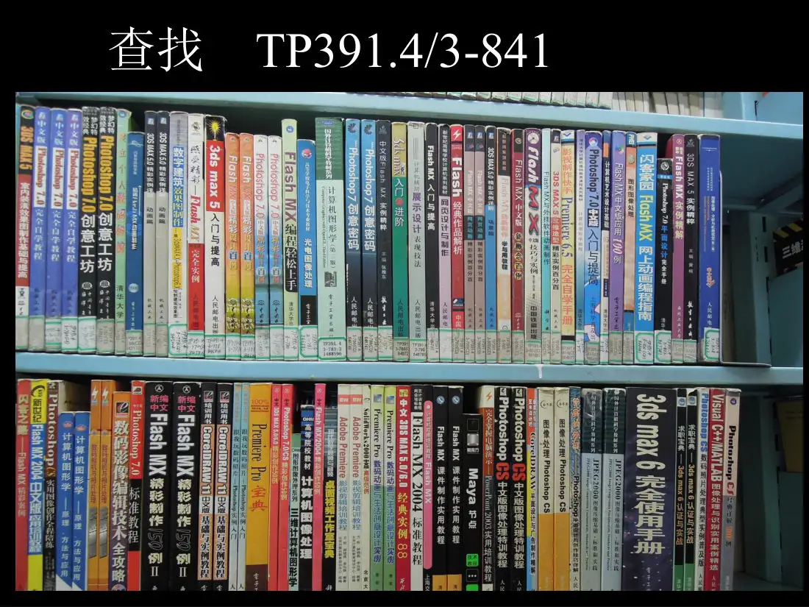

原文：

查找 TP391.4/3-841

0PhotoshopCS片典船00例清 清华大 人民邮 人民 禁华大

艺术设计项人民 民

### 查找 TP391.4/3-841

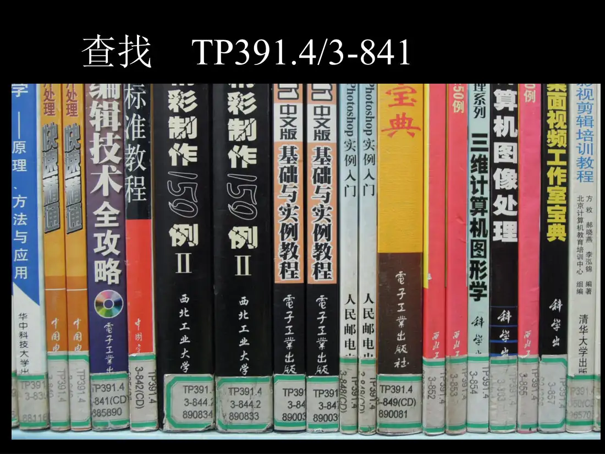

原文：

查找 TP391.4/3-841

组编 编著

50例 3-854 TP391.4

清华大学出版

科学出

科学出

3-852

TP391.4 3-849(CD) 890081

TP39 3-84 89003

TP391.4 3-844.2 890833

TP391. 3-844.2 890834

P391.4 841(CD 385890

### 6.3.1 二分搜索算法

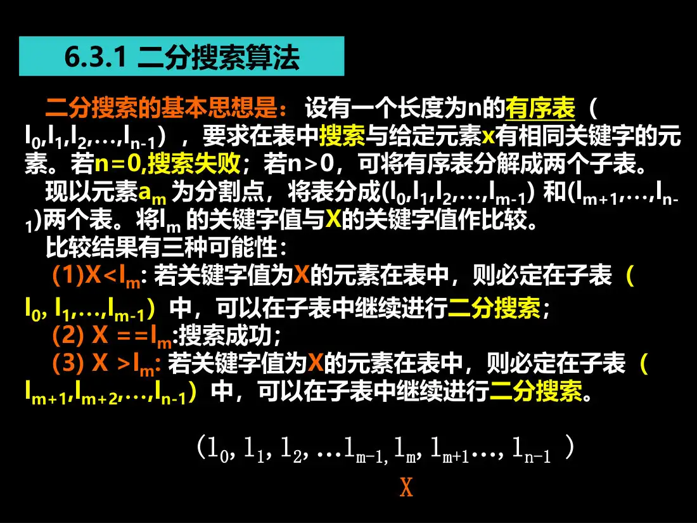

原文：

6.3.1 二分搜索算法

二分搜索的基本思想是：设有一个长度为n的有序表（$[ 0 , 1 ] = [ 1 , 1 ] = [ 1 , 1 ] = [ 1 , 1 ] = [ 1 , 1 ]$ 要求在表中搜索与给定元素x有相同关键字的元素。若 $\bf \Pi ^ { \prime \prime }$ ,搜索失败；若 $\boxed { 1 } \boxed { 2 } \boxed { 0 }$ 可将有序表分解成两个子表。现以元素 $\mathsf { E }$ 为分割点，将表分成 $( 0 . 5 m + 2 0 0 0 0 , 0 . 5 0 )$ 和 $\mathbb { I } \mathbb { I } \mathbb { I } \mathbb { I } \mathbb { I } \mathbb { I } \mathbb { I } \mathbb { I } \mathbb { I } \mathbb { I } \mathbb { I } \mathbb { I } \mathbb { I } \mathbb { I } \mathbb { I } \mathbb { I } \mathbb { I } \mathbb { I } \mathbb { I } \mathbb { I } \mathbb { I } \mathbb { I }$ )两个表。将l 的关键字值与X的关键字值作比较。 $\pmb { \left[ 1 0 \right] }$ 比较结果有三种可能性：$( 6 0 ) 2 < 1 9$ 若关键字值为X的元素在表中，则必定在子表（$[ 0 , 1 , 1 , 1 , 1 , 1 , 1 , 1 , 1 , 1 , 1 , 1 , 1 , 1 , ]$ 中，可以在子表中继续进行二分搜索；（2)（3) $\mathrm { B E } = \mathrm { E I }$ :搜索成功；$\mathbb { Z } ^ { \times \times }$ 若关键字值为X的元素在表中，则必定在子表（$[ 1 1 5 , 1 2 , 1 1 5 , 2 , 1 5 , 2 , 1 5 , 2 ]$ 中，可以在子表中继续进行二分搜索。

$$
(1 _ {0}, 1 _ {1}, 1 _ {2}, \dots 1 _ {m - 1}, 1 _ {m}, 1 _ {m + 1} \dots , 1 _ {n - 1})
$$

X

### 6.3.2 对半搜索

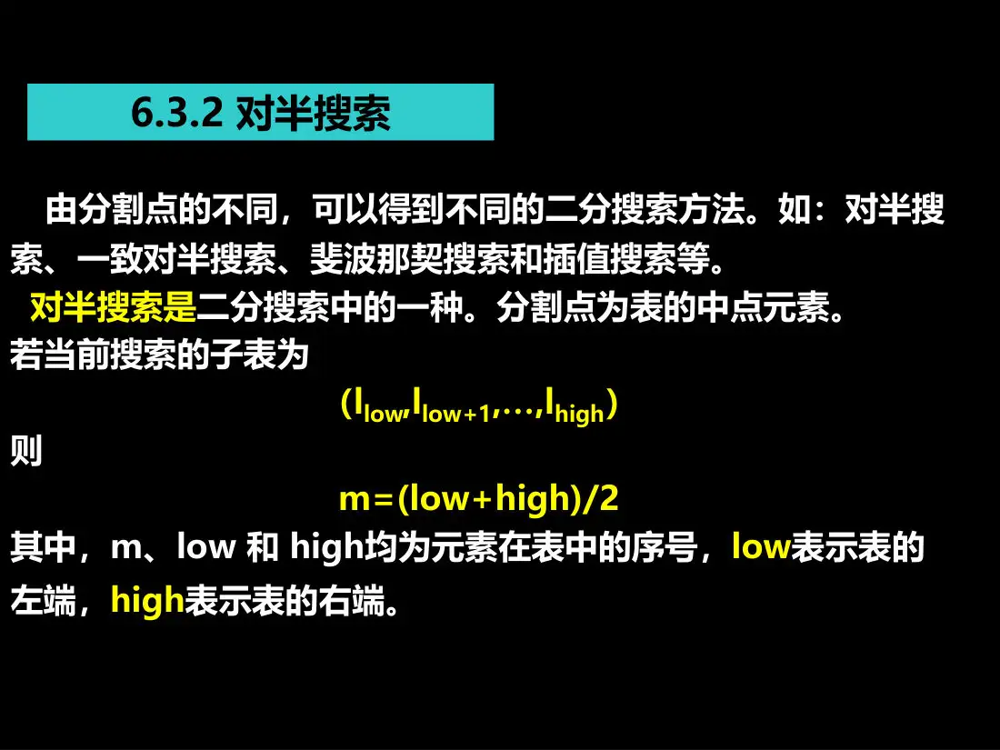

原文：

6.3.2 对半搜索

由分割点的不同，可以得到不同的二分搜索方法。如：对半搜索、一致对半搜索、斐波那契搜索和插值搜索等。对半搜索是二分搜索中的一种。分割点为表的中点元素。若当前搜索的子表为

$$
(I _ {\text { low }}, I _ {\text { low+1 }}, \dots , I _ {\text { high }})
$$

则

$$
m = (l o w + h i g h) / 2
$$

其中，m、low 和 high均为元素在表中的序号，low表示表的左端，high表示表的右端。

### 对半搜索的算法思想：

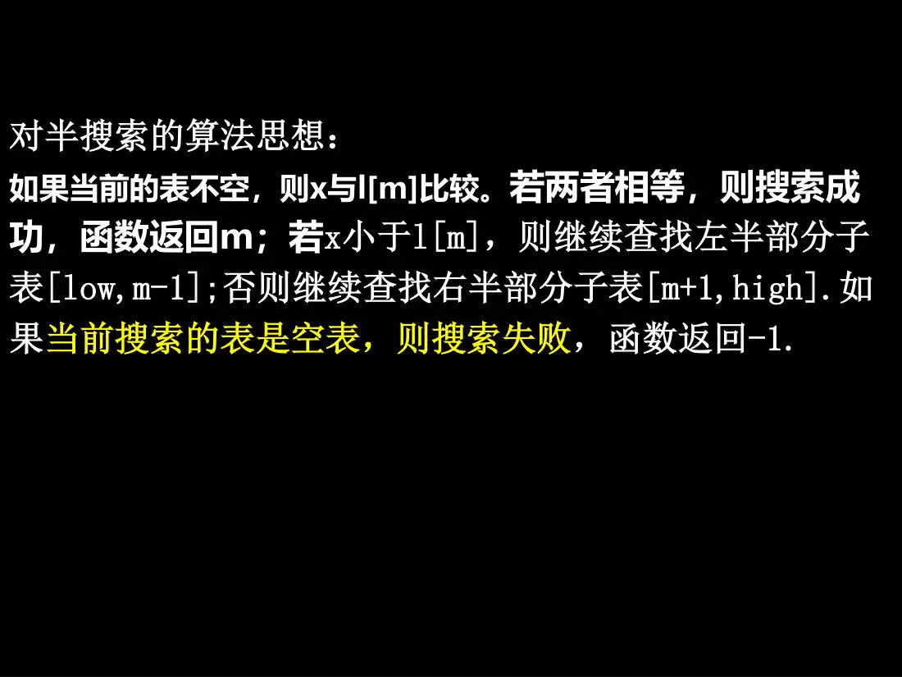

原文：

对半搜索的算法思想：

如果当前的表不空，则x与l[m]比较。若两者相等，则搜索成功，函数返回m；若x小于l[m]，则继续查找左半部分子表[low,m-1];否则继续查找右半部分子表[m+1,high].如果当前搜索的表是空表，则搜索失败，函数返回-1.

### $$

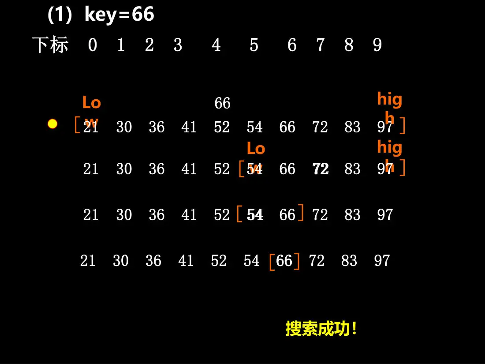

原文：

$$
\begin{array}{l l} & \text {(1)   k e y = 6 6} \\ \text {下标} & 0 \quad 1 \quad 2 \quad 3 \quad 4 \quad 5 \quad 6 \quad 7 \quad 8 \quad 9 \end{array}
$$

$$
\begin{array}{c c c c c c c c c c} \text {Lo} & & & & 6 6 & & & & & \text {hig} \\ [ w ] & 3 0 & 3 6 & 4 1 & 5 2 & 5 4 & 6 6 & 7 2 & 8 3 & h ] \\ & & & & \text {Lo} & & & & & \text {hig} \\ 2 1 & 3 0 & 3 6 & 4 1 & 5 2 & [ 5 4 & 6 6 & 7 2 & 8 3 & h ] \end{array}
$$

$$
\begin{array}{l l l l l l l l l l} 2 1 & 3 0 & 3 6 & 4 1 & 5 2 [ 5 4 & 6 6 ] & 7 2 & 8 3 & 9 7 \end{array}
$$

$$
\begin{array}{l l l l l l l l l l l} 2 1 & 3 0 & 3 6 & 4 1 & 5 2 & 5 4 & [ 6 6 ] & 7 2 & 8 3 & 9 7 \end{array}
$$

搜索成功！

### $$

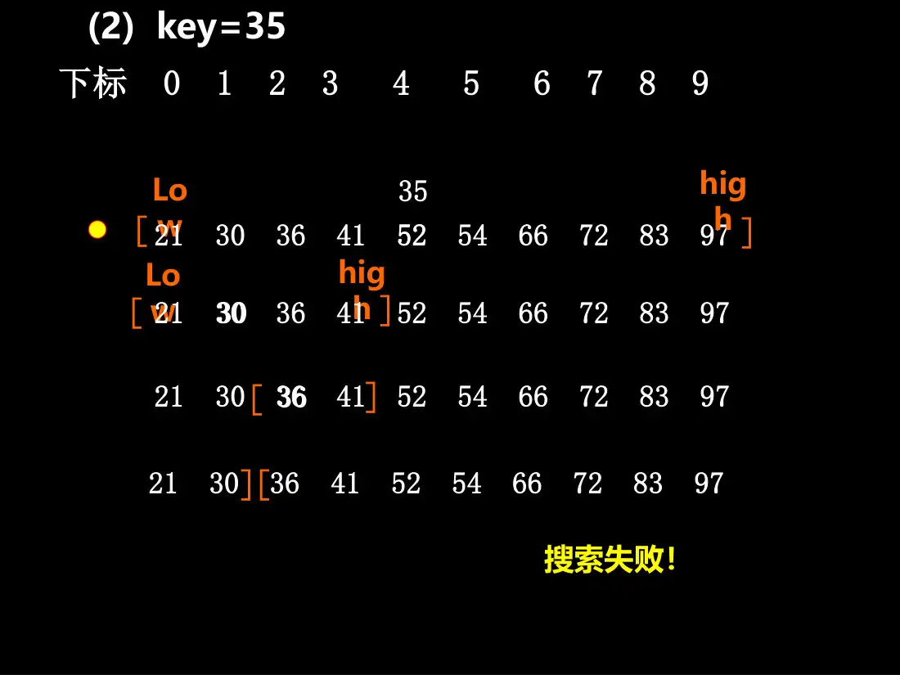

原文：

$$
\begin{array}{l l} (2) & \text {key = 35} \\ \text {下标} & 0 \quad 1 \quad 2 \quad 3 \quad 4 \quad 5 \quad 6 \quad 7 \quad 8 \quad 9 \end{array}
$$

$$
\begin{array}{c c c c c c c c c c} \text {Lo} & & & & 3 5 & & & & & \text {hig} \\ \bullet & [ w ] & 3 0 & 3 6 & 4 1 & 5 2 & 5 4 & 6 6 & 7 2 & 8 3 & h ] \\ \text {Lo} & & & & \text {hig} \\ [ w ] & 3 0 & 3 6 & 4 1 ] & 5 2 & 5 4 & 6 6 & 7 2 & 8 3 & 9 7 \end{array}
$$

$$
\begin{array}{l l l l l l l l l l} 2 1 & 3 0 [ 3 6 & 4 1 ] & 5 2 & 5 4 & 6 6 & 7 2 & 8 3 & 9 7 \end{array}
$$

$$
\left. \begin{array}{l l} 2 1 & 3 0 \end{array} \right] [ 3 6 \quad 4 1 \quad 5 2 \quad 5 4 \quad 6 6 \quad 7 2 \quad 8 3 \quad 9 7
$$

搜索失败！

### 程序6.5 对半搜索的递归算法

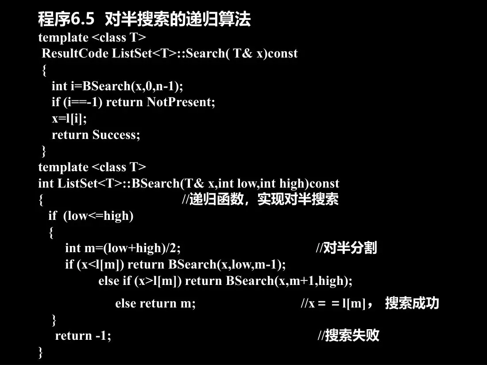

原文：

程序6.5 对半搜索的递归算法

template <class T> ResultCode ListSet<T>::Search( T& x)const

int i=BSearch(x,0,n-1); if (i==-1) return NotPresent;

x=l[i]; return Success;

template <class T> int ListSet<T>::BSearch(T& x,int low,int high)const { //递归函数，实现对半搜索

if (low<=high)

int m=(low+high)/2;

//对半分割

if (x<l[m]) return BSearch(x,low,m-1); else if (x>l[m]) return BSearch(x,m+1,high);

else return m;

//x＝＝l[m]，搜索成功

return -1;

//搜索失败

### 0 1 2 3 4 5 6 3 1 20 34 45 56 64

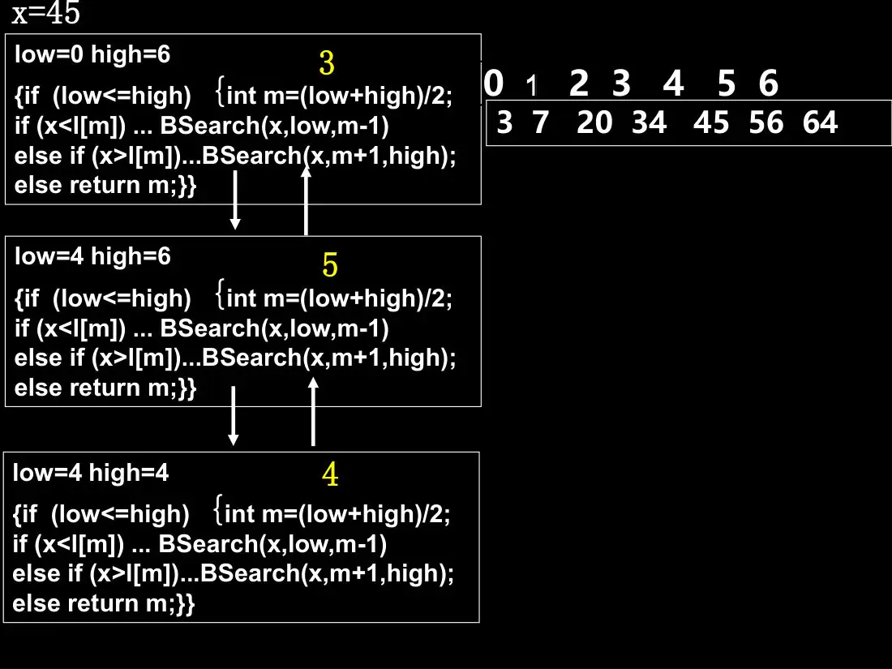

原文：

low=0 high=6 3 {if (low<=high) {int m=(low+high)/2; if (x<l[m]) ... BSearch(x,low,m-1) else if (x>l[m])...BSearch(x,m+1,high); else return m;}}

0 1 2 3 4 5 6 3 1 20 34 45 56 64

low=4 high=6

{if (low<=high) {int m=(low+high)/2; if (x<l[m]) ... BSearch(x,low,m-1) else if (x>l[m])...BSearch(x,m+1,high); else return m;}}

low=4 high=4

{if (low<=high) {int m=(low+high)/2; if (x<l[m]) ... BSearch(x,low,m-1) else if (x>l[m])...BSearch(x,m+1,high); else return m;}}

### int m,low=0,high=n-1; while (low<=high)

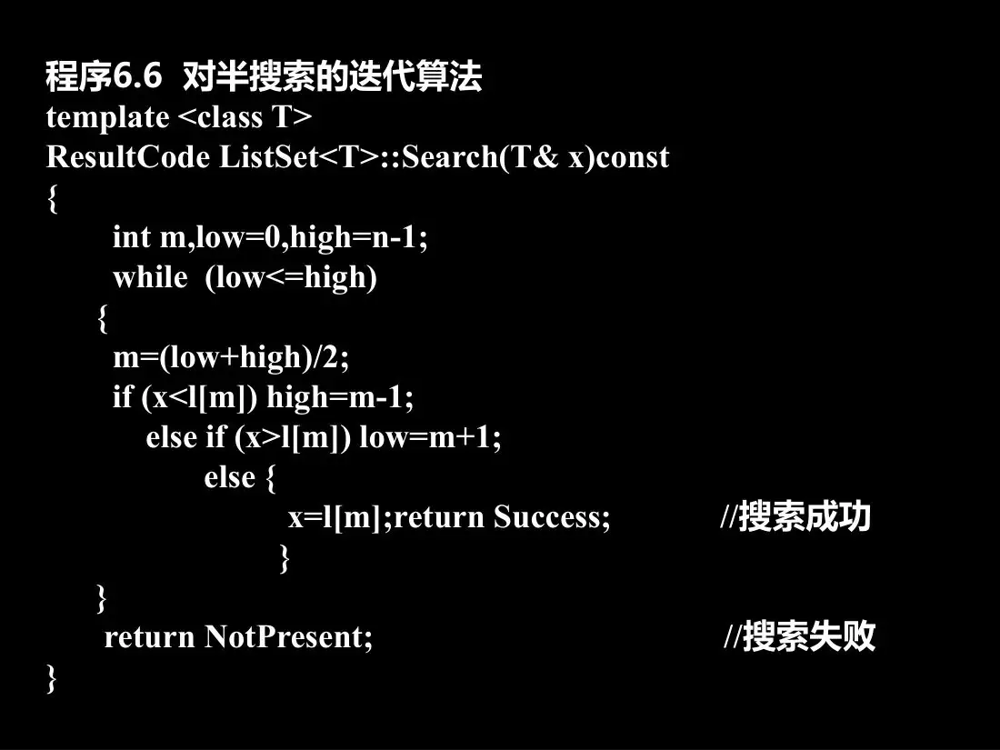

原文：

程序6.6 对半搜索的迭代算法 template <class T> ResultCode ListSet<T>::Search(T& x)const

int m,low=0,high=n-1; while (low<=high)

m=(low+high)/2; if (x<l[m]) high=m-1; else if (x>l[m]) low=m+1; else {

x=l[m];return Success;

//搜索成功

return NotPresent;

//搜索失败

### 6.3.3 二叉判定树

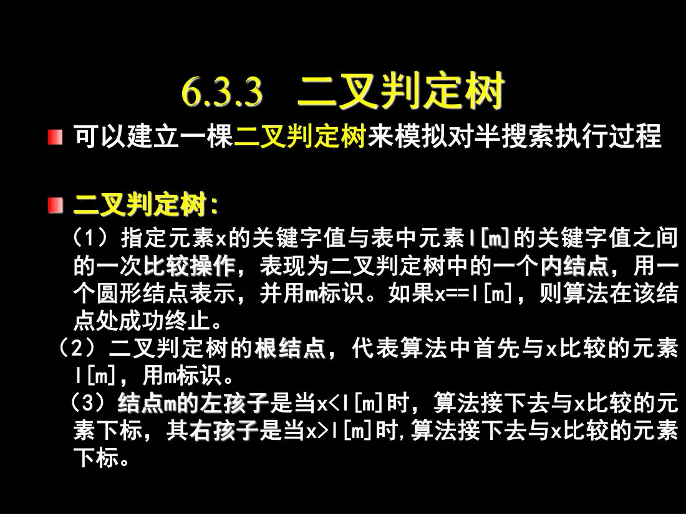

原文：

6.3.3 二叉判定树

可以建立一棵二叉判定树来模拟对半搜索执行过程

二叉判定树:

（1）指定元素x的关键字值与表中元素l[m]的关键字值之间的一次比较操作，表现为二叉判定树中的一个内结点，用一个圆形结点表示，并用m标识。如果x==l[m]，则算法在该结点处成功终止。

（2）二叉判定树的根结点，代表算法中首先与x比较的元素l[m]，用m标识。

（3）结点m的左孩子是当x<l[m]时，算法接下去与x比较的元素下标，其右孩子是当x>l[m]时,算法接下去与x比较的元素下标。

### （a）当0m<n-1时，l[m]<x<l[m+1]之间；

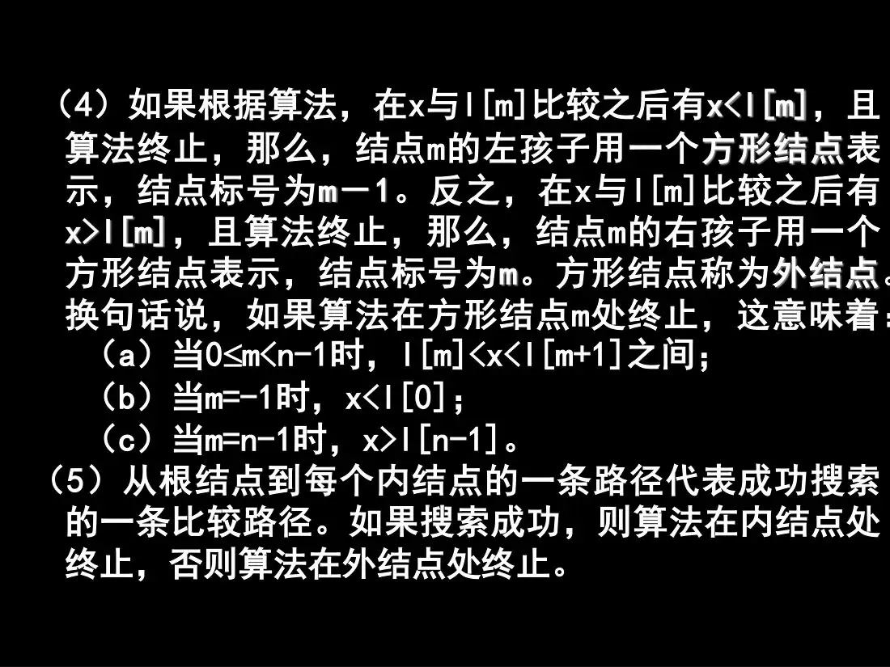

原文：

（4）如果根据算法，在x与l[m]比较之后有x<l[m]，且算法终止，那么，结点m的左孩子用一个方形结点表示，结点标号为m－1。反之，在x与l[m]比较之后有x>l[m]，且算法终止，那么，结点m的右孩子用一个方形结点表示，结点标号为m。方形结点称为外结点。换句话说，如果算法在方形结点m处终止，这意味着：

（a）当0m<n-1时，l[m]<x<l[m+1]之间；

（b）当m=-1时，x<l[0]；

（c）当m=n-1时，x>l[n-1]。

（5）从根结点到每个内结点的一条路径代表成功搜索的一条比较路径。如果搜索成功，则算法在内结点处终止，否则算法在外结点处终止。

### 二叉判定树的建立：

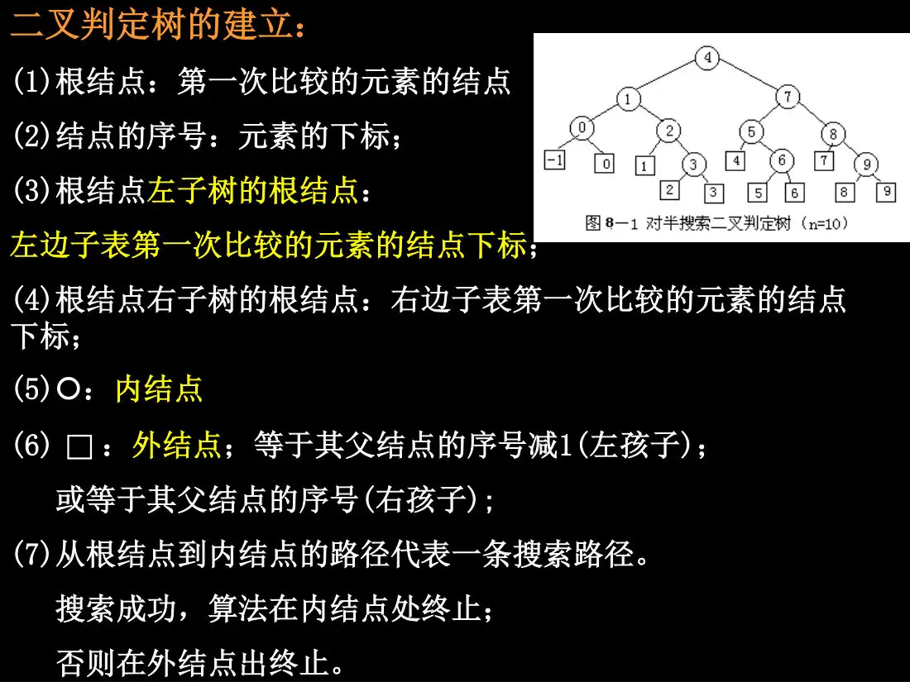

原文：

二叉判定树的建立：

(1)根结点：第一次比较的元素的结点

(2)结点的序号：元素的下标；

(3)根结点左子树的根结点：

左边子表第一次比较的元素的结点下标；

(4)根结点右子树的根结点：右边子表第一次比较的元素的结点下标；

(5)：内结点

(6) ：外结点；等于其父结点的序号减1(左孩子)；或等于其父结点的序号(右孩子);

(7)从根结点到内结点的路径代表一条搜索路径。搜索成功，算法在内结点处终止；否则在外结点出终止。

### $$

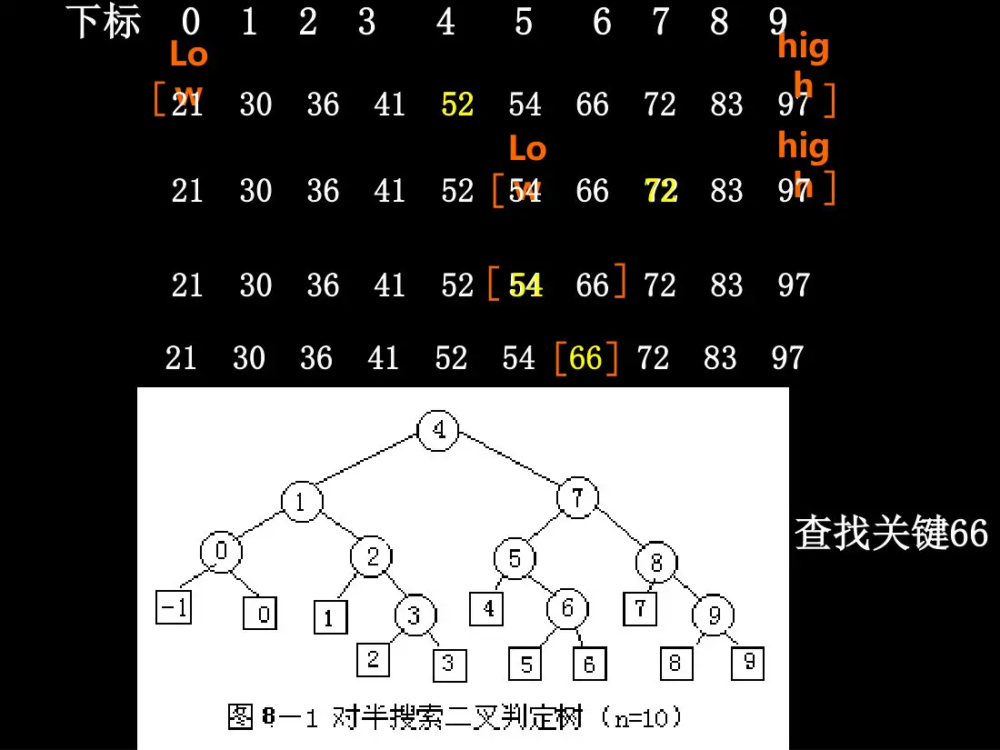

原文：

$$
\begin{array}{c c c c c c c c c c} \text {下标} & 0 & 1 & 2 & 3 & 4 & 5 & 6 & 7 & 8 & 9 \\ & \text {Lo} & & & & & & & & \text {hig} \\ & [ w ] & 3 0 & 3 6 & 4 1 & 5 2 & 5 4 & 6 6 & 7 2 & 8 3 & h ] \\ & & & & & \text {Lo} & & & & \text {hig} \\ & 2 1 & 3 0 & 3 6 & 4 1 & 5 2 & [ 5 4 & 6 6 & 7 2 & 8 3 & h ] \\ & 2 1 & 3 0 & 3 6 & 4 1 & 5 2 & [ 5 4 & 6 6 ] & 7 2 & 8 3 & 9 7 \\ & 2 1 & 3 0 & 3 6 & 4 1 & 5 2 & 5 4 & [ 6 6 ] & 7 2 & 8 3 & 9 7 \end{array}
$$

### 第 37 页

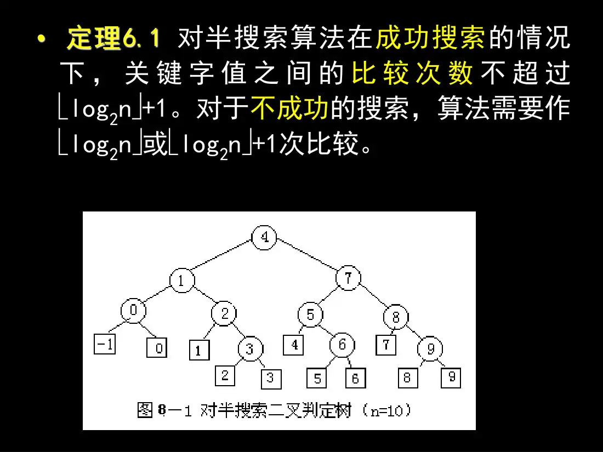

原文：

定理6.1 对半搜索算法在成功搜索的情况下，关键字值之间的比较次数不超过$\vert \overrightarrow { O } \vert = \vert \overrightarrow { O } \vert = \vert \overrightarrow { O } \vert$ 。对于不成功的搜索，算法需要作$1 0 2 3 7 0$ 或L $1 0 2 \div 2 1 = 1 1$ 次比较。

### 第 38 页

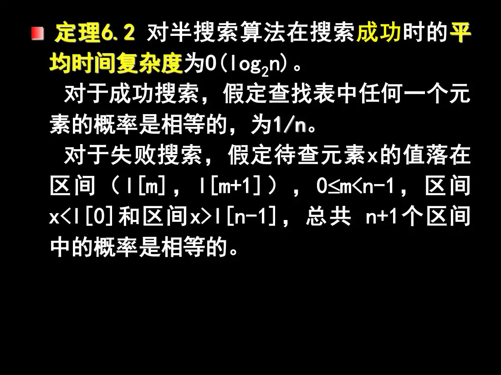

原文：

定理6.2 对半搜索算法在搜索成功时的平均时间复杂度为 $\textcircled { 1 } \textcircled { 4 } \textcircled { \circ } \div \textcircled { 2 } \textcircled { 1 }$ 对于成功搜索，假定查找表中任何一个元素的概率是相等的，为1/n。对于失败搜索，假定待查元素x的值落在区间（l[m]，l[m+1]）， $0 \leq 1 1 0 \leq a - 1 1$ ，区间x<l[0]和区间x>l[n-1]，总共 n+1个区间中的概率是相等的。

### 那么，

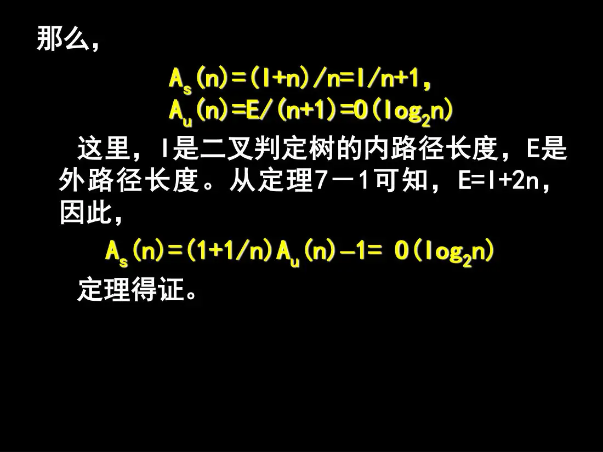

原文：

那么，

$: ( 0 ) = ( 0 , 0 ) / ( 1 - 1 ) = 1 / ( 1 - 1 )$ $[ \pmb { \chi } ( 0 ) ] = \pmb { \chi } ( 0 , 0 ) = 0 ( 0 , 0 )$ 这里，I是二叉判定树的内路径长度，E是外路径长度。从定理7－1可知，E=I+2n，因此，

$l _ { 1 } \mathrm { S G } = ( \mathrm { G E } / \mathrm { G } ) \mathrm { T G } = \mathrm { E G } ( \mathrm { T G } / \mathrm { G } )$ 定理得证。

### 本章小结

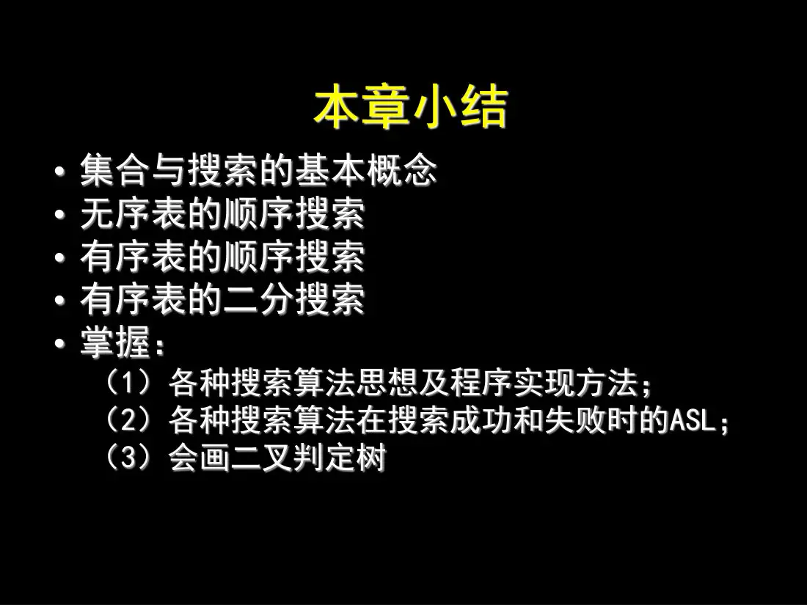

原文：

本章小结

• 集合与搜索的基本概念

• 无序表的顺序搜索

• 有序表的顺序搜索

• 有序表的二分搜索

• 掌握：

（1）各种搜索算法思想及程序实现方法；

（2）各种搜索算法在搜索成功和失败时的ASL；

（3）会画二叉判定树
