# 《数据结构》第8章 跳表和散列表（课件）

原件的每一页，下面附识别出的文字。

### 数据结构 DATAA STRUCTURE

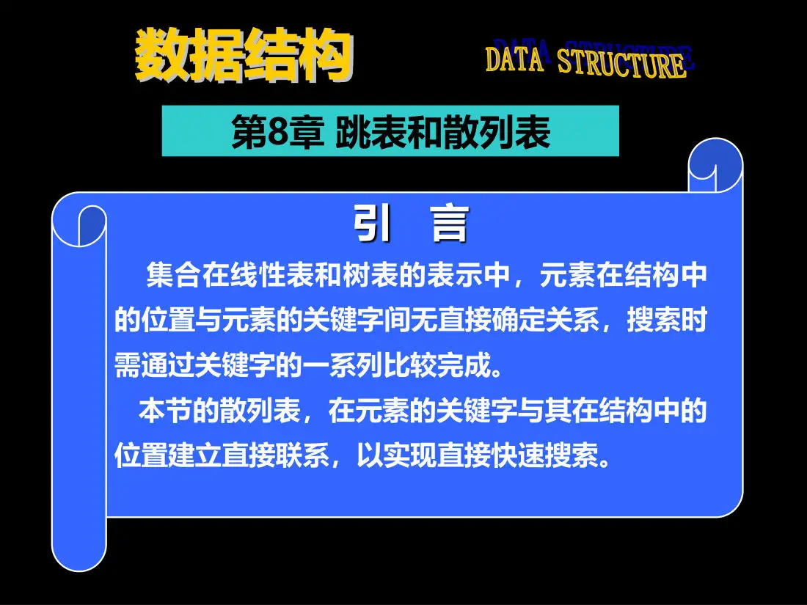

原文：

数据结构 DATAA STRUCTURE

第8章 跳表和散列表

引 言

集合在线性表和树表的表示中，元素在结构中的位置与元素的关键字间无直接确定关系，搜索时需通过关键字的一系列比较完成。

本节的散列表，在元素的关键字与其在结构中的位置建立直接联系，以实现直接快速搜索。

### 8.1 字典8.3 散列表

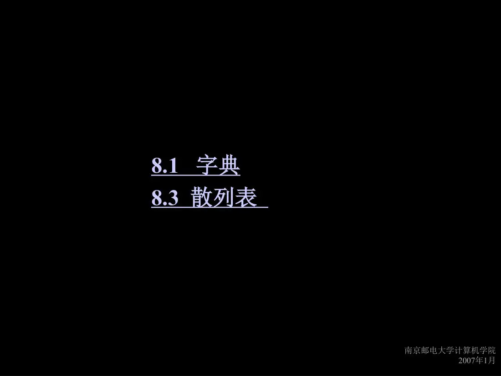

原文：

8.1 字典8.3 散列表

南京邮电大学计算机学院2007年1月

### 8.1 字典

原文：

8.1 字典

南京邮电大学计算机学院2007年1月

### 字典记录的集合。

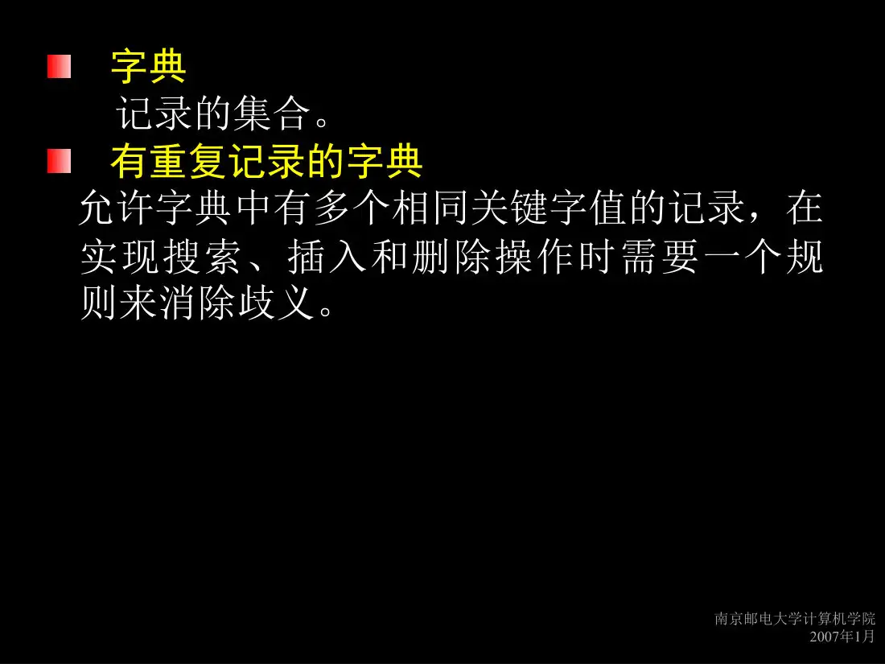

原文：

字典记录的集合。

有重复记录的字典允许字典中有多个相同关键字值的记录，在实现搜索、插入和删除操作时需要一个规则来消除歧义。

南京邮电大学计算机学院2007年1月

### 8.3散列表

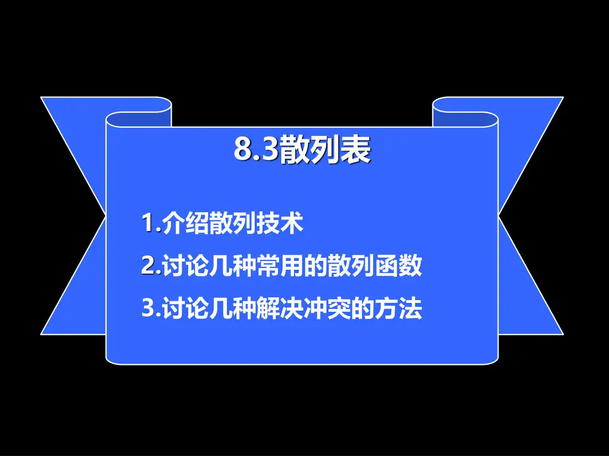

原文：

8.3散列表

1.介绍散列技术

2.讨论几种常用的散列函数

3.讨论几种解决冲突的方法

### 8.3 散列表

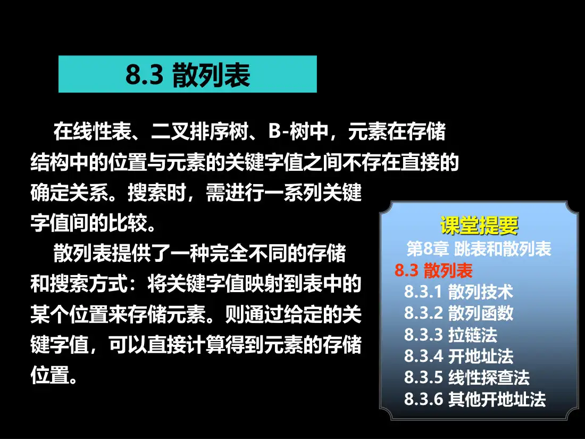

原文：

8.3 散列表

在线性表、二叉排序树、B-树中，元素在存储结构中的位置与元素的关键字值之间不存在直接的确定关系。搜索时，需进行一系列关键字值间的比较。 课

散列表提供了一种完全不同的存储和搜索方式：将关键字值映射到表中的某个位置来存储元素。则通过给定的关键字值，可以直接计算得到元素的存储位置。

堂提要第8章 跳表和散列表

8.3 散列表

8.3.1 散列技术

8.3.2 散列函数

8.3.3 拉链法

8.3.4 开地址法

8.3.5 线性探查法

8.3.6 其他开地址法

### 8.3.1 散列技术

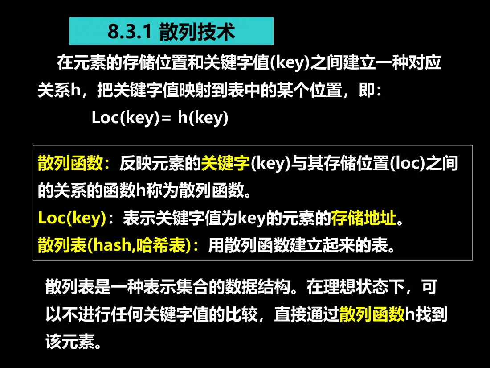

原文：

8.3.1 散列技术

在元素的存储位置和关键字值(key)之间建立一种对应关系h，把关键字值映射到表中的某个位置，即：$| \mathrm { I c r o } ( ( \cdot \odot ) / ) | = | \mathrm { I I } ( \cdot \odot ) / )$

散列函数：反映元素的关键字(key)与其存储位置(loc)之间的关系的函数h称为散列函数。Loc(key)：表示关键字值为key的元素的存储地址。散列表(hash,哈希表)：用散列函数建立起来的表。

散列表是一种表示集合的数据结构。在理想状态下，可以不进行任何关键字值的比较，直接通过散列函数h找到该元素。

### 散列表举例

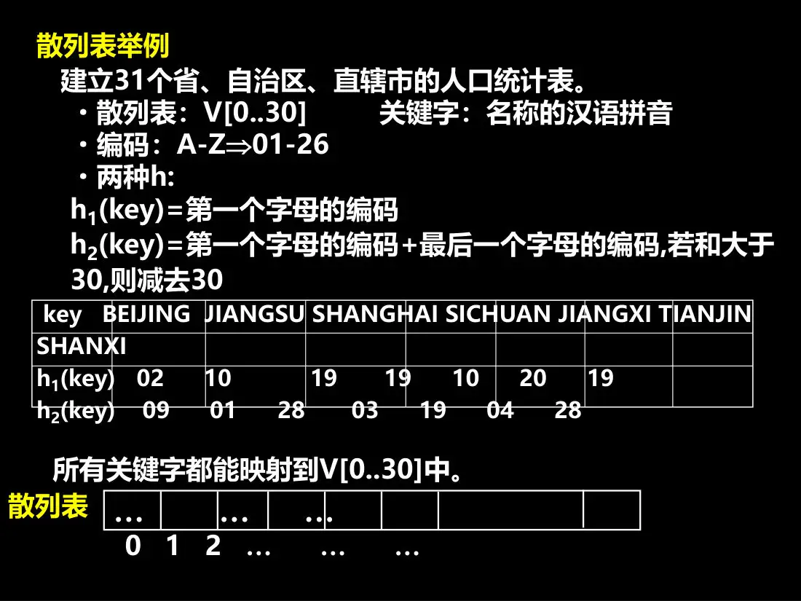

原文：

散列表举例

$$
A - Z \Rightarrow 0 1 - 2 6
$$

$\angle B A C = \angle A E C = \angle E = \angle E$ 一个字母的编码$1 4 \times ( - 2 ) = - 2 = 3$ 个字母的编码+最后一个字母的编码,若和大于30,则减去30

key BEIJING JIANGSU SHANGHAI SICHUAN JIANGXI TIANJIN SHANXI h1(key) 02 10 19 19 10 20 19 h2(key) 09 01 28 03 19 04 28

所有关键字都能映射到V[0..30]中。

散列表

### h2(key)冲突少于h1(key)

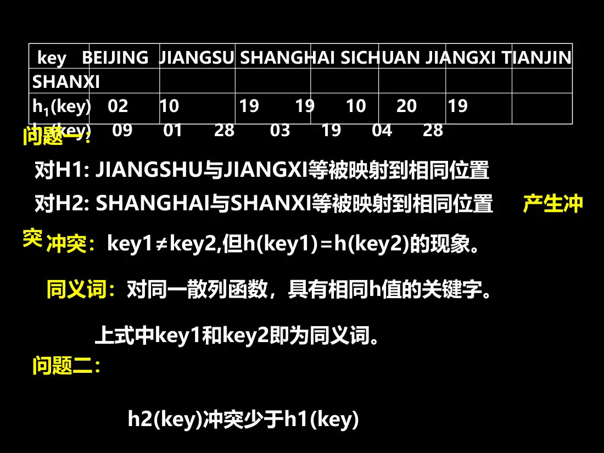

原文：

key BEIJING JIANGSU SHANGHAI SICHUAN JIANGXI TIANJINSHANXIh1(key) 02 10 19 19 10 20 19h2 问题一：(key) 09 01 28 03 19 04 28对H1: JIANGSHU与JIANGXI等被映射到相同位置对H2: SHANGHAI与SHANXI等被映射到相同位置 产生冲突 冲突：key1≠key2,但h(key1)=h(key2)的现象。同义词：对同一散列函数，具有相同h值的关键字。上式中key1和key2即为同义词。问题二：

h2(key)冲突少于h1(key)

### 能否避免冲突？不现实

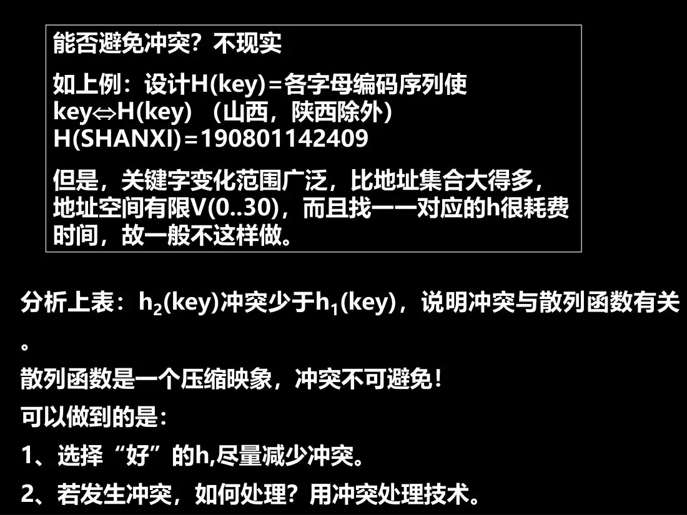

原文：

能否避免冲突？不现实

如上例：设计H(key)=各字母编码序列使keyH(key) （山西，陕西除外）$[ [ [ \mathrm { e f f ~ \bar { t } ~ 1 9 ~ . 1 3 ~ 5 0 } ] ] \equiv [ [ \mathrm { e f f ~ \bar { t } ~ 2 0 ~ . 7 0 } ] ] [ [ \mathrm { e f f ~ 2 . 7 0 ~ 7 0 } ] ]$

但是，关键字变化范围广泛，比地址集合大得多，地址空间有限V(0..30)，而且找一一对应的h很耗费时间，故一般不这样做。

分析上表： $\mathbb { H } \mathbb { G } \mathbb { G }$ 冲突少于 $\mathbb { H } \mathbb { ( < ) }$ ，说明冲突与散列函数有关

散列函数是一个压缩映象，冲突不可避免！可以做到的是：

1、选择“好”的h,尽量减少冲突。

2、若发生冲突，如何处理？用冲突处理技术。

### 8.3.2 散列函数

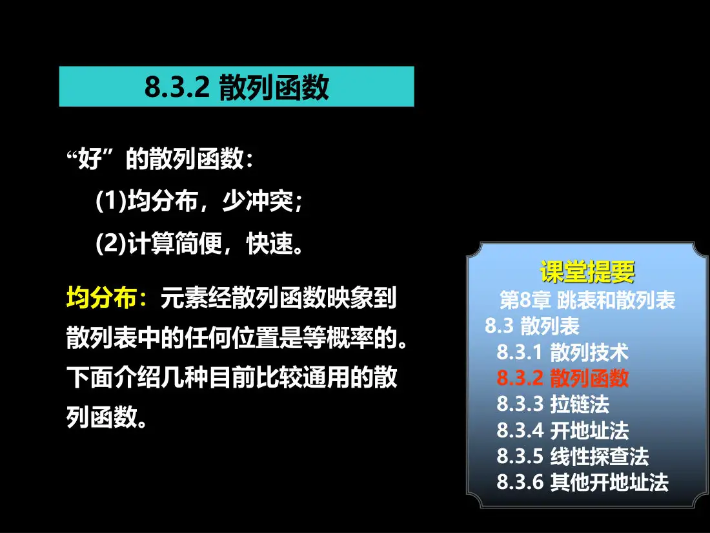

原文：

8.3.2 散列函数

“好”的散列函数：

(1)均分布，少冲突；

(2)计算简便，快速。

均分布：元素经散列函数映象到散列表中的任何位置是等概率的。下面介绍几种目前比较通用的散列函数。

课堂提要第8章 跳表和散列表8.3 散列表8.3.1 散列技术8.3.2 散列函数8.3.3 拉链法8.3.4 开地址法8.3.5 线性探查法8.3.6 其他开地址法

### 1、除留余数法

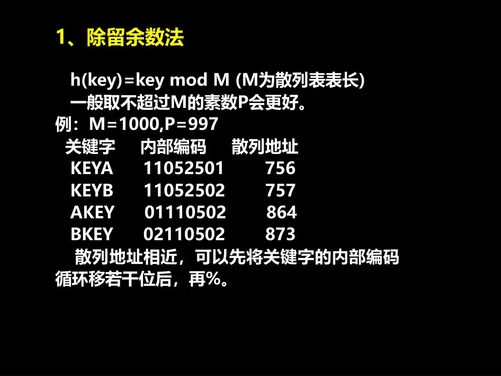

原文：

1、除留余数法

h(key)=key mod M (M为散列表表长)般取不超过M的素数P会更好。

例： $\mathrm { { I I } } \dot { \mathbf { \eta } } = \mathrm { { I I } } \left( 0 . 0 0 0 \right) \dot { \mathbf { \eta } } = \mathrm { { e } } \mathbf { \eta } \cdot \mathbf { \eta }$

关键字 内部编码 散列地址

KEYA 11052501 756

KEYB 11052502 757

AKEY 01110502 864

BKEY 02110502 873

散列地址相近，可以先将关键字的内部编码循环移若干位后，再%。

### 2、平方取中法

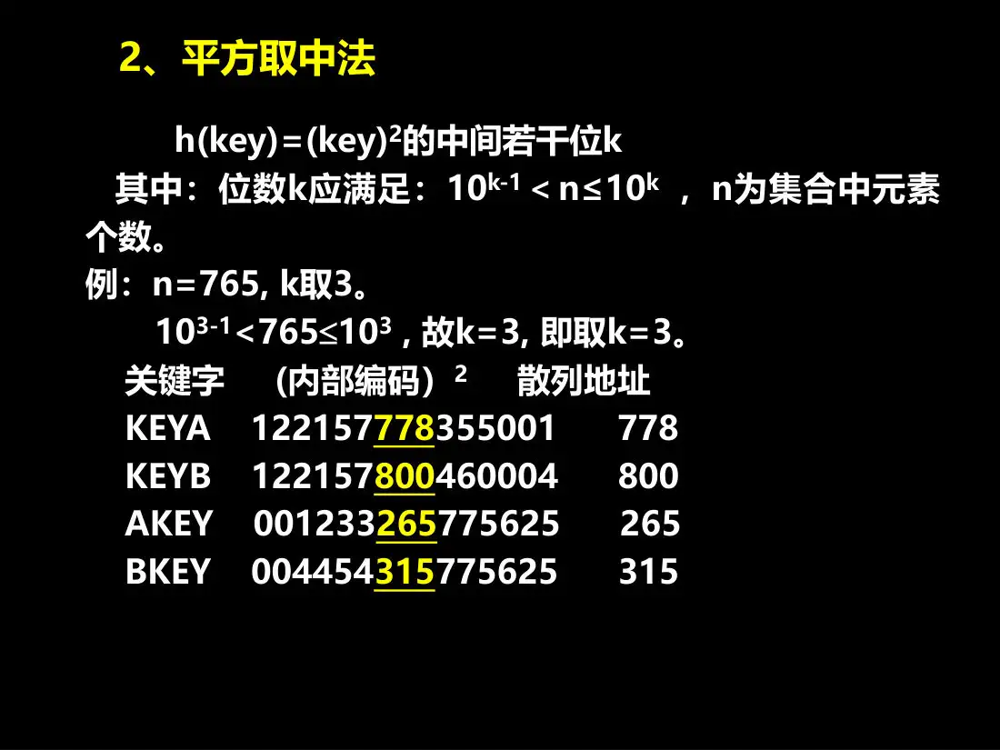

原文：

2、平方取中法

$\mathbb { M } ( \mathbb { C } \mathbb { 2 } ) \mathbb { 2 } ( \mathbb { C } \mathbb { 2 } \mathbb { 2 } )$ 2的中间若干位k其中：位数k应满足： $6 0 0 - 4 0 = 1 0 0$ ，n为集合中元素个数。

例：n=765, k取3。$( 1 0 ) \times ( - 1 1 0 ) = - 1 1 0$ , 故k=3, 即取k=3。关键字 (内部编码） 2 散列地址KEYA 122157778355001 778KEYB 122157800460004 800AKEY 001233265775625 265BKEY 004454315775625 315

### 3、 折叠法

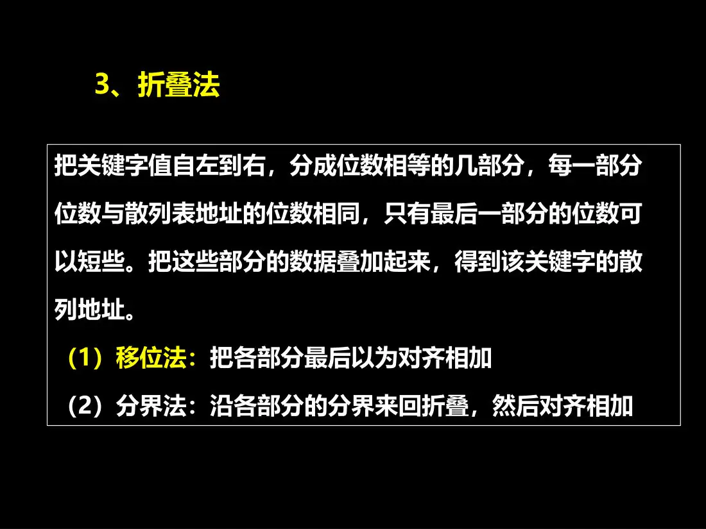

原文：

3、 折叠法

把关键字值自左到右，分成位数相等的几部分，每一部分位数与散列表地址的位数相同，只有最后一部分的位数可以短些。把这些部分的数据叠加起来，得到该关键字的散列地址。

（1）移位法：把各部分最后以为对齐相加

（2）分界法：沿各部分的分界来回折叠，然后对齐相加例：设关键字key=12320324111220，散列地址取3位，则key被划分位5段：

### 123 203 241 112 20

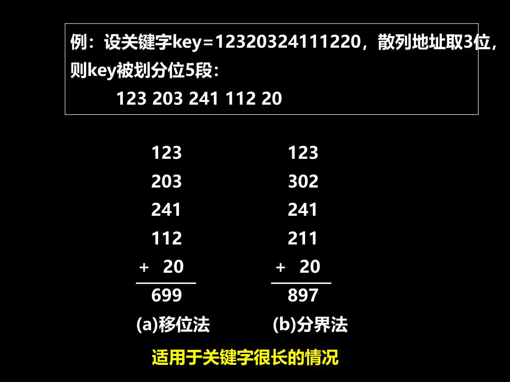

原文：

123 203 241 112 20

<table><tr><td>123</td><td>123</td></tr><tr><td>203</td><td>302</td></tr><tr><td>241</td><td>241</td></tr><tr><td>112</td><td>211</td></tr><tr><td>+ 20</td><td>+ 20</td></tr><tr><td>699</td><td>897</td></tr><tr><td>(a)移位法</td><td>(b)分界法</td></tr></table>

适用于关键字很长的情况

### 4、数字分析法

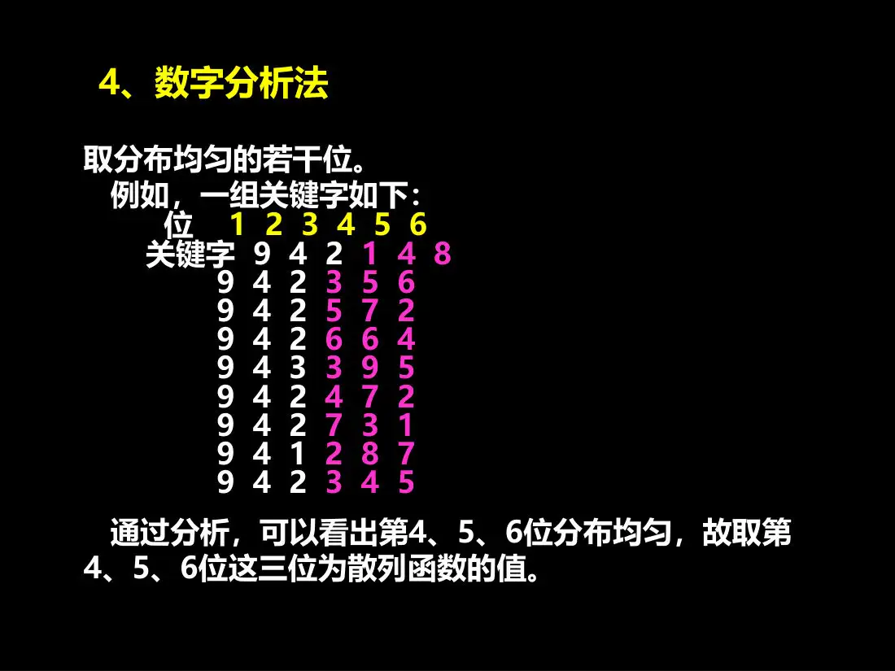

原文：

4、数字分析法

取分布均匀的若干位。例如， 组关键字如下：位 1 2 3 4 5 6关键字 8

通过分析，可以看出第4、5、6位分布均匀，故取第4、5、6位这三位为散列函数的值。

### 冲突是不可避免的。当冲突发生时，必须对冲突进行处理。

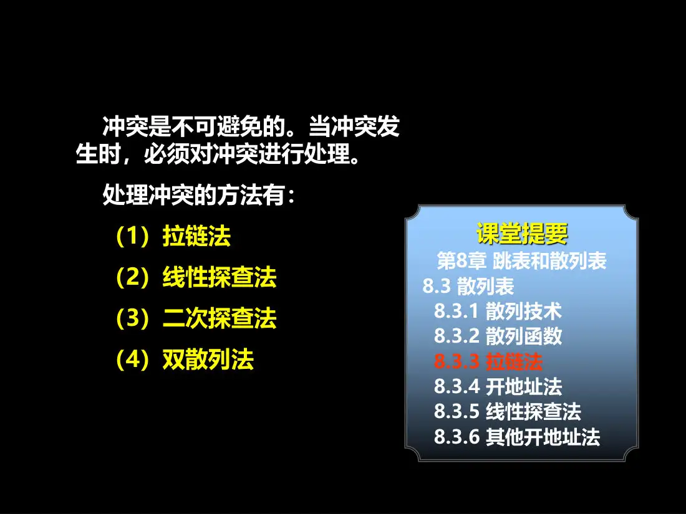

原文：

冲突是不可避免的。当冲突发生时，必须对冲突进行处理。

处理冲突的方法有：

（1）拉链法

课堂提要

（2）线性探查法

第8章 跳表和散列表

8.3 散列表

（3）二次探查法

（4）双散列法

8.3.1 散列技术

8.3.2 散列函数

8.3.3 拉链法

8.3.4 开地址法

8.3.5 线性探查法

8.3.6 其他开地址法

### 8.3.3 拉链法

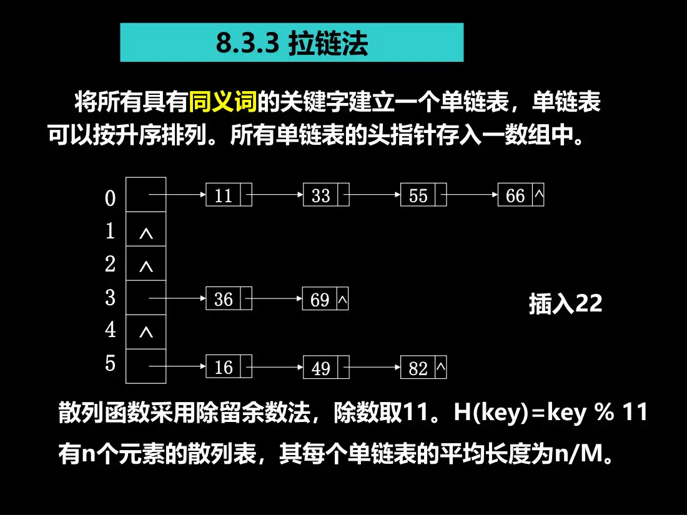

原文：

8.3.3 拉链法

将所有具有同义词的关键字建立一个单链表，单链表可以按升序排列。所有单链表的头指针存入一数组中。

插入22

散列函数采用除留余数法，除数取11。H(key)=key % 11有n个元素的散列表，其每个单链表的平均长度为n/M。

### 8.3.4 开地址法

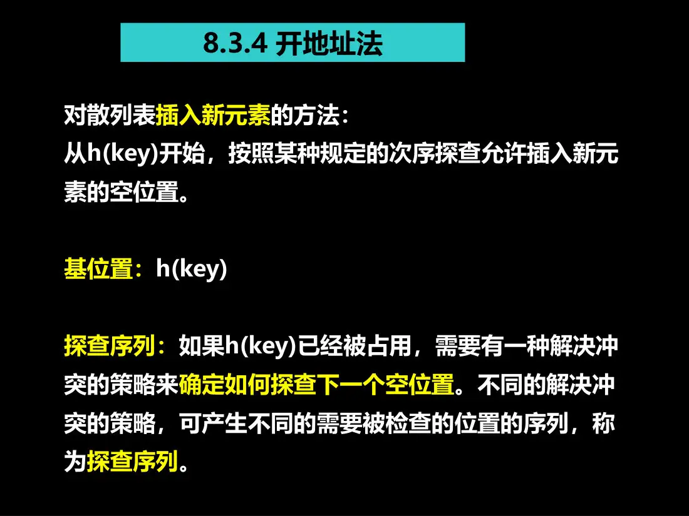

原文：

8.3.4 开地址法

对散列表插入新元素的方法：从h(key)开始，按照某种规定的次序探查允许插入新元素的空位置。

基位置： $\mathbb { M } ( \mathbb { G } ( \mathbb { 2 } \mathbb { 2 } ) )$

探查序列：如果h(key)已经被占用，需要有一种解决冲突的策略来确定如何探查下一个空位置。不同的解决冲突的策略，可产生不同的需要被检查的位置的序列，称为探查序列。

### • 根据生成探查序列的规则的不同，开地址法有：

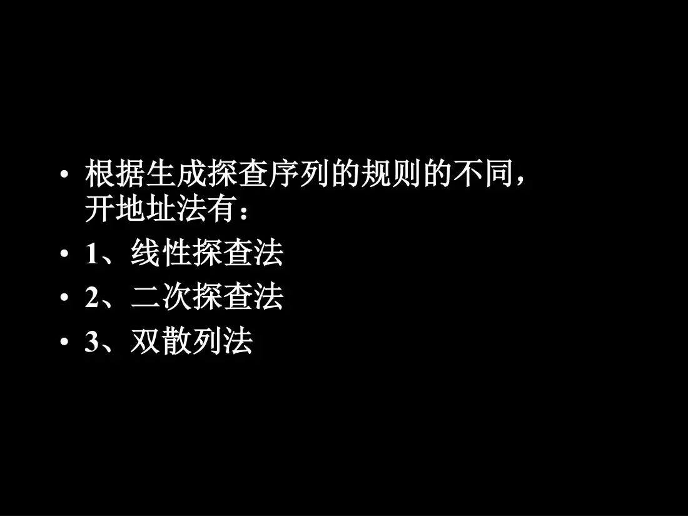

原文：

• 根据生成探查序列的规则的不同，开地址法有：

• 1、线性探查法

• 2、二次探查法

• 3、双散列法

### 1、线性探查法

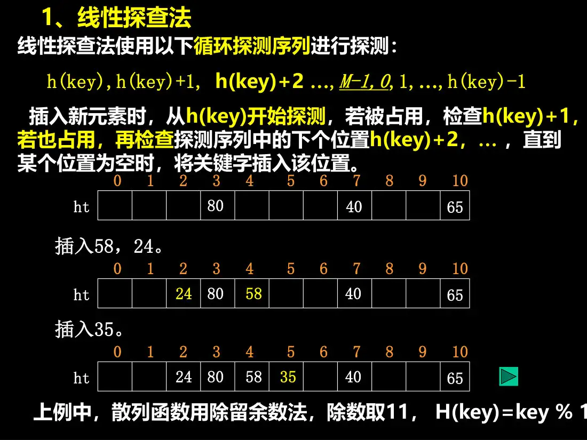

原文：

1、线性探查法

线性探查法使用以下循环探测序列进行探测：

插入新元素时，从h(key)开始探测，若被占用，检查h(key)+1，若也占用，再检查探测序列中的下个位置h(key)+2，… ，直到某个位置为空时，将关键字插入该位置。

插入58，24。

上例中，散列函数用除留余数法，除数取11， H(key)=key % 1

### 线性探查散列表的搜索

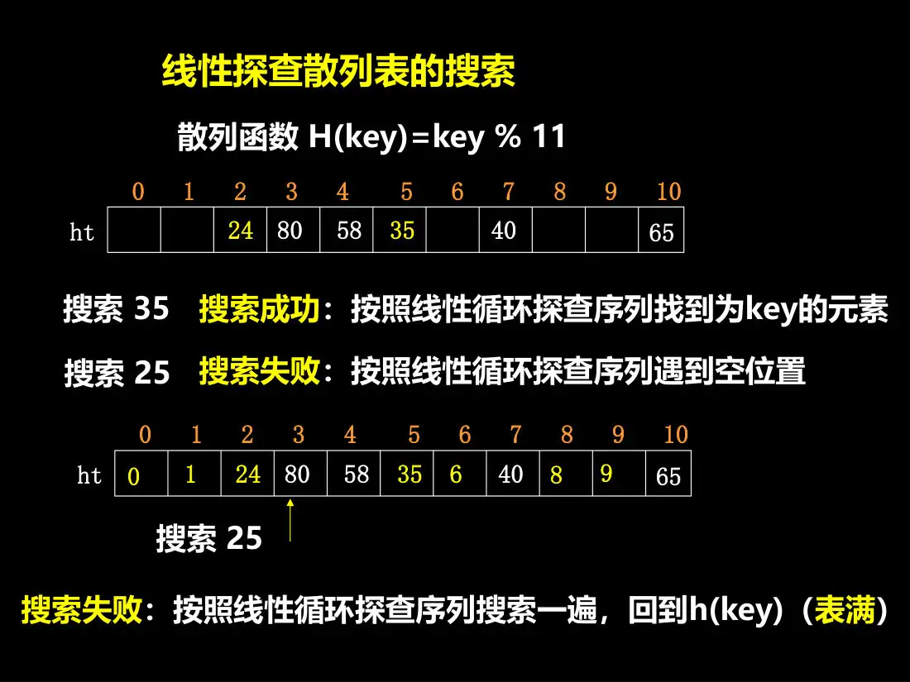

原文：

线性探查散列表的搜索

散列函数 H(key)=key % 11

0 1 2 3 4 5 6 7 8 9 10 ht 24 80 58 35 40 65

搜索 35 搜索成功：按照线性循环探查序列找到为key的元素

搜索 25 搜索失败：按照线性循环探查序列遇到空位置

0 1 2 3 4 5 6 7 8 9 10 ht 0 1 24 80 58 35 6 40 8 9 65

搜索 25

搜索失败：按照线性循环探查序列搜索一遍，回到h(key)（表满）

### 搜索成功：找到关键字值为key的元素；

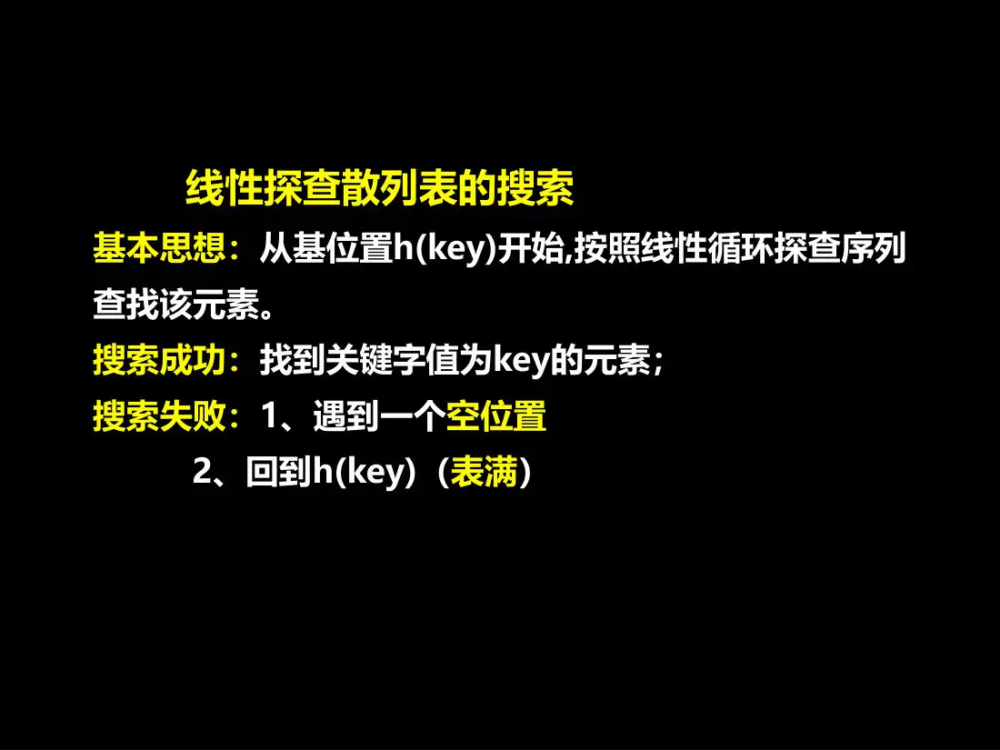

原文：

线性探查散列表的搜索基本思想：从基位置h(key)开始,按照线性循环探查序列查找该元素。

搜索成功：找到关键字值为key的元素；

搜索失败：1、遇到一个空位置

2、回到h(key)（表满）

### 线性探查散列表的删除

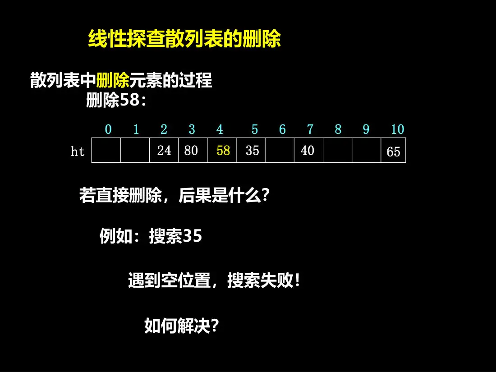

原文：

线性探查散列表的删除

散列表中删除元素的过程删除58：

若直接删除，后果是什么？

例如：搜索35

遇到空位置，搜索失败！

如何解决？

### 线性探查散列表的删除删除时需考虑两点：

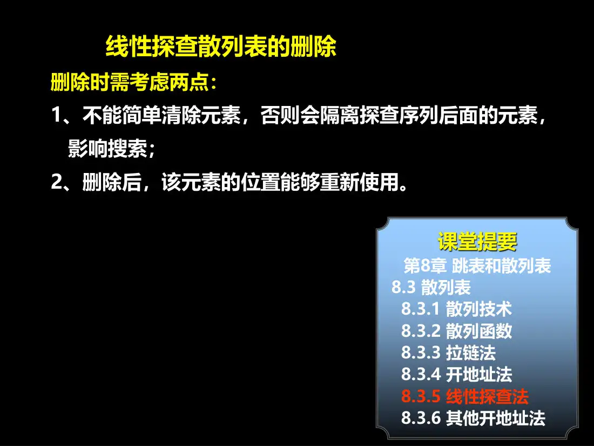

原文：

线性探查散列表的删除删除时需考虑两点：

1、不能简单清除元素，否则会隔离探查序列后面的元素，影响搜索；

2、删除后，该元素的位置能够重新使用。

课堂提要第8章 跳表和散列表

8.3 散列表

8.3.1 散列技术

8.3.2 散列函数

8.3.3 拉链法

8.3.4 开地址法

8.3.5 线性探查法

8.3.6 其他开地址法

### 删除元素的方法：

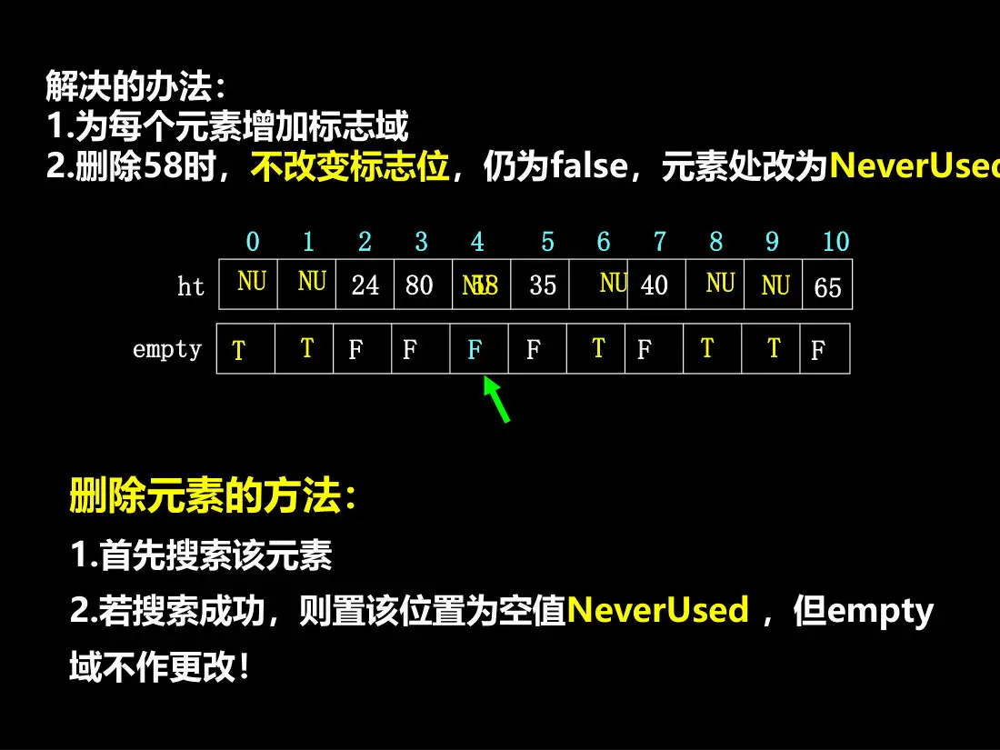

原文：

解决的办法：1.为每个元素增加标志域2.删除58时，不改变标志位，仍为false，元素处改为NeverUse

0 1 2 3 4 5 6 7 8 9 10 ht NU NU 24 80 NU 58 35 40NU NU NU 65 empty T T F F F F T F T T F

删除元素的方法：

1.首先搜索该元素

2.若搜索成功，则置该位置为空值NeverUsed ，但empty域不作更改！

### 搜索 35，25

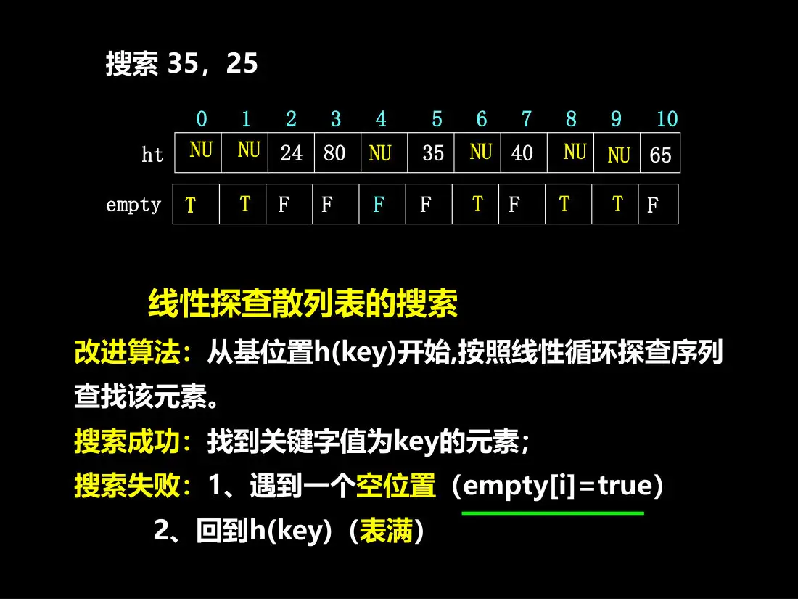

原文：

搜索 35，25

<table><tr><td></td><td>0</td><td>1</td><td>2</td><td>3</td><td>4</td><td>5</td><td>6</td><td>7</td><td>8</td><td>9</td><td>10</td></tr><tr><td>ht</td><td>NU</td><td>NU</td><td>24</td><td>80</td><td>NU</td><td>35</td><td>NU</td><td>40</td><td>NU</td><td>NU</td><td>65</td></tr><tr><td>empty</td><td>T</td><td>T</td><td>F</td><td>F</td><td>F</td><td>F</td><td>T</td><td>F</td><td>T</td><td>T</td><td>F</td></tr></table>

线性探查散列表的搜索改进算法：从基位置h(key)开始,按照线性循环探查序列查找该元素。

搜索成功：找到关键字值为key的元素；

搜索失败：1、遇到一个空位置（empty[i]=true）

2、回到h(key)（表满）

### 线性开地址法散列表的C++类

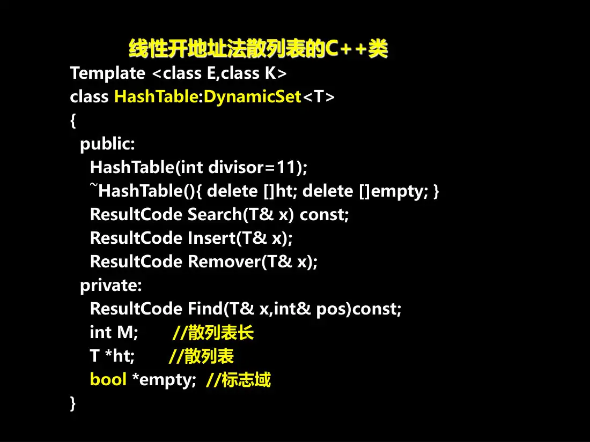

原文：

线性开地址法散列表的C++类

Template <class E,class K> class HashTable:DynamicSet<T>

public:

HashTable(int divisor=11); \~HashTable(){ delete []ht; delete []empty; } ResultCode Search(T& x) const; ResultCode Insert(T& x); ResultCode Remover(T& x);

private:

ResultCode Find(T& x,int& pos)const;

int M; //散列表长

T \*ht; //散列表

bool \*empty; //标志域

### 第 29 页

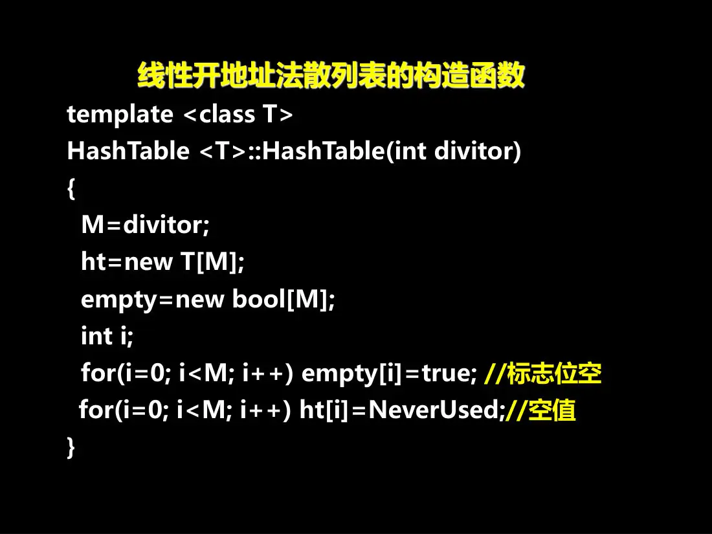

原文：

线性开地址法散列表的构造函数 template <class T> HashTable <T>::HashTable(int divitor)

M=divitor; ht=new T[M]; empty=new bool[M];

for(i=0; i<M; i++) empty[i]=true; //标志位空 for(i=0; i<M; i++) ht[i]=NeverUsed;//空值

### 搜索 35，25

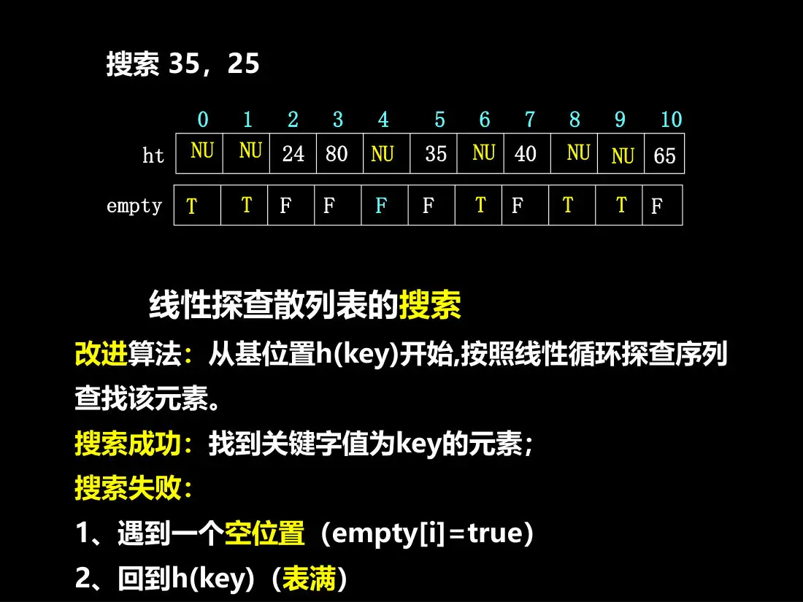

原文：

搜索 35，25

<table><tr><td></td><td>0</td><td>1</td><td>2</td><td>3</td><td>4</td><td>5</td><td>6</td><td>7</td><td>8</td><td>9</td><td>10</td></tr><tr><td>ht</td><td>NU</td><td>NU</td><td>24</td><td>80</td><td>NU</td><td>35</td><td>NU</td><td>40</td><td>NU</td><td>NU</td><td>65</td></tr><tr><td>empty</td><td>T</td><td>T</td><td>F</td><td>F</td><td>F</td><td>F</td><td>T</td><td>F</td><td>T</td><td>T</td><td>F</td></tr></table>

线性探查散列表的搜索改进算法：从基位置h(key)开始,按照线性循环探查序列查找该元素。

搜索成功：找到关键字值为key的元素；搜索失败：

1、遇到一个空位置（empty[i]=true）

2、回到h(key)（表满）

### 第 31 页

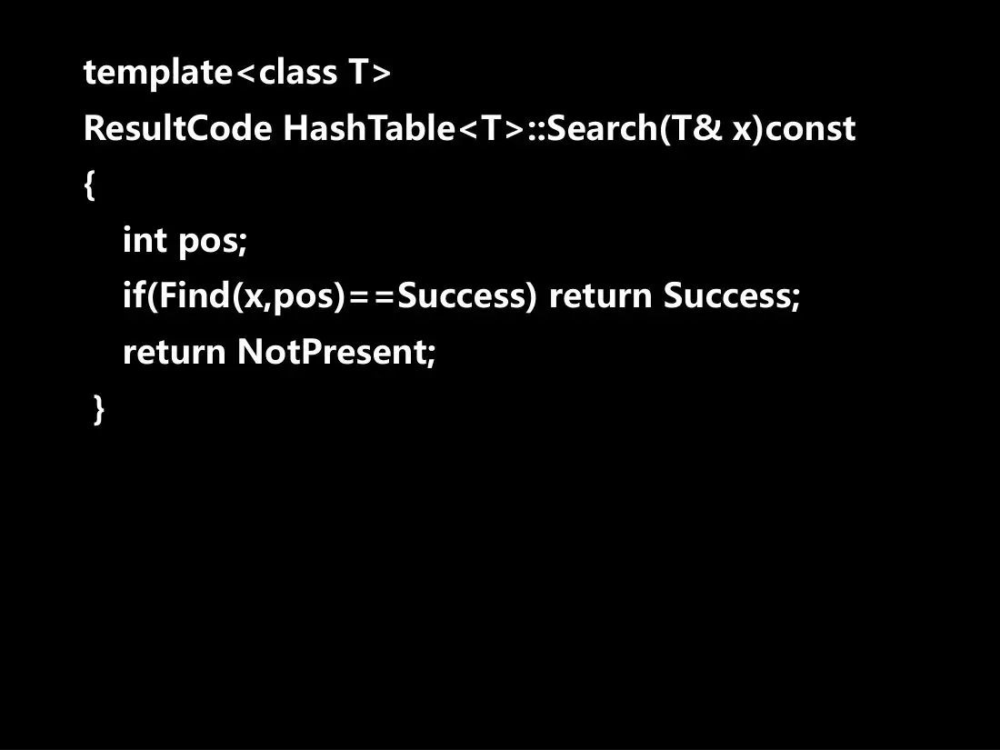

原文：

template<class T> ResultCode HashTable<T>::Search(T& x)const {

int pos; if(Find(x,pos)==Success) return Success; return NotPresent;

### 第 32 页

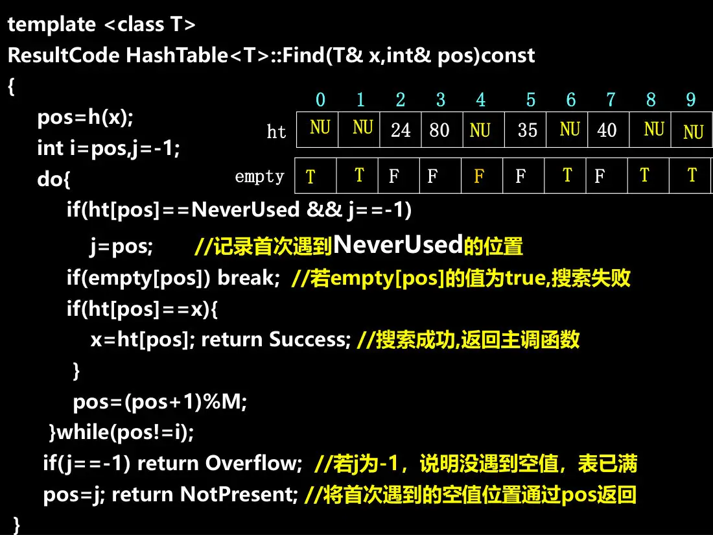

原文：

template <class T> ResultCode HashTable<T>::Find(T& x,int& pos)const

0 1 2 3 4 5 6 7 8 9pos=h(x); ht NU NU 24 80 NU 35 NU 40 NU NUint i=pos,j=-1;do{ empty T T F F F F T F T Tif(ht[pos]==NeverUsed && j==-1)j=pos; //记录首次遇到NeverUsed的位置if(empty[pos]) break; //若empty[pos]的值为true,搜索失败if(ht[pos]==x){x=ht[pos]; return Success; //搜索成功,返回主调函数}pos=(pos+1)%M;}while(pos!=i);if(j==-1) return Overflow; //若j为-1，说明没遇到空值，表已满pos=j; return NotPresent; //将首次遇到的空值位置通过pos返回

### 删除元素的方法：

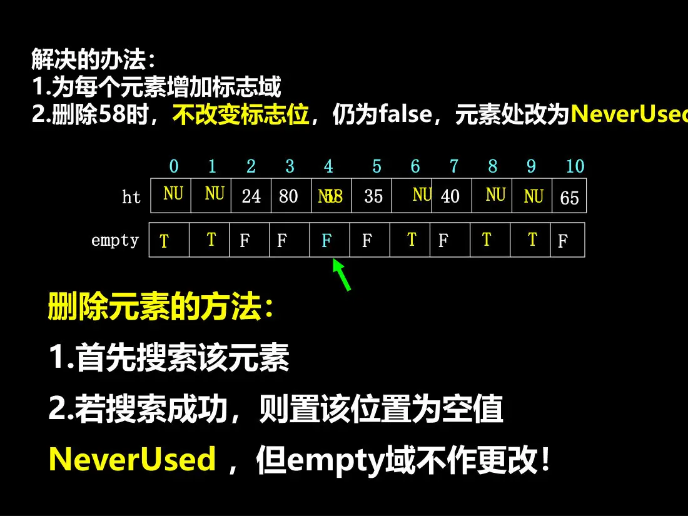

原文：

解决的办法：1.为每个元素增加标志域2.删除58时，不改变标志位，仍为false，元素处改为NeverUse

0 1 2 3 4 5 6 7 8 9 10 ht NU NU 24 80 NU 58 35 40NU NU NU 65 empty T T F F F F T F T T F

删除元素的方法：

1.首先搜索该元素

2.若搜索成功，则置该位置为空值

NeverUsed ，但empty域不作更改！

### 程序8.10 线性探查散列表的删除

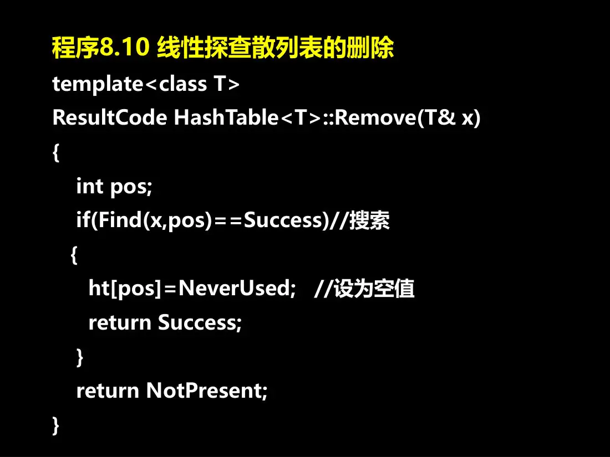

原文：

程序8.10 线性探查散列表的删除

int pos; if(Find(x,pos)==Success)//搜索

ht[pos]=NeverUsed; //设为空值 return Success;

return NotPresent;

### 第 35 页

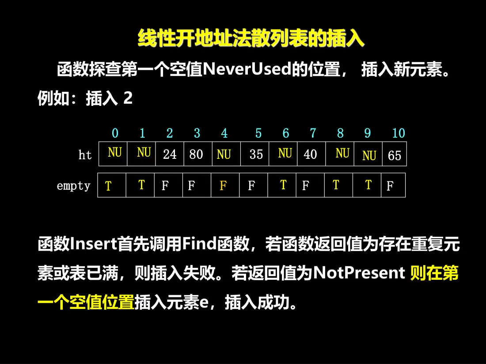

原文：

线性开地址法散列表的插入函数探查第一个空值NeverUsed的位置， 插入新元素。例如：插入 2

0 1 2 3 4 5 6 7 8 9 10 ht NU NU 24 80 NU 35 NU 40 NU NU 65 empty T T F F F F T F T T F

函数Insert首先调用Find函数，若函数返回值为存在重复元素或表已满，则插入失败。若返回值为NotPresent 则在第一个空值位置插入元素e，插入成功。

### 第 36 页

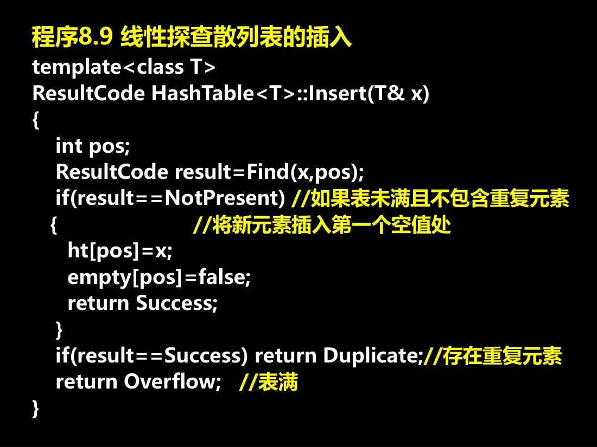

原文：

程序8.9 线性探查散列表的插入 template<class T> ResultCode HashTable<T>::Insert(T& x)

int pos;ResultCode result=Find(x,pos);if(result==NotPresent) //如果表未满且不包含重复元素{ //将新元素插入第一个空值处

ht[pos]=x; empty[pos]=false; return Success;

if(result==Success) return Duplicate;//存在重复元素 return Overflow; //表满

### 8.3.6 其他开地址法

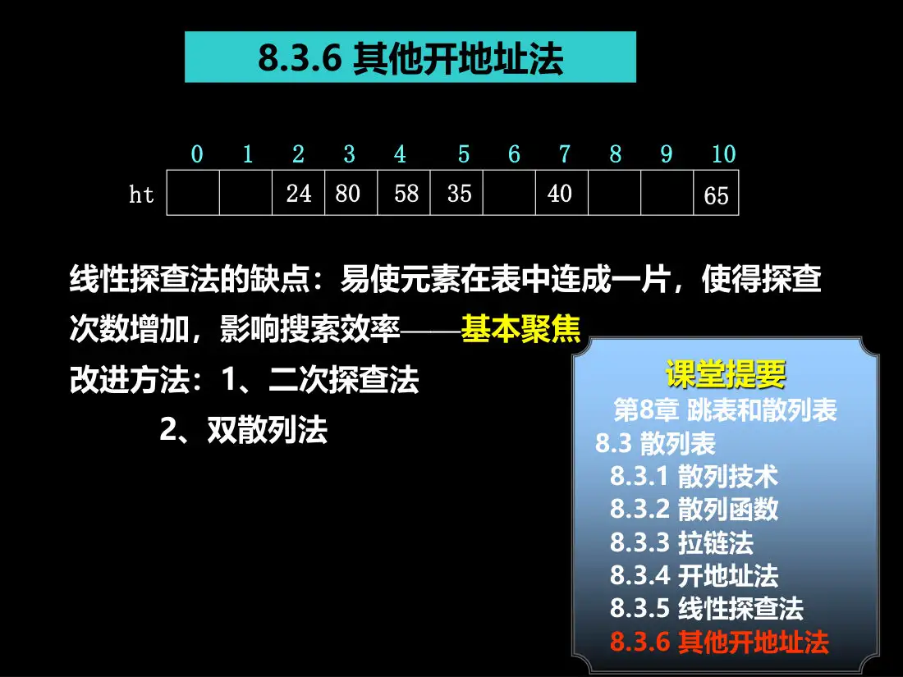

原文：

8.3.6 其他开地址法

0 1 2 3 4 5 6 7 8 9 10 ht 24 80 58 35 40 65

线性探查法的缺点：易使元素在表中连成一片，使得探查次数增加，影响搜索效率— 基本聚焦

改进方法：1、二次探查法

2、双散列法

课堂提要

第8章 跳表和散列表

8.3 散列表

8.3.1 散列技术

8.3.2 散列函数

8.3.3 拉链法

8.3.4 开地址法

8.3.5 线性探查法

8.3.6 其他开地址法

### 第 38 页

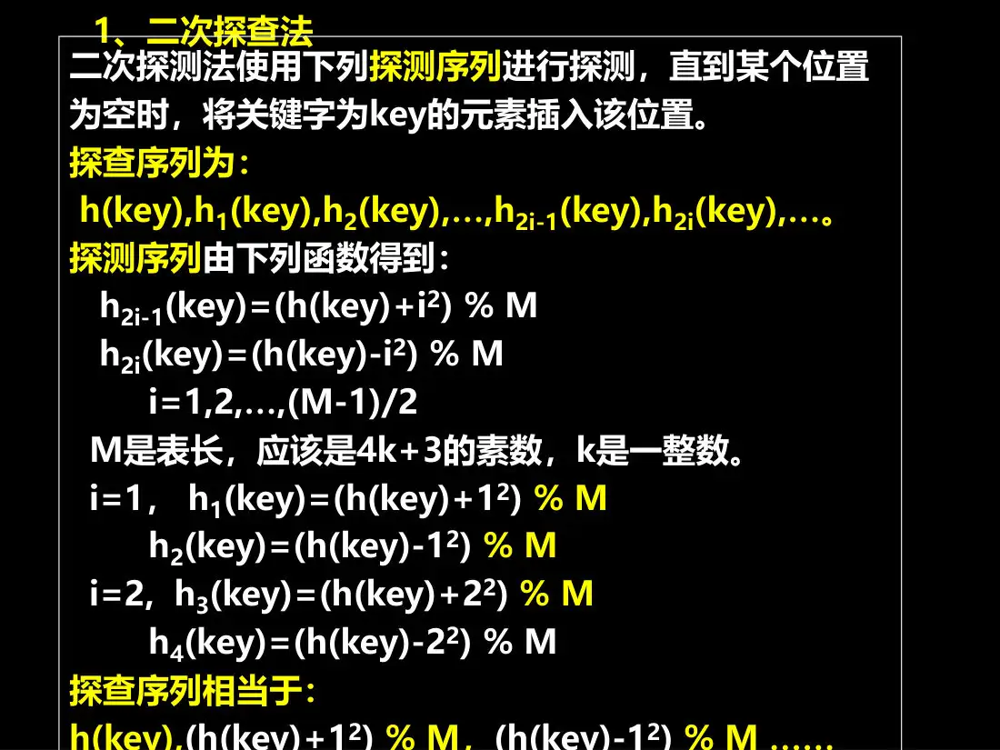

原文：

二次探查法二次探测法使用下列探测序列进行探测，直到某个位置为空时，将关键字为key的元素插入该位置。探查序列为：$( 1 1 ( 1 0 ) ) 1 0 ( 1 0 ) 1 0 ( 1 0 ) 2 0 ( 1 0 ) 1 0 ( 1 0 ) 2 0 ( 1 0 ) 2 0 ( 1 0 )$ 探测序列由下列函数得到：$( 1 ) ( 1 0 ) [ ( 1 1 ( 1 0 ) ) ( 1 0 ) ( 1 0 ) ] = ( 1 0 ) ( 1 0 ) ( 1 0 ) ( 1 0 ) ( 1 0 ) ( 1 0 ) ( 1 0 ) ( 1 0 ) ( 1 0 ) ( 1 0 ) ( 1 0 ) ( 1 0 ) ( 1 0 ) ( 1 0 ) ( 1 0 ) ( 1 0 ) ( 1 0 )$ $( 1 ) ( ( - 1 ) ) = ( 1 ) ( ( - 1 ) + 1 )$ % M$\mathbf { \hat { \Pi } } = ( \mathbf { \hat { m } } + \mathbf { \hat { m } } ) \mathbf { \hat { m } } ( \mathbf { \bar { m } } - \mathbf { \hat { m } } ) \mathbf { \hat { m } } ( \mathbf { \bar { m } }$ M是表长，应该是4k+3的素数，k是一整数。i=1， $1 1 ( 1 0 - 2 ) = ( 1 1 ( 1 0 - 2 ) ) = ( 2 0 )$ % M$\operatorname { I p } ( \operatorname { C O } ) = \operatorname { G T } ( \operatorname { C O } ) = \operatorname { I p } ( \operatorname { C O } )$ % Mi=2, $\boxed { 1 } \boxed { 1 } \boxed { 1 } \boxed { 2 } \boxed { 2 } \boxed { 1 } \boxed { 1 } \boxed { 1 } \boxed { 2 } \boxed { 2 } \boxed { 1 } \boxed { 2 } \boxed { 1 }$ % M$\mathrm { l y } ( \mathrm { C O D } ) = ( \mathrm { l f } ( \mathrm { C O D } ) + 2 )$ % M探查序列相当于：h(key),(h(key)+12) % M，(h(key)-12) % M

### 插入35

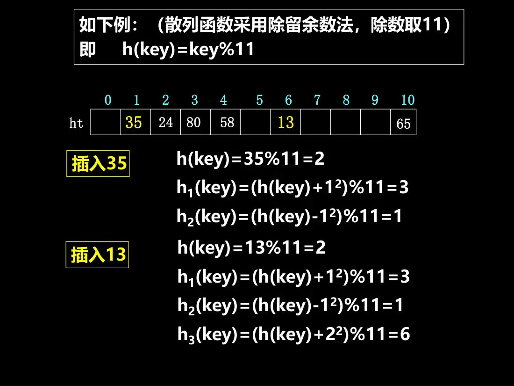

原文：

如下例： （散列函数采用除留余数法，除数取11）即 $[ [ ( \langle { \langle { \bf { \vec { x } } \rangle } } _ { 2 } ] = \langle { \langle { \bf { \vec { x } } \rangle } } _ { 2 } ^ { \prime } \langle { \bf { \vec { x } } } | ]$

0 1 2 3 4 5 6 7 8 9 10 ht 35 24 80 58 13 65

插入35

插入13

$\ln ( \cos 2 ) = - \sin ( \sqrt { 2 } - \sqrt { 2 } )$ $[ \Gamma ( - 2 ) ] = ( 4 ( - 2 ) + 6 ) ( - 2 ) ( - 6 )$ $\Delta B C ( A ) = ( \Delta B C ( A ) ) ( \Delta B ) ( \Delta B ) = ( \Delta B C ( A ) ) ( \Delta B C ( A ) )$ $\mathrm { I I } ( \mathrm { C } \cdot \mathrm { > } \mathrm { ) = I } ( \mathrm { e } \mathrm { > } \mathrm { ) , } \mathrm { A } \mathrm { t } \mathrm { = } \mathrm { } \mathrm { > } \mathrm { ) }$ $\mathrm { i } \pi ( \odot ) = ( \mathrm { i } ( \mathrm { i } ( \odot ) ) , \mathrm { i } \infty ) \times \mathrm { i } ( \mathrm { i } ( \cdot \odot ) ) = \mathrm { i } ( \mathrm { i } ( \cdot \odot ) )$ $\Delta A ( ( - 2 ) ) = ( - 1 1 ( - 2 ) ) ( - 2 ) ( - 1 1 ( - 2 ) )$ $\angle E ( \cdot \Theta ) = ( 1 1 ( \cdot \Theta ) ) ( 2 \cdot \Theta ) ( 2 \cdot \Theta ) = 0$

### 2、双散列法

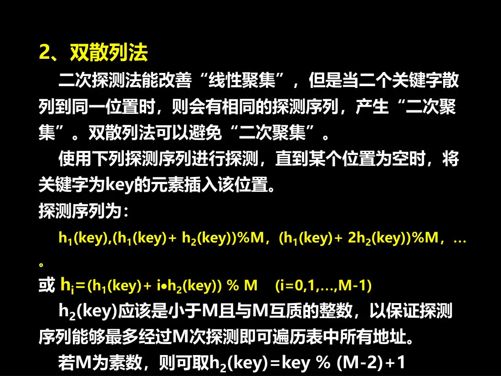

原文：

2、双散列法

二次探测法能改善“线性聚集”，但是当二个关键字散列到同一位置时，则会有相同的探测序列，产生“二次聚集”。双散列法可以避免“二次聚集”。

使用下列探测序列进行探测，直到某个位置为空时，将关键字为key的元素插入该位置。

探测序列为：

$\mathrm { I r } ( \mathrm { C 2 } ) \mathrm { R t } ( \mathrm { C 2 } ) = \mathrm { R t } ( \mathrm { C 2 } ) \mathrm { R t } ( \mathrm { C 2 } ) / \mathrm { R t } ( \mathrm { C 2 } ) / \mathrm { R t } ( \mathrm { C 2 } ) / \mathrm { R t } ( \mathrm { C 2 } ) / \mathrm { R t } ( \mathrm { C 2 } ) / \mathrm { R t } ( \mathrm { C 2 } ) / \mathrm { R t } ( \mathrm { C 2 } )$ o或 $U _ { 1 } = ( \mathrm  U r ( C + 2 ) . ~ m ( C + 2 ) . ~ m ( C + 2 ) . ~ ( m ( C + 0 ) ) . ~ ( m ( C + 2 ) . ~ m ( C + 2 ) . ~ m ( C + 2 ) . ~ m ( C + 2 ) . ~ m ( C + 2 ) . ~ m ( C + 2 ) . ~ m ( C + 2 ) . ~ m ( C + 2 ) . ~ m ( C + 2 ) . ~ m ( C + 2 ) . ~ m ( C + 2 ) . ~ m ( C + 2 ) . ~ m ( C + 2 ) . ~ m ( C + 2 ) . ~ m ( C + 2 ) . ~ m ( C + 2 ) . ~ m ( C + 2 ) . ~ m ( C + 2 ) . ~ m ( C + 2 ) . ~ m ( C + 2 ) . ~ m ( C + 2 ) . ~ m ( C + 2 ) . ~ m ( C + 2 ) . ~ m ( C + 2 ) . ~ m ( C + 2 ) . ~ m ( C + 2 ) . ~ m ( C + 2 ) . ~ m ( C + 2 ) . ~ m ( C + 2 ) . ~ m ( C + 2 ) . ~ m ( C + 2 ) . ~ m ( C + 2 ) . ~ m ( C + 2 ) . ~ m ( C + 2 ) . ~ m ( C + 2 ) . ~ m ( C + 2 ) . ~ m ( C + 2 ) . ~ m ( C + 2 ) . ~ m ( C + 2 ) . ~ m ( C + 2 ) . ~ m ( C + 2 ) . ~ m ( C + 2 ) . ~ m ( C + 2 ) . ~ m ( C + ) . ~ m ( C + 2 ) . ~ m ~ m ( C + ) . ~ m ( C + 2 ) . ~ m ~ m ( C + ) . ~ m  ~ m ( C + 2 ) . ~ m . ~ m ( C + ) . ~ m ~ m ( C + ) . ~ m ~ m { } . ~ m ~ m ( C + ) . ~ m ~ m { ~ m } . ~ m { ~ m ~ m } { ~ m } . ~ m  ~ m ~ m { } . ~ m ~ m { } ~ m . ~ m ~ m { } . ~ m ~ m ~ m { } . ~ m ~ m . ~ m ~ m { } . ~ m ~ m . ~ m ~ m . ~ m ~ m { } . ~ m ~ m . ~ m . ~ m ~ m . ~ m ~ m . ~ m ~ m . ~ m . ~ m . ~ m ~ m . ~ m . ~ m . ~ m ~ m . ~ m . ~ m ~ m . ~ m . . ~ m ~ m . . ~ m . ~ m ~ m . . ~ m . ~ m . ~ m ~ m . . . ~ m . ~ m . ~ m ~ m . . . . ~ m ~ m . . .$ $\mathbb { B } ( \mathbb { G } \mathbb { Q } )$ 应该是小于M且与M互质的整数，以保证探测序列能够最多经过M次探测即可遍历表中所有地址。若M为素数，则可取 $\angle D A C = \angle D A C = \angle C A C = \angle C A C = 3 \angle C$

### 插入58

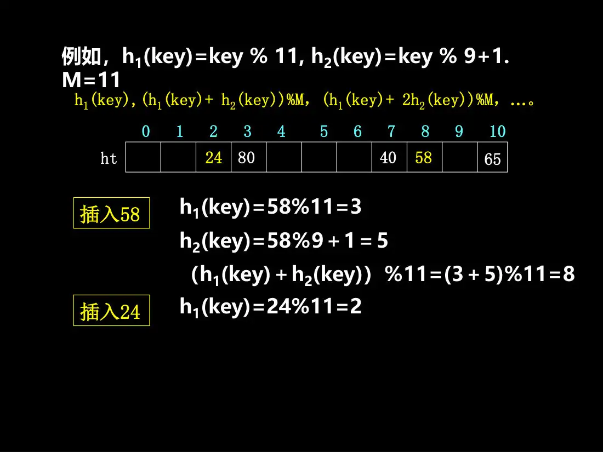

原文：

例如， $\mathrm { P r } ( \cdot  \mathcal { D } ) = \langle \Phi ^ { \prime } ( \cdot ) \cdot \Phi ^ { \prime } ( \cdot ) \vert \Phi ^ { \prime } ( \cdot \Phi ^ { \prime } ) \vert = \langle \Phi ^ { \prime } ( \cdot ) \cdot \Phi ^ { \prime } ( \cdot \Phi ^ { \prime } ( \cdot \Phi ^ { \prime } ) )$ $\mathbb { M } \mathbb { E } \mathbb { I } \mathbb { I }$ h (key),(h (key)+ h (key))%M，(h (key)+ 2h (key))%M，…。 0 1 2 3 4 5 6 7 8 9 10 ht 8024 40 58 65

插入58

$1 1 7 ( 1 0 - 2 ) = 1 - 2 : 3 : 2 ( 1 1 - 2 )$ $1 0 0 ( c m ) = 6 0 0 ( c m ) = 1 0 0 ( c m )$ $( ( 1 ) ( 1 0 0 ) \times 1 0 0 ( 0 0 ) )$ $\langle \langle A ( \pm 2 , \pm 2 ) \rangle \angle A ( \pm 2 ) = 1 2$ $1 1 9 ( 1 0 - 2 ) = 1 2 9 ( 1 1 - 2 ) = 1 2$

插入24
