# 《数据结构》第9章 图（课件）

原件的每一页，下面附识别出的文字。

### 数据结构

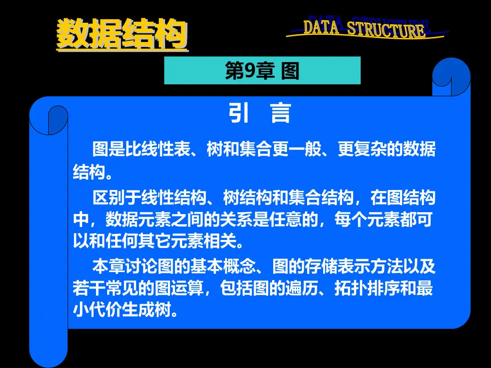

原文：

数据结构

第9章 图

引 言

图是比线性表、树和集合更一般、更复杂的数据结构。

区别于线性结构、树结构和集合结构，在图结构中，数据元素之间的关系是任意的，每个元素都可以和任何其它元素相关。

本章讨论图的基本概念、图的存储表示方法以及若干常见的图运算，包括图的遍历、拓扑排序和最小代价生成树。

DATAA STRUCTURE

### 内容提要

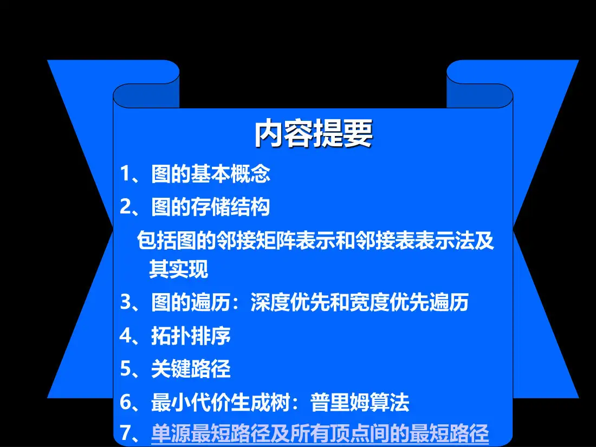

原文：

内容提要

1、图的基本概念

2、图的存储结构包括图的邻接矩阵表示和邻接表表示法及其实现

3、图的遍历：深度优先和宽度优先遍历

4、拓扑排序

5、关键路径

6、最小代价生成树：普里姆算法

7、单源最短路径及所有顶点间的最短路径

### 9.1 图的基本概念

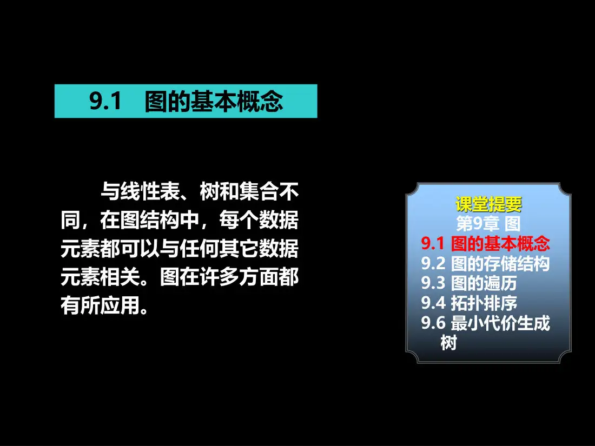

原文：

9.1 图的基本概念

与线性表、树和集合不同，在图结构中，每个数据元素都可以与任何其它数据元素相关。图在许多方面都有所应用。

课堂提要第9章 图9.1 图的基本概念9.2 图的存储结构9.3 图的遍历9.4 拓扑排序9.6 最小代价生成树

### (b) (a)的图表示

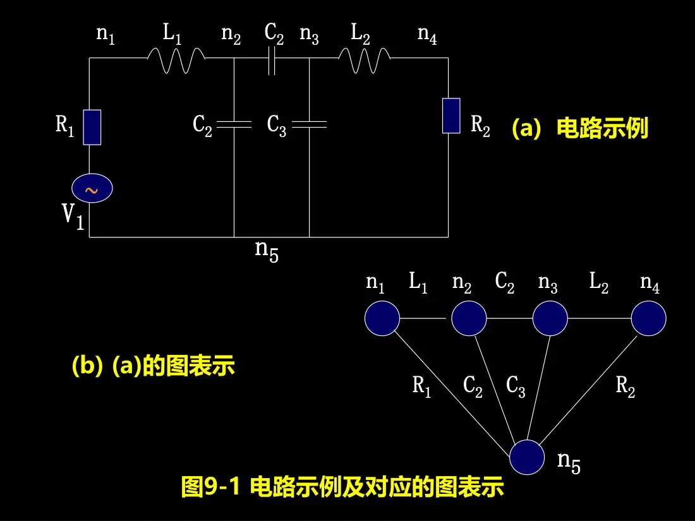

原文：

(b) (a)的图表示

图9-1 电路示例及对应的图表示

### 9.1.1 图的定义与术语

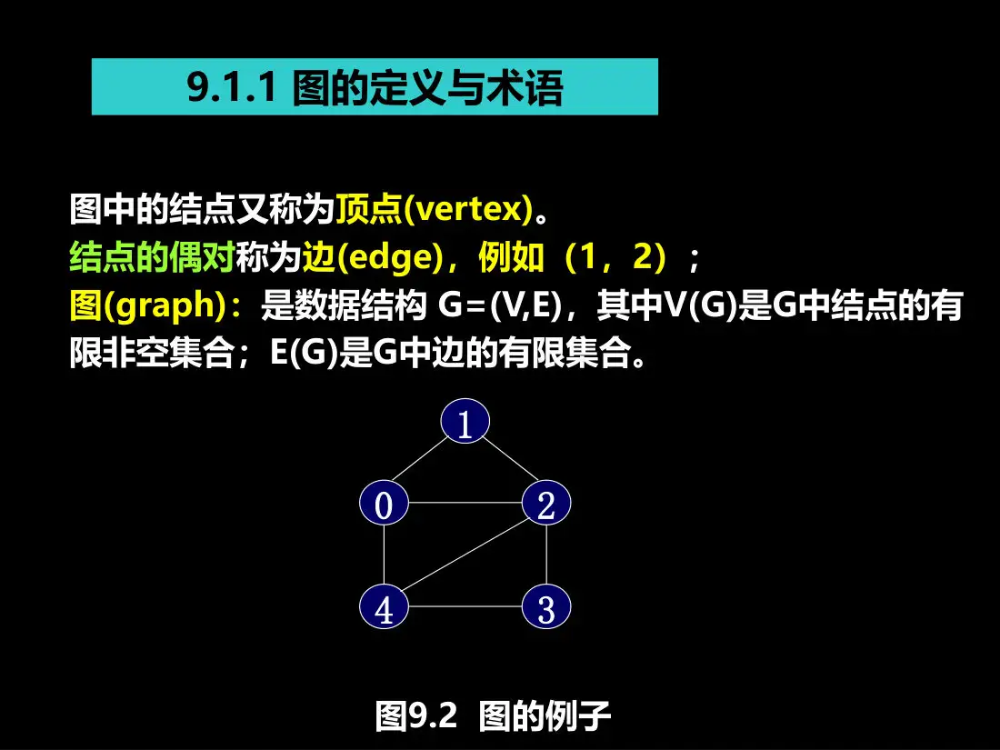

原文：

9.1.1 图的定义与术语

图中的结点又称为顶点(vertex)。结点的偶对称为边(edge)，例如（1，2）；图(graph)：是数据结构 G=(V,E)，其中V(G)是G中结点的有限非空集合；E(G)是G中边的有限集合。

图9.2 图的例子

### 9.1.1 图的定义与术语

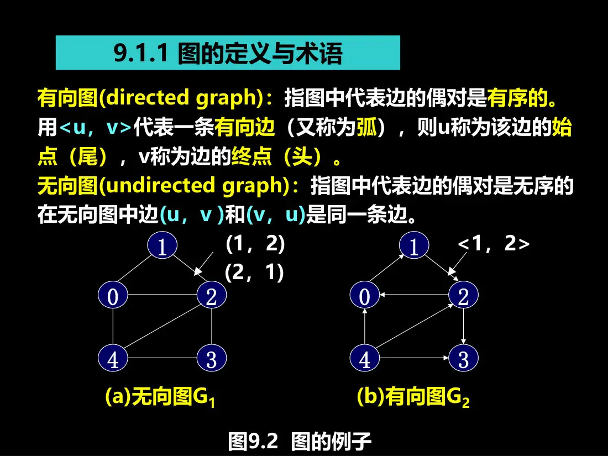

原文：

9.1.1 图的定义与术语

有向图(directed graph)：指图中代表边的偶对是有序的。用<u，v>代表一条有向边（又称为弧），则u称为该边的始点（尾），v称为边的终点（头）。无向图(undirected graph)：指图中代表边的偶对是无序的在无向图中边(u，v )和(v，u)是同一条边。

(a)无向图G1

(b)有向图G2

图9.2 图的例子

### (a)无向图G1

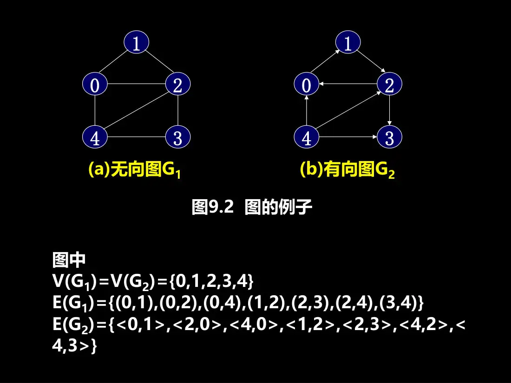

原文：

(a)无向图G1

(b)有向图G2

图9.2 图的例子

图中 $\because \angle C D E = \angle C D E = 9 0 ^ { \circ } - \angle C A B = 9 0 ^ { \circ }$ E(G )={(0,1),(0,2),(0,4),(1,2),(2,3),(2,4),(3,4)} E(G )={<0,1>,<2,0>,<4,0>,<1,2>,<2,3>,<4,2>,< 4,3>}

### 第 8 页

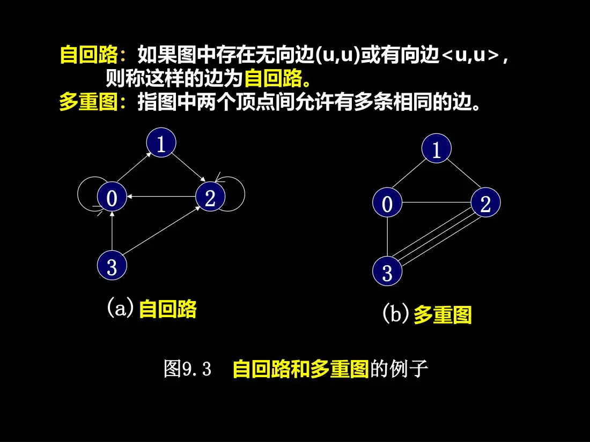

原文：

自回路：如果图中存在无向边(u,u)或有向边 $\mathbf { \nabla } \times \mathbf { U } \mathbf { \mathbb { m } } \mathbf { \mathbb { m } }$ 则称这样的边为自回路。多重图：指图中两个顶点间允许有多条相同的边。

图9.3 自回路和多重图的例子完全图：如果一个图有最多的边数，称为完全图。无向完全图有n(n-1)/2条边，有向完全图有n(n-1)条边。例如：左图是一个完全图。有6条边。

### 图9.2 图的例子

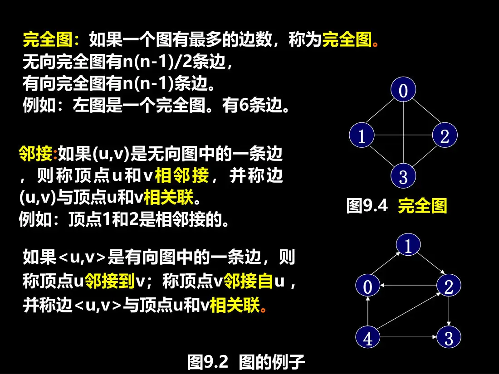

原文：

邻接:如果(u,v)是无向图中的一条边，则称顶点u和v相邻接，并称边(u,v)与顶点u和v相关联。例如：顶点1和2是相邻接的。

如果 $\Xi \bar { \bf M } \bar { \bf p }$ 是有向图中的一条边，则称顶点u邻接到v；称顶点v邻接自u ,并称边 $\mathbf { \nabla } \Xi \mathbf { m }$ 与顶点u和v相关联。

图9.2 图的例子

图9.4 完全图

### 第 10 页

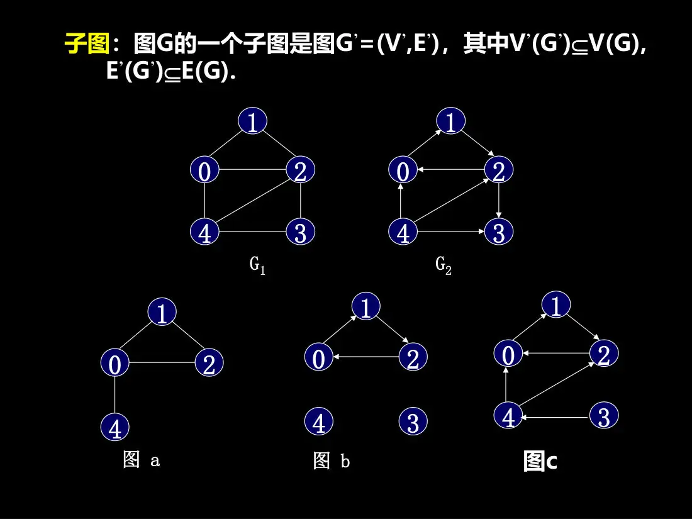

原文：

子图：图G的一个子图是图G’=(V’,E’)，其中V’(G’)V(G),E’(G’)E(G).

### 第 11 页

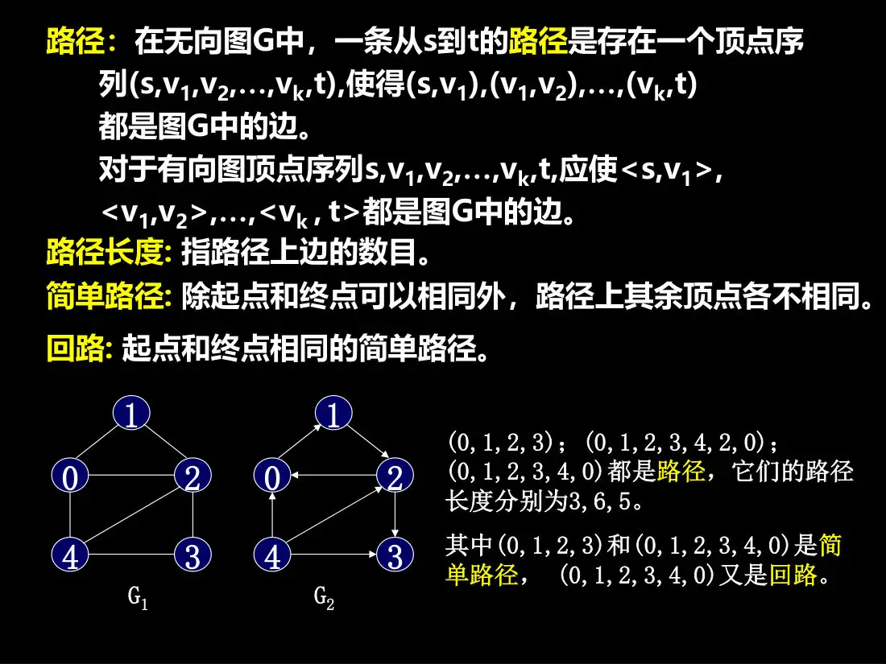

原文：

路径：在无向图G中，一条从s到t的路径是存在一个顶点序列 $6 0 \times 6 0 = 6 0 0 ( c m )$ ,使得 $\sin ( \sqrt { \pi } \cdot \sin ( 2 \sqrt { \pi } ) ) = \sin ( \sqrt { \pi } )$ 都是图G中的边。对于有向图顶点序列s, $n \times \frac { 1 } { 2 } \times \frac { 1 } { 2 } \times \frac { 1 } { 2 } = 1 . 2 ( m o d n )$ 应使 $\eqcirc$ $- \sqrt { 5 } \sqrt { 2 } + \sqrt { 5 } \sqrt { 2 } + \sqrt { 5 } \sqrt { 2 }$ ,t>都是图G中的边。路径长度: 指路径上边的数目。简单路径: 除起点和终点可以相同外，路径上其余顶点各不相同。回路: 起点和终点相同的简单路径。

(0,1,2,3)；(0,1,2,3,4,2,0)； (0,1,2,3,4,0)都是路径，它们的路径 长度分别为3,6,5。

其中(0,1,2,3)和(0,1,2,3,4,0)是简单路径， (0,1,2,3,4,0)又是回路。

### 0和3是连通的 实际上该图任意两个顶点都是连通的，故该图是连通图。

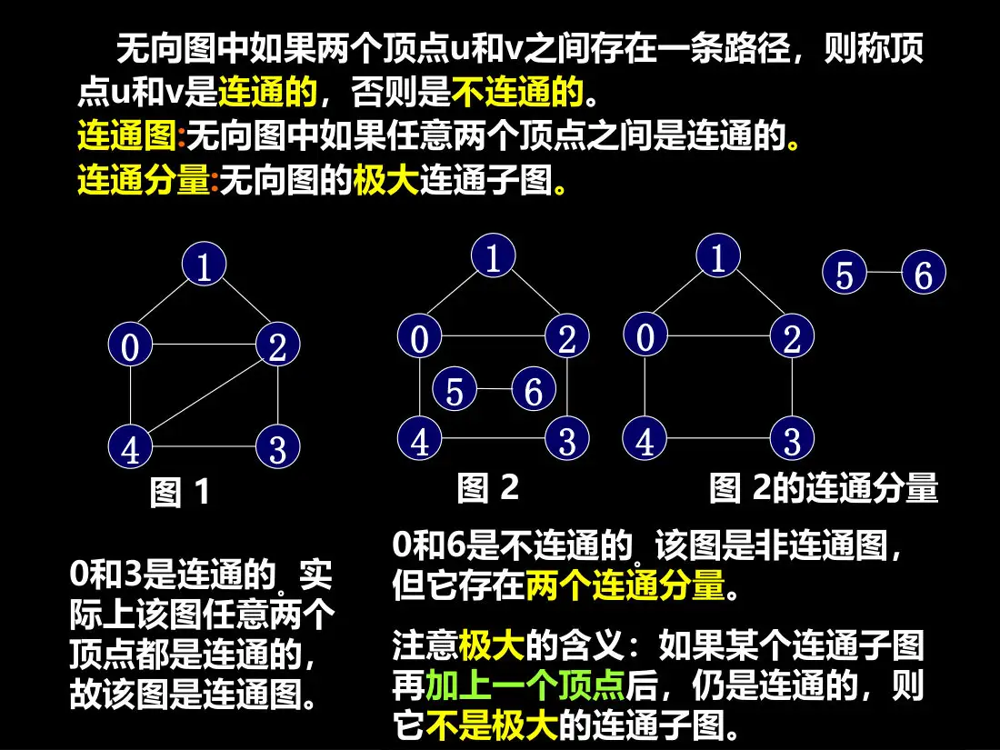

原文：

无向图中如果两个顶点u和v之间存在一条路径，则称顶点u和v是连通的，否则是不连通的。连通图:无向图中如果任意两个顶点之间是连通的。连通分量:无向图的极大连通子图。

0和3是连通的 实际上该图任意两个顶点都是连通的，故该图是连通图。

图 2的连通分量

0和6是不连通的 该图是非连通图，但它存在两个连通分量。

注意极大的含义：如果某个连通子图再加上一个顶点后，仍是连通的，则它不是极大的连通子图。

### 求无向图的连通分量应该注意：

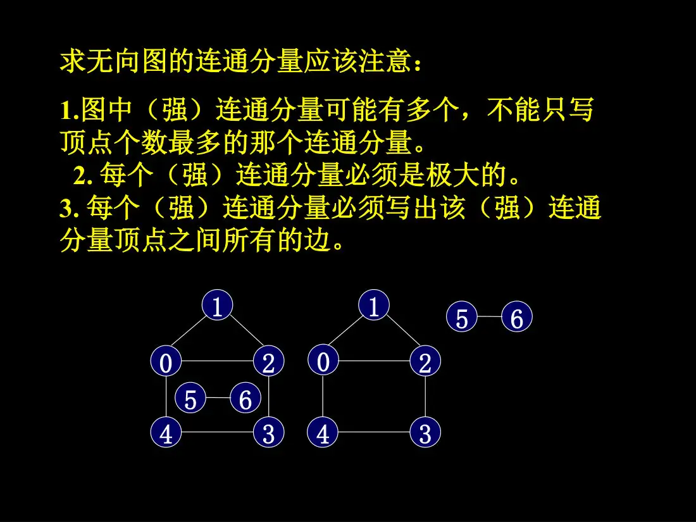

原文：

求无向图的连通分量应该注意：

1.图中（强）连通分量可能有多个，不能只写顶点个数最多的那个连通分量。

2. 每个（强）连通分量必须是极大的。

3. 每个（强）连通分量必须写出该（强）连通分量顶点之间所有的边。

### 强连通分量：有向图的极大连通子图。

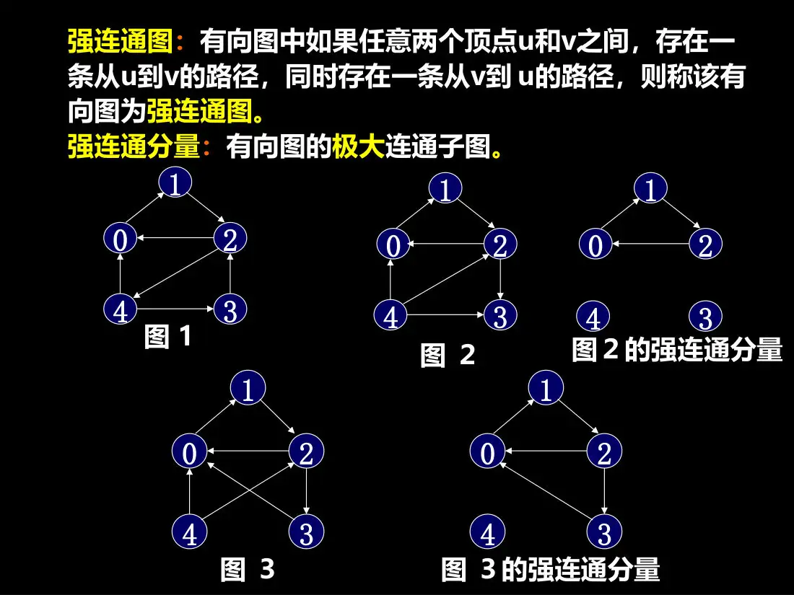

原文：

强连通图：有向图中如果任意两个顶点u和v之间，存在一条从u到v的路径，同时存在一条从v到u的路径，则称该有向图为强连通图。

强连通分量：有向图的极大连通子图。

图 3的强连通分量

### 第 15 页

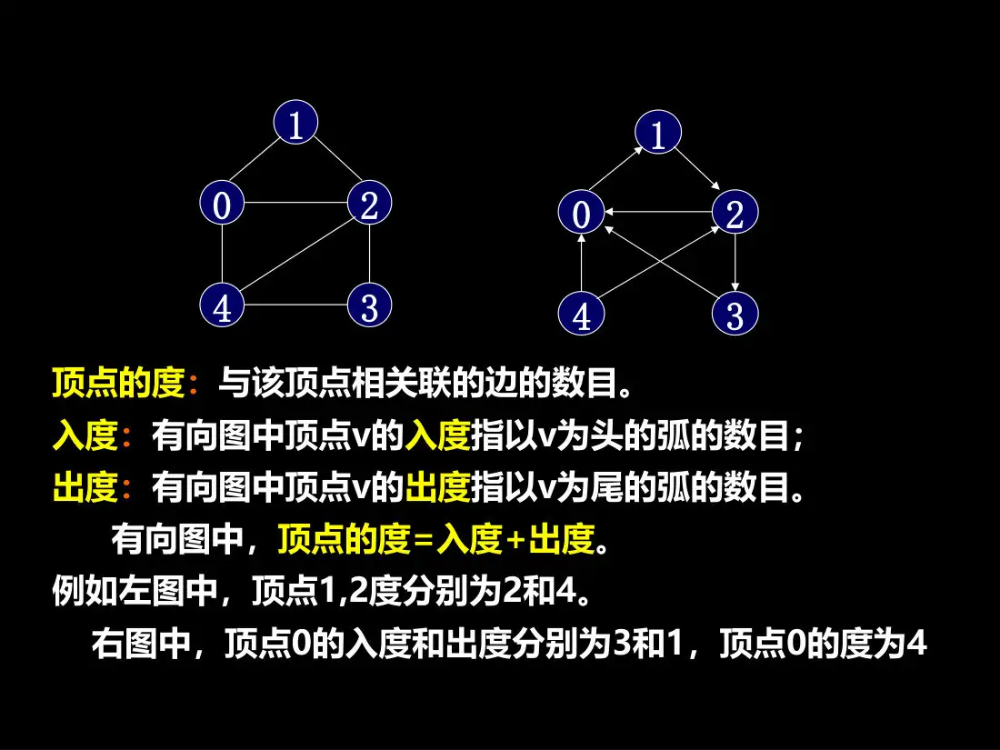

原文：

顶点的度：与该顶点相关联的边的数目。入度：有向图中顶点v的入度指以v为头的弧的数目；出度：有向图中顶点v的出度指以v为尾的弧的数目。有向图中，顶点的度=入度+出度。例如左图中，顶点1,2度分别为2和4。右图中，顶点0的入度和出度分别为3和1，顶点0的度为4生成树：无向图的生成树是一个极小连通子图，它包含图中所有顶点，但只有足以构成一棵树的(n-1)条边。再加上一条边将构成回路。

### 有向无环图（DAG图）：不包含回路的有向图。自由树：不包含回路的连通图。

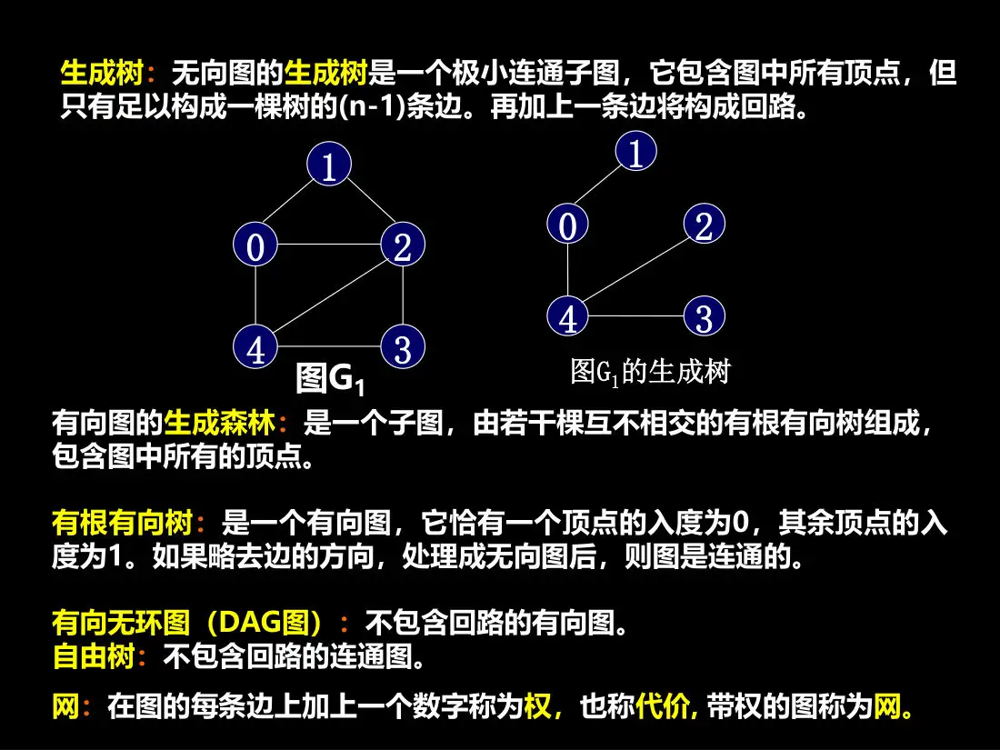

原文：

有向图的生成森林：是一个子图，由若干棵互不相交的有根有向树组成，包含图中所有的顶点。

有根有向树：是一个有向图，它恰有一个顶点的入度为0，其余顶点的入度为1。如果略去边的方向，处理成无向图后，则图是连通的。

有向无环图（DAG图）：不包含回路的有向图。自由树：不包含回路的连通图。

网：在图的每条边上加上一个数字称为权，也称代价, 带权的图称为网。

### 9.1.2 图的抽象数据类型

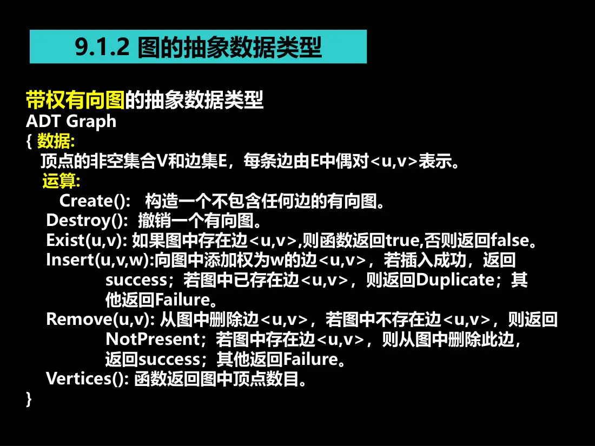

原文：

9.1.2 图的抽象数据类型

带权有向图的抽象数据类型ADT Graph

{ 数据:顶点的非空集合V和边集E，每条边由E中偶对<u,v>表示。运算:

Create(): 构造一个不包含任何边的有向图。Destroy(): 撤销一个有向图。

Exist(u,v): 如果图中存在边<u,v>,则函数返回true,否则返回false。Insert(u,v,w):向图中添加权为w的边<u,v>，若插入成功，返回success；若图中已存在边<u,v>，则返回Duplicate；其他返回Failure。

Remove(u,v): 从图中删除边<u,v>，若图中不存在边<u,v>，则返回NotPresent；若图中存在边<u,v>，则从图中删除此边，返回success；其他返回Failure。Vertices(): 函数返回图中顶点数目。

### 程序9.1 Graph类 template  class Graph

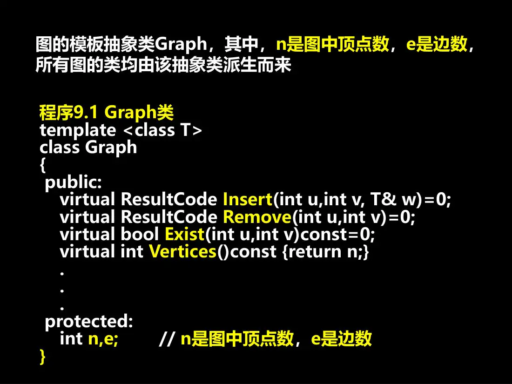

原文：

图的模板抽象类Graph，其中，n是图中顶点数，e是边数，所有图的类均由该抽象类派生而来

程序9.1 Graph类 template <class T> class Graph

virtual ResultCode Insert(int u,int v, T& w)=0; virtual ResultCode Remove(int u,int v)=0; virtual bool Exist(int u,int v)const=0; virtual int Vertices()const {return n;}

protected:int n,e; // n是图中顶点数，e是边数

### 对于图的操作，还有其它成员函数，将在以后陆续介绍。

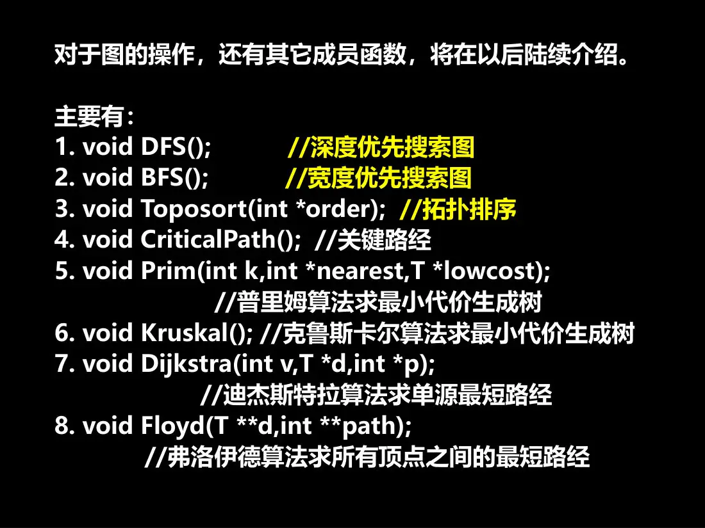

原文：

对于图的操作，还有其它成员函数，将在以后陆续介绍。

主要有：

1. void DFS();

//深度优先搜索图

2. void BFS();

//宽度优先搜索图

3. void Toposort(int \*order); //拓扑排序

4. void CriticalPath(); //关键路经

5. void Prim(int k,int \*nearest,T \*lowcost); //普里姆算法求最小代价生成树

6. void Kruskal(); //克鲁斯卡尔算法求最小代价生成树

7. void Dijkstra(int v,T \*d,int \*p); //迪杰斯特拉算法求单源最短路经

8. void Floyd(T \*\*d,int \*\*path);

//弗洛伊德算法求所有顶点之间的最短路经

### 9.2 图的存储结构

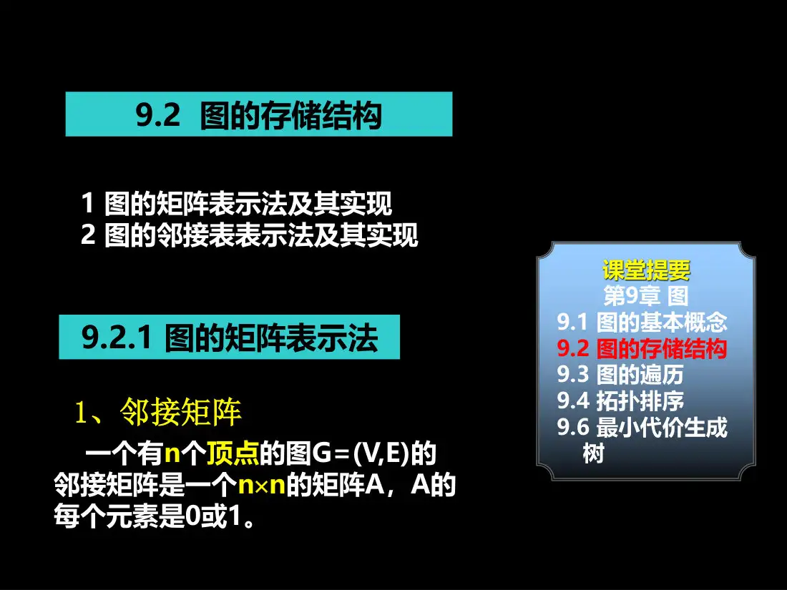

原文：

9.2 图的存储结构

1 图的矩阵表示法及其实现2 图的邻接表表示法及其实现

9.2.1 图的矩阵表示法

1、邻接矩阵

个有n个顶点的图G=(V,E)的 邻接矩阵是一个nn的矩阵A，A的 每个元素是0或1。

课堂提要第9章 图9.1 图的基本概念9.2 图的存储结构9.3 图的遍历9.4 拓扑排序9.6 最小代价生成树

### 设V={0,1,2,……,n-1},如果G是无向图，则A的元素定义为：

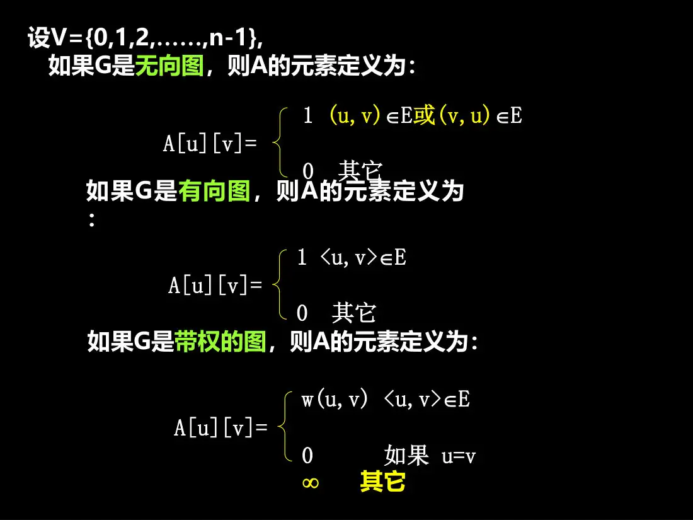

原文：

设V={0,1,2,……,n-1},如果G是无向图，则A的元素定义为：

1 (u, v) ∈E或(v, u) ∈EA[u][v]=0 其它如果G是有向图，则A的元素定义为

1 <u,v>EA[u][v]=0 其它如果G是带权的图，则A的元素定义为：

w(u,v) <u,v>EA[u][v]=如果 u=v 其它

### (a) 无向图G1

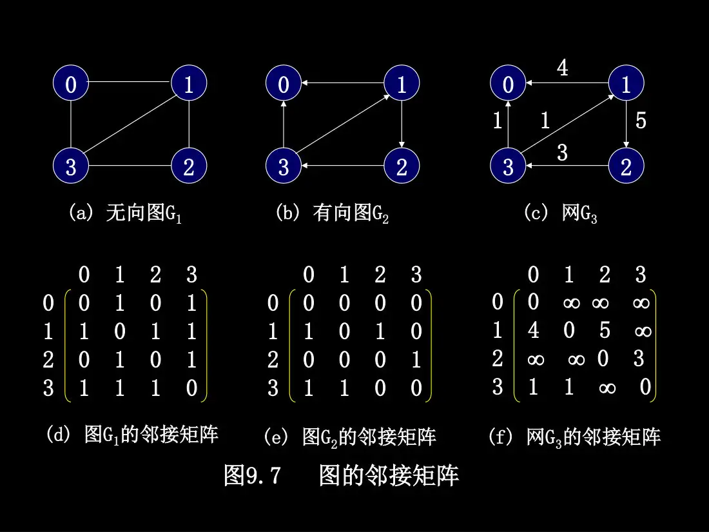

原文：

(a) 无向图G1

$$
\begin{array}{c c c c c} & 0 & 1 & 2 & 3 \\ 0 & 0 & 1 & 0 & 1 \\ 1 & 1 & 0 & 1 & 1 \\ 2 & 0 & 1 & 0 & 1 \\ 3 & 1 & 1 & 1 & 0 \end{array}
$$

(d) 图G1的邻接矩阵

(b) 有向图G2

$$
\begin{array}{c c c c c} & 0 & 1 & 2 & 3 \\ 0 & 0 & 0 & 0 & 0 \\ 1 & 1 & 0 & 1 & 0 \\ 2 & 0 & 0 & 0 & 1 \\ 3 & 1 & 1 & 0 & 0 \end{array}
$$

(e) 图G2的邻接矩阵

图9.7

图的邻接矩阵

(c) 网G3

$$
\left( \begin{array}{c c c c} 0 & 1 & 2 & 3 \\ 0 & \infty & \infty & \infty \\ 4 & 0 & 5 & \infty \\ \infty & \infty & 0 & 3 \\ 1 & 1 & \infty & 0 \end{array} \right)
$$

(f) 网 $( 6 0 - 1 ) \times ( 6 0 - 1 ) \times ( 6 0 - 1 ) \times ( 6 0 - 1 ) \times ( 6 0 - 1 ) \times ( 6 0 - 1 ) \times ( 6 0 - 1 ) \times ( 6 0 - 1 ) \times ( 6 0 - 1 ) \times ( 6 0 - 1 ) \times ( 6 0 - 1 ) \times ( 6 0 - 1 ) \times ( 6 0 - 1 ) \times ( 6 0 - 1 ) \times ( 6 0 - 1 ) \times ( 6 0 - 1 )$ 的邻接矩阵

### 9.2.2 图的邻接矩阵实现

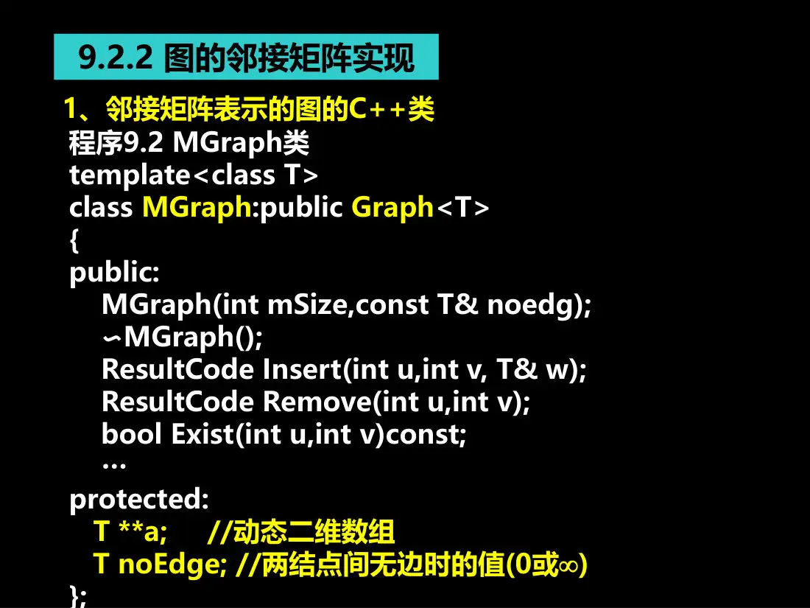

原文：

9.2.2 图的邻接矩阵实现

1、邻接矩阵表示的图的C++类程序9.2 MGraph类template<class T>class MGraph:public Graph<T>

public: MGraph(int mSize,const T& noedg); 〜MGraph(); ResultCode Insert(int u,int v, T& w); ResultCode Remove(int u,int v); bool Exist(int u,int v)const;

protected: T \*\*a; //动态二维数组 T noEdge; //两结点间无边时的值(0或)

### template //析构函数 MGraph::〜MGraph()

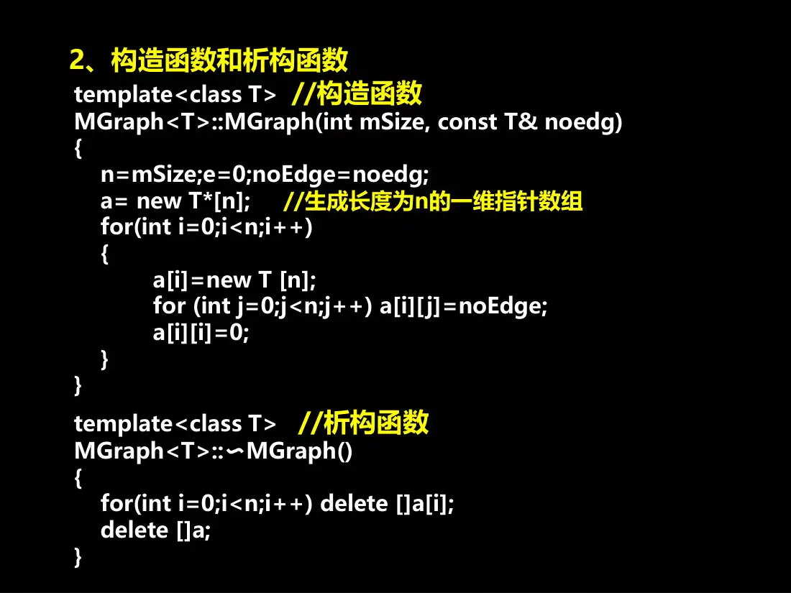

原文：

2、构造函数和析构函数 template<class T> //构造函数 MGraph<T>::MGraph(int mSize, const T& noedg)

n=mSize;e=0;noEdge=noedg;a= new T\*[n]; //生成长度为n的一维指针数组for(int i=0;i<n;i++)

a[i]=new T [n]; for (int j=0;j<n;j++) a[i][j]=noEdge; a[i][i]=0;

template<class T> //析构函数 MGraph<T>::〜MGraph()

for(int i=0;i<n;i++) delete []a[i]; delete []a;

### 3、边的搜索、插入和删除

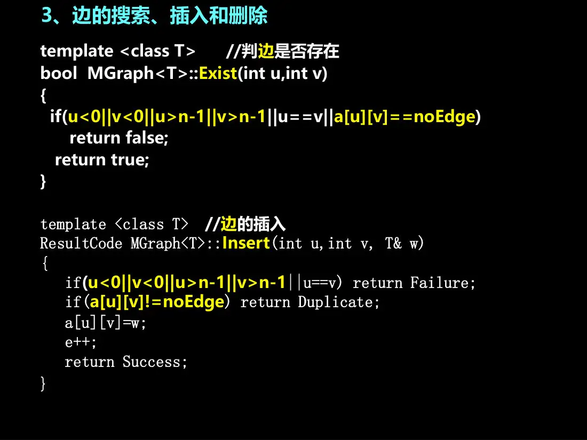

原文：

3、边的搜索、插入和删除

template <class T> //判边是否存在 bool MGraph<T>::Exist(int u,int v)

if(u<0||v<0||u>n-1||v>n-1||u==v||a[u][v]==noEdge) return false; return true;

template <class T> //边的插入 ResultCode MGraph<T>::Insert(int u,int v, T& w)

if(u<0||v<0||u>n-1||v>n-1||u==v) return Failure; if(a[u][v]!=noEdge) return Duplicate; a[u][v]=w; e++; return Success;

### 第 26 页

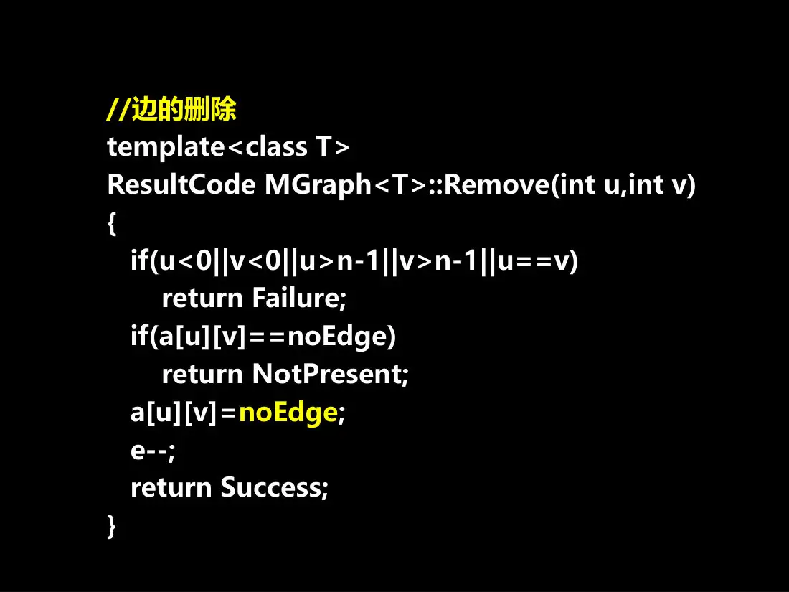

原文：

//边的删除 template<class T> ResultCode MGraph<T>::Remove(int u,int v)

if(u<0||v<0||u>n-1||v>n-1||u==v) return Failure; if(a[u][v]==noEdge) return NotPresent; a[u][v]=noEdge; e--; return Success;

### 1、为图中每个顶点u建立一个单链表；

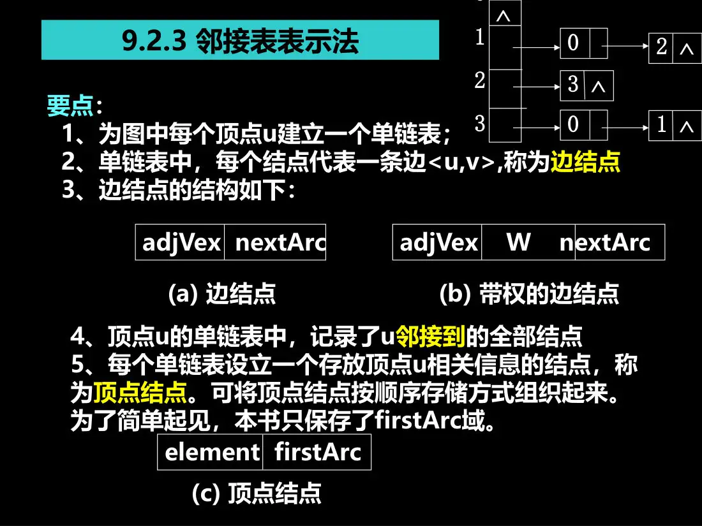

原文：

1、为图中每个顶点u建立一个单链表；

2、单链表中，每个结点代表一条边<u,v>,称为边结点

3、边结点的结构如下：

adjVex nextArc

(a) 边结点

adjVex W nextArc

(b) 带权的边结点

4、顶点u的单链表中，记录了u邻接到的全部结点5、每个单链表设立一个存放顶点u相关信息的结点，称为顶点结点。可将顶点结点按顺序存储方式组织起来。为了简单起见，本书只保存了firstArc域。

element firstArc

(c) 顶点结点

9.2.3 邻接表表示法

要点：

1 0 2 2 3 3 0 1 

### (b)图G 的邻接表

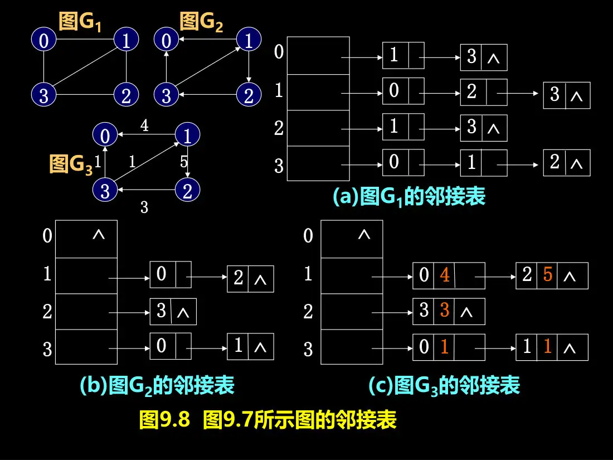

原文：

(b)图G 的邻接表

(a)图G 的邻接表

(c)图G 的邻接表

图9.8 图9.7所示图的邻接表

### 9.2.2 图的邻接表实现

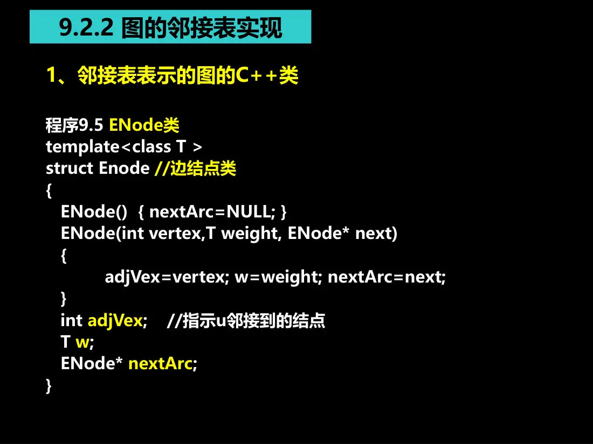

原文：

9.2.2 图的邻接表实现

1、邻接表表示的图的C++类

程序9.5 ENode类 template<class T > struct Enode //边结点类

ENode() { nextArc=NULL; } ENode(int vertex,T weight, ENode\* next)

T w; ENode\* nextArc;

### protected: ENode \*\*a;

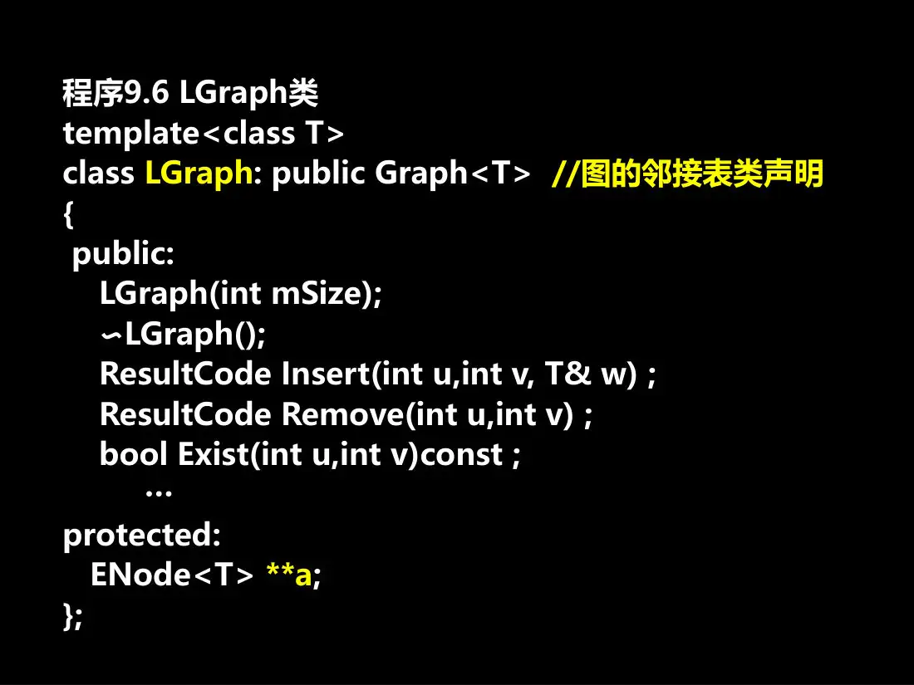

原文：

程序9.6 LGraph类 template<class T> class LGraph: public Graph<T> //图的邻接表类声明 {

public: LGraph(int mSize); 〜LGraph(); ResultCode Insert(int u,int v, T& w) ; ResultCode Remove(int u,int v) ; bool Exist(int u,int v)const ;

protected: ENode<T> \*\*a;

};

### template //析构函数LGraph:: 〜LGraph()

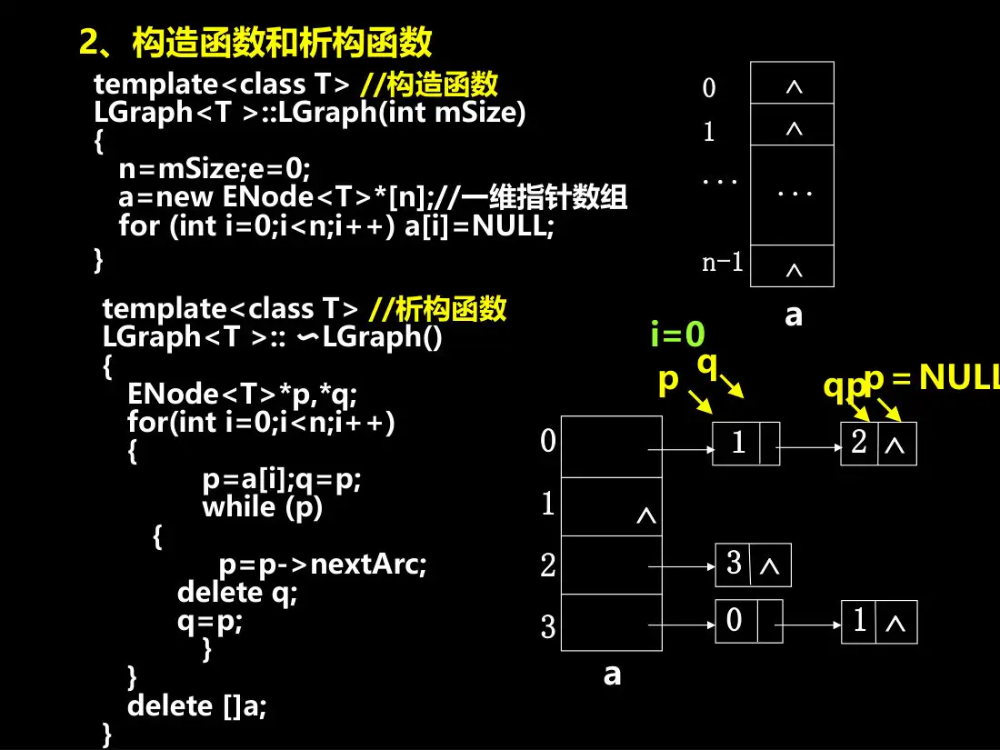

原文：

2、构造函数和析构函数template<class T> //构造函数LGraph<T >::LGraph(int mSize)

n=mSize;e=0; a=new ENode<T>\*[n];//一维指针数组 for (int i=0;i<n;i++) a[i]=NULL;

template<class T> //析构函数LGraph<T >:: 〜LGraph()

ENode<T>\*p,\*q; for(int i=0;i<n;i++) { p=a[i];q=p; while (p) p=p->nextArc; delete q; q=p; } delete []a;

### 3 边的搜索、插入和删除

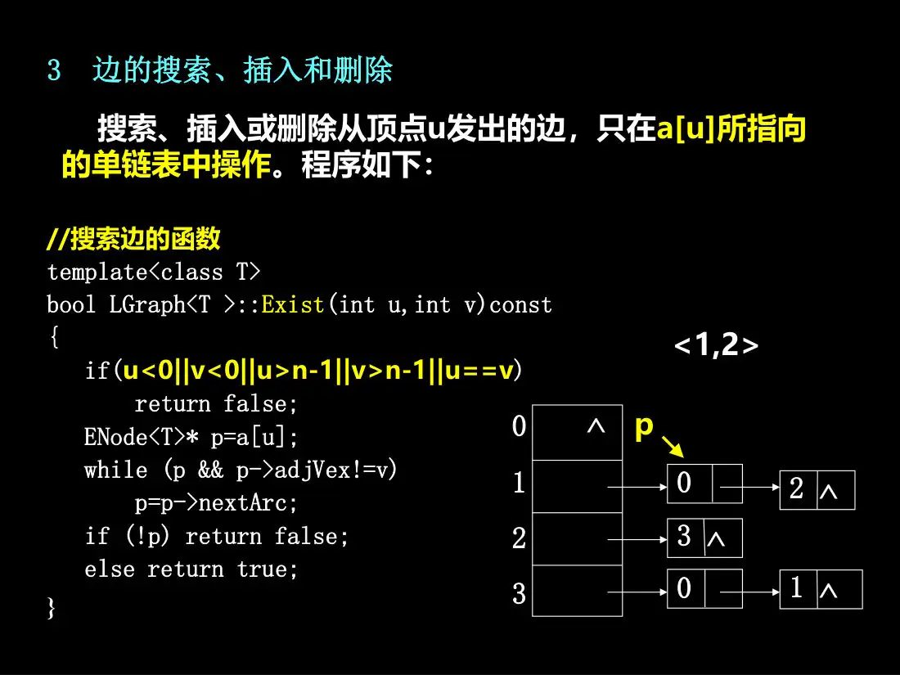

原文：

3 边的搜索、插入和删除

搜索、插入或删除从顶点u发出的边，只在a[u]所指向的单链表中操作。程序如下：

//搜索边的函数

template<class T> bool LGraph<T >::Exist(int u,int v)const

if(u<0||v<0||u>n-1||v>n-1||u==v return false; ENode<T>\* p=a[u]; while (p && p->adjVex!=v) p=p->nextArc; if (!p) return false; else return true;

### return Success;

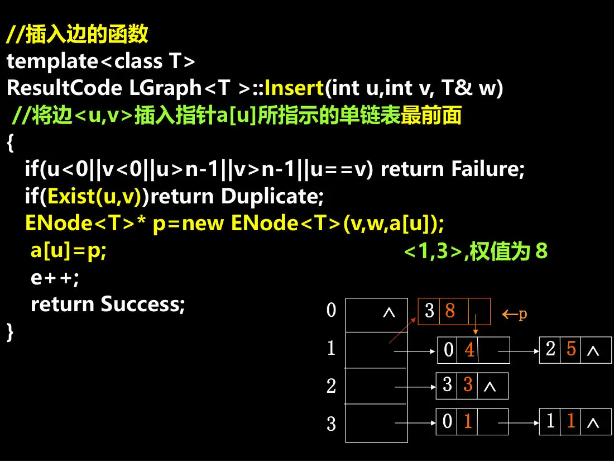

原文：

//插入边的函数 template<class T> ResultCode LGraph<T >::Insert(int u,int v, T& w) //将边<u,v>插入指针a[u]所指示的单链表最前面

return Success;

### 第 34 页

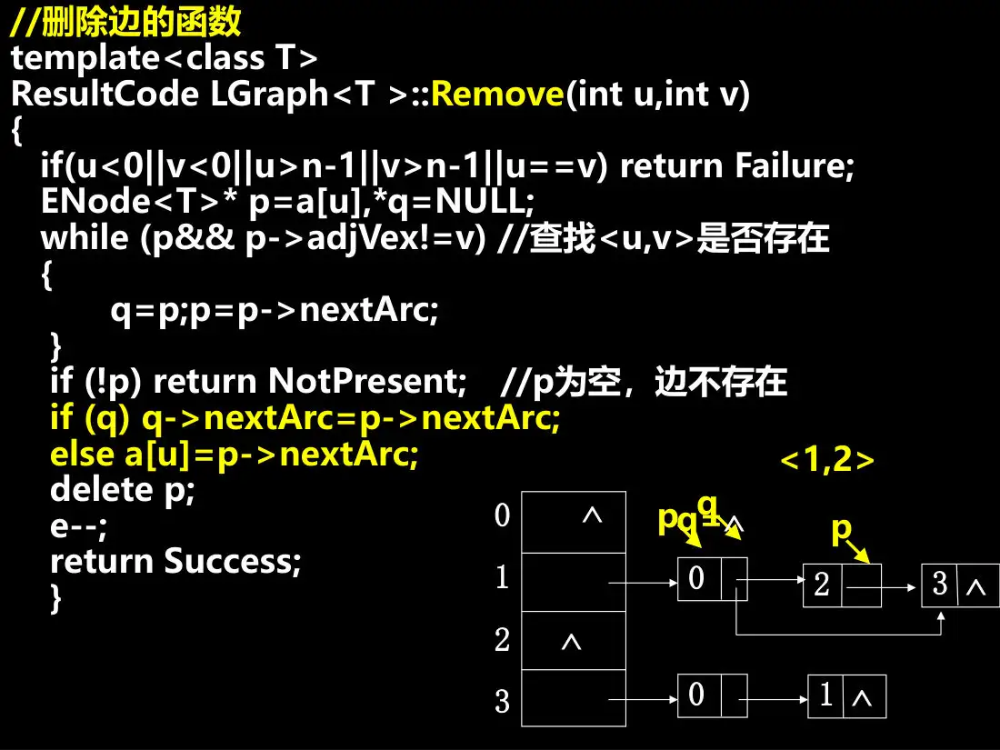

原文：

//删除边的函数 template<class T> ResultCode LGraph<T >::Remove(int u,int v)

if(u<0||v<0||u>n-1||v>n-1||u==v) return Failure; ENode<T>\* p=a[u],\*q=NULL; while (p&& p->adjVex!=v) //查找<u,v>是否存在 { q=p;p=p->nextArc;

if (!p) return NotPresent; //p为空，边不存在 if (q) q->nextArc=p->nextArc; else a[u]=p->nextArc; <

### 9.3 图的遍历

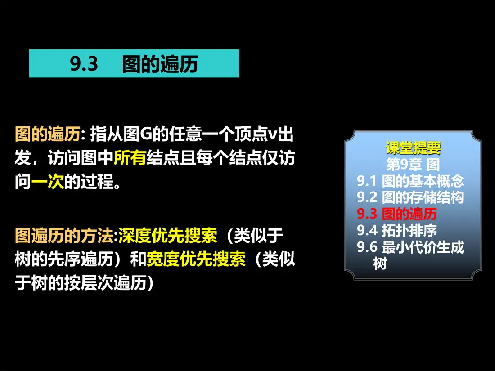

原文：

9.3 图的遍历

图的遍历: 指从图G的任意一个顶点v出发，访问图中所有结点且每个结点仅访问一次的过程。

图遍历的方法:深度优先搜索（类似于树的先序遍历）和宽度优先搜索（类似于树的按层次遍历）

课堂提要第9章 图

9.1 图的基本概念

9.2 图的存储结构

9.3 图的遍历

9.4 拓扑排序

9.6 最小代价生成树

### 9.3.1 扩充的图类

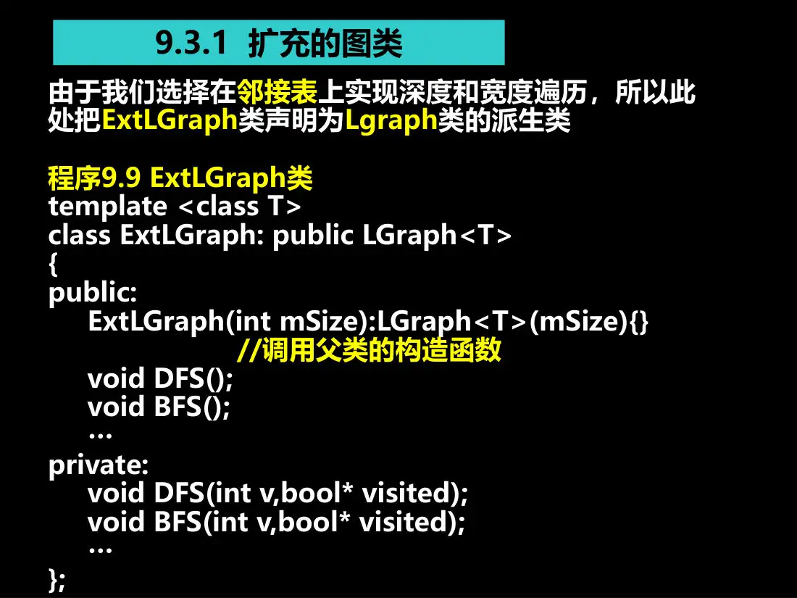

原文：

9.3.1 扩充的图类

由于我们选择在邻接表上实现深度和宽度遍历，所以此处把ExtLGraph类声明为Lgraph类的派生类

程序9.9 ExtLGraph类 template <class T> class ExtLGraph: public LGraph<T>

public: ExtLGraph(int mSize):LGraph<T>(mSize){} //调用父类的构造函数 void DFS(); void BFS();

private: void DFS(int v,bool\* visited); void BFS(int v,bool\* visited);

};

### 9.3.2 深度优先遍历

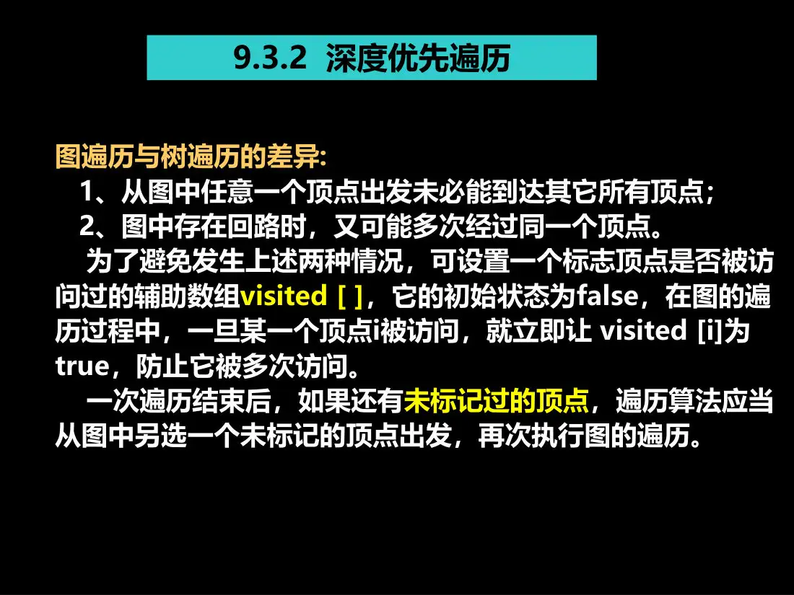

原文：

9.3.2 深度优先遍历

图遍历与树遍历的差异:

1、从图中任意一个顶点出发未必能到达其它所有顶点；2、图中存在回路时，又可能多次经过同一个顶点。为了避免发生上述两种情况，可设置一个标志顶点是否被访问过的辅助数组visited [ ]，它的初始状态为false，在图的遍历过程中，一旦某一个顶点i被访问，就立即让 visited [i]为true，防止它被多次访问。

一次遍历结束后，如果还有未标记过的顶点，遍历算法应当从图中另选一个未标记的顶点出发，再次执行图的遍历。

### 9.3.2 深度优先遍历

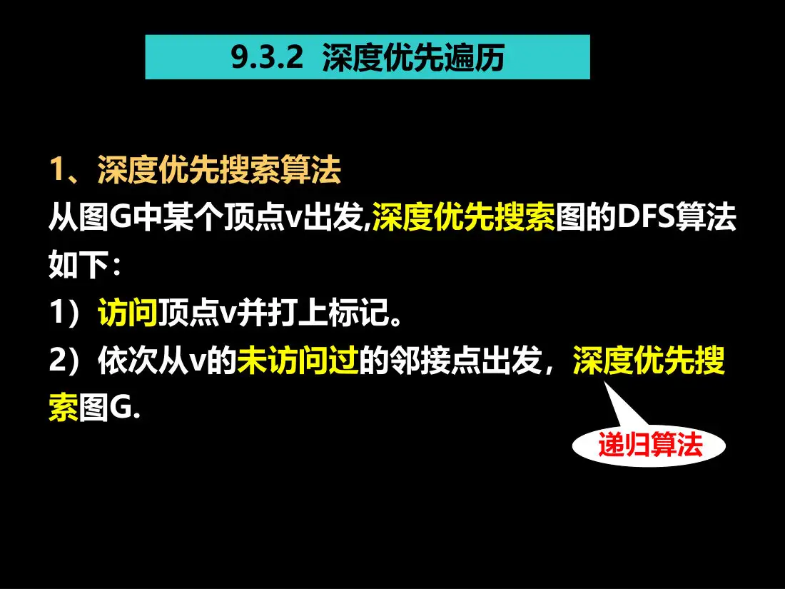

原文：

9.3.2 深度优先遍历

1、深度优先搜索算法从图G中某个顶点v出发,深度优先搜索图的DFS算法如下：

1）访问顶点v并打上标记。

2）依次从v的未访问过的邻接点出发，深度优先搜 索图G.

递归算法

### 搜索 回退

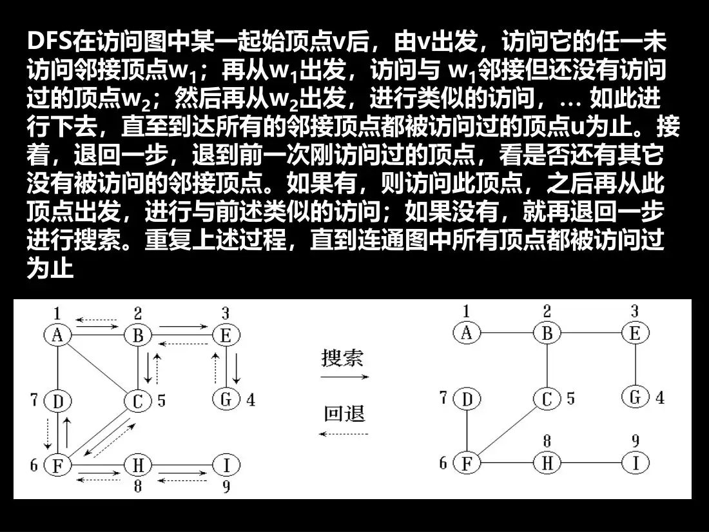

原文：

DFS在访问图中某一起始顶点v后，由v出发，访问它的任一未访问邻接顶点w ；再从 $[ W _ { 4 } ]$ 出发，访问与 $\mathbb { W } k$ 邻接但还没有访问过的顶点 $\textcircled { 4 } \textcircled { > }$ ；然后再从 $\mathbb { W }$ 出发，进行类似的访问，… 如此进行下去，直至到达所有的邻接顶点都被访问过的顶点u为止。接着，退回一步，退到前一次刚访问过的顶点，看是否还有其它没有被访问的邻接顶点。如果有，则访问此顶点，之后再从此顶点出发，进行与前述类似的访问；如果没有，就再退回一步进行搜索。重复上述过程，直到连通图中所有顶点都被访问过为止

搜索 回退

### 0 1 2 3 4 5 6

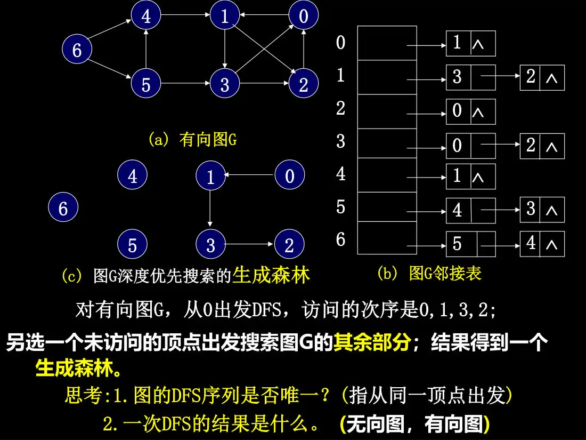

原文：

0 1 2 3 4 5 6

(a) 有向图G

(c) 图G深度优先搜索的生成森林 (b) 图G邻接表对有向图G，从0出发DFS，访问的次序是0,1,3,2;另选一个未访问的顶点出发搜索图G的其余部分；结果得到一个生成森林。

思考:1.图的DFS序列是否唯一？(指从同一顶点出发)2.一次DFS的结果是什么。 (无向图，有向图)

### 2、深度优先搜索的递归算法

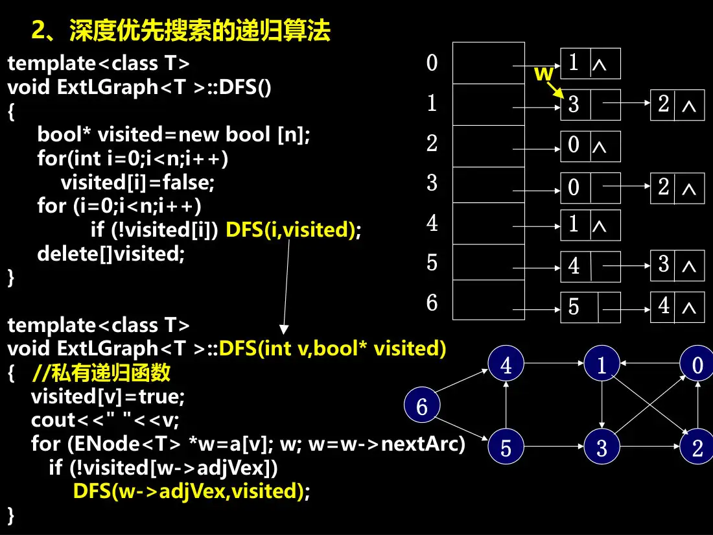

原文：

2、深度优先搜索的递归算法

template<class T> void ExtLGraph<T >::DFS()

bool\* visited=new bool [n]; for(int i=0;i<n;i++) visited[i]=false; for (i=0;i<n;i++) if (!visited[i]) DFS(i,visited); delete[]visited;

template<class T> void ExtLGraph<T >::DFS(int v,bool\* visited)

{ //私有递归函数 visited[v]=true; 6 cout<<" "<<v; for (ENode<T> \*w=a[v]; w; w=w->nextArc) if (!visited[w->adjVex]) DFS(w->adjVex,visited);

### 3、总结：

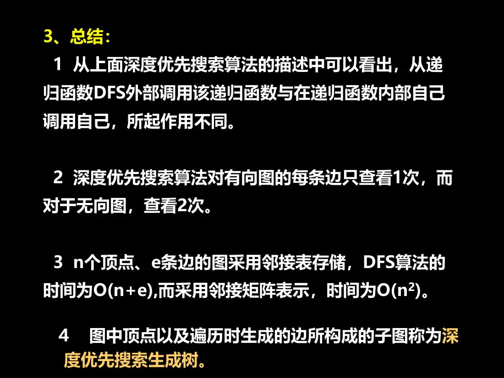

原文：

3、总结：

1 从上面深度优先搜索算法的描述中可以看出，从递归函数DFS外部调用该递归函数与在递归函数内部自己调用自己，所起作用不同。

2 深度优先搜索算法对有向图的每条边只查看1次，而对于无向图，查看2次。

3 n个顶点、e条边的图采用邻接表存储，DFS算法的时间为O(n+e),而采用邻接矩阵表示，时间为 $\odot \odot$

图中顶点以及遍历时生成的边所构成的子图称为深度优先搜索生成树。

### 9.3.3 宽度优先遍历

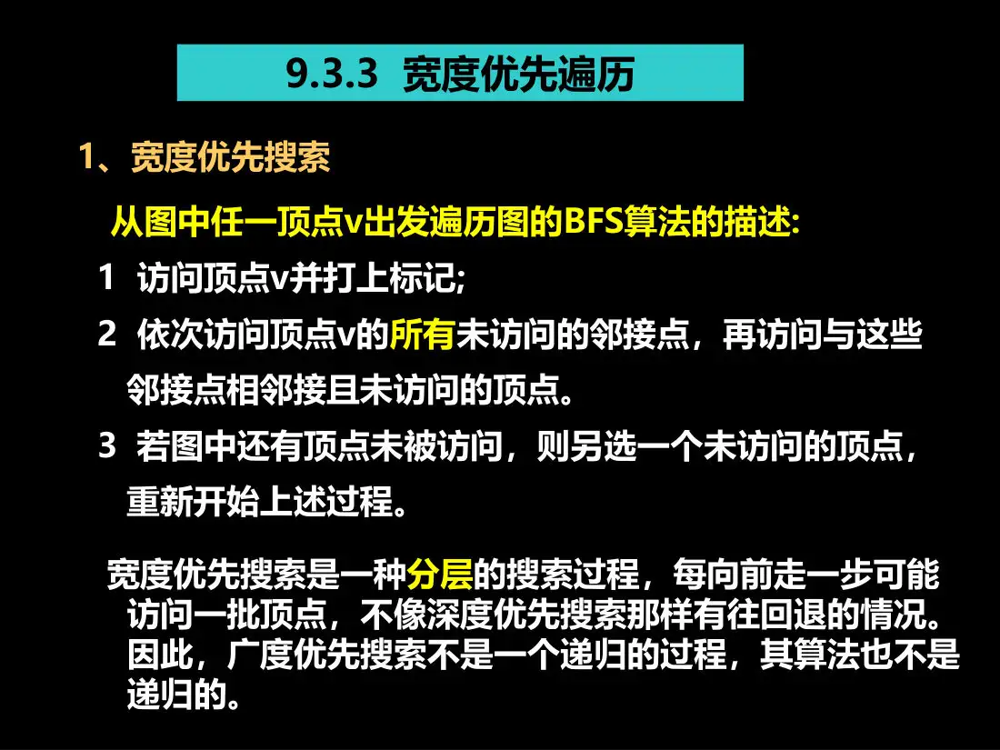

原文：

9.3.3 宽度优先遍历

1、宽度优先搜索从图中任一顶点v出发遍历图的BFS算法的描述:

1 访问顶点v并打上标记;

2 依次访问顶点v的所有未访问的邻接点，再访问与这些 邻接点相邻接且未访问的顶点。

3 若图中还有顶点未被访问，则另选一个未访问的顶点，重新开始上述过程。

宽度优先搜索是一种分层的搜索过程，每向前走一步可能访问一批顶点，不像深度优先搜索那样有往回退的情况。因此，广度优先搜索不是一个递归的过程，其算法也不是递归的。

### (a) 无向图G

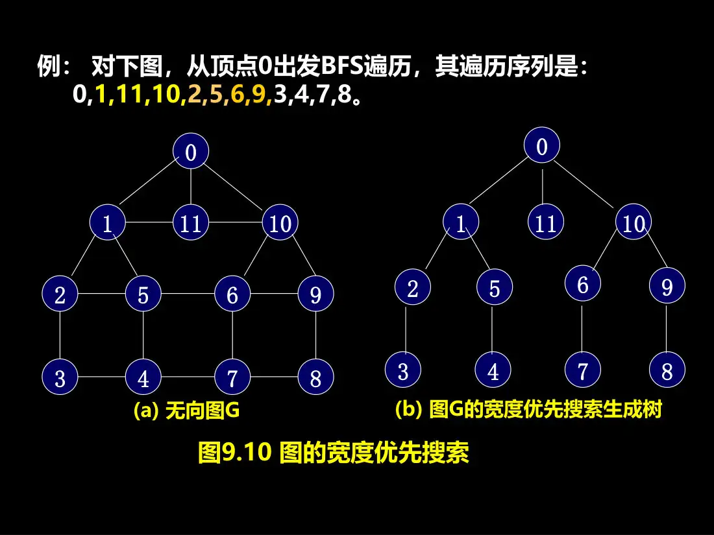

原文：

例： 对下图，从顶点0出发BFS遍历，其遍历序列是：0,1,11,10,2,5,6,9,3,4,7,8。

(a) 无向图G

(b) 图G的宽度优先搜索生成树

图9.10 图的宽度优先搜索

### 若图中还有顶点未被访问，则另选一个未访问的顶点重新开始上述过程。

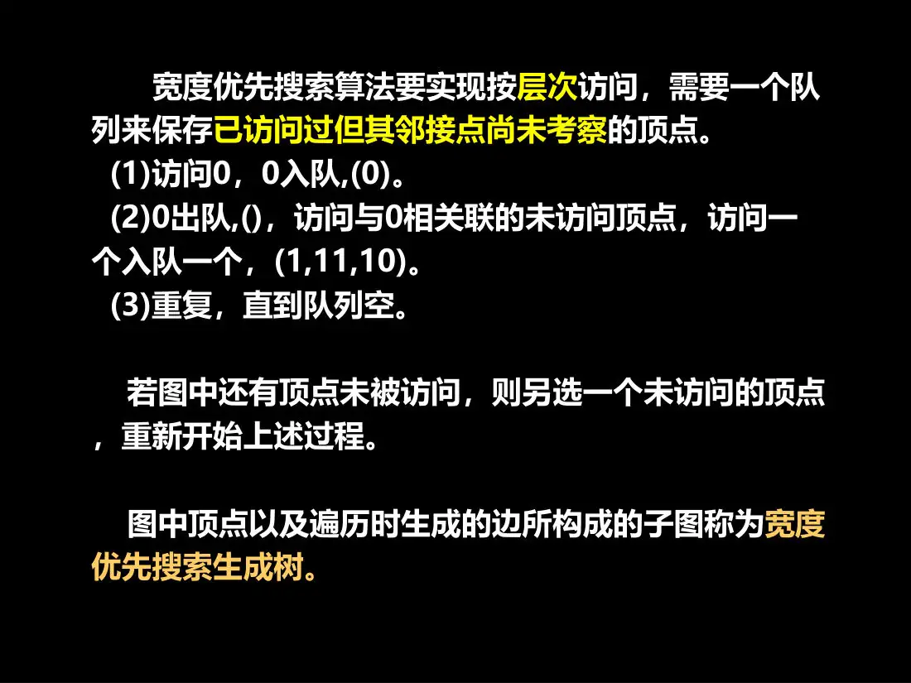

原文：

宽度优先搜索算法要实现按层次访问，需要一个队列来保存已访问过但其邻接点尚未考察的顶点。(1)访问0，0入队,(0)。(2)0出队,()，访问与0相关联的未访问顶点，访问一个入队一个，(1,11,10)。(3)重复，直到队列空。

若图中还有顶点未被访问，则另选一个未访问的顶点重新开始上述过程。

图中顶点以及遍历时生成的边所构成的子图称为宽度优先搜索生成树。

### 2、宽度优先搜索的C++程序

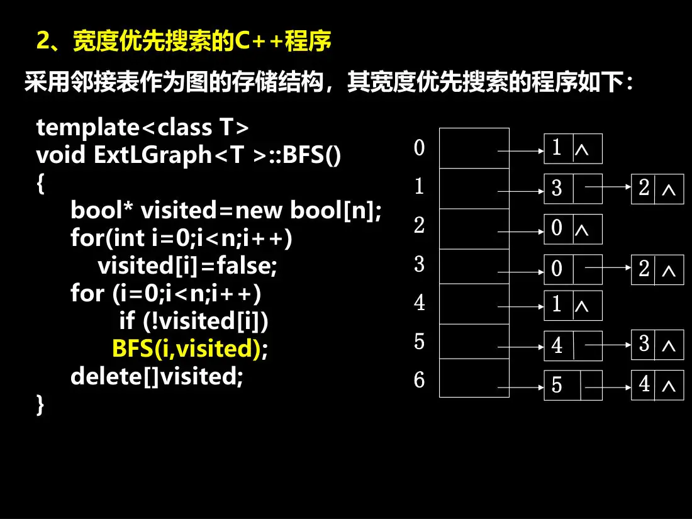

原文：

2、宽度优先搜索的C++程序

采用邻接表作为图的存储结构，其宽度优先搜索的程序如下：

template<class T> void ExtLGraph<T >::BFS()

bool\* visited=new bool[n]; for(int i=0;i<n;i++) visited[i]=false; for (i=0;i<n;i++) if (!visited[i]) BFS(i,visited); delete[]visited;

### 第 47 页

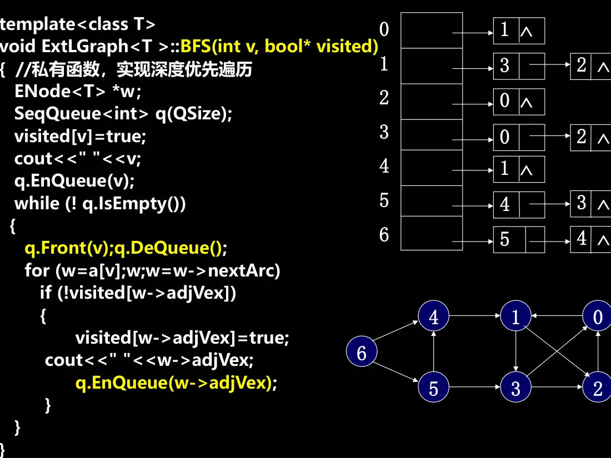

原文：

template<class T> void ExtLGraph<T >::BFS(int v, bool\* visited)

{ //私有函数，实现深度优先遍历 ENode<T> \*w； SeqQueue<int> q(QSize); visited[v]=true; cout<<" "<<v; q.EnQueue(v); while (! q.IsEmpty())

q.Front(v);q.DeQueue(); for (w=a[v];w;w=w->nextArc) if (!visited[w->adjVex])

visited[w->adjVex]=true; cout<<" "<<w->adjVex; q.EnQueue(w->adjVex);

### BFS算法的特点：1、每个顶点进出队列各一次。

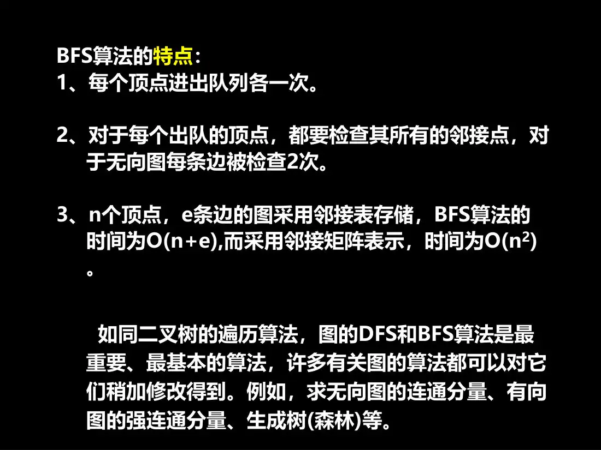

原文：

BFS算法的特点：1、每个顶点进出队列各一次。

2、对于每个出队的顶点，都要检查其所有的邻接点，对于无向图每条边被检查2次。

3、n个顶点，e条边的图采用邻接表存储，BFS算法的时间为O(n+e),而采用邻接矩阵表示，时间为 $\mathbf { G } ( \mathbf { G } )$

如同二叉树的遍历算法，图的DFS和BFS算法是最重要、最基本的算法，许多有关图的算法都可以对它们稍加修改得到。例如，求无向图的连通分量、有向图的强连通分量、生成树(森林)等。

### 9.4 拓扑排序

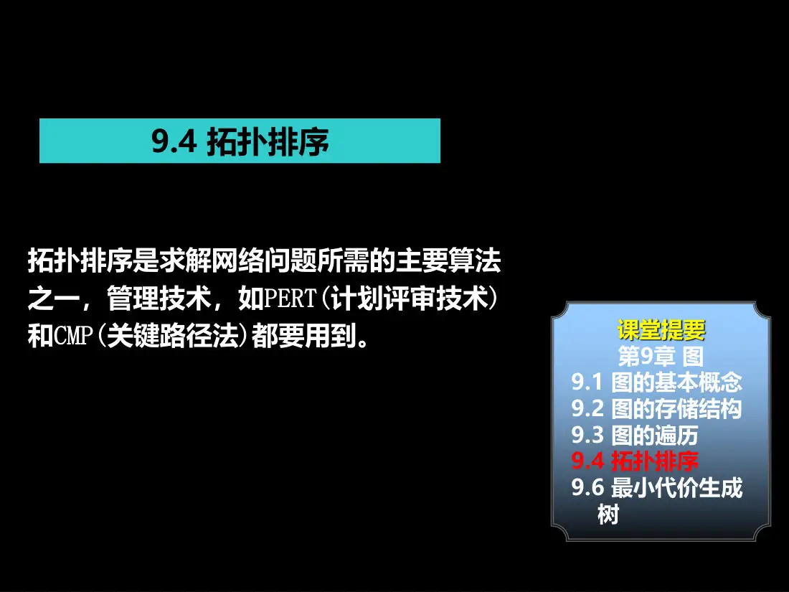

原文：

9.4 拓扑排序

拓扑排序是求解网络问题所需的主要算法之一，管理技术，如PERT(计划评审技术)和CMP(关键路径法)都要用到。

课堂提要第9章 图

9.1 图的基本概念

9.2 图的存储结构

9.3 图的遍历

9.4 拓扑排序

9.6 最小代价生成树

### 9.4.1 用顶点代表活动的AOV网

原文：

9.4.1 用顶点代表活动的AOV网

通常，一个工程(如软件开发、施工、生产流程等)可以分成若干子工程(称为活动)。要完成整个工程，就要完成所有活动。而活动的执行通常有某些先决条件的，即一些活动必须先于另一些活动完成。

用有向图可以表示活动的领先关系。

顶点：表示活动。

有向边：表示先决条件。

AOV网(顶点活动网络)：有向图G中，若用顶点代表活动，有向边表示活动之间的领先关系，则称图G为AOV网络。

### AOV网络举例：计算机专业学生学习的课程。

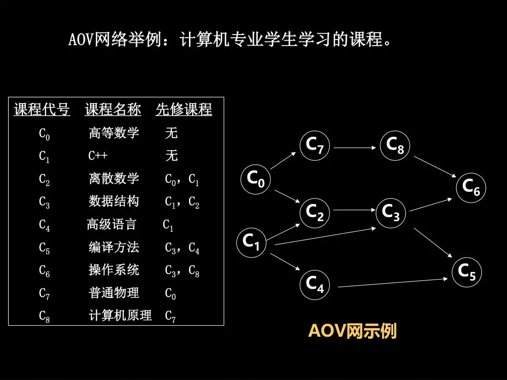

原文：

AOV网络举例：计算机专业学生学习的课程。

课程代号

$$
C _ {0}
$$

$$
\mathrm{C} _ {2}
$$

$$
C _ {3}
$$

$$
\mathrm{C} _ {4}
$$

$$
\mathrm{C} _ {5}
$$

$$
C _ {6}
$$

$$
\mathrm{C} _ {7}
$$

$$
C _ {8}
$$

课程名称

先修课程

高等数学

C++

离散数学

数据结构

高级语言

编译方法

操作系统

普通物理

计算机原理

$$
\mathrm{C} _ {1},
$$

$$
\mathrm{C} _ {1}
$$

$$
\mathrm{C} _ {7}
$$

AOV网示例

### C7 C8 001 7 23 ∧ ∧2 C0 C6 2

原文：

C7 C8 001 7 23 ∧ ∧2 C0 C6 2
3
4 6 ∧ C2 C3 ∧ 5 ∧ C1 5 ∧ C5 6 ∧ C4 7 4 8 ∧ 8 6 ∧

(a) AOV网

(b) (a)的邻接表

图9-11 课程先修关系的AOV网

### AOV网中的领先关系是一种拟序关系，即具有传递性和反自反性。

原文：

AOV网中的领先关系是一种拟序关系，即具有传递性和反自反性。

传递性：活动的领先关系是可以传递的。如 $\textcircled{9}$ 领先于 $\textcircled{9}$ $\circledcirc$ 领先于 $\textcircled { \bullet }$ $\textcircled{9}$ 也领先于 $\textcircled { 9 }$

反自反性：不允许一个活动在开始之前就完成。要求AOV网是一个有向无回路图。

C语言

数据结构

### 9.4.2 什么是拓扑排序

原文：

9.4.2 什么是拓扑排序

1、拓扑序列和拓扑排序算法

用拓扑排序算法可以做以下两件事情：

（1）测试AOV网的可行性；（是否存在回路）

（2）对可行的AOV网求出其拓扑序列。

一个拓扑序列是AOV网中顶点的线性序列，使得对图中任意二个顶点i和j，若在图中，i领先于j，则在线性序列中i是j的前驱结点。

### 2、拓扑排序步骤

原文：

2、拓扑排序步骤

拓扑排序算法：

（1）在图中找一个入度为零的顶点，输出之；

（2）从图中删除该顶点及其所有出边；

（3）重复(1)、(2)，直到所有顶点都输出（即得到一个拓扑序列），或者图中剩下的顶点再也没有入度为零的顶点(存在有向回路)为止。

### 第 56 页

### 左图中的两个拓扑序列为：

原文：

左图中的两个拓扑序列为：

如按拓扑次序学习课程，能保证学任何课程时，其他先修课均已学过。

注意：一个AOV网络的拓扑序列不是唯一的

### C2 C3 C5 C4 4

原文：

C2 C3 C5 C4 4

C2

### 拓扑排序算法要解决的问题：

原文：

拓扑排序算法要解决的问题：

（1）如何计算每个顶点的入度：使用一个数组InDgree保存每个顶点的入度。

（2）如何保存新产生的入度为0的顶点：可以用堆栈或队列保存

（3）如何删除一个顶点的所有出边：将该顶点的所有邻接到的顶点的入度减一。

### 9.4.3 拓扑排序算法

原文：

9.4.3 拓扑排序算法

1、设计数据结构

拓扑排序算法采用邻接表存储，用InDegree[i]存储顶点i的入度，数组order被用于保存所求得的一个拓扑序列。

### 2、实现拓扑排序算法

原文：

2、实现拓扑排序算法

（1）初始化。计算每个顶点的入度，存于InDegree数组中。

InDegree

图9-12 图9-11(a)的顶点的入度

### （2）检查InDegree数组中顶点的入度，将入度为零的顶点进栈

原文：

（2）检查InDegree数组中顶点的入度，将入度为零的顶点进栈

图9-13 顶点0和1进栈后InDegree数组的状态

（3）从栈中弹出入度为零的顶点输出，并将该顶点关联到的的所有邻接点的入度减一，如果此时某个邻接点的入度为零，便令其进栈。

(4)重复步骤（3），直到栈为空时为止。（此时，或者所有顶点都已列出，或者图中包含有向回路）

### 表9-2 输出顶点后InDegree数组的值

原文：

表9-2 输出顶点后InDegree数组的值
<table><tr><td>输出顶点</td><td>top</td><td>0</td><td>1</td><td>2</td><td>3</td><td>4</td><td>5</td><td>6</td><td>7</td><td>8</td></tr><tr><td>初始时</td><td>1</td><td>-1</td><td>0</td><td>2</td><td>2</td><td>1</td><td>2</td><td>2</td><td>1</td><td>1</td></tr><tr><td>1</td><td>4</td><td>-1</td><td></td><td>1</td><td>1</td><td>0</td><td>2</td><td>2</td><td>1</td><td>1</td></tr><tr><td>4</td><td>0</td><td>-1</td><td></td><td>1</td><td>1</td><td></td><td>1</td><td>2</td><td>1</td><td>1</td></tr><tr><td>0</td><td>2</td><td></td><td></td><td>7</td><td>1</td><td></td><td>1</td><td>2</td><td>-1</td><td>1</td></tr><tr><td>2</td><td>3</td><td></td><td></td><td></td><td>7</td><td></td><td>1</td><td>2</td><td>-1</td><td>1</td></tr><tr><td>3</td><td>5</td><td></td><td></td><td></td><td></td><td></td><td>7</td><td>1</td><td>-1</td><td>1</td></tr><tr><td>5</td><td>7</td><td></td><td></td><td></td><td></td><td></td><td></td><td>1</td><td>-1</td><td>1</td></tr><tr><td>7</td><td>8</td><td></td><td></td><td></td><td></td><td></td><td></td><td>1</td><td></td><td>-1</td></tr><tr><td>8</td><td>6</td><td></td><td></td><td></td><td></td><td></td><td></td><td>-1</td><td></td><td></td></tr><tr><td>6</td><td>-1</td><td></td><td></td><td></td><td></td><td></td><td></td><td></td><td></td><td></td></tr></table>

### for(int i=0;i<n;i++) InDegree[i]=0;

原文：

void ExtLGraph<T >::CalInDegree(int\* InDegree)3

for(int i=0;i<n;i++) InDegree[i]=0;

//检查以顶点i为尾的所有邻接点

InDegree[p->adjVex]++; //将顶点i的邻接点p->adjVex 的入度加1

0 1 2 3 4 5 6 8

InDegree

### 第 65 页

原文：

序9.13 拓扑排序C++程序 mplate<class T> id ExtLGraph<T >::TopoSort(int\* order)

int\* InDegree=new int[n];int i,j,k,top=-1; //to0为－1，代表空栈CalInDegree(InDegree);//计顶点的入度for (i=0;i<n;i++)if (!InDegree[i]){InDegree[i]=top;top=i;}//(2) 图中入度为零的顶点进栈for (i=0;i<n;i++) {//(3)生成拓朴序列if (top==-1) throw HasCycle;//若堆栈为空，表示图中存在有向环

### }//endfor

原文：

j=top;top=InDegree[top]; //入度为零的顶点出栈 order[i]=j;cout<<j<<' '; //order[i]＝j，输出顶点j for (ENode<T>\* p=a[j];p;p=p->nextArc)

k=p->adjVex; InDegree[k]--; //将j的出邻接点k的入度减1 if (!InDegree[k]) {InDegree[k]=top;top=k;} //顶点k入度为零时进栈

}//endfor

}//endelse

}//endfor

程序的时间复杂度：O(n+e)

### 9.5关键路径

原文：

9.5关键路径

一、AOE网络

上一节的AOV网络，用顶点表示活动，有向边表示先决条件，有向图可以表示活动之间的领先关系。

AOE(边活动网络)：有向图G中，若用顶点代表事件，有向边表示活动，有向边上的权值表示一项活动持续的时间，则称图G为AOE网络。

顶点所代表的事件，表示它的入边的活动均已完成，出边的活动可以开始。

AOE网络主要用于估算一项工程的完成时间。

### i ak=w(i,j) j

原文：

i ak=w(i,j) j

AOE网的例子

边(i,j)的权值w(i,j)

$1 0 \%$ (s): 整个工程的起点(源点) 。 $\pmb { \psi } _ { 0 }$ (f): 整个工程的终点(汇点) 。

$\boxed { 1 } \boxed { 2 }$ 表示活动 $\mathbf { \delta E }$ 和 $\wp$ 已经完成， $\boxed { 6 }$ 和 $\Theta$ 可以开始。

$\boxed { \div } \boxed { \div }$ 表示活动 $\boxed { 6 }$ 持续的时间是2(天)。

整个工程只有一个开始点，AOE就只有一个入度为0的顶点(源点)

整个工程只有一个完成点，AOE就只有一个出度为0的顶点(汇点)

### 二、关键路径与关键活动

原文：

二、关键路径与关键活动

与AOV网络不同，AOE网络研究以下两个方面：

(1)整个工程至少需要多少时间；

(2)哪些活动是影响工程进度的关键。

关键路径法(CMP)就是解决这类问题的方法。

完成工程所需的最短时间是从开始顶点到完成顶点的最长路径的长度（各边的权值之和）。

这条最长路径称为关键路径。

关键活动：关键路径上的活动。或对整个工程的最短完成时间有影响的活动。即如它不能按期完成就会影响整个工程。

例如:

$( \because \cos \angle A ) \cos \angle B = \frac { 1 } { 2 } \cos \angle B = \frac { 1 } { 2 }$ 就是一条关键路径。

$\div ( 0 . 5 - 0 . 5 ) = \frac { 1 } { ( 0 . 5 ) } = \frac { 1 } { ( 0 . 5 ) } = 0 . 5 ( 0 . 5 )$ 就是关键活动。

路径长度= $( \frac { 1 } { 2 } ) ( \frac { 1 } { 2 } - \frac { 1 } { 3 } ) ( \frac { 1 } { 2 } - \frac { 1 } { 3 } ) ( \frac { 1 } { 2 } - \frac { 1 } { 3 } ) ( \frac { 1 } { 2 } - \frac { 1 } { 3 } ) ( \frac { 1 } { 2 } - \frac { 1 } { 3 } ) ( \frac { 1 } { 2 } - \frac { 1 } { 3 } ) ( \frac { 1 } { 2 } - \frac { 1 } { 3 } )$

### 找关键活动的目的：

原文：

找关键活动的目的：

(1)重视关键活动；

(2)缩短整个工期。

关键活动对缩短整个工期起着至关重要的作用；非关键活动对缩短整个工期不起作用。

因此，对关键活动投入较多的人力和物力，确保工程按期完成，或缩短整个工期。

### 第 71 页

原文：

顶点所代表的事件，表示它的入边的活动均已完成，出边的活动可以开始为了定量找出关键路径和关键活动，需要以下几个量：

(1)事件v 的可能的最早发生时间$\cos \angle A C E = \cos \angle C A D = \angle B C$ 源点 $\pmb { \mathbb { M } }$ 到 $\boxed { 1 }$ 的最长路径长度

(2)事件v 的允许的最晚发生时间。即在不影响工期的条件下事件v 允许的最晚发生时间。

latest(i)=earliest(n)-从v 到汇点 $\because \frac { 1 } { 2 } = \frac { 1 } { 2 }$ 的最长路径长度

earliest(4)=a0+a3=6+1=7 earliest(5)=a2+a5=5+2=7 earliest(8)=a0+a3+a7+a10 =6+1+8+4=19 Latest(4)=19-(8+4)=7 latest(5)=19-(4+4)=11 latest(7)=earliest(8)-4 =19-4=15

### 第 72 页

原文：

(3) early(k)：活动 $\textcircled { \div } \textcircled { \div } \textcircled { \div } \textcircled { \div } \textcircled { \div } \textcircled { \div } \textcircled { \div } \textcircled { \div } \textcircled { \div } \textcircled { \div } \textcircled { \div } \textcircled { \div }$ 的可能的最早开始时间$1 3 - 1 = 1 1$ 表示的边为<vi,vj>，w(i,j)为 $\mathbf { \epsilon }$ 的权值。

early(k)=事件 $\because \frac { 1 } { 2 } = \frac { 1 } { 2 }$ 的可能的最早发生时间即 $( \mathrm { s c a l i n } ) \mathrm { s c a l ( A ) } = ( \mathrm { s c a l i n } ) \mathrm { s c a s s ( A ) }$ (4) late(k):活动 $\mathbf { \epsilon }$ 的允许的最晚开始时间。$1 1 0 \times 1 0 = 1 1 0 ( c m ) = 1 1 0 ( c m )$ (5)若early(k)=late(k),则 $\mathbf { E }$ 是关键活动。

$( 2 ) 2 \times ( 4 0 - 2 ) \times ( 2 0 - 2 ) \times ( 2 0 - 2 ) \times ( 2 0 - 2 ) = 1 1$ late(7)=latest(7)-8=15-8=7$\mathrm { ( s i n ) ( s i n ( 0 ) ) } = \mathrm { ( s i n ) ( s i n ( 0 ) ) } = 0$ $1 1 0 \times 1 0 = 1 1 0 0 0 0 0 0 0 0 = 1 1 0 0 0 0 0 0 0 0 0 0 0 0 0 0 0 0 0 0 0 0 0 0 0 0 0 0 0 0 0 0 0 0 0 0 0 0 0 0 0 0 0 0 0 0 0 0 0 0 0 0 0 0 0 0 0 0 0 0 0 0 0 0 0 0 0 0 0 0 0 0 0 0 0 0 0 0 0 0 0 0 0 0 0 0 0 0 0 0 0 0 0 0 0 0 0 0 0 0 0 0 0 0 0 0 0 0 0 0 0 0 0 0 0 0 0 0 0 0 0 0 0 0 0 0 0 0 0 0 0 0 0 0 0 0 0 0 0 0 0 0 0 0 0 0 0 0 0 0 0 0 0 0 0 0 0 0 0 0 0 0 0 0 0 0 0 0 0 0 0 0 0 0 0 0 0 0 0 0 0 0 0 0 0 0 0 0 0 0 0 0 0 0 0 0 0 0 0 0 0 0 0 0 0 0 0 0 0 0 0 0 0 0 0 0 0 0 0 0 0 0 0 0 0 0 0 0 0 0 0 0 0 0 0 0 0 0 0 0 0 0 0 0 0 0 0 0 0 0 0 0 0$ 因 $\textcircled { 2 } \textcircled { 2 } \textcircled { 2 } \textcircled { 1 } \textcircled { 2 } \textcircled { 4 } \textcircled { 2 } \textcircled { 2 } \textcircled { 2 } \textcircled { 2 } \textcircled { 2 } \textcircled { 2 } \textcircled { 2 }$ early(8)<>late(8),故 $\boxed { 6 }$ 是关键活动， $\mathbf { \delta E }$ 不是关键活动。

earliest(4)=a +a =6+1=7 earliest(5)=a2+a5=5+2=7 earliest(8)=a0+a3+a7+a10 =6+1+8+4=19 Latest(4)=19-(8+4)=7 latest(5)=19-(4+4)=11 latest(7)=earliest(8)-4 =19-4=15

### earliest(i)=从源点v0到vi的最长路径长度

原文：

earliest(i)=从源点v0到vi的最长路径长度

latest(i)=earliest(n)-从vi到汇点vn的最长路径长度

活动ak: early(k)=earliest(i) late(k)=latest(j)-w(i,j) 若 early(k)=late(k), 则ak是关 键活动。

<table><tr><td colspan="2">项目</td><td> $v_0$ </td><td> $v_1$ </td><td> $v_2$ </td><td> $v_3$ </td><td> $v_4$ </td><td> $v_5$ </td><td> $v_6$ </td><td> $v_7$ </td><td> $v_8$ </td><td></td></tr><tr><td colspan="2">earliest(i)</td><td>0</td><td>6</td><td>4</td><td>5</td><td>7</td><td>7</td><td>16</td><td>15</td><td>19</td><td></td></tr><tr><td colspan="2">latest(i)</td><td>0</td><td>6</td><td>6</td><td>9</td><td>7</td><td>11</td><td>17</td><td>15</td><td>19</td><td></td></tr><tr><td>项目</td><td> $a_0$ </td><td> $a_1$ </td><td> $a_2$ </td><td> $a_3$ </td><td> $a_4$ </td><td> $a_5$ </td><td> $a_6$ </td><td> $a_7$ </td><td> $a_8$ </td><td> $a_9$ </td><td> $a_{10}$ </td></tr><tr><td>early(k)</td><td>0</td><td>0</td><td>0</td><td>6</td><td>4</td><td>5</td><td>7</td><td>7</td><td>7</td><td>16</td><td>15</td></tr><tr><td>late(k)</td><td>0</td><td>2</td><td>4</td><td>6</td><td>6</td><td>9</td><td>8</td><td>7</td><td>11</td><td>17</td><td>15</td></tr><tr><td>关键活动</td><td>*</td><td></td><td></td><td>*</td><td></td><td></td><td></td><td>*</td><td></td><td></td><td>*</td></tr></table>

关键路径： $\because \angle C D B = \angle C A C = 9 0 ^ { \circ }$

### 三、关键路径算法

原文：

三、关键路径算法

earliest(4)=7

earliest(2)=4

(1)计算事件的最早发生时间earliest。

从earliest(0)=0开始，自前向后递推计算:

earliest(j)=max{earliest(i)+w(i,j)} iP(j)

P(j)是所有以j为头的弧<i,j>的弧尾i的集合。

为保证计算earliest(j)时，所有的earliest(i)(iP(j))已经求得。可以利用拓扑排序。

### latest(6)=17

原文：

latest(6)=17

(2)计算事件的最晚发生时间latest。从latest(n)=earliest(n)开始，自后向前递推计算:

latest(7)=15

latest(i)=mim{latest(j)-w(i,j)} jS(j)

S(i)是所有以i为尾的弧<i,j>的弧头j的集合。

为保证计算latest(i)时，所有的latest(j)(jS(i))已经求得。可以利用逆拓扑排序。

### 第 76 页

原文：

(3)计算活动的最早开始时间early(k)和最晚开始时间$1 4 \div 1 5 = 1 5 ( m )$ o$( 9 2 ) \div ( 1 2 0 - 2 ) = ( 9 2 ) \div ( 1 2 ) = ( 1 2 0 - 2 ) = ( 1 2 0 )$ $[ \mathrm { E } ] [ \mathrm { E } ] = [ ( \mathrm { B } ) \mathrm { E } ] [ \mathrm { E } ] [ \mathrm { E } ] [ \mathrm { E } ] [ \mathrm { E } ] [ \mathrm { E } ] [ \mathrm { E } ]$ (4)确定关键路径若 $: 2 \div b : \square : ( 3 ) = 1 : 1 : 1 = 1 : 3$ ,则ak是关键活动。

### $$

原文：

template<class T> void ExtLGraph<T >::Earliest(int\* earliest,int\* order)

int k=order[i];//按拓扑排序的次序 for (ENode<T>\* p=a[k];p;p=p->nextArc) if (earliest[p->adjVex]<earliest[k]+p->w) earliest[p->adjVex]=earliest[k]+p->w;

$$
0 <   j <   n
$$

### 第 78 页

原文：

void ExtLGraph<T >::Latest(int\* latest,int\* order,int

for (int i=0;i<n;i++) latest[i]=longest; for (i=n-2;i>-1;i--){ int j=order[i]; //按逆拓扑排序的次序 for (ENode<T>\* p=a[j];p;p=p->nextArc) if (latest[j]>latest[p->adjVex]-p->w) latest[j]=latest[p->adjVex]-p->w;

### $$

原文：

(3) 计算early[]和late[] early(k)=earliest(i) late(k)=latest(j)-w(i,j)

$$
\begin{array}{c c c} 0 & 0 & 1 \\ 1 & 0 & 2 \\ 2 & 0 & 3 \\ 3 & 1 & 4 \\ 4 & 2 & 4 \\ 5 & 3 & 5 \\ 6 & 4 & 6 \\ 7 & 4 & 7 \\ 8 & 5 & 7 \\ 9 & 6 & 8 \\ 1 0 & 7 & 8 \end{array}
$$

$$
\left[ \begin{array}{r r r r r r r r r r r} 0 & 1 & 2 & 3 & 4 & 5 & 6 & 7 & 8 & 9 & 1 0 \\ 0 & 1 & 1 & 0 & 0 & 0 & 0 & 0 & 0 & 0 & 0 \\ 1 & - 1 & 0 & 0 & 1 & 0 & 0 & 0 & 0 & 0 & 0 \\ 2 & 0 & - 1 & 0 & 0 & 1 & 0 & 0 & 0 & 0 & 0 \\ 3 & 0 & 0 & - 1 & 0 & 0 & 1 & 0 & 0 & 0 & 0 \\ 4 & 0 & 0 & 0 & - 1 & - 1 & 0 & 1 & 1 & 0 & 0 \\ 5 & 0 & 0 & 0 & 0 & 0 & - 1 & 0 & 0 & 1 & 0 \\ 6 & 0 & 0 & 0 & 0 & 0 & 0 & - 1 & 0 & 0 & 1 \\ 7 & 0 & 0 & 0 & 0 & 0 & 0 & 0 & - 1 & - 1 & 0 \\ 8 & 0 & 0 & 0 & 0 & 0 & 0 & 0 & 0 & 0 & - 1 \end{array} \right]
$$

### 9.6 最小代价生成树

原文：

9.6 最小代价生成树

9.6.1 基本概念

问题的引入：在n个城市之间架设通信线路。已知每两个城市间架设线路的代价，问如何选择n-1条线路，可以使总代价最小？

一个连通图的生成树是一个极小连通子图，它包括图中全部顶点，但只有足以构成一棵树的n-1条边。

遍历一个连通图可以得到它的生成树

一棵生成树的代价是各条边上的代价之和。

一个网络（带权的连通图）的生成树中具有最小代价的生成树称为该网络的最小代价生成树。

课堂提要第9章 图

9.1 图的基本概念

9.2 图的存储结构

9.3 图的遍历

9.4 拓扑排序

9.6 最小代价生成树

### 图G的生成树

原文：

图G的生成树

图G的生成树

图G的生成树

### 9.6 最小代价生成树

原文：

9.6 最小代价生成树

9.6.1 基本概念

构造最小代价生成树的两种算法：普里姆算法（Prim)克鲁斯卡尔算法(Kruskal)

课堂提要第9章 图9.1 图的基本概念9.2 图的存储结构9.3 图的遍历9.4 拓扑排序9.6 最小代价生成树

### 9.6.2 普里姆算法

原文：

9.6.2 普里姆算法

1.普里姆算法（Prim)

设 $\mathbf { \epsilon } \mathbf { G } \mathbf { \equiv } \mathbf { \langle } \mathbf { 0 } \mathbf { \rangle }$ E)是带权的连通图， $\mathbf { \nabla } [ \mathbf { H } ] = [ \mathbf { \nabla } ( \mathbf { \nabla } \mathbf { \hat { u } } ) ]$ ,E’)是正在构造中的生成树。初始状态下，这棵生成树只有一个顶点，没有边，即 $\mathbb { W } k = \mathbb { W } ( 0 )$ $\vartriangleleft$ $\pmb { \mathbb { Z } }$ 是任意选定的起始顶点。从初始状态开始，重复执行下列运算：

1.在所有 $\mathbf { \delta U } \equiv \mathbf { \delta V }$ $\scriptstyle \mathtt { M } = \pmb { \mathbb { M } } = \pmb { \mathbb { M } }$ 的边 $( \mathbf { m } , \mathbf { n } )$ $[ [ \pmb { \operatorname { m } } , \pmb { \operatorname { m } } ] ] = ] ^ { \frac { 1 } { 2 } }$ 中找条代价最小的边 $( 0 ) \times ( 0 . 2 ) ^ { 2 }$

2.边 $\mathbf { \Omega } [ \mathbf { U } ] = \mathbf { \Omega } [ \mathbf { U } ]$ 并入集合E’，将顶点v’并入集合V’。重复执行上述操作，直到 $\mathbb { V } _ { \mathbf { \lambda } } = \mathbb { V } _ { \mathbf { \lambda } }$ 为止。

这时E’中必有n-1条边， $\boxed { 1 } \boxed { - } \boxed { 6 } \boxed { 2 } \boxed { 3 }$ 是图G的一棵最小代价生成树。

### 0 6 5 1 1 3 5 5 2 3 6 4 2 4 5 6

原文：

0 6 5 1 1 3 5 5 2 3 6 4 2 4 5 6

0 1 1 3 5 2 3 4 2 4 5

图9-15 以0为起始结点，用普里姆算法构造最小代价生成树的过程

### 2.实现普里姆算法

原文：

2.实现普里姆算法

本算法的C++实现中图采用邻接表存储。

为实现Prim算法,定义两个一维数组:nearest,lowcost，

其中，nearest用于存放顶点，lowcost用于存放权值。再定6义一个一维数组mark，用于表示某个顶点是否在生成树上。

对于当前尚未入选生成树的顶点v,此时可存在若干条边使它与生成树上顶点相邻接，边(u,v)是其中权值最小者，那么nearest[v]=u，而该最小权值w(u,v)存在lowcost[v]中。如果mark[v]=false,表示v未加入生成树，反之，v已选入。

初始时，nearest[v]=-1，

### 第 86 页

原文：

普里姆算法的C++程序 template<class T> void ExtLGraph<T >::Prim(int k,int\* nearest,T\* lowcost) { bool\* mark=new bool[n]; ENode<T> \*p; if (k<0||k>n-1) throw OutofBounds; for (int i=0;i<n;i++){ // 初始化 nearest[i]=-1;mark[i]=false; lowcost[i]=INFTY; } lowcost[k]=0; nearest[k]=k; mark[k]=true; // 源点k加入生成树

### mark[k]=true; //将顶点k加到生成树上

原文：

for (i=1;i<n;i++){ for(p=a[k];p;p=p->nextArc){ //修改lowcost和nearest的值 int j= p->adjVex; if ((!mark[j] )&&(lowcost[j]>p->w)){ lowcost[j]=p->w; nearest[j]=k;

T min=INFTY; //求下一条最小权值的边for (int j=0;j<n;j++)//找不属于树中的顶点中，具有最小lowcost的顶点kif ((!mark[j])&&(lowcost[j]<min)){min=lowcost[j]; k=j;

mark[k]=true; //将顶点k加到生成树上

程序的时间复杂度：O(n2)

### 9.5.2 克鲁斯卡尔算法

原文：

9.5.2 克鲁斯卡尔算法

最小代价生成树的另一种算法。通过找n-1条不构成回路的最小权值边，来得到最小代价生成树。

### 1.克鲁斯卡尔算法(Kruscal)

原文：

1.克鲁斯卡尔算法(Kruscal)

设G=(V,E)是带权的连通图，T=(V’,E’)是正在构造中的生成树(构造之前是生成森林)。初始状态下，这个生成森林包含n棵只有一个结点的树，没有边，即V’=V，E’={ }。

从初始状态开始，重复执行下列运算：(1)在E中选一条权值最小的边(u,v)(2)若在T中加入(u,v)后不形成回路，则加入T，并从E中删除；否则继续选另一条边。重复(1)、(2)，直到E中包含n-1条边为止。这时T=(V’,E’)是图G的一棵最小代价生成树。

### 2.克鲁斯卡尔算法实例

原文：

2.克鲁斯卡尔算法实例

### 设每条边具有如下定义的结构类型：

原文：

设每条边具有如下定义的结构类型：

template<class T> struct eNode{ operator T ()const { return w;} int u,v; T w;

### template  void ExtLGraph::Kruskal

原文：

template <class T> void ExtLGraph<T>::Kruskal

(PrioQueue<eNode<T> >& pq)

UFSet s(n); //建立一个并查集

int u,v,k=0;

### if (k} //O(elog2e)。

原文：

while (k<n-1 && !pq.IsEmpty()){ pq.Serve(x); //从优先权队列里取出最小代价的边 u=s.Find(x.u); v=s.Find(x.v); if (u!=v){ //如果边X的两个顶点不在同一个子集中 s.Union(u,v); k++; cout<<"("<<x.u<<","<<x.v<<","<<x.w<<") "; }

if (k<n-2) {cout<<“NonConnected”;return;} //O(elog2e)。

### 9.7 单源最短路径

原文：

9.7 单源最短路径

最短路径是又一种重要的图算法。在生活中常常遇到这样的问题，两地之间是否有路可通？在有几条通路的情况下，哪一条路最短？这就是路由选择。

邮政自动分拣机的路选装置计算机网络的路由选择

### 第 95 页

原文：

两种最常见的最短路径算法：求单源最短路径的迪杰斯特拉（Djikstra）算法、求所有顶点之间的最短路径的弗洛伊德Floyd）算法。

注意这里所指的路径长度是指路径上的边所带的权值之和，而不是前面定义的路径上的边的数目。

### 9.6.1 单源最短路径

原文：

9.6.1 单源最短路径

1.单源最短路径问题给定带权的有向图G=(V,E)，源点 $\therefore N = N$ ，求从顶点v到顶点集V中其余各顶点的最短路径。

<table><tr><td>源点</td><td>终点</td><td>最短路径</td><td>路径长度</td></tr><tr><td> $v_0$ </td><td> $v_1$ </td><td> $(v_0, v_2, v_3, v_1)$ </td><td>45</td></tr><tr><td></td><td> $v_2$ </td><td> $(v_0, v_2)$ </td><td>10</td></tr><tr><td></td><td> $v_3$ </td><td> $(v_0, v_2, v_3)$ </td><td>25</td></tr><tr><td></td><td> $v_d$ </td><td> $(v_0, v_2, v_3, v_1, v_d)$ </td><td>55</td></tr><tr><td></td><td> $v_5$ </td><td>-</td><td>∞</td></tr></table>
(b)(a)中图G的顶点0的单源最短路径

### （1）算法思想：

原文：

（1）算法思想：

首先求得长度最短的一条最短路径，再求得长度次短的一条最短路径，依此类推，直到从源点到其它所有顶点之间的最短路径都已求得为止。

(b)(a)中图G的顶点O的单源最短路径
<table><tr><td>源点</td><td>终点</td><td>最短路径</td><td>路径长度</td></tr><tr><td> $v_0$ </td><td> $v_2$ </td><td> $(v_0, v_2)$ </td><td>10</td></tr><tr><td></td><td> $v_3$ </td><td> $(v_0, v_2, v_3)$ </td><td>25</td></tr><tr><td></td><td> $v_1$ </td><td> $(v_0, v_2, v_3, v_1)$ </td><td>45</td></tr><tr><td></td><td> $v_4$ </td><td> $(v_0, v_2, v_3, v_1, v_4)$ </td><td>55</td></tr><tr><td></td><td> $v_5$ </td><td>-</td><td>∞</td></tr></table>

### 把V分成两组：

原文：

把V分成两组：

（1）S：存放已求得最短路径的顶点的集合

（2）V-S=T：尚未确定最短路径的顶点集合

迪杰斯特拉算法的具体步骤：

• 初始状态时，集合S中只有一个源点，设为顶点 $\Psi$ 首先产生从源点 $w$ 到它自身的路径，其长度为0，将$w$ 加入S。

• 算法的每一步上，按照最短路径值的非递减次序，产生下一条最短路径，并将该路径的终点tV-S加入S。

• 直到S＝V时算法结束。

### 当前最短路径

原文：

当前最短路径

在算法执行中，一个顶点tV－S的当前最短路径，是一条从源点v 到顶点t的路径

$$
(\mathbf {v} _ {0}, \dots , \mathbf {u}, t)
$$

在该路径上，除顶点t 外，其余顶点的最短路径都已求得，即路径 $( \cos \pi - \cos \pi - \frac { 1 } { 2 } )$ 上所有顶点都属于S。

$( 4 0 - 1 0 0 ) \times ( 1 0 - 2 ) \times ( 1 0 - 2 ) \times ( 2 0 - 1 ) \times ( 2 0 - 1 ) \times ( 2 0 - 1 ) \times ( 2 0 - 1 ) \times ( 2 0 - 1 ) \times ( 2 0 - 1 ) \times ( 2 0 - 1 ) \times ( 2 0 - 1 )$ 是所有这些路径中的最短者。

### 最短路径4510

原文：

最短路径4510

25 55 ∞

终点 V1 V2 V3 V4 V5

源点 V0

(a) 带权的有向图G

假设顶点2,3已求出最短路径。顶点4的当前最短路径是：路径（0,4）与路径（0,2,3,4）之间的较短者

### 3. Dijkstra算法用到的数据结构(1) 图用邻接矩阵；

原文：

3. Dijkstra算法用到的数据结构(1) 图用邻接矩阵；

(2)一维布尔数组s若s[i]为true，表示顶点i在S中，否则表示i在V－S中。

(3) 一维数组d：保存各条最短路径的长度，其中，d[i]存放从源点 $w$ 到顶点 $y = \frac { 1 } { 2 }$ 的最短路径长度。在算法执行中，若v 是尚未产生最短路径的顶点，则d[i]被定义为“由已经产生的最短路径上再扩充一条边”所形成的从 $\pmb { \mathbb { W } }$ 到 $y = \frac { 1 } { 2 }$ 的“当前最短路径”。

(4) 一维数组path：指示该条最短路径。path[i]给出：从 $\pmb { \mathbb { W } }$ 到 $\pmb { \mathbb { M } }$ 的最短路径上，顶点 $y = \frac { 1 } { 2 }$ 前面的顶点。例如:从 $1 7 \div 5 = 1 7$ 到 $1 1 \times 1 1 = 1 1 1$ 的最短路径为 $\because \textcircled { 1 } \because \textcircled { 1 } \because \textcircled { 2 } \textcircled { 1 } \textcircled { 2 } \textcircled { 1 } \textcircled { 2 } \textcircled { 1 } \textcircled { 2 }$ 则有path[1]=3

### 9.7.5单源最短路径算法的C++程序实现

原文：

9.7.5单源最短路径算法的C++程序实现

（1）初始化

（1） $\therefore \angle B A C = \angle B A C = \angle C$ （2）d[i]$1 1 0 0 - 1 1 0 0 0 0$

（3）path[i]:若 $S _ { \Delta } A B C = 1 0 0 ^ { \circ }$ 则 $| | \mathbf { \eta } | | \mathbf { \bar { \eta } } | | \mathbf { \eta } | | \mathbf { \bar { \eta } } | | \mathbf { \eta } | | \mathbf { \bar { \eta } } | | \mathbf { \eta } | | \mathbf { \bar { \eta } } | | \mathbf { \eta } | | \mathbf { \bar { \eta } } | |$ 否则 path[i]=-1

$- \angle D B D = 9 0 ^ { \circ }$ $( 1 ) ( 1 2 ) \div ( 2 2 ) = ( 2 2 )$

<table><tr><td>S</td><td>d[0]path[0]</td><td>d[1]path[1]</td><td>d[2]path[2]</td><td>d[3]path[3]</td><td>d[4]path[4]</td><td>d[5]path[5]</td></tr><tr><td>0</td><td>0,-1</td><td>50,0</td><td>10,0</td><td>∞,-1</td><td>70,0</td><td>∞,-1</td></tr></table>

### 9.7.5单源最短路径算法的C++程序实现

原文：

9.7.5单源最短路径算法的C++程序实现

（2）求第一条最短路径第一条最短路径是所有最短路径中的最短者，它必定只包含一条边 $\mathbb { G }$ ，并满足：

d[k]= min { d[i]|i ∈V −{v0} }

例如：

<table><tr><td>S</td><td>d[0]path[0]</td><td>d[1]path[1]</td><td>d[2]path[2]</td><td>d[3]path[3]</td><td>d[4]path[4]</td><td>d[5]path[5]</td></tr><tr><td>0</td><td>0,-1</td><td>50,0</td><td>10,0</td><td>∞,-1</td><td>70,0</td><td>∞,-1</td></tr></table>

### 9.7.5单源最短路径算法的C++程序实现

原文：

9.7.5单源最短路径算法的C++程序实现

（3）更新数组d和path将顶点k加入S，并对所有的i∈V-S修正d的值，使d中始终是顶点i的当前最短路径长度。

$$
d [ i ] = \min \{d [ i ], d [ k ] + w (k, i) \}
$$

### 例如

原文：

例如

<table><tr><td>S</td><td>d[0]path[0]</td><td>d[1]path[1]</td><td>d[2]path[2]</td><td>d[3]path[3]</td><td>d[4]path[4]</td><td>d[5]path[5]</td></tr><tr><td>0</td><td>0,-1</td><td>50,0</td><td>10,0</td><td>∞,-1</td><td>70,0</td><td>∞,-1</td></tr><tr><td>2</td><td>0,-1</td><td>50,0</td><td>10,0</td><td>25,2</td><td>70,0</td><td>∞,-1</td></tr></table>

修改d的值

### 9.7.5单源最短路径算法的C++程序实现

原文：

9.7.5单源最短路径算法的C++程序实现

（4）求下一条最短路径◼下一条最短路径的终点，必定是V－S中，具有最短的当前最短路径值的顶点k，满足d[k]= min{d[i]|i∈ V −S} i∈V-S

<table><tr><td>S</td><td>d[0]path[0]</td><td>d[1]path[1]</td><td>d[2]path[2]</td><td>d[3]path[3]</td><td>d[4]path[4]</td><td>d[5]path[5]</td></tr><tr><td>0</td><td>0,-1</td><td>50,0</td><td>10,0</td><td>∞,-1</td><td>70,0</td><td>∞,-1</td></tr><tr><td>2</td><td>0,-1</td><td>50,0</td><td>10,0</td><td>25,2</td><td>70,0</td><td>∞,-1</td></tr></table>

### 9.7.5单源最短路径算法的C++程序实现

原文：

9.7.5单源最短路径算法的C++程序实现

<table><tr><td>S</td><td>d[0] path[0]</td><td>d[1] path[1]</td><td>d[2] path[2]</td><td>d[3] path[3]</td><td>d[4] path[4]</td><td>d[5] path[5]</td></tr><tr><td>0</td><td>0,-1</td><td>50,0</td><td>10,0</td><td>∞,-1</td><td>70,0</td><td>∞,-1</td></tr><tr><td>2</td><td>0,-1</td><td>50,0</td><td>10,0</td><td>25,2</td><td>70,0</td><td>∞,-1</td></tr><tr><td>3</td><td>0,-1</td><td>45,3</td><td>10,0</td><td>25,2</td><td>60,3</td><td>∞,-1</td></tr><tr><td>1</td><td>0,-1</td><td>45,3</td><td>10,0</td><td>25,2</td><td>55,1</td><td>∞,-1</td></tr><tr><td>4</td><td>0,-1</td><td>45,3</td><td>10,0</td><td>25,2</td><td>55,1</td><td>∞,-1</td></tr></table>

### 9.7.5单源最短路径算法的C++程序实现

原文：

9.7.5单源最短路径算法的C++程序实现

template <class T> int ExtMGraph<T>::Choose(int\* d, bool\* s) {//选出最小的d[i], i∈V-S int i,minpos; T min; min=INFTY; minpos=-1; for (i=1;i<n;i++) if (d[i]<min &&!s[i]){ min=d[i];minpos=i; return minpos; //返回下标位置

### 9.7.5单源最短路径算法的C++程序实现

原文：

9.7.5单源最短路径算法的C++程序实现

template <class T> void ExtMGraph<T>:: Dijkstra(int v,T\* d,int\* path)

int i,k,w; if (v<0||v>n-1) cout<< “OutOfBounds”;return; bool \*s=new bool[n]; for (i=0;i<n;i++){ //初始化 s[i]=false; d[i]=a[v][i]; if (i!=v && d[i]<INFTY) path[i]=v; else path[i]=-1;

<table><tr><td>S</td><td>d[0]path[0]</td><td>d[1]path[1]</td><td>d[2]path[2]</td><td>d[3]path[3]</td><td>d[4]path[4]</td><td>d[5]path[5]</td></tr><tr><td>0</td><td>0,-1</td><td>50,0</td><td>10,0</td><td>∞,-1</td><td>70,0</td><td>∞,-1</td></tr></table>

### 9.7.5 单源最短路径算法的C++程序实现

原文：

9.7.5 单源最短路径算法的C++程序实现

s[v]=true; d[v]=0; //顶点V为源点 for (i=1;i<n-1;i++){ k=Choose(d,s); s[k]=true; //k加入s中 for (w=0; w<n; w++) //更新d和path if (!s[w] && d[k]+a[k][w]< d[w]){ d[w]=d[k]+a[k][w]; path[w]=k; }

<table><tr><td>S</td><td>d[0]path[0]</td><td>d[1]path[1]</td><td>d[2]path[2]</td><td>d[3]path[3]</td><td>d[4]path[4]</td><td>d[5]path[5]</td></tr><tr><td>0</td><td>0,-1</td><td>50,0</td><td>10,0</td><td>∞,-1</td><td>70,0</td><td>∞,-1</td></tr><tr><td>2</td><td>0,-1</td><td>50,0</td><td>10,0</td><td>25,2</td><td>70,0</td><td>∞,-1</td></tr></table>

### 9.7.5单源最短路径算法的C++程序实现

原文：

9.7.5单源最短路径算法的C++程序实现

上述算法的执行时间为O(n2)。如果人们只希望求从源点到某一个特定顶点之间的最短路径，也需要与求单源最短路径相同的时间复杂度 $\textcircled { 1 } \textcircled { 1 1 }$

### 9.8 所有顶点之间的最短路径

原文：

9.8 所有顶点之间的最短路径

### 下面介绍在形式上更直接些的弗洛伊德算法。

原文：

所有顶点之间的求任意两对顶点之间的最短路径，可以以自需每次选择一个顶点为源点，重复执行迪杰斯特拉算法n次，便可以求得任意两对顶点之间的最短路径，总执行时间为 $\textcircled { 4 } \textcircled { 1 1 }$

下面介绍在形式上更直接些的弗洛伊德算法。

课堂提要第9章 图

9.1 图的基本概念

9.2 图的存储结构

9.3 图的遍历

9.4 拓扑排序

9.5 关键路径

9.6 最小代价生成树

9.7 单源最短路径

9.8 所有顶点之间的最短路径

### 9.8.1所有顶点之间选择数据结构

原文：

9.8.1所有顶点之间选择数据结构

弗洛伊德算法的基本思想是：设集合S的初始状态为空集合。然后依此向集合S中加入顶点0, $1 5 \times \cos 1 1 = 1 1$ ，每次加入一个顶点。

二维数组d中，d[i][j]被定义为：从i到j中间只经过S中的顶点的，所有可能的路径中的最短路径的长度。如果从i到j，中间只经过S中的顶点当前没有路径相通，那么d[i][j]为一个大值MaxNum。不妨称此时的d[i][j]中保存的是从i到j的“当前最短路径”的长度。

随着S中顶点的不断增加， d[i][j]中值不断修正，当S=V时， d[i][j]的值就是i到j的最短路径。

### 9.8.1所有顶点之间选择数据结构

原文：

9.8.1所有顶点之间选择数据结构

（1）集合S: 加入顶点 $\because \angle D A E = \angle A B C = \angle C A E = 9 0 ^ { \circ }$ 每次加入一个顶点。

（2）二维数组d：d[i][j]: 从v到v的“当前最短路径”的长度。

（3）二维数组path：path[i][j]给出从vi到vj的最短路径上顶点vj前面的那个顶点

例如：若从v 到v 的最短路径为（v0,v1,v3,v2）则有path[0][2]=3

### 9.8.1所有顶点之间选择数据结构

原文：

9.8.1所有顶点之间选择数据结构

初始化

（1）集合S={}

（2）d[i][j]=a[i][j]，是从v 直接邻接到v ，中间不经过任何顶点的最短路径。

（3）path[i][j]:若<vi,vj> E，则 path[i][j]=i，否则 path[i][j]=-1

### 9.8.1所有顶点之间选择数据结构

原文：

9.8.1所有顶点之间选择数据结构

当S={v }即顶点0加入S后， d [i][j]的值修改：d0[i][j]= min{d[i][j], d[i][0]+d[0][j]}

d [i][j]是从顶点i到j，中间只允许经过顶点0的当前最短路径的长度

### 9.8.1所有顶点之间选择数据结构

原文：

9.8.1所有顶点之间选择数据结构

一般情况，顶点k加入S后, d [i][j]的值修改：

dk [i ][ j ] = min{ dk−1[i ][ j ] dk−1[i][k]+dk−1[k][j]}

其中dk-1[i][j]是从顶点i到j，中间只允许经过{0,1,…..k-1}的当前最短路径的长度

### 9.8.1所有顶点之间选择数据结构

原文：

9.8.1所有顶点之间选择数据结构

般情况：

$( 1 0 0 / 1 0 ) = 1 1 1 0 0 0 = 1 0 0 / 1 0 0 / m$ $( ) \frac { 1 } { 2 } ( 1 0 ) \times 2 \times 2 = 1 0 0 ( c m )$ 若则 $( 1 0 ) \textcircled { 1 } \textcircled { 2 } \textcircled { 1 } \textcircled { 2 } \textcircled { 1 } \textcircled { 2 } \textcircled { 1 } \textcircled { 2 } \textcircled { 1 } \textcircled { 2 } \textcircled { 1 } \textcircled { 2 } \textcircled { 1 } \textcircled { 2 } \textcircled { 1 } \textcircled { 2 }$ $| i | \Delta B | | \Delta B | = | i | \Delta B |$ [k][j]

### 第 120 页

### 9.8.2所有顶点之间弗洛伊德算法

原文：

9.8.2所有顶点之间弗洛伊德算法

template<class T> void ExtMGraph<T>::Floyd(T \*\*d, int \*\*path) {

int i,j,k; for(i=0;i<n;i++) for (j=0;j<n;j++){ // 初始化 d[i][j]=a[i][j]; if (i!=j && a[i][j]<INFTY) path[i][j]=i; else path[i][j]=-1; }

### 9.8.2所有顶点之间弗洛伊德算法

原文：

9.8.2所有顶点之间弗洛伊德算法

（续） for (k=0;k<n;k++) for (i=0;i<n;i++) for (j=0;j<n;j++) if (d[i][k]+d[k][j] < d[i][j] ){ d[i][j]=d[i][k]+d[k][j]; path[i][j]=path[k][j]; }

### 9.8.2所有顶点之间弗洛伊德算法

原文：

9.8.2所有顶点之间弗洛伊德算法

容易看出，弗洛伊德算法的时间复杂度为 $\textcircled { 9 } \textcircled { 1 1 }$ 与通过n次调用迪杰斯特拉算法来计算图中所有顶点间的最短路径的做法具有相同的时间复杂度。但如果实际需要计算图中任意两个顶点间的最短路径时，弗洛伊德算法显然比迪杰斯特拉算法简洁。

### 图的两种常用表示方法图的基本运算（边的插入、删除、搜索、求入度、求连通分量等）

原文：

图的两种常用表示方法图的基本运算（边的插入、删除、搜索、求入度、求连通分量等）

图的两种遍历算法

拓扑排序

关键路径

最小代价生成树

最短路径
