# 《算法与程序设计》选择题复习资料

原件经识别和整理；“参考解答”是我们补的。

## 选择题复习

### 选择 1

下列各组控件都具有 Caption 属性的是

- A. 窗体、文本框
- B. 标签、定时器
- C. 窗体、标签
- D. 文本框、定时器

知识点：[使用程序步分析算法的时间复杂度](../../../topics/算法分析/程序步分析法.md)

### 选择 2

下面关于算法的错误说法是

- A. 算法必须有输出
- B. 算法必须在计算机上用某种语言实现
- C. 算法不一定有输入
- D. 算法必须在有限步执行后能结束

知识点：[算法的概念与基本特性（确定性、有限性等）](../../../topics/算法分析/算法概念与特性.md)

### 选择 3

下列每个控件都具有的属性是

- A. Name
- B. Caption
- C. Font
- D. Interval

知识点：[使用程序步分析算法的时间复杂度](../../../topics/算法分析/程序步分析法.md)

### 选择 4

下列运算结果中，值最大的是

- A. 3\4
- B. 3/4
- C. 4 mod 3
- D. 3 mod 4

知识点：[算法的概念与基本特性（确定性、有限性等）](../../../topics/算法分析/算法概念与特性.md)、[欧几里德算法（递归与迭代实现求最大公约数）](../../../topics/算法分析/欧几里德算法.md)、[数论初步（同余定义、按模计算原理、欧拉函数）](../../../topics/算法分析/数论初步.md)

### 选择 5

以下哪个是合法的变量名

- A. Len
- B. Test@qw
- C. 6cost_1
- D. count2s

知识点：[算法的概念与基本特性（确定性、有限性等）](../../../topics/算法分析/算法概念与特性.md)

### 选择 6

在 Visual Basic 代码中，将多个语句合并在一行上的并行符是

- A. 撇号（'）
- B. 冒号（：）
- C. 感叹号（！）
- D. 问号（?）

知识点：[算法的概念与基本特性（确定性、有限性等）](../../../topics/算法分析/算法概念与特性.md)、[问题和问题求解方法与系统生命周期](../../../topics/算法分析/问题求解过程.md)

### 选择 7

下列语句中，可以表示输入语句的有，输出语句的有，表示赋值语句的有（多选）

- A. text1.text=str(a)
- B. msgbox(a)
- C. inputbox()
- D. P=val(text5.text)
- E. print a
- F. a=a*b+c
- G. ads=309

知识点：[算法的概念与基本特性（确定性、有限性等）](../../../topics/算法分析/算法概念与特性.md)

### 选择 8

下面程序执行的结果是

```vb
Private Sub Form_Click()
    A = "123": B = "456"
    C = Val(A) + Val(B)
    msgbox (C \ 100)
End Sub
```

- A. 123
- B. 3
- C. 5
- D. 579

知识点：[算法的概念与基本特性（确定性、有限性等）](../../../topics/算法分析/算法概念与特性.md)

### 选择 9

在 VB 中，执行“IF A>5 then b=10 else b=20”语句后（程序在该行语句前未对 A 变量赋值），B 值为

- A. 5
- B. 10
- C. 20
- D. 10 或 20

知识点：[算法的概念与基本特性（确定性、有限性等）](../../../topics/算法分析/算法概念与特性.md)

### 选择 10

下列逻辑运算结果为 "true" 的是

- A. flase or not true
- B. flase and not true
- C. true or not true
- D. true and not true

知识点：[算法的概念与基本特性（确定性、有限性等）](../../../topics/算法分析/算法概念与特性.md)

### 选择 11

下列控件中可用于接受用户输入文本，又可用于显示文本的是

- A. Label 控件
- B. TextBox 控件
- C. Timer 控件
- D. CommandButton 控件

知识点：[算法的概念与基本特性（确定性、有限性等）](../../../topics/算法分析/算法概念与特性.md)

### 选择 12

以下程序段执行后，整型变量 n 的值为

```vb
year=2001
n=year\4+year\400-year\100
```

- A. 495
- B. 505
- C. 500
- D. 485

知识点：[算法的概念与基本特性（确定性、有限性等）](../../../topics/算法分析/算法概念与特性.md)、[问题和问题求解方法与系统生命周期](../../../topics/算法分析/问题求解过程.md)、[使用程序步分析算法的时间复杂度](../../../topics/算法分析/程序步分析法.md)

### 选择 13

下列关于 CommandButton 控件的叙述正确的是

- A. CommandButton 控件的 Caption 属性决定按钮上显示的内容
- B. 单击 VB 应用程序中的按钮，则系统激活按钮控件对应的 Change 事件
- C. CommandButton 控件的 name 属性决定按钮上显示的内容
- D. 以上都不对

知识点：[使用程序步分析算法的时间复杂度](../../../topics/算法分析/程序步分析法.md)

### 选择 14

使用枚举法解决问题，在列举问题可能解的过程中，

- A. 不能遗漏，但可以重复
- B. 不能遗漏，也不应重复
- C. 可以遗漏，但不应重复
- D. 可以遗漏，也可以重复

知识点：[问题和问题求解方法与系统生命周期](../../../topics/算法分析/问题求解过程.md)

### 选择 15

一只漂亮的酒杯被摔碎了，则漂亮、酒杯、摔、碎了是

- A. 对象，属性，事件，方法
- B. 对象，属性，方法，事件
- C. 属性，对象，方法，事件
- D. 属性，对象，事件，方法

知识点：[问题和问题求解方法与系统生命周期](../../../topics/算法分析/问题求解过程.md)、[算法的概念与基本特性（确定性、有限性等）](../../../topics/算法分析/算法概念与特性.md)

### 选择 16

如果要改变窗体的标题，需要设置窗体对象的属性。

- A. Name
- B. Caption
- C. BackColor
- D. BorderStyle

知识点：[算法的概念与基本特性（确定性、有限性等）](../../../topics/算法分析/算法概念与特性.md)

### 选择 17

窗体的 BackColor 属性用于设置窗体的

- A. 高度
- B. 宽度
- C. 背景色
- D. 前景色

知识点：[使用程序步分析算法的时间复杂度](../../../topics/算法分析/程序步分析法.md)

### 选择 18

Visual Basic 提供的标签控件（LABEL）可具有功能是

- A. 输入文本
- B. 显示文本
- C. 计时
- D. 显示时间

知识点：[算法的概念与基本特性（确定性、有限性等）](../../../topics/算法分析/算法概念与特性.md)

### 选择 19

要使窗体 Form1 的标题栏中显示“正在复制文件…”，以下语句正确的是

- A. Form1.Caption=“正在复制文件…”
- B. Form1.title=“正在复制文件…”
- C. Form1.Text=“正在复制文件…”
- D. Form1.名称=“正在复制文件…”

知识点：[使用程序步分析算法的时间复杂度](../../../topics/算法分析/程序步分析法.md)

### 选择 20

Visual Basic 规定窗体文件的扩展名是

- A. .for
- B. .frm
- C. .vbp
- D. .bas

知识点：[算法的概念与基本特性（确定性、有限性等）](../../../topics/算法分析/算法概念与特性.md)

### 选择 21

下列关于算法的叙述不正确的是

- A. 算法是解决问题的有序步骤
- B. 算法具有确定性、可行性、有限性等基本特征
- C. 一个问题的算法都只有一种
- D. 常见的算法描述方法有自然语言、图示法、伪代码法等

知识点：[算法的概念与基本特性（确定性、有限性等）](../../../topics/算法分析/算法概念与特性.md)、[问题和问题求解方法与系统生命周期](../../../topics/算法分析/问题求解过程.md)

### 选择 22

下列关于添加"控件"的方法正确的是

- A. 单击控件图标，将指针移到窗体上，双击鼠标
- B. 双击工具箱中的控件，即在窗体上出现该控件
- C. 单击工具箱中的控件，将指针移到窗体上，再单击
- D. 用鼠标左键拖动工具箱中的某控件到窗体的适当位置

知识点：[问题和问题求解方法与系统生命周期](../../../topics/算法分析/问题求解过程.md)

### 选择 23

以下选项中，不是 Visual Basic 控件的是

- A. 文本框
- B. 定时器
- C. 窗体
- D. 命令按钮

知识点：[算法的概念与基本特性（确定性、有限性等）](../../../topics/算法分析/算法概念与特性.md)

### 选择 24

编译一个工程的目的是

- A. 将工程的程序翻译成可以看懂的文件
- B. 将工程的程序重新正确编排
- C. 按工程的程序生成计算机能够执行的机器代码，使之能够脱离 VB 集成开发环境独立运行
- D. 检查工程中有无错误的机器代码，以便工程能够脱离 VB 集成开发环境独立运行

知识点：[使用程序步分析算法的时间复杂度](../../../topics/算法分析/程序步分析法.md)

### 选择 25

双击窗体中的对象后，Visual Basic 将显示的窗口是

- A. 项目（工程）窗口
- B. 工具箱
- C. 代码窗口
- D. 属性窗口

知识点：[算法的概念与基本特性（确定性、有限性等）](../../../topics/算法分析/算法概念与特性.md)

### 选择 26

下列逻辑表达式中能完全正确表示条件 "year 是闰年" 的是

- A. year mod 4=0
- B. year mod 400=0
- C. (year mod 400=0) or (year mod 4=0) and (year mod 100<>0)
- D. (year mod 400=0) and (year mod 4=0) or (year mod 100<>0)

知识点：[算法的概念与基本特性（确定性、有限性等）](../../../topics/算法分析/算法概念与特性.md)、[问题和问题求解方法与系统生命周期](../../../topics/算法分析/问题求解过程.md)

### 选择 27

下列关于 For ... Next 语句的说法正确的是

- A. 循环变量、初值、终值和步长都必须为数值型
- B. step 后的步长只能为正数
- C. 初值必须小于终值
- D. 初值必须大于终值

知识点：[算法的概念与基本特性（确定性、有限性等）](../../../topics/算法分析/算法概念与特性.md)

### 选择 28

命令按钮能响应的事件是

- A. DblClick
- B. Click
- C. Load
- D. Scroll

知识点：[问题和问题求解方法与系统生命周期](../../../topics/算法分析/问题求解过程.md)

### 选择 29

如果想在程序中反复使用一个数据“01/01/2000”，为了避免在编写程序时反复输入这个数据，也为了一次能够修改程序中所有用到这个数据的语句，可以采用

- A. 将这个数据声明为字符串型常量，用一个常量标识符代表它。
- B. 将这个数据声明为字符串型变量，用一个变量标识符表示它。
- C. 将这个数据声明为日期型常量，用一个常量标识符代表它。
- D. 将这个数据声明为日期型变量，用一个变量标识符表示它。

知识点：[算法的概念与基本特性（确定性、有限性等）](../../../topics/算法分析/算法概念与特性.md)

### 选择 30

Visual Basic 程序设计的完整的步骤是

- A. 可视性程序设计
- B. 代码程序设计
- C. 可视性程序设计和代码程序设计
- D. 界面设计

知识点：[算法的概念与基本特性（确定性、有限性等）](../../../topics/算法分析/算法概念与特性.md)

### 选择 31

在 Visual Basic 环境下，当写一个新的 Visual Basic 程序时，所做的第一件事是

- A. 编写代码
- B. 新建一个工程
- C. 打开属性窗口
- D. 进入 VB 环境

知识点：[问题和问题求解方法与系统生命周期](../../../topics/算法分析/问题求解过程.md)

### 选择 32

Visual Basic 是一种面向对象的程序设计语言，构成对象的三要素是

- A. 属性、事件、方法
- B. 控件、属性、事件
- C. 窗体、控件、过程
- D. 窗体、控件、模块

知识点：[算法的概念与基本特性（确定性、有限性等）](../../../topics/算法分析/算法概念与特性.md)

### 选择 33

只能用来显示字符信息的控件是

- A. 文本框
- B. 标签框
- C. 图片框
- D. 图像框

### 选择 34

如果 x=4，那么以下运算结果为 True 的表达式是

- A. (x<=4) and (x>=6)
- B. (x>4) Or (x>=6)
- C. (x<4) or (x>6)
- D. not(x<>4)

知识点：[算法的概念与基本特性（确定性、有限性等）](../../../topics/算法分析/算法概念与特性.md)

### 选择 35

设计一个计算器时，必须要使用的控件是

- A. 滚动条
- B. 图片框
- C. 文本框
- D. 单选框

知识点：[算法的概念与基本特性（确定性、有限性等）](../../../topics/算法分析/算法概念与特性.md)

### 选择 36

下列各赋值语句，语法不正确的是

- A. x+y=5
- B. BiNumber =15
- C. Labell.caption =time
- D. sLength =x+y

知识点：[算法的概念与基本特性（确定性、有限性等）](../../../topics/算法分析/算法概念与特性.md)

### 选择 37

Visual Basic 规定工程文件的扩展名是

- A. .for
- B. .frm
- C. .vbp
- D. .bas

知识点：[问题和问题求解方法与系统生命周期](../../../topics/算法分析/问题求解过程.md)

### 选择 38

下列关于“控件”属性的说法正确的是

- A. 单击窗体中的某控件，在属性窗口中的属性列表框中找到所要设置的属性，即可设置其属性值。
- B. 所有对象都具有同样的属性
- C. 控件的属性只能在设计时设置，不能在运行时修改
- D. 控件的每一个属性都具有同样的默认值

知识点：[算法的概念与基本特性（确定性、有限性等）](../../../topics/算法分析/算法概念与特性.md)

### 选择 39

下列关于事件的叙述中不正确的是

- A. 事件是系统预先为对象定义的能被对象识别的动作
- B. 事件可分为用户事件与系统事件两类
- C. VB 为每个对象设置好各种事件，并定义好事件过程的过程名，但过程代码必须由用户自行编写
- D. VB 中所有对象的默认事件都是 Click

知识点：[算法的概念与基本特性（确定性、有限性等）](../../../topics/算法分析/算法概念与特性.md)

### 选择 40

下列各组变量声明不正确的是

- A. Dim abc as integer , num as single
- B. Dim p(3 to 100) as integer
- C. Dim aaa,ccc,bb as double
- D. dim saa,str,sqr as char

知识点：[算法的概念与基本特性（确定性、有限性等）](../../../topics/算法分析/算法概念与特性.md)

### 选择 41

找出表示问题的前提条件与结果之间关系的数学表达式，并通过表达式的计算来实现问题求解，这种方法叫做

- A. 递推法
- B. 枚举法
- C. 选择法
- D. 解析法

知识点：[问题和问题求解方法与系统生命周期](../../../topics/算法分析/问题求解过程.md)

### 选择 42

在使用计算机处理数据的过程中，往往需要对数据进行排序，所谓排序就是：

- A. 把杂乱无章的数据变为从小到大排列的数据
- B. 把杂乱无章的数据变为从大到小排列的数据
- C. 把杂乱无章的数据变为有序的数据
- D. 以上说法都错误

知识点：[算法的概念与基本特性（确定性、有限性等）](../../../topics/算法分析/算法概念与特性.md)

### 选择 43

已知：三角形三条边的长 a、b、c，求三角形的面积。

求三角形面积的海伦公式是：$s = \sqrt{p(p-a)(p-b)(p-c)}$

其中：$\displaystyle p = (a+b+c)/2$

下述流程图正确的是

- A
- B
- C
- D

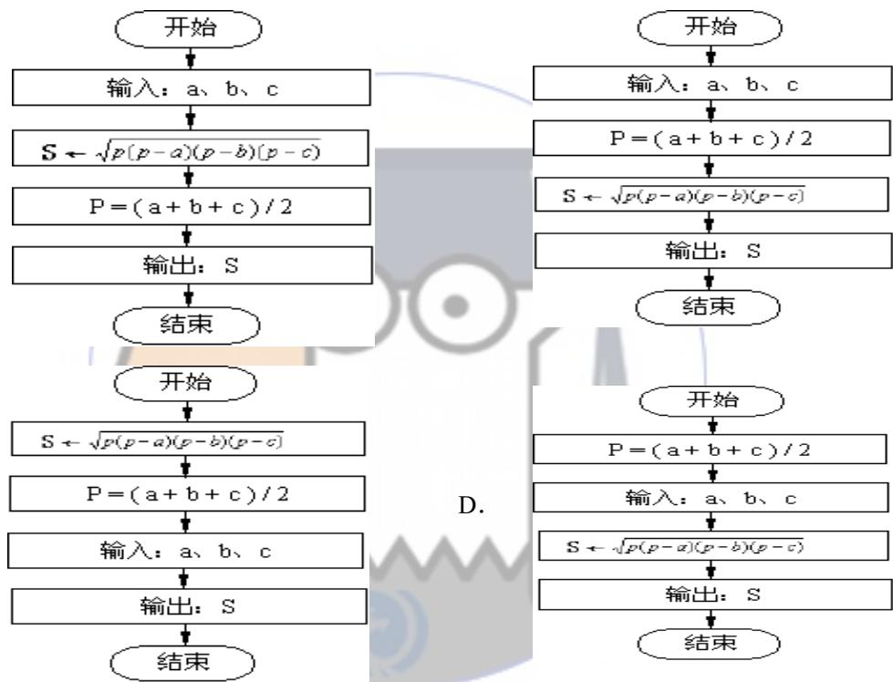

知识点：[算法的概念与基本特性（确定性、有限性等）](../../../topics/算法分析/算法概念与特性.md)

### 选择 44

关于下面流程图功能的描述正确的是：

- A. 输入一个数，若其大于 0 则输出该数，若其小于 0 则输出该数的相反数
- B. 输入一个数，若其小于或等于 0 则输出该数的相反数
- C. 输入一个数，输出其绝对值
- D. 以上答案都正确

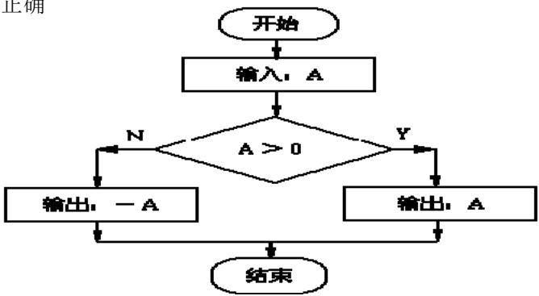

知识点：[算法的概念与基本特性（确定性、有限性等）](../../../topics/算法分析/算法概念与特性.md)

### 选择 45

鸡、兔共笼问题，有腿共 60 条，问鸡、兔各有多少只？下面鸡和兔只数最合理的范围是。(范围确定了循环的起始值和终止值)

- A. 鸡：1 到 28，兔：1 到 14
- B. 鸡：2 到 28，兔：1 到 14
- C. 鸡：1 到 28，兔：2 到 14
- D. 鸡：2 到 28，兔：2 到 14

知识点：[问题和问题求解方法与系统生命周期](../../../topics/算法分析/问题求解过程.md)、[算法的概念与基本特性（确定性、有限性等）](../../../topics/算法分析/算法概念与特性.md)、[使用程序步分析算法的时间复杂度](../../../topics/算法分析/程序步分析法.md)

### 选择 46

在程序中需要将两个变量的值交换，以下四段流程图中，不能完成将变量 X、Y 的值互相交换。

- A
- B
- C
- D

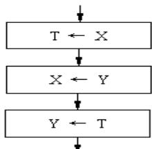

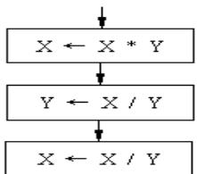

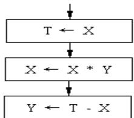

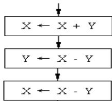

知识点：[算法的概念与基本特性（确定性、有限性等）](../../../topics/算法分析/算法概念与特性.md)、[问题和问题求解方法与系统生命周期](../../../topics/算法分析/问题求解过程.md)

### 选择 47

使用计算机解题的步骤，以下描述正确的是：

- A. 正确理解题意→设计正确算法→寻找解题方法→编写程序→调试运行
- B. 正确理解题意→寻找解题方法→设计正确算法→编写程序→调试运行
- C. 正确理解题意→寻找解题方法→设计正确算法→调试运行→编写程序
- D. 正确理解题意→寻找解题方法→设计正确算法→编写程序→调试运行

知识点：[问题和问题求解方法与系统生命周期](../../../topics/算法分析/问题求解过程.md)

### 选择 48

算法的特征是：有穷性、＿、能行性、有 0 个或多个输入和有一个或多个输出。

- A. 稳定性
- B. 确定性
- C. 正常性
- D. 快速性

知识点：[算法的概念与基本特性（确定性、有限性等）](../../../topics/算法分析/算法概念与特性.md)

### 选择 49

可以用多种不同的方法来描述一个算法，算法的描述可以用：

- A. 流程图、分支和循环
- B. 顺序、流程图和自然语言
- C. 流程图、自然语言和伪代码
- D. 顺序、分支和循环

知识点：[算法的概念与基本特性（确定性、有限性等）](../../../topics/算法分析/算法概念与特性.md)

### 选择 50

算法中通常需要三种不同的执行流程，即：。

- A. 连续模式、分支模式和循环模式
- B. 顺序模式、结构模式和循环模式
- C. 结构模式、分支模式和循环模式
- D. 顺序模式、分支模式和循环模式

知识点：[算法的概念与基本特性（确定性、有限性等）](../../../topics/算法分析/算法概念与特性.md)

### 选择 51

流程图是一种描述算法的方法，其中最基本、最常用的成分有：

- A. 处理框、矩形框、连接框、流程线和开始、结束符
- B. 菱形框、判断框、连接框、流程线和开始、结束符
- C. 处理框、判断框、连接框、圆形框和开始、结束符
- D. 处理框、判断框、连接框、流程线和开始、结束符

知识点：[算法的概念与基本特性（确定性、有限性等）](../../../topics/算法分析/算法概念与特性.md)

### 选择 52

关于程序中的变量，下面说法中错误的是：

- A. 一旦将数据存入某变量，读取变量中的值，不会改变变量的内容
- B. 一旦将数据存入某变量，以后就不能将新的数据存入该变量
- C. 一旦将数据存入某变量，以后可以将新的数据存入该变量
- D. 一旦将数据存入某变量，只要不把新的数据存入，变量的内容不会改变

知识点：[算法的概念与基本特性（确定性、有限性等）](../../../topics/算法分析/算法概念与特性.md)

### 选择 53

程序通常需要三种不同的控制结构，即：顺序结构、分支结构和循环结构，下面说法正确的是：

- A. 一个程序只能包含一种结构
- B. 一个程序最多可以包含两种结构
- C. 一个程序可以包含以上三种结构中的任意组合
- D. 一个程序必须包含以上三种结构

知识点：[算法的概念与基本特性（确定性、有限性等）](../../../topics/算法分析/算法概念与特性.md)

### 选择 54

采用盲目的搜索方法，在搜索结果的过程中，把各种可能的情况都考虑到，并对所得的结果逐一进行判断，过滤掉那些不合要求的，保留那些合乎要求的结果，这种方法叫做

- A. 递推法
- B. 枚举法
- C. 选择法
- D. 解析法

## VB 程序填空题

知识点：[回溯法的基本概念（解空间、状态空间树、显式约束与隐式约束）](../../../topics/算法分析/回溯法基本概念.md)、[子集树与排列树的搜索结构](../../../topics/算法分析/子集树与排列树.md)、[剪枝函数设计与回溯法效率分析（蒙特卡罗估计算法）](../../../topics/算法分析/剪枝函数与效率分析.md)

### 填空 1

下列程序的功能是从键盘上任意输入一个数，判断这数是正数、负数、还是零，并输出判断结果。程序中有三处错误，请更正。程序如下：

知识点：[算法的概念与基本特性（确定性、有限性等）](../../../topics/算法分析/算法概念与特性.md)、[问题和问题求解方法与系统生命周期](../../../topics/算法分析/问题求解过程.md)、[使用程序步分析算法的时间复杂度](../../../topics/算法分析/程序步分析法.md)

### 填空 2

完善程序，使其能输出：1-2+3-4+5-6+...+99-100 的值。

知识点：[使用程序步分析算法的时间复杂度](../../../topics/算法分析/程序步分析法.md)、[算法的概念与基本特性（确定性、有限性等）](../../../topics/算法分析/算法概念与特性.md)

### 填空 3

已知一元二次方程的二次项系数、一次项系数、常数项分别为 a、b、c，其中 a 不等于 0。编写程序，求方程的根，要求：如果方程无实数根，则输出“无实数根”，否则输出两个实数根。程序如下：

知识点：[算法的概念与基本特性（确定性、有限性等）](../../../topics/算法分析/算法概念与特性.md)

### 填空 4

如果下面程序执行后输出的结果是 132，请将程序补充完整：

知识点：[使用程序步分析算法的时间复杂度](../../../topics/算法分析/程序步分析法.md)

### 填空 5

下面的程序是求 7!（7!=1\*2\*3...\*6\*7）的值，并在默认窗口输出这个值。程序中有两处错误，请更正。

知识点：[递归概念与归纳证明（斐波那契数列、Hanoi塔问题）](../../../topics/算法分析/递归与归纳证明.md)、[使用程序步分析算法的时间复杂度](../../../topics/算法分析/程序步分析法.md)

### 填空 6

下面的程序是求 100 以内奇数和 s 的值（S=1+3+5+7...+99）。请将程序补充完整：

## 一、编程与算法填空题

知识点：[算法的概念与基本特性（确定性、有限性等）](../../../topics/算法分析/算法概念与特性.md)

### 填空 8

小明数了圈在一起的鸡和兔共有30个头，90只脚，在这个圈子中鸡和兔各有多少只？为了实现这一目标，完善下面的 VB 程序，在划线处填入合适的语句或表达式。

设鸡为 x 只，兔为 y 只，Visual Basic 程序如下：

```vb
' (此处原题应有代码，但识别内容缺失，仅保留题干)
```

答案：(foot-2\*head)/2；30-y

知识点：[连续整数检测算法求最大公约数](../../../topics/算法分析/连续整数检测算法.md)、[问题和问题求解方法与系统生命周期](../../../topics/算法分析/问题求解过程.md)

### 填空 10

编写一个计算矩形面积的 Sub过程，然后调用该过程计算矩形面积。

矩形面积

答案：Rlen\*Rwid；Str(Area)

知识点：[算法的概念与基本特性（确定性、有限性等）](../../../topics/算法分析/算法概念与特性.md)

### 填空 11

用物理天平测量物体的质量时，测得物体的质量为 a克（a为整数，并小于 1 千克），问：这时在天平的砝码盘中应有哪几个砝码？请选用最少数量的砝码（称质量为 1 千克的物体，天平的砝码由下列质量的砝码组成：500 克 1 个，200 克 1 个，100 克 2 个，50 克 1 个，20 克 1 个，10 克 2 个，5 克 1个，2克 2个，1 克1 个）。

为了实现这一目标，请参照下边的流程图完善下面的 VB程序，在划线处填入合适的语句或表达式，完成程序设计。

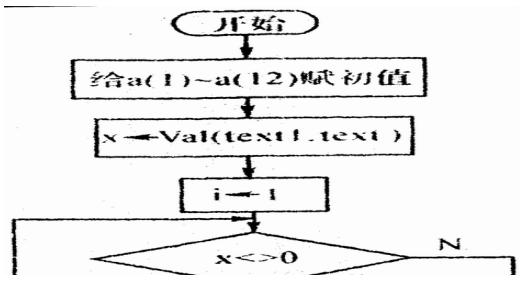

答案：x<>0；X=x-a(i)

知识点：[贪心法的基本要素（贪心选择性质/最优量度标准、最优子结构性质）](../../../topics/算法分析/贪心法基本要素.md)、[贪心法的一般算法框架（按量度标准排序后逐步决策）](../../../topics/算法分析/贪心法一般框架.md)

### 填空 12

有一个单击按钮过程，其作用是产生 50个60~100 的随机数，统计其中被 6 整除余2的个数，并将这些数输出。请补充下面的程序：

答案：60；Counter=counter+1

知识点：[算法的概念与基本特性（确定性、有限性等）](../../../topics/算法分析/算法概念与特性.md)

### 填空 13

下面是一个检测密码的程序（界面如图7－4，其功能是：当用户输入的密码正确时，在窗体上显示“欢迎您使用本系统”；否则显示“密码错误！请重新输入密码：”。正确的密码是 0123456789。仔细阅读程序，请问程序中划线处的语句应为 \_\_\_\_

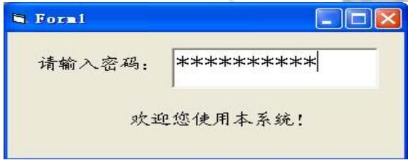

'以下两语句的作用是使程序能自动选中错误的密码，使用户可直接重新输入

答案：Text1.Text="0123456789"；"密码错误！请重新输入密码："

知识点：[问题和问题求解方法与系统生命周期](../../../topics/算法分析/问题求解过程.md)

### 填空 14

猴子吃桃问题。猴子第一天摘下若干个桃子，当即吃了一半，还不过瘾，又多吃了一个。第二天早晨又将剩下的桃子吃了一半，又多吃了一个。以后每天早上都吃了前一天剩下的一半零一个。到第十天早上再想吃时，见只剩一个桃子了。问：第一天猴子共摘了多少个桃子。为了实现这一目标，完善下面的 VB程序，在划线处填入合适的语句或表达式，完成程序设计。Visual Basic 程序如下：

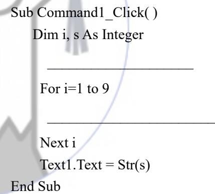

答案：s=1；S=(s+1)*2

知识点：[递归概念与归纳证明（斐波那契数列、Hanoi塔问题）](../../../topics/算法分析/递归与归纳证明.md)、[算法的概念与基本特性（确定性、有限性等）](../../../topics/算法分析/算法概念与特性.md)、[使用程序步分析算法的时间复杂度](../../../topics/算法分析/程序步分析法.md)

### 填空 15

下面程序（界面如图）的功能是：将0到255之间的十进制整数转换为二进制整数的表示形式。在如图中上面的文本框（Text1）中输入一个 0到 255之间的十进制的二进制形式会显示在下面的文本框

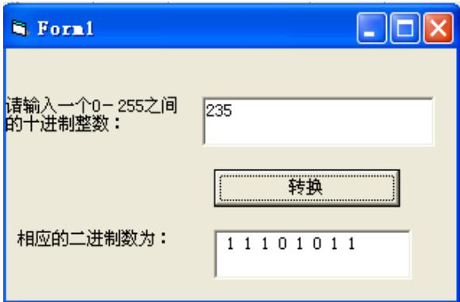

答案：a\2

知识点：[算法的概念与基本特性（确定性、有限性等）](../../../topics/算法分析/算法概念与特性.md)

### 填空 16

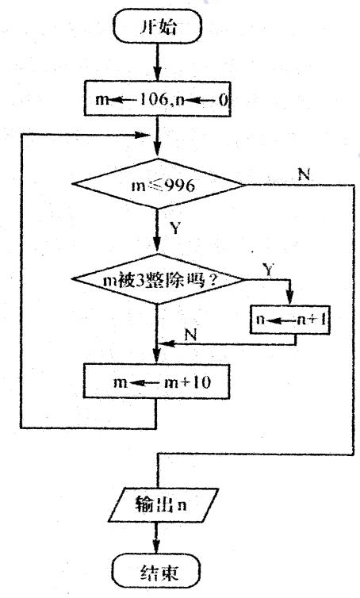

答案：0；m Mod 3 = 0；m+10

知识点：[欧几里德算法（递归与迭代实现求最大公约数）](../../../topics/算法分析/欧几里德算法.md)

### 填空 19

从键盘键入一个整数x，将 x插入到一列有序数据：－5，3，4，12，20，45，70中，并使数据序列仍保持有序，试求出 x应插入的位置。

为了实现这一目标，请参照流程图，完善下面的VB 程序，在划线处填入合适的语句或表达式，完成程序设计。

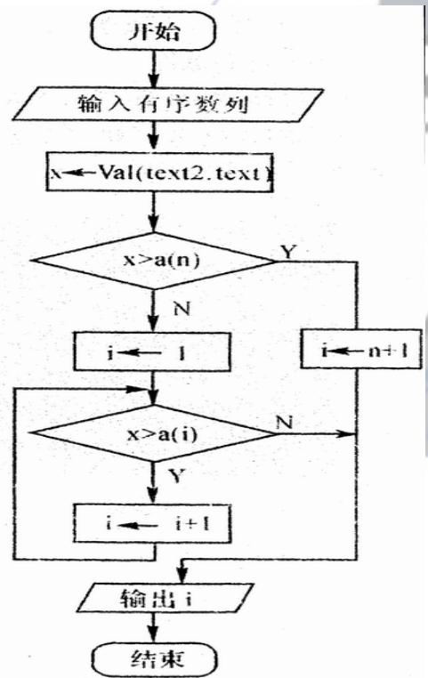

```vb
Dim a(1 To 8) As Integer 
Dim n, i, j, x As Integer 
Private Sub Command1_Click() 
    x = Val(Text2.Text) 
    If x > a(n) Then
        ' ...
    End If
End Sub
```

答案：i=n+1；i=i+1

知识点：[使用程序步分析算法的时间复杂度](../../../topics/算法分析/程序步分析法.md)、[分治法的一般思想与算法框架（分解、解决、合并）](../../../topics/算法分析/分治法一般框架.md)、[算法的概念与基本特性（确定性、有限性等）](../../../topics/算法分析/算法概念与特性.md)

### 填空 20

输入 100个数，统计其中负数、零及正数的个数。

```vb
Print "负数、零及正数的个数是:"; fs, ns, zs 
End Sub
```

答案：zs=zs+1；ns=ns+1

知识点：[算法的概念与基本特性（确定性、有限性等）](../../../topics/算法分析/算法概念与特性.md)

### 填空 21

有一个数组 DATA 存放了 N 个数据，现从中删除了一个元素，其余的元素依次向前递补（假设删除的是第 3个元素，则要将第4 个元素移到第3个元素处，第 5个元素移到第 4 个元素处，以此类推），然后输出数组内容。填写程序中的空缺

```vb
Private Sub Command1_Click()
    Dim data(10) As Integer
    Dim I, N, T As Integer
    N = 10
    For I = 1 To N
        ' ...
    Next I
End Sub
```

答案：T+1 to N；N=N-1

知识点：[使用程序步分析算法的时间复杂度](../../../topics/算法分析/程序步分析法.md)、[算法的概念与基本特性（确定性、有限性等）](../../../topics/算法分析/算法概念与特性.md)

### 填空 22

寻找 100 以内的勾股数。“勾三股四弦五”大家都知道 $3^2+4^2=5^2$，3，4，5 就是勾股数，寻找 100以内的勾股数。请完成下面的程序填空：

答案：i^2+j^2=k^2

知识点：[算法的概念与基本特性（确定性、有限性等）](../../../topics/算法分析/算法概念与特性.md)、[使用程序步分析算法的时间复杂度](../../../topics/算法分析/程序步分析法.md)、[渐近表示法：大O记号（紧上界）](../../../topics/算法分析/大O记号.md)

### 填空 23

随机产生10 个1－100 之间的正整数，按从小到大的次序排序并输出。为了实现这一目标，完善下面的VB 程序，在划线处填入合适的语句或表达式，完成程序设计（流程图参见下图）

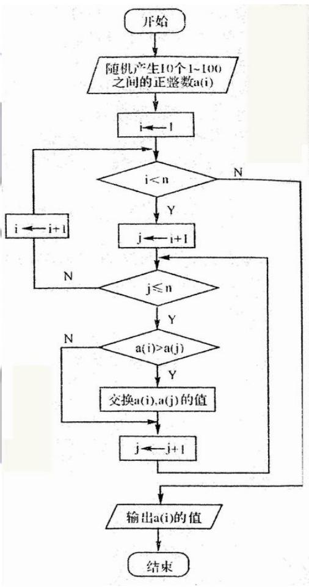

答案：a(i)>a(j)

知识点：[两路合并排序算法及其时间与空间复杂度分析](../../../topics/算法分析/合并排序.md)

### 填空 24

有 30个人，其中有男人、女人和小孩。他们在一家饭馆里花去500 元。已知，每个男人花30元，每个女人花 20元，每个小孩花 10 元。问：男人、女人、小孩各为多少人。

为了实现这一目标，完善下面的 VB程序，在划线处填入合适的语句或表达式，完成程序设计。

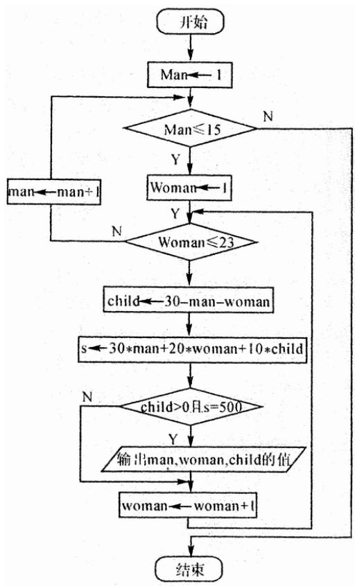

答案：30－man－woman；S=500

知识点：[算法的概念与基本特性（确定性、有限性等）](../../../topics/算法分析/算法概念与特性.md)、[问题和问题求解方法与系统生命周期](../../../topics/算法分析/问题求解过程.md)、[递归概念与归纳证明（斐波那契数列、Hanoi塔问题）](../../../topics/算法分析/递归与归纳证明.md)

### 填空 25

在我国古代《孙子算经》中曾经提出这样一个问题。原文是这样的：“今有物，不知其数，三三数之，剩二；五五数之，剩三；七七数之，剩二；问物几何？”试用枚举法来解决这一问题。现分析如下，所寻找之数为满足如下条件的自然数：以3 除余 2，以5 除余 3，以 7 除余 2，程序将从自然数 1开始依次寻找，逐一判断某一自然数是否满足全部条件，直至在指定范围内找到满足条件的所有自然数。程序代码如下，请补充完整：

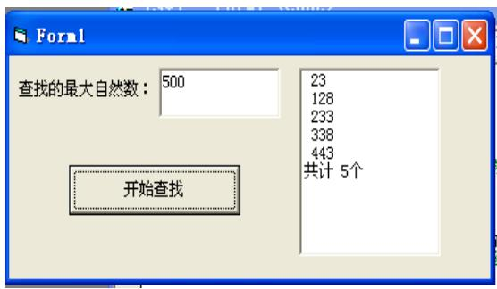

范围的最大自然数，在text1框中输入

答案：Val(Text1.Text)；n Mod 3 =2 And n Mod 5 =3 And n Mod 7 = 2；sum=sum+1

知识点：[算法的概念与基本特性（确定性、有限性等）](../../../topics/算法分析/算法概念与特性.md)、[问题和问题求解方法与系统生命周期](../../../topics/算法分析/问题求解过程.md)、[算法的时间复杂度定义（最好、最坏、平均情况）](../../../topics/算法分析/时间复杂度定义.md)

### 填空 26

下面程序若用于计算 $s=1!+2!+3!+4!+5!+6!＋7!+8!+9!+10!$，则程序中划线处的语句应为 \_\_\_\_

答案：t=t*i

知识点：[使用程序步分析算法的时间复杂度](../../../topics/算法分析/程序步分析法.md)、[算法的概念与基本特性（确定性、有限性等）](../../../topics/算法分析/算法概念与特性.md)、[算法的时间复杂度定义（最好、最坏、平均情况）](../../../topics/算法分析/时间复杂度定义.md)

### 填空 27

用 VB 编写一个计算 $S＝1－1/3!+1/5!－1/7!+\dots＋(-1)^{n-1}/(2n－1)!$ 的程序，程序代码如下，请补充完整：

答案：j/((2*i-1)*(2*i-2))；s+((-1)^(i-1))*j

知识点：[使用程序步分析算法的时间复杂度](../../../topics/算法分析/程序步分析法.md)、[算法的时间复杂度定义（最好、最坏、平均情况）](../../../topics/算法分析/时间复杂度定义.md)

### 填空 28

设有 n 盏灯，放在一排，从 1～n 依次顺序编号。有n 个人也从 1 到n 依次编号。第1 个人（1 号）将灯全部关闭，第 2 个人（2号）将凡是2 的倍数的灯打开，第 3个人（3 号）将凡是3 的倍数的灯做相反处理（该灯如为打开的，则将它关闭，如关闭的则将它打开），以后的人都和3 号一样，将凡是自己号数倍数的灯做相反处理。试计算，当n 个人操作后，哪几盏灯是亮的。

（提示：亮灯为 0，关闭为 1）

为了实现这一目标，完善下面的 VB程序。根据右面的流程图，在划线处填入合适的语句或表达式，完成程序设计。

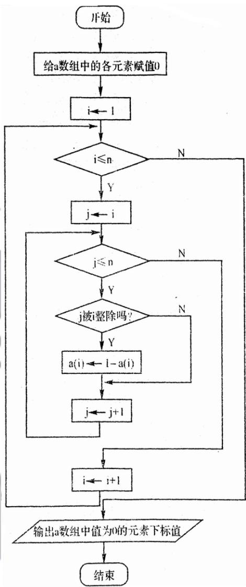

答案：a(i)＝1 - a(i)；a(i)＝0

---

## 二、Vb 程序填空参考答案汇总

| 题号 | 1 | 2 | 3 | 4 | 5 | 6 | 7 | 8 | 9 | 10 |
| :--- | :-: | :-: | :-: | :-: | :-: | :-: | :-: | :-: | :-: | :-: |
| **答案** | C | B | A | D | D | B | | C | C | C |
| **题号** | 11 | 12 | 13 | 14 | 15 | 16 | 17 | 18 | 19 | 20 |
| **答案** | B | D | A | B | C | B | C | B | A | B |
| **题号** | 21 | 22 | 23 | 24 | 25 | 26 | 27 | 28 | 29 | 30 |
| **答案** | C | B | C | D | C | C | A | B | C | C |
| **题号** | 31 | 32 | 33 | 34 | 35 | 36 | 37 | 38 | 39 | 40 |
| **答案** | B | A | B | D | C | A | C | A | D | D |
| **题号** | 41 | 42 | 43 | 44 | 45 | 46 | 47 | 48 | 49 | 50 |
| **答案** | D | C | B | D | B | C | B | B | C | D |
| **题号** | 51 | 52 | 53 | 54 | | | | | | |
| **答案** | D | B | C | B | | | | | | |

知识点：[算法的概念与基本特性（确定性、有限性等）](../../../topics/算法分析/算法概念与特性.md)
