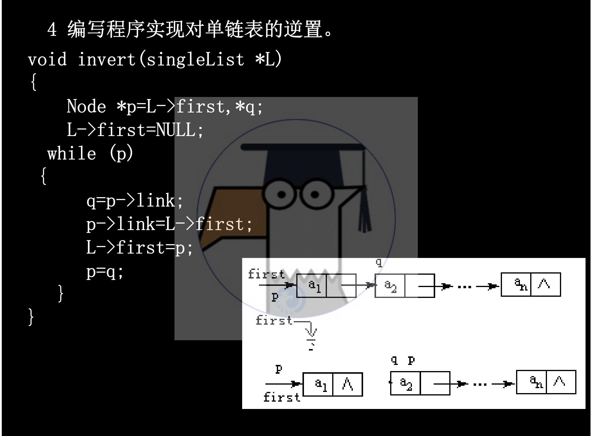

# 《算法分析与设计》第2章习题参考答案

原件经识别和整理；“参考解答”是我们补的。

## 习题二

### 编程 1

编写程序实现对顺序表逆置。

```c
void Invert(seqList *L)
{
    // 对顺序表 L 就地逆置
    for (int i = 0; i < L->n / 2; i++) {
        temp = L->element[i];
        L->element[i] = L->element[L->n - i - 1];
        L->element[L->n - i - 1] = temp;
    }
}
```

知识点：[算法的空间复杂度定义](../../../topics/算法分析/空间复杂度定义.md)、[使用程序步分析算法的时间复杂度](../../../topics/算法分析/程序步分析法.md)

### 编程 4

编写程序实现对单链表的逆置。

```c
void invert(singleList *L)
{
    Node *p = L->first, *q;
    L->first = NULL;
    while (p) {
        q = p->link;
        p->link = L->first;
        L->first = p;
        p = q;
    }
}
```



知识点：[算法的概念与基本特性（确定性、有限性等）](../../../topics/算法分析/算法概念与特性.md)、[算法的空间复杂度定义](../../../topics/算法分析/空间复杂度定义.md)

### 编程 6

编写程序将两个有序递增的单链表合并为一个有序递增的单链表。

```c
void MergeList1(headerList *La, headerList *Lb, headerList *Lc)
{
    // 合并链表 La 和 Lb，合并后的新表使用头指针 Lc 指向
    Node *pa, *pb, *pc, *q;
    pa = La->head->link;
    pb = Lb->head->link;
    pc = Lc->head;
    while (pa && pb) {
        if (pa->element < pb->element) {
            pc->link = pa;
            pc = pa;
            pa = pa->link;
            La->n--;
        }
    }
}

知识点：[两路合并排序算法及其时间与空间复杂度分析](../../../topics/算法分析/合并排序.md)
