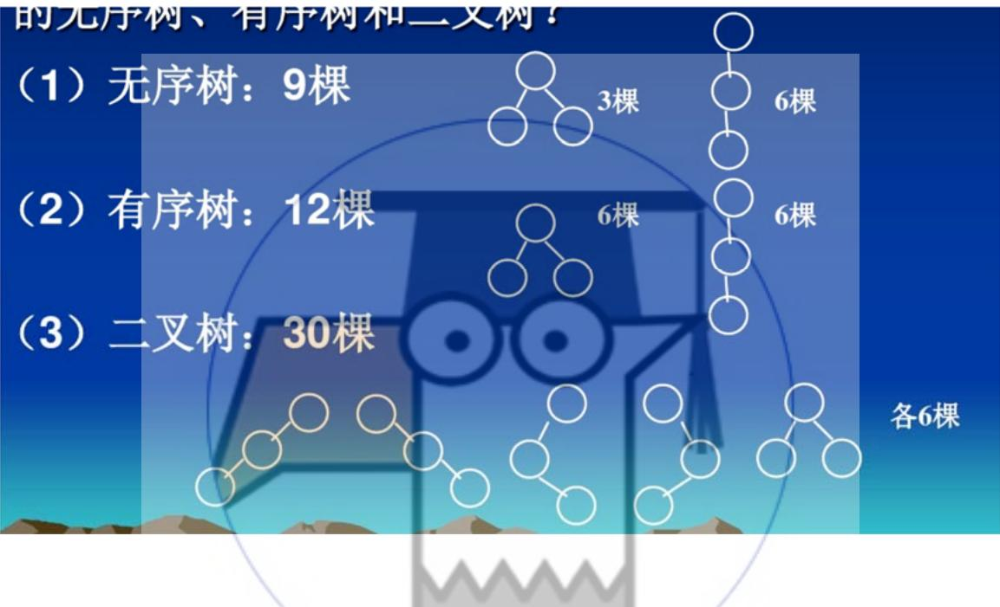
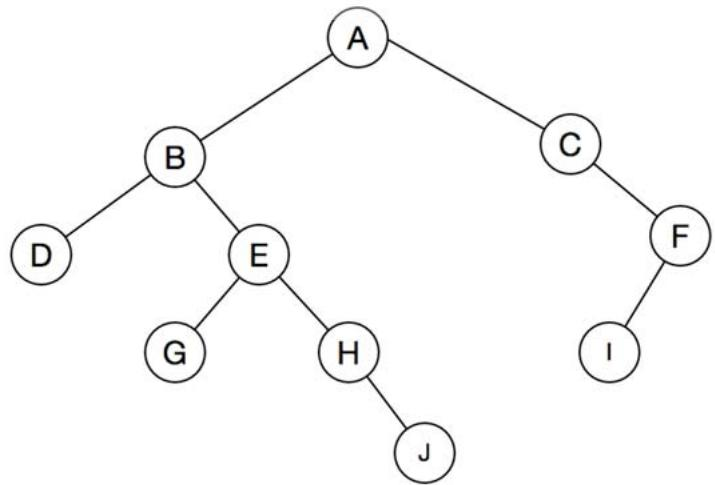
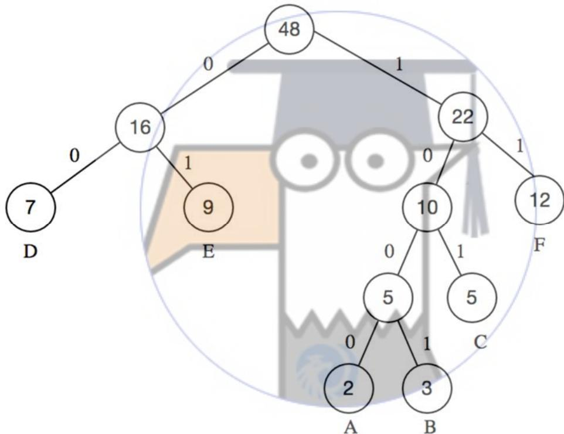
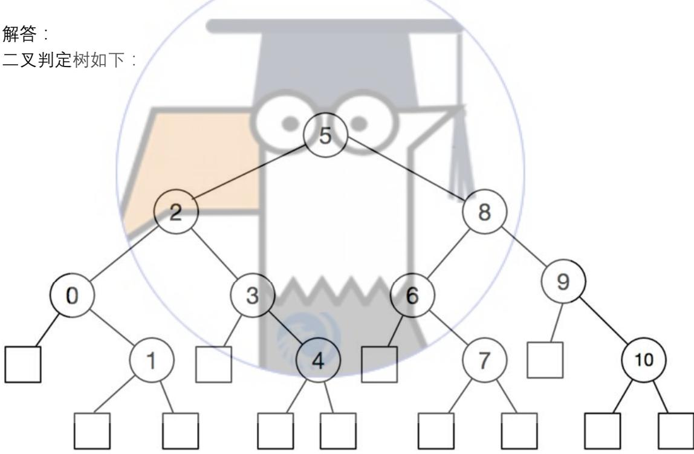

# 《算法分析与设计》第5-6章习题参考答案

原件经识别和整理；“参考解答”是我们补的。

# 算法分析与设计第5-6章习题参考答案

本资料由识别工具读取整理，包含第5章和第6章的基础题答案及扩展题解答。

## 第5章

### 一 基础题

| 1 | 2 | 3 | 4 | 5 | 6 | 7 | 8 | 9 | 10 | 11 | 12 |
|---|---|---|---|---|---|---|---|---|---|---|---|
| D | B | D | D | C | C | A | C | B | B | A | C |

答案：D, B, D, D, C, C, A, C, B, B, A, C

知识点：[算法的概念与基本特性（确定性、有限性等）](../../../topics/算法分析/算法概念与特性.md)、[使用程序步分析算法的时间复杂度](../../../topics/算法分析/程序步分析法.md)、[渐近表示法：大O记号（紧上界）](../../../topics/算法分析/大O记号.md)

### 二 扩展题

#### 选择 1

题干：对于三个结点 A、B 和 C，可分别组成多少不同的无序树、有序树和二叉树？

解答：
（1）无序树：9 棵；
（2）有序树：12 棵；
（3）二叉树：30 棵。




#### 选择 4

题干：假设一棵二叉树的层次序列为 ABCDEFGHIJ，中序遍历序列为 DBGEHJACIF。请画出这棵二叉树。

解答：




#### 选择 7

题干：试求:(1)树 T 的最大深度和最小可能深度;(2)树 T 中的非叶子结点个数。

解答：
（1）树 T 的最大深度为 6；
树 T 的最小可能深度为 $4$。

（2）设叶子结点数为 $\mathrm{N}_{0}$，度为 2 的结点数为 $\mathrm{N}_{2}$，由二叉树性质 $\mathrm{N}_{0} = \mathrm{N}_{2} + 1$。
由题意可知：非叶子结点个数 $\mathrm{N}_{2} = 6 - 1 = 5$。


#### 选择 8

题干：设 S={A,B,C,D,E,F}，W={2,3,5,7,9,12}，对字符集合进行哈夫曼编码，W 为各字符的频率。(1)画出哈夫曼树;(2)计算加权路径长度;(3)求各字符的编码。

解答：
(1) 哈夫曼树如下：



(3) 各字符的编码如下：
A: 1000
B: 1001
C: 101
D: 00
E: 01
F: 11


#### 补充习题

题干：设二叉树以二叉链表存储，试编写求解下列问题的递归算法。
（1）求一棵二叉树的高度；
（2）求一棵二叉树中的结点个数；
（3）交换一棵二叉树中每个结点的左、右子树。

参考解答：

```cpp
// (1) 求二叉树高度
int GetHeight(BTNode *root) {
    if (root == NULL) return 0;
    int hLeft = GetHeight(root->lchild);
    int hRight = GetHeight(root->rchild);
    return (hLeft > hRight ? hLeft : hRight) + 1;
}

// (2) 求二叉树结点个数
int CountNodes(BTNode *root) {
    if (root == NULL) return 0;
    return 1 + CountNodes(root->lchild) + CountNodes(root->rchild);
}

// (3) 交换左右子树
void SwapSubtrees(BTNode *root) {
    if (root == NULL) return;
    BTNode *temp = root->lchild;
    root->lchild = root->rchild;
    root->rchild = temp;
    SwapSubtrees(root->lchild);
    SwapSubtrees(root->rchild);
}
```


## 第6章

知识点：[二分搜索（对半搜索）的递归与迭代实现](../../../topics/算法分析/二分搜索.md)、[对半搜索的二叉判定树性质及基于关键字比较的搜索算法时间下界](../../../topics/算法分析/二叉判定树.md)、[算法的时间复杂度定义（最好、最坏、平均情况）](../../../topics/算法分析/时间复杂度定义.md)

### 一 基础题

| 1 | 2 | 3 | 4 | 5 |
|---|---|---|---|---|
| B | B | D | C | B |

答案：B, B, D, C, B

知识点：[算法的概念与基本特性（确定性、有限性等）](../../../topics/算法分析/算法概念与特性.md)、[使用程序步分析算法的时间复杂度](../../../topics/算法分析/程序步分析法.md)、[渐近表示法：大O记号（紧上界）](../../../topics/算法分析/大O记号.md)

### 二 扩展题

#### 选择 5

题干：假定对下标从 0 开始标记、长度为 11 的有序表 (6, 17, 21, 27, 30, 36, 44, 55, 60, 67, 71) 进行对半搜索，请画出描述对半搜索的二叉判定树。若每个元素的搜索概率相等，求搜索成功的平均查找长度。

解答：
二叉判定树如下：



计算平均查找长度（ASL）：
该判定树共有 11 个结点。
第一层（根）：1 个结点，深度 1
第二层：2 个结点，深度 2
第三层：4 个结点，深度 3
第四层：4 个结点，深度 4

总比较次数 = $1\times1 + 2\times2 + 4\times3 + 4\times4 = 1 + 4 + 12 + 16 = 33$
平均查找长度 $ASL_{成功} = \frac{33}{11} = 3$。

答案：二叉判定树见上图，搜索成功的平均查找长度为 3。

知识点：[二分搜索（对半搜索）的递归与迭代实现](../../../topics/算法分析/二分搜索.md)、[对半搜索的二叉判定树性质及基于关键字比较的搜索算法时间下界](../../../topics/算法分析/二叉判定树.md)、[算法的时间复杂度定义（最好、最坏、平均情况）](../../../topics/算法分析/时间复杂度定义.md)
