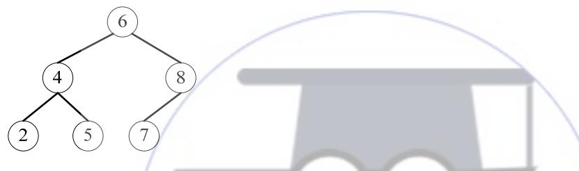
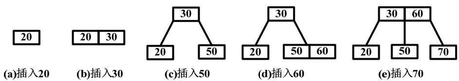
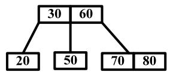
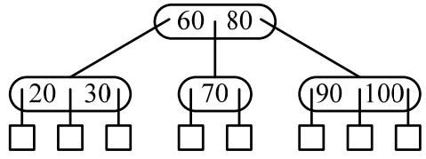
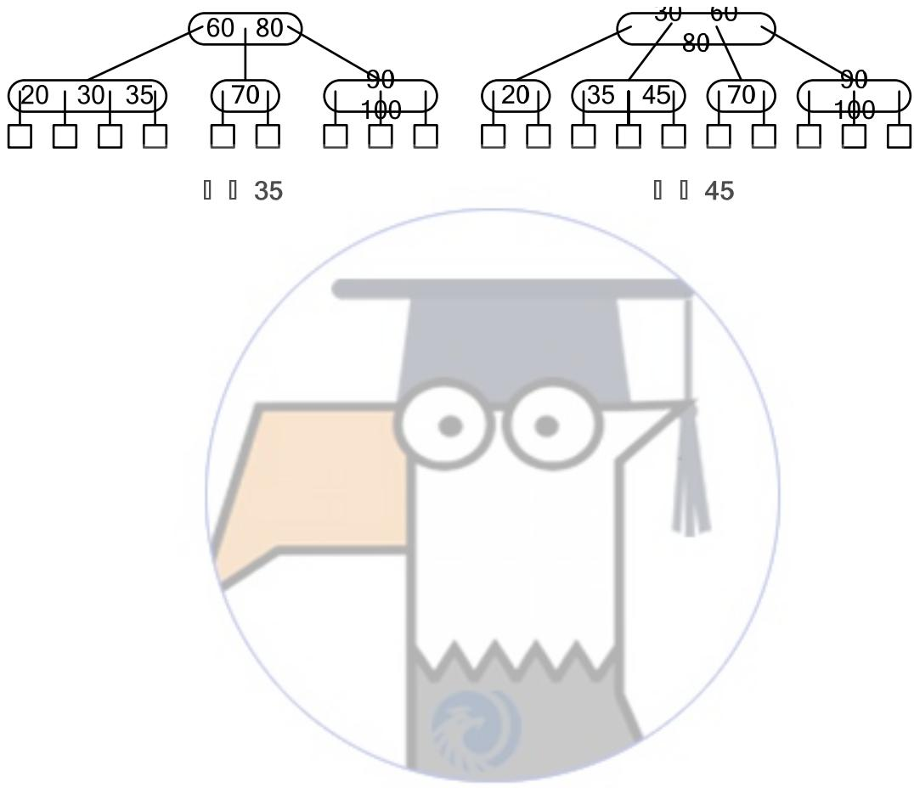

# 《算法分析与设计》第7-8章习题参考答案（AVL树、B-树与哈希表）

原件经识别和整理；“参考解答”是我们补的。

## 布置的作业

第七章扩展题 4、5、6、7；第八章扩展题 1、2。

### 计算 4

向空的 AVL 树中，依次插入关键字 5、2、4、8、6 和 7，画出最终生成的 AVL 树。

答案：

知识点：[二分搜索（对半搜索）的递归与迭代实现](../../../topics/算法分析/二分搜索.md)、[对半搜索的二叉判定树性质及基于关键字比较的搜索算法时间下界](../../../topics/算法分析/二叉判定树.md)

### 计算 5

依次输入序列 2，60，7，55，9，40，从一棵空树开始构造 AVL 树，依次画出每一步的构造过程。

答案：

知识点：[欧几里德算法（递归与迭代实现求最大公约数）](../../../topics/算法分析/欧几里德算法.md)、[连续整数检测算法求最大公约数](../../../topics/算法分析/连续整数检测算法.md)

### 计算 6

已知关键字序列为（20，30，50，60，70，80），依照此顺序建立一棵 3 阶 B-树，给出建立的过程及最终结果。

答案：

知识点：[算法的空间复杂度定义](../../../topics/算法分析/空间复杂度定义.md)

### 计算 7

图 7.11 是一棵 4 阶 B-树，请画出向该树中依次插入关键字 35，45 后最终所得的 B-树。

答案：

## 第八章 扩展题

知识点：[算法的概念与基本特性（确定性、有限性等）](../../../topics/算法分析/算法概念与特性.md)、[二分搜索（对半搜索）的递归与迭代实现](../../../topics/算法分析/二分搜索.md)

### 综合 1

假定一个待哈希存储的线性表为 (32,75,29,63,48,94,25,46,18,70)，哈希地址空间为 HT[13]，若采用除留余数法构造哈希函数和线性探测法处理冲突，试求出每一元素在哈希表中的初始哈希地址和最终哈希地址，画出最后得到的哈希表，求出平均查找长度。

| 元素 | 32 | 75 | 29 | 63 | 48 | 94 | 25 | 46 | 18 | 70 |
| --- | --- | --- | --- | --- | --- | --- | --- | --- | --- | --- |
| 初始哈希地址 |  |  |  |  |  |  |  |  |  |  |
| 最终哈希地址 |  |  |  |  |  |  |  |  |  |  |

哈希表

| 0 | 1 | 2 | 3 | 4 | 5 | 6 | 7 | 8 | 9 | 10 | 11 | 12 |
| --- | --- | --- | --- | --- | --- | --- | --- | --- | --- | --- | --- | --- |
|  |  |  |  |  |  |  |  |  |  |  |  |  |

答案：H(K)=K % 13，平均查找长度为 14/10，其余解答如下。

| 元素 | 32 | 75 | 29 | 63 | 48 | 94 | 25 | 46 | 18 | 70 |
| --- | --- | --- | --- | --- | --- | --- | --- | --- | --- | --- |
| 初始哈希地址 | 6 | 10 | 3 | 11 | 9 | 3 | 12 | 7 | 5 | 5 |
| 最终哈希地址 | 6 | 10 | 3 | 11 | 9 | 4 | 12 | 7 | 5 | 8 |

| | 0 | 1 | 2 | 3 | 4 | 5 | 6 | 7 | 8 | 9 | 10 | 11 | 12 |
| --- | --- | --- | --- | --- | --- | --- | --- | --- | --- | --- | --- | --- | --- |
| 哈希表 |  |  |  | 29 | 94 | 18 | 32 | 46 | 70 | 48 | 75 | 63 | 25 |

知识点：[算法的概念与基本特性（确定性、有限性等）](../../../topics/算法分析/算法概念与特性.md)

### 综合 2

有长度为 13 的散列表 ht，采用双散列法解决冲突，散列函数为：

$h_1(key)=key\%13$，$h_2(key)=key\%11+1$，

试用关键字值的序列：52，37，24，27，83，13，62，48 建立散列表。（说明：在以下表的合适位置直接填入关键字）

| 0 | 1 | 2 | 3 | 4 | 5 | 6 | 7 | 8 | 9 | 10 | 11 | 12 |
| --- | --- | --- | --- | --- | --- | --- | --- | --- | --- | --- | --- | --- |
| 52 | 24 |  |  |  |  |  |  |  |  |  |  | 37 |

答案：

| 0 | 1 | 2 | 3 | 4 | 5 | 6 | 7 | 8 | 9 | 10 | 11 | 12 |
| --- | --- | --- | --- | --- | --- | --- | --- | --- | --- | --- | --- | --- |
| 52 | 24 |  | 13 |  | 83 |  | 27 |  | 48 | 62 | 37 |  |

知识点：[算法的概念与基本特性（确定性、有限性等）](../../../topics/算法分析/算法概念与特性.md)、[数论初步（同余定义、按模计算原理、欧拉函数）](../../../topics/算法分析/数论初步.md)
