# 《算法分析与设计》第9章习题参考答案

原件经识别和整理；“参考解答”是我们补的。

## 9-1

(1) 顶点入度

$$
Q: 2
$$

## 9-2 邻接矩阵

$$
\begin{array}{l} {0} \\ {1} \\ {2} \\ {3} \\ {4} \\ {5} \end{array} \left[ \begin{array}{l l l l l l} {0} & {1} & {0} & {0} & {0} & {0} \\ {0} & {0} & {1} & {0} & {0} & {0} \\ {0} & {0} & {0} & {1} & {0} & {0} \\ {1} & {0} & {0} & {0} & {0} & {0} \\ {1} & {0} & {1} & {0} & {0} & {0} \\ {0} & {1} & {0} & {1} & {0} & {0} \end{array} \right]
$$

(2) 邻接矩阵

$$
\begin{array}{l} 0 \\ 1 \\ 2 \\ 3 \end{array} \left[ \begin{array}{l l l l} 0 & 1 & 1 & 1 \\ 1 & 0 & 1 & 1 \\ 1 & 1 & 0 & 1 \\ 1 & 1 & 1 & 0 \end{array} \right]
$$

## 9-3

(3) 强连通分量

⑤

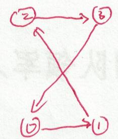

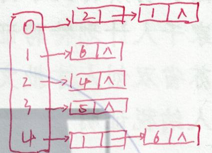

## 9-10

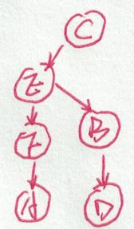

## 9-18

以 A 为出发点：

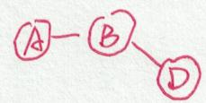

1.

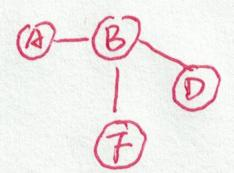

2.

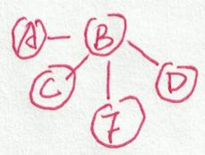

3.

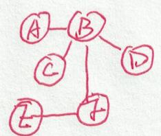

4.

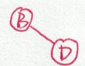

5.

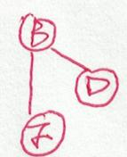

1

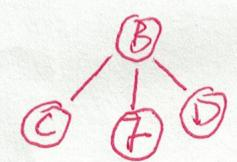

2.

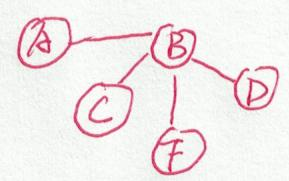

3.

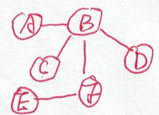

4

| S | d[1]. p[0] | d[2]. p[2] | d[3]. p[3] | d[4]. p[4] | d[5]. p[5] |
| --- | --- | --- | --- | --- | --- |
| 1 | 0, -1 | 10, 1 | ∞, -1 | 30, 1 | 100, 1 |
| 2 | 0, -1 | 10, 1 | 60, 2 | 30, 1 | 100, 1 |
| 4 | 0, -1 | 10, 1 | 50, 4 | 30, 1 | 90, 4 |
| 3 | 0, -1 | 10, 1 | 50, 4 | 30, 1 | 60, 3 |
| 5 | 0, -1 | 10, 1 | 50, 4 | 30, 1 | 60, 3 |
