# 《算法设计与分析》第05章 分治法（课件）

原件的每一页，下面附识别出的文字。

### 算法设计与分析

原文：

算法设计与分析

DeSign and Analysis of Algorithms In C++

陈慧南 编著

南京邮电大学计算机学院 2008年3月

“十一五”国家级规划教材

电子工业出版社

### 第2部分 算法设计策略

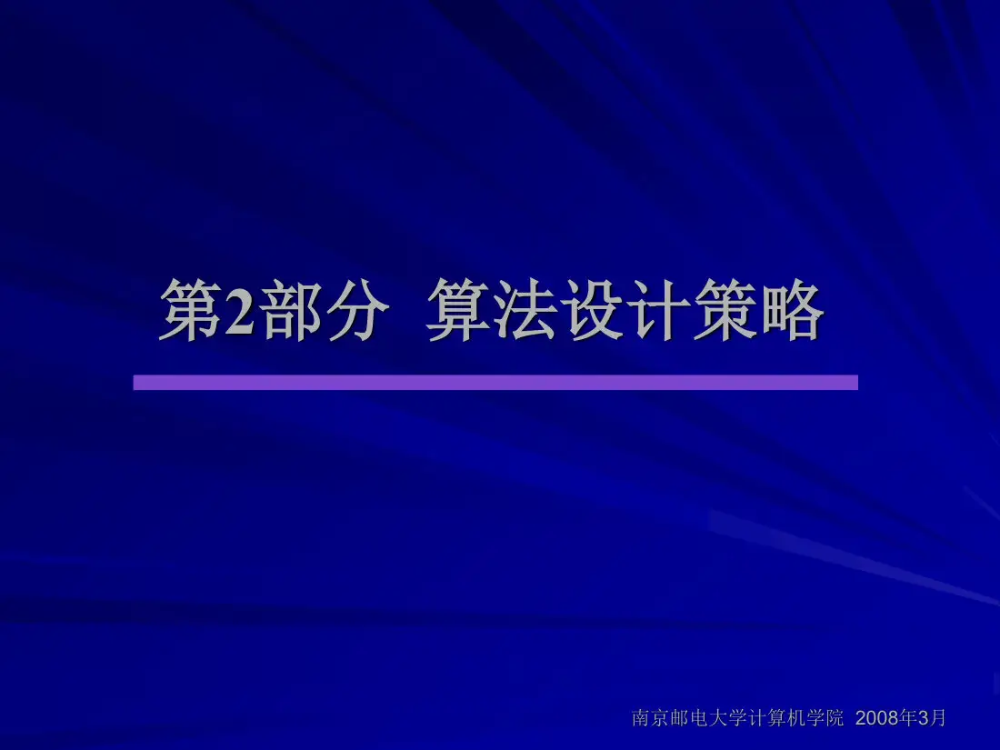

原文：

第2部分 算法设计策略

南京邮电大学计算机学院 2008年3月

### 第5章 分治法

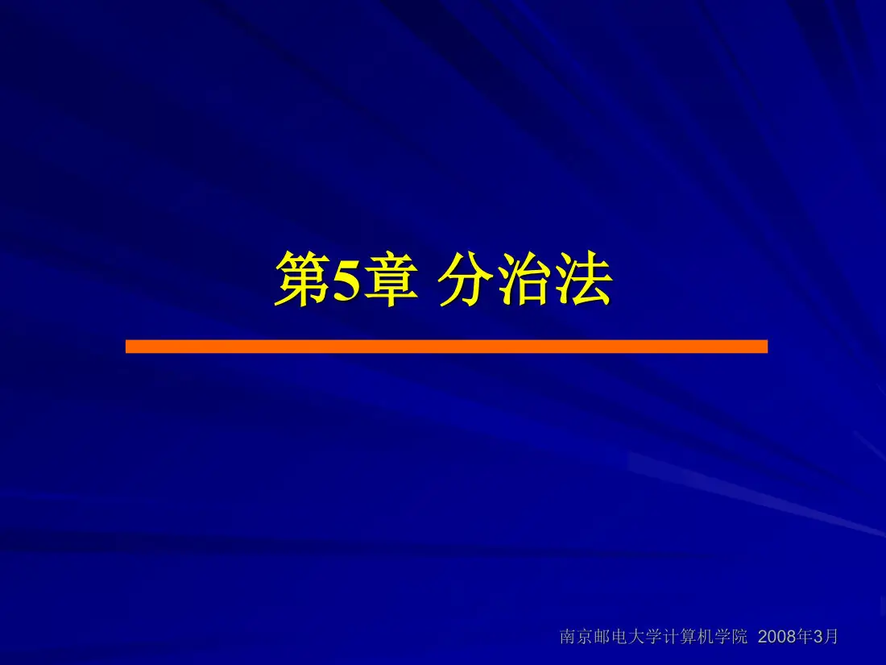

原文：

第5章 分治法

南京邮电大学计算机学院 2008年3月

### 5.1 分治法的基本思想

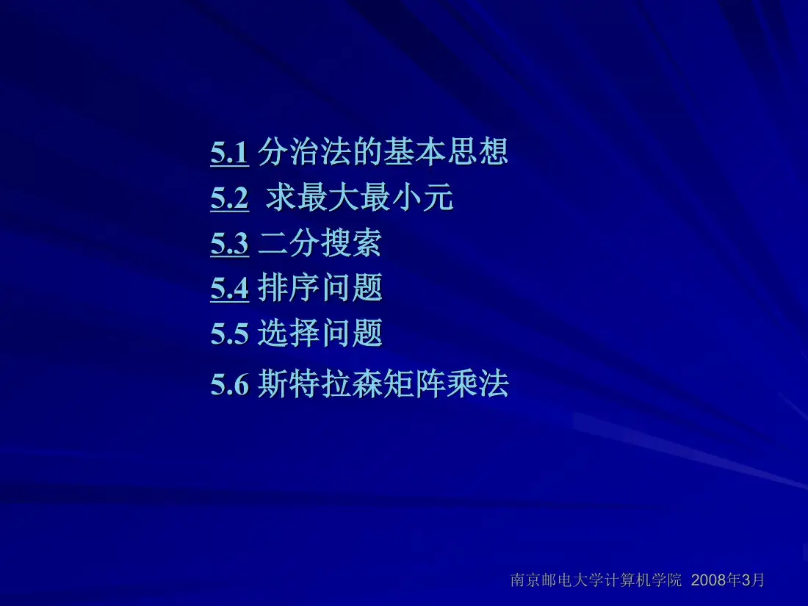

原文：

5.1 分治法的基本思想
5.2 求最大最小元
5.3 二分搜索
5.4 排序问题
5.5 选择问题
5.6 斯特拉森矩阵乘法

南京邮电大学计算机学院 2008年3月

### 5.1 一般方法

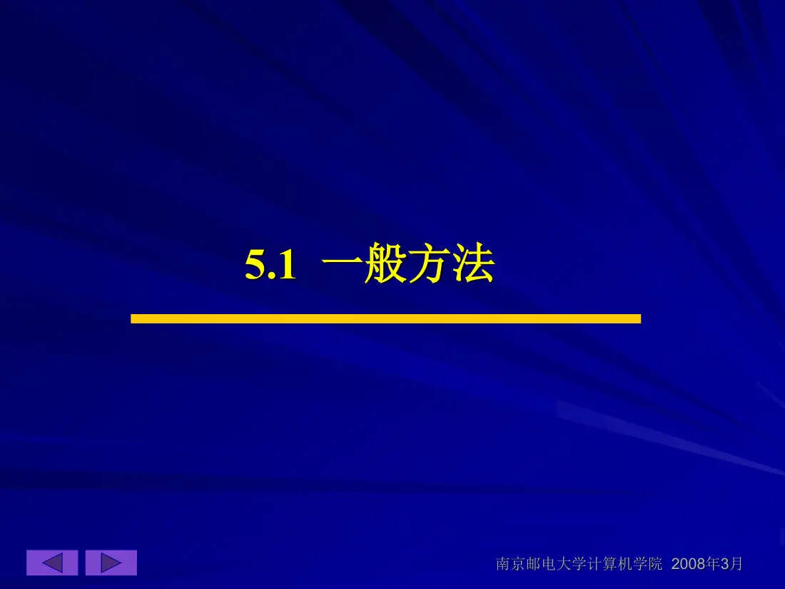

原文：

5.1 一般方法

△

南京邮电大学计算机学院 2008年3月

### 5.1.1 分治法的基本思想

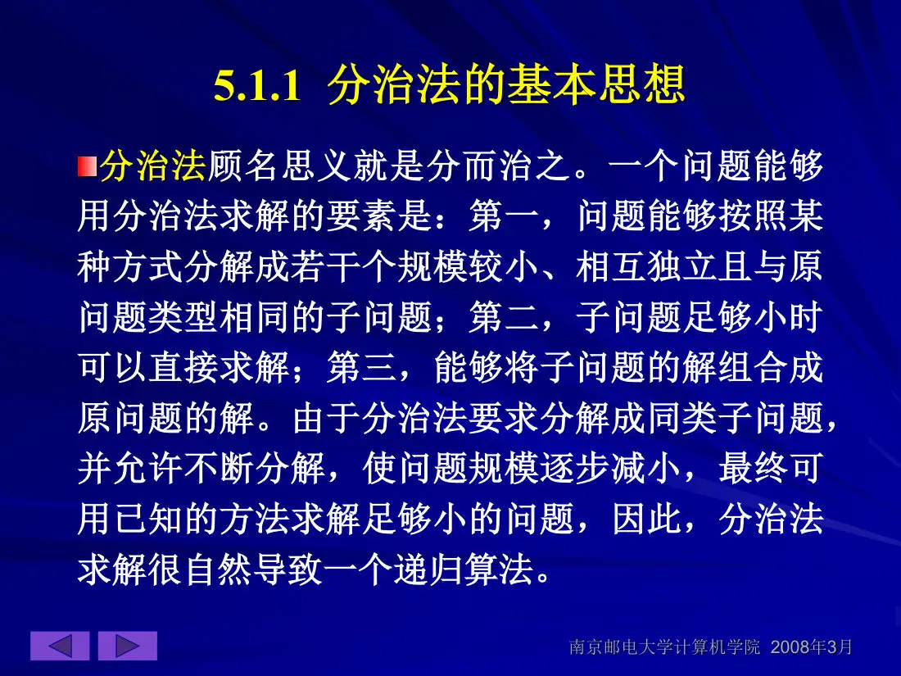

原文：

5.1.1 分治法的基本思想

分治法顾名思义就是分而治之。一个问题能够用分治法求解的要素是：第一，问题能够按照某种方式分解成若干个规模较小、相互独立且与原问题类型相同的子问题；第二，子问题足够小时可以直接求解；第三，能够将子问题的解组合成原问题的解。由于分治法要求分解成同类子问题并允许不断分解，使问题规模逐步减小，最终可用已知的方法求解足够小的问题，因此，分治法求解很自然导致一个递归算法。

南京邮电大学计算机学院 2008年3月

### 南京邮电大学计算机学院 2008年3月

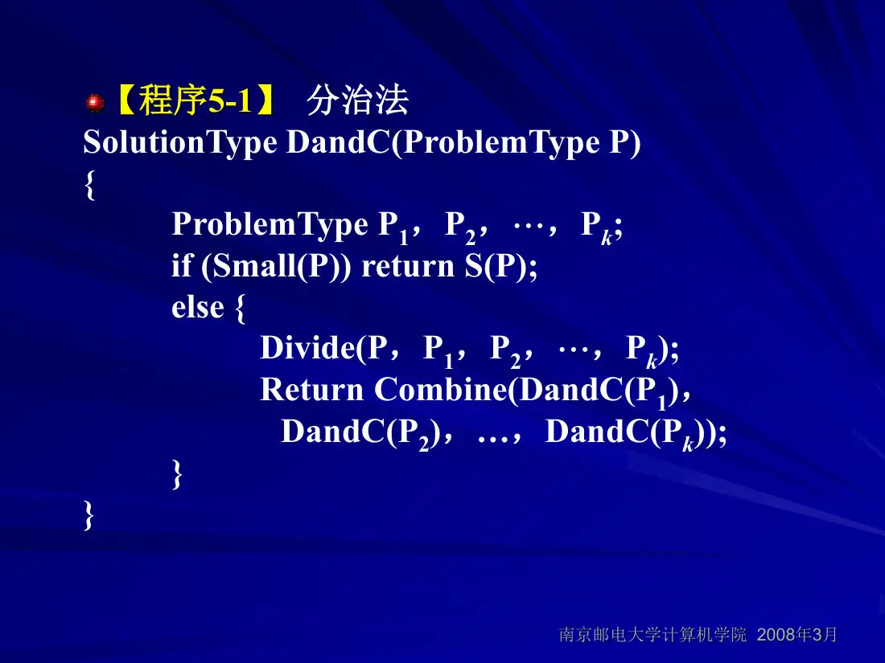

原文：

【程序5-1】 分治法SolutionType DandC(ProblemType P)

ProblemType $1 2 0 0 \div 2 = 2 0 0 0 0 ( c m )$ if (Small(P)) return S(P); else {

Divide(P，P ， Pk);Return Combine(DandC(P )，DandC(P )，…，DandC(P ));

南京邮电大学计算机学院 2008年3月

### else {

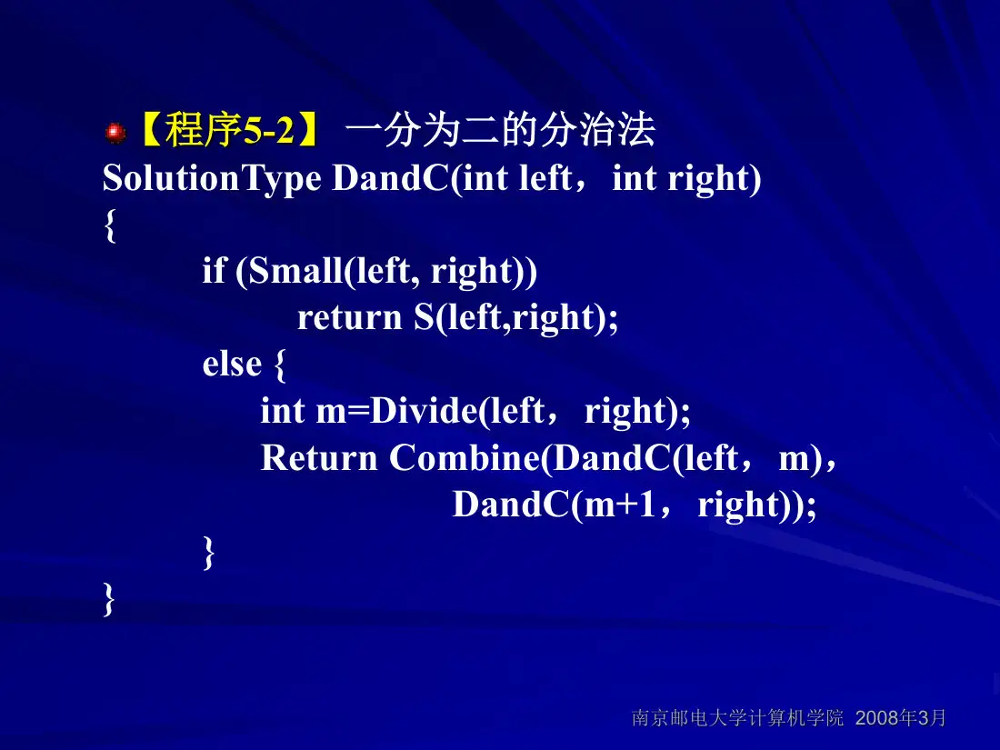

原文：

【程序5-2】 一分为二的分治法SolutionType DandC(int left，int right)

if (Small(left, right)) return S(left,right);

else {

int m=Divide(left，right); Return Combine(DandC(left，m)， DandC(m+1，right));

南京邮电大学计算机学院 2008年3月

### 5.1.2 算法分析

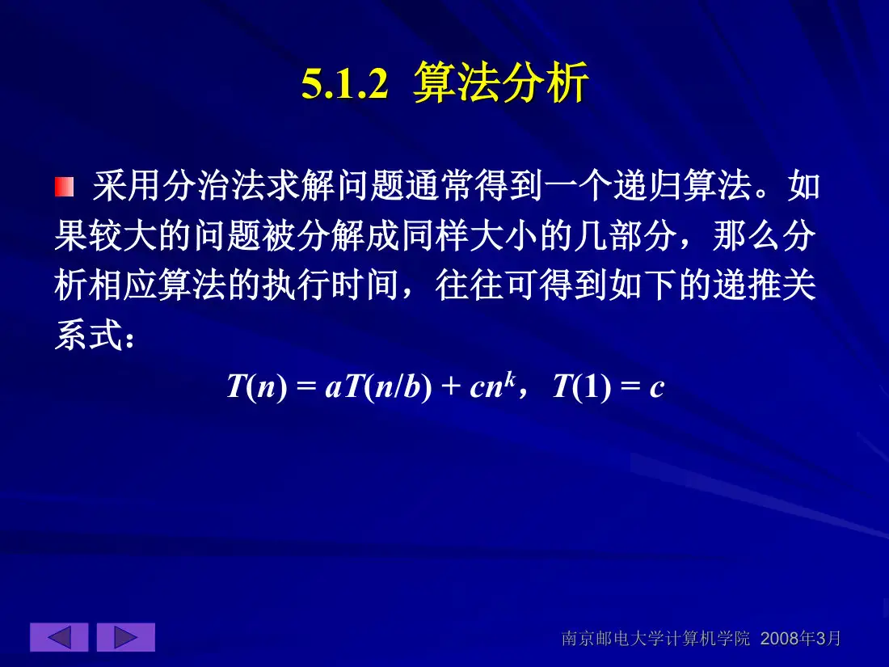

原文：

5.1.2 算法分析

采用分治法求解问题通常得到一个递归算法。如果较大的问题被分解成同样大小的几部分，那么分析相应算法的执行时间，往往可得到如下的递推关系式：

$$
T (n) = a T (n / b) + c n ^ {k}, \quad T (1) = c
$$

南京邮电大学计算机学院 2008年3月

### $$

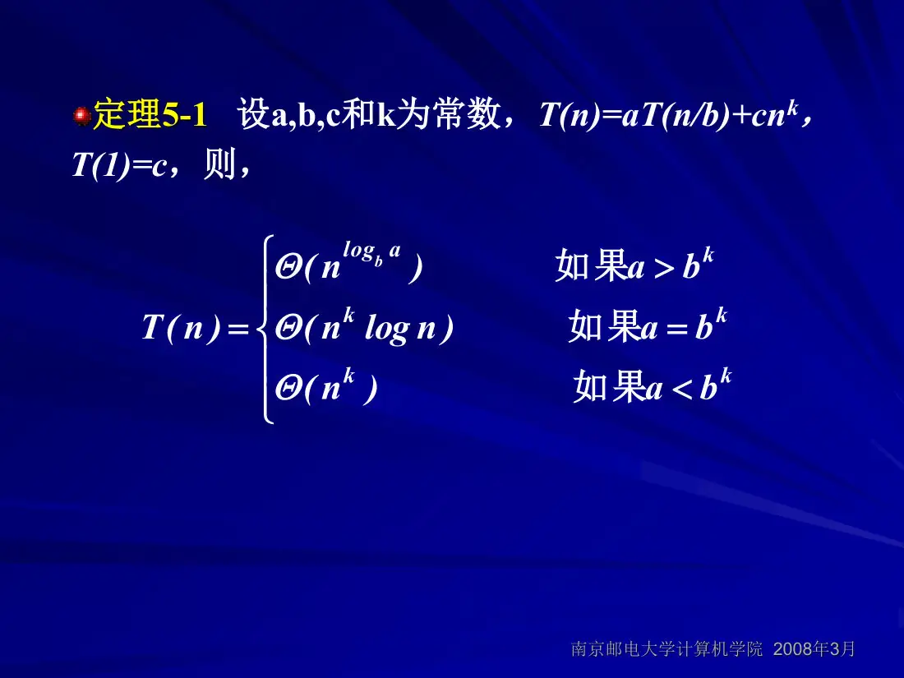

原文：

定理5-1 设 $\mathrm { \sf e m }$ c和k为常数， $1 0 0 - 0 0 0 0 0 0 0 0 0$ $1 0 0 0 = 0$ 9 ，则，

$$
\Theta (n ^ {\log_ {b} a})
$$

$$
T (n) = \left\{ \begin{array}{l} \Theta (n ^ {k} \log n) \\ \Theta (n ^ {k}) \end{array} \right.
$$

如果 $\textcircled { 1 } \textcircled { 2 } \textcircled { 1 }$

如果 $\angle B = 1 0 ^ { \circ }$

如果 $\textcircled { 1 } \textcircled { < } \textcircled { 1 }$

南京邮电大学计算机学院 2008年3月

### $$

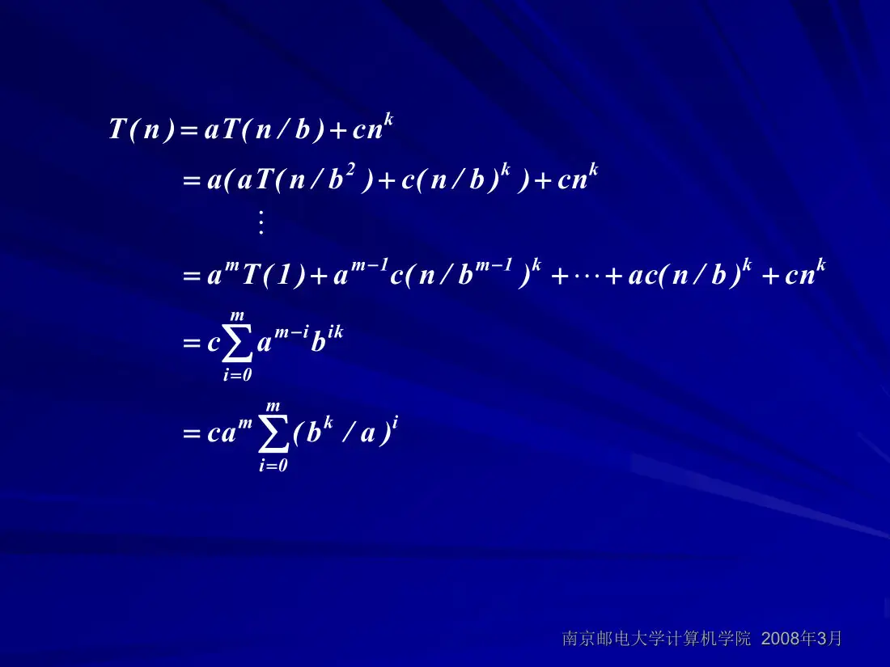

原文：

$$
\begin{array}{r l} & T (n) = a T (n / b) + c n ^ {k} \\ & \qquad = a (a T (n / b ^ {2}) + c (n / b) ^ {k}) + c n ^ {k} \\ & \qquad \vdots \\ & \qquad = a ^ {m} T (1) + a ^ {m - 1} c (n / b ^ {m - 1}) ^ {k} + \dots + a c (n / b) ^ {k} + c n ^ {k} \\ & \qquad = c \sum_ {i = 0} ^ {m} a ^ {m - i} b ^ {i k} \\ & \qquad = c a ^ {m} \sum_ {i = 0} ^ {m} (b ^ {k} / a) ^ {i} \end{array}
$$

南京邮电大学计算机学院 2008年3月

### 所以 $1 1 0 2 - 1 0 2 = 1 0$

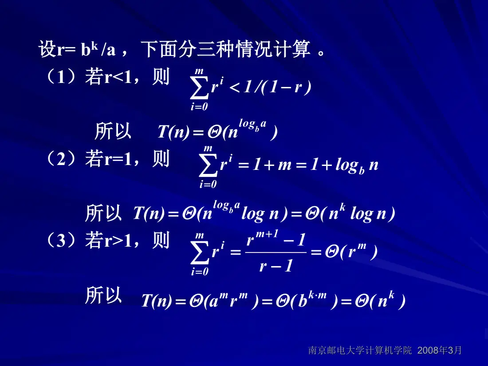

原文：

设 $\lVert \rVert \equiv \lVert \mathbf { \tilde { z } } \rVert _ { \mathbf { z } } ^ { \mathrm { p } } $ ，下面分三种情况计算 。

（1）若r<1，则 $\frac { 1 } { 2 } \times \frac { 1 } { 3 } = \frac { 1 } { 2 } ( m ^ { 2 } )$

所以 $1 1 0 2 - 1 0 2 = 1 0$

（2）若r=1，则 $\angle 2 = \angle B A C = \angle C A C = \angle C A C = \angle C A C = 9 0 ^ { \circ }$

所以 $( \mathcal { W } ) = ( \mathcal { Q } / \mathcal { Q } - \mathcal { Q } / \mathcal { Q } \mathcal { Q } / \mathcal { Q } ) = ( \mathcal { Q } / \mathcal { Q } / \mathcal { Q } - \mathcal { Q } / \mathcal { Q } )$

（3）若r>1，则 $\frac { 1 } { 2 } \times \frac { 1 } { 3 } = \frac { 1 } { 2 } ( m ^ { 2 } )$

所以 $( \lambda ( \lambda ) ) = ( \mathcal { Q } ( \lambda ( \lambda ( \lambda ) ) ) = ( \mathcal { Q } ( \lambda ( \lambda ) ) ) = ( \mathcal { Q } ( \lambda ( \lambda ) )$

南京邮电大学计算机学院 2008年3月

### 5.1.3 数据结构

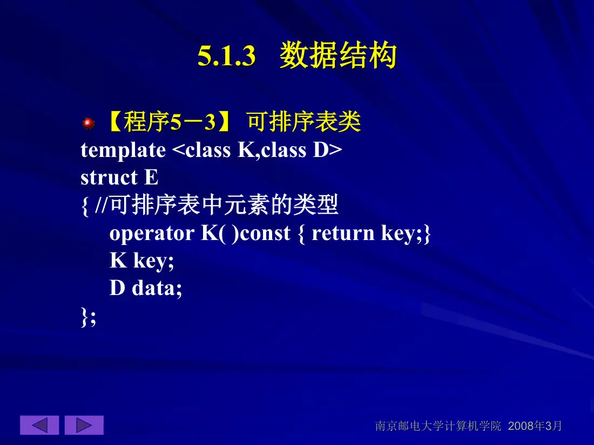

原文：

5.1.3 数据结构

【程序5－3】 可排序表类template <class K,class D>struct E{ //可排序表中元素的类型operator K( )const { return key;}K key;D data;};

南京邮电大学计算机学院 2008年3月

### private: T \*l ; int maxSize; int n;

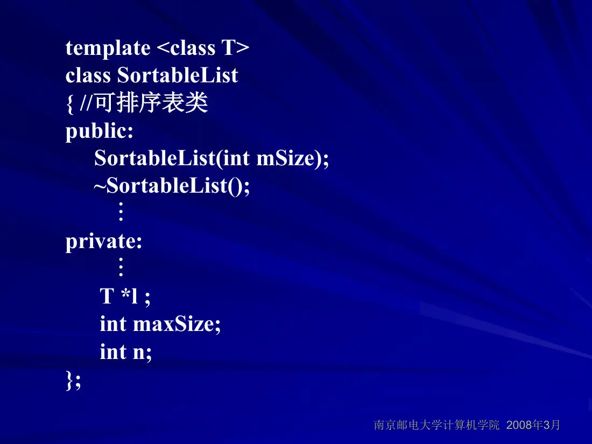

原文：

private: T \*l ; int maxSize; int n;

南京邮电大学计算机学院 2008年3月

### 5.2 求最大最小元

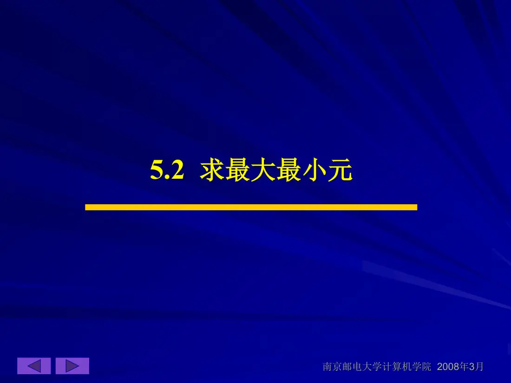

原文：

5.2 求最大最小元

△

南京邮电大学计算机学院 2008年3月

### 问题在一个元素集合中寻找最大元素和最小元素的问题。

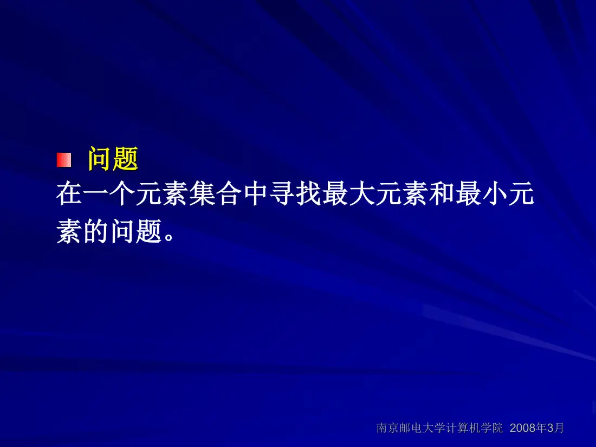

原文：

问题在一个元素集合中寻找最大元素和最小元素的问题。

南京邮电大学计算机学院 2008年3月

### 南京邮电大学计算机学院 2008年3月

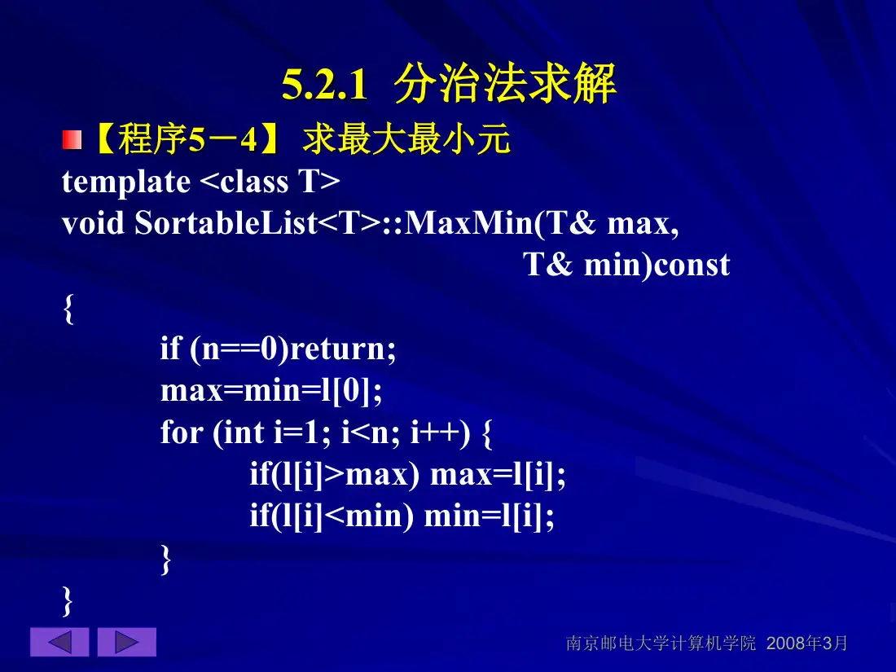

原文：

5.2.1 分治法求解【程序5－4】 求最大最小元template <class T>void SortableList<T>::MaxMin(T& max,T& min)const

if (n==0)return;max=min=l[0];for (int i=1; i<n; i++) {if(l[i]>max) max=l[i];if(l[i]<min) min=l[i];

△

南京邮电大学计算机学院 2008年3月

### 南京邮电大学计算机学院 2008年3月

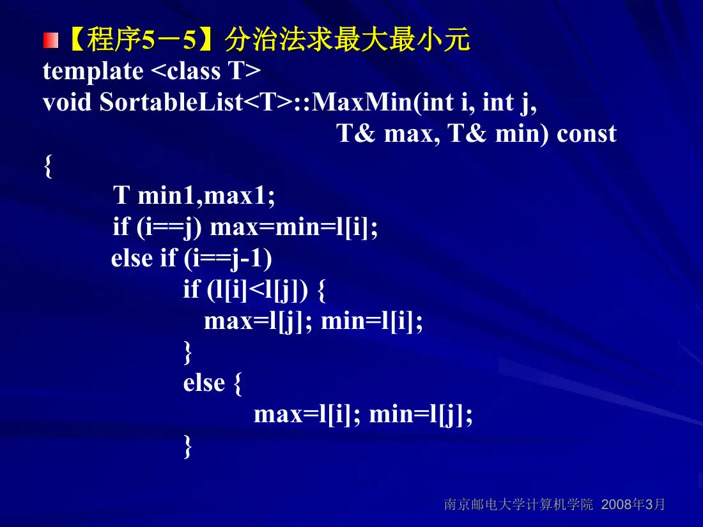

原文：

【程序5－5】分治法求最大最小元template <class T>void SortableList<T>::MaxMin(int i, int j,T& max, T& min) const

T min1,max1; if (i==j) max=min=l[i]; else if (i==j-1) if (l[i]<l[j]) { max=l[j]; min=l[i]; else { max=l[i]; min=l[j];

南京邮电大学计算机学院 2008年3月

### 南京邮电大学计算机学院 2008年3月

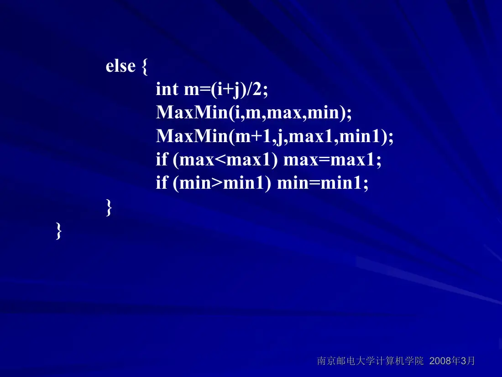

原文：

int m=(i+j)/2; MaxMin(i,m,max,min); MaxMin(m+1,j,max1,min1); if (max<max1) max=max1; if (min>min1) min=min1;

南京邮电大学计算机学院 2008年3月

### 5.2.2 时间分析

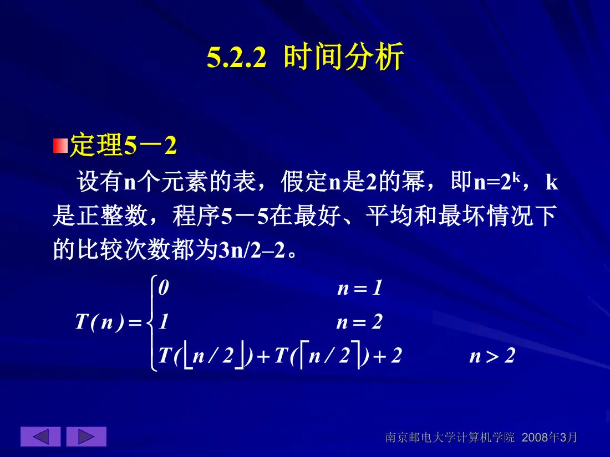

原文：

5.2.2 时间分析

定理5－2

设有n个元素的表，假定n是2的幂，即 $\scriptstyle \prod = 2 ^ { 2 }$ ，k是正整数，程序5－5在最好、平均和最坏情况下的比较次数都为3n/2–2。

$$
T (n) = \left\{ \begin{array}{l l} 0 & n = 1 \\ 1 & n = 2 \\ T (\lfloor n / 2 \rfloor) + T (\lceil n / 2 \rceil) + 2 \end{array} \right.
$$

$$
n > 2
$$

南京邮电大学计算机学院 2008年3月

### 5.3 二分搜索

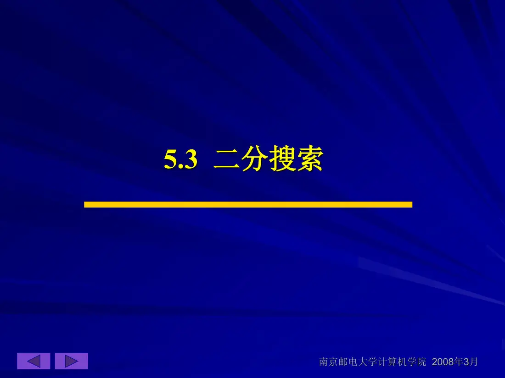

原文：

5.3 二分搜索

△

南京邮电大学计算机学院 2008年3月

### 问题

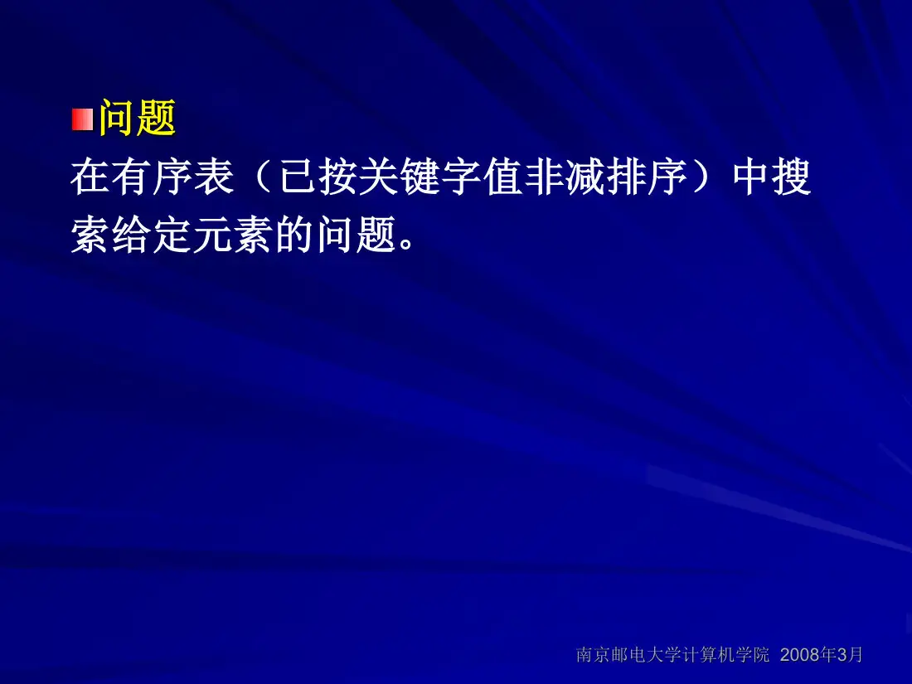

原文：

问题

在有序表（已按关键字值非减排序）中搜索给定元素的问题。

南京邮电大学计算机学院 2008年3月

### 5.3.1 分治法求解

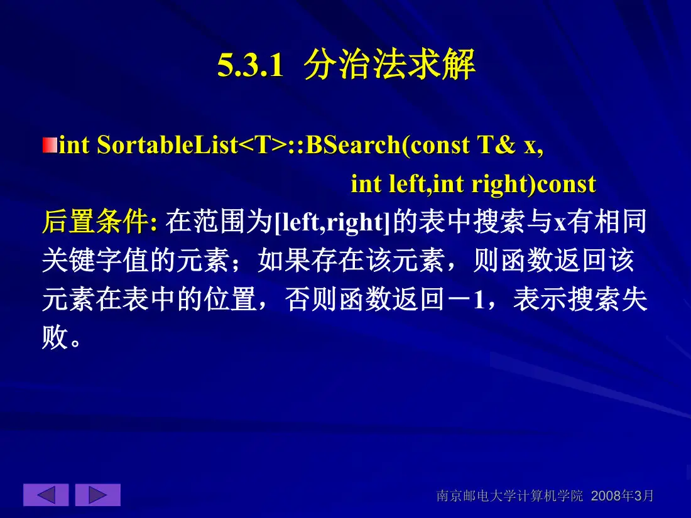

原文：

5.3.1 分治法求解

int SortableList<T>::BSearch(const T& x, int left,int right)const

后置条件: 在范围为[left,right]的表中搜索与x有相同关键字值的元素；如果存在该元素，则函数返回该元素在表中的位置，否则函数返回－1，表示搜索失败。

南京邮电大学计算机学院 2008年3月

### } return -1;

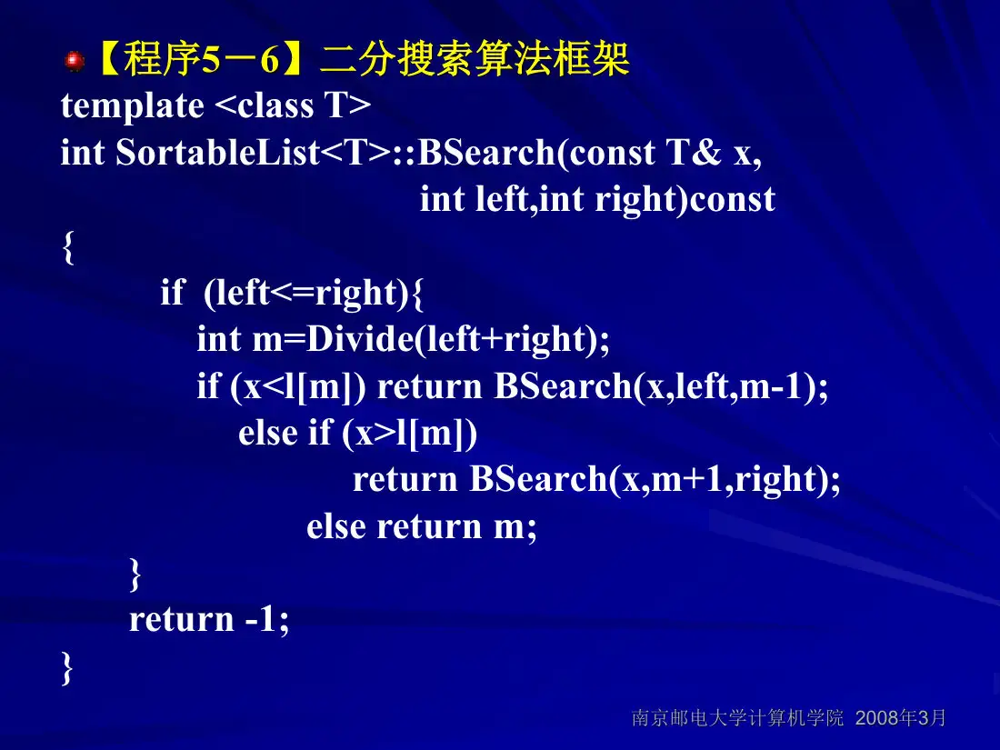

原文：

【程序5－6】二分搜索算法框架template <class T>int SortableList<T>::BSearch(const T& x,int left,int right)const

if (left<=right){ int m=Divide(left+right); if (x<l[m]) return BSearch(x,left,m-1); else if (x>l[m]) return BSearch(x,m+1,right); else return m;

} return -1;

南京邮电大学计算机学院 2008年3月

### 5.3.2 对半搜索

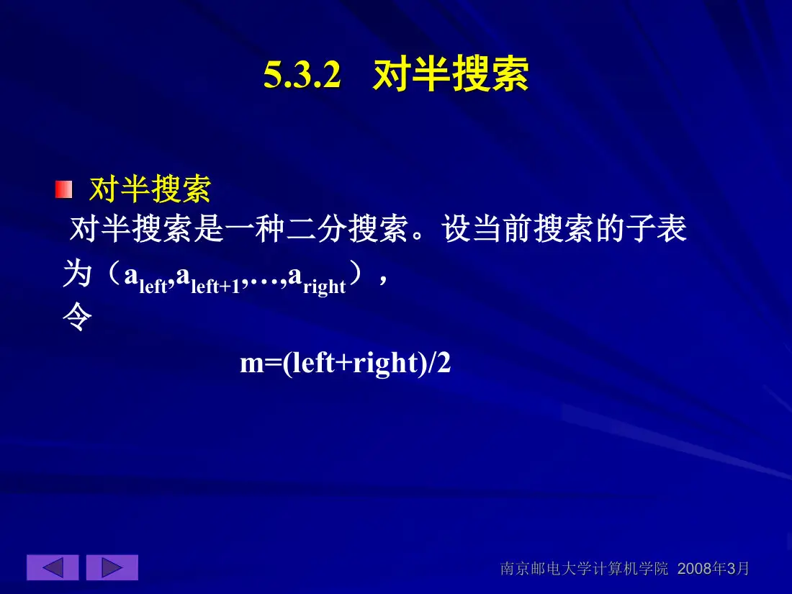

原文：

5.3.2 对半搜索

对半搜索对半搜索是一种二分搜索。设当前搜索的子表为令 $\textcircled { 4 } \textcircled { 5 } \textcircled { 6 } \textcircled { 2 } \textcircled { 1 } \textcircled { 5 } \textcircled { 6 } \textcircled { 6 } \textcircled { 2 } \textcircled { 6 } \textcircled { 2 } \textcircled { 1 } \textcircled { 2 } \textcircled { 1 } \textcircled { 2 } \textcircled { 1 } \textcircled { 2 }$ 9

m=(left+right)/2

△

南京邮电大学计算机学院 2008年3月

### return -1;

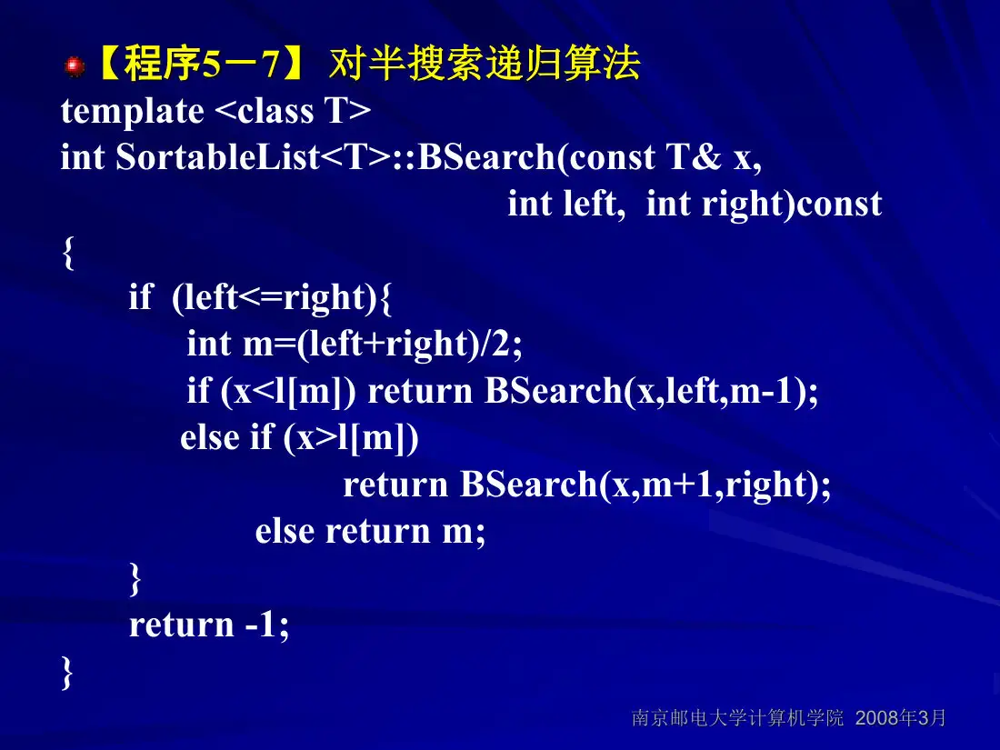

原文：

【程序5－7】 对半搜索递归算法template <class T>int SortableList<T>::BSearch(const T& x,int left, int right)const

if (left<=right){ int m=(left+right)/2; if (x<l[m]) return BSearch(x,left,m-1); else if (x>l[m]) return BSearch(x,m+1,right); else return m;

return -1;

南京邮电大学计算机学院 2008年3月

### 定理5－3对于n0，程序5－7的对半搜索递归函数BSearch是正确的。

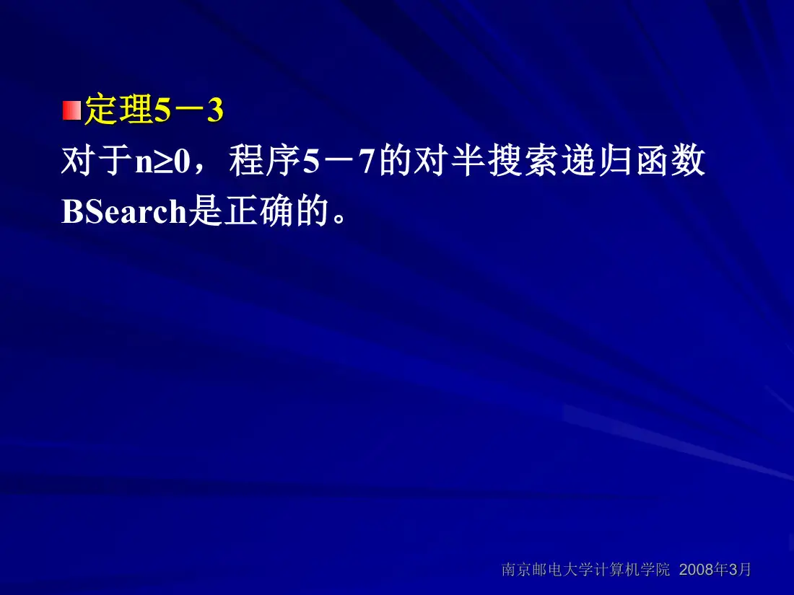

原文：

定理5－3对于n0，程序5－7的对半搜索递归函数BSearch是正确的。

南京邮电大学计算机学院 2008年3月

### 5.3.3 二叉判定树

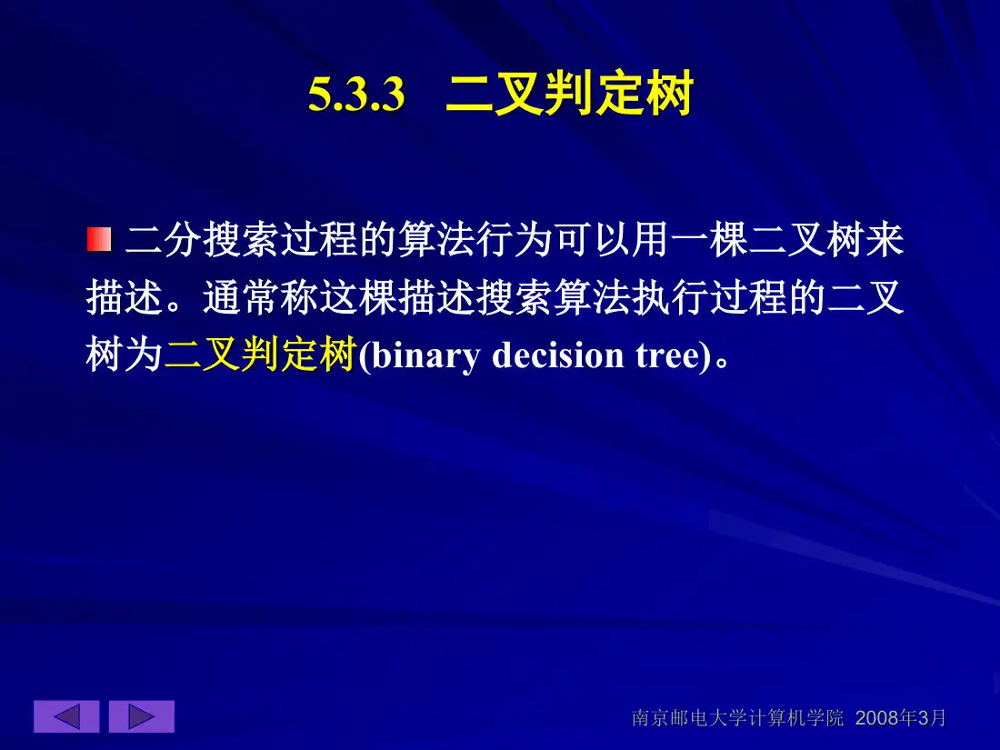

原文：

5.3.3 二叉判定树

二分搜索过程的算法行为可以用一棵二叉树来描述。通常称这棵描述搜索算法执行过程的二叉树为二叉判定树(binary decision tree)。

△

南京邮电大学计算机学院 2008年3月

### 南京邮电大学计算机学院 2008年3月

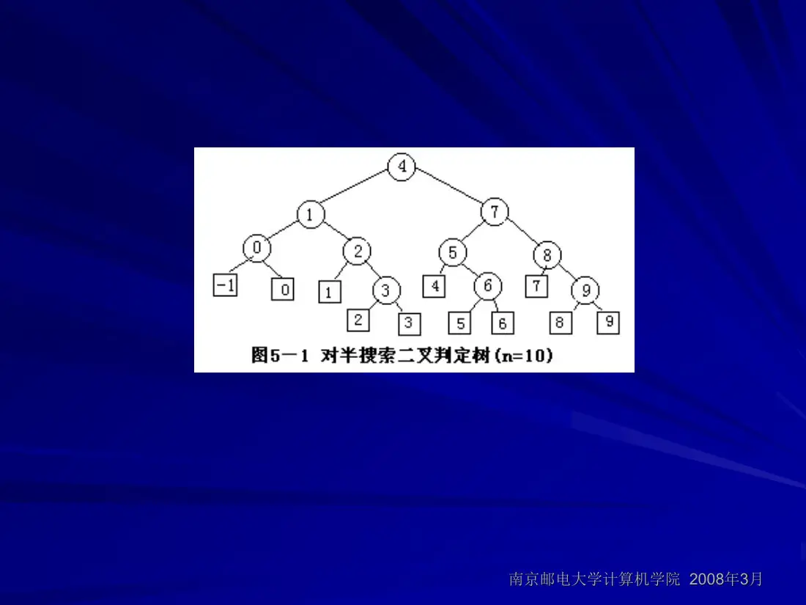

原文：

南京邮电大学计算机学院 2008年3月

### 性质 5－1

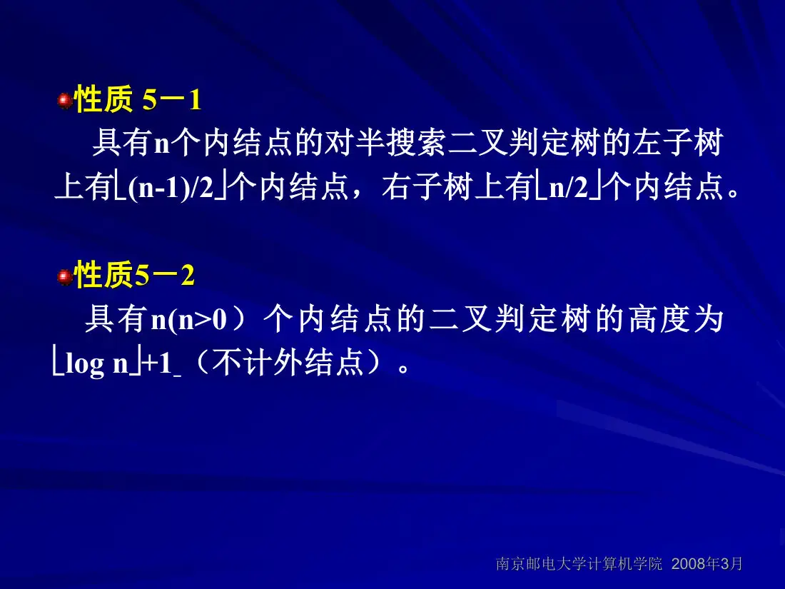

原文：

性质 5－1

具有n个内结点的对半搜索二叉判定树的左子树上有L(n-1)/2个内结点，右子树上有Ln/2」个内结点。

性质5－2

具有n(n>0）个内结点的二叉判定树的高度为Llog n」+1\_（不计外结点）。

南京邮电大学计算机学院 2008年3月

### 性质 5－3若n=2h-1，则对半搜索二叉判定树是满二叉树。

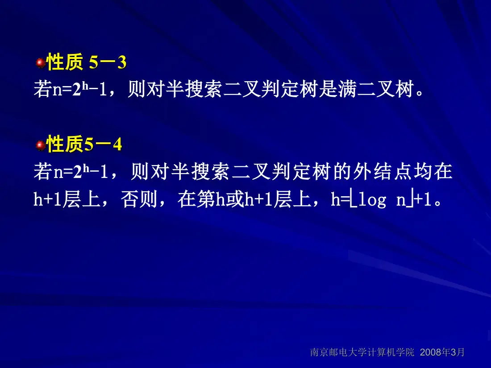

原文：

性质 5－3若n=2h-1，则对半搜索二叉判定树是满二叉树。

性质5－4若n=2h-1，则对半搜索二叉判定树的外结点均在h+1层上，否则，在第h或h+1层上， $1 0 = 1 1 0 : 1 5 = 1 0 : 1 5$

南京邮电大学计算机学院 2008年3月

### 定理 5－4

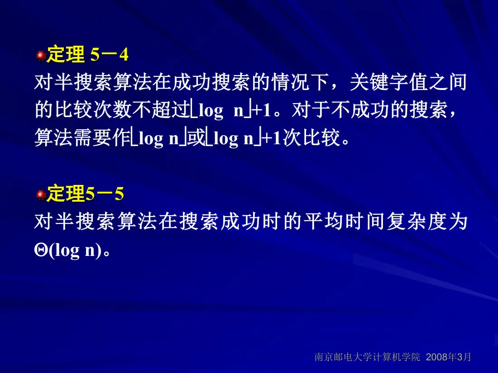

原文：

定理 5－4

对半搜索算法在成功搜索的情况下，关键字值之间的比较次数不超过Llog n+1。对于不成功的搜索，算法需要作Llog n或Llog n+1次比较。

定理5－5对半搜索算法在搜索成功时的平均时间复杂度为(log n)。

南京邮电大学计算机学院 2008年3月

### 5.3.4 搜索算法的时间下界

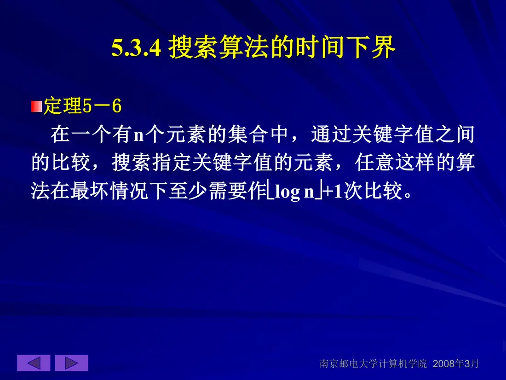

原文：

5.3.4 搜索算法的时间下界

定理5－6

在一个有n个元素的集合中，通过关键字值之间的比较，搜索指定关键字值的元素，任意这样的算法在最坏情况下至少需要作Llogn+1次比较。

南京邮电大学计算机学院 2008年3月

### 5.4 排序问题

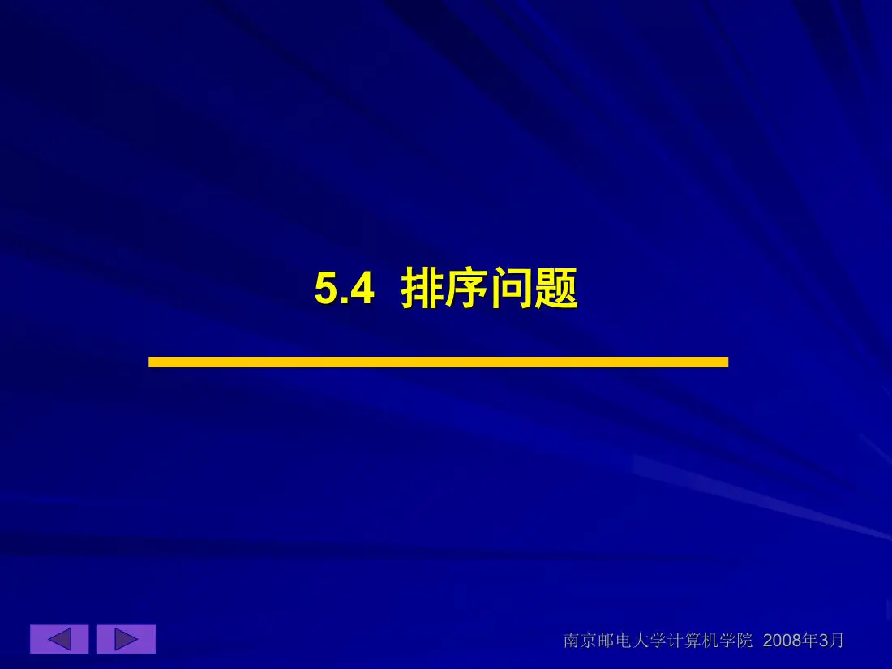

原文：

5.4 排序问题

△

南京邮电大学计算机学院 2008年3月

### 问题

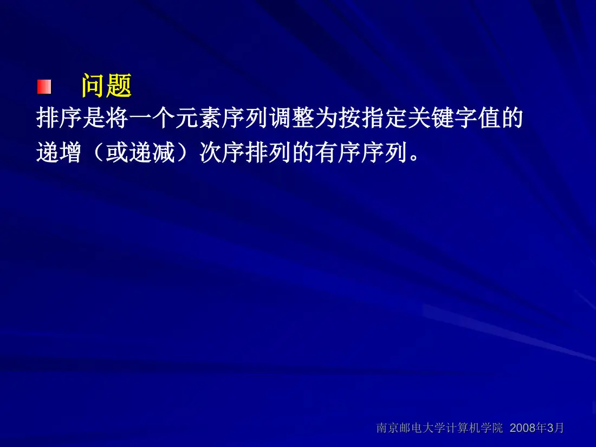

原文：

问题

排序是将一个元素序列调整为按指定关键字值的递增（或递减）次序排列的有序序列。

南京邮电大学计算机学院 2008年3月

### 5.4.1 合并排序

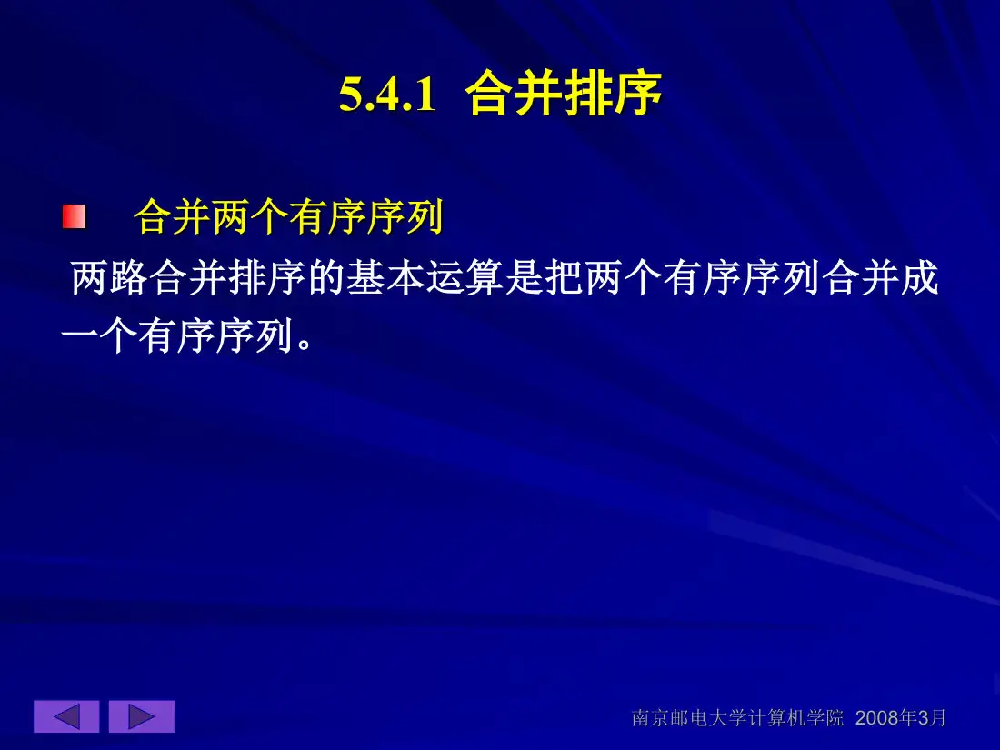

原文：

5.4.1 合并排序

合并两个有序序列两路合并排序的基本运算是把两个有序序列合并成一个有序序列。

△

南京邮电大学计算机学院 2008年3月

### 南京邮电大学计算机学院 2008年3月

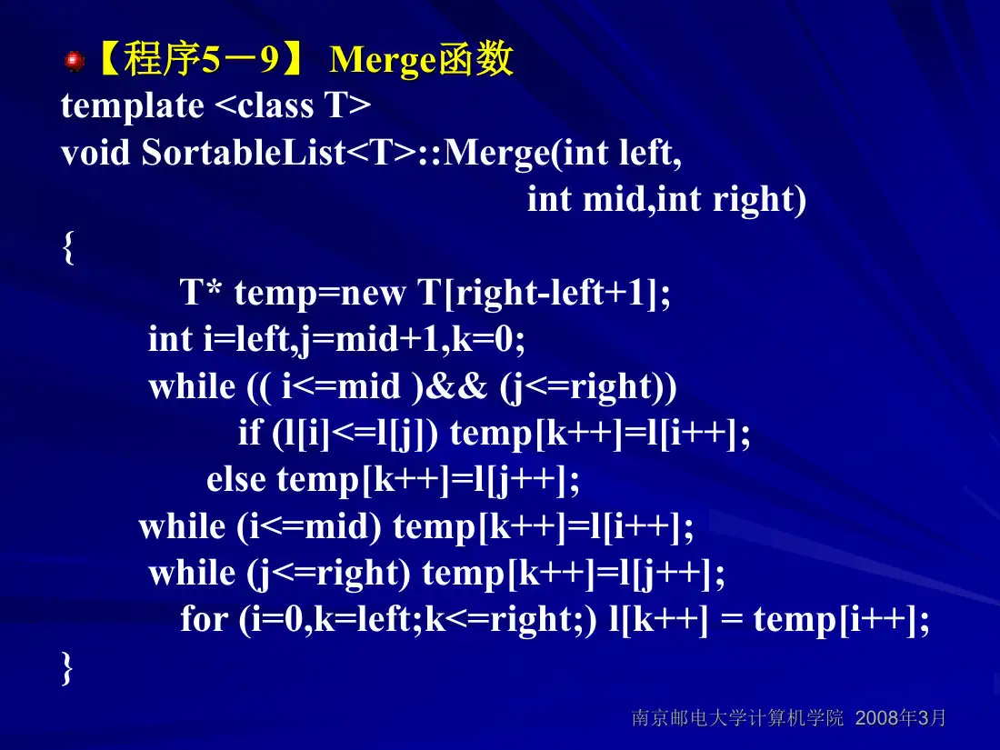

原文：

【程序5－9】 Merge函数template <class T>void SortableList<T>::Merge(int left,int mid,int right)

T\* temp=new T[right-left+1]; int i=left,j=mid+1,k=0; while (( i<=mid )&& (j<=right)) if (l[i]<=l[j]) temp[k++]=l[i++]; else temp[k++]=l[j++]; while (i<=mid) temp[k++]=l[i++]; while (j<=right) temp[k++]=l[j++]; for (i=0,k=left;k<=right;) l[k++] = temp[i++];

南京邮电大学计算机学院 2008年3月

### ∫(5, 25,55) (10, 20,30)

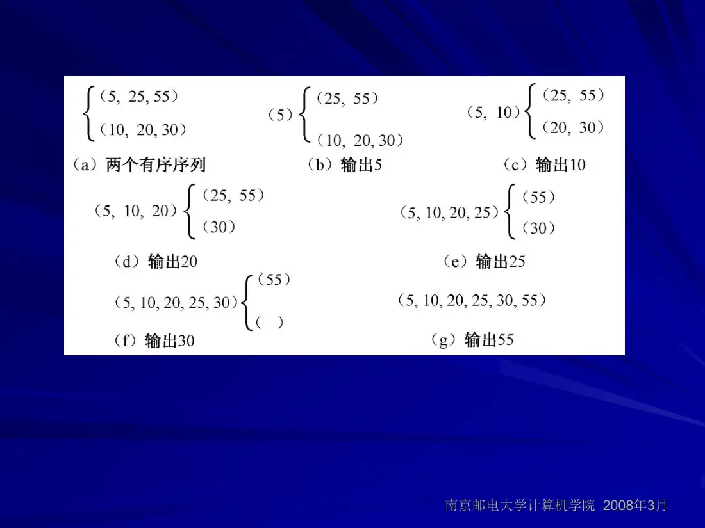

原文：

∫(5, 25,55) (10, 20,30)

(5)

(a) 两个有序序列

(5, 10, 20) $\left\{ { \begin{array} { l } { ( 2 5 , 5 5 ) } \\ { ( 3 0 ) } \end{array} } \right.$

(d) 输出20

(5, 10, 20, 25, 30) $\left\{ { \begin{array} { l } { ( 5 5 ) } \\ { } \\ { ( ) } \end{array} } \right.$

(f) 输出30

$$
\left\{ \begin{array}{l l} (2 5, 5 5) \\ (1 0, 2 0, 3 0) \end{array} \right.
$$

(b) 输出5

(5,10) (2(, 0) ∫(25, 55)

(c) 输出10

(5, 10, 20, 25) $\left\{ { \begin{array} { l } { ( 5 5 ) } \\ { ( 3 0 ) } \end{array} } \right.$

(e) 输出25

(5, 10, 20, 25, 30, 55)

(g)输出55

南京邮电大学计算机学院 2008年3月

### 分治法求解

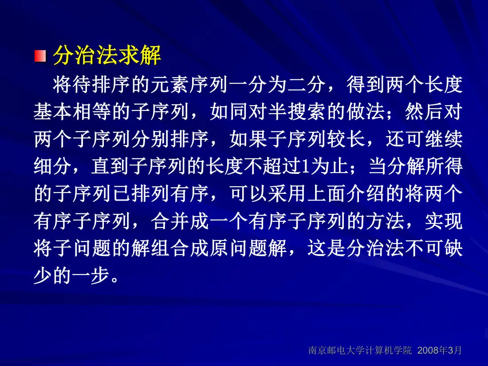

原文：

分治法求解

将待排序的元素序列一分为二分，得到两个长度基本相等的子序列，如同对半搜索的做法；然后对两个子序列分别排序，如果子序列较长，还可继续细分，直到子序列的长度不超过1为止；当分解所得的子序列已排列有序，可以采用上面介绍的将两个有序子序列，合并成一个有序子序列的方法，实现将子问题的解组合成原问题解，这是分治法不可缺少的一步。

南京邮电大学计算机学院 2008年3月

### 南京邮电大学计算机学院 2008年3月

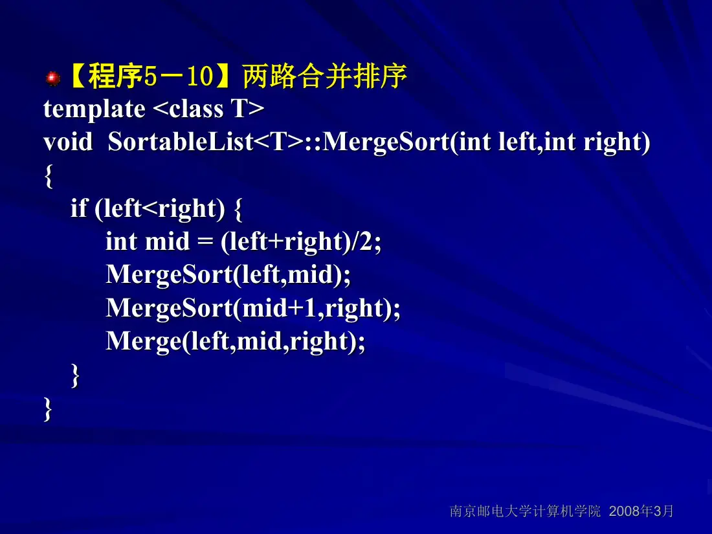

原文：

if (left<right) { int mid = (left+right)/2; MergeSort(left,mid); MergeSort(mid+1,right); Merge(left,mid,right);

南京邮电大学计算机学院 2008年3月

### 南京邮电大学计算机学院 2008年3月

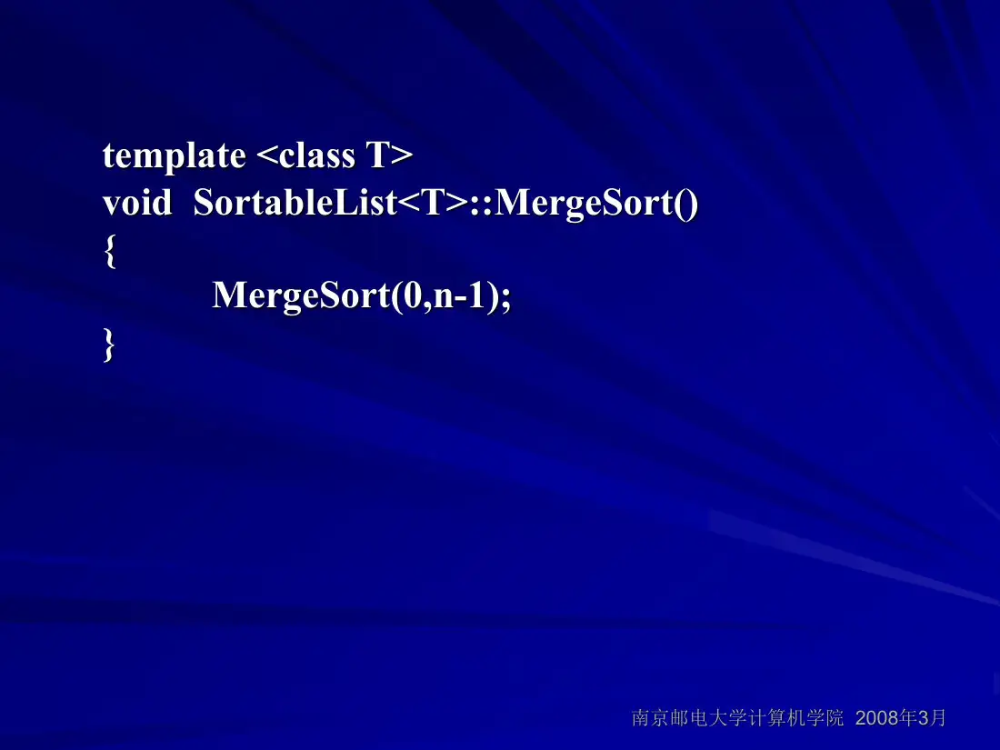

原文：

template <class T> void SortableList<T>::MergeSort() MergeSort(0,n-1);

南京邮电大学计算机学院 2008年3月

### (a) 分解过程

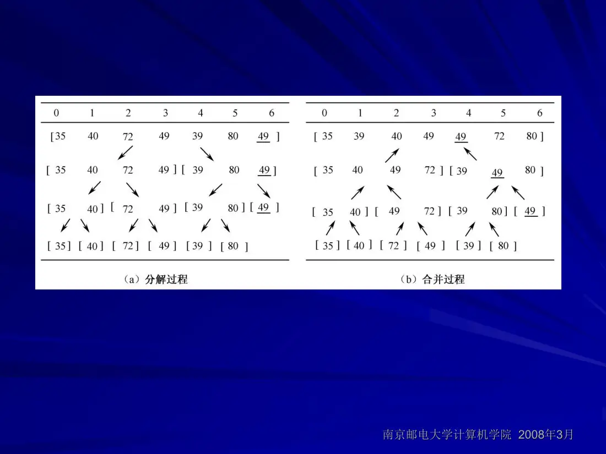

原文：

(a) 分解过程
<table><tr><td>0</td><td>1</td><td>2</td><td>3</td><td>4</td><td>5</td><td>6</td></tr><tr><td>[35</td><td>40</td><td>72</td><td>49</td><td>39</td><td>80</td><td> $\underline{49}$  ]</td></tr><tr><td>[35</td><td>40</td><td>72</td><td>49]</td><td>[39</td><td>80</td><td> $\underline{49}$  ]</td></tr><tr><td>[35</td><td>40]</td><td>[72</td><td>49]</td><td>[39</td><td>80]</td><td> $\underline{49}$  ]</td></tr><tr><td>[35]</td><td>[40]</td><td>[72]</td><td>[49]</td><td>[39]</td><td>[80]</td><td></td></tr></table>

(b) 合并过程
<table><tr><td>0</td><td>1</td><td>2</td><td>3</td><td>4</td><td>5</td><td>6</td></tr><tr><td>[ 35</td><td>39</td><td>40</td><td>49</td><td> $\underline{49}$ </td><td>72</td><td>80 ]</td></tr><tr><td></td><td></td><td>↗</td><td></td><td>↗</td><td></td><td></td></tr><tr><td>[ 35</td><td>40</td><td>49</td><td>72 ]</td><td>[ 39</td><td> $\underline{49}$ </td><td>80 ]</td></tr><tr><td></td><td>↗</td><td>↗</td><td></td><td></td><td>↗</td><td>↗</td></tr><tr><td>[ 35</td><td>40 ]</td><td>[ 49</td><td>72 ]</td><td>[ 39</td><td>80 ]</td><td>[  $\underline{49}$  ]</td></tr><tr><td>↗</td><td>↗</td><td>↗</td><td>↗</td><td>↗</td><td>↗</td><td></td></tr><tr><td>[ 35 ]</td><td>[ 40 ]</td><td>[ 72 ]</td><td>[ 49 ]</td><td>[ 39 ]</td><td>[ 80 ]</td><td></td></tr></table>

南京邮电大学计算机学院 2008年3月

### 性能分析合并排序递归算法的时间复杂度为O(n log n)。

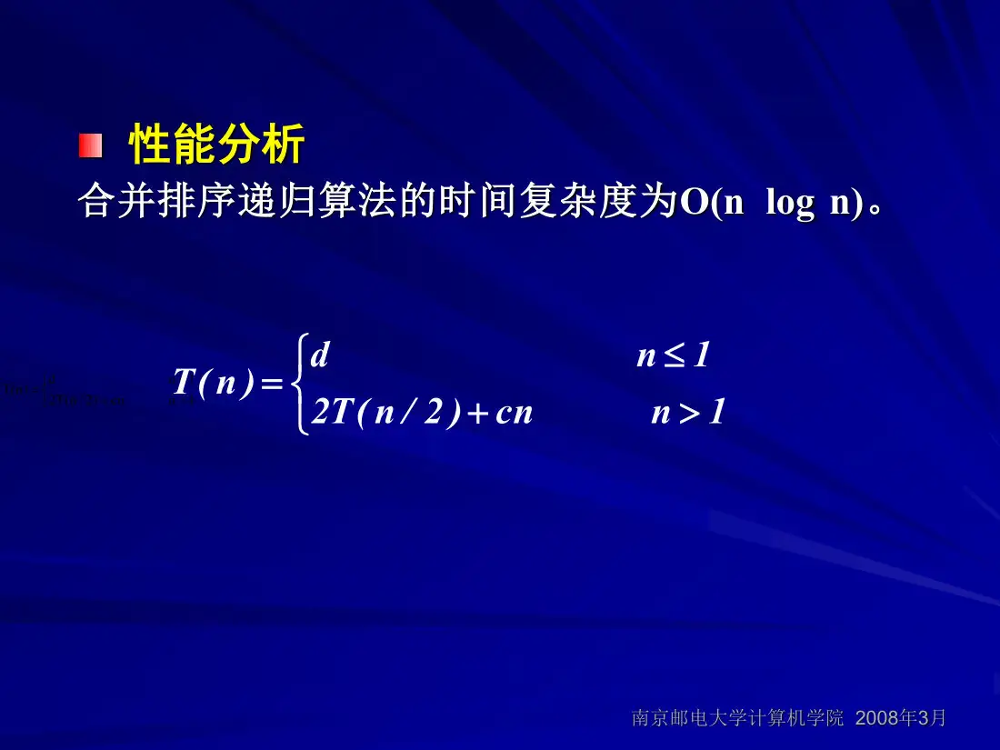

原文：

性能分析合并排序递归算法的时间复杂度为O(n log n)。

$$
T (n) = \left\{ \begin{array}{l} d \\ 2 T (n / 2) + c n \end{array} \right.
$$

$$
{ } _ { n > 1 } ^ { n } T ( n ) = \left\{ \begin{array} { l } d \\ 2 T ( n / 2 ) + c n \end{array} \right.
$$

$$
n \leq 1
$$

$$
n > 1
$$

南京邮电大学计算机学院 2008年3月

### 5.4.2 快速排序

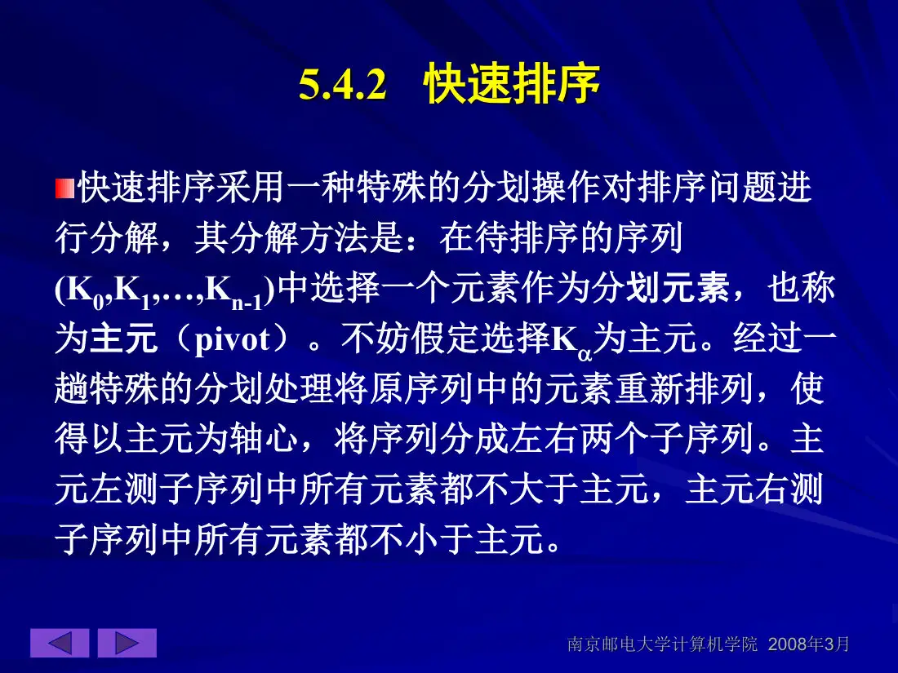

原文：

5.4.2 快速排序

快速排序采用一种特殊的分划操作对排序问题进行分解，其分解方法是：在待排序的序列$( 1 5 0 0 0 0 0 0 0 0 0 0 0 0 0 0 0 0 0 0 0 0 0 0 0 0 0 0 0 0 0 0 0 0 0 0 0 0 0 0 0 0 0 0 0 0 0 0 0 0 0 0 0 0 0 0 0 0 0 0 0 0 0 0 0 0 0 0 0 0 0 0 0 0 0 0 0 0 0 0 0 0 0 0 0 0 0 0 0 0 0 0 0 0 0 0 0 0 0 0 0 0 0 0 0 0 0 0 0 0 0 0 0 0 0 0 0 0 0 0 0 0 0 0 0 0 0 0 0 0 0 0 0 0 0 0 0 0 0$ 中选择一个元素作为分划元素，也称为主元（pivot）。不妨假定选择 $1 3 \div 5 = 1 \cdots 1$ 为主元。经过一趟特殊的分划处理将原序列中的元素重新排列，使得以主元为轴心，将序列分成左右两个子序列。主元左测子序列中所有元素都不大于主元，主元右测子序列中所有元素都不小于主元。

南京邮电大学计算机学院 2008年3月

### 分划操作

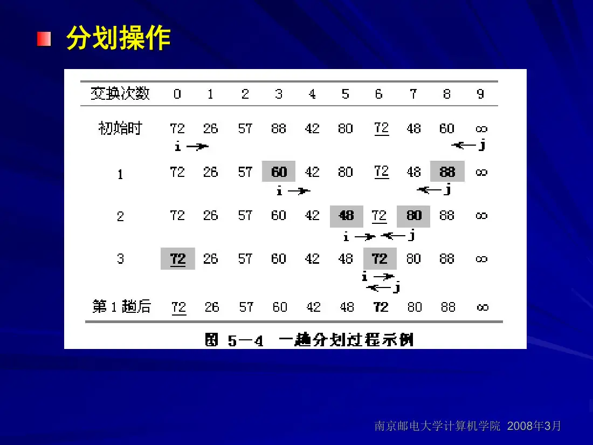

原文：

分划操作

图 5一4 一趟分划过程示例
<table><tr><td>交换次数</td><td>0</td><td>1</td><td>2</td><td>3</td><td>4</td><td>5</td><td>6</td><td>7</td><td>8</td><td>9</td></tr><tr><td rowspan="2">初始时</td><td rowspan="2">72i→</td><td rowspan="2">26</td><td rowspan="2">57</td><td rowspan="2">88</td><td rowspan="2">42</td><td rowspan="2">80</td><td rowspan="2">72</td><td rowspan="2">48</td><td>60</td><td>∞</td></tr><tr><td colspan="2">←j</td></tr><tr><td rowspan="2">1</td><td rowspan="2">72</td><td rowspan="2">26</td><td rowspan="2">57</td><td rowspan="2">60i→</td><td rowspan="2">42</td><td rowspan="2">80</td><td rowspan="2">72</td><td>48</td><td>88</td><td>∞</td></tr><tr><td colspan="3">←j</td></tr><tr><td rowspan="2">2</td><td rowspan="2">72</td><td rowspan="2">26</td><td rowspan="2">57</td><td rowspan="2">60</td><td rowspan="2">42</td><td>48</td><td>72</td><td>80</td><td>88</td><td>∞</td></tr><tr><td colspan="5">i→←j</td></tr><tr><td rowspan="2">3</td><td rowspan="2">72</td><td rowspan="2">26</td><td rowspan="2">57</td><td rowspan="2">60</td><td rowspan="2">42</td><td>48</td><td>72</td><td>80</td><td>88</td><td>∞</td></tr><tr><td colspan="5">i→←j</td></tr><tr><td>第1趟后</td><td>72</td><td>26</td><td>57</td><td>60</td><td>42</td><td>48</td><td>72</td><td>80</td><td>88</td><td>∞</td></tr></table>

南京邮电大学计算机学院 2008年3月

### 南京邮电大学计算机学院 2008年3月

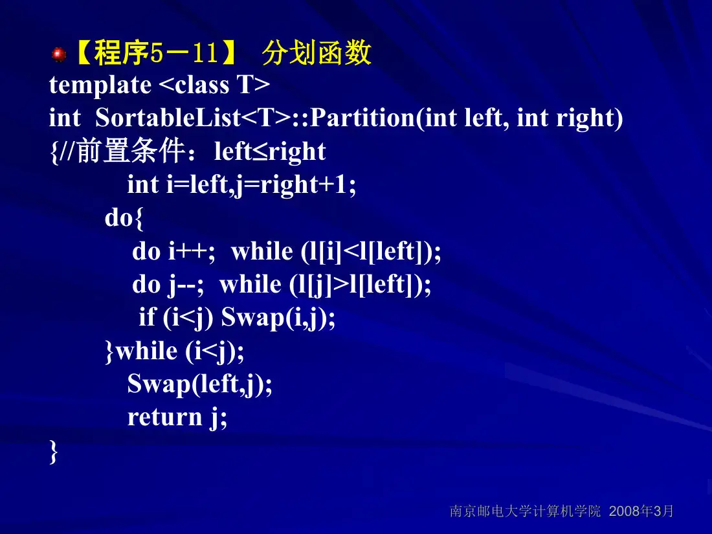

原文：

do{ do i++; while (l[i]<l[left]); do j--; while (l[j]>l[left]); if (i<j) Swap(i,j); }while (i<j); Swap(left,j); return j;

南京邮电大学计算机学院 2008年3月

### 快速排序算法

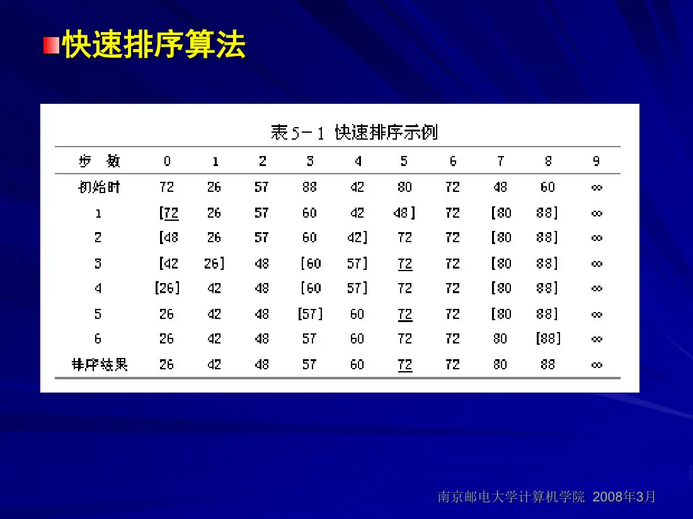

原文：

快速排序算法

表5-1 快速排序示例
<table><tr><td>步数</td><td>0</td><td>1</td><td>2</td><td>3</td><td>4</td><td>5</td><td>6</td><td>7</td><td>8</td><td>9</td></tr><tr><td>初始时</td><td>72</td><td>26</td><td>57</td><td>88</td><td>42</td><td>80</td><td>72</td><td>48</td><td>60</td><td>∞</td></tr><tr><td>1</td><td>[72]</td><td>26</td><td>57</td><td>60</td><td>42</td><td>48]</td><td>72</td><td>[80</td><td>88]</td><td>∞</td></tr><tr><td>2</td><td>[48]</td><td>26</td><td>57</td><td>60</td><td>42]</td><td>72</td><td>72</td><td>[80</td><td>88]</td><td>∞</td></tr><tr><td>3</td><td>[42]</td><td>26]</td><td>48</td><td>[60]</td><td>57]</td><td>72</td><td>72</td><td>[80</td><td>88]</td><td>∞</td></tr><tr><td>4</td><td>[26]</td><td>42</td><td>48</td><td>[60]</td><td>57]</td><td>72</td><td>72</td><td>[80]</td><td>88]</td><td>∞</td></tr><tr><td>5</td><td>26</td><td>42</td><td>48</td><td>[57]</td><td>60</td><td>72</td><td>72</td><td>[80]</td><td>88]</td><td>∞</td></tr><tr><td>6</td><td>26</td><td>42</td><td>48</td><td>57</td><td>60</td><td>72</td><td>72</td><td>80</td><td>[88]</td><td>∞</td></tr><tr><td>排序结果</td><td>26</td><td>42</td><td>48</td><td>57</td><td>60</td><td>72</td><td>72</td><td>80</td><td>88</td><td>∞</td></tr></table>

南京邮电大学计算机学院 2008年3月

### QuickSort(0,n-1);

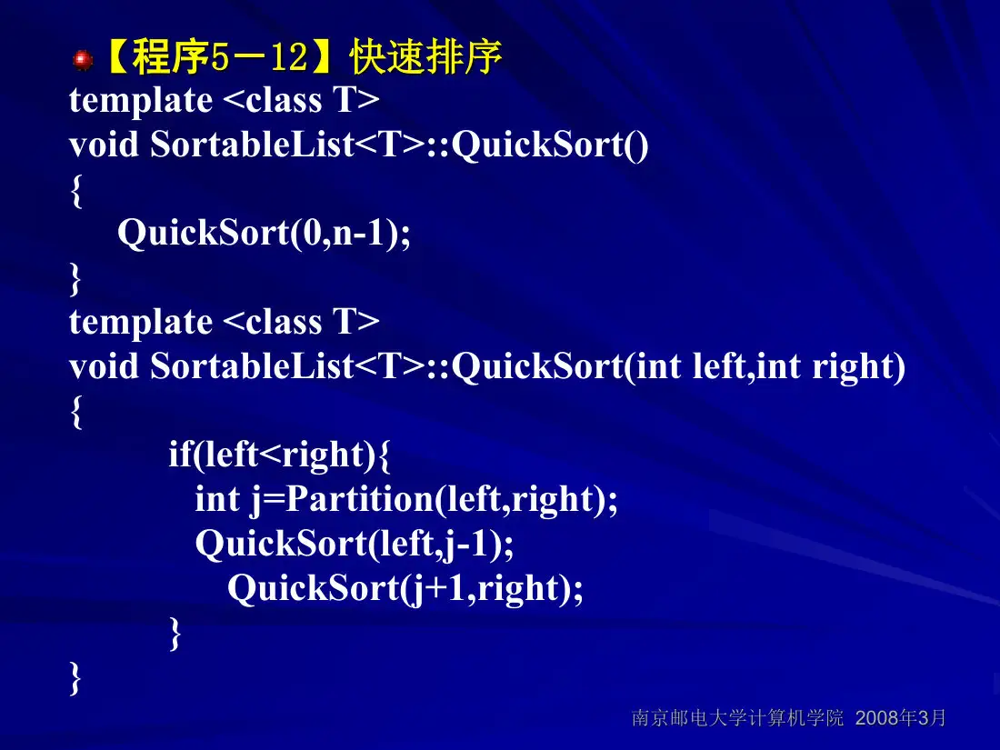

原文：

【程序5－12】快速排序 template <class T> void SortableList<T>::QuickSort()

QuickSort(0,n-1);

template <class T> void SortableList<T>::QuickSort(int left,int right)

if(left<right){ int j=Partition(left,right); QuickSort(left,j-1); QuickSort(j+1,right);

南京邮电大学计算机学院 2008年3月

### 南京邮电大学计算机学院 2008年3月

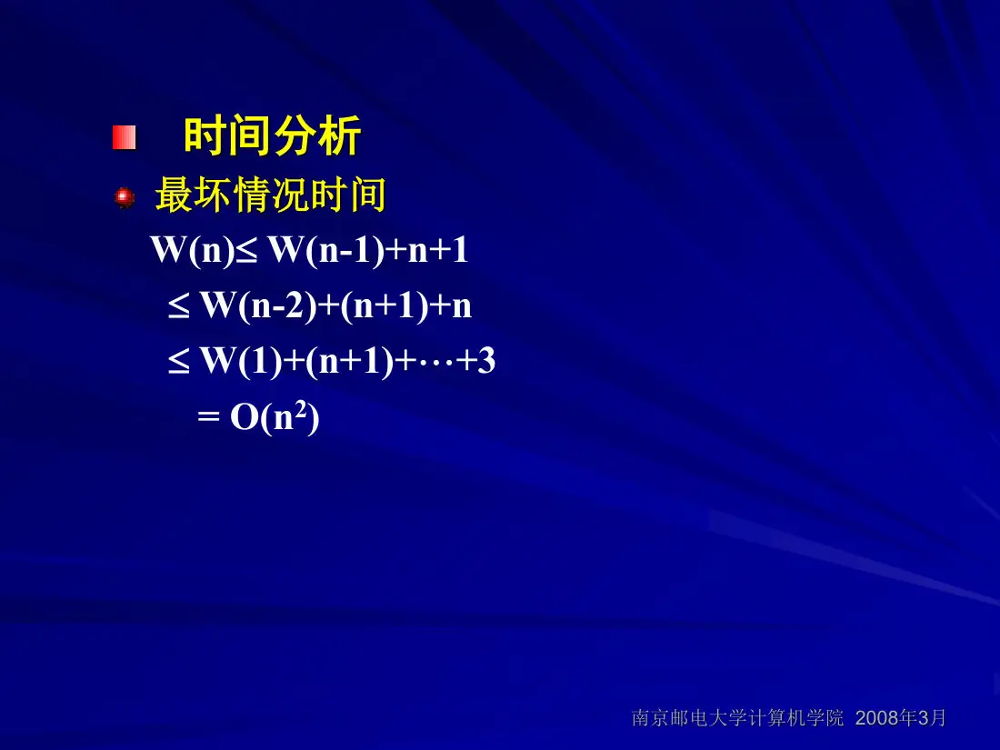

原文：

时间分析最坏情况时间$\because ( 1 0 ) \leq 0 . 9 ( 1 1 5 ) \leq 1 5 5 1$ $- 3 \times ( 1 0 - 2 ) \times ( 1 5 - 1 ) \times 2 = 1 1$ $- 4 \times ( 0 . 1 5 - 0 . 1 5 ) = - 8 . 5 ( 0 . 1 5 - 0 . 1 ) = - 8 . 5 ( 0 . 1 5 - 0 . 1 ) ( 0 . 1 5 - 0 . 1 )$ = O(n2)

南京邮电大学计算机学院 2008年3月

### 平均情况时间

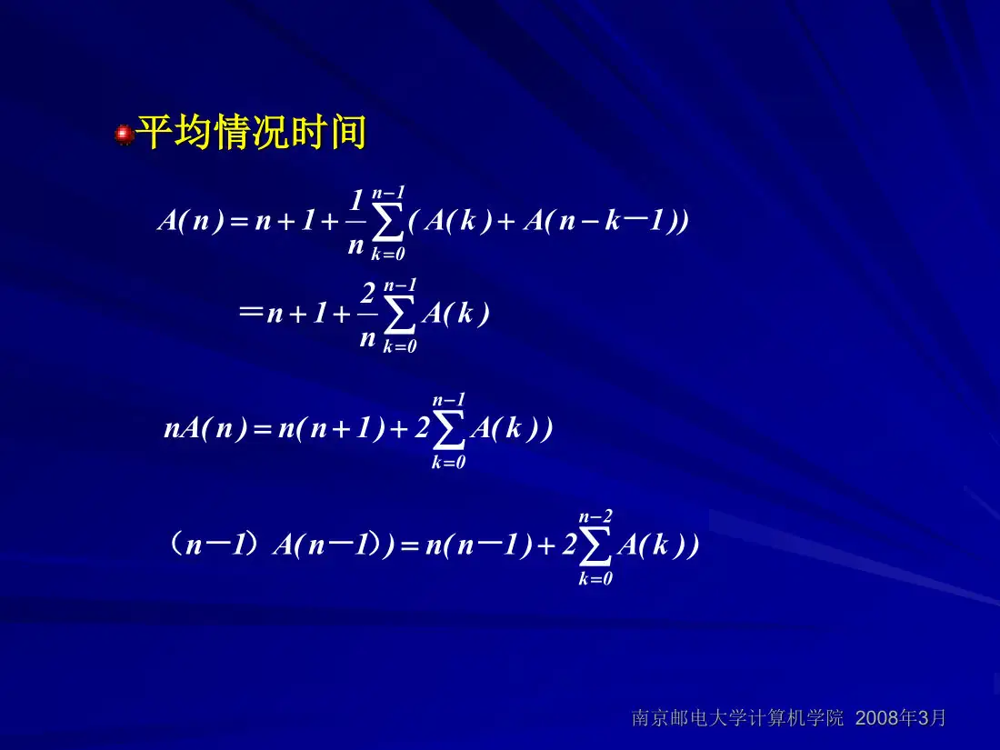

原文：

平均情况时间

$$
\begin{array}{r l} A (n) & = n + 1 + \frac {1}{n} \sum_ {k = 0} ^ {n - 1} (A (k) + A (n - k - 1)) \\ & = n + 1 + \frac {2}{n} \sum_ {k = 0} ^ {n - 1} A (k) \end{array}
$$

$$
n A (n) = n (n + 1) + 2 \sum_ {k = 0} ^ {n - 1} A (k))
$$

$$
(n - 1) A (n - 1)) = n (n - 1) + 2 \sum_ {k = 0} ^ {n - 2} A (k))
$$

南京邮电大学计算机学院 2008年3月

### $$

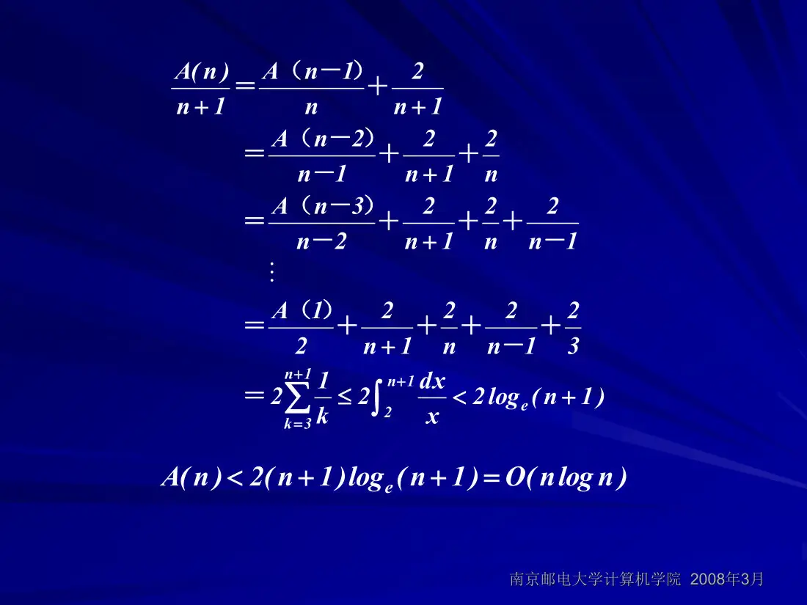

原文：

$$
\begin{array}{r l} & {\frac {A (n)}{n + 1} = \frac {A (n - 1)}{n} + \frac {2}{n + 1}} \\ & {\qquad = \frac {A (n - 2)}{n - 1} + \frac {2}{n + 1} + \frac {2}{n}} \\ & {\qquad = \frac {A (n - 3)}{n - 2} + \frac {2}{n + 1} + \frac {2}{n} + \frac {2}{n - 1}} \\ & {\qquad \vdots} \\ & {\qquad = \frac {A (1)}{2} + \frac {2}{n + 1} + \frac {2}{n} + \frac {2}{n - 1} + \frac {2}{3}} \\ & {\qquad = 2 \sum_ {k = 3} ^ {n + 1} \frac {1}{k} \leq 2 \int_ {2} ^ {n + 1} \frac {d x}{x} <   2 \log_ {e} (n + 1)} \end{array}
$$

$$
A (n) <   2 (n + 1) \log_ {e} (n + 1) = O (n \log n)
$$

南京邮电大学计算机学院 2008年3月

### 5.4.3 排序算法的时间下界

原文：

5.4.3 排序算法的时间下界

定理5－7

任何一个通过关键字值比较对n个元素进行排序的算法，在最坏情况下，至少需作（n/4）log n次比较。

△

南京邮电大学计算机学院 2008年3月

### 南京邮电大学计算机学院 2008年3月

原文：

南京邮电大学计算机学院 2008年3月

### 5.5 选择问题

原文：

5.5 选择问题

△

南京邮电大学计算机学院 2008年3月

### 问题

原文：

问题

选择问题（select problem）是指在n个元素的集合中，选出某个元素值大小在集合中处于第k位的元素，即所谓的求第k小元素问题(kth-smallest)。

南京邮电大学计算机学院 2008年3月

### 5.5.1 分治法求解

原文：

5.5.1 分治法求解

设原表长度为n，假定经过一趟分划，分成两个左右子表，其中左子表是主元及其左边元素的子表，设其长度为p，右子表是主元右边元素的子表。那么，若k=p，则主元就是第k小元素；否则若k
p，则第k小元素必定在右子表中，需求解的子问题成为在右子表中求第k-p小元素。

南京邮电大学计算机学院 2008年3月

### 5.5.2 随机选择主元

原文：

5.5.2 随机选择主元

随机选主元算法

假定表中元素各不相同，并且随机选择主元，即在下标区间[left,right]中随机选择一个下标r，以该下标处的元素为主元。

南京邮电大学计算机学院 2008年3月

### } while (true);

原文：

【程序5－13】Select函数template <class T>ResultCode SortableList<T>::Select1(T& x,int k)

if(n<=0||k>n||k<=0) return OutOfBounds; int left=0, right=n; l[n] = INFTY;

int j=rand()% (right-left+1)+left; Swap(left,j); j=Partition(left, right); if (k==j+1) {x=l[j];return Success;} else if (k<j+1) right=j; else left=j+1;

} while (true);

南京邮电大学计算机学院 2008年3月

### 定理5－8

原文：

定理5－8

程序5－13的Select算法的平均时间 $\mathbf { A } ( 0 ) = \mathbf { 0 } ( 0 )$ 。

算法的最坏情况时间复杂度 $\textcircled { 1 } \textcircled { 1 1 }$ 。

南京邮电大学计算机学院 2008年3月

### 5.5.3 线性时间选择算法

原文：

5.5.3 线性时间选择算法

改进的选择算法采用二次取中法(median ofmedians rule)确定主元

△

南京邮电大学计算机学院 2008年3月

### 第 61 页

原文：

月

### 南京邮电大学计算机学院 2008年3月

原文：

【程序5－14】 线性时间选择算法ResultCode SortableList<T>::Select(T& x,int k)

if(n<=0||k>n||k<=0) return OutOfBounds; int j=Select(k,0,n-1,5); x=l[j];return Success;

南京邮电大学计算机学院 2008年3月

### 南京邮电大学计算机学院 2008年3月

原文：

template <class T> int SortableList<T>::Select(int k, int left,int right,int r)

int n=right-left+1; if (n<=r){ InsertSort(left,right); return left+k-1;

南京邮电大学计算机学院 2008年3月

### 南京邮电大学计算机学院 2008年3月

原文：

for (int i=1;i<=n/r;i++){ InsertSort(left+(i-1)\*r,left+i\*r-1); Swap(left+i-1, left+(i-1)\*r+Ceil(r,2)-1);

int j=Select(Ceil(n/r,2),left,left+(n/r)-1,r ); Swap(left,j); j =Partition(left,right); if (k==j-left+1) return j; else if (k<j-left+1) return Select(k,left,j-1,r); else return Select(k-(j-left+1),j+1,right,r);

南京邮电大学计算机学院 2008年3月

### 5.5.4 时间分析

原文：

5.5.4 时间分析

以二次取中的中间值mm为主元，经过一趟分划，左、右两个子表的大小均至多为：n-Ln/r/2[r/2]设T(n)为当表长为n时执行程序5－14所需的时间。T(n)由三部分时间组成：$1 1 ( 1 1 ) = 1 1 ( 1 1 1 6 ) 1 1 ( 1 1 1 1 ) 1 1 ( 1 1 1 1 )$ 用归纳法容易证明， $4 ( 1 1 ) \leq 4 2 ( 1 ) ( 9 1 )$ ，n1是线性时间的。

南京邮电大学计算机学院 2008年3月

### 5.5.5 允许重复元素的选择算法

原文：

5.5.5 允许重复元素的选择算法

由于允许包含相同元素，左子表中除了小于mm的元素外，还包含与mm相同值的元素。因此，左子表的大小至多可达n-Ln/r/2[r/27+1/2∏n/r/2[r/2]$= 1 1 5 . 1 6 2 \vert \vert 1 1 1 1 1 0 \vert \vert \vert \vert \vert \cdot \vert \vert \vert \vert \cdot \vert \vert \vert$ 容易用归纳法证明对于所有 $\Pi \ge \mathbb { M }$ $1 1 ( 1 1 ) 2 + 1 1 ( 1 1 1 ) 2 + 1 1 ( 1 1 1 ) 2 = 9 1 3 ( 1 1 2 ) 2 ( 1 1 1 ) 1 1 ( 2 1 1 )$

南京邮电大学计算机学院 2008年3月

### 5.6 斯特拉森矩阵乘法

原文：

5.6 斯特拉森矩阵乘法

△

南京邮电大学计算机学院 2008年3月

### 问题矩阵相乘

原文：

问题矩阵相乘

南京邮电大学计算机学院 2008年3月

### 5.6.1 分治法求解

原文：

5.6.1 分治法求解

$$
\begin{array}{r l} & {\left[ \begin{array}{l l} A _ {1 1} & A _ {1 2} \\ A _ {2 1} & A _ {2 2} \end{array} \right] \left[ \begin{array}{l l} B _ {1 1} & B _ {1 2} \\ B _ {2 1} & B _ {2 2} \end{array} \right] = \left[ \begin{array}{l l} C _ {1 1} & C _ {1 2} \\ C _ {2 1} & C _ {2 2} \end{array} \right]} \\ & {\qquad \mathrm{C} _ {1 1} = \mathrm{A} _ {1 1} \mathrm{B} _ {1 1} + \mathrm{A} _ {1 2} \mathrm{B} _ {2 1}} \\ & {\qquad \mathrm{C} _ {1 2} = \mathrm{A} _ {1 1} \mathrm{B} _ {1 2} + \mathrm{A} _ {1 2} \mathrm{B} _ {2 2}} \\ & {\qquad \mathrm{C} _ {2 1} = \mathrm{A} _ {2 1} \mathrm{B} _ {1 1} + \mathrm{A} _ {2 2} \mathrm{B} _ {2 1}} \\ & {\qquad \mathrm{C} _ {2 2} = \mathrm{A} _ {2 1} \mathrm{B} _ {1 2} + \mathrm{A} _ {2 2} \mathrm{B} _ {2 2}} \\ & {T (n) = \left\{ \begin{array}{l l l l l l l l l l l l l l l l l l l l l l l l l l l l l l l l l l l l l l l l l l l l l l l l l l l l l l l l l l l l l l l l l l l l l l l l l l l l l l l l l l l l l l l l l l l l l l l l l l l l l} b & & n \leq 2 & & & & & & & & & & & & & & & & & & & & & & & & & & & & & & & & & & & & & & & & & & & & & & & & & & & & & & & \\ 8 T (n / 2) + d n ^ {2} & n > 2 & & & & & & & & & & & & & & & & & & & & & & & & & & & & & & & & & & & & & & & & \\ \end{array} \right. \quad \mathrm{T(n)=Θ(n^ {3})}} \end{array}
$$

南京邮电大学计算机学院 2008年3月

### 5.6.2 斯特拉森分治法

原文：

5.6.2 斯特拉森分治法

$1 2 ( 1 - \frac { 1 } { 2 } + \frac { 1 } { 2 } + \frac { 1 } { 2 } + \frac { 1 } { 2 } ) ( 1 - \frac { 1 } { 2 } + \frac { 1 } { 2 } + \frac { 1 } { 2 } )$ $\textcircled { 1 } = ( 0 . 5 \times \frac { 7 } { 2 } , 5 \times ) : 3 \times 5 = ( 0 . 5 \times \frac { 7 } { 2 } )$ $1 1 \div 7 . 5 ( 1 3 . 7 6 ) = 3 . 7 5 ( 1 3 . 7 6 )$ $\textcircled { 2 } 2 5 \times ( 1 0 \% - 1 0 \% )$ $1 1 = ( 0 . 5 7 - 0 . 5 7 ) : 3 3$ $\textcircled { 1 } = ( \frac { 1 } { 2 } , \frac { 1 } { 3 } , \frac { 1 } { 2 } , \frac { 1 } { 3 } , \frac { 1 } { 3 } , \frac { 1 } { 3 } , \frac { 1 } { 3 } , \frac { 1 } { 3 } )$ $y = ( - \frac { 1 } { 2 } , y ) = ( - \frac { 1 } { 2 } , y ) ( \frac { 1 } { 2 } , y ) = ( - \frac { 1 } { 2 } , y )$

南京邮电大学计算机学院 2008年3月

### $$

原文：

$$
T (n) = \left\{ \begin{array}{l l} b & n \leq 2 \\ 7 T (n / 2) + d n ^ {2} & n > 2 \end{array} \right.
$$

T(n)= Θ(nlog 7)≈Θ(n2. 81)

南京邮电大学计算机学院 2008年3月
