# 《算法设计与分析》第11章 随机算法（课件）

原件的每一页，下面附识别出的文字。

### 算法设计与分析

原文：

算法设计与分析

DeSign and Analysis of Algorithms In C++

陈慧南 编著

南京邮电大学计算机学院 2008年3月

“十一五”国家级规划教材

电子工业出版社

### 第3部分 求解困难问题

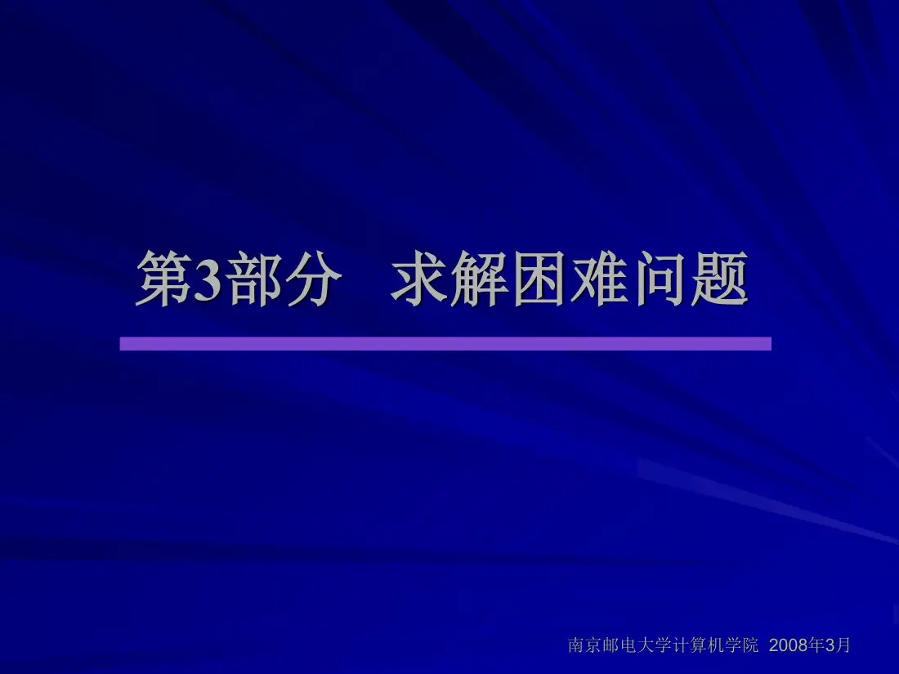

原文：

第3部分 求解困难问题

南京邮电大学计算机学院 2008年3月

### 第11章 随机算法

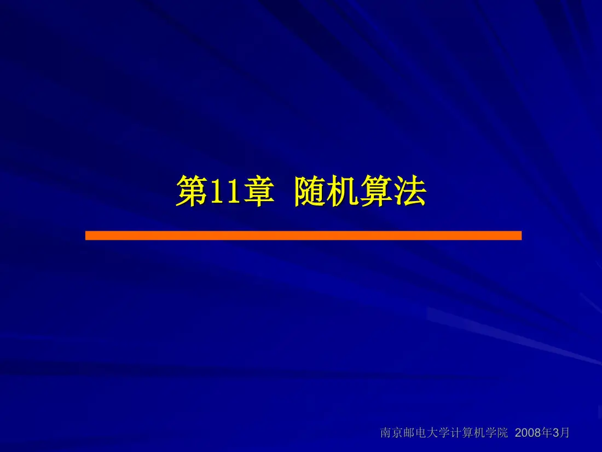

原文：

第11章 随机算法

南京邮电大学计算机学院 2008年3月

### 11.1 基本概念

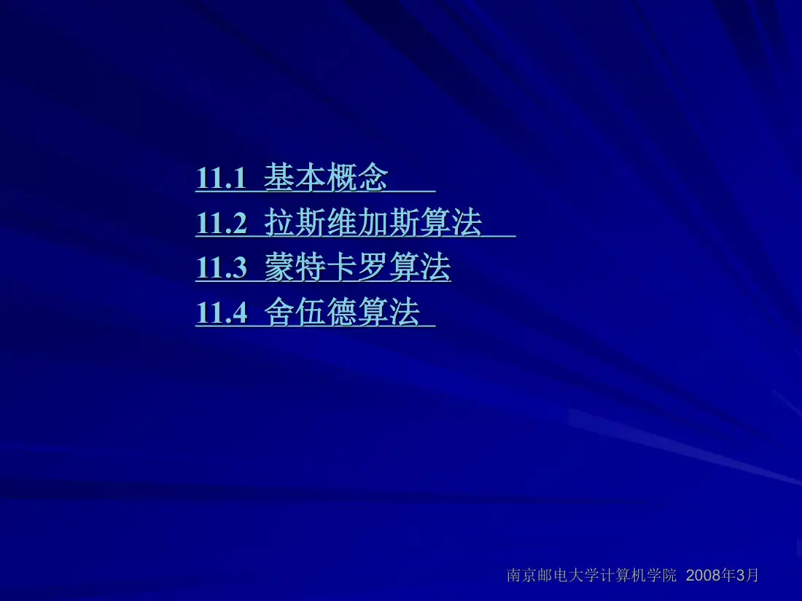

原文：

11.1 基本概念
11.2 拉斯维加斯算法
11.3 蒙特卡罗算法
11.4 舍伍德算法

南京邮电大学计算机学院 2008年3月

### 11.1 基本概念

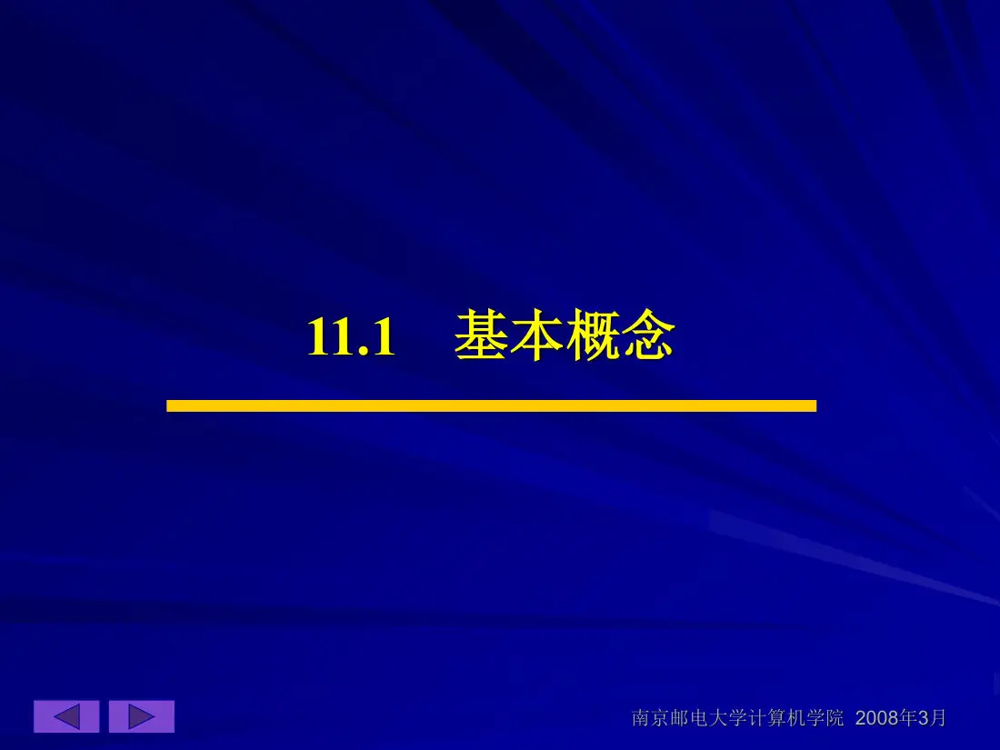

原文：

11.1 基本概念

△

南京邮电大学计算机学院 2008年3月

### 11.1.1 随机算法概述

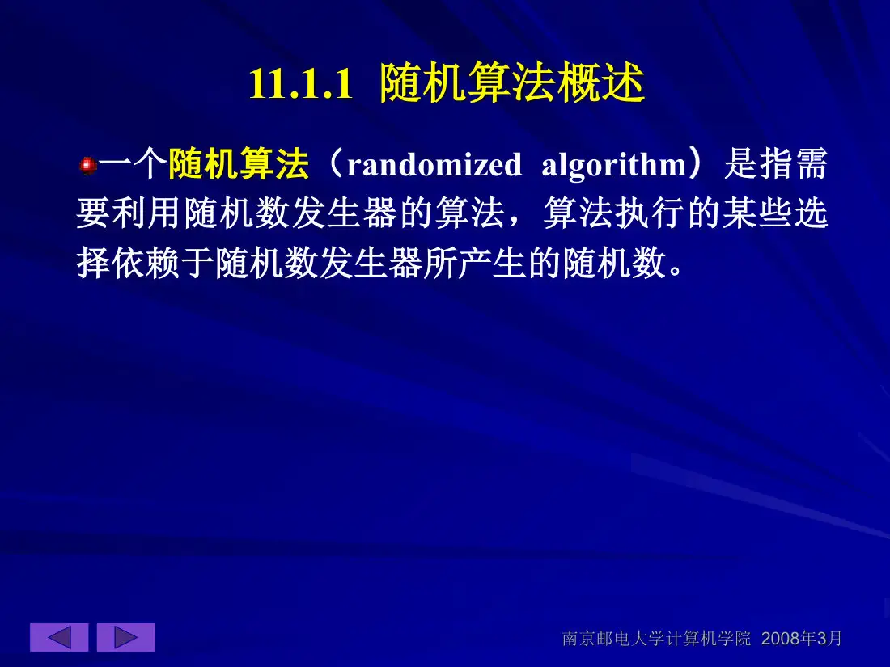

原文：

11.1.1 随机算法概述

一个随机算法（randomized algorithm）是指需要利用随机数发生器的算法，算法执行的某些选择依赖于随机数发生器所产生的随机数。

南京邮电大学计算机学院 2008年3月

### 11.1.2 随机数发生器

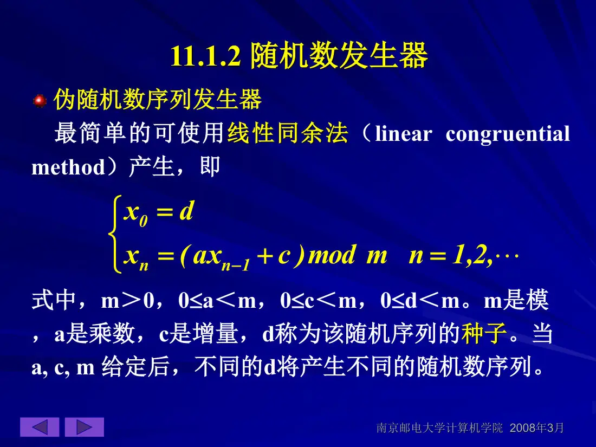

原文：

11.1.2 随机数发生器

伪随机数序列发生器最简单的可使用线性同余法（linear congruentialmethod）产生，即

$$
\left\{ \begin{array}{l} x _ {0} = d \\ x _ {n} = (a x _ {n - 1} + c) \bmod m \quad n = 1, 2, \dots \end{array} \right.
$$

式中， $\yen 10$ $0 . 8 9 \times 1 0 ^ { 3 } m$ $\textcircled { 1 } \leq \textcircled { 4 } \leq \textcircled { 1 1 }$ $0 . 8 0 6 \approx 1 1 1$ 。m是模，a是乘数，c是增量，d称为该随机序列的种子。当$\textcircled { 1 } \textcircled { 1 }$ 给定后，不同的d将产生不同的随机数序列。

南京邮电大学计算机学院 2008年3月

### 南京邮电大学计算机学院 2008年3月

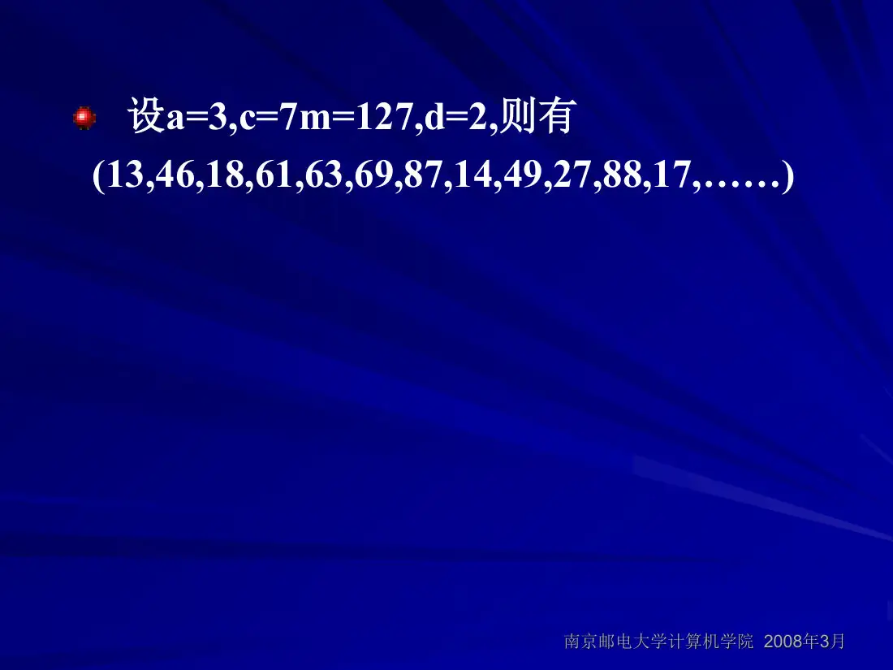

原文：

设 $1 2 \times 2 \times 1 0 = 1 8 0 ( c m )$ ,则有 (13,46,18,61,63,69,87,14,49,27,88,17,……)

南京邮电大学计算机学院 2008年3月

### 11.1.3 随机算法分类

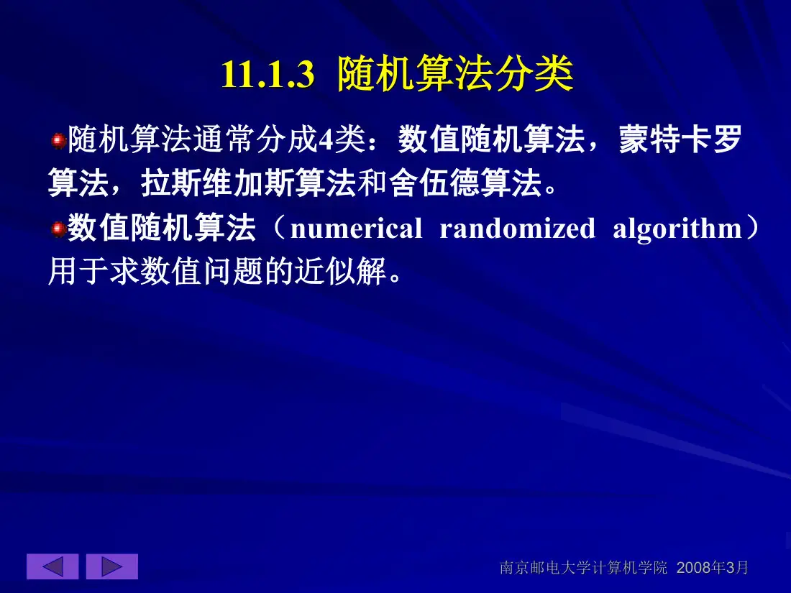

原文：

11.1.3 随机算法分类

随机算法通常分成4类：数值随机算法，蒙特卡罗算法，拉斯维加斯算法和舍伍德算法。

数值随机算法（numerical randomized algorithm）用于求数值问题的近似解。

南京邮电大学计算机学院 2008年3月

### 蒙特卡罗算法

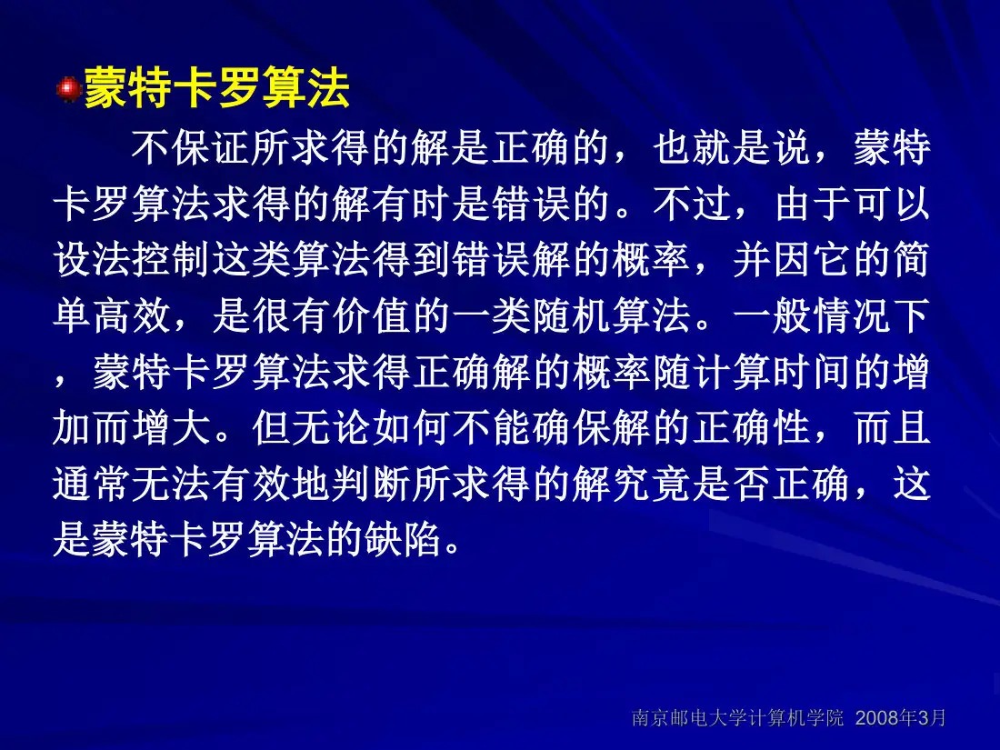

原文：

蒙特卡罗算法

不保证所求得的解是正确的，也就是说，蒙特卡罗算法求得的解有时是错误的。不过，由于可以设法控制这类算法得到错误解的概率，并因它的简单高效，是很有价值的一类随机算法。一般情况下蒙特卡罗算法求得正确解的概率随计算时间的增加而增大。但无论如何不能确保解的正确性，而且通常无法有效地判断所求得的解究竟是否正确，这是蒙特卡罗算法的缺陷。

南京邮电大学计算机学院 2008年3月

### 拉斯维加斯算法

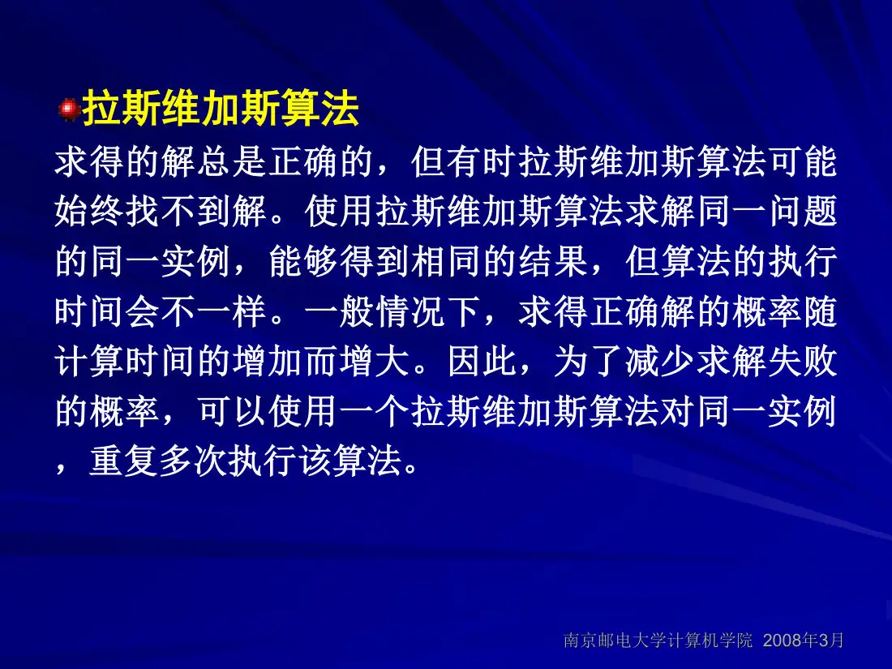

原文：

拉斯维加斯算法

求得的解总是正确的，但有时拉斯维加斯算法可能始终找不到解。使用拉斯维加斯算法求解同一问题的同一实例，能够得到相同的结果，但算法的执行时间会不一样。一般情况下，求得正确解的概率随计算时间的增加而增大。因此，为了减少求解失败的概率，可以使用一个拉斯维加斯算法对同一实例，重复多次执行该算法。

南京邮电大学计算机学院 2008年3月

### 南京邮电大学计算机学院 2008年3月

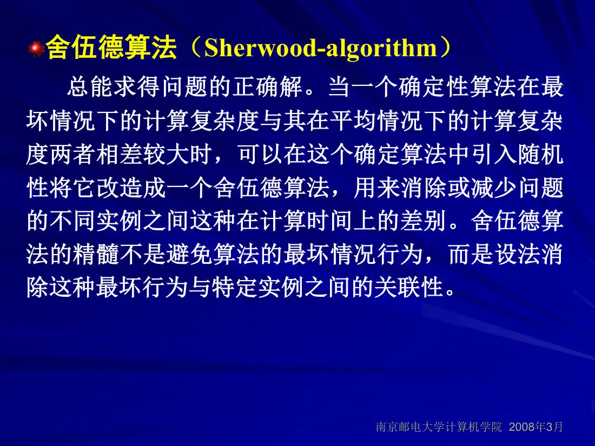

原文：

舍伍德算法（Sherwood-algorithm）总能求得问题的正确解。当一个确定性算法在最坏情况下的计算复杂度与其在平均情况下的计算复杂度两者相差较大时，可以在这个确定算法中引入随机性将它改造成一个舍伍德算法，用来消除或减少问题的不同实例之间这种在计算时间上的差别。舍伍德算法的精髓不是避免算法的最坏情况行为，而是设法消除这种最坏行为与特定实例之间的关联性。

南京邮电大学计算机学院 2008年3月

### 南京邮电大学计算机学院 2008年3月

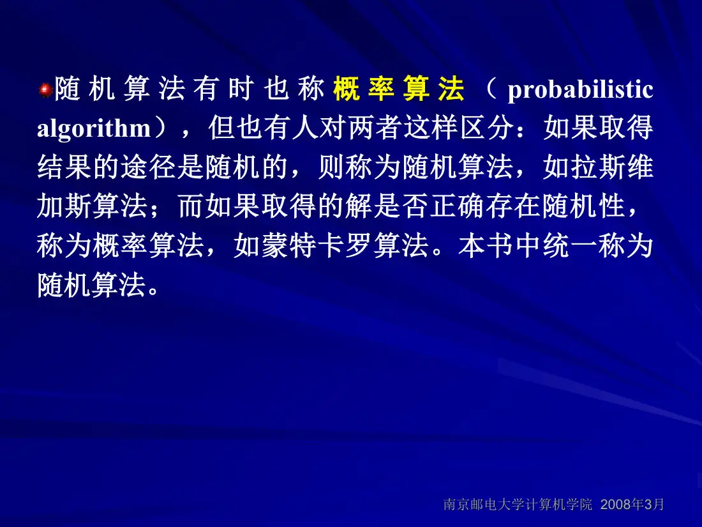

原文：

随 机 算 法 有 时 也 称 概 率 算 法 （ probabilisticalgorithm），但也有人对两者这样区分：如果取得结果的途径是随机的，则称为随机算法，如拉斯维加斯算法；而如果取得的解是否正确存在随机性，称为概率算法，如蒙特卡罗算法。本书中统一称为随机算法。

南京邮电大学计算机学院 2008年3月

### 11.2 拉斯维加斯算法

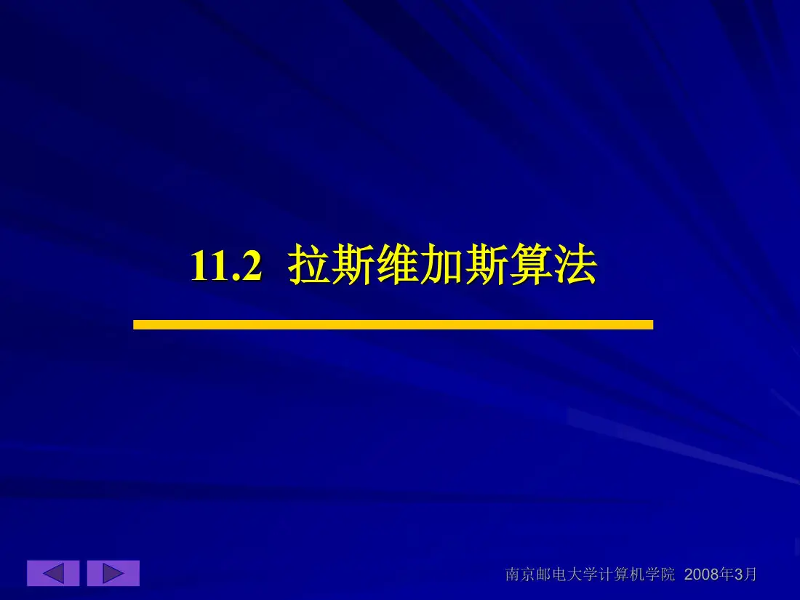

原文：

11.2 拉斯维加斯算法

△

南京邮电大学计算机学院 2008年3月

### 南京邮电大学计算机学院 2008年3月

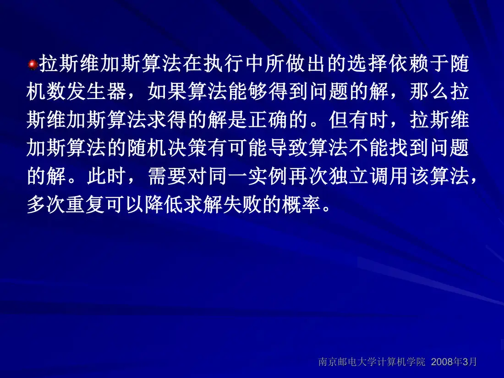

原文：

拉斯维加斯算法在执行中所做出的选择依赖于随机数发生器，如果算法能够得到问题的解，那么拉斯维加斯算法求得的解是正确的。但有时，拉斯维加斯算法的随机决策有可能导致算法不能找到问题的解。此时，需要对同一实例再次独立调用该算法多次重复可以降低求解失败的概率。

南京邮电大学计算机学院 2008年3月

### 11.2.1 标识重复元素算法

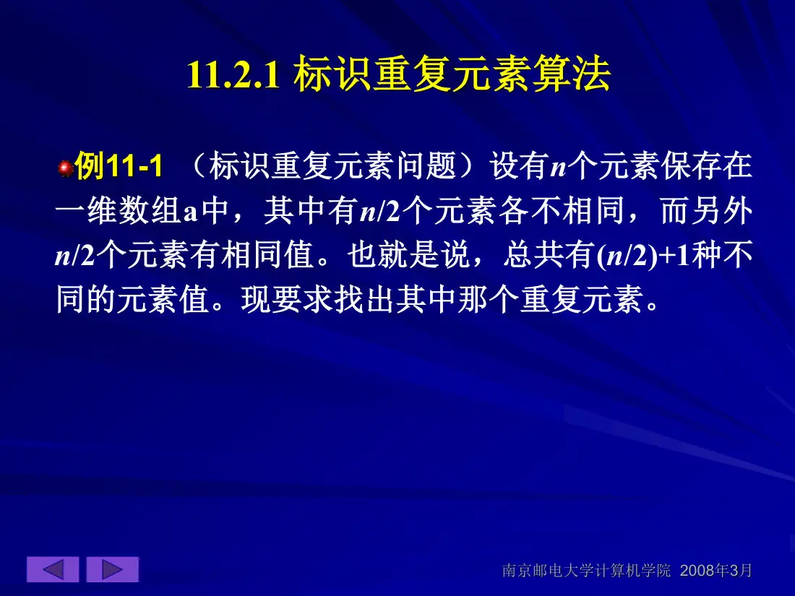

原文：

11.2.1 标识重复元素算法

例11-1 （标识重复元素问题）设有n个元素保存在维数组a中，其中有n/2个元素各不相同，而另外n/2个元素有相同值。也就是说，总共有(n/2)+1种不同的元素值。现要求找出其中那个重复元素。

南京邮电大学计算机学院 2008年3月

### 南京邮电大学计算机学院 2008年3月

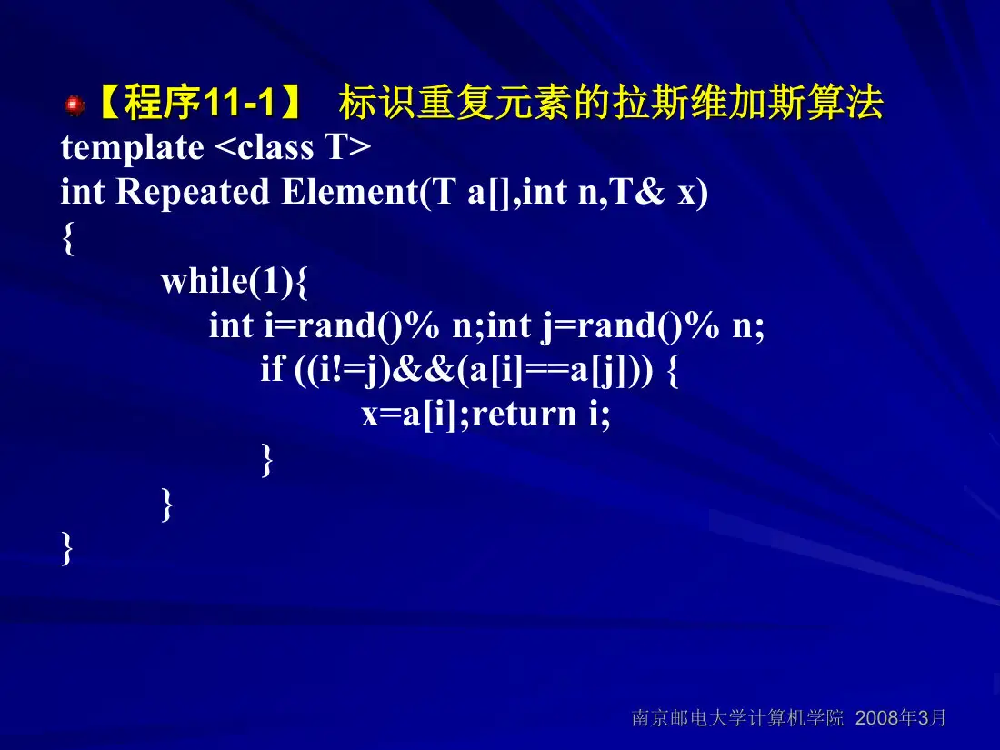

原文：

【程序11-1】 标识重复元素的拉斯维加斯算法template <class T>int Repeated Element(T a[],int n,T& x)

while(1){ int i=rand()% n;int j=rand()% n; if ((i!=j)&&(a[i]==a[j])) { x=a[i];return i;

南京邮电大学计算机学院 2008年3月

### 11.2.2 性能分析

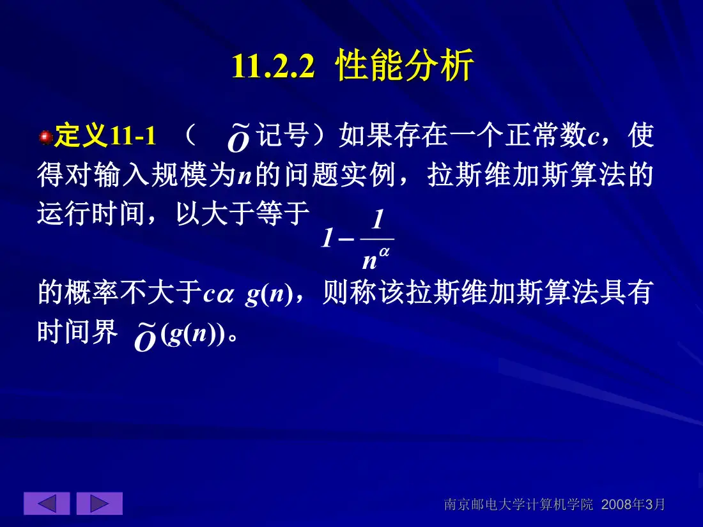

原文：

11.2.2 性能分析

定义11-1 （ 记号）如果存在一个正常数c，使得对输入规模为n的问题实例，拉斯维加斯算法的运行时间，以大于等于 $1 2 \div \frac { 1 } { 1 1 }$ 的概率不大于 $\textcircled { q } \textcircled { q } \textcircled { q } \textcircled { 1 }$ 则称该拉斯维加斯算法具有时间界 $\widetilde { \mathbf { \Omega } } ^ { \mathrm { f f } } ( \widetilde { \mathbf { \Omega } } )$ a

△M

南京邮电大学计算机学院 2008年3月

### 南京邮电大学计算机学院 2008年3月

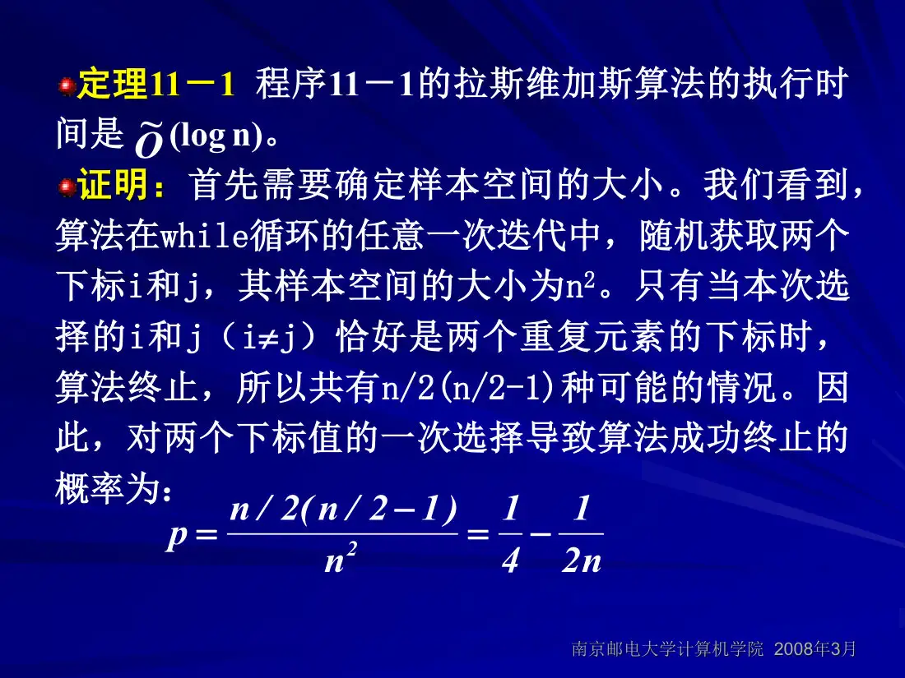

原文：

定理11－1 程序11－1的拉斯维加斯算法的执行时间是 $\textcircled { 4 } \textcircled { 1 } \textcircled { 1 } \textcircled { 2 } \textcircled { 1 }$

证明：首先需要确定样本空间的大小。我们看到，算法在while循环的任意一次迭代中，随机获取两个下标i和j，其样本空间的大小为n2。只有当本次选择的i和j（ij）恰好是两个重复元素的下标时，算法终止，所以共有n/2(n/2-1)种可能的情况。因此，对两个下标值的一次选择导致算法成功终止的概率为：n/2(n/2-1) 1n 4 2n

南京邮电大学计算机学院 2008年3月

### 如果要求算法经一次迭代便终止的概率大于等于1/5，即，

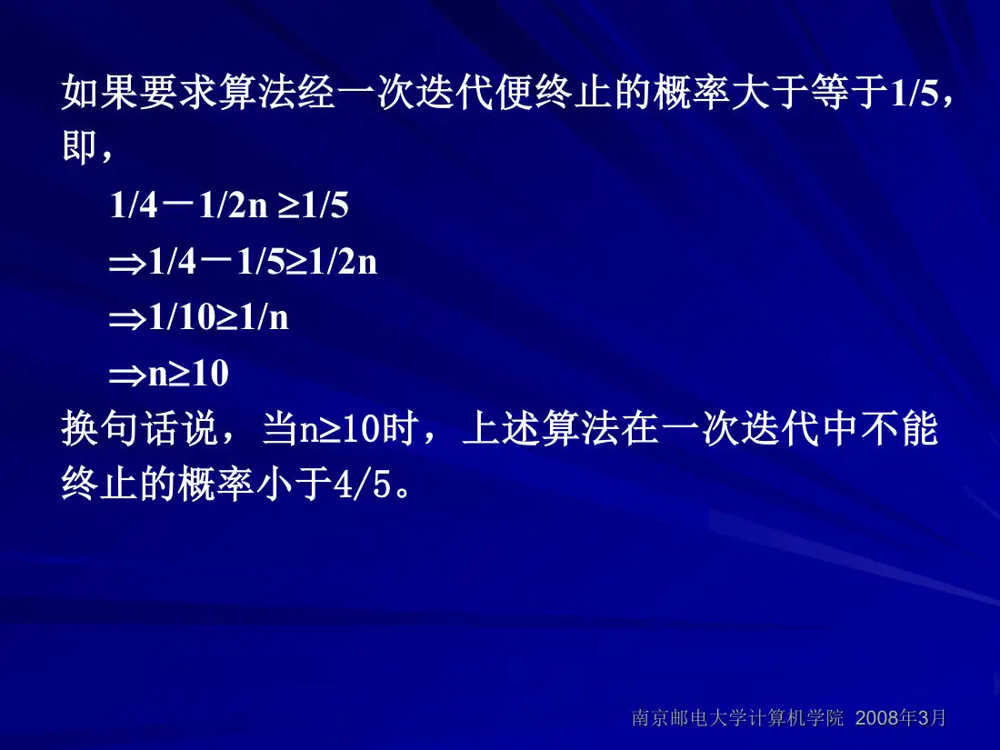

原文：

如果要求算法经一次迭代便终止的概率大于等于1/5，即，

$$
1 / 4 - 1 / 2 \mathrm{n} \geq 1 / 5
$$

$$
\Rightarrow 1 / 4 - 1 / 5 \geq 1 / 2 n
$$

$$
\Rightarrow 1 / 1 0 \geq 1 / n
$$

换句话说，当n10时，上述算法在一次迭代中不能终止的概率小于4/5。

南京邮电大学计算机学院 2008年3月

### $$

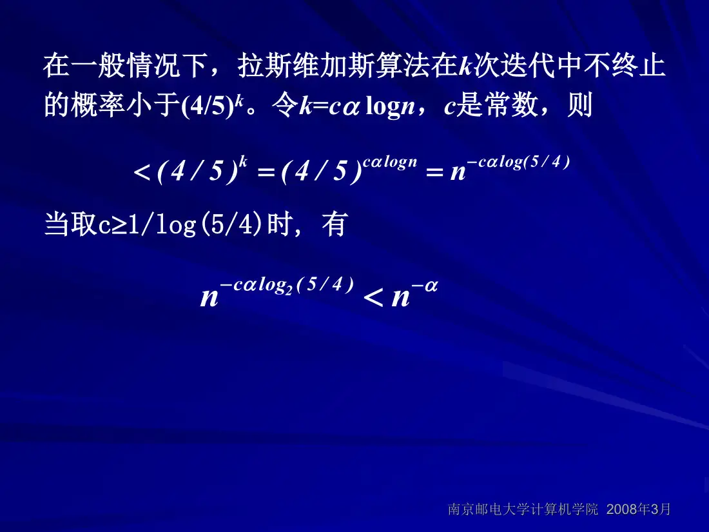

原文：

在一般情况下，拉斯维加斯算法在k次迭代中不终止的概率小于(4/5)k。令k=c logn，c是常数，则

$$
<   (4 / 5) ^ {k} = (4 / 5) ^ {c \alpha l o g n} = n ^ {- c \alpha l o g (5 / 4)}
$$

当取c1/log(5/4)时, 有

$$
n ^ {- c \alpha l o g _ {2} (5 / 4)} <   n ^ {- \alpha}
$$

南京邮电大学计算机学院 2008年3月

### 南京邮电大学计算机学院 2008年3月

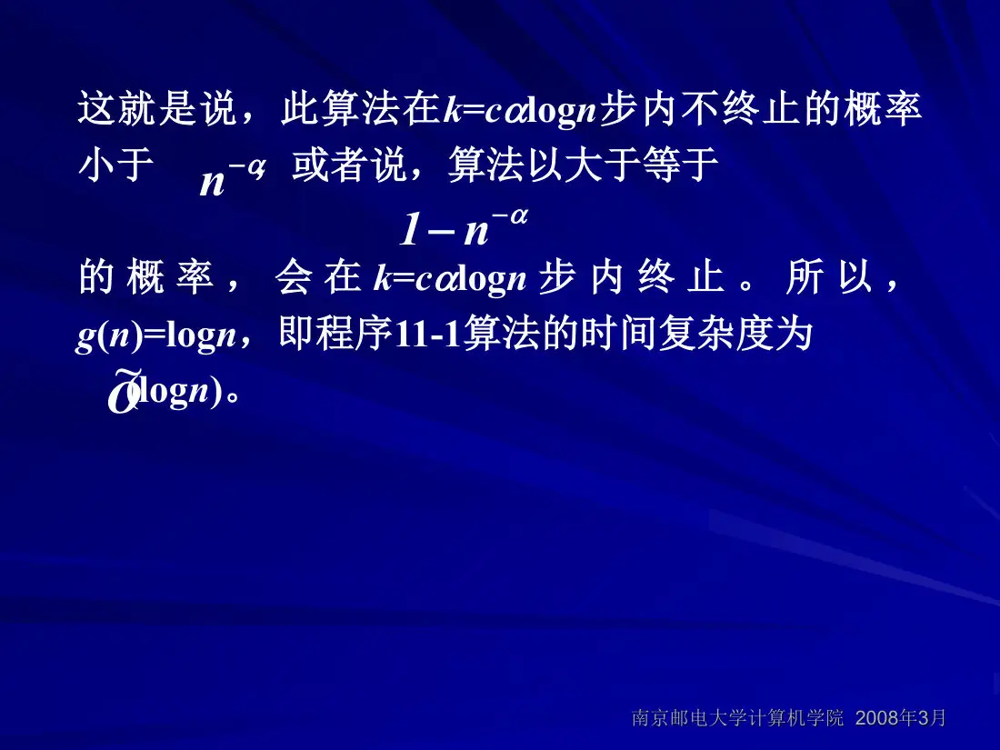

原文：

这就是说，此算法在k=clogn步内不终止的概率小于 $\textcircled { 1 }$ 或者说，算法以大于等于1−n α的 概 率 ， 会 在 $1 5 - 1 9 0 9 ( 1 ) = 1 1$ 步 内 终 止 。 所 以 ，$9 ( m ) = 1 0 ( m ^ { 2 } - 1 )$ 即程序11-1算法的时间复杂度为$\textcircled { 4 } \textcircled { 1 } \textcircled { 2 } \textcircled { 1 }$ 0

南京邮电大学计算机学院 2008年3月

### 11.3 蒙特卡罗算法

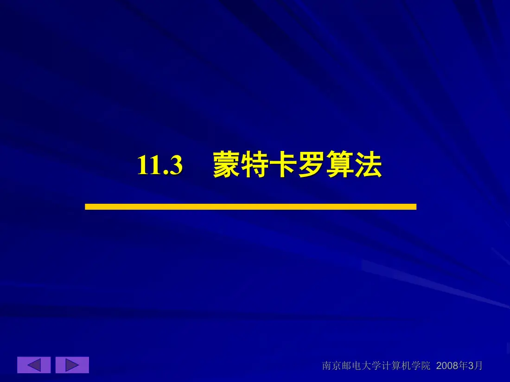

原文：

11.3 蒙特卡罗算法

△

南京邮电大学计算机学院 2008年3月

### 南京邮电大学计算机学院 2008年3月

原文：

拉斯维加斯算法对于相同的输入总是产生相同的输出。算法的执行时间取决于随机数发生器的输出，可能很快，也可能很慢。蒙特卡罗算法对于相同的输入，算法的结果可能不同。

南京邮电大学计算机学院 2008年3月

### 11.3.1 素数测试问题

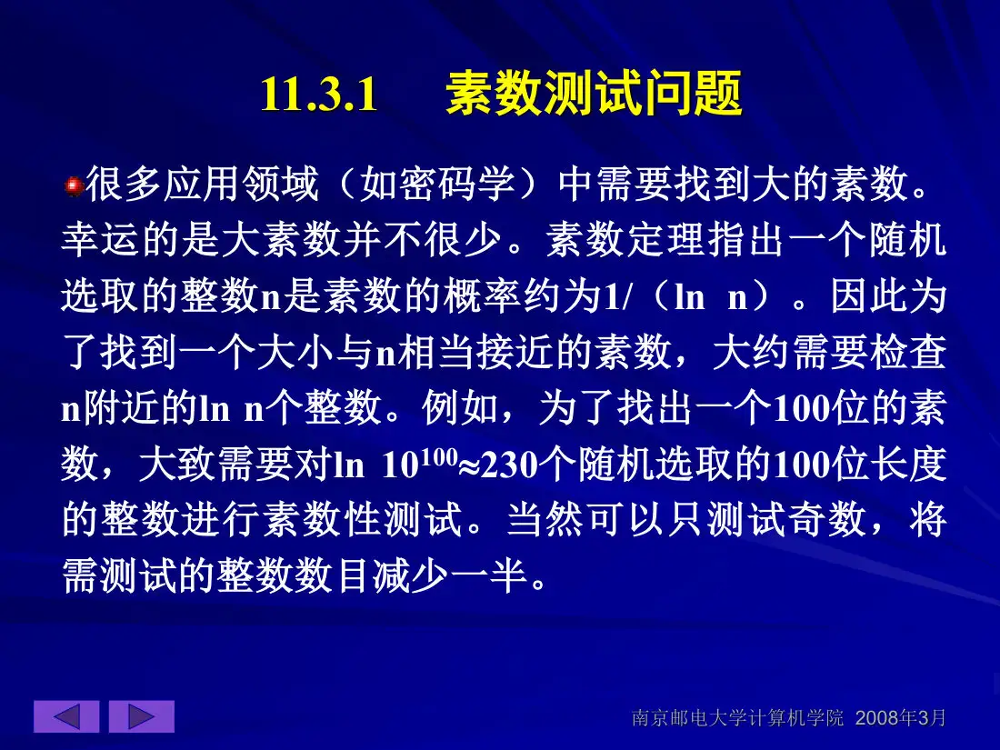

原文：

11.3.1 素数测试问题

很多应用领域（如密码学）中需要找到大的素数。幸运的是大素数并不很少。素数定理指出一个随机选取的整数n是素数的概率约为1/（ln n）。因此为了找到一个大小与n相当接近的素数，大约需要检查n附近的ln n个整数。例如，为了找出一个100位的素数，大致需要对ln 10100230个随机选取的100位长度的整数进行素数性测试。当然可以只测试奇数，将需测试的整数数目减少一半。

南京邮电大学计算机学院 2008年3月

### 南京邮电大学计算机学院 2008年3月

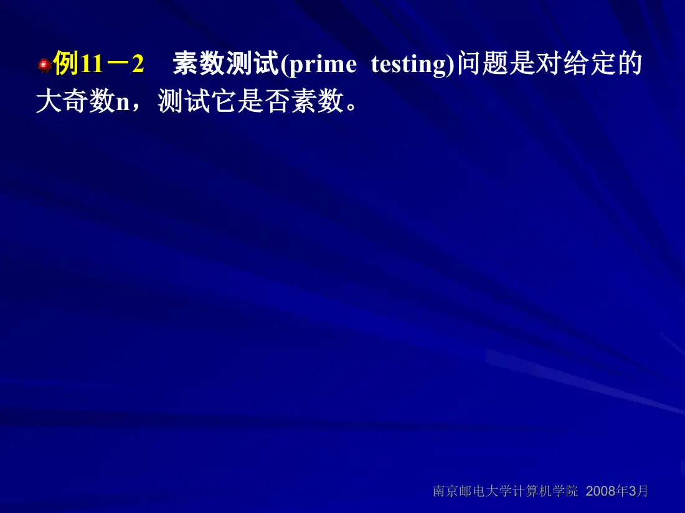

原文：

例11－2 素数测试(prime testing)问题是对给定的大奇数n，测试它是否素数。

南京邮电大学计算机学院 2008年3月

### 11.3.2 伪素数测试

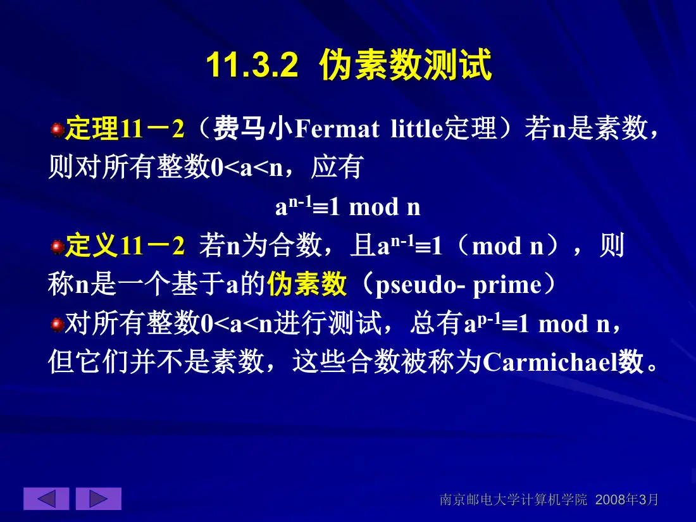

原文：

11.3.2 伪素数测试

定理11－2（费马小Fermat little定理）若n是素数，则对所有整数0<a<n，应有

an-11 mod n

定义11－2 若n为合数，且 $\Theta ^ { \parallel \parallel } [ \circleddash 1 ]$ （mod n），则称n是一个基于a的伪素数（pseudo- prime）对所有整数0<a<n进行测试，总有 $6 1 9 - 1 = 1 1$ mod n，但它们并不是素数，这些合数被称为Carmichael数。

南京邮电大学计算机学院 2008年3月

### 【程序11－2】 伪素数测试int ModExp(int a,int n)

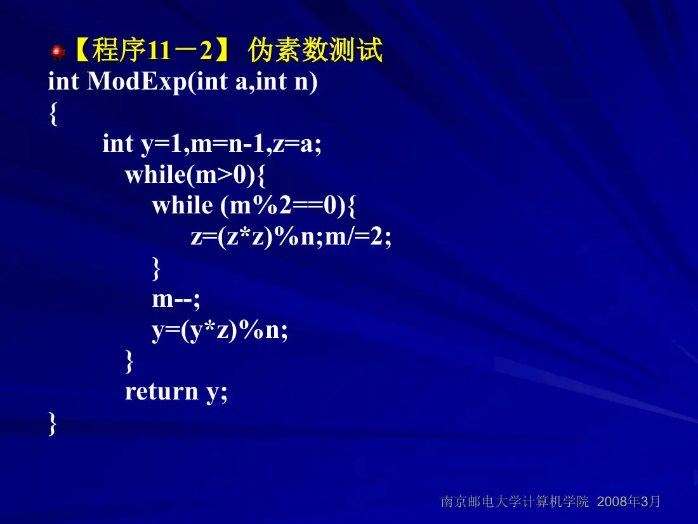

原文：

【程序11－2】 伪素数测试int ModExp(int a,int n)

int y=1,m=n-1,z=a; while(m>0){ while (m%2==0){ z=(z\*z)%n;m/=2; } m--; y=(y\*z)%n; return y;

南京邮电大学计算机学院 2008年3月

### bool PseudoPrime(int a,int n)

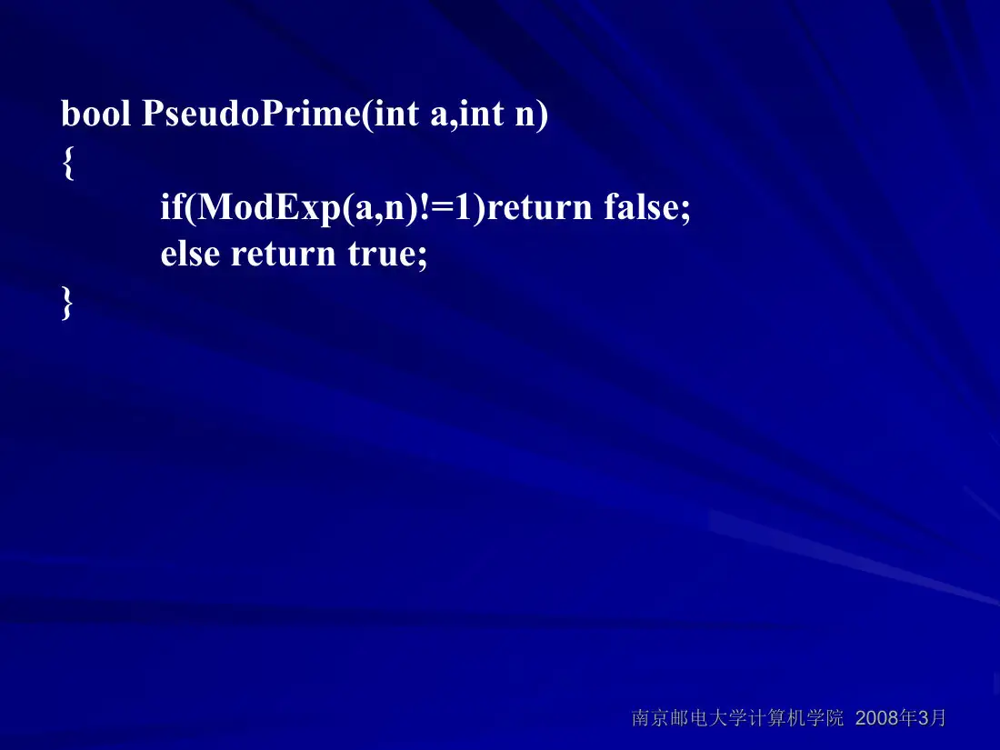

原文：

bool PseudoPrime(int a,int n)

if(ModExp(a,n)!=1)return false; else return true;

南京邮电大学计算机学院 2008年3月

### 11.3.3 米勒-拉宾算法

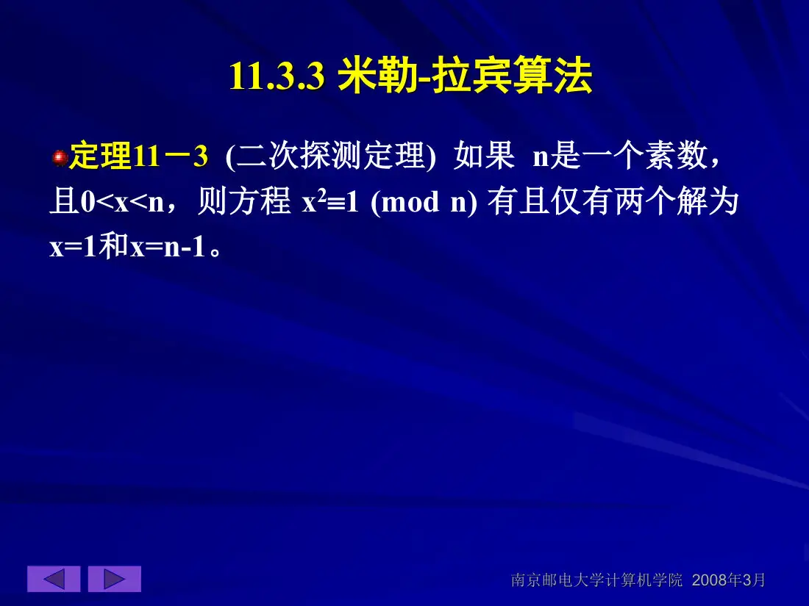

原文：

11.3.3 米勒-拉宾算法

定理11－3 (二次探测定理) 如果 n是一个素数，且 $\textcircled { 1 } \Leftrightarrow \langle \langle \langle \langle \langle i | \rangle \rangle$ ，则方程 x21 (mod n) 有且仅有两个解为x=1和x=n-1。

南京邮电大学计算机学院 2008年3月

### 南京邮电大学计算机学院 2008年3月

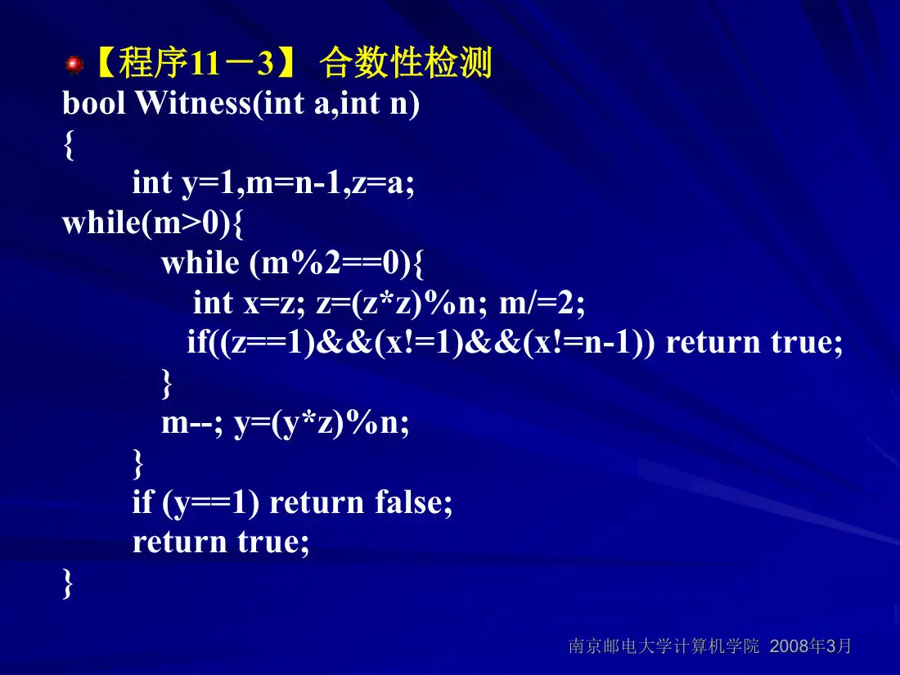

原文：

int y=1,m=n-1,z=a; while(m>0){ while (m%2==0){ int $\angle A P E = ( ( A + \angle A ) + ( 1 + \angle 1 ) \times 2 ) \times 1 1 1 = 2 4$ if((z==1)&&(x!=1)&&(x!=n-1)) return true; } m--; y=(y\*z)%n; } if (y==1) return false; return true;

南京邮电大学计算机学院 2008年3月

### return true;

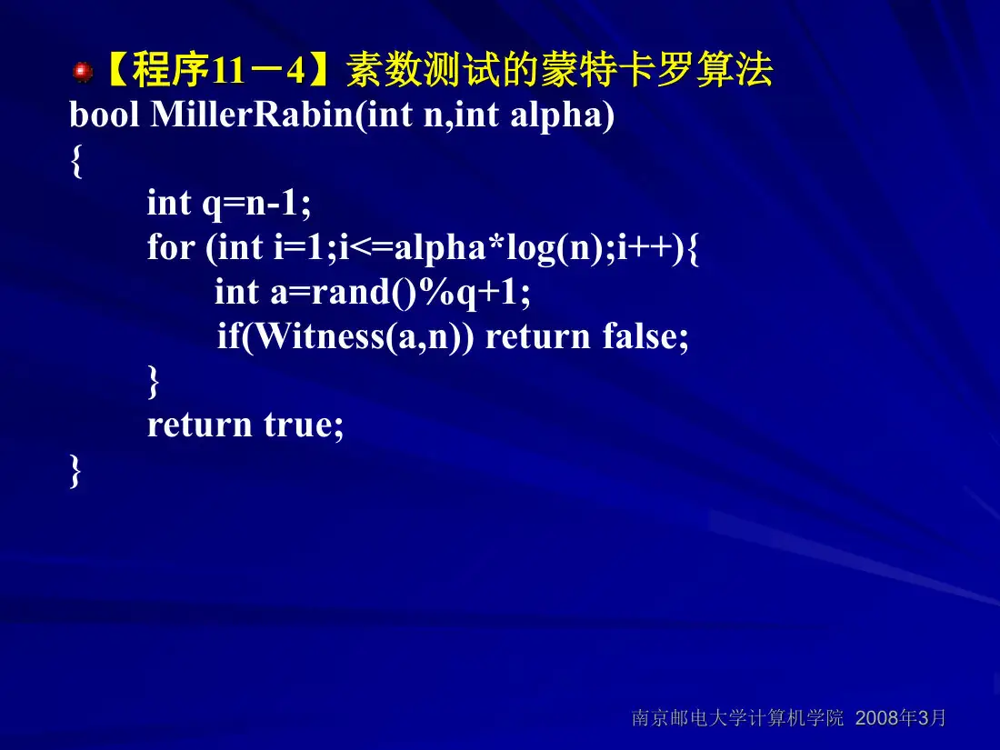

原文：

【程序11－4】素数测试的蒙特卡罗算法bool MillerRabin(int n,int alpha)

int q=n-1; for (int i=1;i<=alpha\*log(n);i++){ int a=rand()%q+1; if(Witness(a,n)) return false;

return true;

南京邮电大学计算机学院 2008年3月

### 11.3.4 性能分析

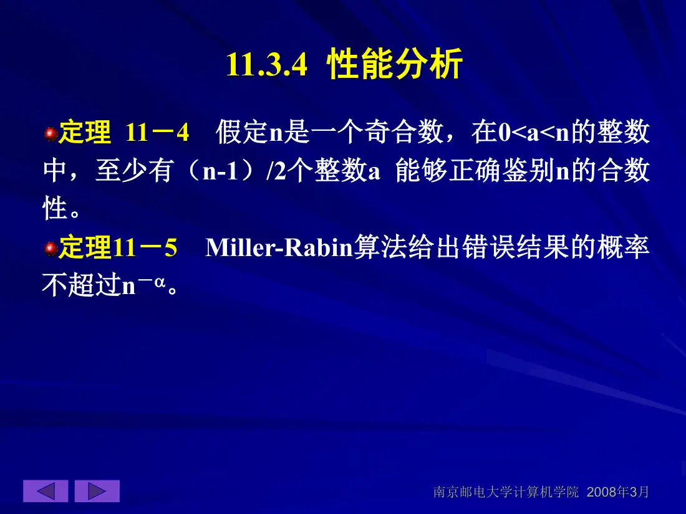

原文：

11.3.4 性能分析

定理 11－4 假定n是一个奇合数，在0<a<n的整数中，至少有（n-1）/2个整数a 能够正确鉴别n的合数性。

定理11－5 Miller-Rabin算法给出错误结果的概率不超过n－。

南京邮电大学计算机学院 2008年3月

### 11.4 舍伍德算法

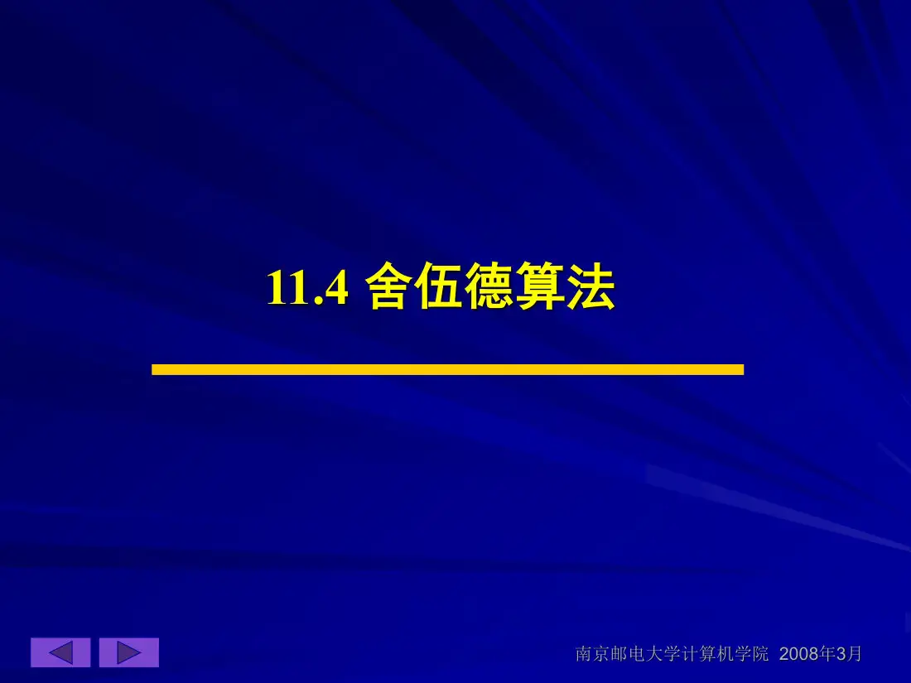

原文：

11.4 舍伍德算法

△

南京邮电大学计算机学院 2008年3月

### 南京邮电大学计算机学院 2008年3月

原文：

若一个确定算法有很好的平均时间性能，但对某些实例该算法的效率较低，则可考虑在算法中引入随机性，将其改造成一个舍伍德型算法，使得该算法对任何实例均有效。舍伍德算法旨在消除或减少问题的实例之间在运行时间上的差异。

南京邮电大学计算机学院 2008年3月

### 11.4.1 随机快速排序算法

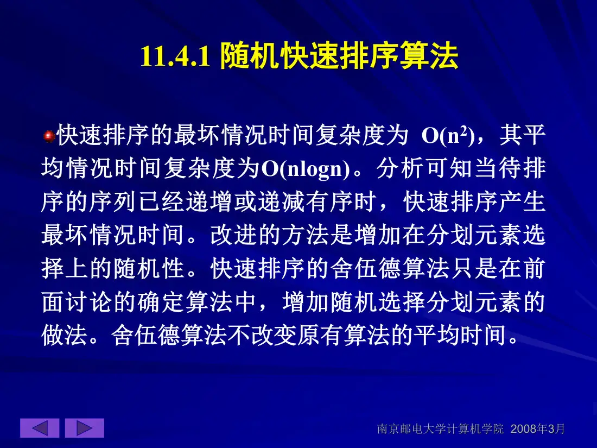

原文：

11.4.1 随机快速排序算法

快速排序的最坏情况时间复杂度为 $\textcircled { 1 } \textcircled { 1 1 }$ ，其平均情况时间复杂度为O(nlogn)。分析可知当待排序的序列已经递增或递减有序时，快速排序产生最坏情况时间。改进的方法是增加在分划元素选择上的随机性。快速排序的舍伍德算法只是在前面讨论的确定算法中，增加随机选择分划元素的做法。舍伍德算法不改变原有算法的平均时间。

南京邮电大学计算机学院 2008年3月

### else InsertSort(left,right);

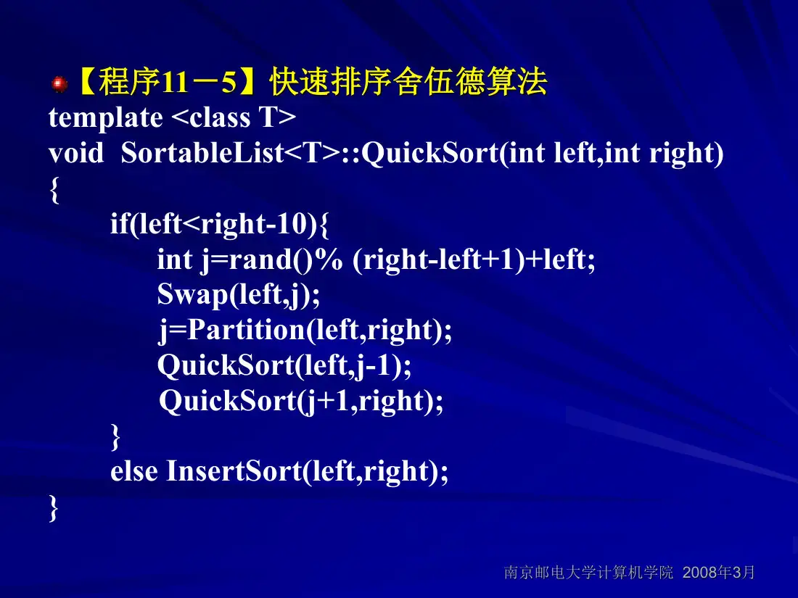

原文：

【程序11－5】快速排序舍伍德算法 template <class T> void SortableList<T>::QuickSort(int left,int right)

if(left<right-10){ int j=rand()% (right-left+1)+left; Swap(left,j); j=Partition(left,right); QuickSort(left,j-1); QuickSort(j+1,right);

else InsertSort(left,right);

南京邮电大学计算机学院 2008年3月

### 11.4.2 舍伍德算法的其它应用

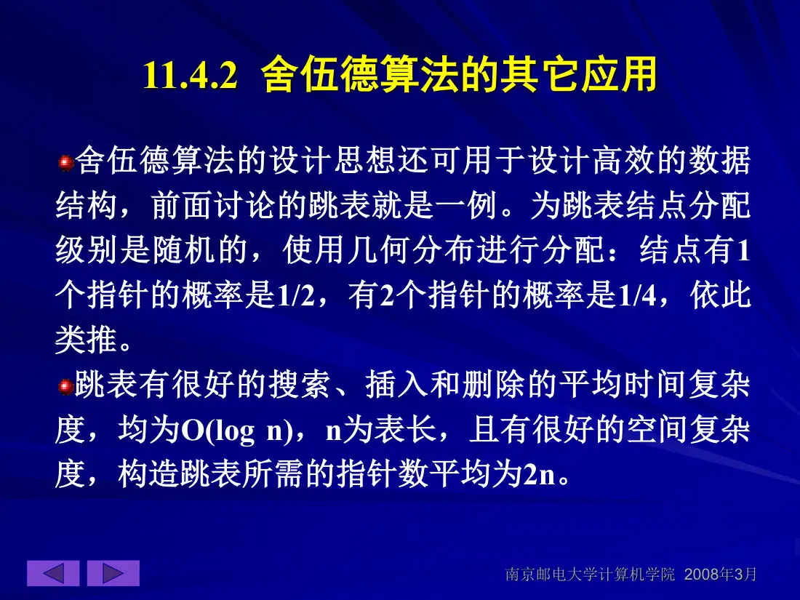

原文：

11.4.2 舍伍德算法的其它应用

舍伍德算法的设计思想还可用于设计高效的数据结构，前面讨论的跳表就是一例。为跳表结点分配级别是随机的，使用几何分布进行分配：结点有1个指针的概率是1/2，有2个指针的概率是1/4，依此类推。

跳表有很好的搜索、插入和删除的平均时间复杂度，均为O(log n)，n为表长，且有很好的空间复杂度，构造跳表所需的指针数平均为2n。

南京邮电大学计算机学院 2008年3月
