# 《算法设计与分析》第12章 近似算法（课件）

原件的每一页，下面附识别出的文字。

### 算法设计与分析

原文：

算法设计与分析

DeSign and Analysis of Algorithms In C++

陈慧南 编著

南京邮电大学计算机学院 2008年3月

“十一五”国家级规划教材

电子工业出版社

### 第3部分 求解困难问题

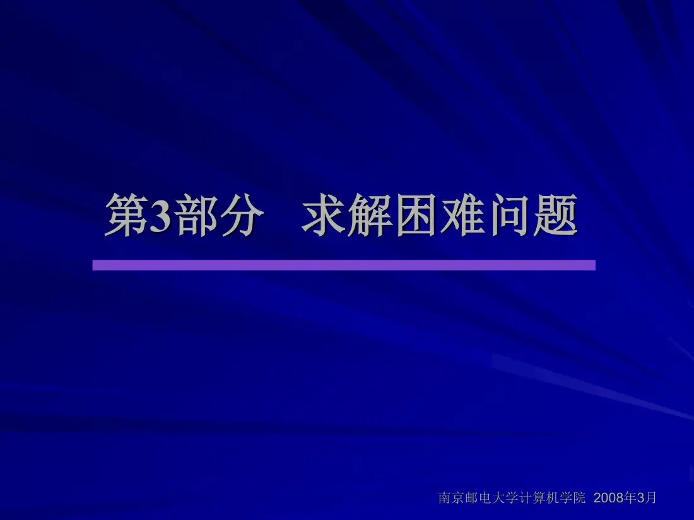

原文：

第3部分 求解困难问题

南京邮电大学计算机学院 2008年3月

### 第12章 近似算法

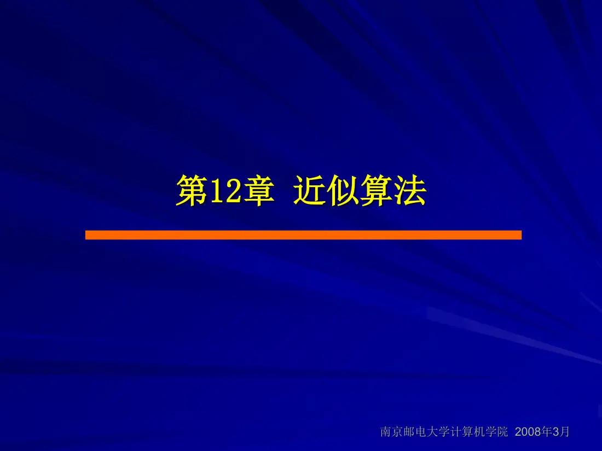

原文：

第12章 近似算法

南京邮电大学计算机学院 2008年3月

### 12.1 近似算法的性能

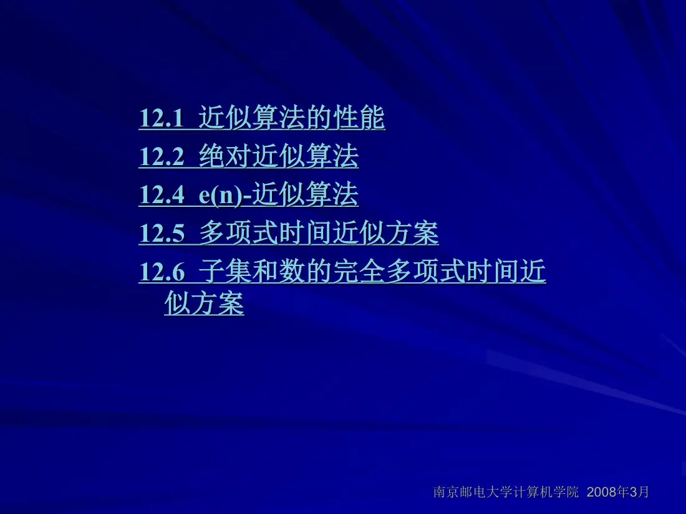

原文：

12.1 近似算法的性能

12.2 绝对近似算法

12.4 e(n)-近似算法

12.6 子集和数的完全多项式时间近似方案

南京邮电大学计算机学院 2008年3月

### 12.1 近似算法的性能

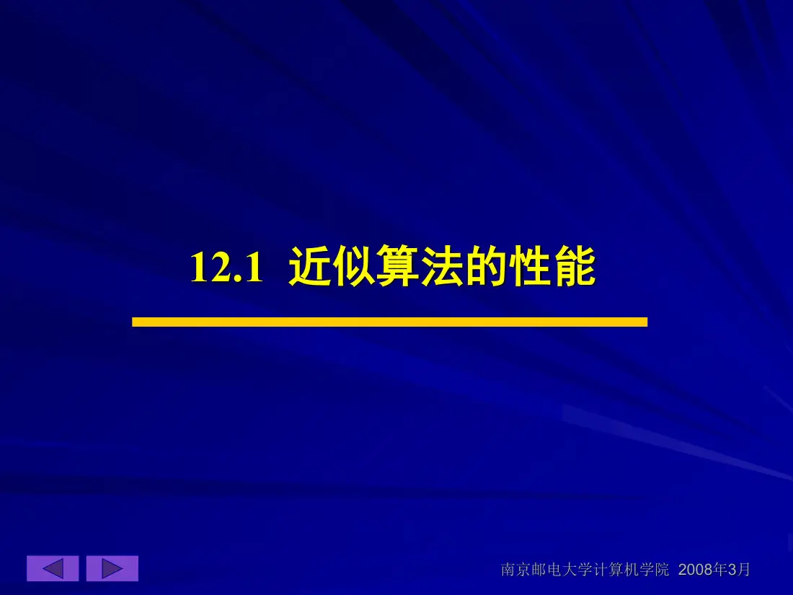

原文：

12.1 近似算法的性能

△

南京邮电大学计算机学院 2008年3月

### 12.1.1 基本概念

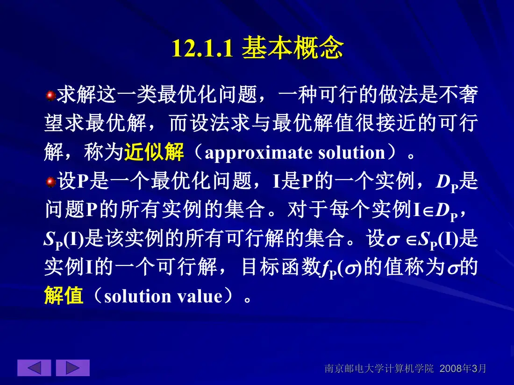

原文：

12.1.1 基本概念

求解这一类最优化问题，一种可行的做法是不奢望求最优解，而设法求与最优解值很接近的可行解，称为近似解（approximate solution）。设P是一个最优化问题，I是P的一个实例， $1 0 \%$ 是问题P的所有实例的集合。对于每个实例 $\lVert \mathbf { r } \rVert _ { \mathbf { V } } = \lVert \mathbf { \Delta } \rVert$ $\textcircled { \bullet } \textcircled { = } \textcircled { = } \textcircled { \bullet }$ 是该实例的所有可行解的集合。设 $\textcircled { \bullet } \textcircled { = } \textcircled { \bullet } \textcircled { = } \textcircled { \bullet }$ 是实例I的一个可行解，目标函数 $l \hbar ( 0 )$ 的值称为的解值（solution value）。

南京邮电大学计算机学院 2008年3月

### 南京邮电大学计算机学院 2008年3月

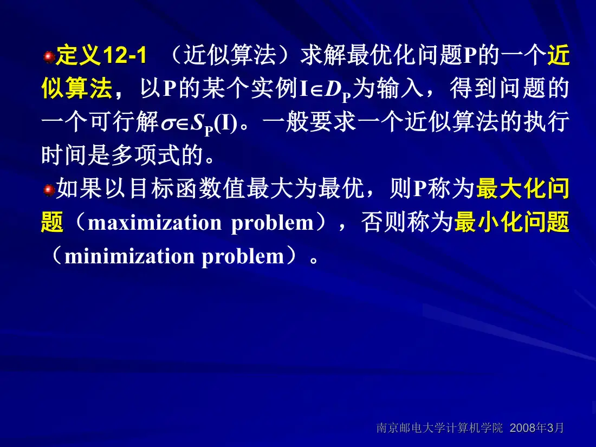

原文：

定义12-1 （近似算法）求解最优化问题P的一个近似算法，以P的某个实例 $1 1 \div b \cdots 1$ 为输入，得到问题的一个可行解 $( \bullet x = \mathbb { N } ) ( 0 )$ 。一般要求一个近似算法的执行时间是多项式的。

如果以目标函数值最大为最优，则P称为最大化问题（maximization problem），否则称为最小化问题（minimization problem）。

南京邮电大学计算机学院 2008年3月

### 南京邮电大学计算机学院 2008年3月

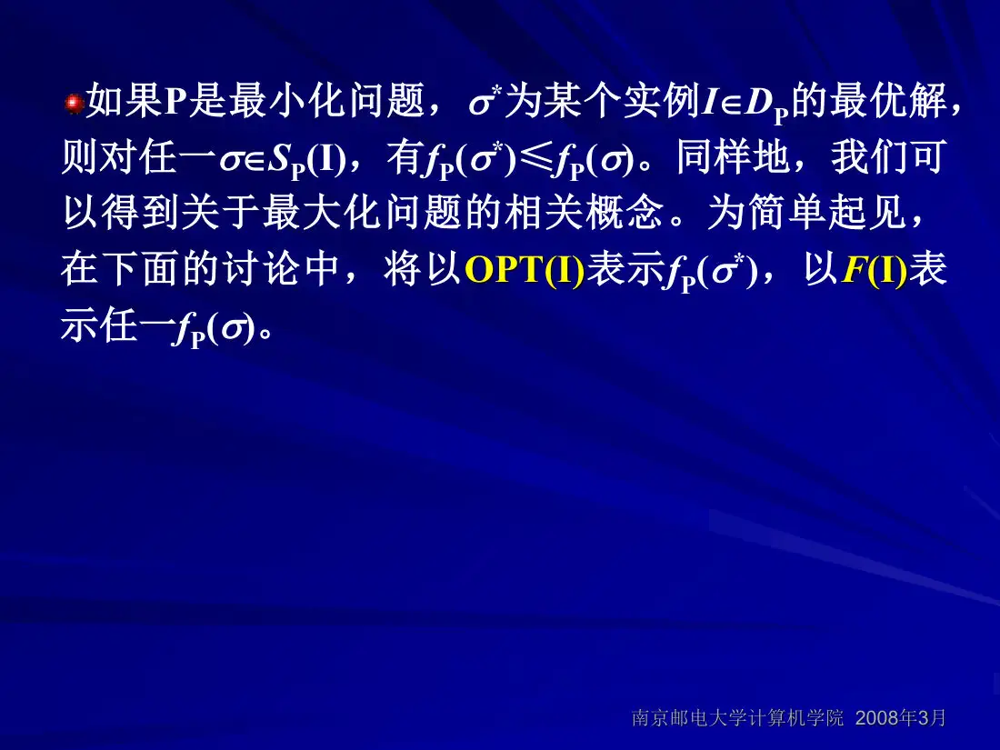

原文：

如果P是最小化问题， $\odot$ 为某个实例 $1 1 \equiv 1 0$ 的最优解，则对任一 $( \bullet \mathbf { x } \equiv \mathbf { A } ) ( \bullet \mathbf { D } )$ $1 / \frac { 1 } { 1 2 } ( 0 . 0 ) \times 1 / \frac { 1 } { 1 2 } ( 0 . 0 )$ 同样地，我们可以得到关于最大化问题的相关概念。为简单起见，在下面的讨论中，将以OPT(I)表示 $1 1 0 0$ 以F(I)表示任 $1 \frac { 4 } { 1 2 } \textcircled { < }$

南京邮电大学计算机学院 2008年3月

### 12.1.2 绝对性能保证

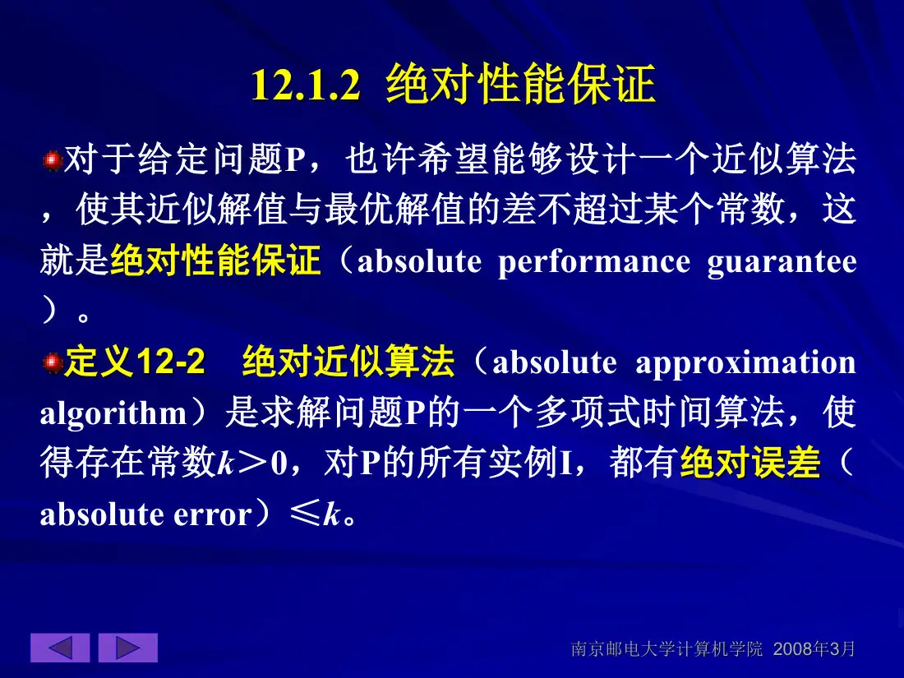

原文：

12.1.2 绝对性能保证

对于给定问题P，也许希望能够设计一个近似算法使其近似解值与最优解值的差不超过某个常数，这就是绝对性能保证（absolute performance guarantee

定义12-2 绝对近似算法（absolute approximationalgorithm）是求解问题P的一个多项式时间算法，使得存在常数k＞0，对P的所有实例I，都有绝对误差absolute error）≤k。

南京邮电大学计算机学院 2008年3月

### 例12-1 设图G=(V, E)是一个平面图，确定对图G着色的最少颜色数。

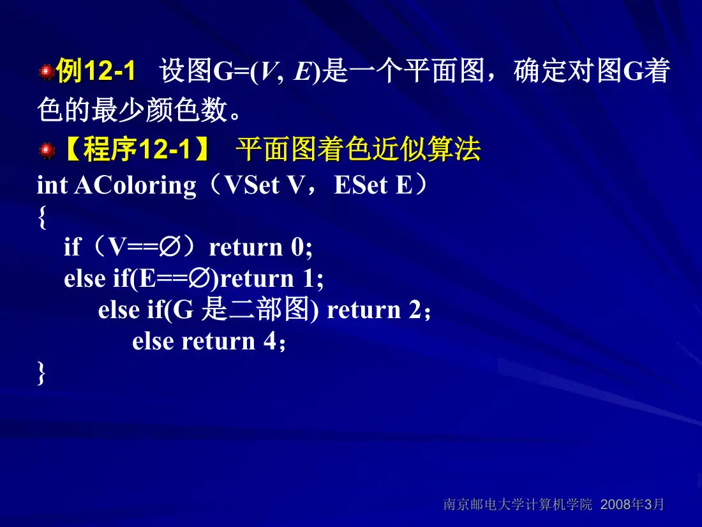

原文：

例12-1 设图G=(V, E)是一个平面图，确定对图G着色的最少颜色数。

【程序12-1】 平面图着色近似算法int AColoring（VSet V，ESet E）

if（V==）return 0;else if(E==)return 1;else if(G 是二部图) return 2；else return 4；

南京邮电大学计算机学院 2008年3月

### 南京邮电大学计算机学院 2008年3月

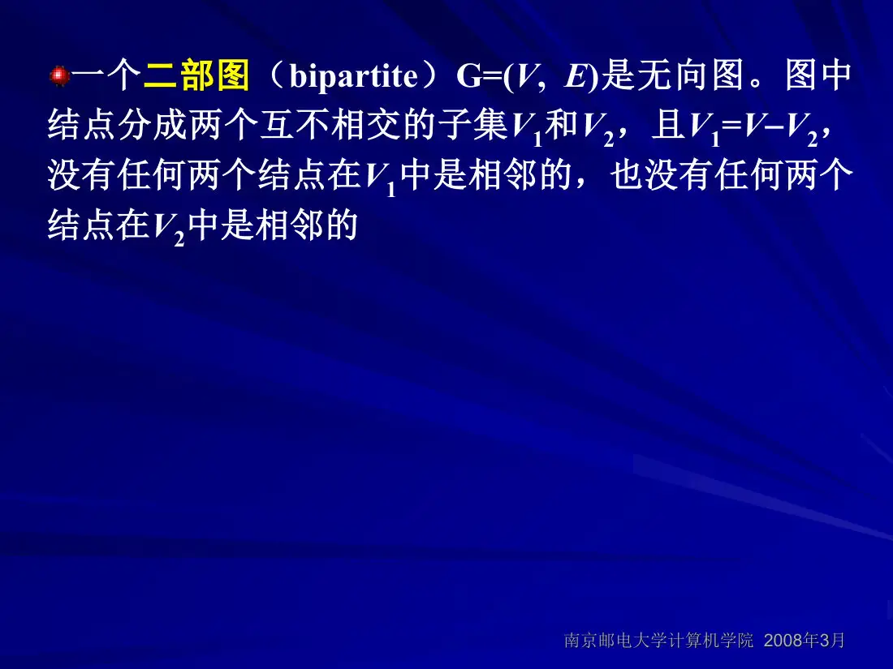

原文：

一个二部图（bipartite）G=(V, E)是无向图。图中结点分成两个互不相交的子集V和V，且V=V−V，没有任何两个结点在V中是相邻的，也没有任何两个结点在V中是相邻的

南京邮电大学计算机学院 2008年3月

### 12.1.3 相对性能保证

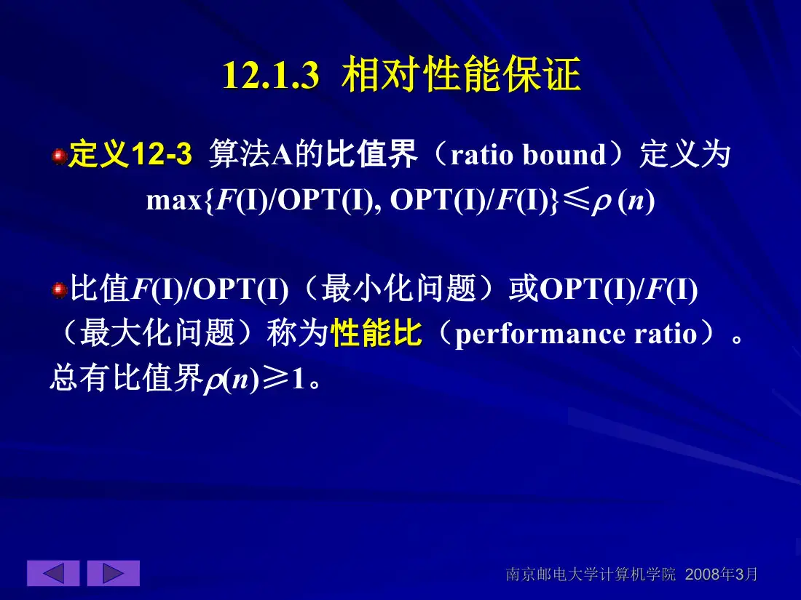

原文：

12.1.3 相对性能保证

定义12-3 算法A的比值界（ratio bound）定义为max{F(I)/OPT(I), OPT(I)/F(I)}≤ (n)

比值F(I)/OPT(I)（最小化问题）或OPT(I)/F(I)（最大化问题）称为性能比（performance ratio）总有比值界(n)≥1。

南京邮电大学计算机学院 2008年3月

### 南京邮电大学计算机学院 2008年3月

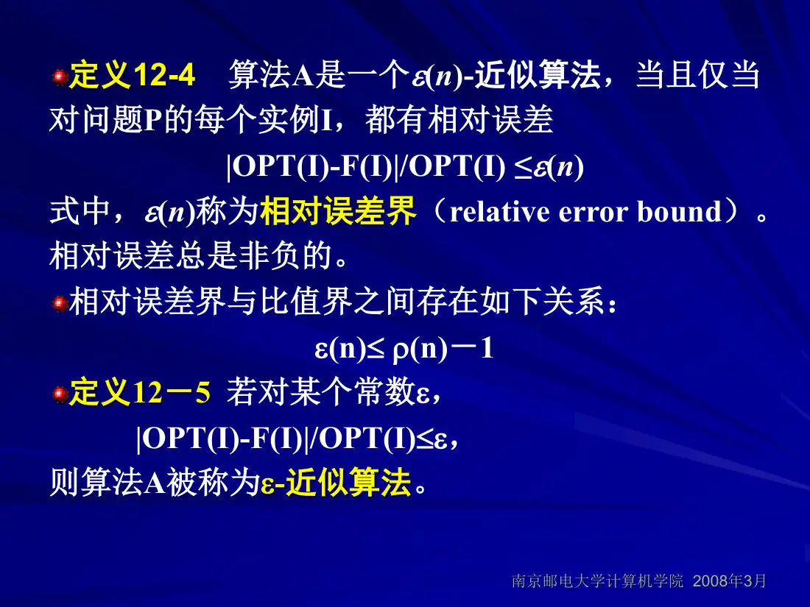

原文：

定义12-4 算法A是一个(n)-近似算法，当且仅当对问题P的每个实例I，都有相对误差$[ 0 ] \because [ ( 1 0 ) > ( 1 0 ) > ( 0 ) > ( 1 0 ) > ( 0 ) > ( 0 0 ) > ( 0 0 )$ 式中，(n)称为相对误差界（relative error bound）相对误差总是非负的。相对误差界与比值界之间存在如下关系：ε(n)≤ρ(n)−1定义12－5 若对某个常数，|OPT(I)-F(I)|/OPT(I)≤ε,则算法A被称为-近似算法。

南京邮电大学计算机学院 2008年3月

### 12.1.4 近似方案

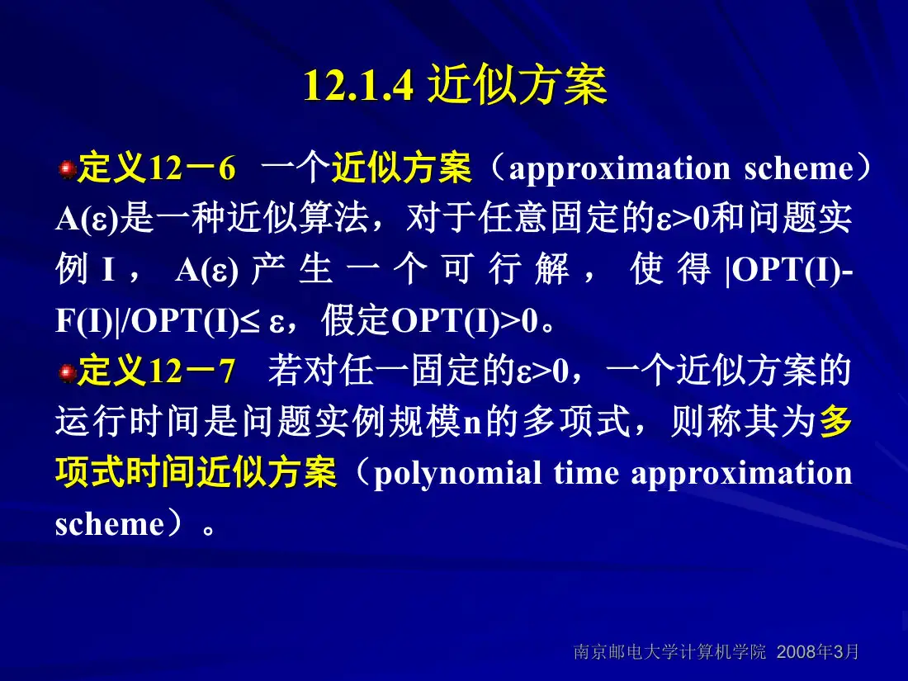

原文：

12.1.4 近似方案

定义12－6 一个近似方案（approximation scheme）A(ε)是一种近似算法，对于任意固定的ε>0和问题实例 I ， A() 产 生 一 个 可 行 解 ， 使 得 |OPT(I)-F(I)|/OPT(I)≤ε，假定OPT(I)>0。定义12－7 若对任一固定的>0，一个近似方案的运行时间是问题实例规模n的多项式，则称其为多项式时间近似方案（polynomial time approximationscheme）。

南京邮电大学计算机学院 2008年3月

### 南京邮电大学计算机学院 2008年3月

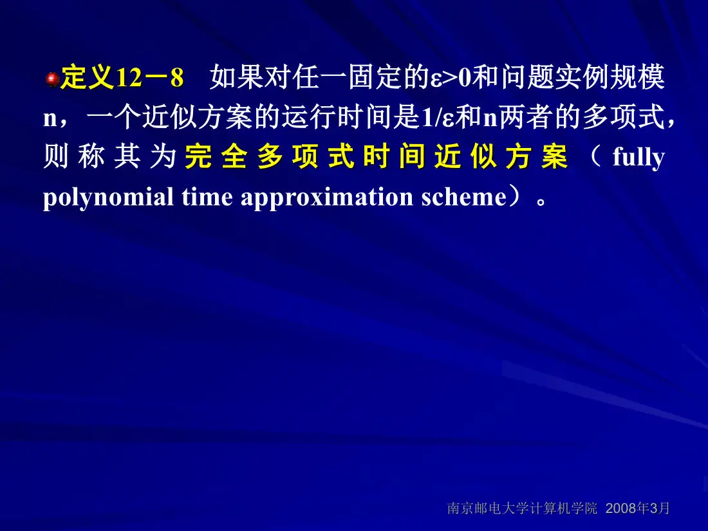

原文：

定义12－8 如果对任一固定的>0和问题实例规模n，一个近似方案的运行时间是1/和n两者的多项式，则 称 其 为 完 全 多 项 式 时 间 近 似 方 案 （ fullypolynomial time approximation scheme）。

南京邮电大学计算机学院 2008年3月

### 12.2 绝对近似算法

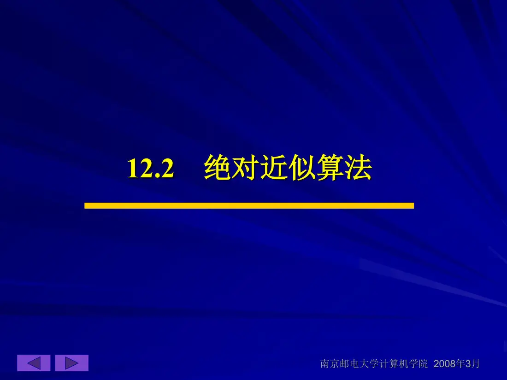

原文：

12.2 绝对近似算法

△

南京邮电大学计算机学院 2008年3月

### 12.2.1 最多程序存储问题

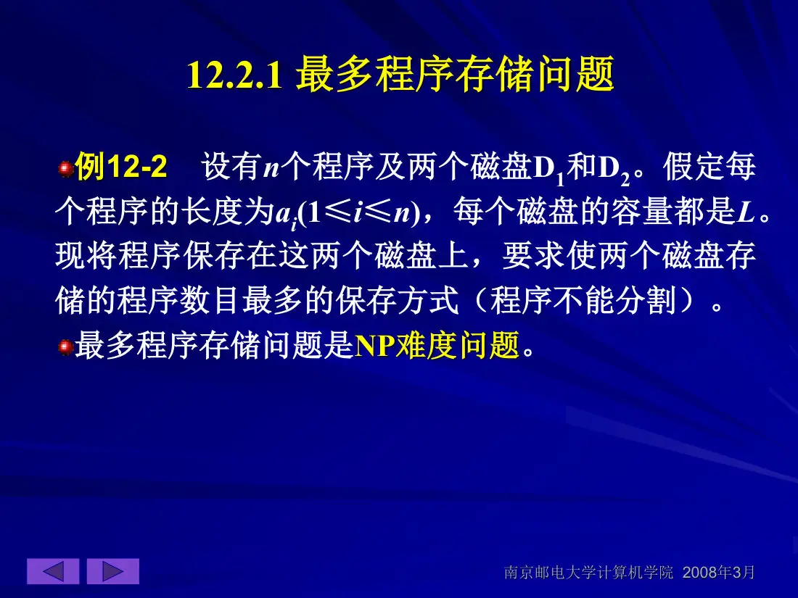

原文：

12.2.1 最多程序存储问题

例12-2 设有n个程序及两个磁盘 $\textcircled { 1 } \textcircled { 2 } \textcircled { 5 } \textcircled { 1 } \textcircled { 1 }$ 。假定每个程序的长度为 $\angle A B E = \angle B A C$ ，每个磁盘的容量都是L。现将程序保存在这两个磁盘上，要求使两个磁盘存储的程序数目最多的保存方式（程序不能分割）。最多程序存储问题是NP难度问题。

南京邮电大学计算机学院 2008年3月

### L=T，ai=ei，1≤i≤n

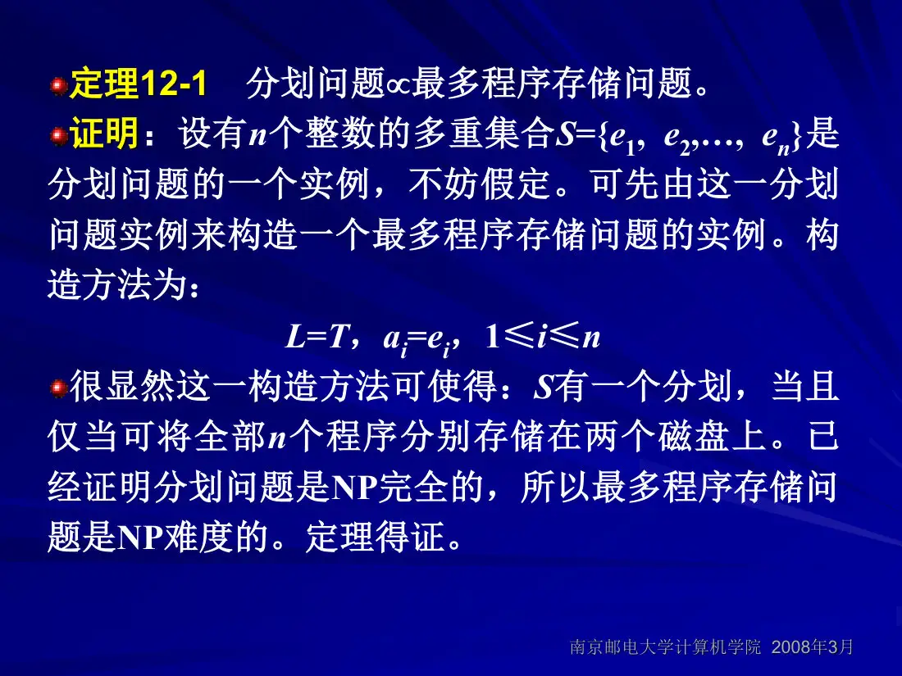

原文：

定理12-1 分划问题最多程序存储问题。证明：设有n个整数的多重集合S={e , e ,…, e }是分划问题的一个实例，不妨假定。可先由这一分划问题实例来构造一个最多程序存储问题的实例。构造方法为：

L=T，ai=ei，1≤i≤n

很显然这一构造方法可使得：S有一个分划，当且仅当可将全部n个程序分别存储在两个磁盘上。已经证明分划问题是NP完全的，所以最多程序存储问题是NP难度的。定理得证。

南京邮电大学计算机学院 2008年3月

### 求解最多程序存储问题的绝对近似算法。算法描述如下:

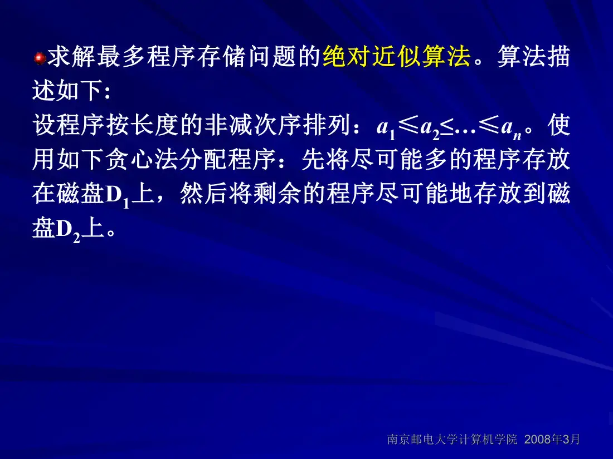

原文：

求解最多程序存储问题的绝对近似算法。算法描述如下:

设程序按长度的非减次序排列： $( 1 5 ) \div ( 1 5 ) = ( 1 5 )$ 。使用如下贪心法分配程序：先将尽可能多的程序存放在磁盘 $\textcircled { 1 }$ 上，然后将剩余的程序尽可能地存放到磁盘 $\textcircled { 1 }$ 上。

南京邮电大学计算机学院 2008年3月

### 南京邮电大学计算机学院 2008年3月

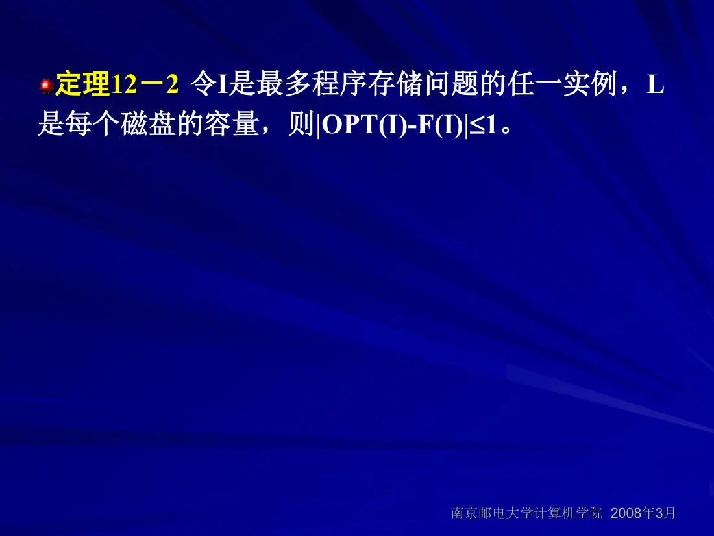

原文：

定理12－2 令I是最多程序存储问题的任一实例，L是每个磁盘的容量，则|OPT(I)-F(I)|1。

南京邮电大学计算机学院 2008年3月

### 南京邮电大学计算机学院 2008年3月

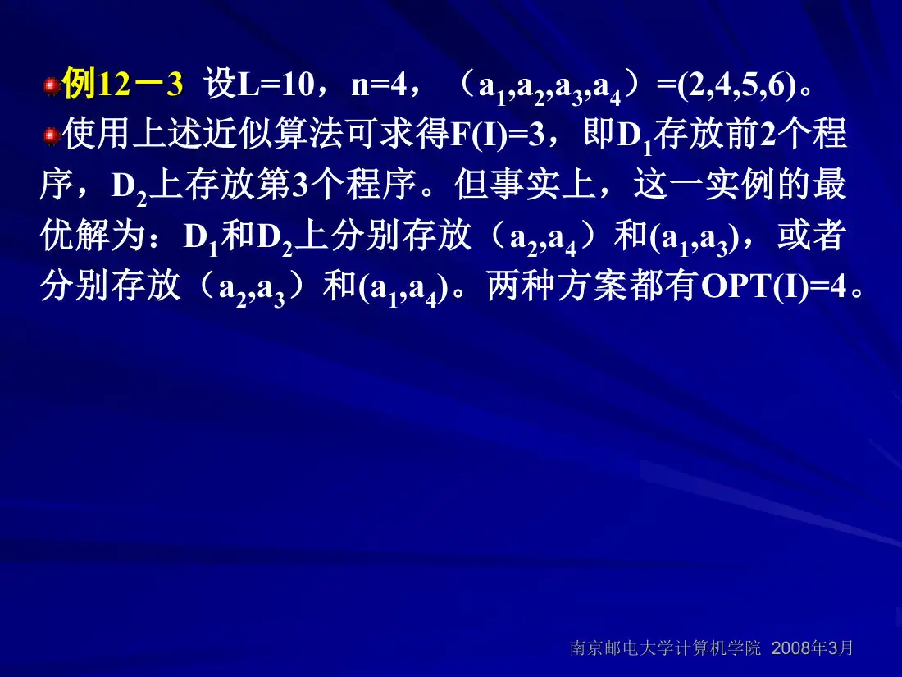

原文：

例12－3 设L=10， $\boxed { 1 } \boxed { \begin{array} { r l } \end{array} }$ $( 1 5 , 1 2 , 1 3 , 1 5 , 2 ) = ( 1 5 , 1 5 , 1 2 ) =$ 使用上述近似算法可求得F(I)=3，即 $\textcircled { 1 }$ 存放前2个程序， $\textcircled { 1 }$ 上存放第3个程序。但事实上，这一实例的最优解为： $\textcircled { 1 }$ 和 $\textcircled { 1 }$ 上分别存放 $\textcircled { 4 } \textcircled { > } \textcircled { > } \textcircled { > }$ 和 $( \mathbf { e } , \mathbf { \vec { e } } , \mathbf { \vec { e } } )$ 或者分别存放 $\textcircled { 4 } \textcircled { > } \textcircled { < } \textcircled { > }$ 和 $( \Theta \mathbb { P } ^ { 1 } )$ 。两种方案都有 $\textcircled { 9 } \div \textcircled { 1 } \textcircled { 1 1 } = \textcircled { 4 }$

南京邮电大学计算机学院 2008年3月

### 12.2.2 NP难度绝对近似算法

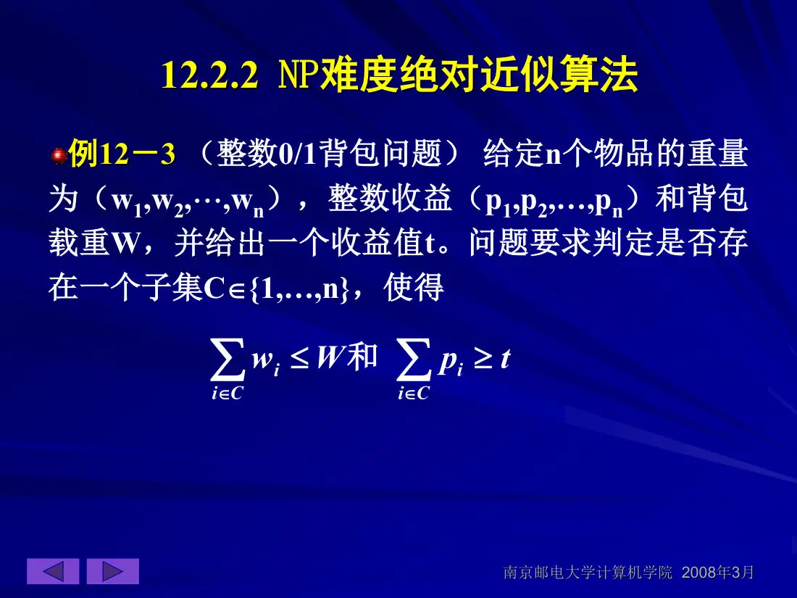

原文：

12.2.2 NP难度绝对近似算法

例12－3 （整数0/1背包问题） 给定n个物品的重量为 $( \cos \angle A ) ^ { \prime } = \frac { 1 } { 2 } \cos \angle A = \frac { 1 } { 2 } \sin \angle B$ ，整数收益 $( \textcircled { 1 } \textcircled { 2 } \textcircled { 1 } \textcircled { 2 } \textcircled { 2 } \textcircled { 2 } \textcircled { 2 } \textcircled { 1 } \textcircled { 2 } \textcircled { 1 }$ 和背包载重W，并给出一个收益值t。问题要求判定是否存在一个子集 $\mathbf  \langle \bullet \mathbf { / = } \mathbf { / \bullet } \mathbf { / \bullet } \mathbf { / \bullet } \mathbf { / \bullet } \mathbf { / \bullet } \mathbf { / } \mathbf { = } \mathbf { } \mathbf { / \bullet } \mathbf { / } \mathbf { / } \mathbf { = } \mathbf { } \mathbf { / } \mathbf { / } \mathbf { / } \mathbf { = } \mathbf { / } \mathbf { / } \mathbf { / } \mathbf { = } \mathbf { / } \mathbf { / } \mathbf { / } \mathbf { / } \mathbf { = } \mathbf { / } \mathbf { / } \mathbf { / } \mathbf { / } \mathbf { = } \mathbf { / } \mathbf { / } \mathbf { / } \mathbf { / } \mathbf { / }$ ，使得

$$
\sum_ {i \in C} w _ {i} \leq W \text {和} \quad \sum_ {i \in C} p _ {i} \geq t
$$

南京邮电大学计算机学院 2008年3月

### 南京邮电大学计算机学院 2008年3月

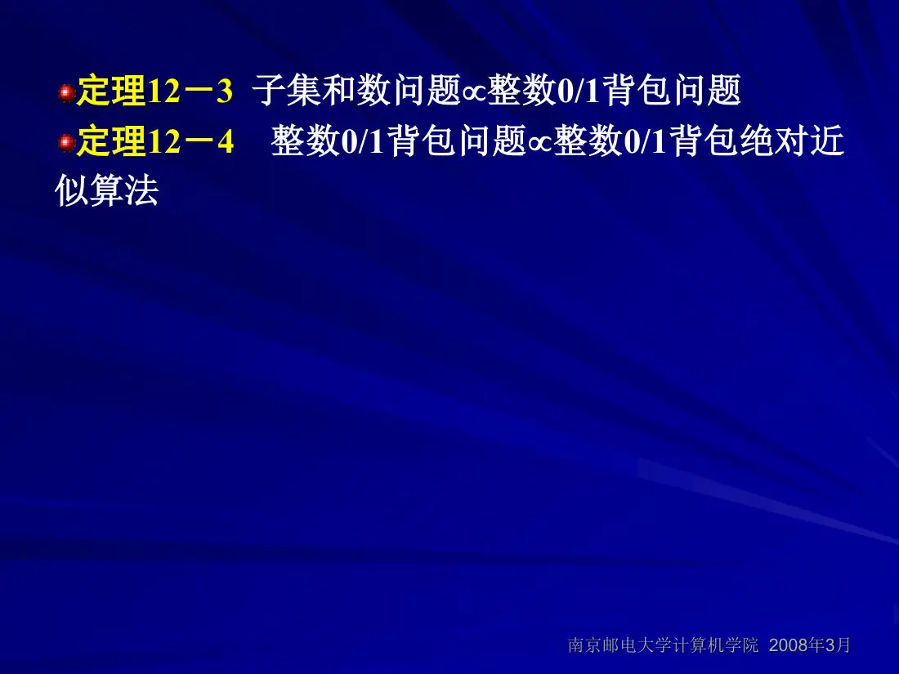

原文：

定理12－3 子集和数问题整数0/1背包问题定理12－4 整数0/1背包问题整数0/1背包绝对近似算法

南京邮电大学计算机学院 2008年3月

### 南京邮电大学计算机学院 2008年3月

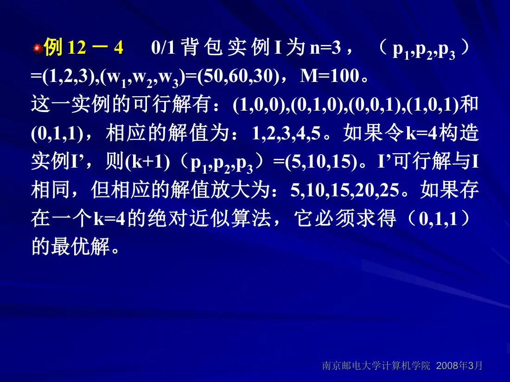

原文：

例 12 － 4 0/1 背 包 实 例 I 为 n=3 ， $1 2 0 \% = 1 2 0 \%$ $= ( 1 0 0 0 0 0 0 0 0 0 0 0 0 0 0 0 0 0 0 0 0 0 0 0 0 0 0 0 0 0 0 0 0 0 0 0 0 0 0 0 0 0 0 0 0 0 0 0 0 0 0 0 0 0 0 0 0 0 0 0 0 0 0 0 0 0 0 0 0 0 0 0 0 0 0 0 0 0 0 0 0 0 0 0 0 0 0 0 0 0 0 0 0 0 0 0 0 0 0 0 0 0 0 0 0 0 0 0 0 0 0 0 0 0 0 0 0 0 0 0 0 0$ 0这一实例的可行解有： $( | | X ( | \bar { X } | ) | ( | \bar { X } | | \bar { X } ( | ) | \bar { X } ( | | X | ) | \bar { X } ( | | X | ) )$ 和(0,1,1)，相应的解值为：1,2,3,4,5。如果令k=4构造实例I’，则 $( 1 , 5 , 1 ) ( 9 , 1 0 , 2 , 1 , 2 ) = ( 6 , 1 , 1 , 1 )$ 。I’可行解与I相同，但相应的解值放大为：5,10,15,20,25。如果存在一个k=4的绝对近似算法，它必须求得（0,1,1）的最优解。

南京邮电大学计算机学院 2008年3月

### 12.3 -近似算法

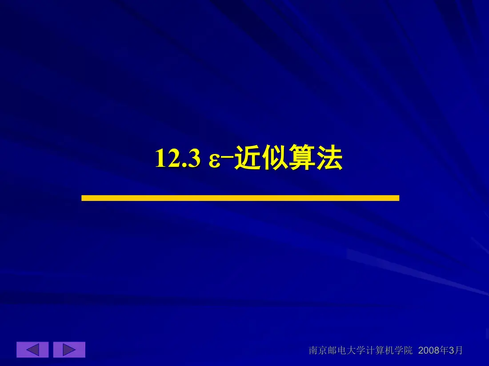

原文：

12.3 -近似算法

△

南京邮电大学计算机学院 2008年3月

### 12.3.1 顶点覆盖近似算法

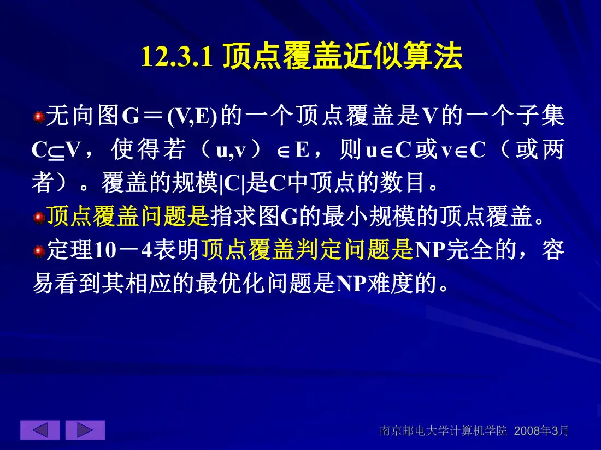

原文：

12.3.1 顶点覆盖近似算法

无向图 $\mathbf { \hat { \rho } } ( \mathbf { \hat { e } } = \mathbf { \hat { \rho } } ( \mathbf { \hat { \rho } } ( \mathbf { \hat { y } } ) )$ 的一个顶点覆盖是V的一个子集$\circledcirc$ ，使得若 $( 1 1 1 0 0 \times 2 ) = 1 0$ ，则 ${ \bf U } = { \bf G }$ 或 $\because \angle C = 1 0$ （或两者）。覆盖的规模|C|是C中顶点的数目。顶点覆盖问题是指求图G的最小规模的顶点覆盖。定理10－4表明顶点覆盖判定问题是NP完全的，容易看到其相应的最优化问题是NP难度的。

南京邮电大学计算机学院 2008年3月

### 南京邮电大学计算机学院 2008年3月

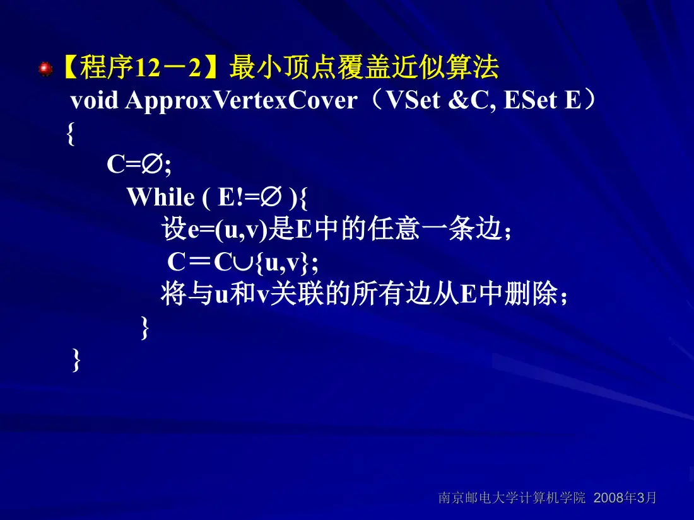

原文：

【程序12－2】最小顶点覆盖近似算法void ApproxVertexCover（VSet &C, ESet E）{

C=;While ( E!= ){设e=(u,v)是E中的任意一条边；C＝C{u,v};将与u和v关联的所有边从E中删除；

南京邮电大学计算机学院 2008年3月

### 图12一1 最小顶点覆盖集近似算法

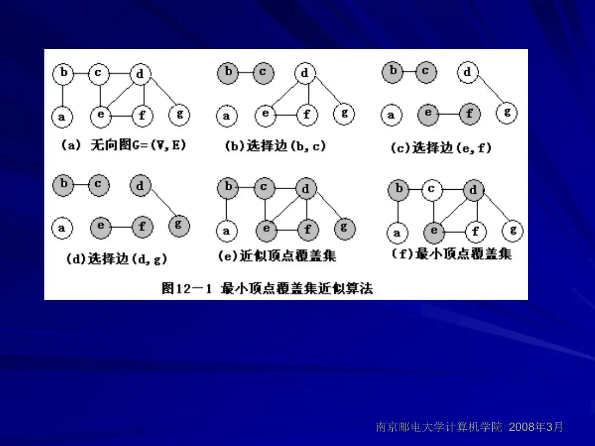

原文：

![(a) 无向图 $| G = [ \nabla , \mathbf { E } ]$](figure:43e6e0105c13a0dbdb82048b17ef983addfc7f4f47a606a08f4ceeba6c4933f5-0/cfc2e5ad3e5ff2fe18683af215a230cea899d6937a7ca8397daf950f8f1beabf.jpg)

图12一1 最小顶点覆盖集近似算法

南京邮电大学计算机学院 2008年3月

### 南京邮电大学计算机学院 2008年3月

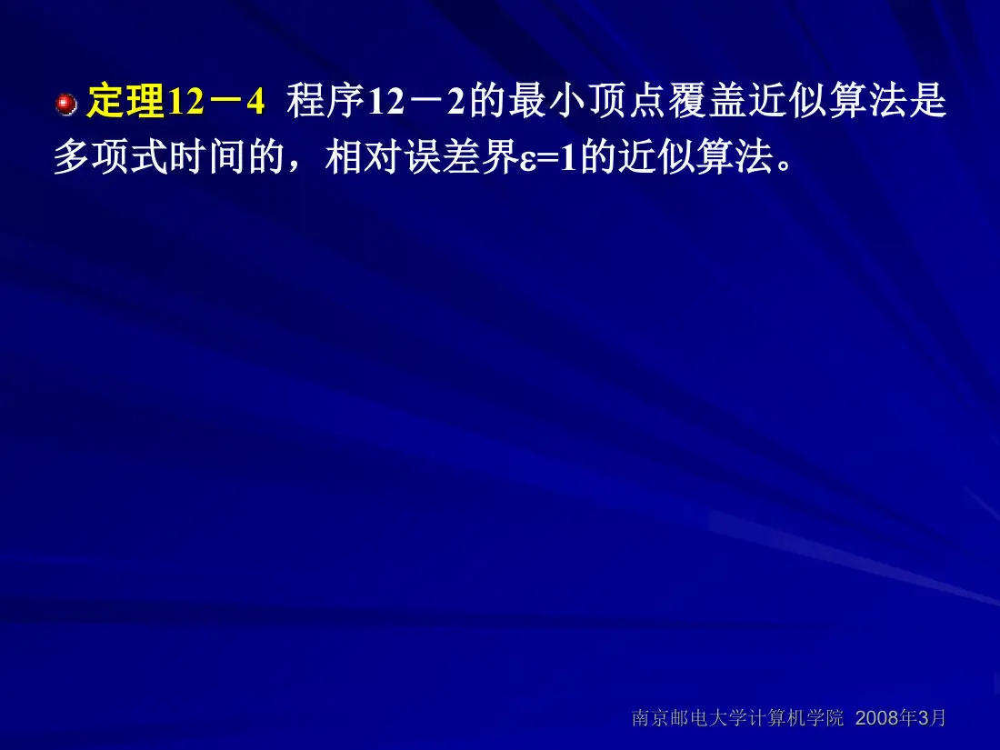

原文：

定理12－4 程序12－2的最小顶点覆盖近似算法是多项式时间的，相对误差界=1的近似算法。

南京邮电大学计算机学院 2008年3月

### 12.3.2 旅行商问题

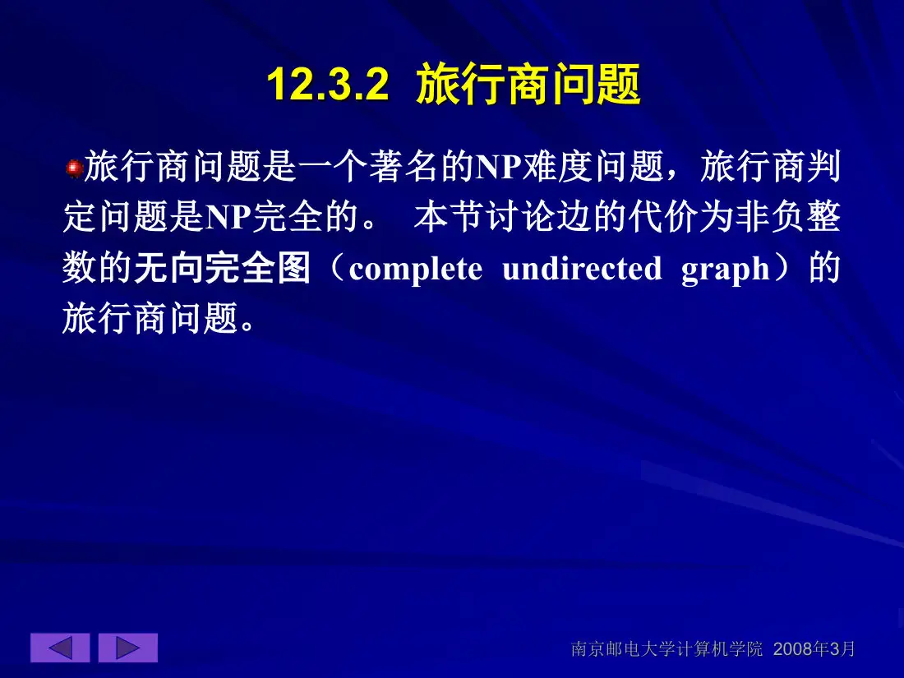

原文：

12.3.2 旅行商问题

旅行商问题是一个著名的NP难度问题，旅行商判定问题是NP完全的。 本节讨论边的代价为非负整数的无向完全图（complete undirected graph）的旅行商问题。

南京邮电大学计算机学院 2008年3月

### 南京邮电大学计算机学院 2008年3月

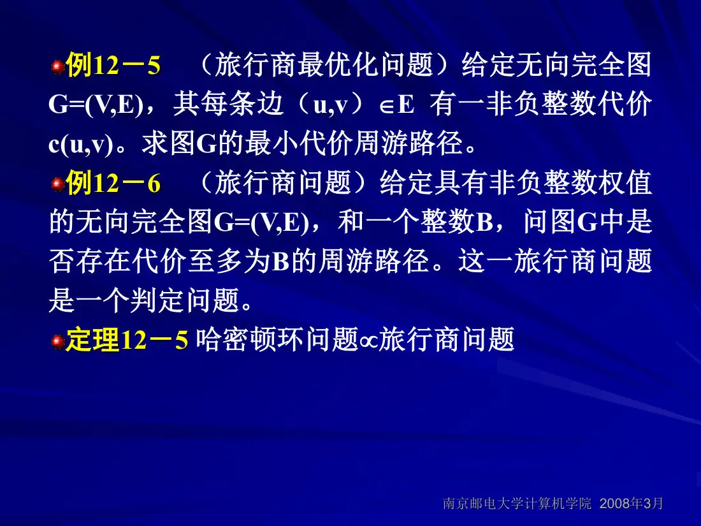

原文：

例12－5 （旅行商最优化问题）给定无向完全图$\textcircled { 6 } = \textcircled { 6 } \textcircled { 3 }$ 其每条边 $( \sin \alpha - \sin \alpha \cos \alpha + \sin \alpha \cos \alpha )$ 有一非负整数代价c(u,v)。求图G的最小代价周游路径。

例12－6 （旅行商问题）给定具有非负整数权值的无向完全图G=(V,E)，和一个整数B，问图G中是否存在代价至多为B的周游路径。这一旅行商问题是一个判定问题。

定理12－5 哈密顿环问题旅行商问题最近邻居算法（nearest neighbor algorithm）。算法描述如下：

南京邮电大学计算机学院 2008年3月

### （1） 任意选择一个结点为起始结点，访问之。

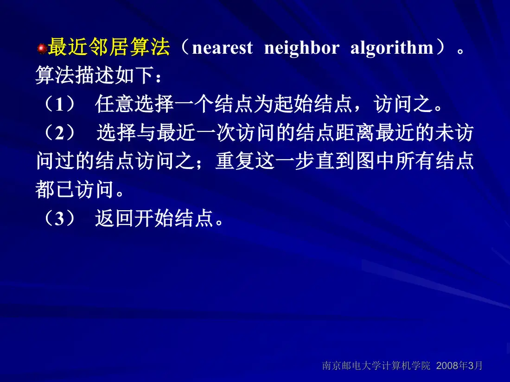

原文：

（1） 任意选择一个结点为起始结点，访问之。

（2） 选择与最近一次访问的结点距离最近的未访问过的结点访问之；重复这一步直到图中所有结点都已访问。

（3） 返回开始结点。

南京邮电大学计算机学院 2008年3月

### 南京邮电大学计算机学院 2008年3月

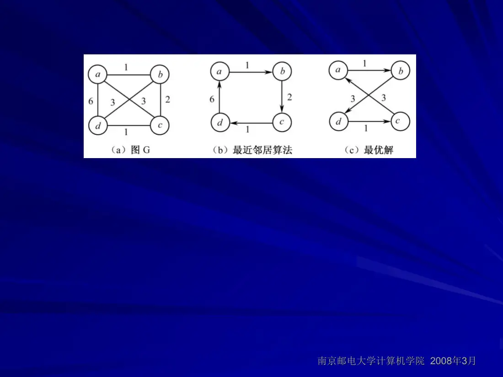

原文：

南京邮电大学计算机学院 2008年3月

### 12.3.3 NP难度-近似旅行商问题

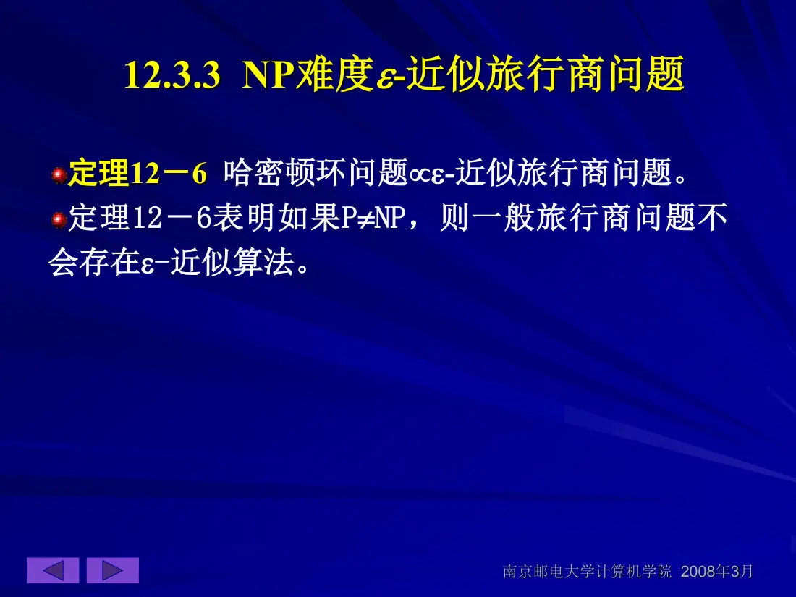

原文：

12.3.3 NP难度-近似旅行商问题

定理12一6哈密顿环问题∝ε-近似旅行商问题。定理12－6表明如果PNP，则一般旅行商问题不会存在-近似算法。

△

南京邮电大学计算机学院 2008年3月

### 12.3.4 具有三角不等式性质的旅行商问题

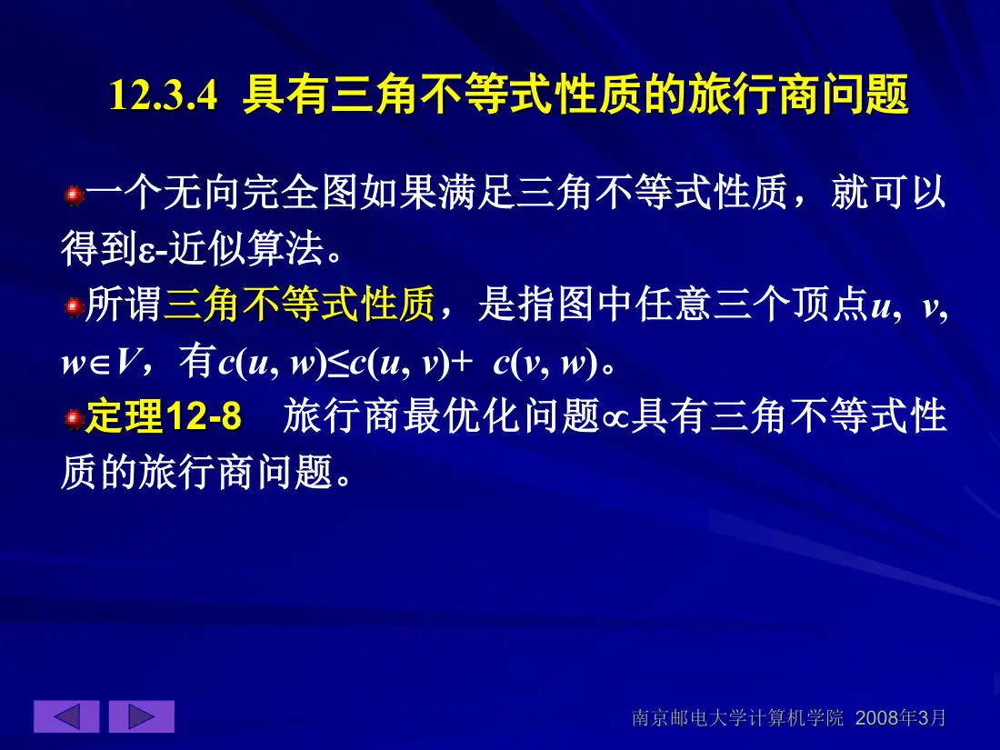

原文：

12.3.4 具有三角不等式性质的旅行商问题

一个无向完全图如果满足三角不等式性质，就可以得到-近似算法。

所谓三角不等式性质，是指图中任意三个顶点u, v,$x = 1 7$ 有 $\boxed { 6 } \boxed { ( 1 0 0 0 ) } = \boxed { 6 } \boxed { ( 1 0 0 ) } \boxed { 6 } \boxed { 1 2 } \boxed { 1 2 }$

定理12-8 旅行商最优化问题具有三角不等式性质的旅行商问题。

南京邮电大学计算机学院 2008年3月

### 南京邮电大学计算机学院 2008年3月

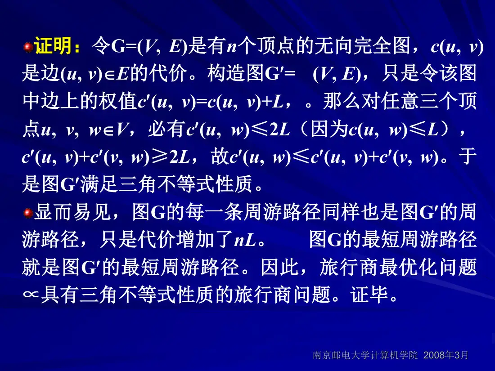

原文：

证明：令G=(V, E)是有n个顶点的无向完全图， $\mathbf { G } ( \mathbf { \mathfrak { u } } )$ 是边 $( 0 . 0 ) = 1 0$ 的代价。构造图 $\textcircled { 6 4 }$ 只是令该图中边上的权值 $\cos \angle C A C = \angle C A D = \angle C A C = 9 0 ^ { \circ }$ 。那么对任意三个顶点 $1 4 0 - 1 2 0 x = 1 4 0 0 - 1 2 0 x = 1 1 0$ 必有 $\rho ( U _ { 2 } ) \times 2 \phi / l ^ { 2 }$ （因为 $( \mathfrak { g } ( U _ { 2 } ) , 0 ) \lesssim 0 . 0 2$ $\angle C = \angle C = \angle C = \angle C = \angle C = \angle C$ 故 $( \angle C D ) = \angle C D = \angle C A D = 9 0 ^ { \circ }$ 于是图G满足三角不等式性质。显而易见，图G的每一条周游路径同样也是图G的周游路径，只是代价增加了nL。 图G的最短周游路径就是图G的最短周游路径。因此，旅行商最优化问题∝具有三角不等式性质的旅行商问题。证毕。

南京邮电大学计算机学院 2008年3月

### （1）构造图G的一棵最小代价生成树；

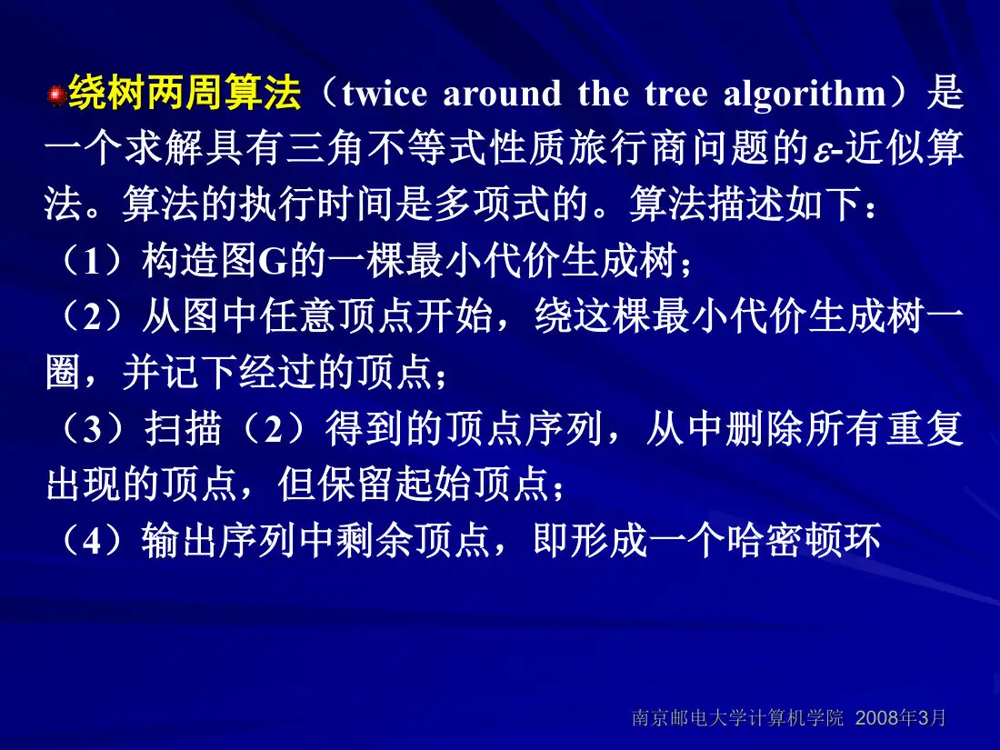

原文：

绕树两周算法（twice around the tree algorithm）是一个求解具有三角不等式性质旅行商问题的-近似算法。算法的执行时间是多项式的。算法描述如下：

（1）构造图G的一棵最小代价生成树；

（2）从图中任意顶点开始，绕这棵最小代价生成树圈，并记下经过的顶点；

（3）扫描（2）得到的顶点序列，从中删除所有重复出现的顶点，但保留起始顶点；

（4）输出序列中剩余顶点，即形成一个哈密顿环定理12-9 对于具有三角不等式性质的旅行商问题的图G，绕树两周算法的比值界为2。

南京邮电大学计算机学院 2008年3月

### 南京邮电大学计算机学院 2008年3月

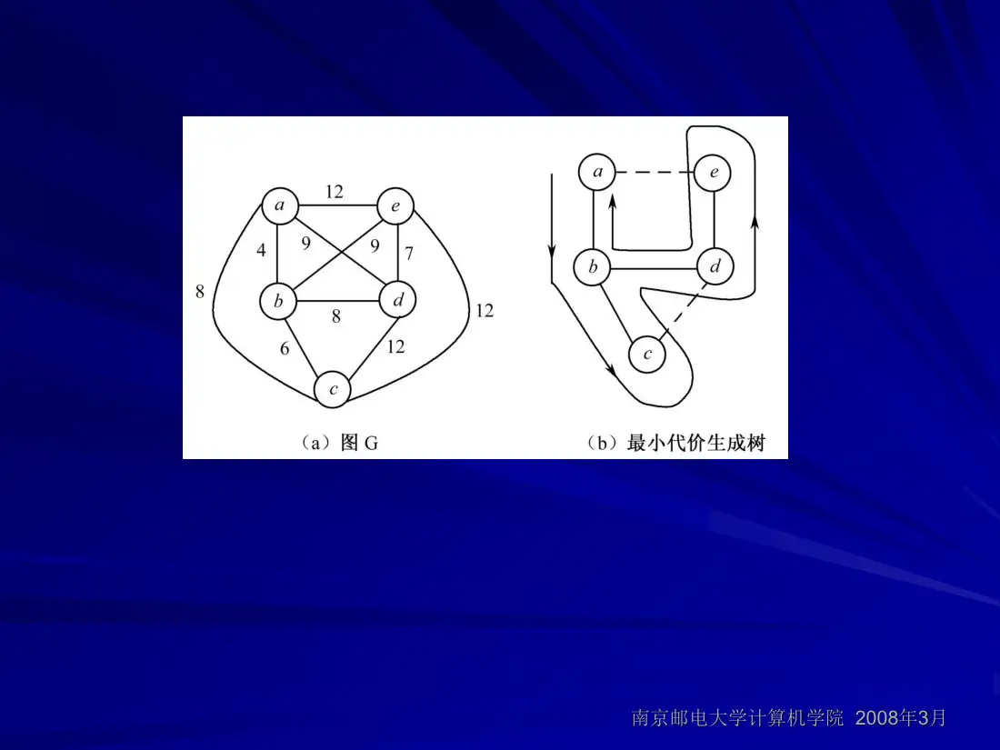

原文：

南京邮电大学计算机学院 2008年3月

### OPT(G)＞cost(G)

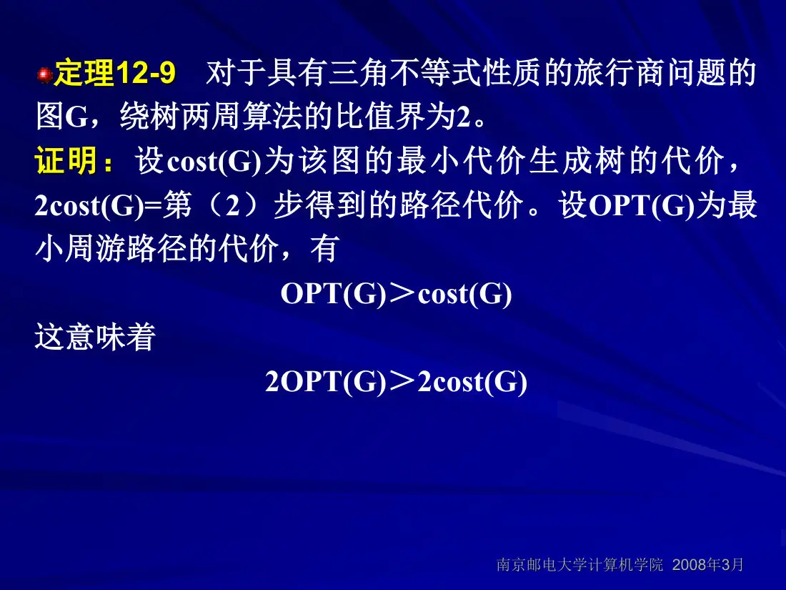

原文：

证明：设cost(G)为该图的最小代价生成树的代价，2cost(G)=第（2）步得到的路径代价。设OPT(G)为最小周游路径的代价，有

OPT(G)＞cost(G)

这意味着

2OPT(G)＞2cost(G)

南京邮电大学计算机学院 2008年3月

### 2cost(G)≥F(G)

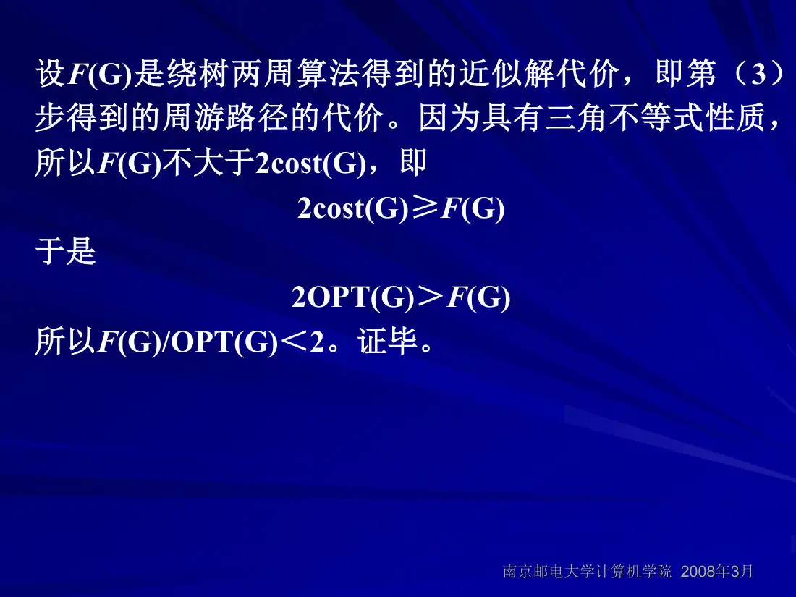

原文：

设F(G)是绕树两周算法得到的近似解代价，即第（3）步得到的周游路径的代价。因为具有三角不等式性质，所以F(G)不大于2cost(G)，即

2cost(G)≥F(G)

于是

2OPT(G)＞F(G)

所以F(G)/OPT(G)＜2。证毕。

南京邮电大学计算机学院 2008年3月

### 12.3.5 任务调度近似算法

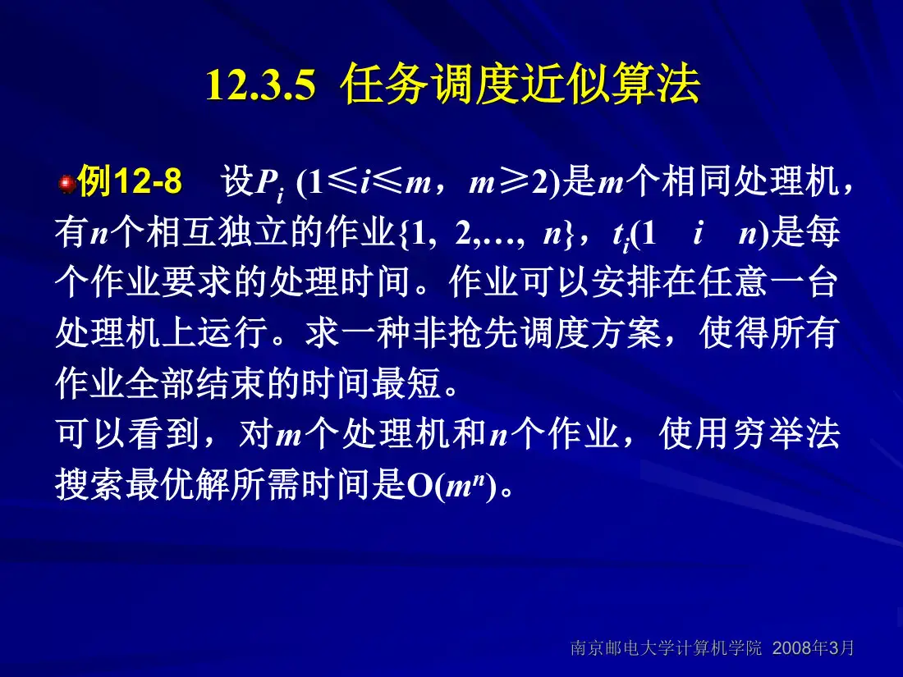

原文：

12.3.5 任务调度近似算法

例12-8 设P (1≤i≤m，m≥2)是m个相同处理机，有n个相互独立的作业{1, 2,…, n}， $1 \sqrt { 5 }$ i n)是每个作业要求的处理时间。作业可以安排在任意一台处理机上运行。求一种非抢先调度方案，使得所有作业全部结束的时间最短。可以看到，对m个处理机和n个作业，使用穷举法搜索最优解所需时间是 $\textcircled { 1 } \textcircled { 1 } \textcircled { 1 } \textcircled { 2 }$

南京邮电大学计算机学院 2008年3月

### 定理12-10 分划问题独立作业非抢先调度最小完成时间问题。

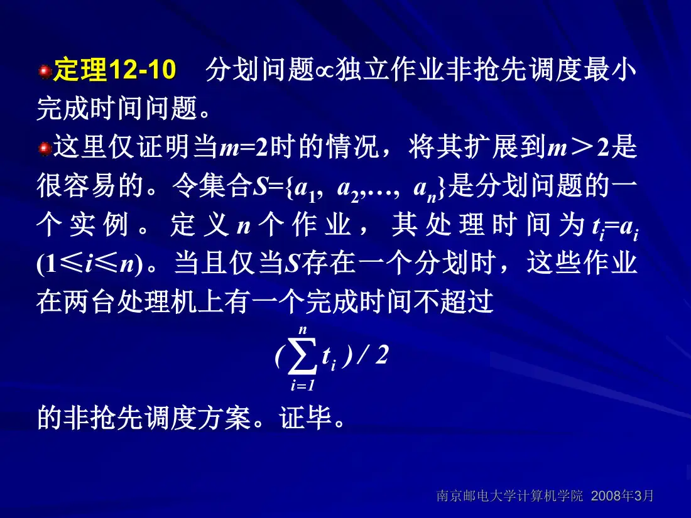

原文：

定理12-10 分划问题独立作业非抢先调度最小完成时间问题。

这里仅证明当m=2时的情况，将其扩展到m＞2是很容易的。令集合 $v = 1 0 0 0 0 0 0 c m / \min = 1 0 0 0 0 0 0 0 0 0 0 0 0 0 0 0 0 0 0 0 0 0 0 0 0 0 0 0 0 0 0 0 0 0 0 0 0 0 0 0 0 0 0 0 0 0 0 0 0 0 0 0 0 0 0 0 0 0 0 0 0 0 0 0 0 0 0 0 0 0 0 0 0 0 0 0 0 0 0 0 0 0 0 0 0 0 0 0 0 0 0 0 0 0 0 0 0 0 0 0 0 0 0 0 0 0 0 0 0 0 0 0 0 0 0 0 0 0 0 0 0 0 0 0 0 0 0 0 0 0 0 0 0 0 0 0 0 0 0 0 0 0 0 0 0 0 0 0 0 0 0 0 0 0 0 0 0 0 0 0 0 0 0 0 0 0 0 0 0 0 0 0 0 0 0 0 0 0 0 0 0 0 0 0 0 0 0 0 0 0 0 0 0 0 0 0 0 0 0 0 0 0 0 0 0 0 0 0 0 0 0 0 0 0 0 0 0 0 0 0 0 0 0 0 0 0 0 0 0 0 0 0 0 0 0 0 0 0 0 0 0 0 0 0 0 0 0 0 0 0 0 0 0 0 0 0 0 0 0 0 0 0 0 0 0 0 0 0 0 0 0 0 0 0 0 0 0 0 0 0 0 0 0 0 0 0 0 0 0 0 0 0 0 0 0 0 0 0 0 0 0 0 0 0 0 0 0 0 0 0 0 0 0 0 0 0 0 0 0 0 0 0 0 0 0 0 0 0 0 0 0 0 0 0 0 0 0 0 0 0 0 0 0 0 0 0 0 0 0 0 0 0 0 0 0 0 0 0 0 0 0 0 0 0 0 0 0 0 0 0 0 0 0 0 0 0 0 0 0 0 0 0 0 0 0 0 0 0 0 0 0 0 0 0 0 0 0 0 0 0 0 0 0 0 0 0 0 0 0 0 0 0 0 0 0 0 0 0 0 0 0 0 0 0 0 0 0 0 0 0 0 0 0 0 0 0 0 0 0 0 0 0 0 0 0 0 0 0 0 0 0 0 0 0 0 0 0 0 0 0 0 0 0 0 0 0 0 0 0 0 0 0 0 0 0 0 0 0 0 0 0 0 0 0 0 0 0 0 0 0 0 0 0 0 0 0 0 0 0 0 0 0 0 0 0 0 0 0 0 0 0 0 0 0 0 0 0 0 0 0 0 0 0 0 0 0 0 0 0 0 0 0 0 0 0 0 0 0 0 0 0 0 0 0 0 0 0 0 0 0 0 0 0 0 0 0 0 0 0 0 0 0 $ 是分划问题的一个 实 例 。 定 义 n 个 作 业 ， 其 处 理 时 间 为 t=a(1≤i≤n)。当且仅当S存在一个分划时，这些作业在两台处理机上有一个完成时间不超过

$$
(\sum_ {i = 1} ^ {n} t _ {i}) / 2
$$

的非抢先调度方案。证毕。

南京邮电大学计算机学院 2008年3月

### 此方案的近似算法：

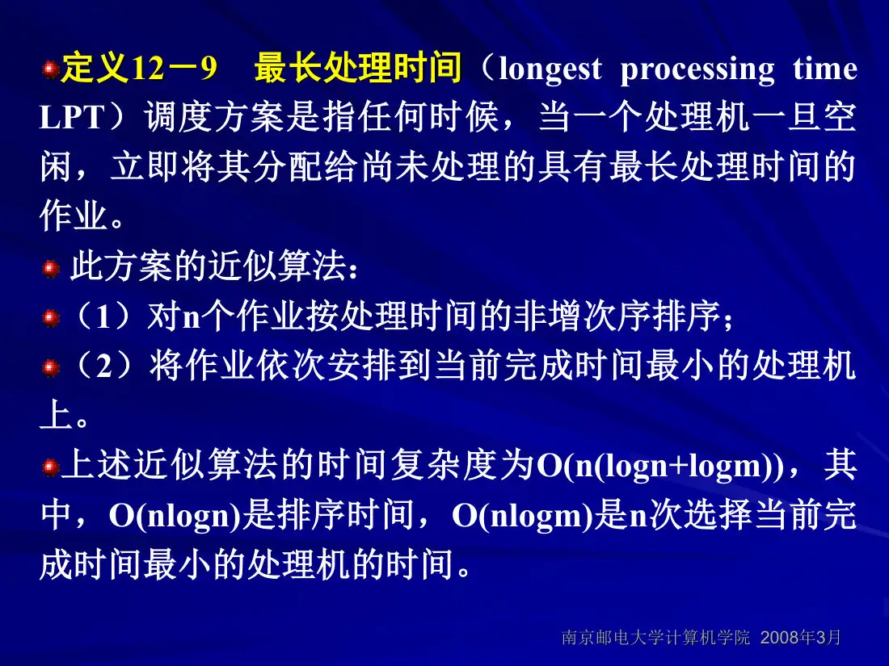

原文：

定义12－9 最长处理时间（longest processing timeLPT）调度方案是指任何时候，当一个处理机一旦空闲，立即将其分配给尚未处理的具有最长处理时间的作业。

此方案的近似算法：

（1）对n个作业按处理时间的非增次序排序；

（2）将作业依次安排到当前完成时间最小的处理机上。

上述近似算法的时间复杂度为O(n(logn+logm))，其中，O(nlogn)是排序时间，O(nlogm)是n次选择当前完成时间最小的处理机的时间。

南京邮电大学计算机学院 2008年3月

### (a)LPT 调度方案

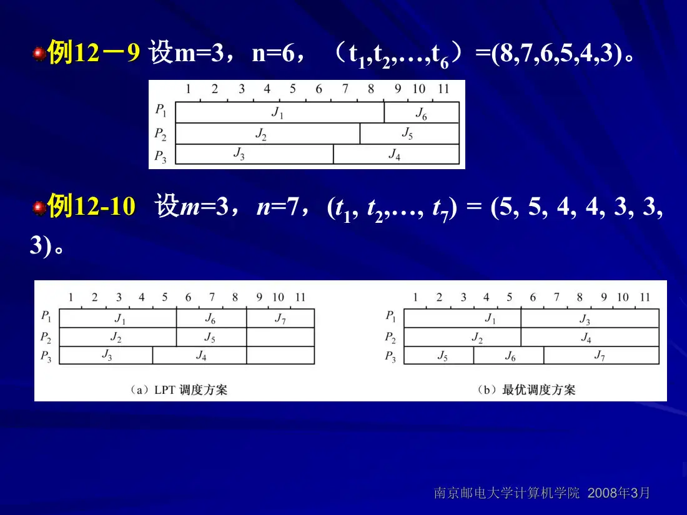

原文：

例12－9 设m=3，n=6， $( 1 7 , 1 3 , 1 3 , 1 3 , 1 5 , 1 5 , 1 5 , 1 5 )$ 。

<table><tr><td></td><td>1</td><td>2</td><td>3</td><td>4</td><td>5</td><td>6</td><td>7</td><td>8</td><td>9</td><td>10</td><td>11</td></tr><tr><td> $P_1$ </td><td colspan="8"> $J_1$ </td><td colspan="3"> $J_6$ </td></tr><tr><td> $P_2$ </td><td colspan="7"> $J_2$ </td><td colspan="4"> $J_5$ </td></tr><tr><td> $P_3$ </td><td colspan="6"> $J_3$ </td><td colspan="5"> $J_4$ </td></tr></table>

例12-10 设m=3， $\scriptstyle { \overline { { u } } } = { \overline { { u } } }$ $( \frac { 1 } { 1 0 0 } , \frac { 1 } { 1 0 0 } , \frac { 1 } { 1 0 0 } ) = ( \frac { 1 } { 1 0 0 } , \frac { 1 } { 1 0 0 } , \frac { 1 } { 1 0 0 } , \frac { 1 } { 1 0 0 } )$ 3)。

(a)LPT 调度方案
<table><tr><td></td><td>1</td><td>2</td><td>3</td><td>4</td><td>5</td><td>6</td><td>7</td><td>8</td><td>9</td><td>10</td><td>11</td></tr><tr><td> $P_1$ </td><td colspan="5"> $J_1$ </td><td colspan="3"> $J_6$ </td><td colspan="3"> $J_7$ </td></tr><tr><td> $P_2$ </td><td colspan="5"> $J_2$ </td><td colspan="3"> $J_5$ </td><td colspan="3"></td></tr><tr><td> $P_3$ </td><td colspan="3"> $J_3$ </td><td colspan="5"> $J_4$ </td><td colspan="3"></td></tr></table>

(b）最优调度方案
<table><tr><td></td><td>1</td><td>2</td><td>3</td><td>4</td><td>5</td><td>6</td><td>7</td><td>8</td><td>9</td><td>10</td><td>11</td></tr><tr><td> $P_1$ </td><td colspan="5"> $J_1$ </td><td colspan="6"> $J_3$ </td></tr><tr><td> $P_2$ </td><td colspan="5"> $J_2$ </td><td colspan="6"> $J_4$ </td></tr><tr><td> $P_3$ </td><td colspan="2"> $J_5$ </td><td colspan="4"> $J_6$ </td><td colspan="5"> $J_7$ </td></tr></table>

南京邮电大学计算机学院 2008年3月

### $$

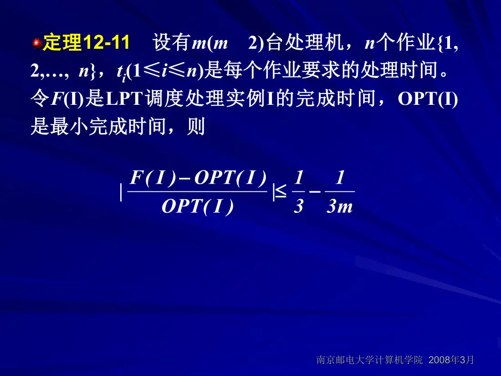

原文：

定理12-11 设有m(m 2)台处理机，n个作业{1,2,…, n}，t(1≤i≤n)是每个作业要求的处理时间。令F(I)是LPT调度处理实例I的完成时间，OPT(I)是最小完成时间，则

$$
\left| \frac {F (I) - O P T (I)}{O P T (I)} \right| \leq \frac {1}{3} - \frac {1}{3 m}
$$

南京邮电大学计算机学院 2008年3月

### 3m-1 4m-1

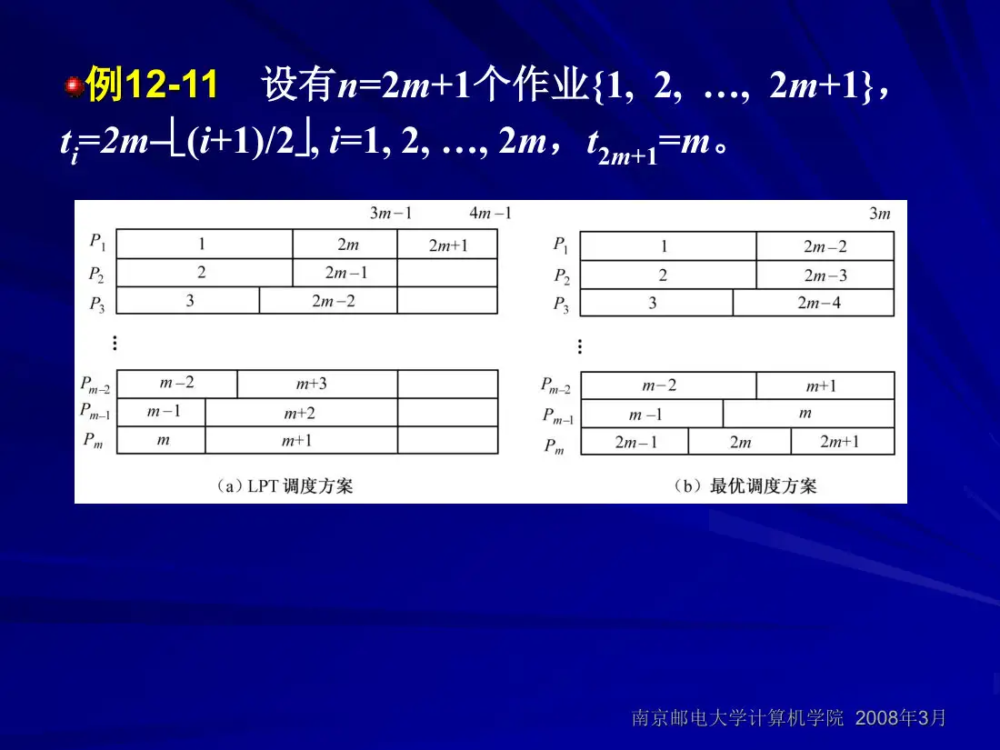

原文：

例12-11 设有n=2m+1个作业{1, 2, …, $2 4 0 5 5 0$ t=2m−L(i+1)/2], i=1, 2, .., 2m, $[ b m ] = [ 1 1 0$ o

3m-1 4m-1

<table><tr><td> $P_1$ </td><td colspan="2">1</td><td>2m</td><td>2m+1</td></tr><tr><td> $P_2$ </td><td colspan="2">2</td><td>2m-1</td><td></td></tr><tr><td> $P_3$ </td><td>3</td><td colspan="2">2m-2</td><td></td></tr></table>
3m

<table><tr><td> $P_1$ </td><td colspan="2">1</td><td>2m-2</td></tr><tr><td> $P_2$ </td><td colspan="2">2</td><td>2m-3</td></tr><tr><td> $P_3$ </td><td>3</td><td colspan="2">2m-4</td></tr></table>

<table><tr><td> $P_{m-2}$ </td><td colspan="2"> $m-2$ </td><td> $m+3$ </td><td></td></tr><tr><td> $P_{m-1}$ </td><td> $m-1$ </td><td colspan="2"> $m+2$ </td><td></td></tr><tr><td> $P_m$ </td><td> $m$ </td><td colspan="2"> $m+1$ </td><td></td></tr></table>
(a)LPT调度方案

<table><tr><td> $P_{m-2}$ </td><td colspan="3"> $m-2$ </td><td colspan="2"> $m+1$ </td></tr><tr><td> $P_{m-1}$ </td><td colspan="2"> $m-1$ </td><td colspan="3"> $m$ </td></tr><tr><td> $P_m$ </td><td> $2m-1$ </td><td colspan="3"> $2m$ </td><td> $2m+1$ </td></tr></table>
(b)最优调度方案

南京邮电大学计算机学院 2008年3月

### 12.4 (n)-近似算法

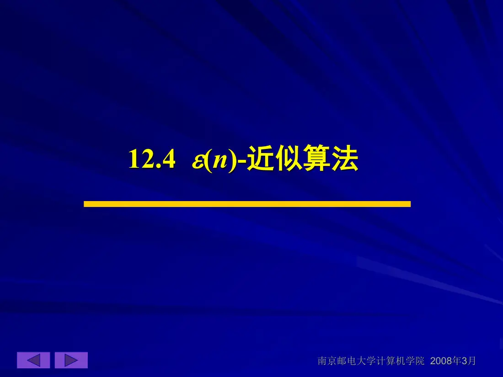

原文：

12.4 (n)-近似算法

△

南京邮电大学计算机学院 2008年3月

### 12.4.1 集合覆盖问题

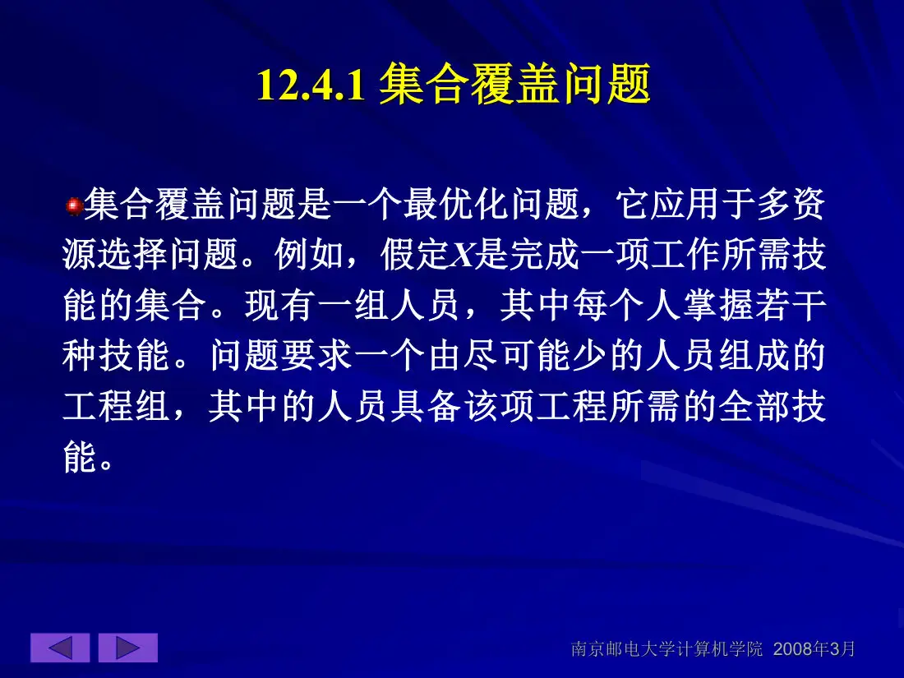

原文：

12.4.1 集合覆盖问题

集合覆盖问题是一个最优化问题，它应用于多资源选择问题。例如，假定X是完成一项工作所需技能的集合。现有一组人员，其中每个人掌握若干种技能。问题要求一个由尽可能少的人员组成的工程组，其中的人员具备该项工程所需的全部技能。

南京邮电大学计算机学院 2008年3月

### $$

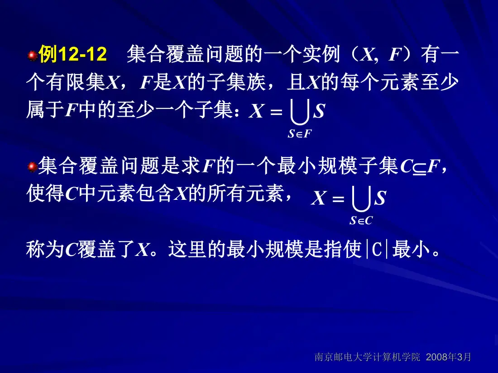

原文：

例12-12 集合覆盖问题的一个实例（X, F）有一个有限集X，F是X的子集族，且X的每个元素至少属于F中的至少一个子集：

$$
X = \bigcup_ {S \in F} S
$$

集合覆盖问题是求F的一个最小规模子集 $\textcircled { 4 } \textcircled { = } \textcircled { 2 }$ 使得C中元素包含X的所有元素，

$$
X = \bigcup_ {S \in C} S
$$

称为C覆盖了X。这里的最小规模是指使|C|最小。

南京邮电大学计算机学院 2008年3月

### 南京邮电大学计算机学院 2008年3月

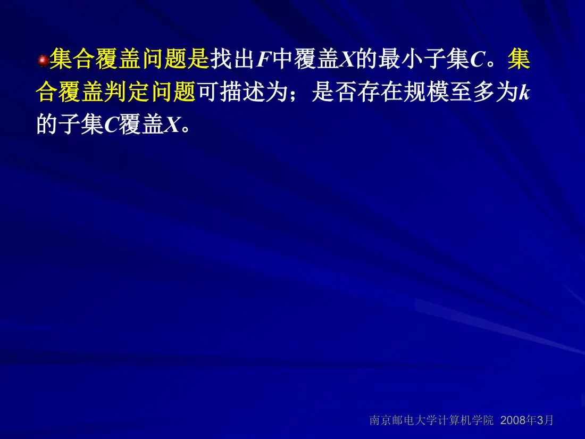

原文：

集合覆盖问题是找出F中覆盖X的最小子集C。集合覆盖判定问题可描述为；是否存在规模至多为k的子集C覆盖X。

南京邮电大学计算机学院 2008年3月

### abcS1defhS2igjS6klS3S4S5

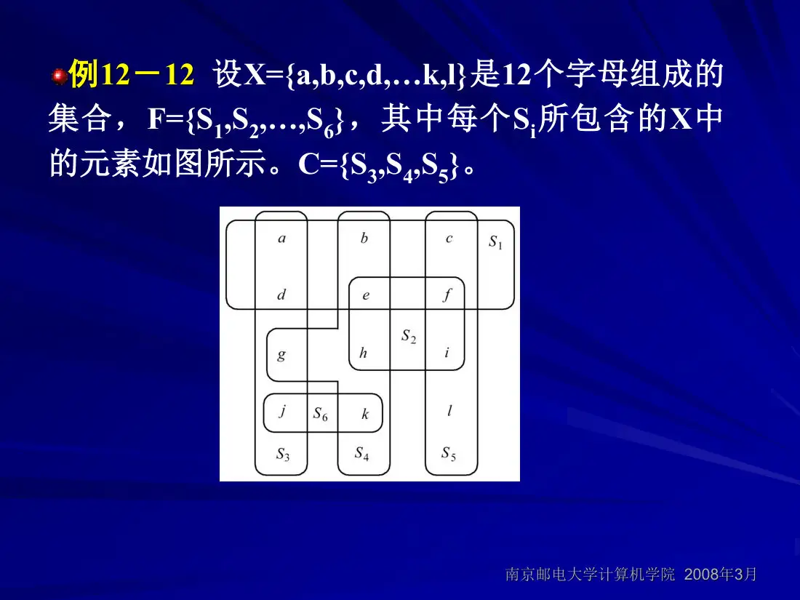

原文：

例12－12 设 $\therefore \angle B = \angle B = \angle C = \angle C = 9 0 ^ { \circ }$ 是12个字母组成的集合， $1 2 - 1 2 = 1 2$ 其中每个 $\mathfrak { G }$ 所包含的X中的元素如图所示。 $\textcircled { 4 } = \textcircled { 1 } \textcircled { 2 } \textcircled { 5 } \textcircled { 2 } \textcircled { 3 }$ 。

<table><tr><td></td><td>a</td><td></td><td>b</td><td></td><td>c</td><td>S1</td></tr><tr><td></td><td>d</td><td></td><td>e</td><td></td><td>f</td><td></td></tr><tr><td></td><td></td><td></td><td>h</td><td>S2</td><td>i</td><td></td></tr><tr><td></td><td>g</td><td></td><td></td><td></td><td></td><td></td></tr><tr><td></td><td>j</td><td>S6</td><td>k</td><td></td><td>l</td><td></td></tr><tr><td></td><td>S3</td><td></td><td>S4</td><td></td><td>S5</td><td></td></tr></table>

南京邮电大学计算机学院 2008年3月

### 定理12-12 顶点覆盖问题∝集合覆盖问题。

原文：

定理12-12 顶点覆盖问题∝集合覆盖问题。

南京邮电大学计算机学院 2008年3月

### 12.4.2 集合覆盖近似算法

原文：

12.4.2 集合覆盖近似算法

【程序12-3】 集合覆盖近似算法void SetCover(Set X, SetofSubset F,SetofSubset& C)

While (U!=){从F中选取使∩最大的子集S，并从F中删除；U=U-S;C=C∪{S}

南京邮电大学计算机学院 2008年3月

### 12.4.3 ln(n)-近似算法

原文：

12.4.3 ln(n)-近似算法

定义12-10 数列1,1/2,1/3,…称为调和级数。调和级数的前n项之和称为调和数，记做H(n)。

$$
H (n) = \sum_ {i = 1} ^ {n} \frac {1}{i} \leq \ln n + 1
$$

定理12-13 程序12-3的近似算法的比值界为

$$
H (\max _ {S \in F} \{| S | \})
$$

这是一个ln(n)-近似算法。

南京邮电大学计算机学院 2008年3月

### 12.5 多项式时间近似方案

原文：

12.5 多项式时间近似方案

△

南京邮电大学计算机学院 2008年3月

### 12.5.1 任务调度近似方案

原文：

12.5.1 任务调度近似方案

任务调度LPT多项式时间近似方案

（1）令k是某个给定的整数；

（2）对前k个处理时间最长的任务进行最优调度；

（3）使用LPT规则调度剩余的n-k个任务。

△

南京邮电大学计算机学院 2008年3月

### 南京邮电大学计算机学院 2008年3月

原文：

例12－13设m=2，n=6， $( \frac { 1 } { 1 0 } , \frac { 1 } { 1 0 } , \frac { 1 } { 1 0 } ) = ( \frac { 1 } { 1 0 } , \frac { 1 } { 1 0 } , \frac { 1 } { 1 0 } , \frac { 1 } { 1 0 } )$ ，k=4。前4个任务处理时间最长。

南京邮电大学计算机学院 2008年3月

### $$

原文：

定理12－12 设I是有m个处理机的调度问题实例。OPT(I)是I的最优调度的完成时间，F(I)是由上述调度规则所产生的调度方案的完成时间，则

$$
\frac {\left| O P T (I) - F (I) \right|}{O P T (I)} \leq \frac {1 - 1 / m}{1 + \lfloor k / m \rfloor}
$$

南京邮电大学计算机学院 2008年3月

### 12.5.2 多项式时间近似方案

原文：

12.5.2 多项式时间近似方案

根据定理12－12，可以构造上一小节描述的多项式时间的ε-近似的调度方案。这一方案以ε作为输入参数，使得对任意输入 ，它能够计算得到一个整数k，使得 $| | \nabla / | | | | \cdot | | | \cdot | | \cdot | | \cdot | | \cdot | | \cdot | | \cdot | | \cdot | |$

上述调度方案第（1）步的时间是O(1)，第（2）步可以采用分枝限界法实现，其时间为 $\textcircled { 4 } \textcircled { 1 1 1 }$ ，另考虑对n个任务按处理时间的非增次序排序所需的时间$\textcircled { 1 } \textcircled { 1 1 } \textcircled { 1 } \div \textcircled { 1 }$ ，总时间为 $\textcircled { 1 } \textcircled { 1 1 } \textcircled { 1 } \textcircled { 2 } \textcircled { 1 } \textcircled { 2 } \textcircled { 1 } \textcircled { 1 } \textcircled { 2 }$

南京邮电大学计算机学院 2008年3月

### 南京邮电大学计算机学院 2008年3月

原文：

第（3）步的时间是按LPT对n-k个任务进行调度所需时间，为$\mathrm { ( 0 ) } [ \mathrm { ( 1 ) } [ \mathrm { ( 1 ) } [ \mathrm { 0 } ] [ \mathrm { 0 } ] [ \mathrm { 0 } ] [ \mathrm { 0 } ] [ \mathrm { 0 } [ \mathrm { 0 } ] [ \mathrm { 0 } ] [ \mathrm { 0 } [ \mathrm { 0 } ] [ \mathrm { 0 } ] [ \mathrm { 0 } ] [ \mathrm { 0 } [ \mathrm { 0 } ] [ \mathrm { 0 } ] [ \mathrm { 0 } ] [ \mathrm { 0 } ] [ \mathrm { 0 } [ \mathrm { 0 } ] [ \mathrm { 0 } ] [ \mathrm { 0 } [ \mathrm { 0 } ] [ \mathrm { 0 } ] [ \mathrm { 0 } ] [ \mathrm { 0 } ] [ \mathrm { 0 } ] [ \mathrm { 0 } ] [ \mathrm { 0 } ] [ \mathrm { 0 } ] [ \mathrm { 0 } [ \mathrm { 0 } ] [ \mathrm { 0 } ] [ \mathrm { 0 } ] [ \mathrm { 0 } ] [ \mathrm { 0 } ] [ \mathrm { 0 } [ \mathrm { 0 } ] [ \mathrm { 0 } ] [ \mathrm { 0 } ] [ \mathrm { 0 } ] [ \mathrm { 0 } ] [ \mathrm { 0 } [ \mathrm { 0 } ] [ \mathrm { 0 } ] [ \mathrm { 0 } ] [ \mathrm { 0 } ] [ \mathrm { 0 } ] [ \mathrm { 0 } [ \mathrm { 0 } ] [ \mathrm { 0 } ] [ \mathrm { 0 } ] [ \mathrm { 0 } ] [ \mathrm { 0 } ] [ \mathrm { 0 } [ \mathrm { 0 } ] [ \mathrm { 0 } ] [ \mathrm { 0 } ] [ \mathrm { 0 } ] [ \mathrm { 0 } ] [ \mathrm { 0 } [ \mathrm { 0 } ] [ \mathrm { 0 } ] [ \mathrm { 0 } ] [ \mathrm { 0 } ] [ \mathrm { 0 } ] [ \mathrm { 0 } [ \mathrm { 0 } ] [ \mathrm { 0 } ] [ \mathrm { 0 } ] [ \mathrm { 0 } ] [ \mathrm { 0 } [ \mathrm { 0 } ] [ \mathrm { 0 } ] [ \mathrm { 0 } ] [ \mathrm { 0 } ] [ \mathrm { 0 } ] [ \mathrm { 0 } [ \mathrm { 0 } ] [ \mathrm { 0 } ] [ \mathrm { 0 } ] [ \mathrm { 0 } ] [ \mathrm { 0 } [ \mathrm { 0 } ] [ \mathrm { 0 } ] [ \mathrm { 0 } ] [ \mathrm { 0 } ] [ \mathrm { 0 } ] [ \mathrm { 0 } [ \mathrm  0 $ 所以是多项式时间的（n>>m）。如果k的选择使得 $| \nabla / | 1 0 | | \nabla | \cdot | \nabla | | \nabla | | \cdot | \nabla | | \cdot | \nabla | | \cdot | \nabla$ 则必有，所以，此近似调度方案是多项式时间近似方案，但不是完全多项式时间近似方案。这是因为对于固定的m，它的运行时间不是1/的多项式，而仅是n的多项式。

南京邮电大学计算机学院 2008年3月

### 12.6 完全多项式时间近似方案

原文：

12.6 完全多项式时间近似方案

△

南京邮电大学计算机学院 2008年3月

### 12.6.1 子集和数指数时间算法

原文：

12.6.1 子集和数指数时间算法

例12－14 设有n个正整数 $\textcircled { \div } \textcircled { \div } \textcircled { \div } \textcircled { \div } \textcircled { \div } \textcircled { \div } \textcircled { \div } \textcircled { \div } \textcircled { \div } \textcircled { \div } \textcircled { \div }$ 和正整数M，求S的一个子集使得子集中的数之和尽可能地大，但不超过M。这也是一种子集和数问题。

南京邮电大学计算机学院 2008年3月

### 南京邮电大学计算机学院 2008年3月

原文：

【程序12－4】子集和数算法int ExactSumofSubset(Set S,int M){//设每个Li]，1≤i≤n为有序表，共n个表，int n=|S|;L[0]={0}；for (int i=1;i<=n;i++){L[i]=Merge(L[i-1],L[i-1]+S[i]);删除L[i]中超过M的元素；}return max(L[n]);

南京邮电大学计算机学院 2008年3月

### $$

原文：

令P表示集合 $\lbrace \pm \frac { \sqrt { 3 } } { 2 } , \lbrace \pm \frac { \sqrt { 3 } } { 2 } , \pm \frac { \sqrt { 3 } } { 2 } \rbrace$ 所有可能的“子集和”组成的集合，即 $1 4$ 的一个元素是集合 $\lbrace \pm \frac { \sqrt { 3 } } { 2 } , \lbrace \pm \frac { \sqrt { 3 } } { 2 } , \pm \frac { \sqrt { 3 } } { 2 } \rbrace$ 的一个子集和。现约定空子集的子集和为0， $\bf { u } = \bf { u }$ 。使用数学归纳法不难证明：

$$
\mathrm{P} _ {\mathrm{i}} = \mathrm{P} _ {\mathrm{i-1}} \cup (\mathrm{P} _ {\mathrm{i-1}} + \mathrm{x} _ {\mathrm{i}}), \quad \mathrm{i} = 1, 2, \dots , \mathrm{n}
$$

例如，若 $S = \sqrt { 1 0 } = \sqrt { 2 }$ 则 P ={0}， P1={0,1}， P2={0,1,4,5}， P ={0,1,4,5,6,9,10}。

南京邮电大学计算机学院 2008年3月

### 12.6.2 完全多项式时间近似方案

原文：

12.6.2 完全多项式时间近似方案

【程序12－5】修正表L为新表List Trim(List L1, float ){//L1和L2均为有序表int m=|L1|；List L2＝(L1[1]);int z=L1[1];for (int i=2;i<=m;i++)if(z<(1-)\*L1[i]){将L1[i]加到表L2 的末尾； z=L1[i];

return L2;

南京邮电大学计算机学院 2008年3月

### 南京邮电大学计算机学院 2008年3月

原文：

【程序12－6】子集和数近似方案int ApproxSumofSubset(Set S,int M,float ){//设L[i]，1≤i≤n为表，共n个表，int n=|S|;L[0]={0}；for (int i=1;i<=n;i++){L[i]=Merge(L[i-1],L[i-1]+S[i]);L[i]=Trim(L[i],/n);删除L[i]中超过M的元素；return max(L[n]);

南京邮电大学计算机学院 2008年3月

### 表12-1例12-15的计算步骤

原文：

例12－15 设L=(104,102,201,101)，M＝308，＝0.20（δ=ε/4=0.05）。函数ApproxSumofSubset的计算过程见表12－1，函数返回302作为近似解值，它与最优解307之间的相对误差不超过=0.2。事实上这一实例的相对误差为（307－302）$V _ { A } ( 1 ) / = \Omega / \Omega / \Omega$

表12-1例12-15的计算步骤
<table><tr><td>循环变量I</td><td>步骤(1)</td><td>步骤(2)</td><td>步骤(3)</td></tr><tr><td>1</td><td>(0,104)</td><td>(0,104)</td><td>(0,104)</td></tr><tr><td>2</td><td>(0,102,104,206)</td><td>(0,102,206)</td><td>(0,102,206)</td></tr><tr><td>3</td><td>(0,102,201,206,303,407)</td><td>(0,102,201,303,407)</td><td>(0,102,201,303)</td></tr><tr><td>4</td><td>(0,101,102,201,203,302,303,404)</td><td>(0,101,201,302,404)</td><td>(0,101,201,302)</td></tr></table>

南京邮电大学计算机学院 2008年3月

### 南京邮电大学计算机学院 2008年3月

原文：

定理12－13 算法ApproxSumofSubset是关于子集和数问题的一个完全多项式时间近似方案。

南京邮电大学计算机学院 2008年3月
