# 《算法设计与分析》第1章 算法和算法分析（课件）

原件的每一页，下面附识别出的文字。

### 算法设计与分析

原文：

算法设计与分析

DeSign and Analysis of Algorithms In C++

陈慧南 编著

南京邮电大学计算机学院 2008年3月

“十一五”国家级规划教材

电子工业出版社

### 课程简介

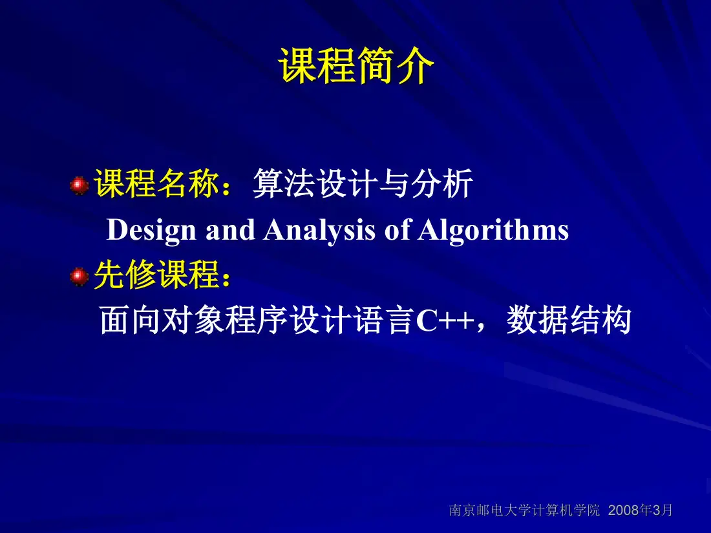

原文：

课程简介

课程名称：算法设计与分析

Design and Analysis of Algorithms

先修课程：

面向对象程序设计语言C++，数据结构

南京邮电大学计算机学院 2008年3月

### 第1部分 算法和算法分析

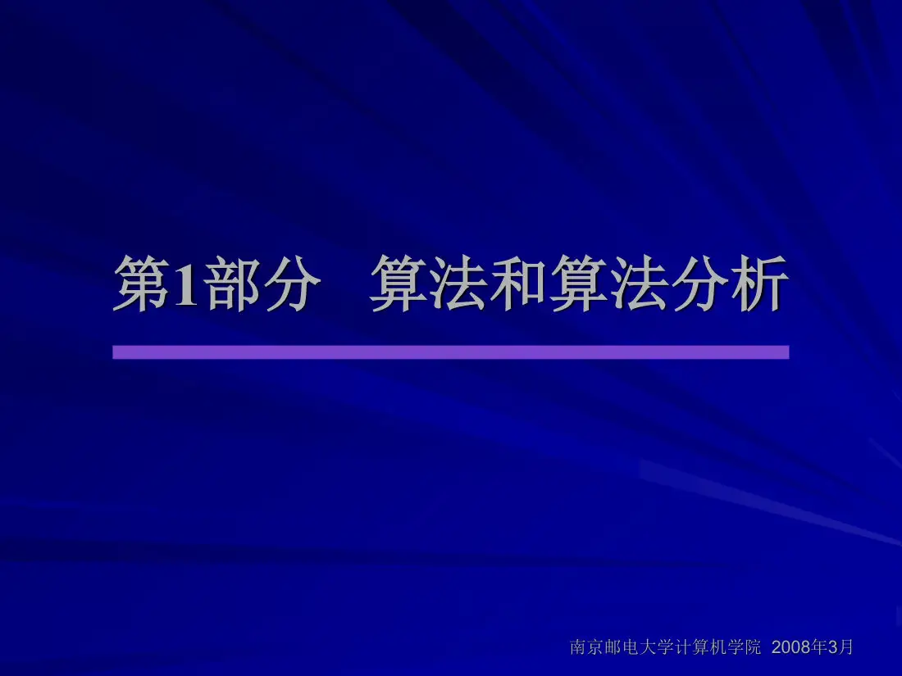

原文：

第1部分 算法和算法分析

南京邮电大学计算机学院 2008年3月

### 第1章 算法问题求解基础

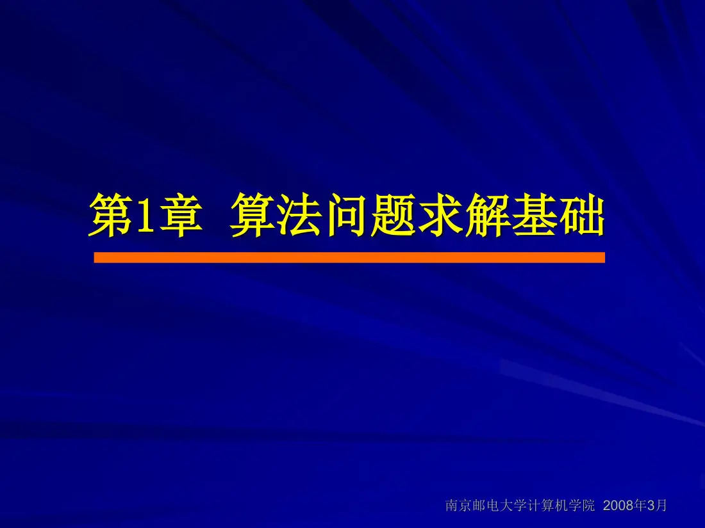

原文：

第1章 算法问题求解基础

南京邮电大学计算机学院 2008年3月

### 1.1 算法概述

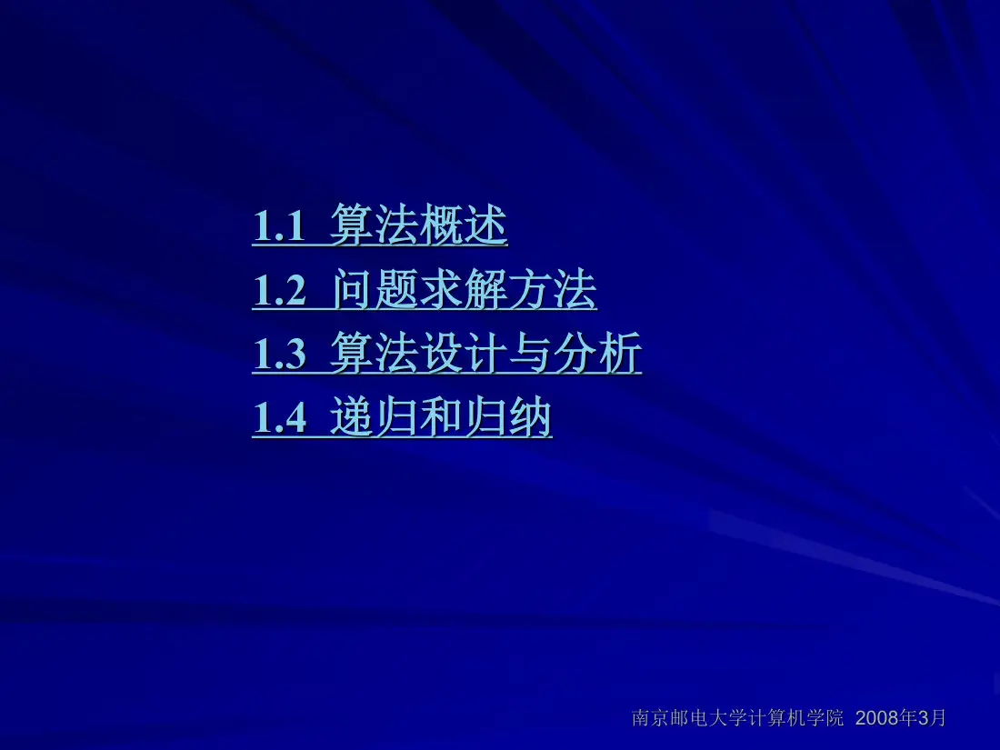

原文：

1.1 算法概述
1.2 问题求解方法
1.3 算法设计与分析
1.4 递归和归纳

南京邮电大学计算机学院 2008年3月

### 1.1 算法概述

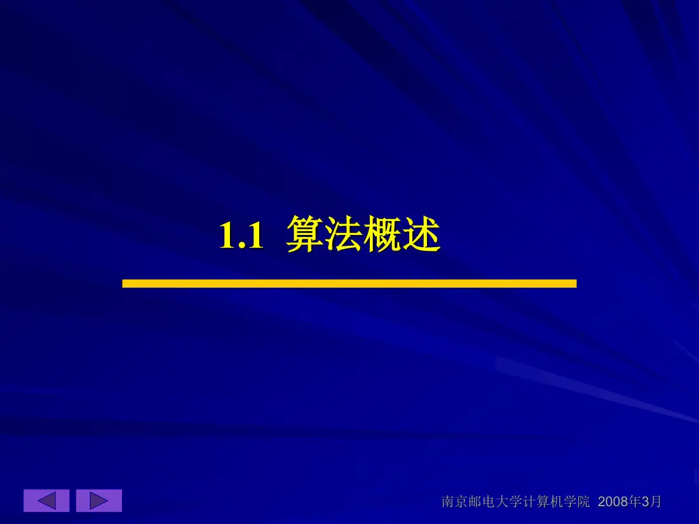

原文：

1.1 算法概述

△

南京邮电大学计算机学院 2008年3月

### 1.1.1 什么是算法

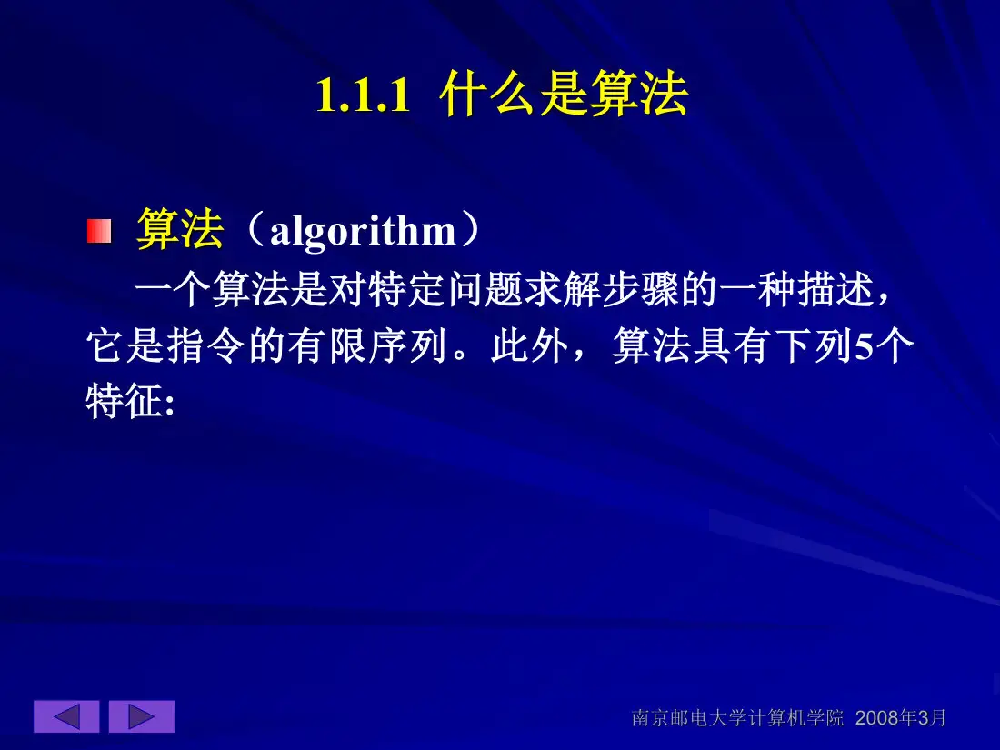

原文：

1.1.1 什么是算法

算法（algorithm）

一个算法是对特定问题求解步骤的一种描述，它是指令的有限序列。此外，算法具有下列5个特征:

△

南京邮电大学计算机学院 2008年3月

### 南京邮电大学计算机学院 2008年3月

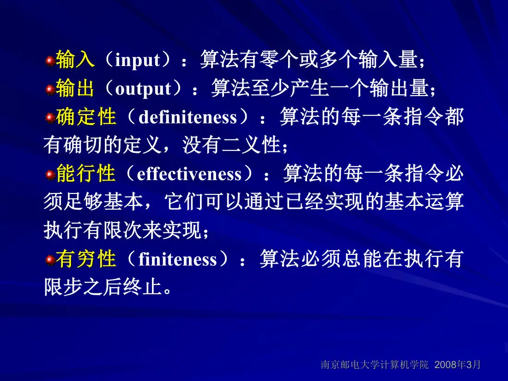

原文：

输入（input）：算法有零个或多个输入量；输出（output）：算法至少产生一个输出量；确定性（definiteness）：算法的每一条指令都有确切的定义，没有二义性；能行性（effectiveness）：算法的每一条指令必须足够基本，它们可以通过已经实现的基本运算执行有限次来实现；有穷性（finiteness）：算法必须总能在执行有限步之后终止。

南京邮电大学计算机学院 2008年3月

### 南京邮电大学计算机学院 2008年3月

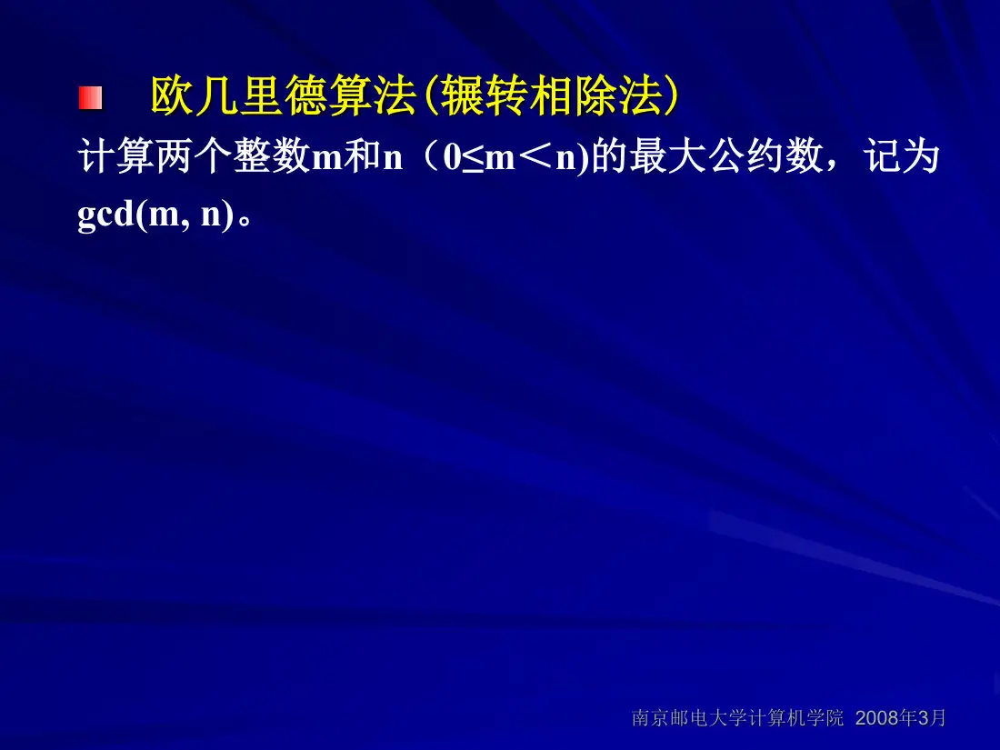

原文：

欧几里德算法(辗转相除法)计算两个整数m和n（0≤m＜n)的最大公约数，记为$\pm \pmb { \psi } ( \pmb { \| } | \pmb { \| } | \pmb { \| } | \pmb { \| } | )$

南京邮电大学计算机学院 2008年3月

### 【程序1-1】 欧几里德递归算法int RGcd(int m,int n)

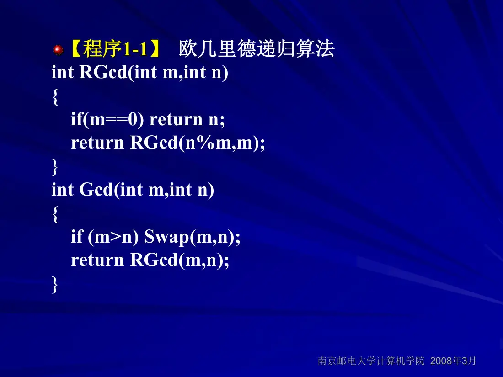

原文：

【程序1-1】 欧几里德递归算法int RGcd(int m,int n)

if(m==0) return n; return RGcd(n%m,m);

int Gcd(int m,int n)

if (m>n) Swap(m,n); return RGcd(m,n);

南京邮电大学计算机学院 2008年3月

### 【程序1-1】 欧几里德递归算法int RGcd(int m,int n)

原文：

【程序1-1】 欧几里德递归算法int RGcd(int m,int n)

if(m==0) return n; return RGcd(n%m,m);

int Gcd(int m,int n)

if (m>n) Swap(m,n); return RGcd(m,n);

南京邮电大学计算机学院 2008年3月

### 【程序1-2】 欧几里德迭代算法int Gcd(int m,int n)

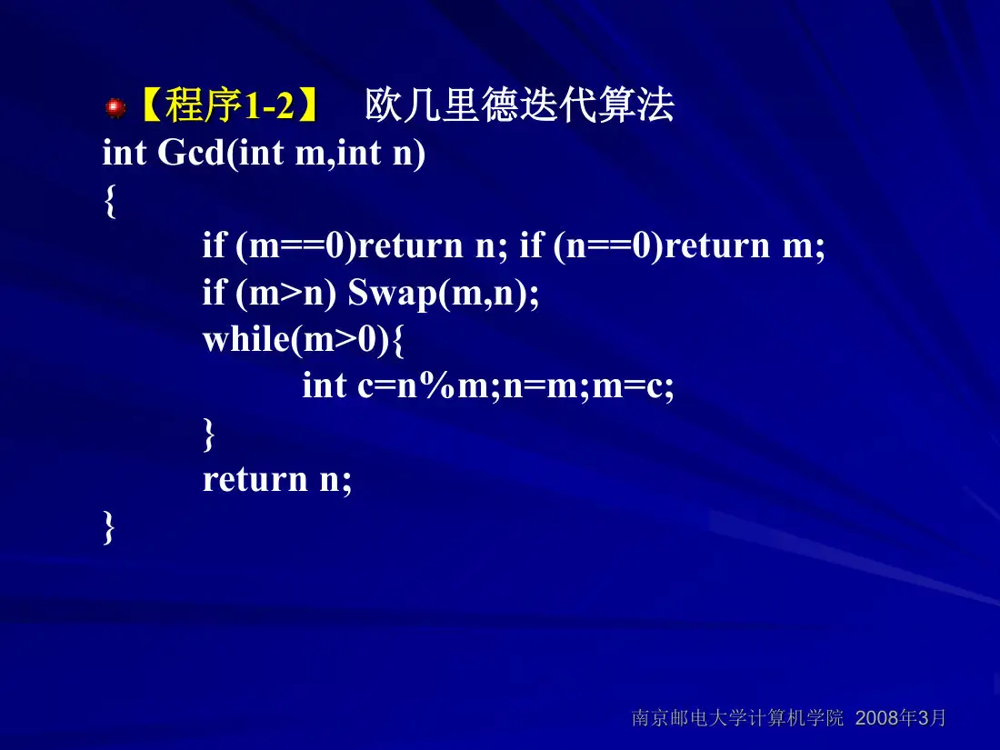

原文：

【程序1-2】 欧几里德迭代算法int Gcd(int m,int n)

if (m==0)return n; if (n==0)return m; if (m>n) Swap(m,n); while(m>0){ int c=n%m;n=m;m=c;

return n;

南京邮电大学计算机学院 2008年3月

### 【程序1-3】 Gcd的连续整数检测算法int Gcd(int m,int n)

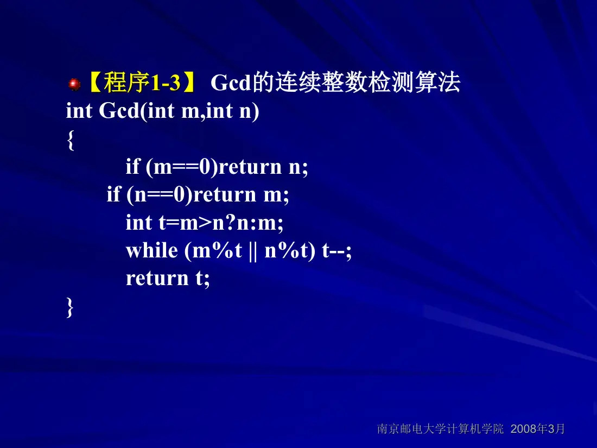

原文：

【程序1-3】 Gcd的连续整数检测算法int Gcd(int m,int n)

if (m==0)return n; if (n==0)return m; int t=m>n?n:m; while (m%t || n%t) t--; return t;

南京邮电大学计算机学院 2008年3月

### 1.1.2 为什么学习算法

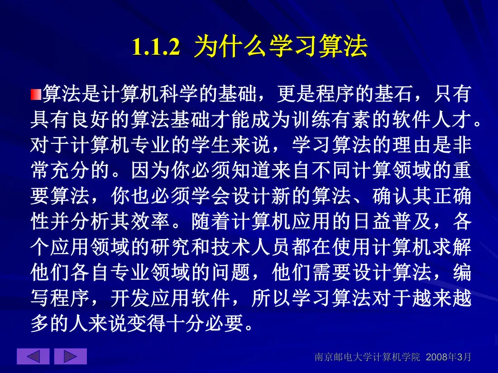

原文：

1.1.2 为什么学习算法

算法是计算机科学的基础，更是程序的基石，只有具有良好的算法基础才能成为训练有素的软件人才对于计算机专业的学生来说，学习算法的理由是非常充分的。因为你必须知道来自不同计算领域的重要算法，你也必须学会设计新的算法、确认其正确性并分析其效率。随着计算机应用的日益普及，各个应用领域的研究和技术人员都在使用计算机求解他们各自专业领域的问题，他们需要设计算法，编写程序，开发应用软件，所以学习算法对于越来越多的人来说变得十分必要。

南京邮电大学计算机学院 2008年3月

### 1.2 问题求解方法

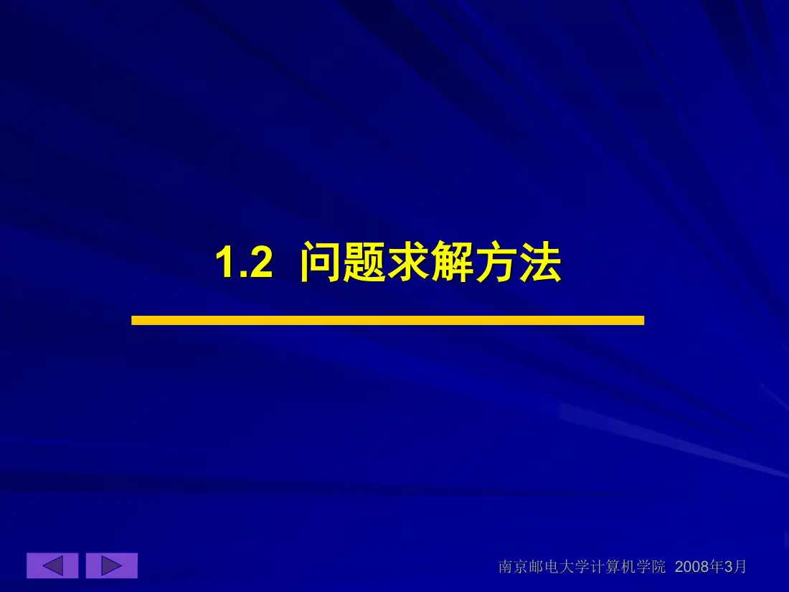

原文：

1.2 问题求解方法

△

南京邮电大学计算机学院 2008年3月

### 1.2.1 问题和问题求解

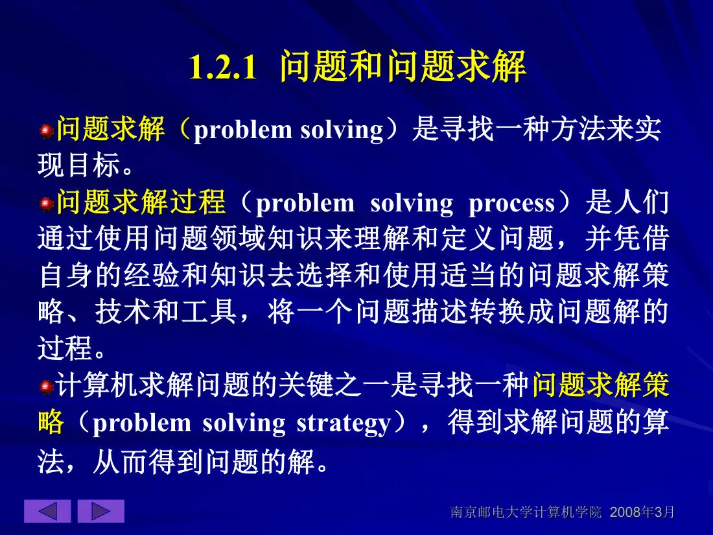

原文：

1.2.1 问题和问题求解

问题求解（problem solving）是寻找一种方法来实现目标。

问题求解过程（problem solving process）是人们通过使用问题领域知识来理解和定义问题，并凭借自身的经验和知识去选择和使用适当的问题求解策略、技术和工具，将一个问题描述转换成问题解的过程。

计算机求解问题的关键之一是寻找一种问题求解策略（problem solving strategy），得到求解问题的算法，从而得到问题的解。

南京邮电大学计算机学院 2008年3月

### 1.2.2 问题求解过程

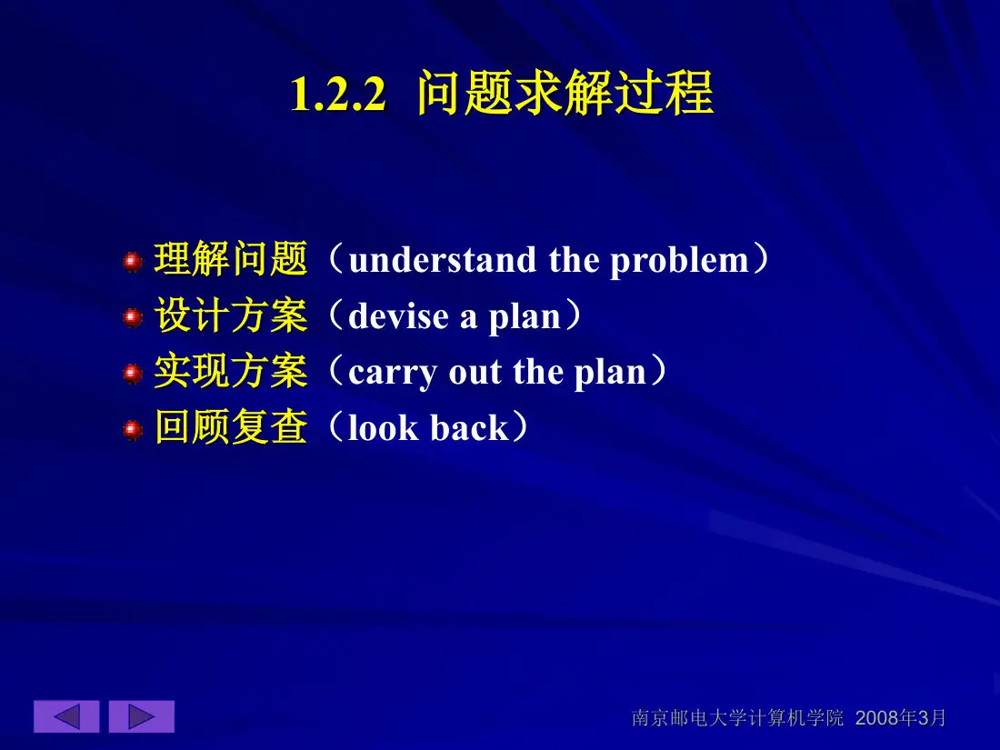

原文：

1.2.2 问题求解过程

理解问题（understand the problem）

设计方案（devise a plan）

实现方案（carry out the plan）

回顾复查（look back）

南京邮电大学计算机学院 2008年3月

### 1.2.3 系统生命周期

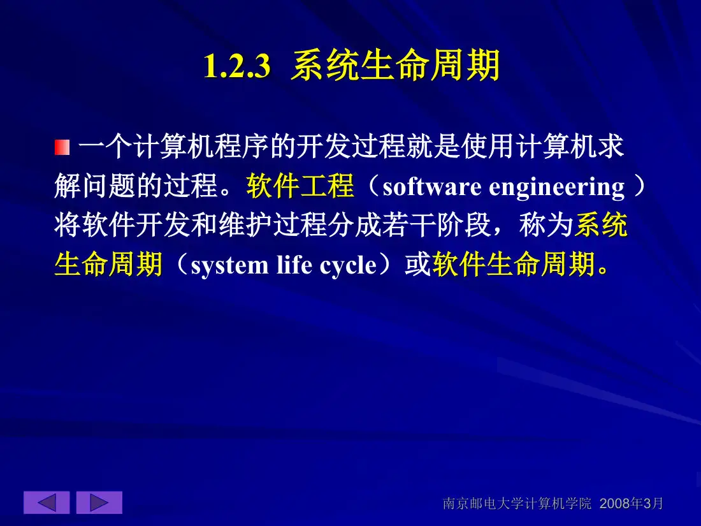

原文：

1.2.3 系统生命周期

一个计算机程序的开发过程就是使用计算机求解问题的过程。软件工程（software engineering将软件开发和维护过程分成若干阶段，称为系统生命周期（system life cycle）或软件生命周期。

南京邮电大学计算机学院 2008年3月

### 软件生命周期划分为:

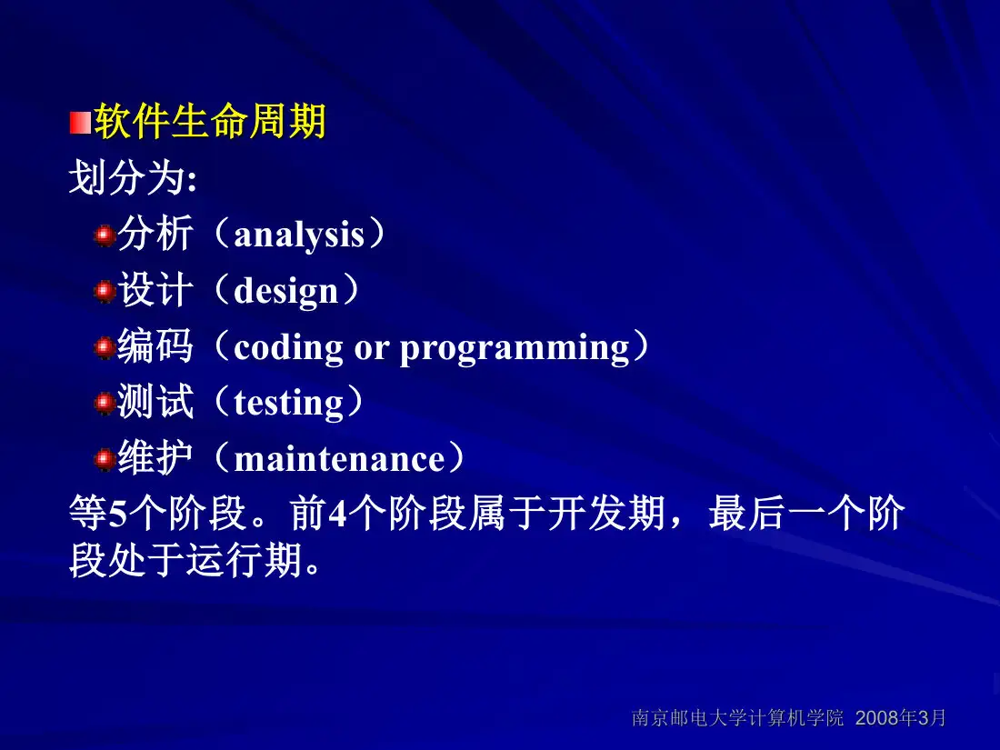

原文：

软件生命周期划分为:

分析（analysis）

设计（design）

编码（coding or programming）

测试（testing）

维护（maintenance）等5个阶段。前4个阶段属于开发期，最后一个阶段处于运行期。

南京邮电大学计算机学院 2008年3月

### 1.3 算法设计与分析

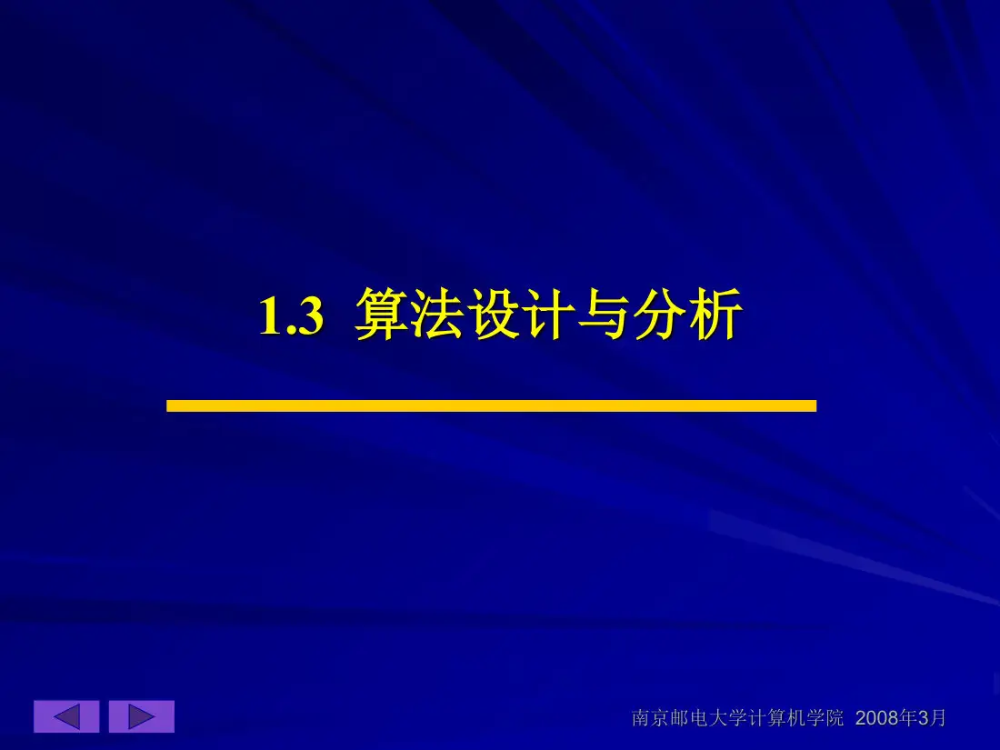

原文：

1.3 算法设计与分析

△

南京邮电大学计算机学院 2008年3月

### 1.3.1 算法问题求解过程

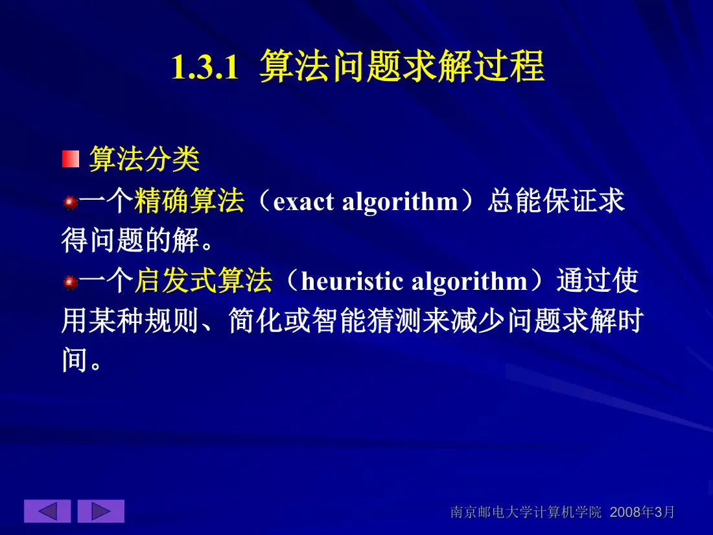

原文：

1.3.1 算法问题求解过程

算法分类

一个精确算法（exact algorithm）总能保证求得问题的解。

一个启发式算法（heuristic algorithm）通过使用某种规则、简化或智能猜测来减少问题求解时间。

△

南京邮电大学计算机学院 2008年3月

### 对于最优化问题，一个算法如果致力于寻找近似解而不是最优解，被称为近似算法

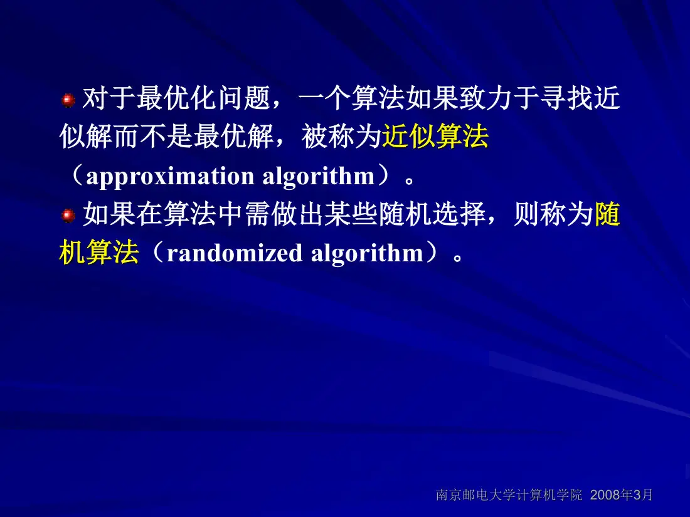

原文：

对于最优化问题，一个算法如果致力于寻找近似解而不是最优解，被称为近似算法

（approximation algorithm）。

如果在算法中需做出某些随机选择，则称为随机算法（randomized algorithm）。

南京邮电大学计算机学院 2008年3月

### 1.3.2 如何设计算法

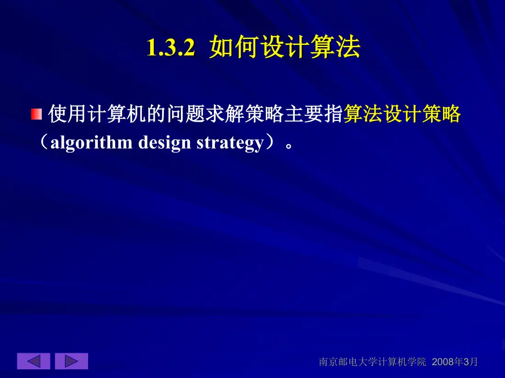

原文：

1.3.2 如何设计算法

使用计算机的问题求解策略主要指算法设计策略（algorithm design strategy）。

△

南京邮电大学计算机学院 2008年3月

### 1.3.3 如何表示算法

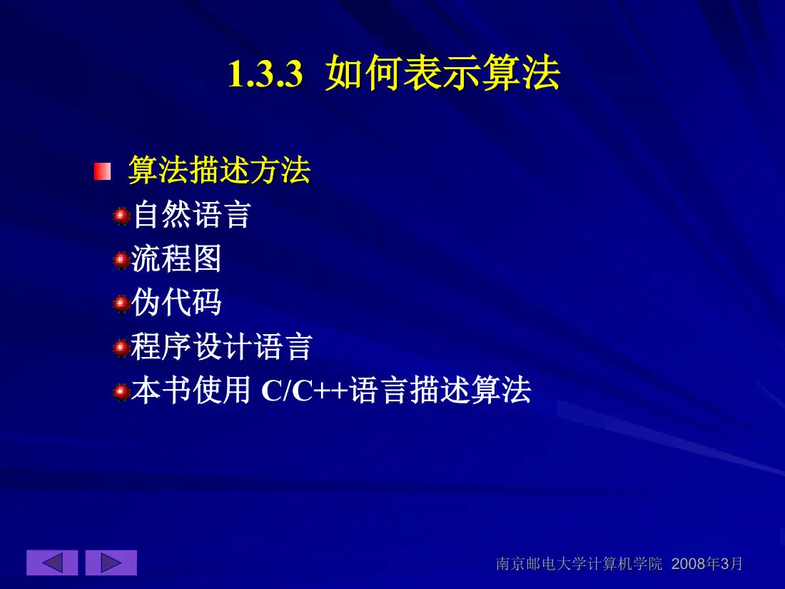

原文：

1.3.3 如何表示算法

算法描述方法

自然语言

流程图

伪代码

程序设计语言

本书使用 C/C++语言描述算法

△

南京邮电大学计算机学院 2008年3月

### 1.3.4 如何确认算法

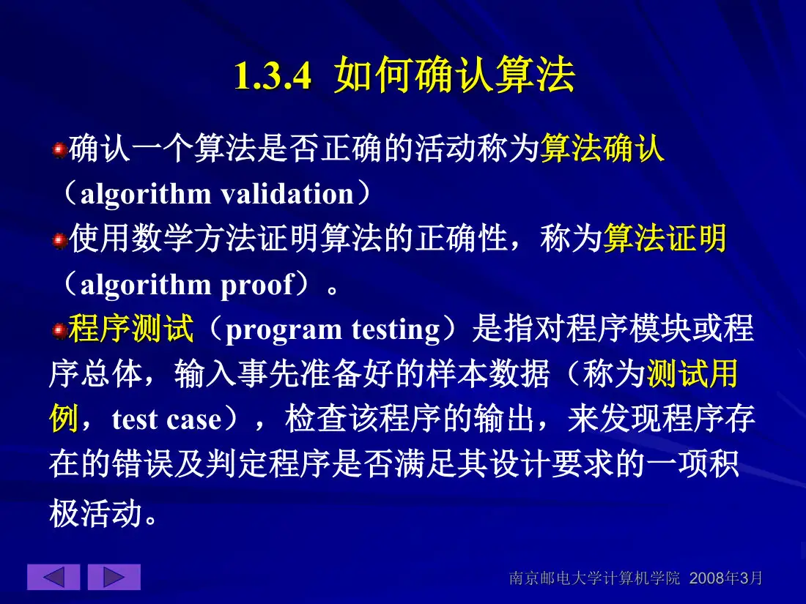

原文：

1.3.4 如何确认算法

确认一个算法是否正确的活动称为算法确认（algorithm validation）

使用数学方法证明算法的正确性，称为算法证明（algorithm proof）。

程序测试（program testing）是指对程序模块或程序总体，输入事先准备好的样本数据（称为测试用例，test case），检查该程序的输出，来发现程序存在的错误及判定程序是否满足其设计要求的一项积极活动。

南京邮电大学计算机学院 2008年3月

### 1.3.5 如何分析算法

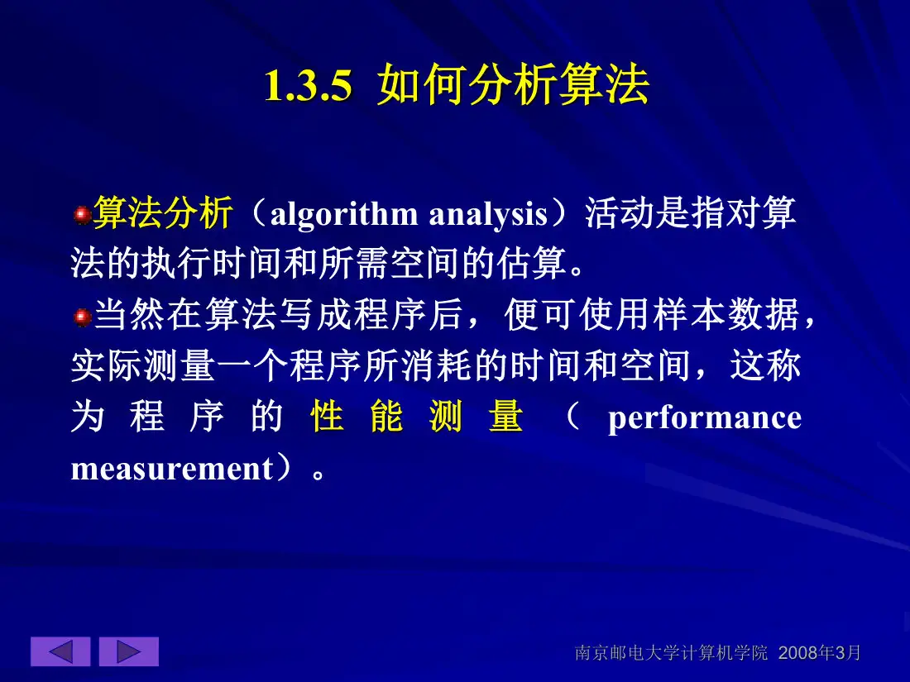

原文：

1.3.5 如何分析算法

算法分析（algorithm analysis）活动是指对算法的执行时间和所需空间的估算。

当然在算法写成程序后，便可使用样本数据，实际测量一个程序所消耗的时间和空间，这称为 程 序 的 性 能 测 量 （ performancemeasurement）。

南京邮电大学计算机学院 2008年3月

### 1.4 递归和归纳

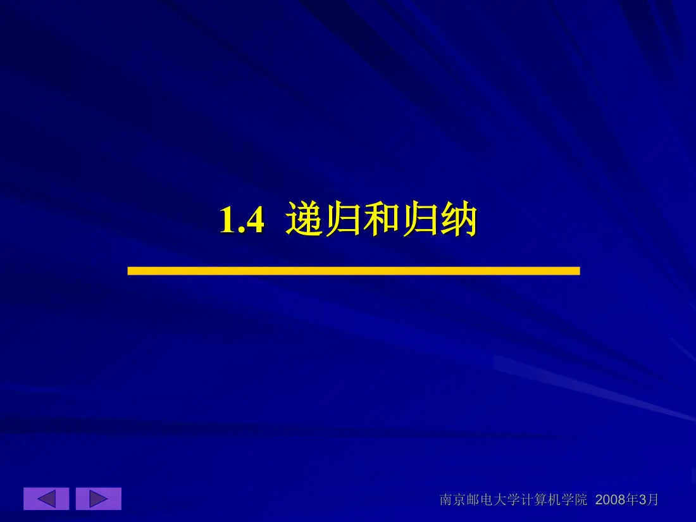

原文：

1.4 递归和归纳

△

南京邮电大学计算机学院 2008年3月

### 1.4.1 递归

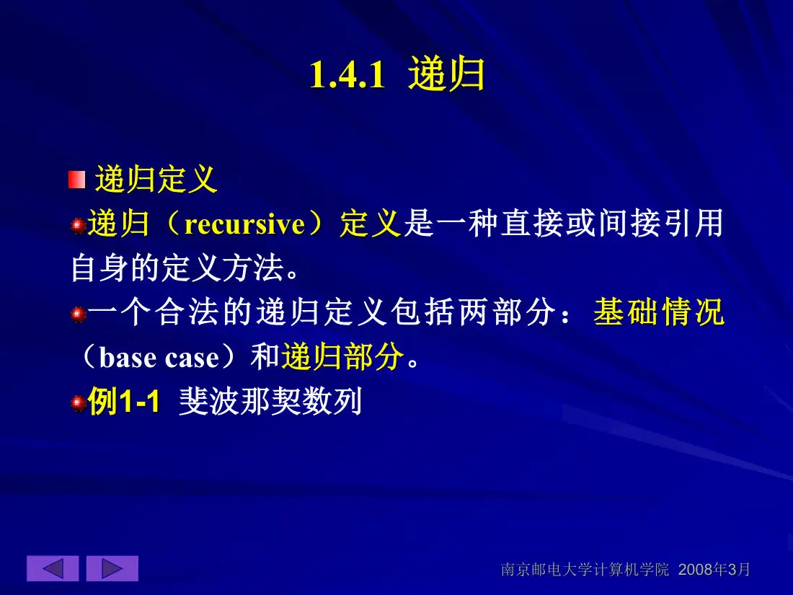

原文：

1.4.1 递归

递归定义

递归（recursive）定义是一种直接或间接引用自身的定义方法。

一个合法的递归定义包括两部分：基础情况（base case）和递归部分。

例1-1 斐波那契数列

南京邮电大学计算机学院 2008年3月

### 例1-1 斐波那契数列

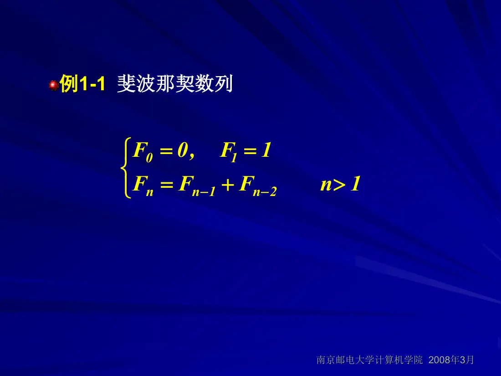

原文：

例1-1 斐波那契数列

$$
\left\{ \begin{array}{l l} F _ {0} = 0, & F _ {1} = 1 \\ F _ {n} = F _ {n - 1} + F _ {n - 2} & n > 1 \end{array} \right.
$$

南京邮电大学计算机学院 2008年3月

### 递归算法

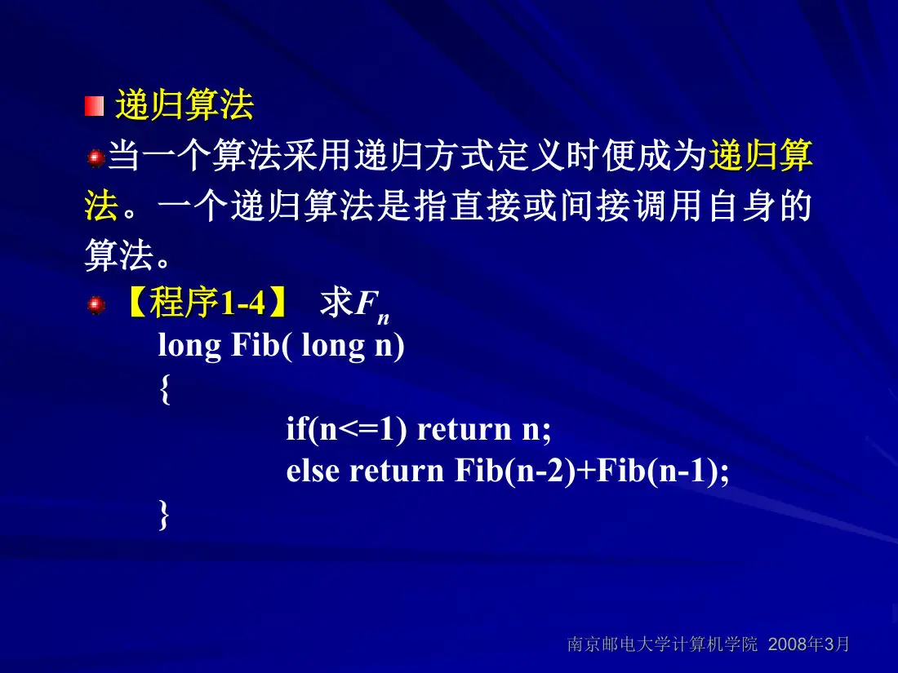

原文：

递归算法

当一个算法采用递归方式定义时便成为递归算法。一个递归算法是指直接或间接调用自身的算法。

【程序1-4】 求 $1 \frac { \overline { { n } } } { 4 }$ long Fib( long n)

if(n<=1) return n; else return Fib(n-2)+Fib(n-1);

南京邮电大学计算机学院 2008年3月

### 图1-2 计算Fib（4）的递归树

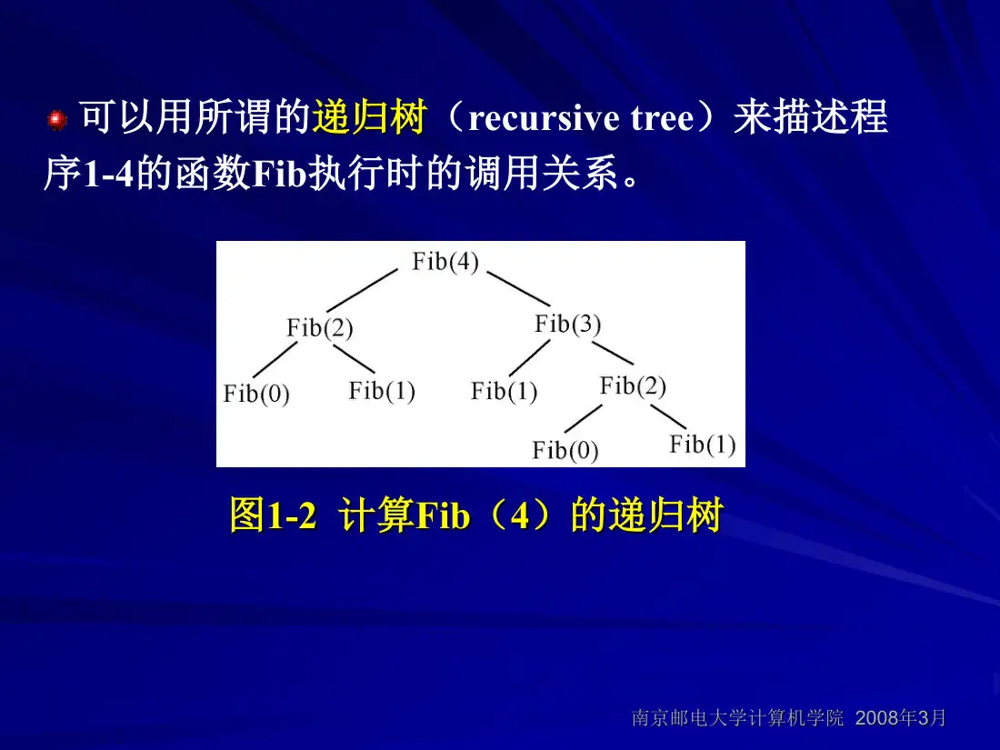

原文：

可以用所谓的递归树（recursive tree）来描述程序1-4的函数Fib执行时的调用关系。

图1-2 计算Fib（4）的递归树

南京邮电大学计算机学院 2008年3月

### 南京邮电大学计算机学院 2008年3月

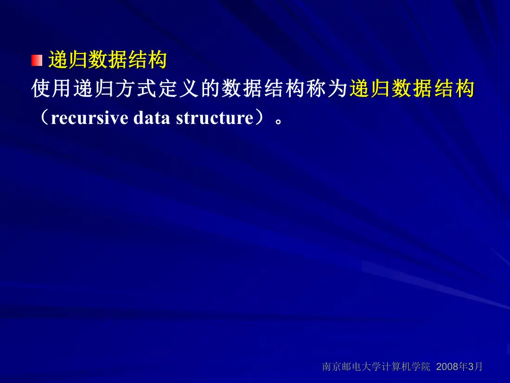

原文：

递归数据结构使用递归方式定义的数据结构称为递归数据结构（recursive data structure）。

南京邮电大学计算机学院 2008年3月

### 1.4.2 递归算法示例

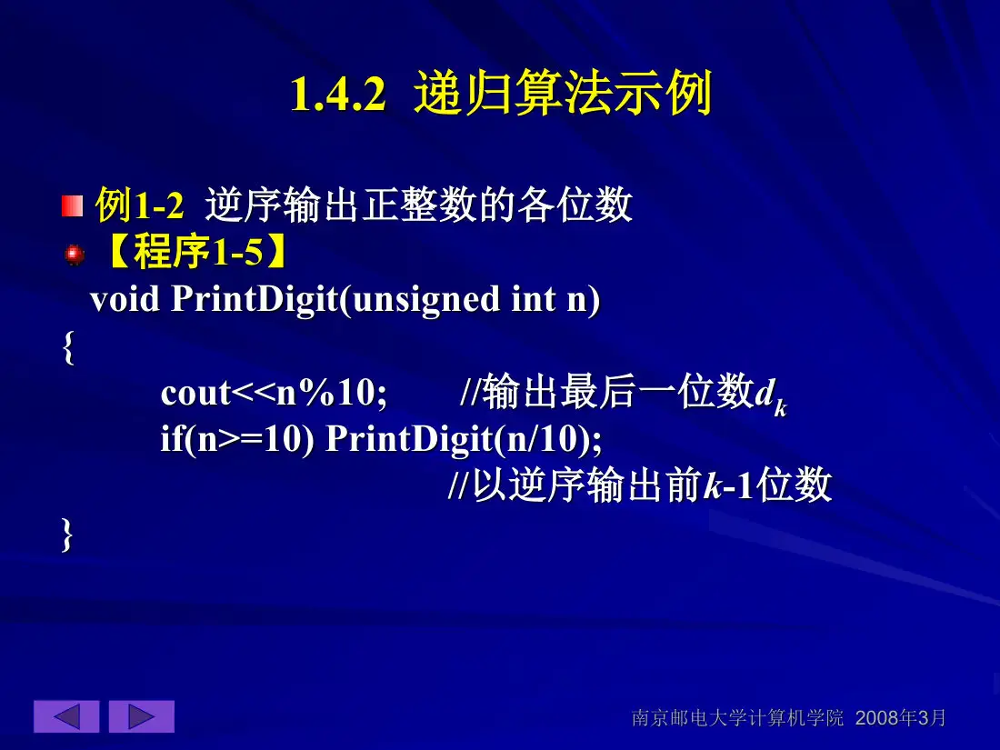

原文：

1.4.2 递归算法示例

例1-2 逆序输出正整数的各位数 【程序1-5】 void PrintDigit(unsigned int n)

cout<<n%10; //输出最后一位数 $\textcircled { 1 }$ if(n>=10) PrintDigit(n/10);//以逆序输出前k-1位数例1-3 汉诺塔问题（tower of Hanoi）假定有三个塔座：X，Y，Z，在塔座X上有n个直径大小各不相同，按圆盘大小从小到大编号为1，2，…，n的圆盘。现要求将X塔座上n个圆盘移到塔座Y上，并仍按同样顺序叠排。圆盘移动时必须遵循下列规则：

南京邮电大学计算机学院 2008年3月

### （1）每次只能移动一个圆盘；

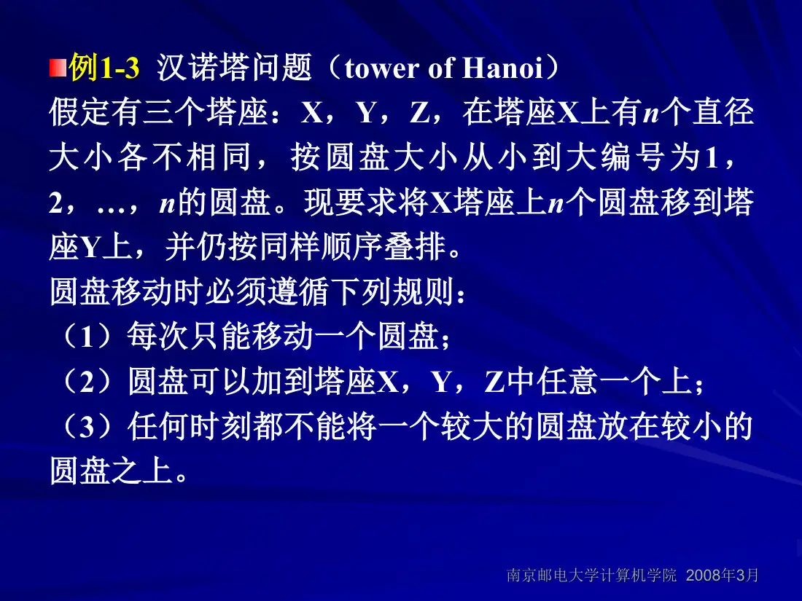

原文：

（1）每次只能移动一个圆盘；

（2）圆盘可以加到塔座X，Y，Z中任意一个上；

（3）任何时刻都不能将一个较大的圆盘放在较小的圆盘之上。

南京邮电大学计算机学院 2008年3月

### 南京邮电大学计算机学院 2008年3月

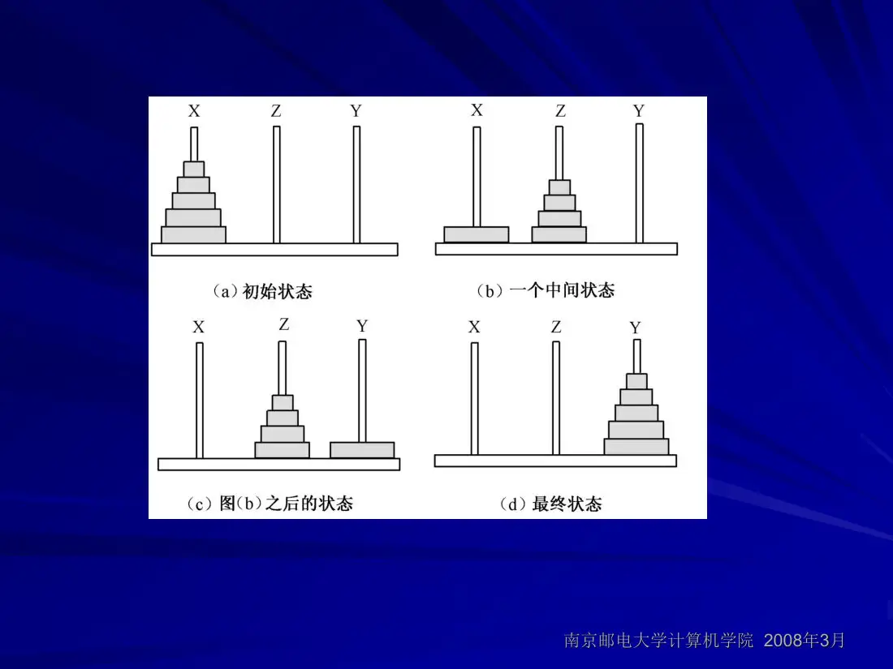

原文：

南京邮电大学计算机学院 2008年3月

### 南京邮电大学计算机学院 2008年3月

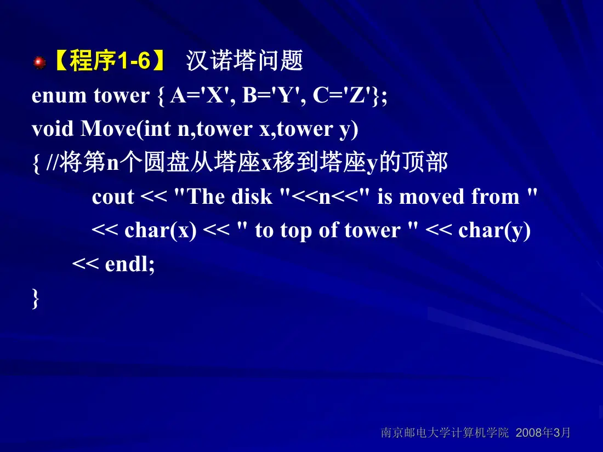

原文：

【程序1-6】 汉诺塔问题 enum tower { A='X', B='Y', C='Z'}; void Move(int n,tower x,tower y) {//将第n个圆盘从塔座x移到塔座y的顶部 cout << "The disk "<<n<<" is moved from << char(x) << " to top of tower " << char(y) << endl;

南京邮电大学计算机学院 2008年3月

### 南京邮电大学计算机学院 2008年3月

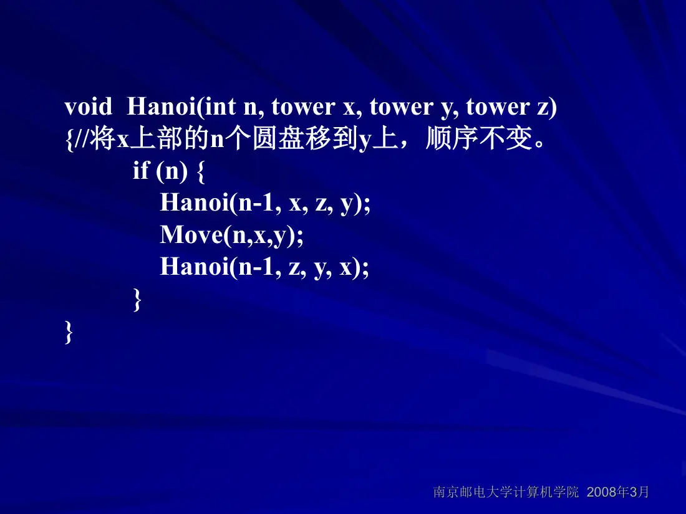

原文：

void Hanoi(int n, tower x, tower y, tower z){//将x上部的n个圆盘移到y上，顺序不变。

if (n) { Hanoi(n-1, x, z, y); Move(n,x,y); Hanoi(n-1, z, y, x);

南京邮电大学计算机学院 2008年3月

### 1.4.3 归纳证明

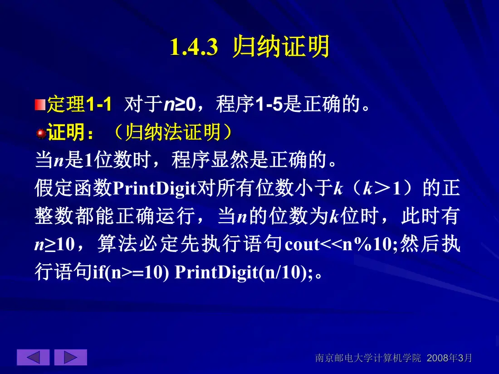

原文：

1.4.3 归纳证明

定理1-1 对于 $\textcircled { \pm } \textcircled { 2 }$ ，程序1-5是正确的。

证明：（归纳法证明）当n是1位数时，程序显然是正确的。

假定函数PrintDigit对所有位数小于k（k＞1）的正整数都能正确运行，当n的位数为k位时，此时有$l i z a m$ 算法必定先执行语句cout<<n%10;然后执行语句if(n>=10) PrintDigit(n/10);。

南京邮电大学计算机学院 2008年3月

### 南京邮电大学计算机学院 2008年3月

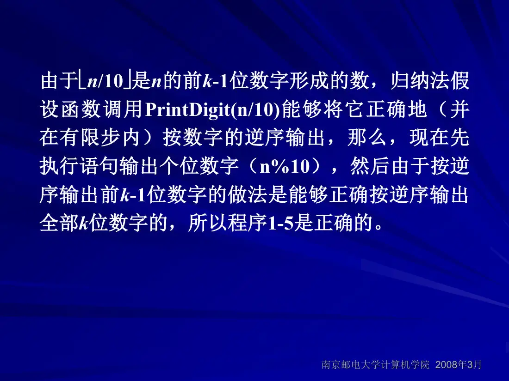

原文：

由于Ln/10是n的前k-1位数字形成的数，归纳法假设函数调用PrintDigit(n/10)能够将它正确地（并在有限步内）按数字的逆序输出，那么，现在先执行语句输出个位数字（n%10），然后由于按逆序输出前k-1位数字的做法是能够正确按逆序输出全部k位数字的，所以程序1-5是正确的。

南京邮电大学计算机学院 2008年3月
