# 《算法设计与分析》第2章 算法分析基础（课件）

原件的每一页，下面附识别出的文字。

### 算法设计与分析

原文：

算法设计与分析

DeSign and Analysis of Algorithms In C++

陈慧南 编著

南京邮电大学计算机学院 2008年3月

“十一五”国家级规划教材

电子工业出版社

### 第2章 算法分析基础

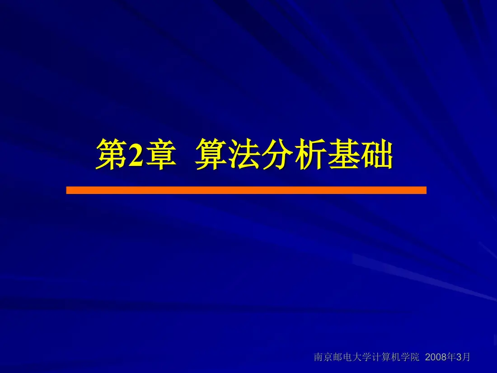

原文：

第2章 算法分析基础

南京邮电大学计算机学院 2008年3月

### 2.1 算法复杂度

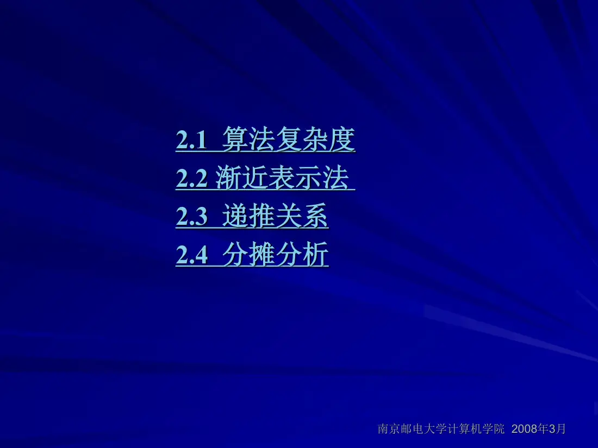

原文：

2.1 算法复杂度
2.2 渐近表示法
2.3 递推关系
2.4 分摊分析

南京邮电大学计算机学院 2008年3月

### 2.1 算法复杂度

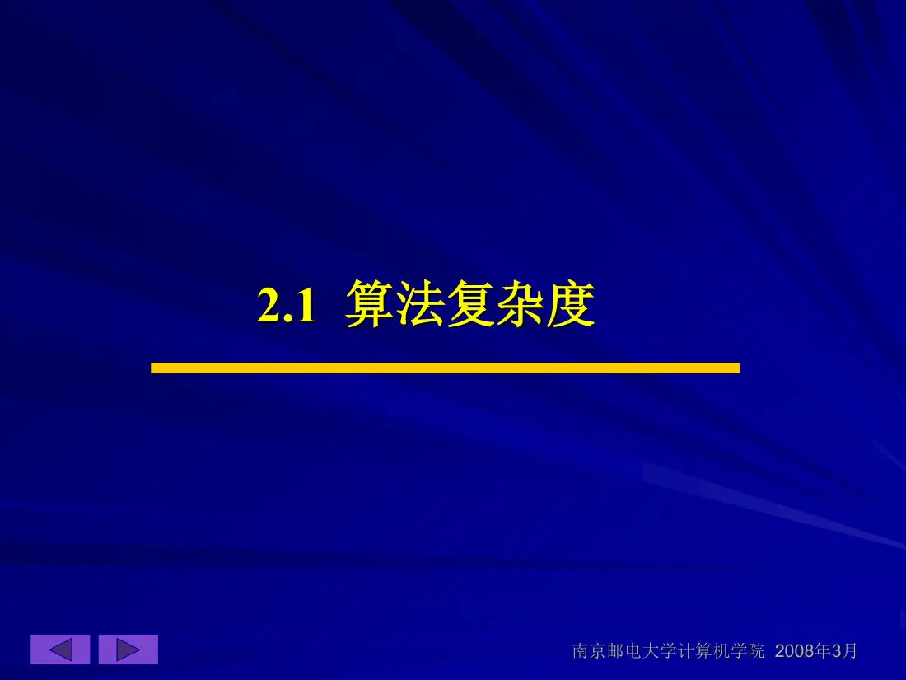

原文：

2.1 算法复杂度

△

南京邮电大学计算机学院 2008年3月

### 2.1.1 什么是好的算法

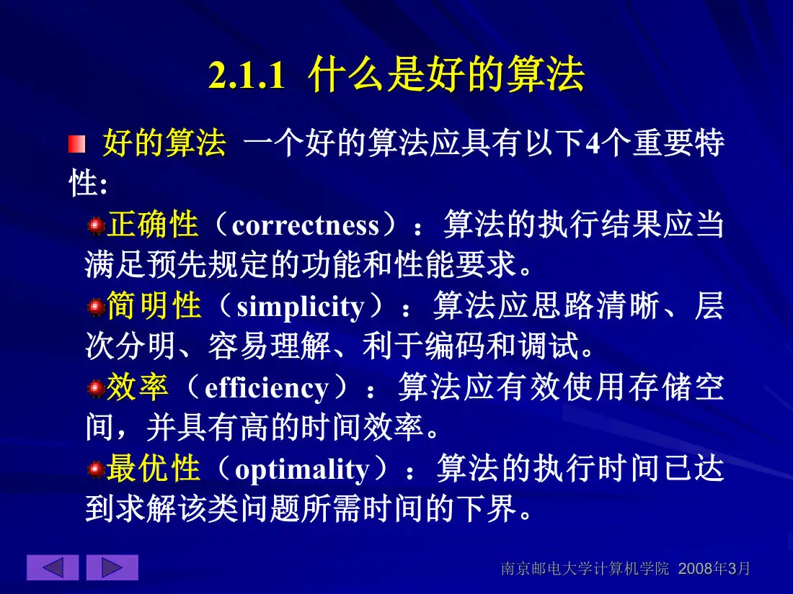

原文：

2.1.1 什么是好的算法

好的算法 一个好的算法应具有以下4个重要特性:

正确性（correctness）：算法的执行结果应当满足预先规定的功能和性能要求。

简明性（simplicity）：算法应思路清晰、层次分明、容易理解、利于编码和调试。

效率（efficiency）：算法应有效使用存储空间，并具有高的时间效率。

最优性（optimality）：算法的执行时间已达到求解该类问题所需时间的下界。

南京邮电大学计算机学院 2008年3月

### 正确性和健壮性是相互补充的。

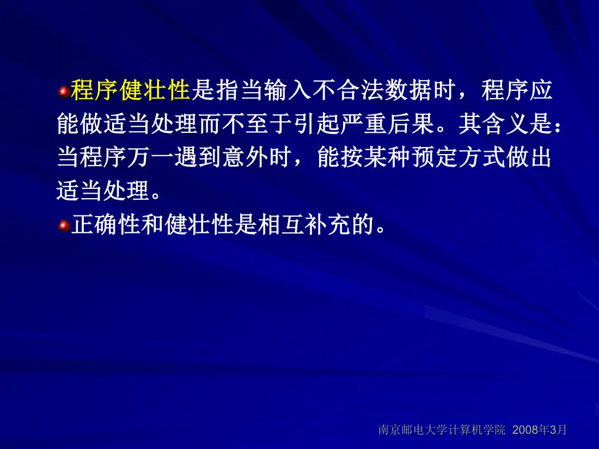

原文：

程序健壮性是指当输入不合法数据时，程序应能做适当处理而不至于引起严重后果。其含义是：当程序万一遇到意外时，能按某种预定方式做出适当处理。

正确性和健壮性是相互补充的。

南京邮电大学计算机学院 2008年3月

### 2.1.2 影响程序运行时间的因素

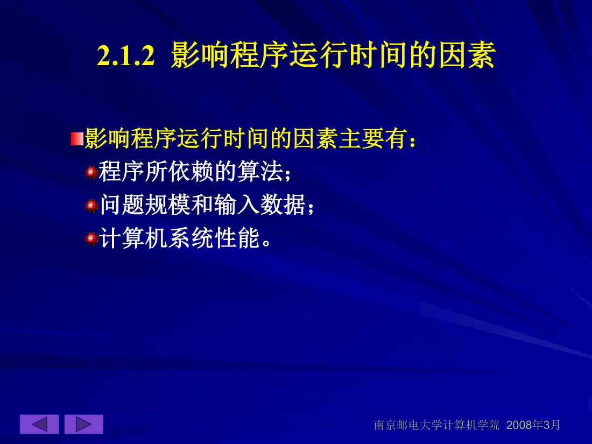

原文：

2.1.2 影响程序运行时间的因素

影响程序运行时间的因素主要有：

程序所依赖的算法；

问题规模和输入数据；

计算机系统性能。

△

南京邮电大学计算机学院 2008年3月

### 2.1.3 算法的时间复杂度

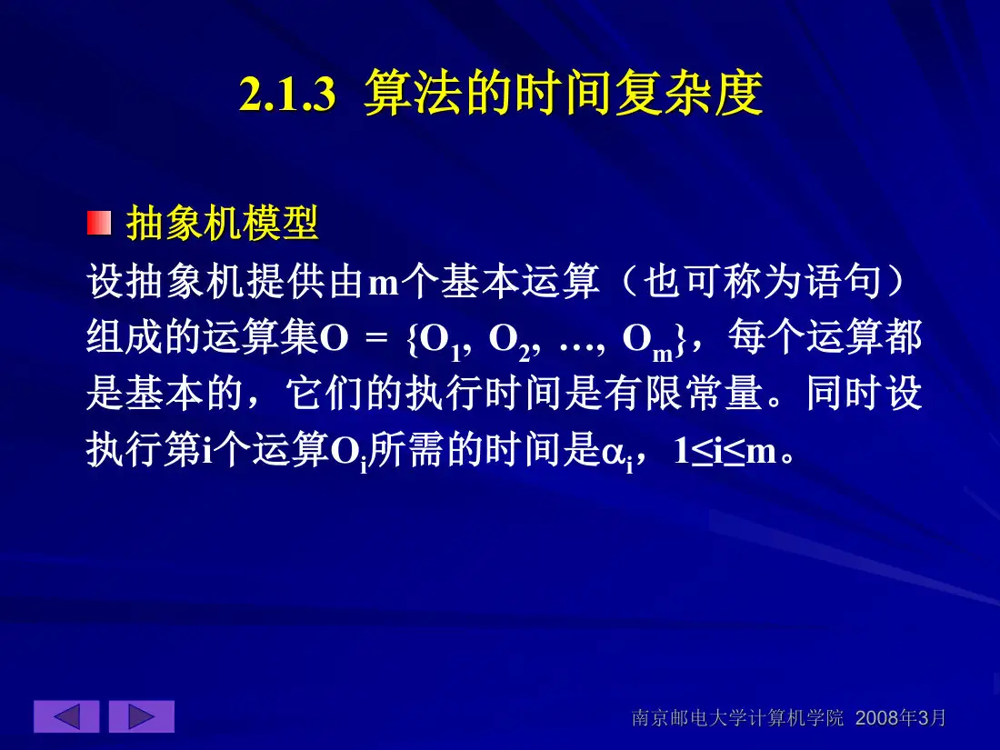

原文：

2.1.3 算法的时间复杂度

抽象机模型

设抽象机提供由m个基本运算（也可称为语句）组成的运算集 $\textcircled { 4 } - \textcircled { 1 } \textcircled { 4 } \textcircled { 1 } \textcircled { 4 } \textcircled { 2 } \textcircled { 2 } \textcircled { 4 } \textcircled { 1 } \textcircled { 2 } \textcircled { 1 } \textcircled { 4 }$ 每个运算都是基本的，它们的执行时间是有限常量。同时设执行第i个运算 $\textcircled{9}$ 所需的时间是 $\textcircled { \bullet }$ ，1≤i≤m。

南京邮电大学计算机学院 2008年3月

### 时间复杂度

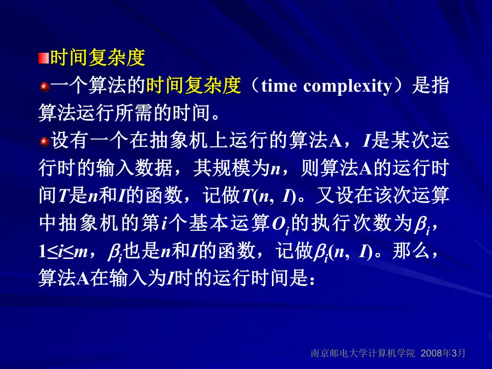

原文：

时间复杂度

一个算法的时间复杂度（time complexity）是指算法运行所需的时间。

设有一个在抽象机上运行的算法A，I是某次运行时的输入数据，其规模为n，则算法A的运行时间T是n和I的函数，记做T(n, I)。又设在该次运算中抽象机的第i个基本运算O 的执行次数为 ，1≤i≤m，β,也是n和I的函数，记做β,(n，I)。那么，算法A在输入为I时的运行时间是：

南京邮电大学计算机学院 2008年3月

### $$

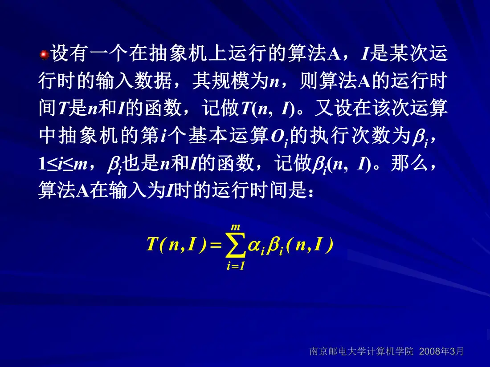

原文：

设有一个在抽象机上运行的算法A，I是某次运行时的输入数据，其规模为n，则算法A的运行时间T是n和I的函数，记做 $1 0 0 \times 1 0 0 = 1 0 0$ 。又设在该次运算中抽象机的第i个基本运算 $\textcircled { \pmb { \mathscr { G } } }$ 的执行次数为 $\textcircled { 6 }$ $1 5 \div m = \cdots 0$ $\textcircled { 6 }$ 也是n和I的函数，记做 $\textcircled { 6 } \textcircled { 1 6 } \textcircled { 7 }$ 。那么，算法A在输入为I时的运行时间是：

$$
T (n, I) = \sum_ {i = 1} ^ {m} \alpha_ {i} \beta_ {i} (n, I)
$$

南京邮电大学计算机学院 2008年3月

### 最好、最坏和平均时间复杂度最好时间复杂度

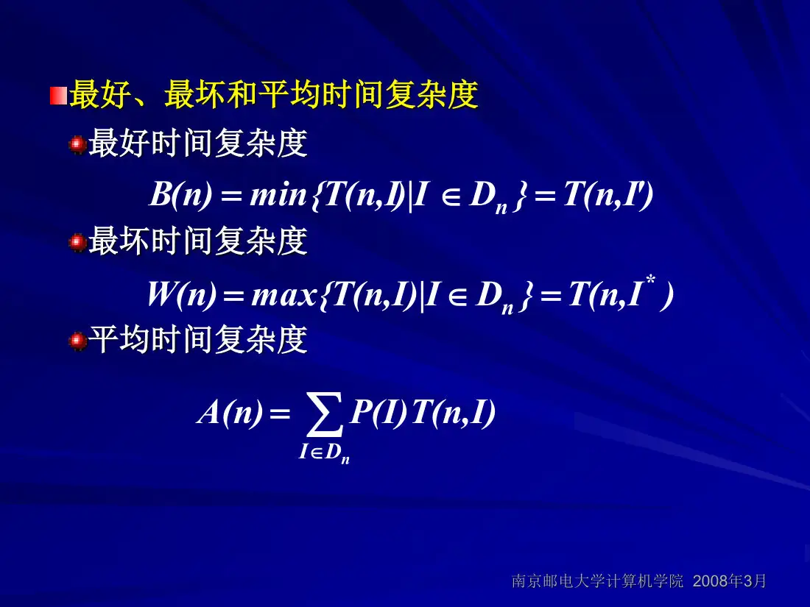

原文：

最好、最坏和平均时间复杂度最好时间复杂度

$$
B (n) = \min \left\{T (n, I) | I \in D _ {n} \right\} = T (n, I ^ {\prime})
$$

最坏时间复杂度

W(n)=max{T(n,I)|I∈ Dn}=T(n,I\*)平均时间复杂度

$$
A (n) = \sum_ {I \in D _ {n}} P (I) T (n, I)
$$

南京邮电大学计算机学院 2008年3月

### 2.1.4 使用程序步分析算法

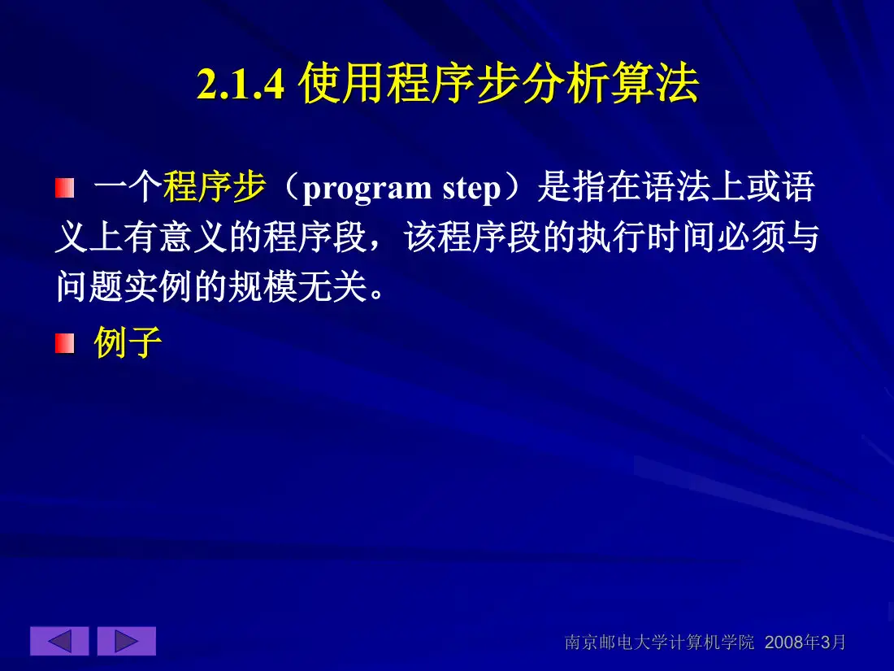

原文：

2.1.4 使用程序步分析算法

一个程序步（program step）是指在语法上或语义上有意义的程序段，该程序段的执行时间必须与问题实例的规模无关。

例子

△

南京邮电大学计算机学院 2008年3月

### count ++;

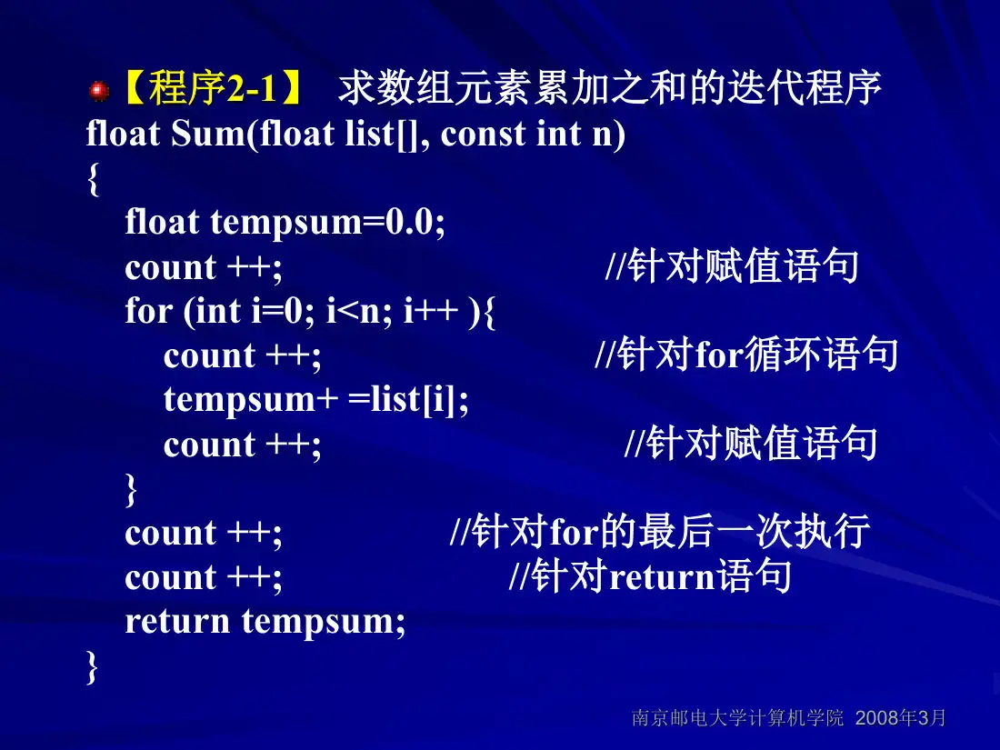

原文：

【程序2-1】 求数组元素累加之和的迭代程序float Sum(float list[], const int n)

float tempsum=0.0; count ++; for (int i=0; i<n; i++ ){ count ++; tempsum+ =list[i]; count ++;

count ++;

count ++;

return tempsum;

//针对赋值语句

//针对for循环语句

//针对赋值语句

//针对for的最后一次执行//针对return语句

南京邮电大学计算机学院 2008年3月

### 设RSum（list,n）的程序步为T(n)

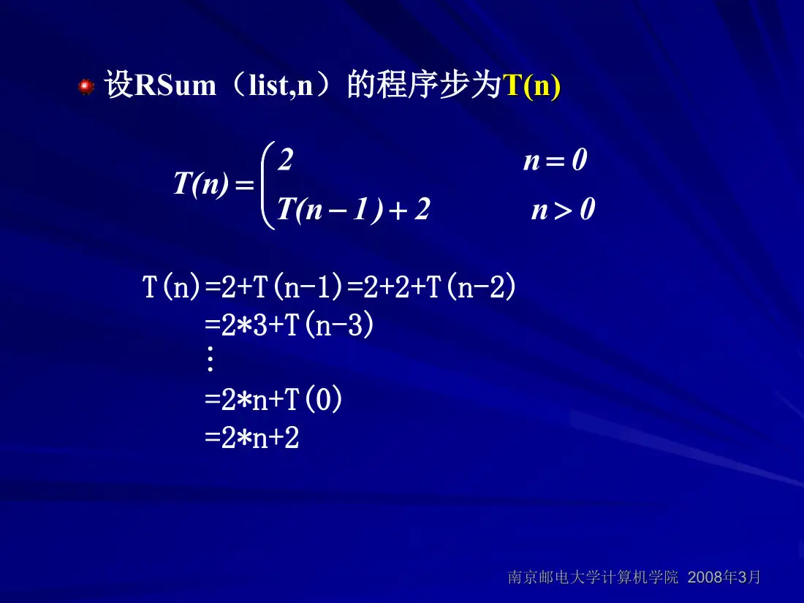

原文：

设RSum（list,n）的程序步为T(n)

$$
T (n) = \left( \begin{array}{l l} 2 & n = 0 \\ T (n - 1) + 2 & n > 0 \end{array} \right.
$$

$$
\begin{array}{r l} & {\mathrm{T(n)} = 2 + \mathrm{T(n-1)} = 2 + 2 + \mathrm{T(n-2)}} \\ & {\quad = 2 * 3 + \mathrm{T(n-3)}} \\ & {\quad \vdots} \\ & {\quad = 2 * \mathrm{n+T(0)}} \\ & {\quad = 2 * \mathrm{n+2}} \end{array}
$$

南京邮电大学计算机学院 2008年3月

### 【程序2-2】求数组元素累加之和的递归程序

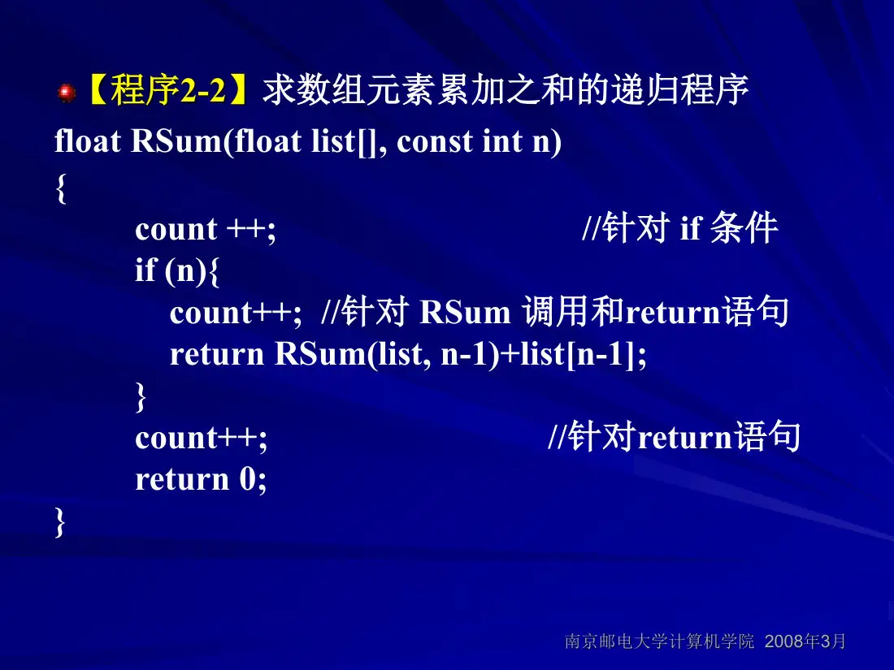

原文：

【程序2-2】求数组元素累加之和的递归程序

float RSum(float list[], const int n)

count ++;

//针对 if 条件

if (n){ count++; //针对 RSum 调用和return语句 return RSum(list, n-1)+list[n-1];

count++;

return 0;

//针对return语句

南京邮电大学计算机学院 2008年3月

### 【程序1-2】 欧几里德迭代算法int Gcd(int m,int n)

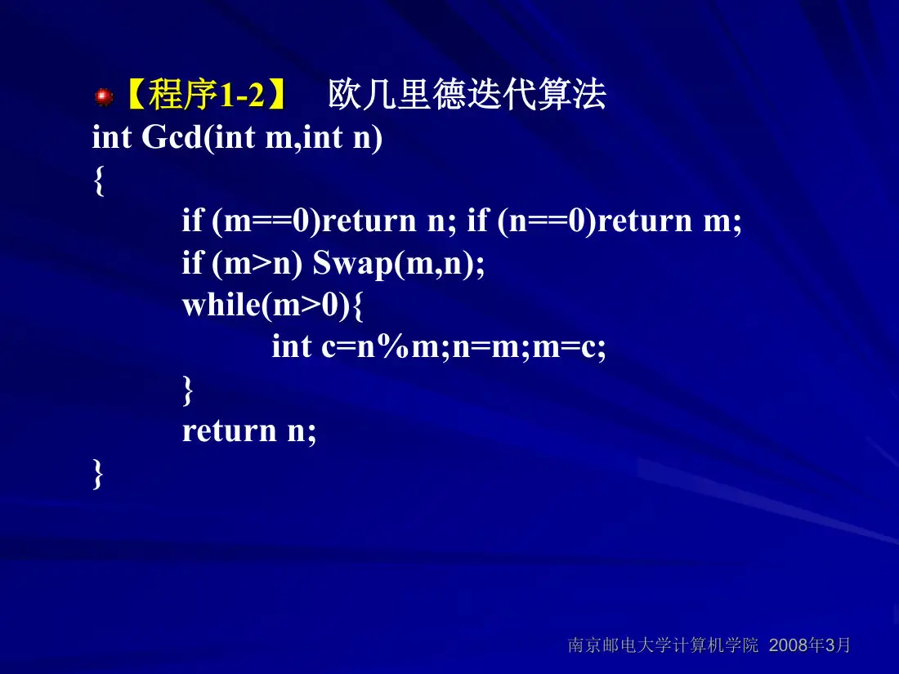

原文：

【程序1-2】 欧几里德迭代算法int Gcd(int m,int n)

if (m==0)return n; if (n==0)return m; if (m>n) Swap(m,n); while(m>0){ int c=n%m;n=m;m=c;

return n;

南京邮电大学计算机学院 2008年3月

### 2.1.5 算法的空间复杂度

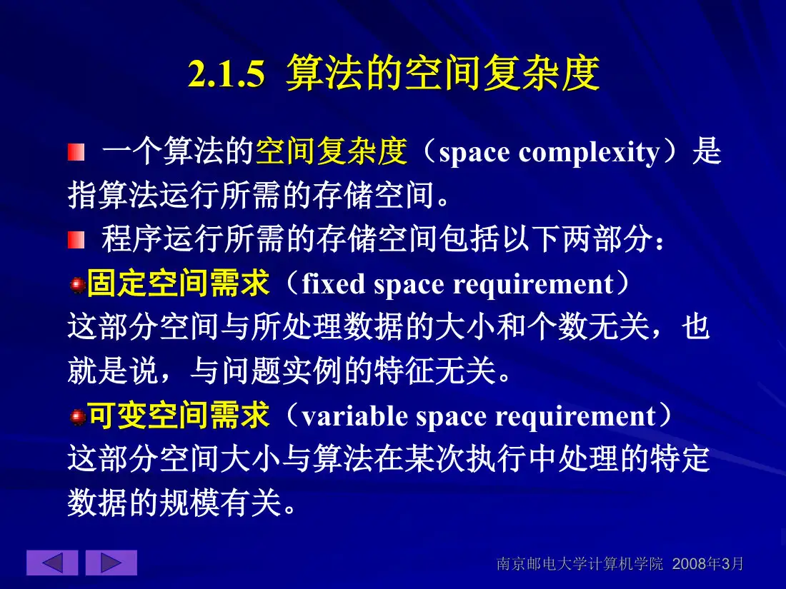

原文：

2.1.5 算法的空间复杂度

一个算法的空间复杂度（space complexity）是指算法运行所需的存储空间。

程序运行所需的存储空间包括以下两部分：

固定空间需求（fixed space requirement）

这部分空间与所处理数据的大小和个数无关，也就是说，与问题实例的特征无关。

可变空间需求（variable space requirement）这部分空间大小与算法在某次执行中处理的特定数据的规模有关。

南京邮电大学计算机学院 2008年3月

### 2.2 渐近表示法

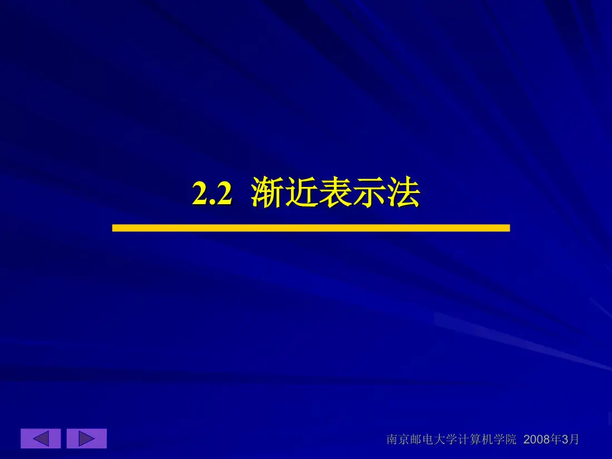

原文：

2.2 渐近表示法

△

南京邮电大学计算机学院 2008年3月

### 2.2.1 大O记号

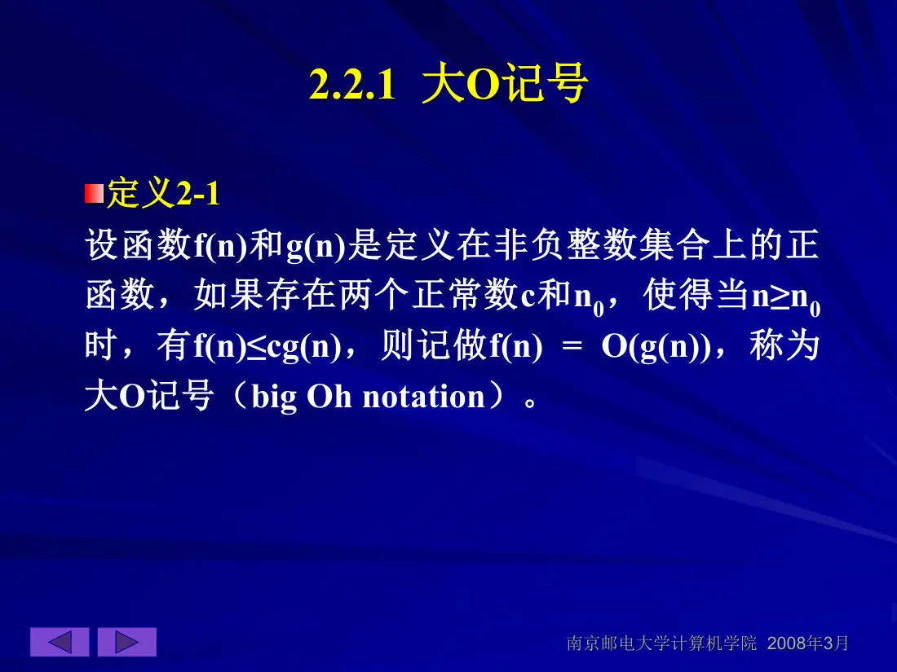

原文：

2.2.1 大O记号

定义2-1

设函数f(n)和g(n)是定义在非负整数集合上的正函数，如果存在两个正常数c和 $\blacktriangleleft$ ，使得当 $1 1 2 0 0 0$ 时，有 $1 ( 0 0 ) = 9 3 ( 0 0 )$ ，则记做 $( 0 ) - \cos ( 0 ) = \frac { \sqrt { 3 } } { 2 }$ ，称为大O记号（big Oh notation）。

南京邮电大学计算机学院 2008年3月

### 例2-1

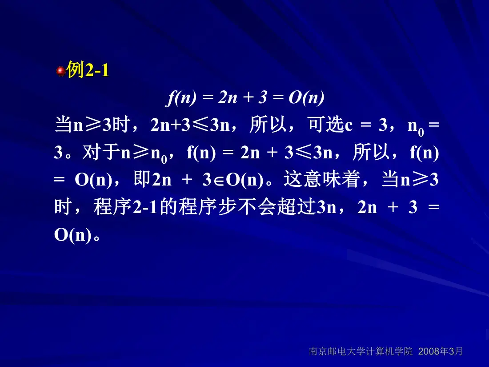

原文：

例2-1

$1 0 0 - 0 . 1 5 = 0 . 0 0 0$ 当 $m e s h$ 时， $2 1 1 5 - 8 1 = 1 1$ 所以，可选 $( y = - \infty , y ) =$ 3。对于 $1 1 0 \div ( 1 1 2 - 1 1 ) = 1 1 0 \div 2 = 1 1 0 ( c m )$ 所以，f(n)$\mathbf { \textcircled { 6 7 } }$ 即 $2 1 1 - 1 2 - 1 0 = 1 0 ( m )$ 这意味着，当 $m = 3 3$ 时，程序2-1的程序步不会超过3n， $\angle 1 1 = \angle 1 = \angle 1 = \angle 1$ $\textcircled { 9 } \textcircled { 1 1 }$

南京邮电大学计算机学院 2008年3月

### 例2-2

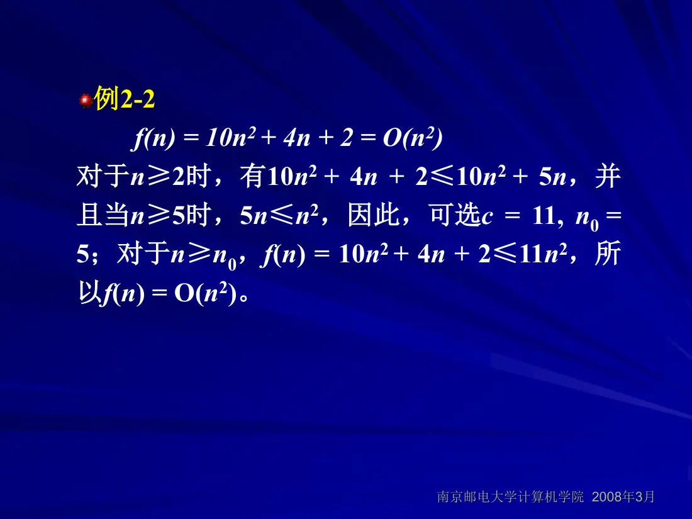

原文：

例2-2

$( \textcircled { 1 } 2 ) = ( \textcircled { 1 } 2 0 \times 2 \textcircled { 1 } 2 0 \times 2 \times 2 \times 2 \times 2 \times 2 \times 2 \times 2 \times 2 \times 2 \times 2 \times 2 \times 2 \times 2 \times 2 \times 2 \times 2 \times 2 \times 2 \times 2 \times 2 \times 2 \times 2 \times 2 \times 2 \times 2 \times 2 \times 2 \times 2 \times 2 \times 2 \times 2 \times 2 \times 2 \times 2 \times 2 \times 2 \times 2 \times 2 \times 2 \times 2 \times 2 \times 2 \times 2 \times 2 \times 2 \times 2 \times 2 \times 2 \times 2 \times 2 \times 2 \times 2 \times 2 \times 2 \times 2 \times 2 \times 2 \times 2 \times 2 \times 2 \times 2 \times 2 \times 2 \times 2 \times 2 \times 2 \times 2 \times 2 \times 2 \times 2 \times 2 \times 2 \times 2 \times 2 \times 2 \times 2 \times 2 \times 2 \times 2 \times 2 \times 2 \times 2 \times 2 \times 2 \times 2 \times 2 \times 2 \times 2 \times 2 \times 2 \times 2 \times 2 \times 2 \times 2 \times 2 \times 2 \times 2 \times 2 \times 2 \times 2 \times 2 \times 2 \times 2 \times 2 \times 2 \times 2 \times 2 \times 2 \times 2 \times 2 \times 2 \times 2 \times 2 \times 2 \times 2 \times 2 \times 2 \times 2 \times \times 2 \times 2 \times 2 \times 2 \times 2 \times 2 \times \times 2 \times 2 \times 2 \times \times 2 \times 2 \times 2 \times \times 2 \times 2 \times \times 2 \times 2 \times 2 \times \times 2 \times 2 \times \times 2 \times 2 \times \times 2 \times 2 \times \times 2 \times \times 2 \times 2 \times \times 2 \times \times 2 \times \times 2 \times \times 2 \times 2 \times \times 2 \times \times 2 \times \times 2 \times \times 2 \times \times 2 \times \times 2 \times \times 2 \times \times 2 \times \times \times 2 \times \times 2 \times \times 2 \times \times \times 2 \times 2 \times \times \times 2 \times \times \times 2 \times \times 2 \times \times \times 2 \times \times \times 2 \times \times \times 2 \times \times \times 2 \times \times \times 2 \times \times \times 2 \times \times \times \ c o r e r e r e r e r e r e r e r e r e r e r e r e r e r m p r m p r m p r m \ a r m p r m \ a r m p r m a r m a r m a r m a r m a r m a r m a r m a r m a r m a r m a r m a r m a$ 对于 $m = 2$ 时，有 $( 1 ) 2 \times ( 2 \times 2 ) = ( 1 ) 2 \times 2 = ( 2 \times 2 )$ 9 并且当n≥5时， $6 m = 1 0$ 因此，可选 $\scriptstyle ( 4 , 5 , 7 ) =$ $\mathbf { \delta E }$ 对于 $1 1 0 0 0 - 1 1 0 0 0 = 1 1 0 0 0 0 ( c m )$ 所以 $[ \langle { m } \rangle ] = \langle { 0 } \langle { \bf { \vec { u } } } ^ { 2 } \rangle$ o

南京邮电大学计算机学院 2008年3月

### 例2-3

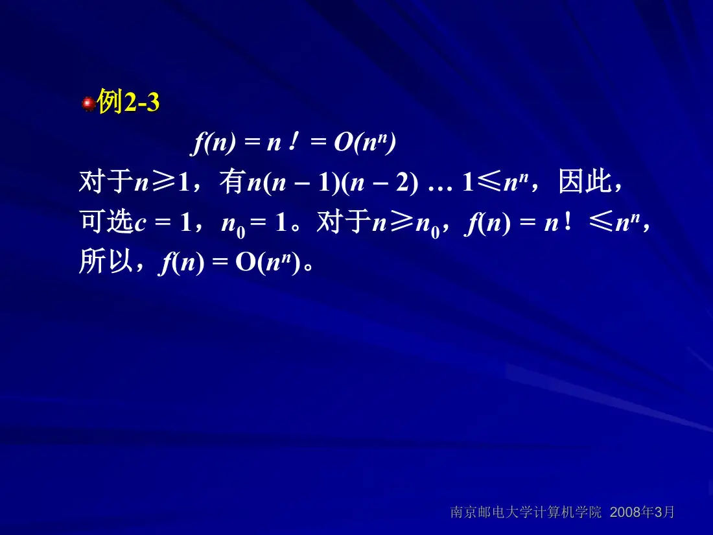

原文：

例2-3

$1 0 0 - 1 1 0 = 1 0 ( c m )$ 对于 $m = 1 1$ 有 $m ( n - 1 ) = ( 2 \sqrt { 2 } - 2 ) ( 2 \sqrt { 2 } - 1 ) ( 2 \sqrt { 2 } - 1 )$ 9 因此，可选 $\mathscr { C } \equiv \mathscr { n }$ $l i n = 1 1$ 。对于 $U E = U _ { 1 2 } = \langle 1 0 ^ { \circ } \rangle = \langle 1 2 0 ^ { \circ } = \langle 1 2 0 ^ { \circ } = 9 0 ^ { \circ }$ 所以， $1 ( 0 ) = 0 ( 0 )$

南京邮电大学计算机学院 2008年3月

### 例2-3

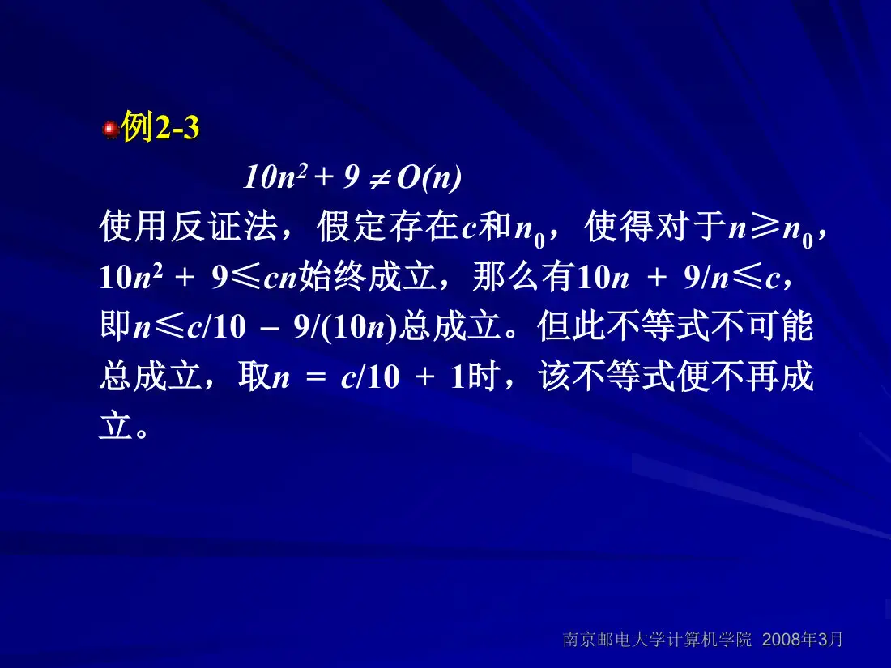

原文：

例2-3

$$
1 0 n ^ {2} + 9 \neq O (n)
$$

使用反证法，假定存在c和 $l i n$ 使得对于 $m = - a \sqrt { 1 2 }$ $1 0 0 - 2 0 0 = 1 0 0 ( c m )$ 始终成立，那么有 $1 1 7 - 1 1 = 1 1 7 - 9 1 = 1 9$ 即 $U _ { 2 } = \mathcal { A } \mathcal { B } [ ( 1 ) - \mathcal { B } ] \big ( \mathrm { H } ( | ) \mathcal { D } \big )$ 总成立。但此不等式不可能总成立，取 $\angle 2 = \angle A B C D = 9 0 ^ { \circ }$ 时，该不等式便不再成立。

南京邮电大学计算机学院 2008年3月

### 南京邮电大学计算机学院 2008年3月

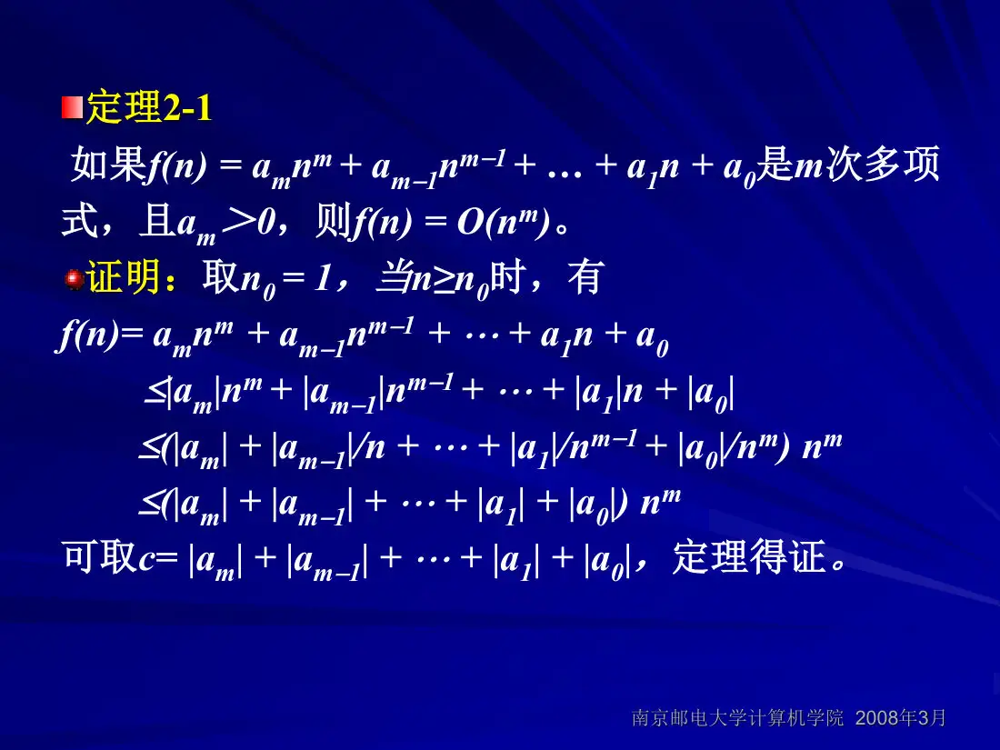

原文：

如果 $\textcircled { 1 0 } = \textcircled { 1 } \textcircled { 2 } \textcircled { 3 } \textcircled { 4 } \textcircled { 1 } \textcircled { 2 } \textcircled { 1 } \textcircled { 2 } \textcircled { 2 } \textcircled { 2 } \textcircled { 3 } \textcircled { 4 } \textcircled { 2 } \textcircled { 2 } \textcircled { 2 } \textcircled { 2 } \textcircled { 2 } \textcircled { 3 } \textcircled { 4 }$ 是m次多项式，且 $\textcircled { 1 } m = 0$ 则 $[ \langle \langle \mathcal { D } \rangle ] = \langle \langle \mathcal { D } \langle \mathcal { D } \langle \mathcal { D } \rangle ]$ 证明：取 $\textcircled { 1 } m = 1 1$ ， $\equiv m ^ { 2 } ( m )$ 时，有$1 0 0 = 1 0 0 0 0 0 0 0 0 0 0 0 0 0 0 0 0 0 0 0 0 0 0 0 0 0 0 0 0 0 0 0 0 0 0 0 0 0 0 0 0 0 0 0 0 0 0 0 0 0 0 0 0 0 0 0 0 0 0 0 0 0 0 0 0 0 0 0 0 0 0 0 0 0 0 0 0 0 0 0 0 0 0 0 0 0 0 0 0 0 0 0 0 0 0 0 0 0 0 0 0 0 0 0 0 0 0 0 0 0 0 0 0 0 0 0 0 0 0 0 0 0 0 0 0 0 0 0 0 0 0 0 0 0 0 0 0 0 0 0 0 0 0 0 0 0 0 0 0 0 0 0 0 0 0 0 0 0 0 0 0 0 0 0 0 0 0 0 0 0 0 0 0 0 0 0 0 0 0 0 0 0 0 0 0 0 0 0 0 0 0 0 0 0 0 0 0 0 0 0 0 0 0 0 0 0 0 0 0 0 0 0 0 0 0 0 0 0 0 0 0 0 0 0 0 0 0 0 0 0 0 0 0 0 0 0 0 0 0 0 0 0 0 0 0 0 0 0 0 0 0 0 0 0 0 0 0 0 0 0 0 0 0 0 0 0 0 0 0 0 0 0 0 0 0 0 0 0 0 0 0 0 0 0 0 0 0 0 0 0 0 0 0 0 0 0 0 0 0 0 0 0 0 0 0 0 0 0 0 0 0 0 0 0 0 0 0 0 0 0 0 0 0 0 0 0 0 0 0 0 0 0 0 0 0 0 0 0 0 0 0 0 0 0 0 0 0 0 0 0 0 0 0 0 0 0 0 0 0 0 0 0 0 0 0 0 0$ $\angle C A C = \angle C D E = \angle C A C = \angle C A C = \angle C A C = \angle C$ $\angle C D E = \angle C D E = \angle C A E = \angle C D E = \angle C D E = \angle C D E$ $\angle C O B = \angle C O B = \angle C O B = \angle C O B = \angle C O B$ 可取 $\cos \angle C = \frac { C O } { C O } = \frac { C O } { C O } = \frac { 1 } { 2 } \sqrt { 2 } \times \sqrt { 2 } = \sqrt { 2 }$ 定理得证。

南京邮电大学计算机学院 2008年3月

### 南京邮电大学计算机学院 2008年3月

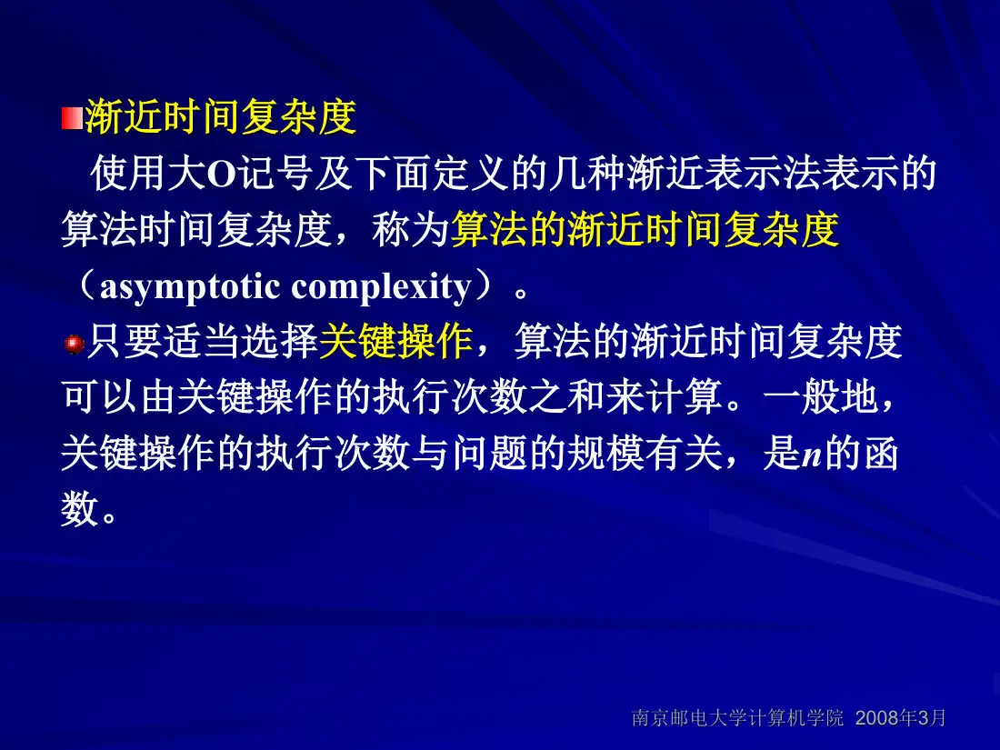

原文：

渐近时间复杂度使用大O记号及下面定义的几种渐近表示法表示的算法时间复杂度，称为算法的渐近时间复杂度（asymptotic complexity）。

只要适当选择关键操作，算法的渐近时间复杂度可以由关键操作的执行次数之和来计算。一般地，关键操作的执行次数与问题的规模有关，是n的函数。

南京邮电大学计算机学院 2008年3月

### 【程序2-3】 矩阵乘法

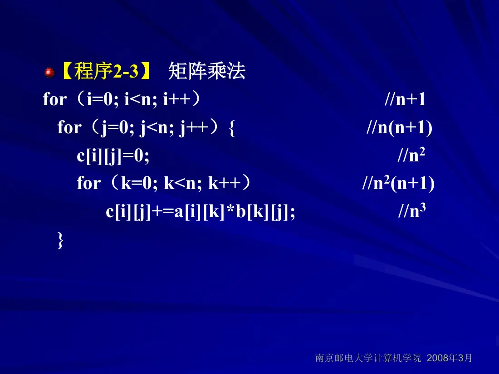

原文：

【程序2-3】 矩阵乘法

$$
\text { for } (i = 0; i <   n; i + +)
$$

$$
/ / \mathrm{n+1}
$$

$$
\text { for } (j = 0; j <   n; j + +) \{
$$

$$
/ / n (n + 1)
$$

c[i][j]=0;

$$
/ / \mathbf {n} ^ {2}
$$

$$
\text { for } (k = 0; k <   n; k + +)
$$

$$
\mathrm{c} [ \mathrm{i} ] [ \mathrm{j} ] + = \mathrm{a} [ \mathrm{i} ] [ \mathrm{k} ] ^ {*} \mathrm{b} [ \mathrm{k} ] [ \mathrm{j} ];
$$

$$
/ / \mathbf {n} ^ {2} (\mathbf {n} + 1)
$$

$$
/ / \mathbf {n} ^ {3}
$$

南京邮电大学计算机学院 2008年3月

### 2.2.2 记号

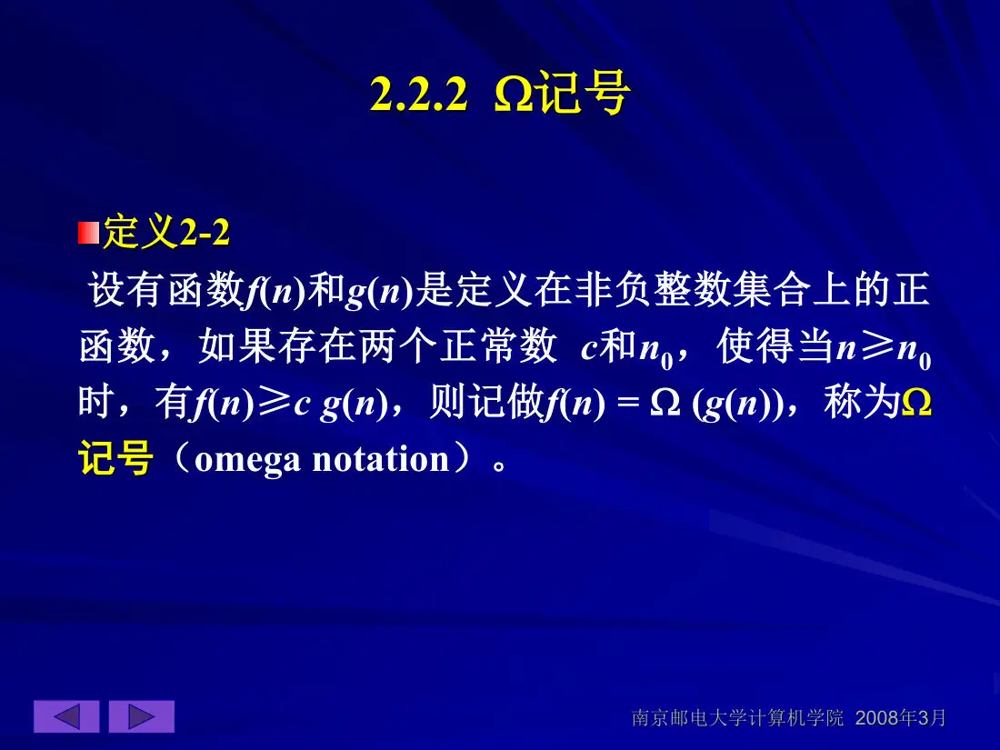

原文：

2.2.2 记号

定义2-2

设有函数f(n)和g(n)是定义在非负整数集合上的正函数，如果存在两个正常数 c和 $i i _ { 0 }$ ，使得当 $m = - a$ 时，有f $( 0 ) = 0 . 0 3 \textcircled { 1 }$ ，则记做f $( \pmb { \mathscr { W } } ) = \pmb { \mathscr { W } } ( \pmb { \mathscr { W } } ( \pmb { \mathscr { W } } ) )$ ，称为记号（omega notation）。

南京邮电大学计算机学院 2008年3月

### 南京邮电大学计算机学院 2008年3月

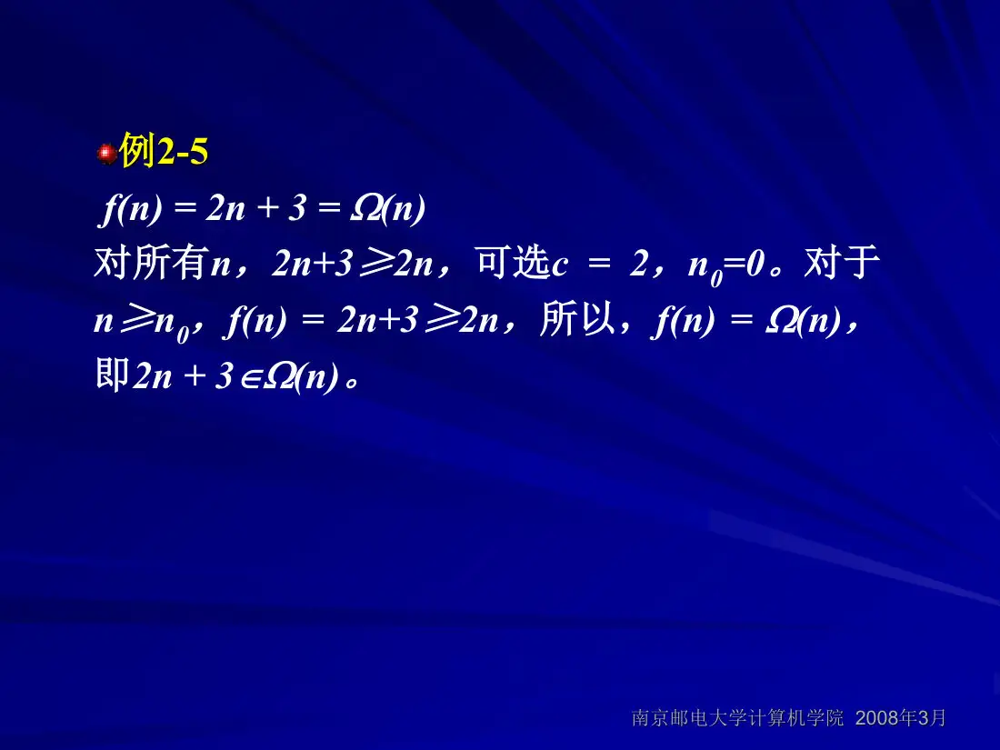

原文：

例2-5$1 0 0 - 0 . 1 5 = 0 . 0 0 0$ 对所有n， $2 m - 3 = 2 m$ ， 可选 $( 4 ) = ( 1 2 ) ( 1 2 ) = ( 1 2 ) ( 1 2 ) = ( 1 2 ) ( 1 2 ) ( 1 2 )$ 对于$U _ { 2 } = U _ { 1 } = \frac { U _ { 2 } } { \vert \overrightarrow { u } \vert } = \frac { \vert \overrightarrow { u } \vert } { \vert \overrightarrow { u } \vert } = \frac { \vert \overrightarrow { u } \vert } { \vert \overrightarrow { u } \vert } = \frac { \vert \overrightarrow { u } \vert } { \vert \overrightarrow { u } \vert } ,$ 所以， $i ( \omega ) = i \phi ( \omega )$ 即 $2 4 \times 5 = 1 0 0 ( m )$ 。

南京邮电大学计算机学院 2008年3月

### 南京邮电大学计算机学院 2008年3月

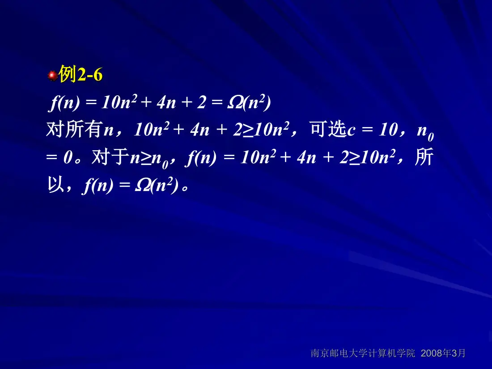

原文：

例2-6$( 1 0 ) = 1 0 0 0 0 ( c m ) = 1 0 0 ( c m )$ 对所有n， $\angle C D E = \angle B A D = \angle C D E$ 可选 $\scriptstyle { ( 4 ) = 1 } , { ( 7 ) = 1 }$ $\circleddash$ 。 对于 $1 0 0 0 - 1 0 0 0 = 1 0 0 0 0 ( c m ) = 1 0 0 0 ( c m )$ 所以， $1 0 0 = \textcircled { \bullet } \textcircled { \div }$ 。

南京邮电大学计算机学院 2008年3月

### 南京邮电大学计算机学院 2008年3月

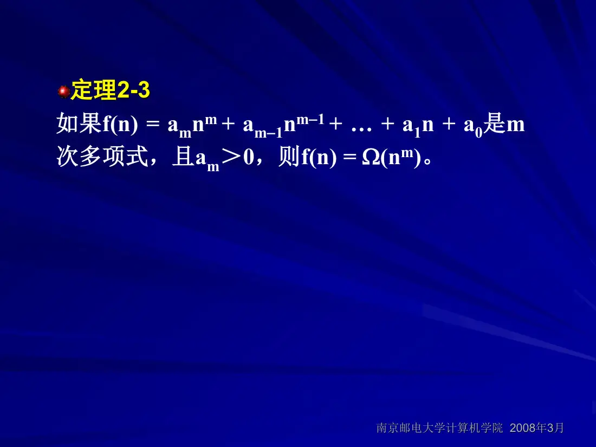

原文：

定理2-3如果f(n) $- \frac { 1 } { 2 } \times \frac { 1 } { 3 } + \frac { 1 } { 2 } \times \frac { 1 } { 3 } = \frac { 1 } { 2 } \times \frac { 1 } { 3 } = \frac { 1 } { 2 } ( - \frac { 1 } { 2 } + \frac { 1 } { 3 } ) = \frac { 1 } { 2 } ( - \frac { 1 } { 2 } + \frac { 1 } { 3 } )$ 是m次多项式，且 $\mathrm { e }$ ，则 $1 7 \div 1 0 = 1 9 ( m )$ 0

南京邮电大学计算机学院 2008年3月

### 2.2.3 记号

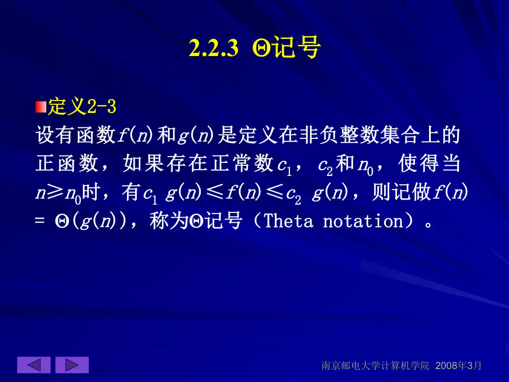

原文：

2.2.3 记号

定义2-3

设有函数 $h _ { i } ( 0 )$ 和 $\textcircled { 3 4 }$ 是定义在非负整数集合上的正函数，如果存在正常数 $\textcircled { 4 }$ ， $\textcircled { 4 2 }$ 和 $1 0 \%$ ，使得当$D E = D E$ 时，有 $( 2 ) ( 2 \sqrt { 1 0 } ) ( 2 \sqrt { 1 0 } ) ( 2 \sqrt { 1 0 } ) ( 2 \sqrt { 1 0 } )$ ，则记做 $7 \div ( 0 . 7 )$ $\mathbf { \Theta } [ \mathbf { Q } ] ( \mathbf { \Theta } ( 0 ) )$ ，称为记号（Theta notation）。

南京邮电大学计算机学院 2008年3月

### 南京邮电大学计算机学院 2008年3月

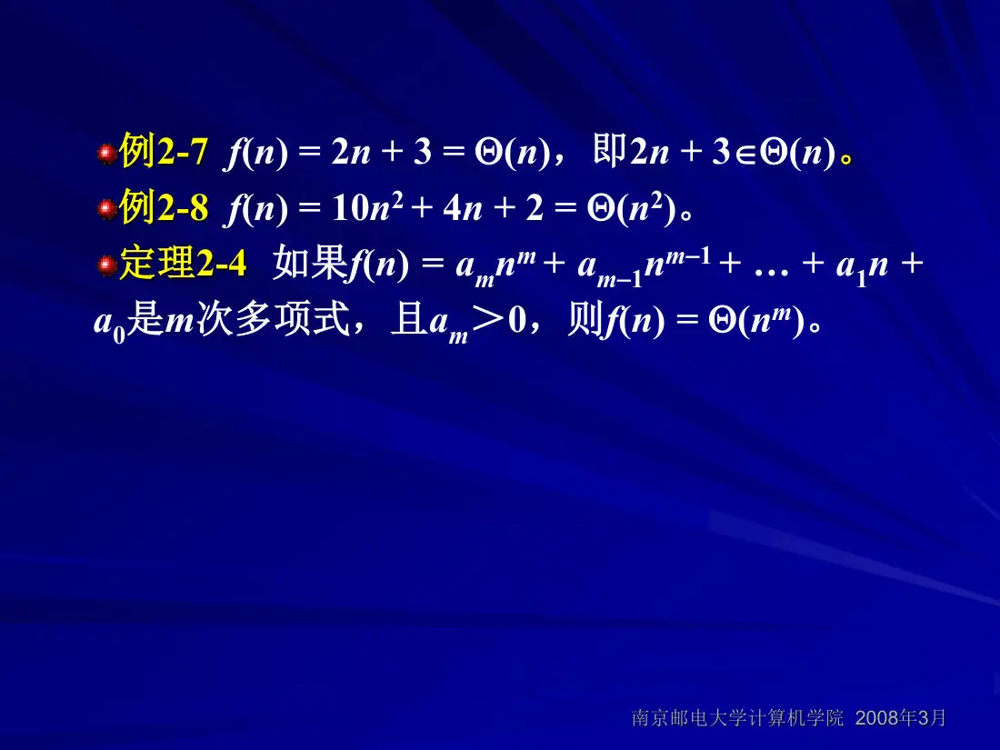

原文：

例2-7 $1 0 0 - 9 \times 1 0 = 9 0 ( c m )$ ，即 $2 4 2 - 5 = 2 0 0$ 例2-8 $( \textcircled { 1 0 } ) = ( 1 7 7 - 2 . 7 7 - 3 ) = ( \textcircled { 2 } \textcircled { 1 2 } )$ $\frac { 1 } { 2 } \times \frac { 1 } { 3 } = \frac { 1 } { 2 }$ 定理2-4 如果 $\textcircled { 1 0 } = \textcircled { 1 } \textcircled { 2 } \textcircled { 4 } \textcircled { 1 } \textcircled { 2 } \textcircled { 1 } \textcircled { 2 } \textcircled { 2 } \textcircled { 2 } \textcircled { 2 } \textcircled { 3 } \textcircled { 4 } \textcircled { 2 } \textcircled { 2 } \textcircled { 2 } \textcircled { 1 } \textcircled { 2 } \textcircled { 2 } \textcircled { 3 }$ $\textcircled { A }$ 是m次多项式，且 $\mathrm { c } m = 0$ ，则 $1 ( \textcircled { 1 } ) = \textcircled { \circ } ( \textcircled { 1 } \textcircled { 1 } )$ o

南京邮电大学计算机学院 2008年3月

### 2.2.4 小o记号

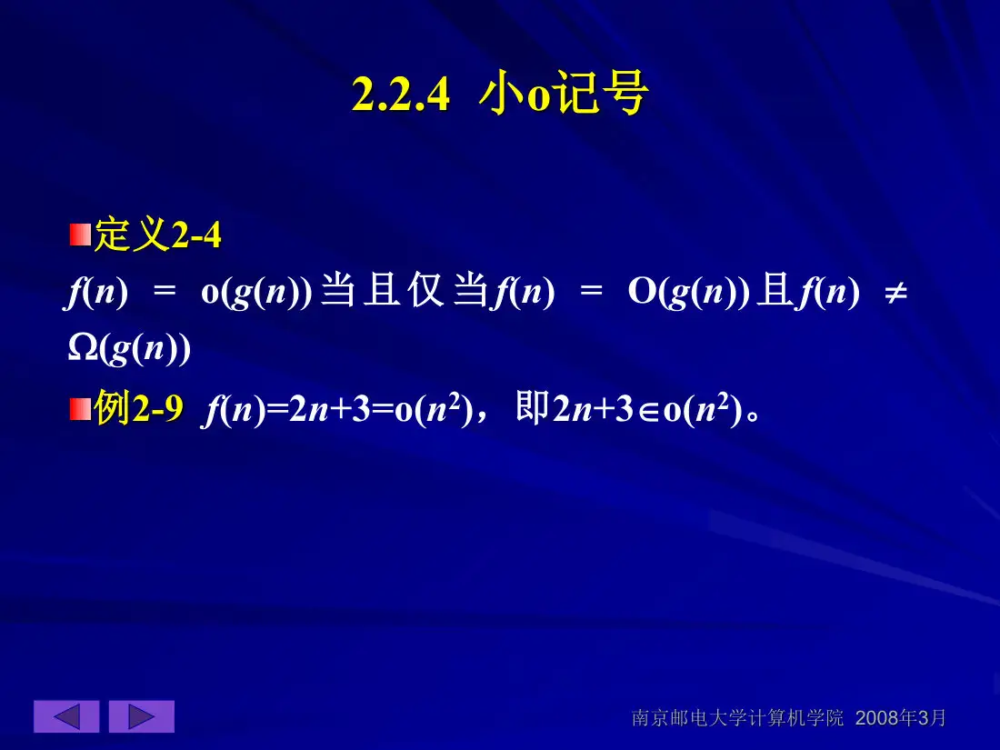

原文：

2.2.4 小o记号

定义2-4

$1 0 0 - 0 . 0 0 0$ 当且仅当 $1 4 0 - 9 0 0 0$ 且 $1 ( m )$

$$
\Omega (g (n))
$$

例2-9 $1 0 0 \times 1 0 0 = 1 1 0 0 0$ ，即 $2 7 \div 2 = 1 7 ( c m ^ { 2 } )$ 。

南京邮电大学计算机学院 2008年3月

### 2.2.5 算法按时间复杂度分类

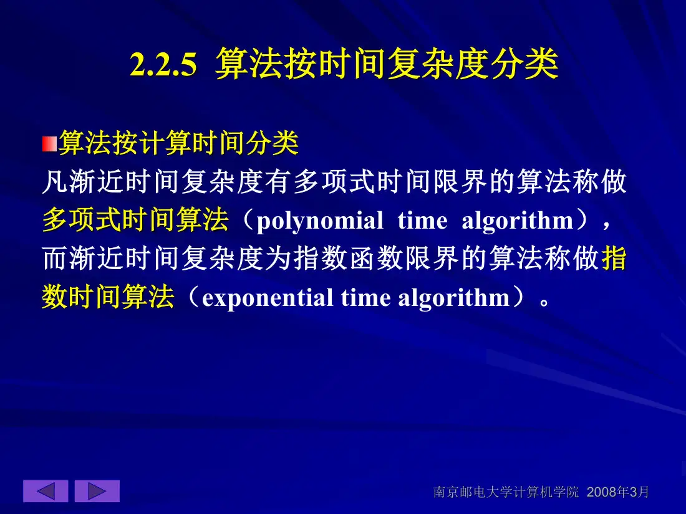

原文：

2.2.5 算法按时间复杂度分类

算法按计算时间分类凡渐近时间复杂度有多项式时间限界的算法称做多项式时间算法（polynomial time algorithm），而渐近时间复杂度为指数函数限界的算法称做指数时间算法（exponential time algorithm）。

南京邮电大学计算机学院 2008年3月

### 南京邮电大学计算机学院 2008年3月

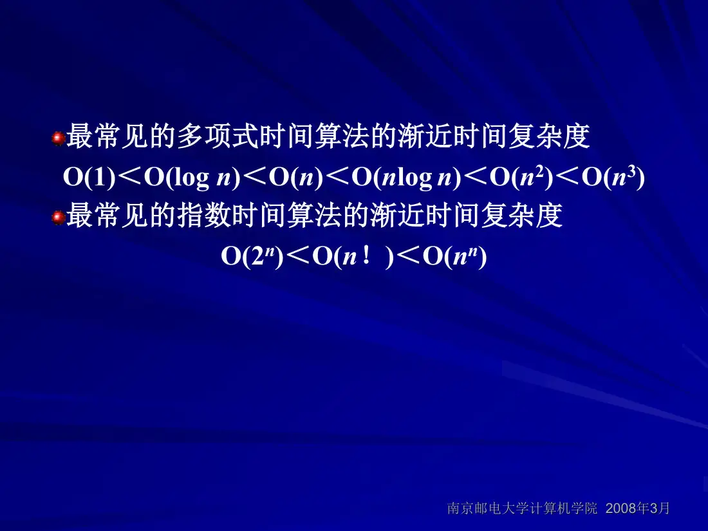

原文：

最常见的多项式时间算法的渐近时间复杂度O(1)＜O(log n)＜O(n)＜O(nlog n)＜O(n2)＜O(n3)最常见的指数时间算法的渐近时间复杂度O(2n)＜O(n！)＜O(nn)

南京邮电大学计算机学院 2008年3月

### 南京邮电大学计算机学院 2008年3月

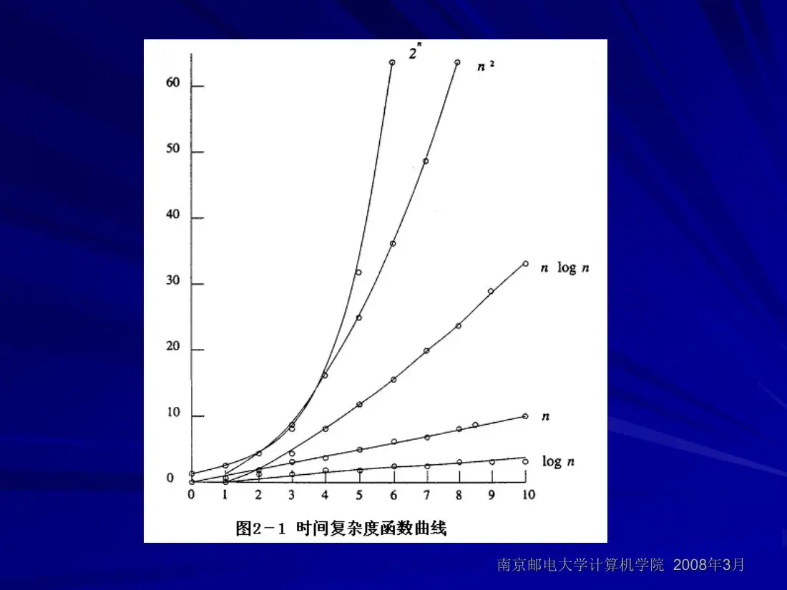

原文：

南京邮电大学计算机学院 2008年3月

### 2.3 递推关系

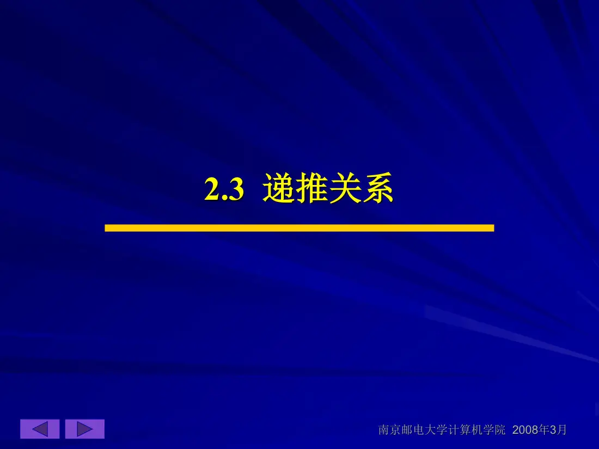

原文：

2.3 递推关系

△

南京邮电大学计算机学院 2008年3月

### 2.3.1 递推方程

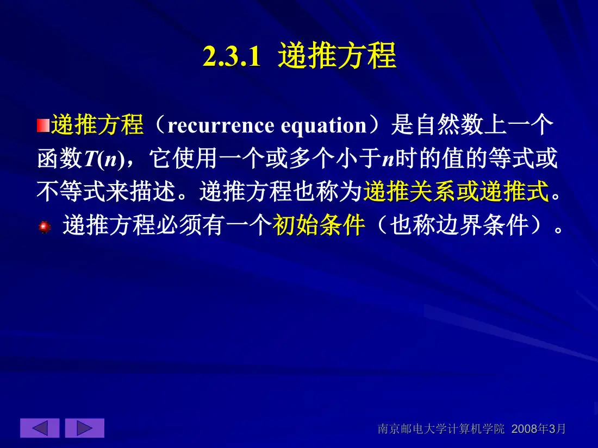

原文：

2.3.1 递推方程

递推方程（recurrence equation）是自然数上一个函数T(n)，它使用一个或多个小于n时的值的等式或不等式来描述。递推方程也称为递推关系或递推式。

递推方程必须有一个初始条件（也称边界条件）。

南京邮电大学计算机学院 2008年3月

### $$

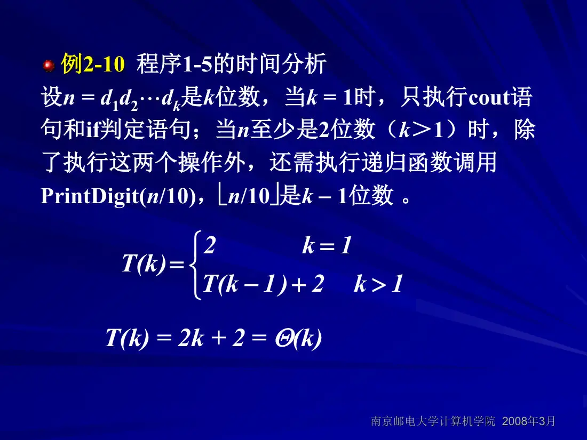

原文：

例2-10 程序1-5的时间分析设 $1 0 0 - 0 . 5 0 0 0 0 0 0$ 是k位数，当k = 1时，只执行cout语句和if判定语句；当n至少是2位数（k＞1）时，除了执行这两个操作外，还需执行递归函数调用PrintDigit(n/10)，Ln/10是k−1位数。

$$
T (k) = \left\{ \begin{array}{l l} 2 & k = 1 \\ T (k - 1) + 2 & k > 1 \end{array} \right.
$$

$$
T (k) = 2 k + 2 = \Theta (k)
$$

南京邮电大学计算机学院 2008年3月

### 2.3.2 替换方法

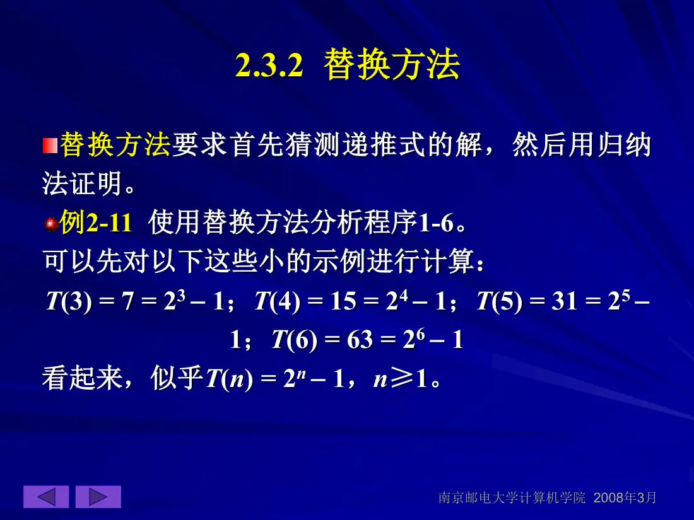

原文：

2.3.2 替换方法

替换方法要求首先猜测递推式的解，然后用归纳法证明。

例2-11 使用替换方法分析程序1-6。

可以先对以下这些小的示例进行计算：

T(3) = 7 = 23 − 1；T(4) = 15 = 24 − 1； $1 1 ( 6 ) - 3 1 ( - 6 ) = 1 2$ 1； $1 1 \textcircled { ( 2 ) } - 1 \textcircled { ( 3 ) } - \textcircled { ( 2 ) } - 1 1$ 看起来，似乎 $n ( 0 ) = 0 . 4 - 0 . 5 = 1$

南京邮电大学计算机学院 2008年3月

### 南京邮电大学计算机学院 2008年3月

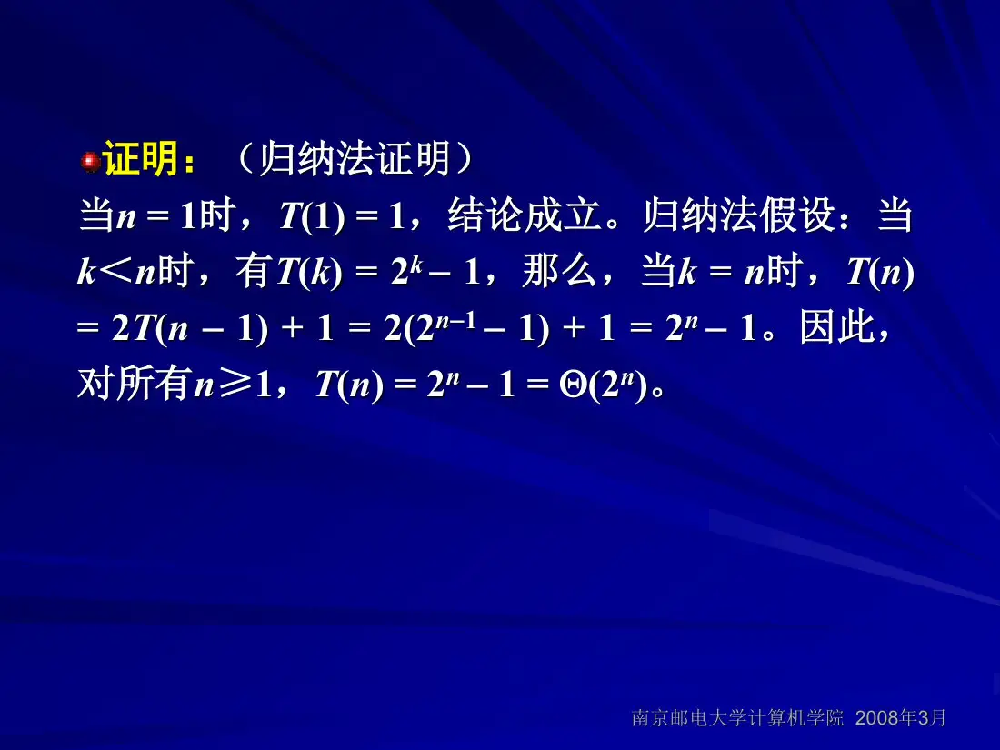

原文：

证明：（归纳法证明）当 $| \bar { u } | = \bar { 1 }$ 时， $4 ( 0 ) = 1 1$ 结论成立。归纳法假设：当$l 5 < \textcircled { < }$ 时，有 $1 0 0 - 5 0 0 = 1 1$ 那么，当 $l i = 1 1$ 时， $4 ( 0 )$ $- \sqrt { 1 1 } ( ( 1 - 1 1 ) - 1 1 ) = - \sqrt { 1 1 } ( 1 2 \sqrt { 1 3 } - 1 1 ) ( 1 - 1 1 ) = - \sqrt { 1 1 } ( 1 - 1 1 )$ 。因此，对所有 $1 1 2 3 1$ $1 1 ( 1 0 ) - 3 1 ( 1 0 - 1 0 ) ( 1 0 - 1 0 )$ 0

南京邮电大学计算机学院 2008年3月

### 2.3.3 迭代方法

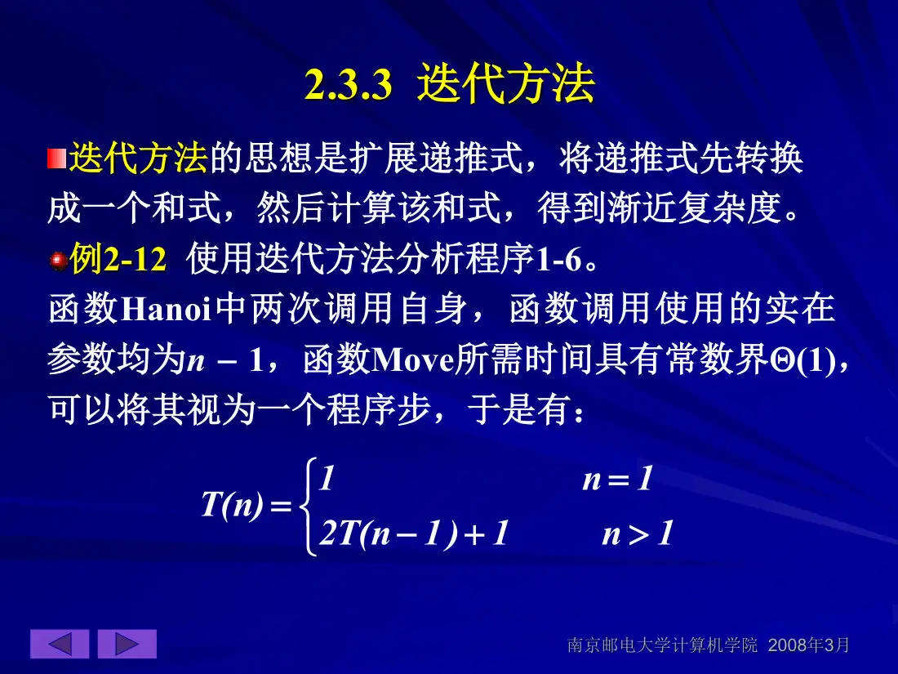

原文：

2.3.3 迭代方法

迭代方法的思想是扩展递推式，将递推式先转换成一个和式，然后计算该和式，得到渐近复杂度。例2-12 使用迭代方法分析程序1-6。

函数Hanoi中两次调用自身，函数调用使用的实在参数均为n − 1，函数Move所需时间具有常数界(1)，可以将其视为一个程序步，于是有：

$$
T (n) = \left\{ \begin{array}{l l} 1 & n = 1 \\ 2 T (n - 1) + 1 & n > 1 \end{array} \right.
$$

南京邮电大学计算机学院 2008年3月

### 扩展并计算此递推式：

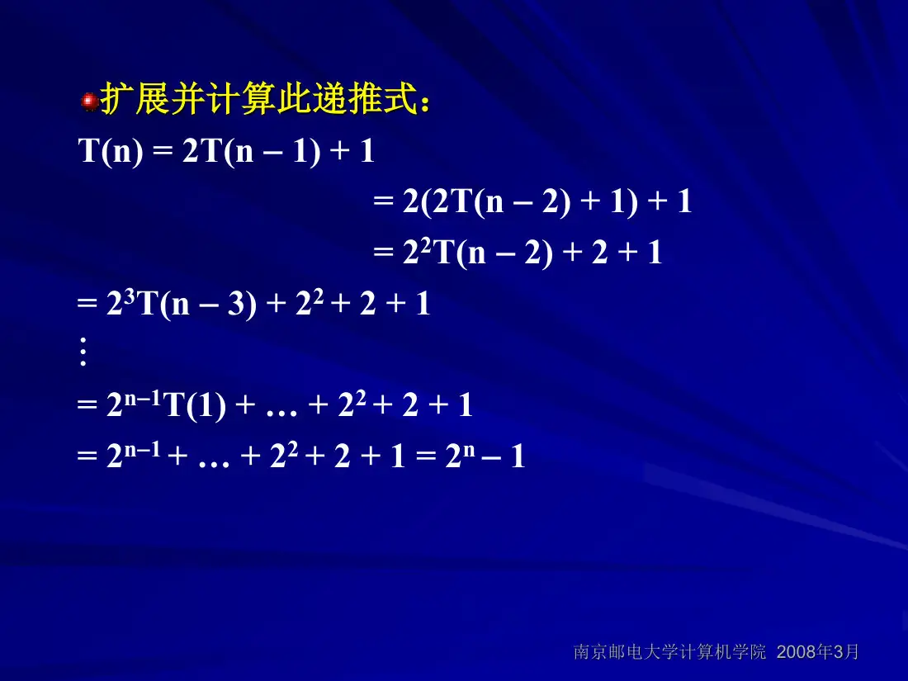

原文：

扩展并计算此递推式：

$$
\begin{array}{r l} \mathrm{T(n)} = 2 \mathrm{T(n-1)} + 1 & \\ & = 2 (2 \mathrm{T(n-2)} + 1) + 1 \\ & = 2 ^ {2} \mathrm{T(n-2)} + 2 + 1 \end{array}
$$

$$
= 2 ^ {3} \mathrm{T(n-3)} + 2 ^ {2} + 2 + 1
$$

$$
= 2 ^ {n - 1} T (1) + \dots + 2 ^ {2} + 2 + 1
$$

$$
= 2 ^ {n - 1} + \dots + 2 ^ {2} + 2 + 1 = 2 ^ {n} - 1
$$

南京邮电大学计算机学院 2008年3月

### 使用递归树（recursion tree）可以形象地看到递推式的迭代过程。

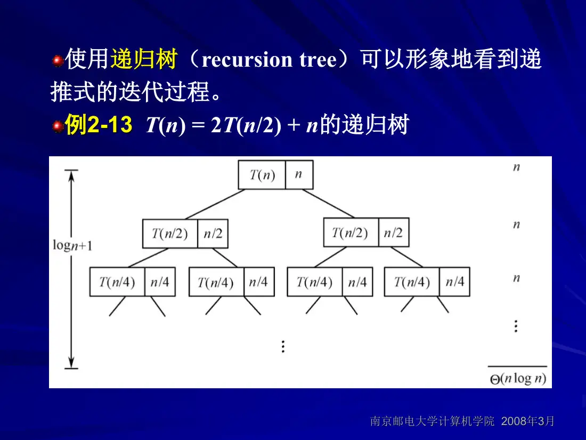

原文：

使用递归树（recursion tree）可以形象地看到递推式的迭代过程。

例2-13 $1 ( \textcircled { 1 } ) - 1 \times ( \textcircled { 1 } \textcircled { 2 } ) = 1 1$ 的递归树

Θ(n log n)

南京邮电大学计算机学院 2008年3月

### 例2-14 T(n) = T(n/3) + T(2n/3) + n的递归树

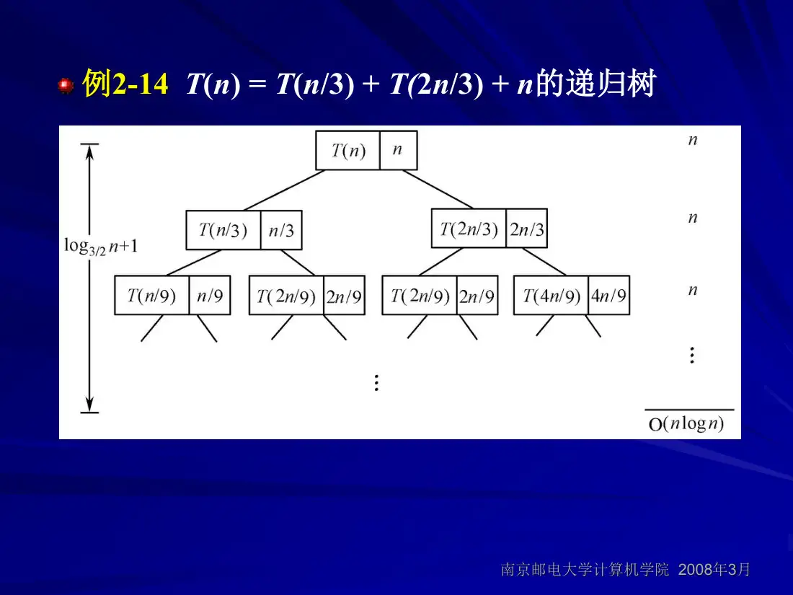

原文：

例2-14 T(n) = T(n/3) + T(2n/3) + n的递归树

O(nlogn)

南京邮电大学计算机学院 2008年3月

### 2.3.4 主方法

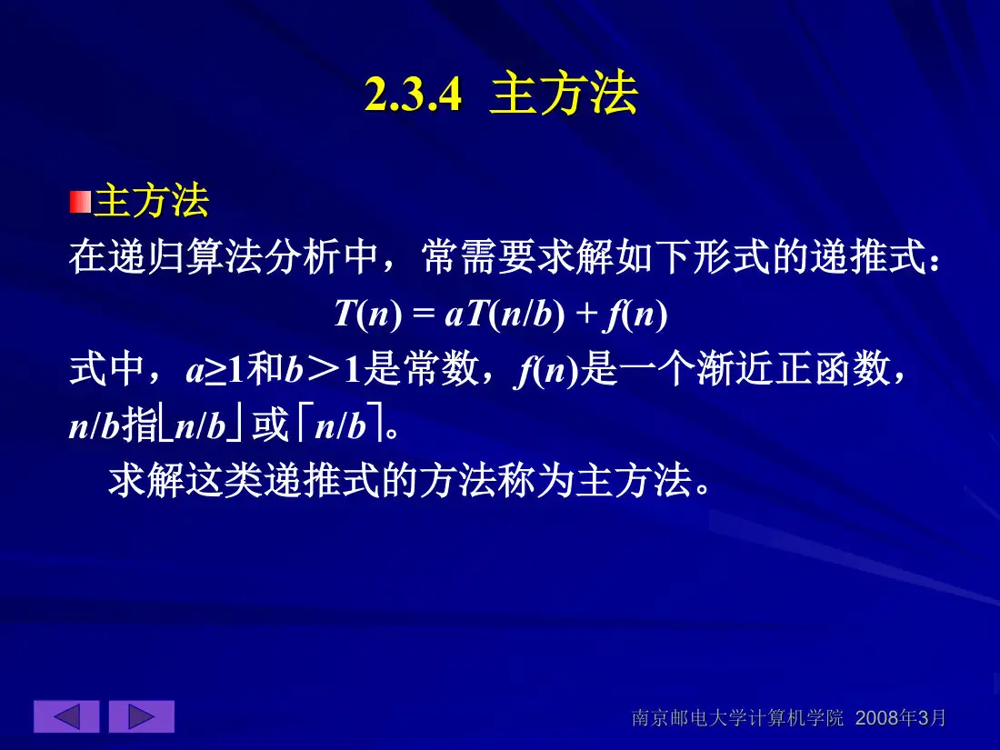

原文：

2.3.4 主方法

主方法

在递归算法分析中，常需要求解如下形式的递推式：

$$
T (n) = a T (n / b) + f (n)
$$

式中， $\textcircled { 1 } 2 1$ 和b＞1是常数，f(n)是一个渐近正函数，$m / l$ 指 $\textcircled { 1 } \textcircled { 1 }$ 或 $\boxed { \pmb { \bigtriangledown } } \boxed { \pmb { \bigtriangledown } } \boxed { \pmb { \bigtriangledown } }$

求解这类递推式的方法称为主方法。

南京邮电大学计算机学院 2008年3月

### 南京邮电大学计算机学院 2008年3月

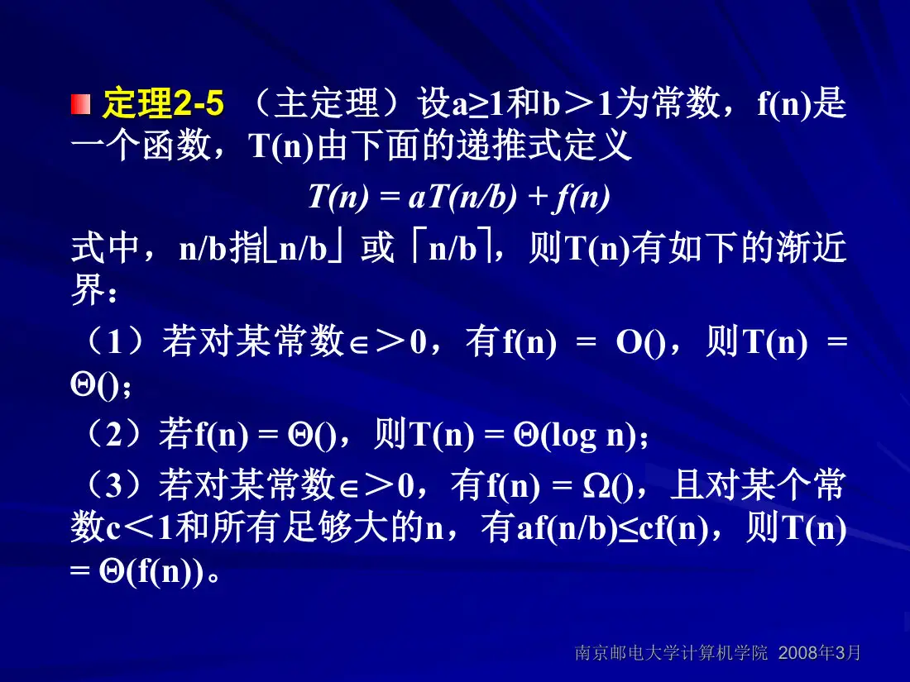

原文：

定理2-5 （主定理）设a≥1和b＞1为常数，f(n)是一个函数，T(n)由下面的递推式定义

$1 8 \textcircled { 1 0 } = 1 0 \times ( 1 0 \times 1 ) = 1 1 \textcircled { 1 0 }$ 式中，n/b指 $\mathbb { I } \mathbb { M } \mathbb { I }$ 或「n/b]，则T(n)有如下的渐近界：

（1）若对某常数 $\circledast$ ，有 $[ [ 0 , 0 ] ] = [ 0 , 0 ]$ 则 $4 0 0 0$ ()；

（2）若 $\langle 0 0 | \mathbf { \bar { \Gamma } } | 0 0 \rangle = \langle 0 | \mathbf { \bar { \Gamma } } | 0 \rangle$ ，则 $4 \times ( 1 0 ) = ( 0 ) ( 1 0 0 \div 1 0 )$ ；

（3）若对某常数＞0，有 $1 0 0 0 0$ ，且对某个常数c＜1和所有足够大的n，有 $2 \times ( 1 1 1 0 - 2 ) = 2 \times ( 1 1 )$ 则T(n)$\mathbf { \delta } \equiv \langle \mathbf { \vec { o } } \rangle ( \mathbf { i } \mathbf { \bf { f } } \langle \mathbf { \vec { o } } \rangle )$

南京邮电大学计算机学院 2008年3月

### 南京邮电大学计算机学院 2008年3月

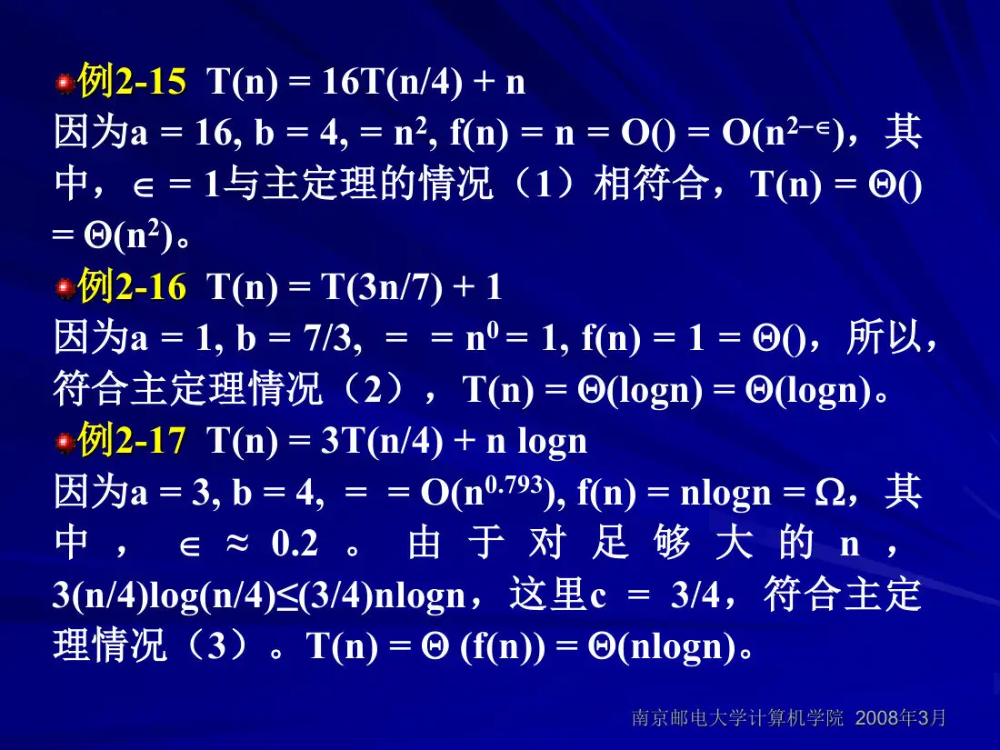

原文：

例 $\Delta E ( A ( 1 ) ) = \Delta E ( A ( 1 ) ) = \Delta E ( A ( 1 ) ) = \Delta E ( A ( 1 ) )$ 因为 $R _ { 1 } = I _ { 1 } ( \Omega _ { 1 } ) = I _ { 2 } ( \Omega _ { 1 } ) = I _ { 1 } ( \Omega _ { 1 } ) = I _ { 1 } ( \Omega _ { 1 } ) = I _ { 2 } ( 0 ) = I _ { 1 } ( \Omega _ { 1 } ) = I _ { 2 } ( \Omega _ { 1 } ) = I _ { 2 } ( \Omega _ { 1 } ) = I _ { 2 } ( \Omega _ { 1 } ) = I _ { 2 } ( \Omega _ { 1 } ) = I _ { 1 } ( \Omega _ { 1 } ) = I _ { 2 } ( \Omega _ { 1 } ) = I _ { 2 } ( \Omega _ { 1 } ) ,$ 其中， $\circledast$ 与主定理的情况（1）相符合， $1 1 0 0 0 0 0$ $\Xi ( \odot ) ( \bar { \bullet } \bar { \bullet } )$ 例2-16 $( 1 ) ( 1 1 ) - ( 1 1 ) ( 1 1 ) ( 1 1 ) = 1 1$ 因为 $R _ { 1 } = \rho _ { 1 } ( \rho _ { 1 } ) = \rho _ { 1 } ( \rho _ { 1 } ) = \rho _ { 1 } ( \rho _ { 1 } ) = \rho _ { 1 } ( \rho _ { 1 } ) = \rho _ { 1 } ( \rho _ { 1 } ) = \rho _ { 1 } ( \rho _ { 1 } )$ 所以，符合主定理情况（2）， $( 1 ) ( 1 0 ) - ( 0 ) ( 1 0 0 \div 1 0 ) = ( 0 ) ( 1 0 \div 1 0 )$ 例 $\langle 2 | \mathcal { S } | | \mathcal { S } | | \langle | \langle | \mathcal { D } \rangle | = | \mathcal { S } \mathcal { S } | | \langle | \mathcal { V } | | \mathcal { L } \rangle | = | | \mathcal { S } | | \langle | \mathcal { V } | | \mathcal { V } | | \mathcal { V } \rangle | .$ 因为 $R _ { 1 } = R _ { 1 } ( 1 ) = R _ { 2 } ( 1 ) = \frac { \sin ( \theta ) } { \sin ( \theta ) } = \frac { \sin ( \theta ) } { \sin ( \theta ) } = \frac { \sin ( \theta ) } { \sin ( \theta ) } = \frac { \sin ( \theta ) } { \sin ( \theta ) } = \frac { \sin ( \theta ) } { \sin ( \theta ) } = \frac { \sin ( \theta ) } { \sin ( \theta ) }$ 其中 ， $\circledast$ o 由 于 对 足 够 大 的 n$\mathrm { s r } ( ( 1 1 \angle ) ) ( 1 2 \leq ( 1 1 \angle ) ) = ( \mathrm { s } ^ { 2 } \angle 2 ) ( 1 2 \angle 2 ) = 1 1$ ，这里 $\circledast$ ，符合主定理情况（3）。 $( \mathrm { C ( 1 ) } ) = ( \mathrm { O } ) ( ( 1 0 ) ) = ( \mathrm { O } ) ( 1 1 1 0 ) = ( \mathrm { O } ) ( 1 1 1 0 ) = ( \mathrm { O } )$ o

南京邮电大学计算机学院 2008年3月

### 南京邮电大学计算机学院 2008年3月

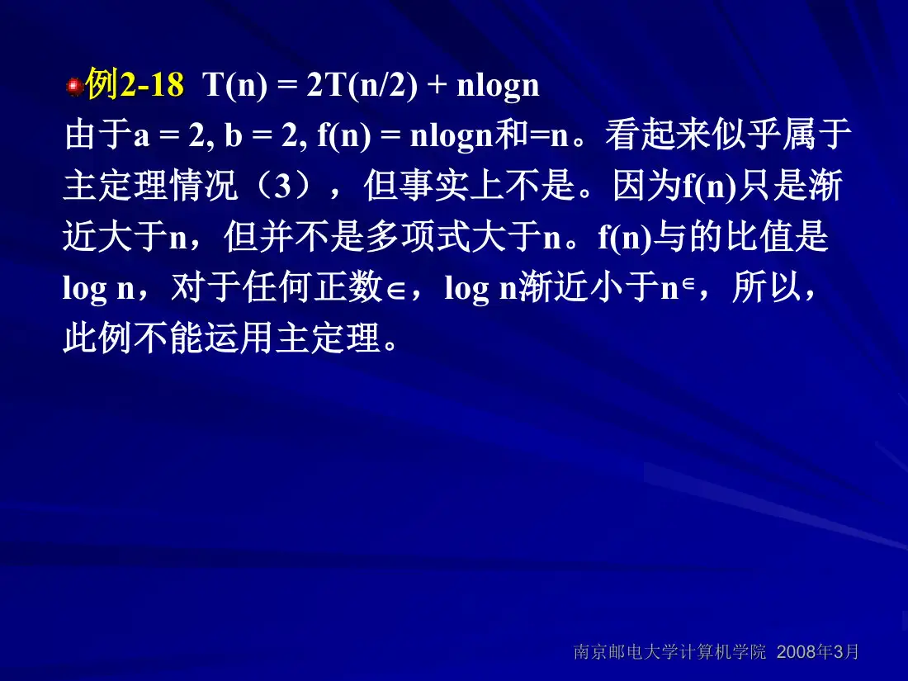

原文：

例 $\Delta A ( A ) = \Delta A ( A ) = \Delta A ( A ) = \Delta A ( A ) = \Delta A ( A ) = \Delta B ( A )$ 由于 $\rho _ { 1 } ( 1 ) = \rho _ { 1 } ( 1 ) = \rho _ { 1 } ( 1 ) ( 1 ) = 1 1 ( 1 ) = 1 1 ( 1 ) = 1 1$ 看起来似乎属于主定理情况（3），但事实上不是。因为f(n)只是渐近大于n，但并不是多项式大于n。f(n)与的比值是log n，对于任何正数，log n渐近小于 $\pmb { \Vert 1 } =$ ，所以，此例不能运用主定理。

南京邮电大学计算机学院 2008年3月
