# 《算法设计与分析》第6章 贪心法（课件）

原件的每一页，下面附识别出的文字。

### 算法设计与分析

原文：

算法设计与分析

DeSign and Analysis of Algorithms In C++

陈慧南 编著

南京邮电大学计算机学院 2008年3月

“十一五”国家级规划教材

电子工业出版社

### 第2部分 算法设计策略

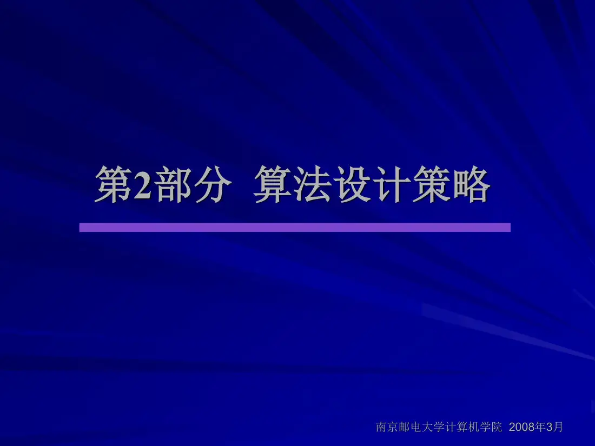

原文：

第2部分 算法设计策略

南京邮电大学计算机学院 2008年3月

### 第6章 贪心法

原文：

第6章 贪心法

南京邮电大学计算机学院 2008年3月

### 6.1 一般方法

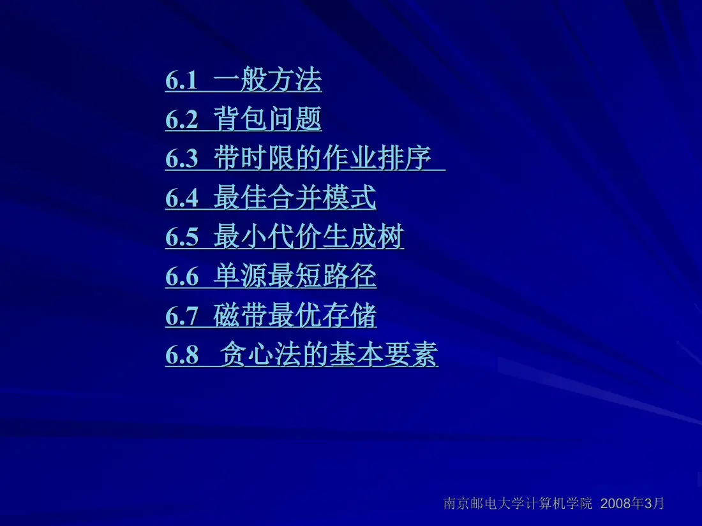

原文：

6.1 一般方法

6.2 背包问题

6.3 带时限的作业排序

6.4 最佳合并模式

6.5 最小代价生成树

6.6 单源最短路径

6.7 磁带最优存储

6.8 贪心法的基本要素

南京邮电大学计算机学院 2008年3月

### 6.1 一般方法

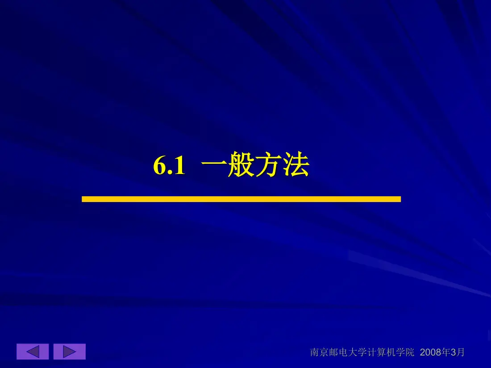

原文：

6.1 一般方法

△

南京邮电大学计算机学院 2008年3月

### 南京邮电大学计算机学院 2008年3月

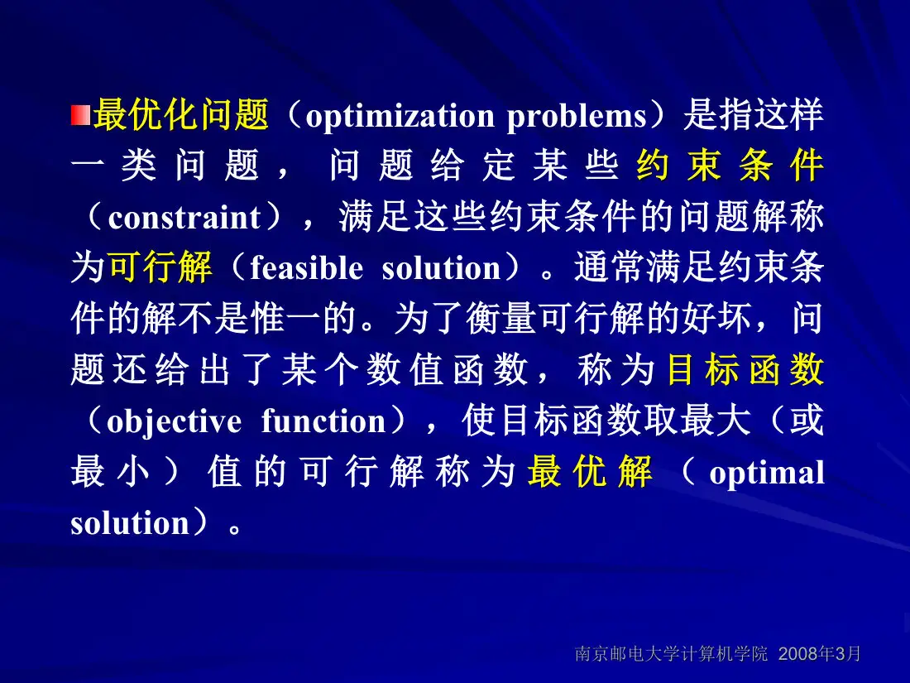

原文：

最优化问题（optimization problems）是指这样一 类 问 题 ， 问 题 给 定 某 些 约 束 条 件（constraint），满足这些约束条件的问题解称为可行解（feasible solution）。通常满足约束条件的解不是惟一的。为了衡量可行解的好坏，问题还给出了某个数值函数，称为目标函数（objective function），使目标函数取最大（或最 小 ） 值 的 可 行 解 称 为 最 优 解 （ optimalsolution）。

南京邮电大学计算机学院 2008年3月

### 贪心法是通过分步决策（stepwise decision）的方法来求解问题的。

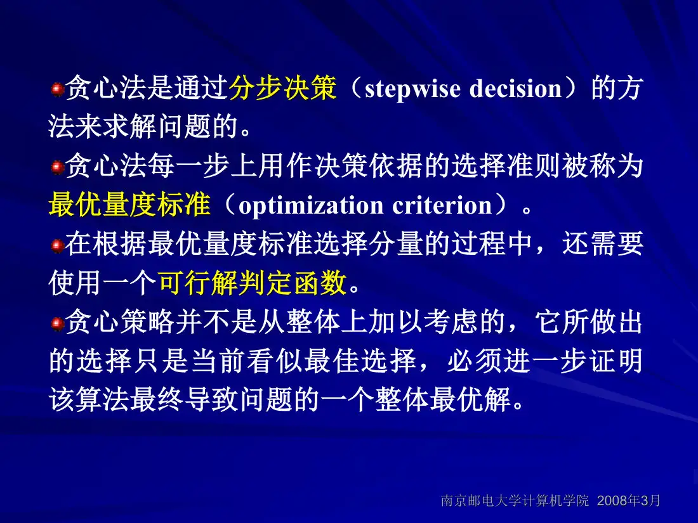

原文：

贪心法是通过分步决策（stepwise decision）的方法来求解问题的。

贪心法每一步上用作决策依据的选择准则被称为最优量度标准（optimization criterion）。

在根据最优量度标准选择分量的过程中，还需要使用一个可行解判定函数。

贪心策略并不是从整体上加以考虑的，它所做出的选择只是当前看似最佳选择，必须进一步证明该算法最终导致问题的一个整体最优解。

南京邮电大学计算机学院 2008年3月

### solution=Union(solution,x);

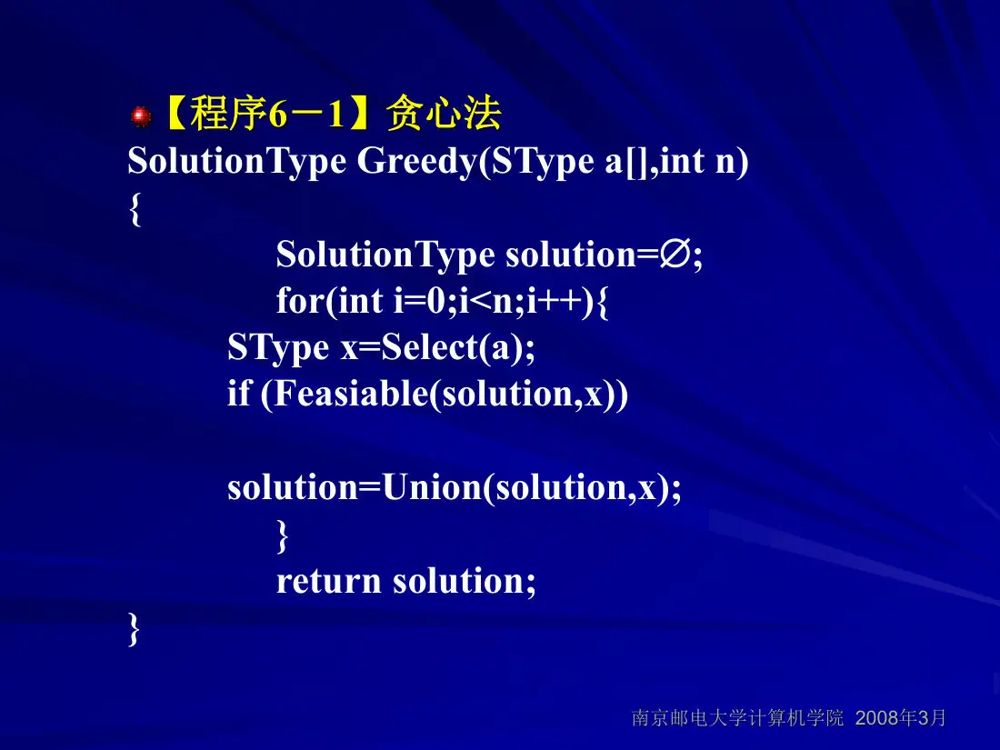

原文：

【程序6－1】贪心法SolutionType Greedy(SType a[],int n)

SolutionType solution=; for(int i=0;i<n;i++){ SType x=Select(a); if (Feasiable(solution,x))

solution=Union(solution,x);

return solution;

南京邮电大学计算机学院 2008年3月

### 6.2 背包问题

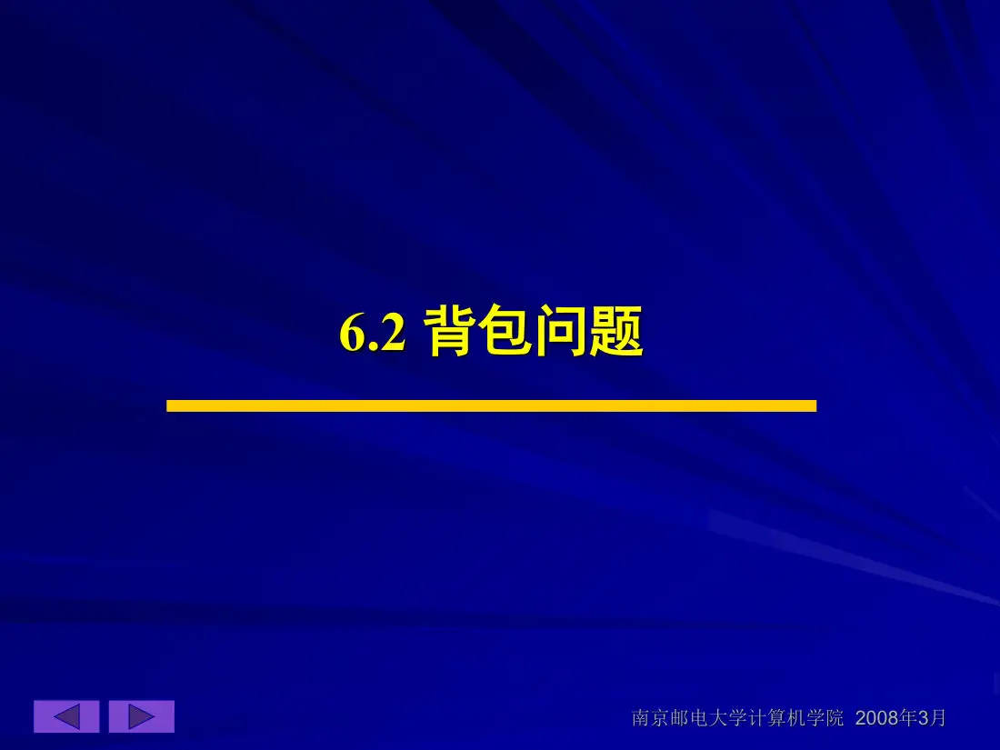

原文：

6.2 背包问题

△

南京邮电大学计算机学院 2008年3月

### 问题在一个元素集合中寻找最大元素和最小元素的问题。

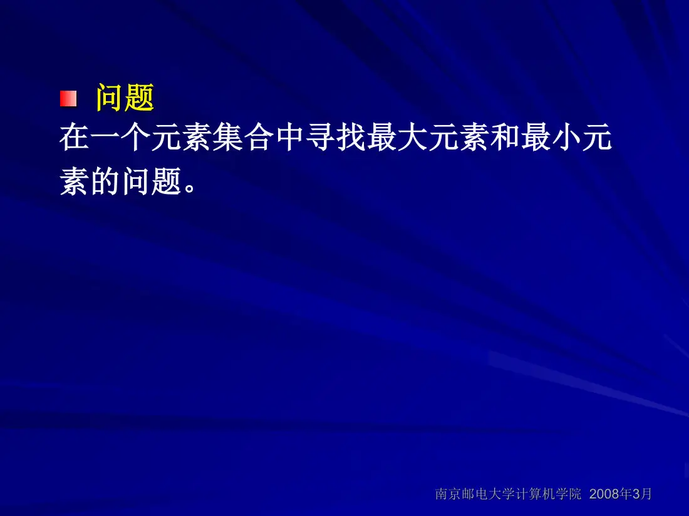

原文：

问题在一个元素集合中寻找最大元素和最小元素的问题。

南京邮电大学计算机学院 2008年3月

### 6.2.1 问题描述

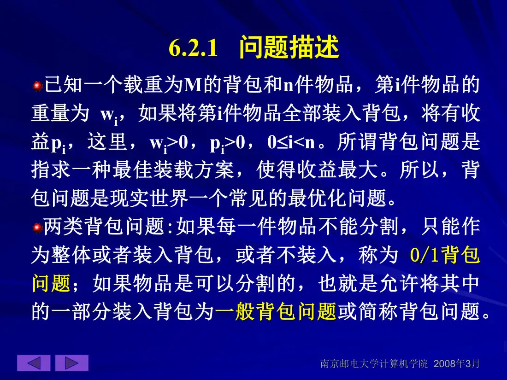

原文：

6.2.1 问题描述

已知一个载重为M的背包和n件物品，第i件物品的重量为 $\therefore \angle B A C = 9 0 ^ { \circ }$ 如果将第i件物品全部装入背包，将有收益 $1 4 0$ 这里，w>0， $1 9 - 9 = 1 1$ 0i<n。所谓背包问题是指求一种最佳装载方案，使得收益最大。所以，背包问题是现实世界一个常见的最优化问题。

两类背包问题:如果每一件物品不能分割，只能作为整体或者装入背包，或者不装入，称为 0/1背包问题；如果物品是可以分割的，也就是允许将其中的一部分装入背包为一般背包问题或简称背包问题。

南京邮电大学计算机学院 2008年3月

### 6.2.2 贪心法求解

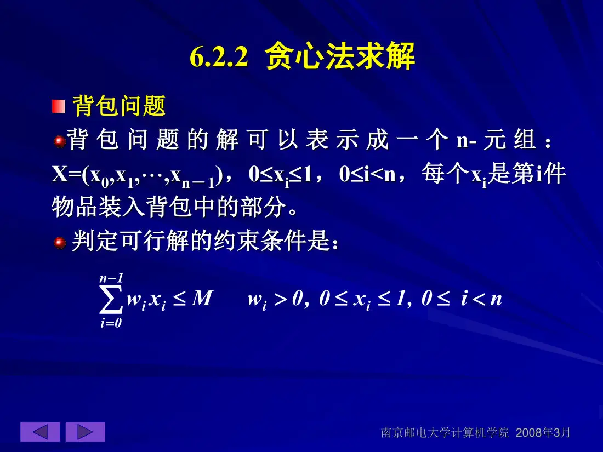

原文：

6.2.2 贪心法求解

背包问题

背 包 问 题 的 解 可 以 表 示 成 一 个 n- 元 组 ：$: \angle 1 = \angle D = \angle E C A = \angle C$ $0 . 5 \times 1 0 = 1 1$ ，0i<n，每个 $\chi _ { 9 }$ 是第i件物品装入背包中的部分。

判定可行解的约束条件是：

$$
\sum_ {i = 0} ^ {n - 1} w _ {i} x _ {i} \leq M \quad w _ {i} > 0, 0 \leq x _ {i} \leq 1, 0 \leq i <   n
$$

南京邮电大学计算机学院 2008年3月

### 背包问题的最优解必须使下列目标函数取最大值：

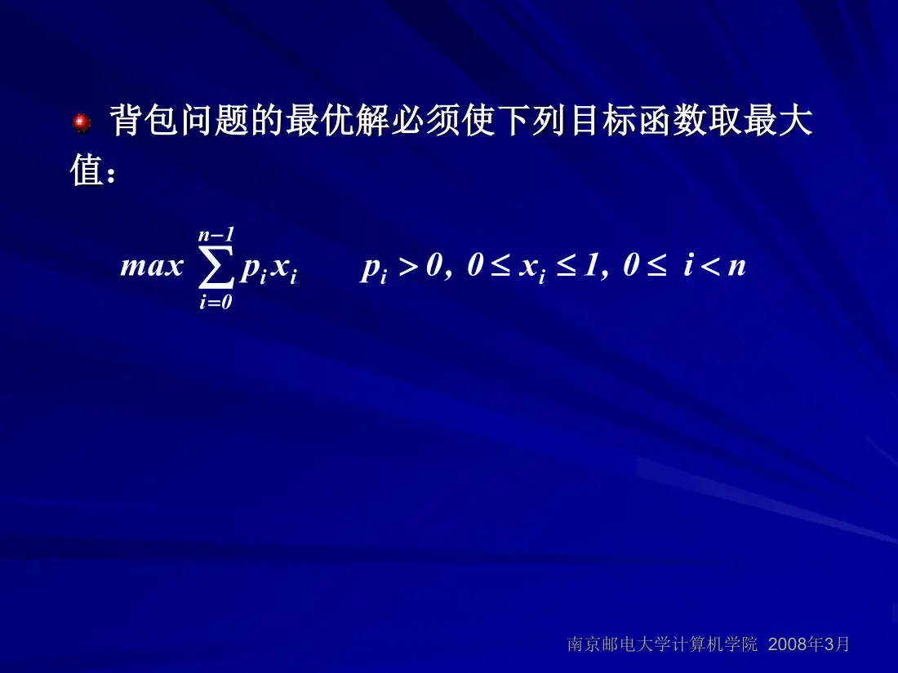

原文：

背包问题的最优解必须使下列目标函数取最大值：

$$
m a x \sum_ {i = 0} ^ {n - 1} p _ {i} x _ {i} \qquad p _ {i} > 0, 0 \leq x _ {i} \leq 1, 0 \leq i <   n
$$

南京邮电大学计算机学院 2008年3月

### 例6－1

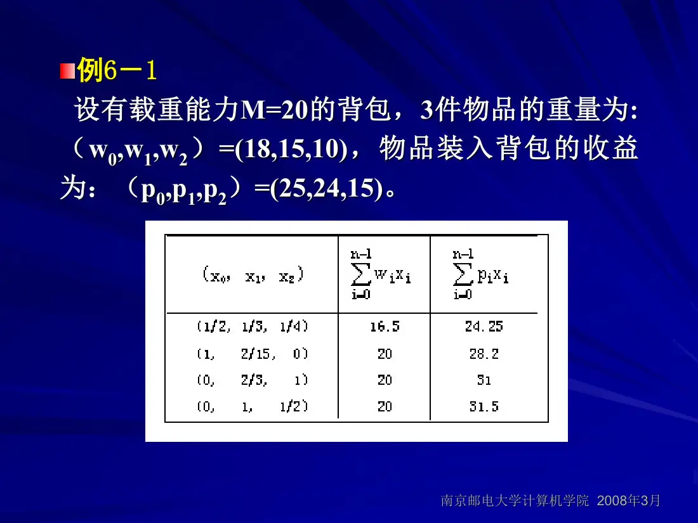

原文：

例6－1

设有载重能力M=20的背包，3件物品的重量为:$( 1 ) ( 1 0 0 0 0 0 0 ) \times ( 1 0 0 0 0 0 0 0 ) \times ( 1 0 0 0 0 0 0 0 ) \times ( 1 0 0 0 0 0 0 0 0 ) \times ( 1 0 0 0 0 0 0 0 0 0 0 ) \times ( 1 0 0 0 0 0 0 0 0 0 0 0 0 0 0 )$ 物品装入背包的收益为： $( 9 , 2 0 0 , 2 0 0 ) = ( 9 , 5 0 0 , 1 0 0 )$ 0

<table><tr><td> $(x_0, x_1, x_2)$ </td><td> $\sum_{i=0}^{n-1} w_i x_i$ </td><td> $\sum_{i=0}^{n-1} p_i x_i$ </td></tr><tr><td>(1/2, 1/3, 1/4)</td><td>16.5</td><td>24.25</td></tr><tr><td>(1, 2/15, 0)</td><td>20</td><td>28.2</td></tr><tr><td>(0, 2/3, 1)</td><td>20</td><td>31</td></tr><tr><td>(0, 1, 1/2)</td><td>20</td><td>31.5</td></tr></table>

南京邮电大学计算机学院 2008年3月

### 【程序6－2】背包问题的贪心算法templateclass Knapsack

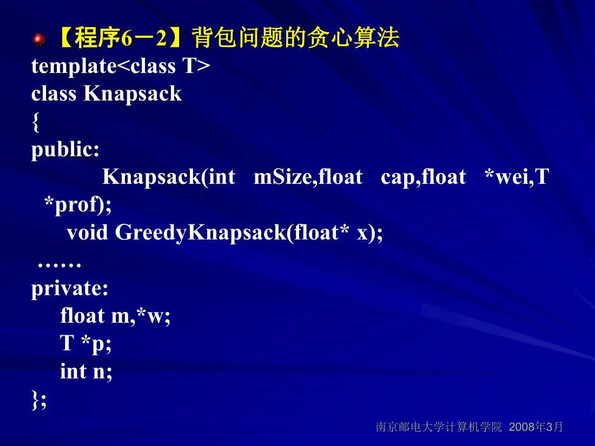

原文：

【程序6－2】背包问题的贪心算法template<class T>class Knapsack

Knapsack(int mSize,float cap,float \*wei,T \*prof); void GreedyKnapsack(float\* x);

private:

float m,\*w;

T \*p;

int n;

南京邮电大学计算机学院 2008年3月

### 南京邮电大学计算机学院 2008年3月

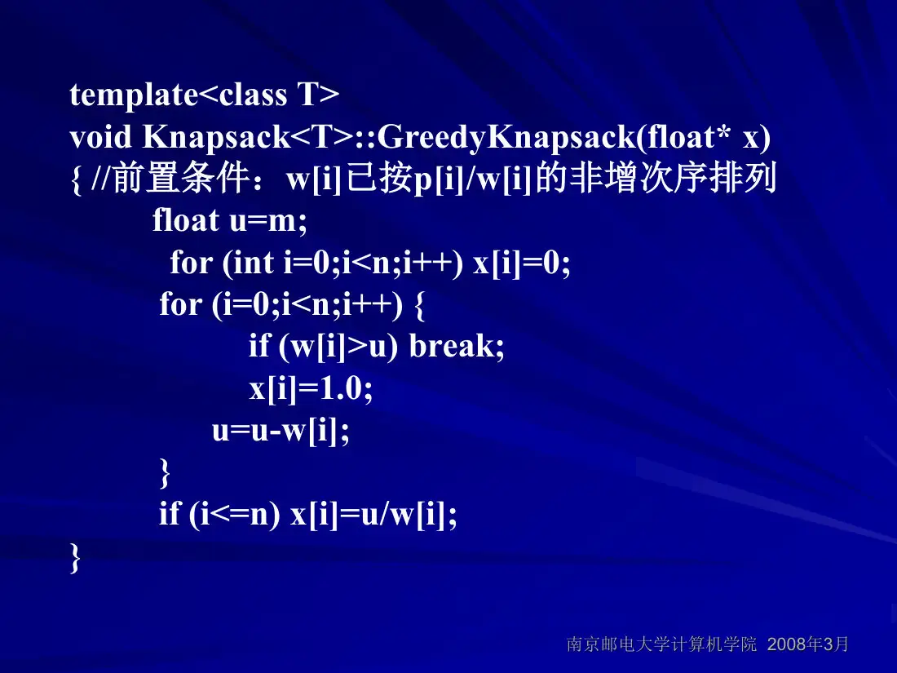

原文：

template<class T> void Knapsack<T>::GreedyKnapsack(float\* x) { //前置条件：w[i]已按p[i]/w[i]的非增次序排列 float u=m; for (int i=0;i<n;i++) x[i]=0; for (i=0;i<n;i++) { if (w[i]>u) break; x[i]=1.0; u=u-w[i]; if (i<=n) x[i]=u/w[i];

南京邮电大学计算机学院 2008年3月

### 6.2.3 算法正确性

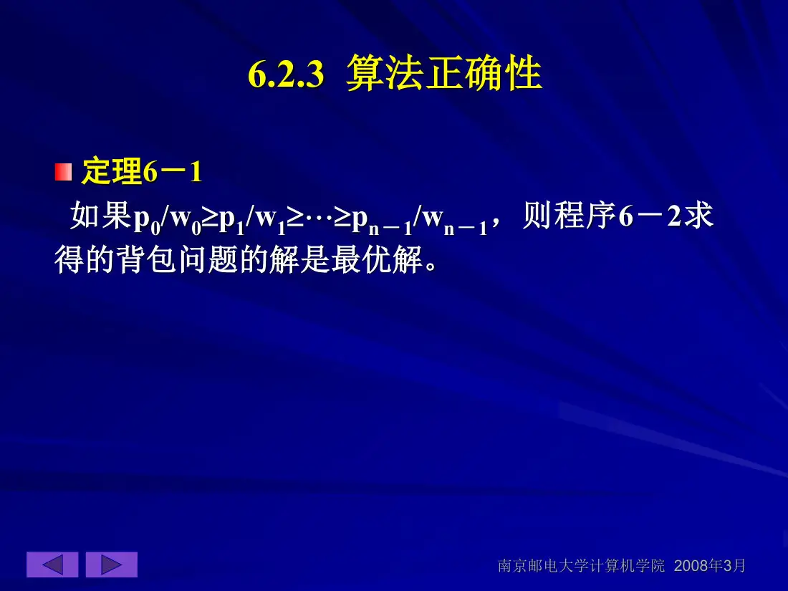

原文：

6.2.3 算法正确性

定理6－1

如果 $1 2 . 5 \times 1 0 ^ { - 3 } k g / m ^ { 3 } = 3 0 0 0 0 0 ( c m ^ { 3 } )$ 则程序6－2求得的背包问题的解是最优解。

南京邮电大学计算机学院 2008年3月

### 6.3 带时限的作业排序

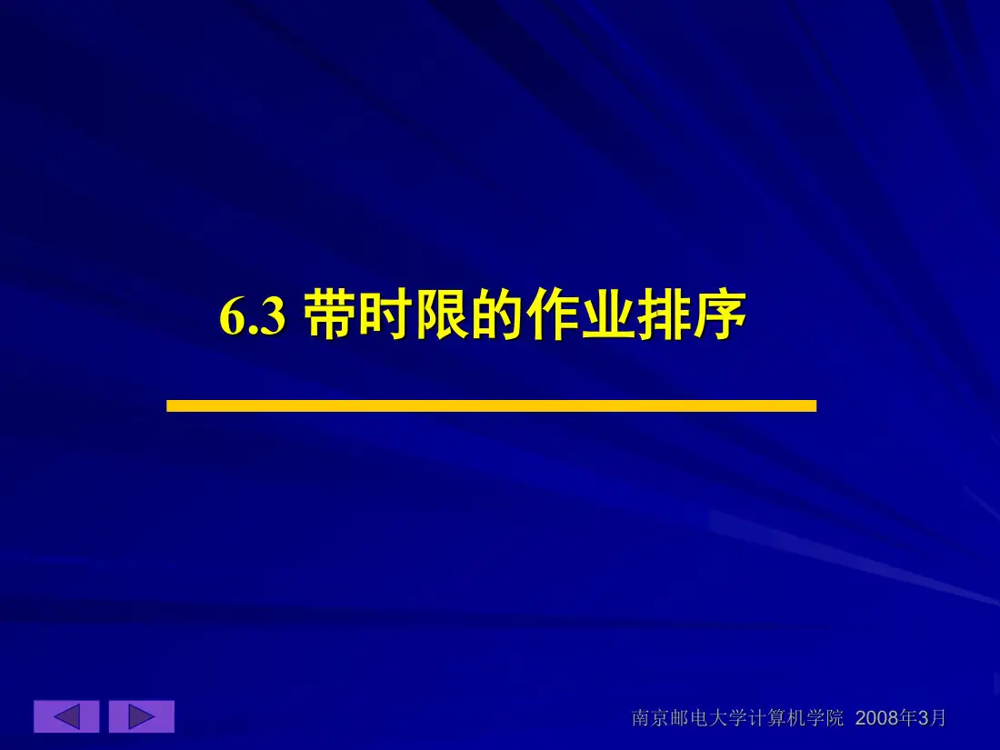

原文：

6.3 带时限的作业排序

△

南京邮电大学计算机学院 2008年3月

### 6.3.1 问题描述

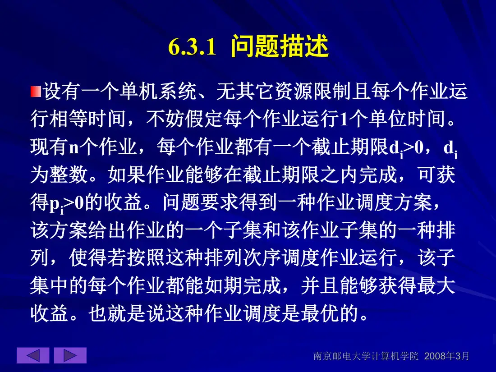

原文：

6.3.1 问题描述

设有一个单机系统、无其它资源限制且每个作业运行相等时间，不妨假定每个作业运行1个单位时间。现有n个作业，每个作业都有一个截止期限 $0 . 0 0$ $\textcircled { 1 }$ 为整数。如果作业能够在截止期限之内完成，可获得 $1 2 0$ 的收益。问题要求得到一种作业调度方案，该方案给出作业的一个子集和该作业子集的一种排列，使得若按照这种排列次序调度作业运行，该子集中的每个作业都能如期完成，并且能够获得最大收益。也就是说这种作业调度是最优的。

南京邮电大学计算机学院 2008年3月

### 6.3.2 贪心法求解

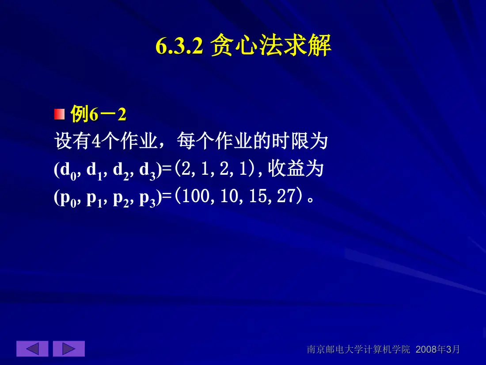

原文：

6.3.2 贪心法求解

例6－2设有4个作业，每个作业的时限为$( \frac { 1 } { 1 2 } , \frac { 1 } { 1 2 } , \frac { 1 } { 1 2 } , \frac { 1 } { 1 2 } , \frac { 1 } { 1 2 } , \frac { 1 } { 1 2 } , \frac { 1 } { 1 2 } , \frac { 1 } { 1 2 } , \frac { 1 } { 1 2 } )$ ,收益为$\mathrm { ( 1 2 0 2 4 2 3 2 2 4 ) } = \mathrm { ( 9 1 0 1 0 2 0 1 0 2 0 2 0 2 0 ) }$

南京邮电大学计算机学院 2008年3月

### 表6-2 例6-2的部分可行解及其收益

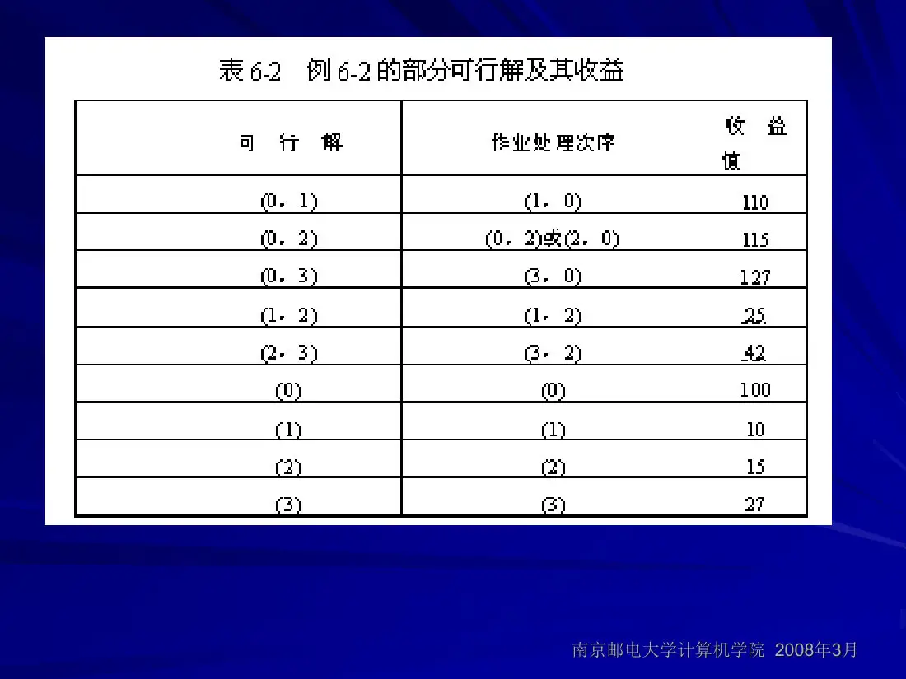

原文：

表6-2 例6-2的部分可行解及其收益
<table><tr><td>可行解</td><td>作业处理次序</td><td>收益值</td></tr><tr><td>(0,1)</td><td>(1,0)</td><td>110</td></tr><tr><td>(0,2)</td><td>(0,2)或(2,0)</td><td>115</td></tr><tr><td>(0,3)</td><td>(3,0)</td><td>127</td></tr><tr><td>(1,2)</td><td>(1,2)</td><td>25</td></tr><tr><td>(2,3)</td><td>(3,2)</td><td>42</td></tr><tr><td>(0)</td><td>(0)</td><td>100</td></tr><tr><td>(1)</td><td>(1)</td><td>10</td></tr><tr><td>(2)</td><td>(2)</td><td>15</td></tr><tr><td>(3)</td><td>(3)</td><td>27</td></tr></table>

南京邮电大学计算机学院 2008年3月

### 南京邮电大学计算机学院 2008年3月

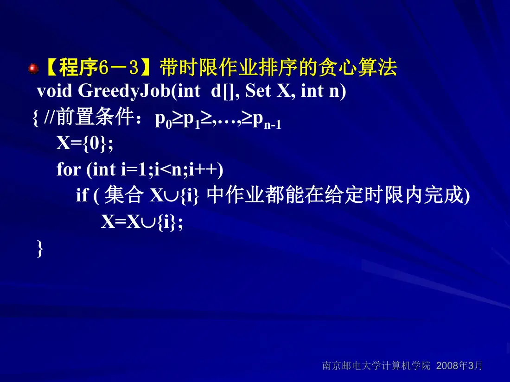

原文：

【程序6－3】带时限作业排序的贪心算法void GreedyJob(int d[], Set X, int n){ //前置条件： $( 1 ) ( 1 - 2 ) \div m = 2 ( 1 ) ( 1 0 )$ $\therefore \angle C A B = \angle B A C = \angle C A B$ $[ 0 ] \angle ( \mathrm { H n } , \mathrm { n } - 1 , \mathrm { H z } \sin \angle 2 )$ if( 集合 X{i}中作业都能在给定时限内完成)X=X{i};

南京邮电大学计算机学院 2008年3月

### 6.3.3 算法正确性

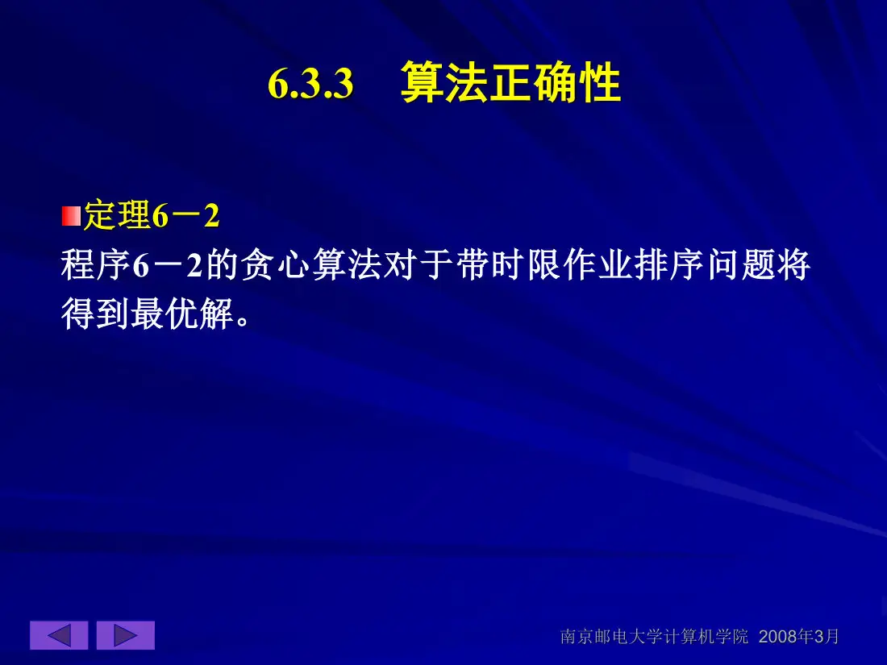

原文：

6.3.3 算法正确性

定理6－2

程序6－2的贪心算法对于带时限作业排序问题将得到最优解。

△

南京邮电大学计算机学院 2008年3月

### 南京邮电大学计算机学院 2008年3月

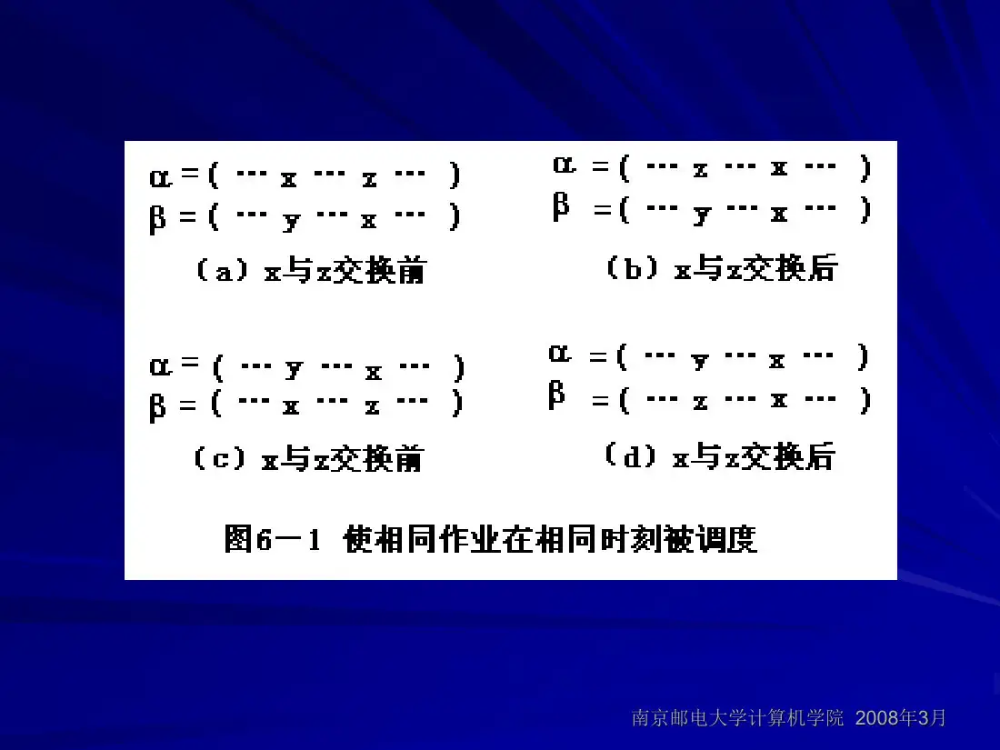

原文：

南京邮电大学计算机学院 2008年3月

### （a)替换前

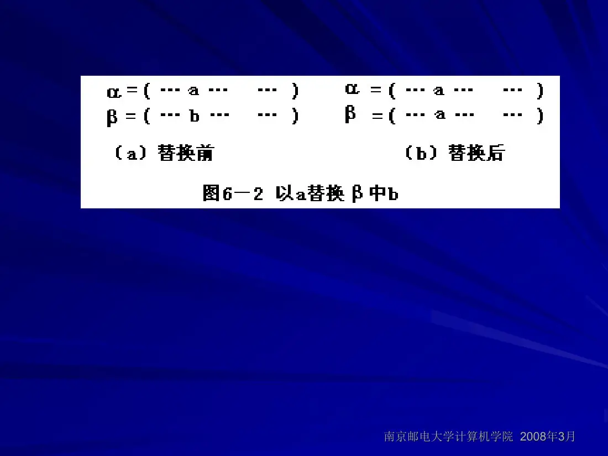

原文：

（a)替换前

图6—2 以a替换β中b

南京邮电大学计算机学院 2008年3月

### 6.3.4 可行性判定

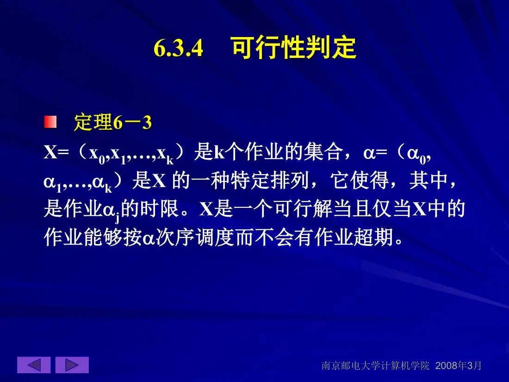

原文：

6.3.4 可行性判定

定理6－3

$\therefore \angle 1 = \angle A = 9 0 ^ { \circ } - \sqrt { 1 2 } \cdot \sqrt { 1 2 } = \sqrt { 3 } .$ 是k个作业的集合， $( 0 / 5 ) = ( 0 / 5 )$ $( 9 7 5 0 0 0 0 0 0 )$ 是X 的一种特定排列，它使得，其中，是作 $1 1 \pi$ 的时限。X是一个可行解当且仅当X中的作业能够按次序调度而不会有作业超期。

南京邮电大学计算机学院 2008年3月

### 南京邮电大学计算机学院 2008年3月

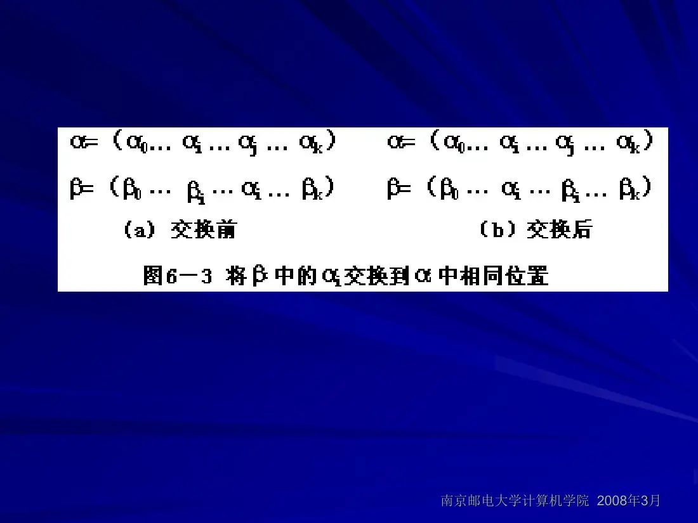

原文：

南京邮电大学计算机学院 2008年3月

### 6.3.5 作业排序贪心算法

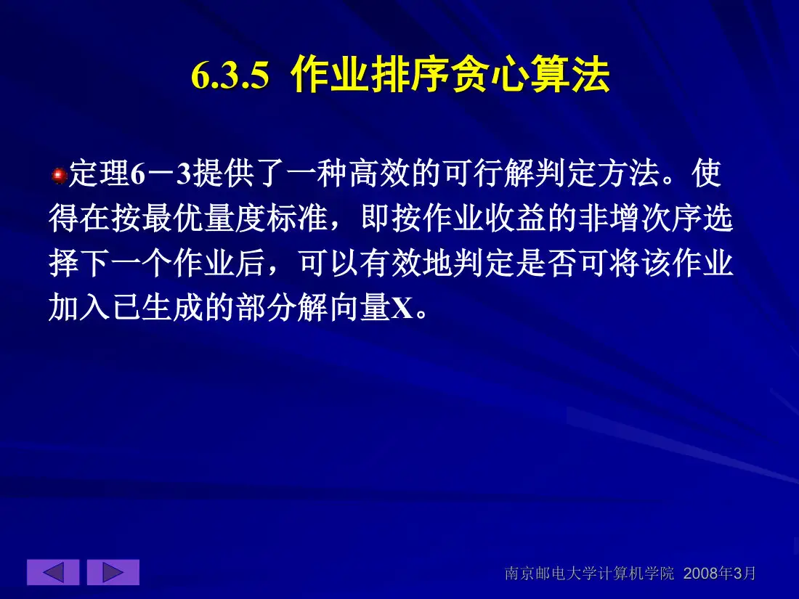

原文：

6.3.5 作业排序贪心算法

定理6－3提供了一种高效的可行解判定方法。使得在按最优量度标准，即按作业收益的非增次序选择下一个作业后，可以有效地判定是否可将该作业加入已生成的部分解向量X。

南京邮电大学计算机学院 2008年3月

### $$

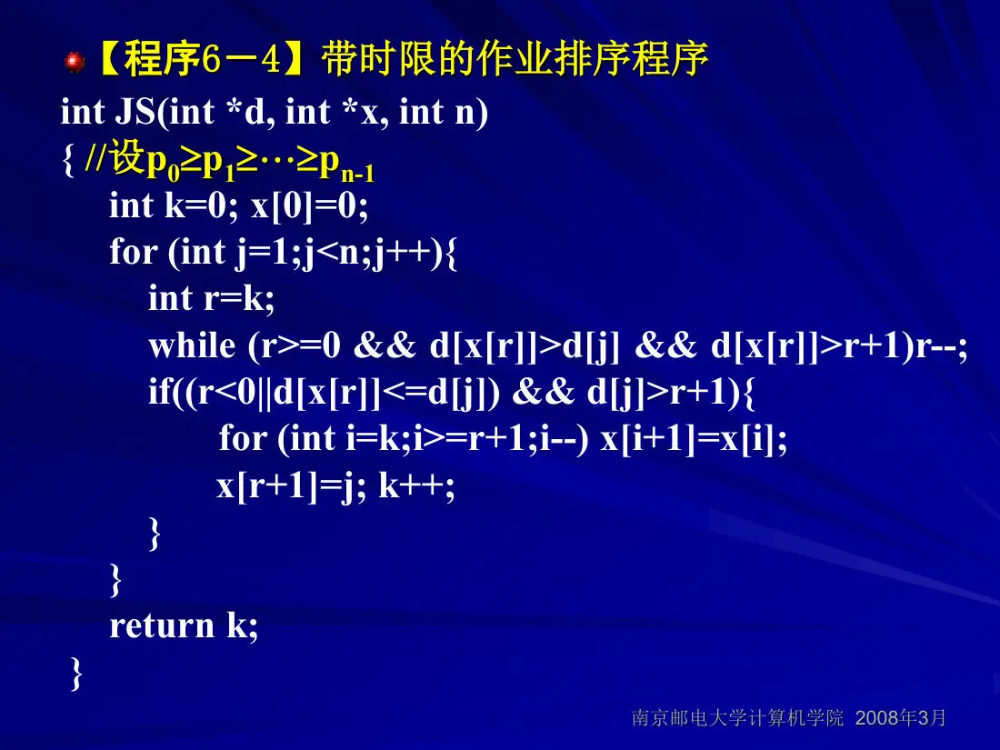

原文：

$$
\mathbf {p} _ {0} \geq \mathbf {p} _ {1} \geq \dots \geq \mathbf {p} _ {\mathrm{n-1}}
$$

return k;

南京邮电大学计算机学院 2008年3月

### 6.3.6 一种改进算法

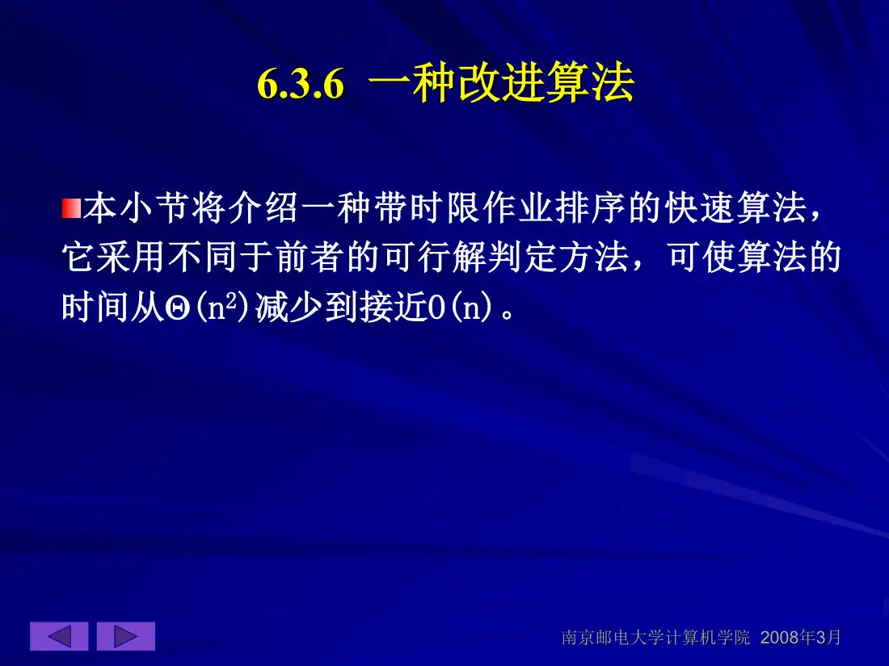

原文：

6.3.6 一种改进算法

本小节将介绍一种带时限作业排序的快速算法，它采用不同于前者的可行解判定方法，可使算法的时间从(n2)减少到接近O(n)。

△

南京邮电大学计算机学院 2008年3月

### 南京邮电大学计算机学院 2008年3月

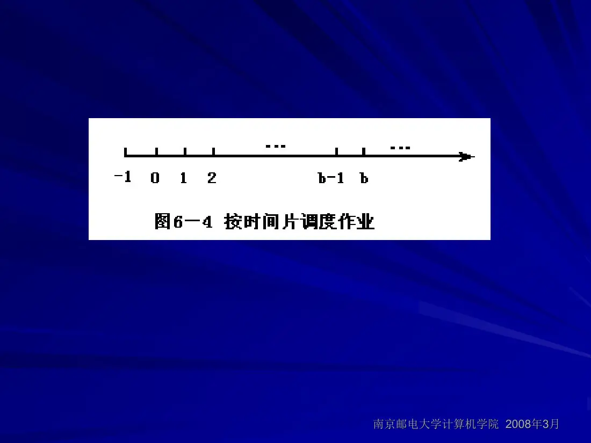

原文：

南京邮电大学计算机学院 2008年3月

### 南京邮电大学计算机学院 2008年3月

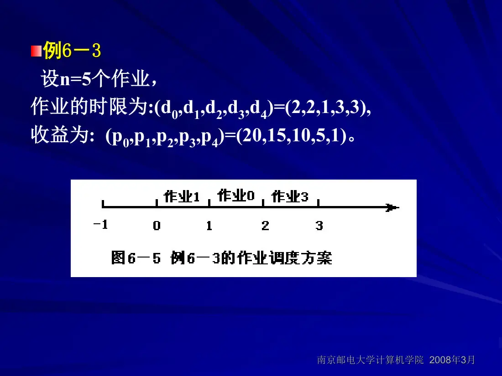

原文：

例6－3设n=5个作业，作业的时限为: $( ( 1 ) 1 2 , 1 3 , 1 5 , 1 5 , 1 5 , 1 5 , 1 5 , 1 5 , 1 5 , 1 5 )$ 收益为: $( | \{ | \mathbf { \Sigma } | \} | \{ | \mathbf { \Sigma } | \} | \{ | \mathbf { \Sigma } | \} | \{ | \mathbf { \Sigma } | \} | \{ | \mathbf { \Sigma } | \} | ) = ( | \{ | \mathbf { \Sigma } | \} | \{ | \mathbf { \Sigma } | \} | \{ | \mathbf { \Sigma } | \} | \{ | \mathbf { \Sigma } | \} )$

南京邮电大学计算机学院 2008年3月

### 南京邮电大学计算机学院 2008年3月

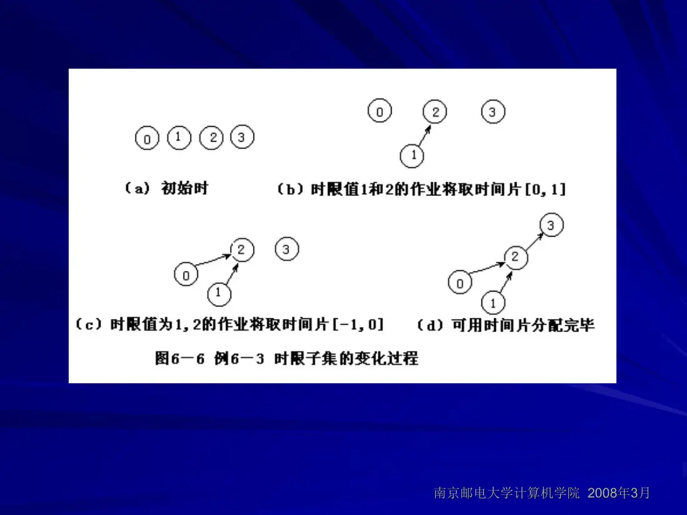

原文：

![(b)时限值1和2的作业将取时间片[0,1]](算法设计与分析第6章-贪心法课件.assets/原件图1.jpg)

![(a) 初始时 （c）时限值为1，2的作业将取时间片[-1,0]](算法设计与分析第6章-贪心法课件.assets/原件图2.jpg)

南京邮电大学计算机学院 2008年3月

### 南京邮电大学计算机学院 2008年3月

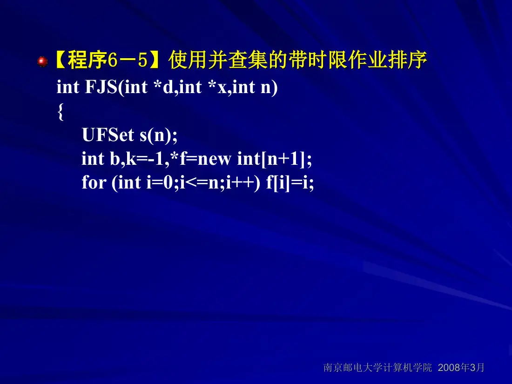

原文：

【程序6－5】使用并查集的带时限作业排序int FJS(int \*d,int \*x,int n)

UFSet s(n); int b,k=-1,\*f=new int[n+1]; for (int i=0;i<=n;i++) f[i]=i;

南京邮电大学计算机学院 2008年3月

### delete []f; return k;

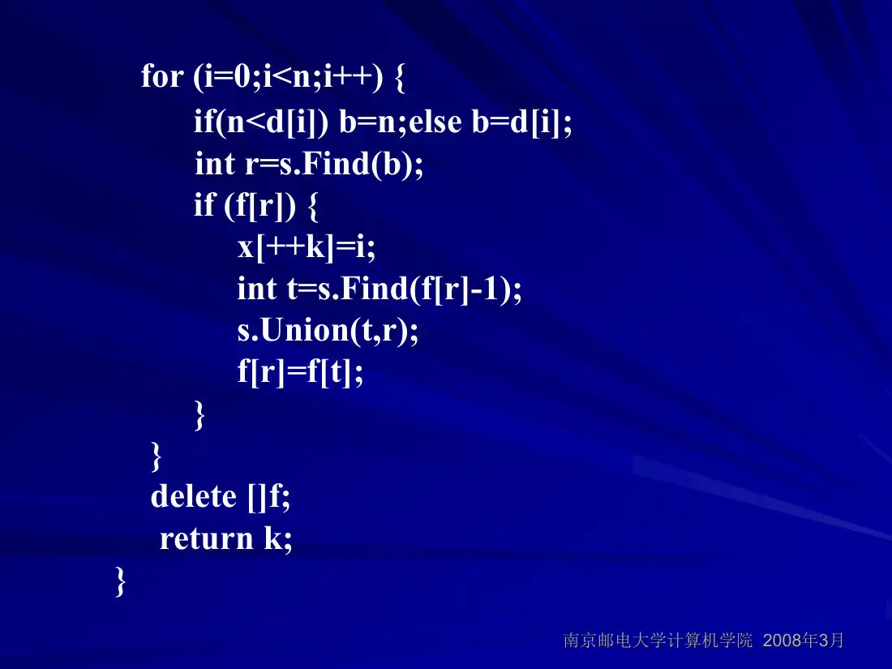

原文：

for (i=0;i<n;i++) { if(n<d[i]) b=n;else b=d[i]; int r=s.Find(b); if (f[r]) { x[++k]=i; int t=s.Find(f[r]-1); s.Union(t,r); f[r]=f[t];

delete []f; return k;

南京邮电大学计算机学院 2008年3月

### 表6-3 以例6-3 为输入，函数FJS的执行过程

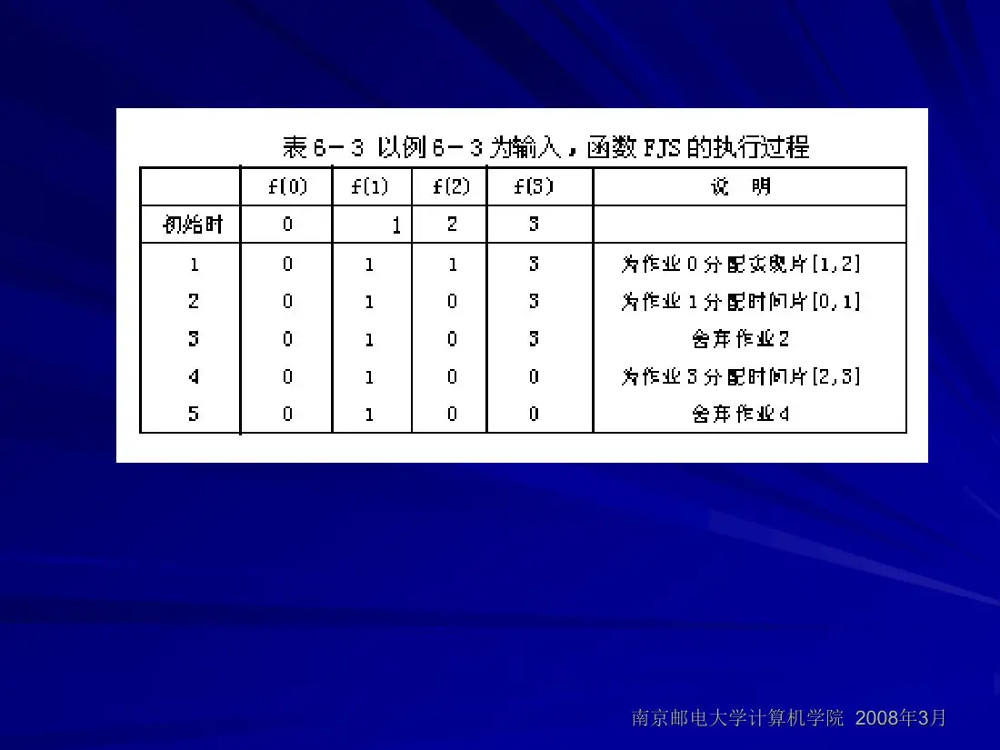

原文：

表6-3 以例6-3 为输入，函数FJS的执行过程
<table><tr><td></td><td>f(0)</td><td>f(1)</td><td>f(2)</td><td>f(3)</td><td>说明</td></tr><tr><td>初始时</td><td>0</td><td>1</td><td>2</td><td>3</td><td></td></tr><tr><td>1</td><td>0</td><td>1</td><td>1</td><td>3</td><td>为作业0分配实现片[1,2]</td></tr><tr><td>2</td><td>0</td><td>1</td><td>0</td><td>3</td><td>为作业1分配时间片[0,1]</td></tr><tr><td>3</td><td>0</td><td>1</td><td>0</td><td>3</td><td>舍弃作业2</td></tr><tr><td>4</td><td>0</td><td>1</td><td>0</td><td>0</td><td>为作业3分配时间片[2,3]</td></tr><tr><td>5</td><td>0</td><td>1</td><td>0</td><td>0</td><td>舍弃作业4</td></tr></table>

南京邮电大学计算机学院 2008年3月

### 6.4 最佳合并模式

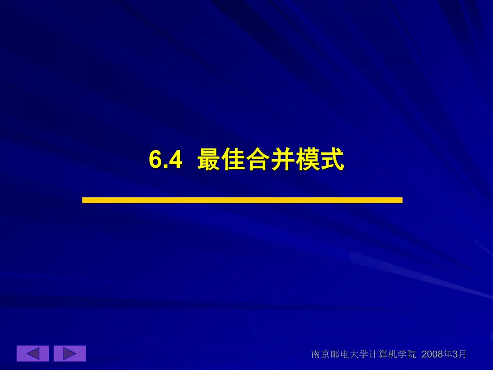

原文：

6.4 最佳合并模式

△

南京邮电大学计算机学院 2008年3月

### 6.4.1 问题描述

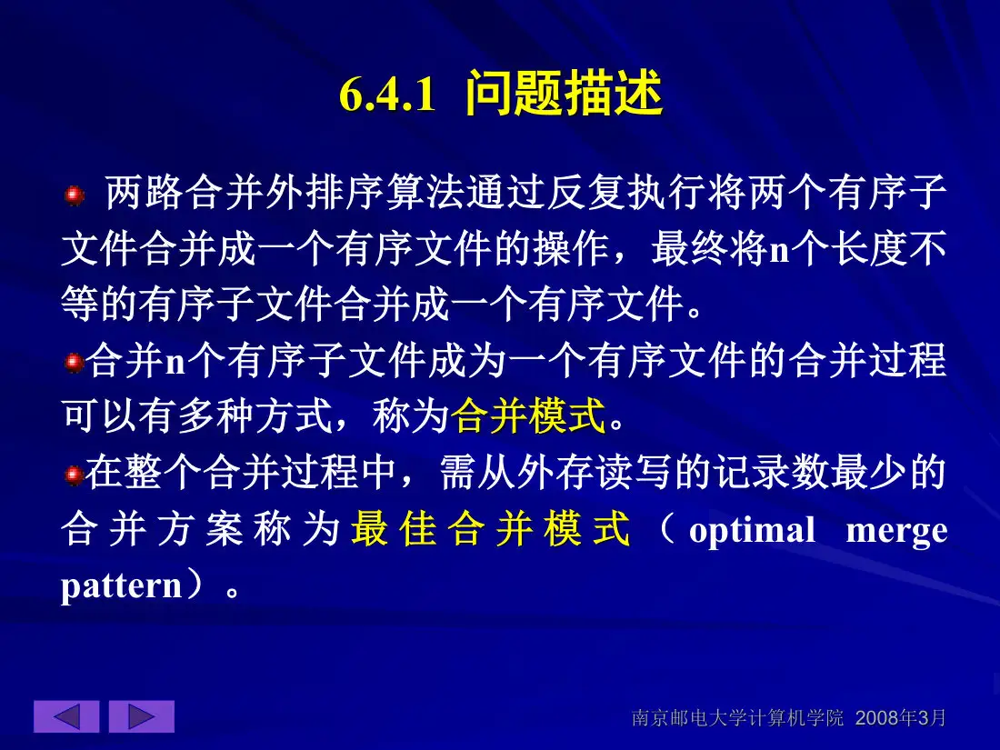

原文：

6.4.1 问题描述

两路合并外排序算法通过反复执行将两个有序子文件合并成一个有序文件的操作，最终将n个长度不等的有序子文件合并成一个有序文件。

合并n个有序子文件成为一个有序文件的合并过程可以有多种方式，称为合并模式。

在整个合并过程中，需从外存读写的记录数最少的合 并 方 案 称 为 最 佳 合 并 模 式 （ optimal mergepattern）。

南京邮电大学计算机学院 2008年3月

### 南京邮电大学计算机学院 2008年3月

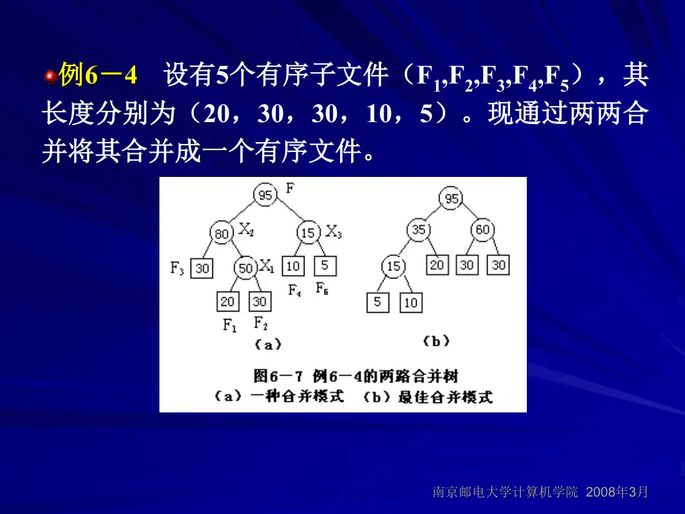

原文：

例6－4 设有5个有序子文件 $( 1 1 , 1 2 , 1 2 , 1 3 , 1 3 , 2 )$ ，其长度分别为（20，30，30，10，5）。现通过两两合并将其合并成一个有序文件。

南京邮电大学计算机学院 2008年3月

### $$

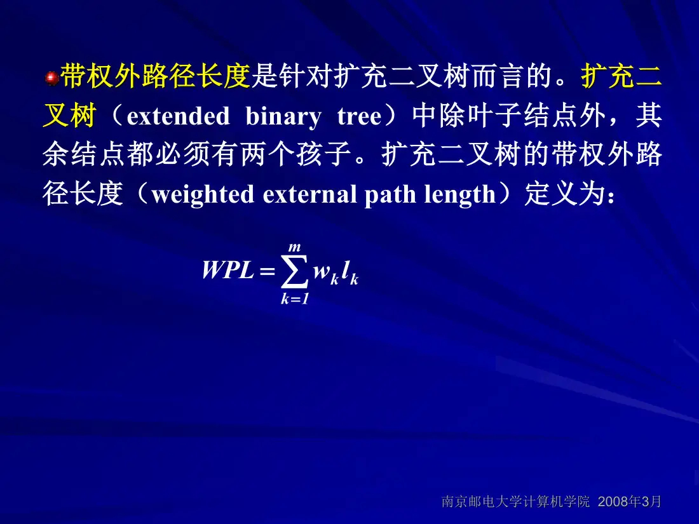

原文：

带权外路径长度是针对扩充二叉树而言的。扩充二叉树（extended binary tree）中除叶子结点外，其余结点都必须有两个孩子。扩充二叉树的带权外路径长度（weighted external path length）定义为：

$$
W P L = \sum_ {k = 1} ^ {m} w _ {k} l _ {k}
$$

南京邮电大学计算机学院 2008年3月

### 6.4.2 贪心法求解

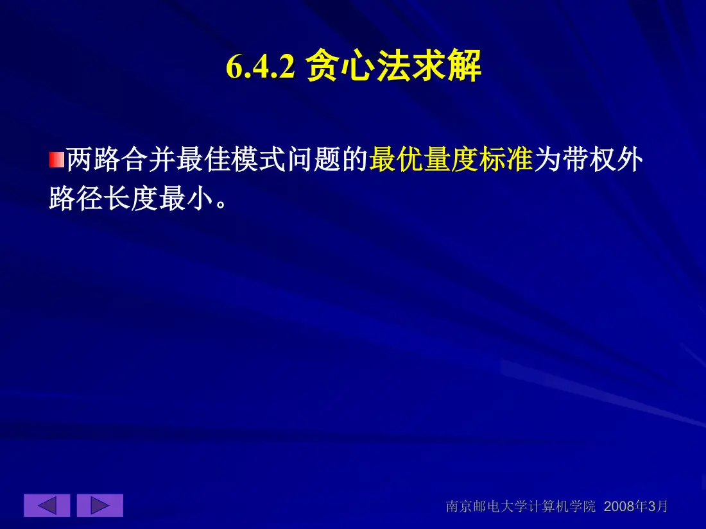

原文：

6.4.2 贪心法求解

两路合并最佳模式问题的最优量度标准为带权外路径长度最小。

△

南京邮电大学计算机学院 2008年3月

### 重复第2步，直到合并成一棵二叉树为止。

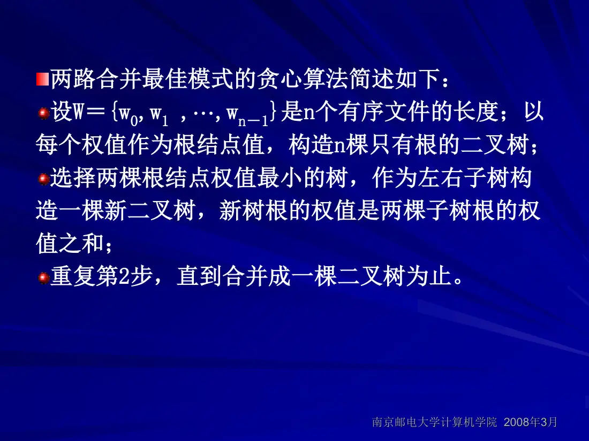

原文：

两路合并最佳模式的贪心算法简述如下：$\cos \angle B = \angle B = \angle C D C = \angle C A C = \angle C$ 是n个有序文件的长度；以每个权值作为根结点值，构造n棵只有根的二叉树；选择两棵根结点权值最小的树，作为左右子树构造一棵新二叉树，新树根的权值是两棵子树根的权值之和；

重复第2步，直到合并成一棵二叉树为止。

南京邮电大学计算机学院 2008年3月

### 南京邮电大学计算机学院 2008年3月

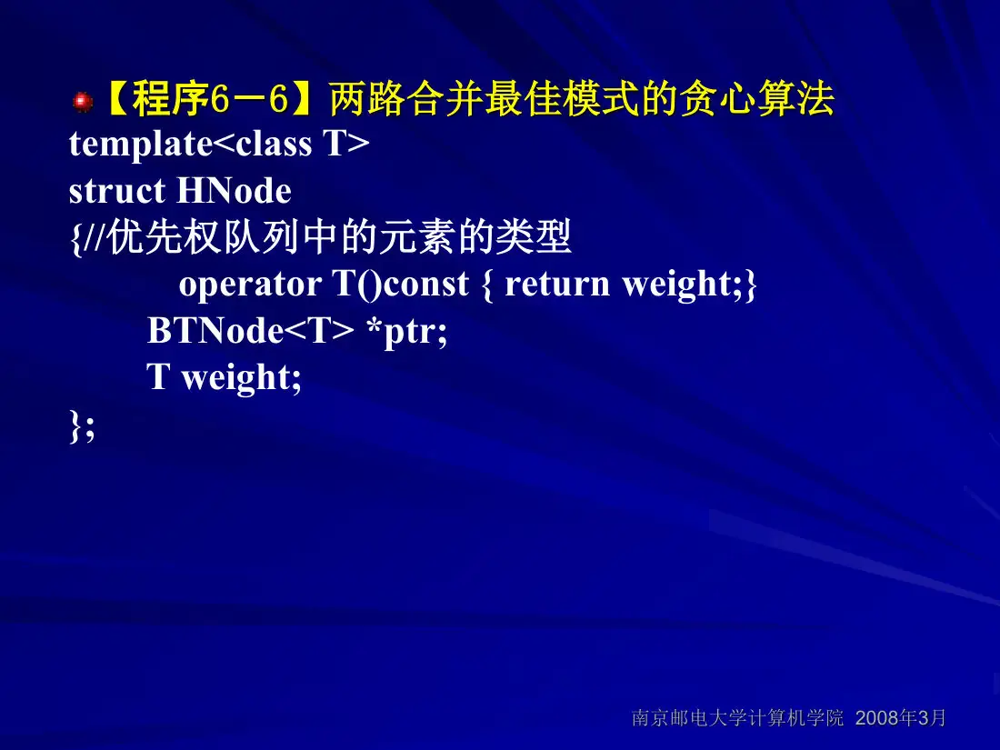

原文：

【程序6－6】两路合并最佳模式的贪心算法template<class T>struct HNode{//优先权队列中的元素的类型operator T()const { return weight;}BTNode<T> \*ptr;T weight;

南京邮电大学计算机学院 2008年3月

### 南京邮电大学计算机学院 2008年3月

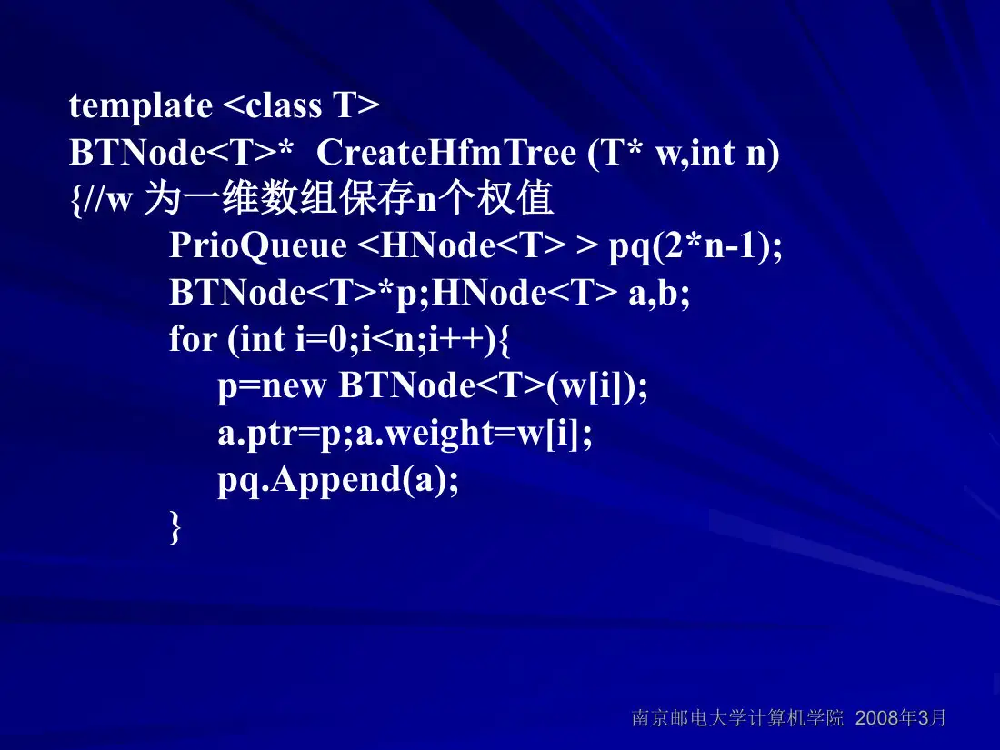

原文：

template <class T> BTNode<T>\* CreateHfmTree (T\* w,int n) {//w为一维数组保存n个权值 PrioQueue <HNode<T> > pq(2\*n-1); BTNode<T>\*p;HNode<T> a,b; for (int i=0;i<n;i++){ p=new BTNode<T>(w[i]); a.ptr=p;a.weight=w[i]; pq.Append(a);

南京邮电大学计算机学院 2008年3月

### pq.Serve(a);

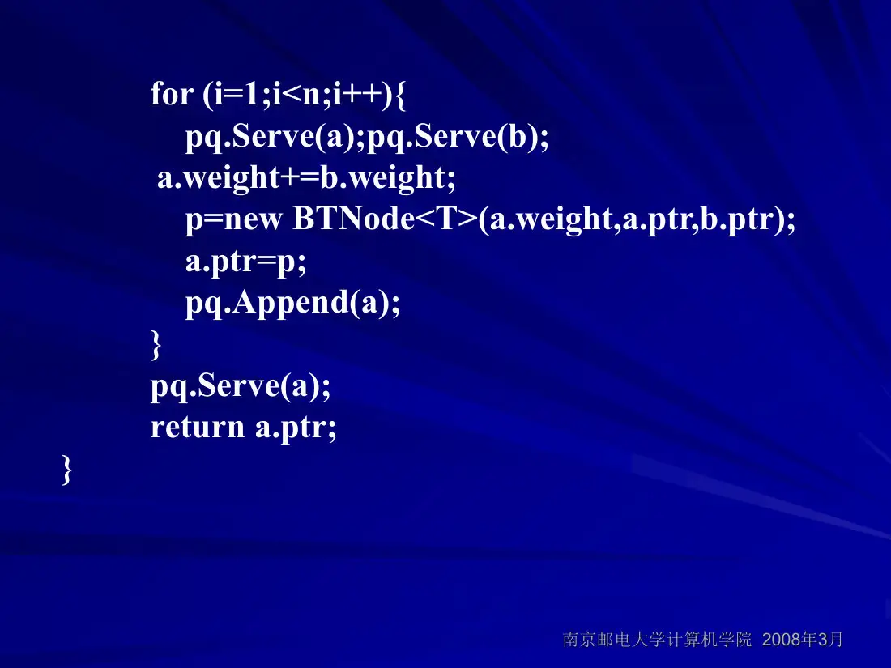

原文：

for (i=1;i<n;i++){ pq.Serve(a);pq.Serve(b); a.weight+=b.weight; p=new BTNode<T>(a.weight,a.ptr,b.ptr); a.ptr=p; pq.Append(a);

pq.Serve(a);

return a.ptr;

南京邮电大学计算机学院 2008年3月

### 6.4.3 算法正确性

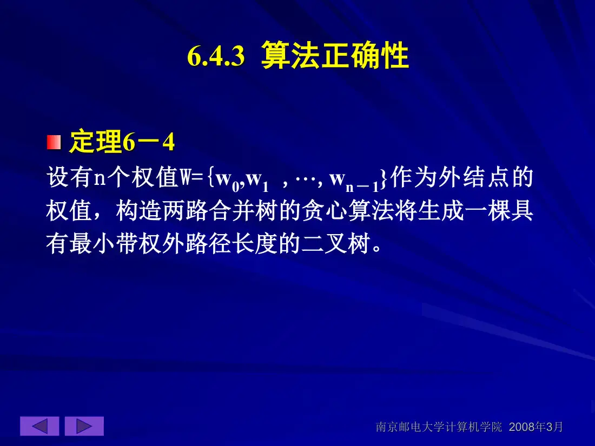

原文：

6.4.3 算法正确性

定理6－4

设有n个权值 $1 1 - 1 0 \times 1 2 \times 1 0 = 1 0 0 0 ( c m )$ 作为外结点的权值，构造两路合并树的贪心算法将生成一棵具有最小带权外路径长度的二叉树。

南京邮电大学计算机学院 2008年3月

### $$

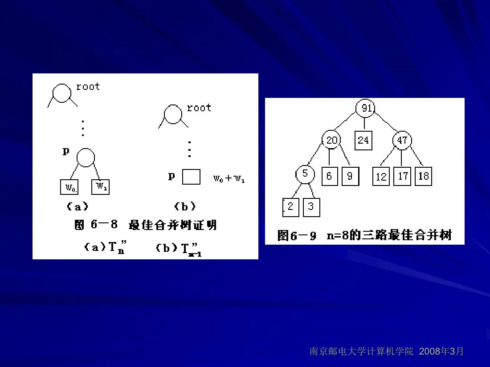

原文：

$$
\mathbf {T _ {n}} ^ {\prime \prime}
$$

南京邮电大学计算机学院 2008年3月

### 6.5 最小代价生成树

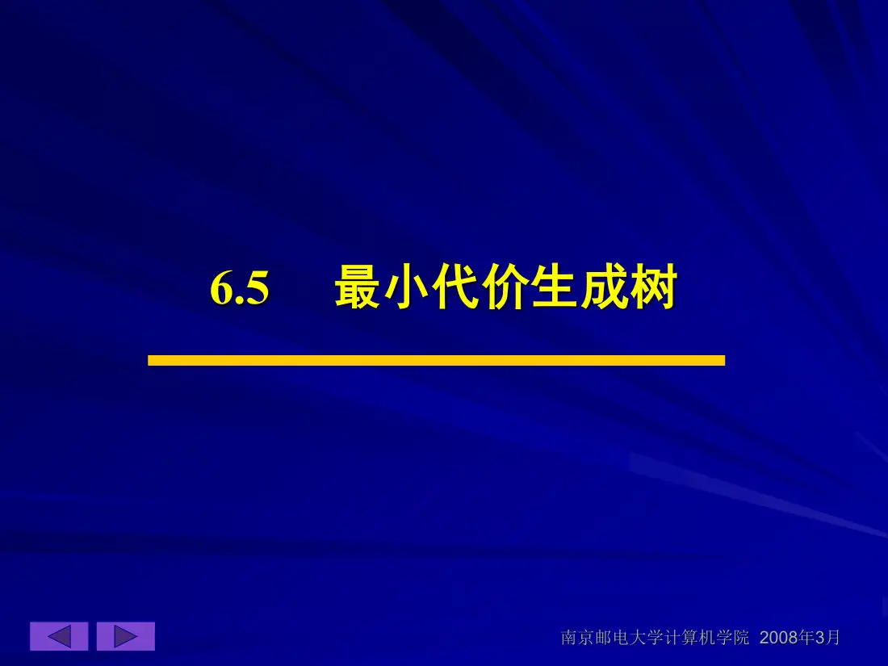

原文：

6.5 最小代价生成树

△

南京邮电大学计算机学院 2008年3月

### 6.5.1 问题描述

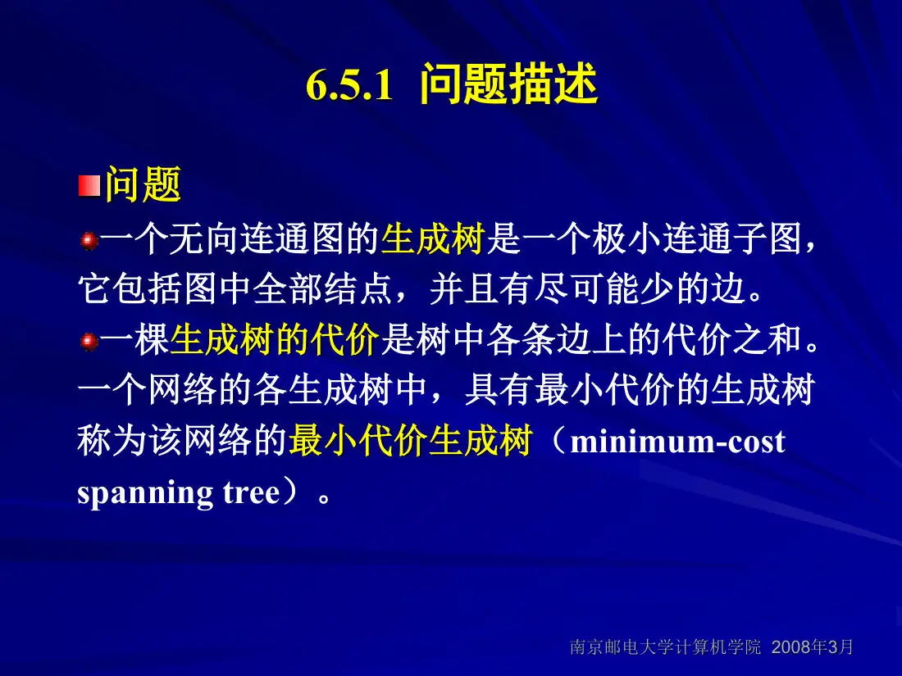

原文：

6.5.1 问题描述

问题

一个无向连通图的生成树是一个极小连通子图，它包括图中全部结点，并且有尽可能少的边。一棵生成树的代价是树中各条边上的代价之和。一个网络的各生成树中，具有最小代价的生成树称为该网络的最小代价生成树（minimum-costspanning tree）。

南京邮电大学计算机学院 2008年3月

### 6.5.2 贪心法求解

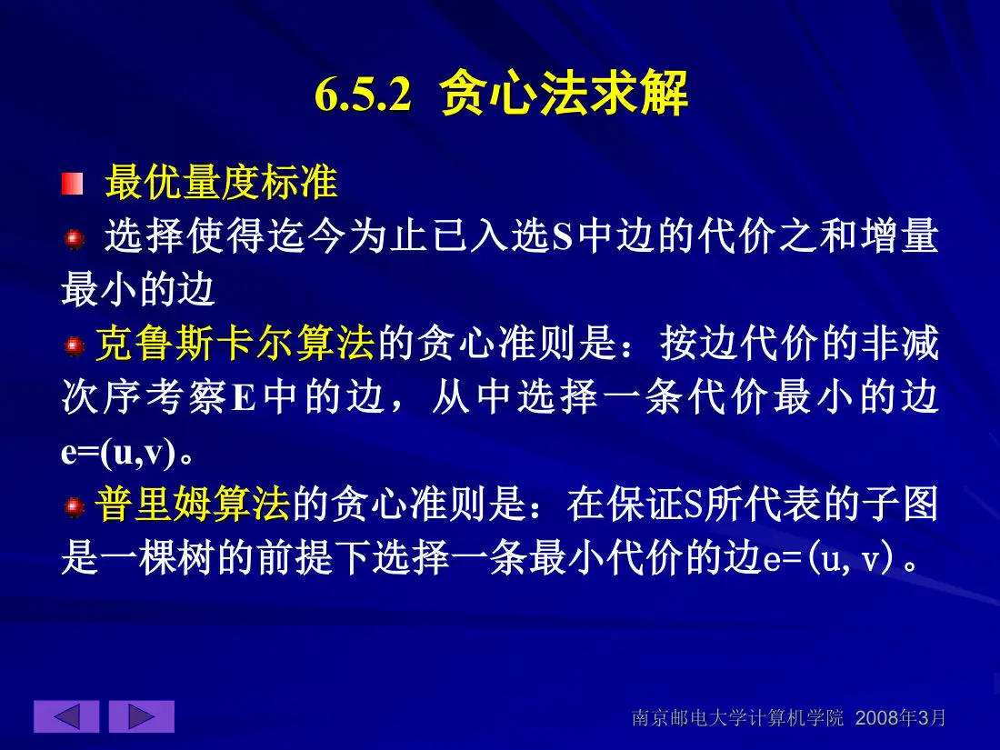

原文：

6.5.2 贪心法求解

最优量度标准

选择使得迄今为止已入选S中边的代价之和增量 最小的边

克鲁斯卡尔算法的贪心准则是：按边代价的非减次序考察E中的边，从中选择一条代价最小的边$\circledast = \circledast \times \frac { \sqrt { 3 } } { 2 }$

普里姆算法的贪心准则是：在保证S所代表的子图是一棵树的前提下选择一条最小代价的边 $\textcircled { \bullet } \textcircled { \bullet } \textcircled { \bullet } \textcircled { \bullet }$

南京邮电大学计算机学院 2008年3月

### return S;

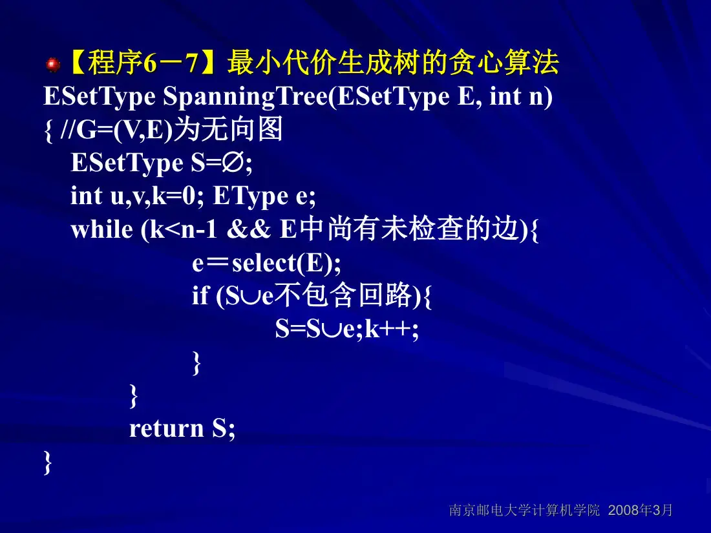

原文：

【程序6－7】最小代价生成树的贪心算法ESetType SpanningTree(ESetType E, int n){ //G=(V,E)为无向图ESetType S=;int u,v,k=0; EType e;while (k<n-1 && E中尚有未检查的边){e＝select(E);if (Se不包含回路){S=Se;k++;

return S;

南京邮电大学计算机学院 2008年3月

### 6.5.3 普里姆算法

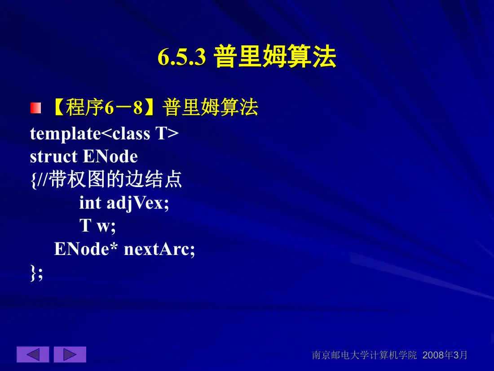

原文：

6.5.3 普里姆算法

【程序6－8】普里姆算法template<class T>struct ENode{//带权图的边结点int adjVex;T w;ENode\* nextArc;};

南京邮电大学计算机学院 2008年3月

### template  class Graph

原文：

template <class T> class Graph

public: Graph (int mSize); void Prim();

protected: void Prim(int k,int\* nearest,T\* lowcost);

ENode<T>\*\* a;

int n;

南京邮电大学计算机学院 2008年3月

### templatevoid Graph::Prim(int s){//公有成员函数

原文：

template<class T>void Graph<T >::Prim(int s){//公有成员函数

int\* nearest=new int[n],\*lowcost=new int[n];

Prim(s,nearest,lowcost);

for(int j=0;j<n;j++) cout<<"("<<nearest[j]<<",“ <<j<<","<<lowcost[j]<<") ";

cout<<endl;

delete [] nearest; delete []lowcost;

南京邮电大学计算机学院 2008年3月

### 南京邮电大学计算机学院 2008年3月

原文：

template<class T> void Graph<T>::Prim(int k, int\* nearest,T\* lowcost)

{//私有成员函数 bool\* mark=new bool[n]; ENode<T> \*p; if (k<0||k>n-1) throw OutofBounds; for (int i=0;i<n;i++){ nearest[i]=-1;mark[i]=false; lowcost[i]=INFTY;

lowcost[k]=0; nearest[k]=k; mark[k]=true;

南京邮电大学计算机学院 2008年3月

### mark[k]=true;

原文：

for (i=1;i<n;i++){ for(p=a[k];p;p=p->nextArc){ int j= p->adjVex; if ((!mark[j] )&&(lowcost[j]>p->w)){ lowcost[j]=p->w; nearest[j]=k;

T min=INFTY; for (int j=0;j<n;j++) if ((!mark[j])&&(lowcost[j]<min)){ min=lowcost[j]; k=j;

mark[k]=true;

}普里姆算法的运行时间是O(n2)。

南京邮电大学计算机学院 2008年3月

### 图6一10 普里姆算法构造最小代价生成树

原文：

图6一10 普里姆算法构造最小代价生成树

南京邮电大学计算机学院 2008年3月

### 6.5.4 克鲁斯卡尔算法

原文：

6.5.4 克鲁斯卡尔算法

克鲁斯卡尔算法从边的集合E中，按照边的权值从小到大的次序依次选取边加以考察。

template<class T>

struct eNode{

operator T ()const { return w;}

int u,v;

T w;

南京邮电大学计算机学院 2008年3月

### 图 6-11 克鲁斯卡尔算祛

原文：

图 6-11 克鲁斯卡尔算祛

南京邮电大学计算机学院 2008年3月

### eNode x;

原文：

【程序6－9】克鲁斯卡尔算法 template <class T> void Graph<T>::Kruskal( PrioQueue<eNode<T> >& pq)

eNode<T> x;

UFSet s(n);

int u,v,k=0;

南京邮电大学计算机学院 2008年3月

### 南京邮电大学计算机学院 2008年3月

原文：

while (k<n-1 && !pq.IsEmpty()){ pq.Serve(x); u=s.Find(x.u); v=s.Find(x.v); if (u!=v){ s.Union(u,v); k++; cout<<"("<<x.u<<",“ <<x.v<<","<<x.w<<") ";

cout<<endl;if (k<n-2) throw NonConnected;}克鲁斯卡尔算法的时间复杂度为 O（elog e）。

南京邮电大学计算机学院 2008年3月

### 6.5.5 算法正确性

原文：

6.5.5 算法正确性

定理6－5

设图G=（V，E）是一个带权连通图，U是V的一个真子集。若边(u,v)∈E是所有u∈U，v∈V-U的边中权值最小者，那么一定存在G的一棵最小代价生成树T=(V,S)，(u,v)S。这一性质称为MST（minimum spanning tree）性质。

南京邮电大学计算机学院 2008年3月

### 定理6－6

原文：

定理6－6

普里姆算法和克鲁斯卡尔算法都将产生一个带权无向连通图的最小代价生成树。

南京邮电大学计算机学院 2008年3月

### 6.6 单源最短路径

原文：

6.6 单源最短路径

△

南京邮电大学计算机学院 2008年3月

### 6.6.1 问题描述

原文：

6.6.1 问题描述

单源最短路径问题是：给定带权的有向图G=(V,E)和图中结点sV，求从s到其余各结点的最短路径，其中，s称为源点。

△

南京邮电大学计算机学院 2008年3月

### (b)图G顶点0的单源最短路径 图6-13 单源最短路径

原文：

(b)图G顶点0的单源最短路径 图6-13 单源最短路径
<table><tr><td>源点</td><td>终点</td><td>最短路径</td><td>路径长度</td></tr><tr><td>0</td><td>1</td><td>(0,2,3,1)</td><td>45</td></tr><tr><td></td><td>2</td><td>(0,2)</td><td>10</td></tr><tr><td></td><td>3</td><td>(0,2,3)</td><td>25</td></tr><tr><td></td><td>4</td><td>(0,2,3,1,4)</td><td>55</td></tr><tr><td></td><td>5</td><td>-</td><td>∞</td></tr></table>

南京邮电大学计算机学院 2008年3月

### 6.6.2 贪心法求解

原文：

6.6.2 贪心法求解

迪杰斯特拉（Dijkstra） 算法首先求得长度最短的一条最短路径，再求得长度次短的一条最短路径，依此类推，直到从源点到其它所有结点之间的最短路径都已求得为止。

南京邮电大学计算机学院 2008年3月

### 6.6.3 迪杰斯特拉算法

原文：

6.6.3 迪杰斯特拉算法

【程序6－10】迪杰斯特拉算法template<class T>class MGraph

public: MGraph(int mSize); void Dijkstra(int s,T\*& d,int\*& path);

南京邮电大学计算机学院 2008年3月

### private: int Choose(int\* d, bool\* s);

原文：

private: int Choose(int\* d, bool\* s);

……

T\*\*a;

int n;

南京邮电大学计算机学院 2008年3月

### 南京邮电大学计算机学院 2008年3月

原文：

template <class T> int MGraph<T>::Choose(int\* d, bool\* s)

int i,minpos; T min; min=INFTY; minpos=-1; for (i=1;i<n;i++) if (d[i]<min &&!s[i]){ min=d[i];minpos=i; } return minpos;

南京邮电大学计算机学院 2008年3月

### 南京邮电大学计算机学院 2008年3月

原文：

template <class T> void MGraph<T>::Dijkstra(int s, T\*& d,int\*& path)

int k,i,j; if (s<0||s>n-1) throw OutOfBounds; bool \*inS=new bool[n]; d=new T[n];path=new int[n]; for (i=0;i<n;i++){ inS[i]=false;d[i]=a[s][i]; if (i!=s && d[i]<INFTY) path[i]=s; else path[i]=-1;

南京邮电大学计算机学院 2008年3月

### 南京邮电大学计算机学院 2008年3月

原文：

inS[s]=true; d[s]=0; for (i=1;i<n-1;i++){ k=Choose(d,inS); inS[k]=true; for (j=0; j<n; j++) if (!inS[j] && d[k]+a[k][j]< d[j]){ d[j]=d[k]+a[k][j]; path[j]=k; }

南京邮电大学计算机学院 2008年3月

### 表6-4 迪杰斯特拉算法求单源最短路径

原文：

表6-4 迪杰斯特拉算法求单源最短路径
<table><tr><td>S</td><td>d[0] path[0]</td><td>d[1] path[1]</td><td>d[2] path[2]</td><td>d[3] path[3]</td><td>d[4] path[4]</td><td>d[5] path[5]</td></tr><tr><td>0</td><td>0,-1</td><td>50,0</td><td>10,0</td><td>∞,-1</td><td>70,0</td><td>∞,-1</td></tr><tr><td>2</td><td>0,-1</td><td>50,0</td><td>10,0</td><td>25,2</td><td>70,0</td><td>∞,-1</td></tr><tr><td>3</td><td>0,-1</td><td>45,3</td><td>10,0</td><td>25,2</td><td>60,3</td><td>∞,-1</td></tr><tr><td>1</td><td>0,-1</td><td>45,3</td><td>10,0</td><td>25,2</td><td>55,1</td><td>∞,-1</td></tr><tr><td>4</td><td>0,-1</td><td>45,3</td><td>10,0</td><td>25,2</td><td>55,1</td><td>∞,-1</td></tr></table>

南京邮电大学计算机学院 2008年3月

### 6.6.4 算法正确性

原文：

6.6.4 算法正确性

已知带权有向图G=(V,E)，其源点为s，迪杰斯特拉算法使得对所有i，i∈V-{s}，d[i]≥δ(s,i)，且一旦d[i]= (s,i)，它将不再改变。

已知带权有向图G=(V,E)，其源点为s，迪杰斯特拉算法使得对所有结点i和j，i∈S，j∈V-S，必有d[i]d[j]。

南京邮电大学计算机学院 2008年3月

### 南京邮电大学计算机学院 2008年3月

原文：

南京邮电大学计算机学院 2008年3月

### 定理6－9

原文：

定理6－9

已知带非负权值的有向图 $\textcircled { 6 } = \textcircled { 6 } \textcircled { 9 }$ 路径 $( \infty , 0 )$ $\cos \angle A C D = \angle B$ 是从s到 $V _ { 1 }$ 的一条最短路径， $\because P = 0$ $0 . 5 6 < 0 . 5 6 < 0 . 5 6$ 则子路径 $( 4 ) = ( 1 ) \times ( 1 2 ) = ( 1 2 ) ( 1 2 )$ 和 $( \cos \alpha - \sin \alpha - \cos \alpha )$ 必定分别是从s到 $\because$ 和v到t的最短路径。

已知带非负权值的有向图G=(V,E)，其源点为s，迪杰 斯 特 拉 算 法 结 束 时 ， 对 所 有 结 点 i ， 有$[ 0 ] [ 1 1 1 ] = [ 0 , 1 ] [ 0 , 1 ]$

南京邮电大学计算机学院 2008年3月

### 6.7 磁带最优存储

原文：

6.7 磁带最优存储

△

南京邮电大学计算机学院 2008年3月

### 6.7.1 单带最优存储

原文：

6.7.1 单带最优存储

问题

设有n个程序编号为 $\textcircled { 1 } \times \operatorname * { c c o m } \textcircled { 1 } \textcircled { - 1 }$ ，存放在长度为L的磁带上，程序i在磁带上的存储长度为 $\mathbf { \delta E }$ ， $0 5 5 \times 1 0$ 假定每个程序被检索地概率相等，则平均检索时间（mean retrieval time MRT）定义为 $m = 1$

单带最优存储问题是求这n个程序的一种排列，使得MRT有最小值。

南京邮电大学计算机学院 2008年3月

### 表 6-5 可能的排列和相应的D值

原文：

例6－5设n=3， $( 1 2 , 1 2 , 1 3 , 1 5 , 1 5 , 1 5 , 1 5 , 2 ) = ( 1 5 , 1 5 , 1 1 , 1 5 , 2 )$

表 6-5 可能的排列和相应的D值
<table><tr><td>排列次序γ</td><td>D(γ)</td></tr><tr><td>0,1,2</td><td>5+(5+10)+(5+10+3)=38</td></tr><tr><td>0,2,1</td><td>5+(5+3)+(5+3+10)=31</td></tr><tr><td>1,0,2</td><td>10+(10+5)+(10+5+3)=43</td></tr><tr><td>1,2,0</td><td>41</td></tr><tr><td>2,0,1</td><td>29</td></tr><tr><td>2,1,0</td><td>34</td></tr></table>

南京邮电大学计算机学院 2008年3月

### 南京邮电大学计算机学院 2008年3月

原文：

贪心法求解量度标准：计算迄今为止已选的那部分程序的D值，选择下一个程序应使得该值增加最小。

设有n个程序 $\left\{ 1 \right\} = \left\{ 1 \pm \frac { 1 } { 2 } \pm \frac { 1 } { 2 } \pm 1 \pm 1 \pm 1 \right\}$ 程序i的长度为 $\mathbf { p }$ $0 . 5 \times 1 0 = 1 0$ 且有 $\angle B = \angle C = \angle C = \angle C = \angle C = \angle C = \angle C = \angle C$ )是这n个作业的一种排列。那么只有当 $1 0 - 1 = 1 1$ $( 1 ) \boxtimes ( \sqrt { 1 } \preceq \bar { 1 } )$ 时，D()=有最小值。

南京邮电大学计算机学院 2008年3月

### 6.7.2 多带最优存储

原文：

6.7.2 多带最优存储

问题

设有m>1条磁带 $1 1 2 1 4 5 0 0 0 0 0 0 0 0 0$ 和n个程序。要求将此n个程序分配到这m条磁带上，令 $1 6 0 - 9 1 = 1 1 1$ 是存放在第j条磁带上的程序子集的某种排列， $\boxed { 1 } \boxed { 1 } \boxed { 9 }$ 的定义如前面相同，那么，求m条磁带上检索一个程序的平均检索时间的最小值等价于求

的最小值。

∑D(Lj) 0≤j<m

南京邮电大学计算机学院 2008年3月

### 【程序6－11】多带最优存储

原文：

【程序6－11】多带最优存储

int j = 0; for (int i=0; i<n; i++) { cout << "将程序"<<i<<" 加到磁带" <<j<<endl; j=(j+1)% m; } cout<<endl;

南京邮电大学计算机学院 2008年3月

### 定理6－12

原文：

定理6－12

设有n个程序 $\{ 1 \} | \mathbf { H } | \mathbf { H } \mathbf { H } \mathbf { H } \mathbf { H } \mathbf { H } \mathbf { H } \mathbf { H } \mathbf { H } $ 程序i的长度为 $\mathrm { \Delta \sf g }$ ， $0 . 5 7 5 \div 0$ 且有 $2 7 - 9 = 1 1 - 9 = 1 1 1 = 1 1 1$ 程序6－11 实现将n个程序分配到m条磁带上，且有最小TD值。

南京邮电大学计算机学院 2008年3月

### 6.8 贪心法的基本要素

原文：

6.8 贪心法的基本要素

△

南京邮电大学计算机学院 2008年3月

### 6.8.1 最优量度标准

原文：

6.8.1 最优量度标准

选择最优量度标准是使用贪心法求解问题的核心问题。

贪心算法每一步作出的选择可以依赖以前作出的选择，但不依赖将来的选择，也不依赖于子问题的解。

对于一个贪心算法，必须证明所采用的量度标准能够导致一个整体最优解。

南京邮电大学计算机学院 2008年3月

### 6.8.2 最优子结构

原文：

6.8.2 最优子结构

最优子结构特性是关于问题最优解的特性。当一个问题的最优解中包含了子问题的最优解，则称该问题具有最优子结构特性（optimal substructure）一般而言，如果一个最优化问题的解结构具有元组形式，并具有最优子结构特性，我们可以尝试选择量度标准。

南京邮电大学计算机学院 2008年3月
