# 《算法设计与分析》第7章 动态规划法（课件）

原件的每一页，下面附识别出的文字。

### 算法设计与分析

原文：

算法设计与分析

DeSign and Analysis of Algorithms In C++

陈慧南 编著

南京邮电大学计算机学院 2008年3月

“十一五”国家级规划教材

电子工业出版社

### 第2部分 算法设计策略

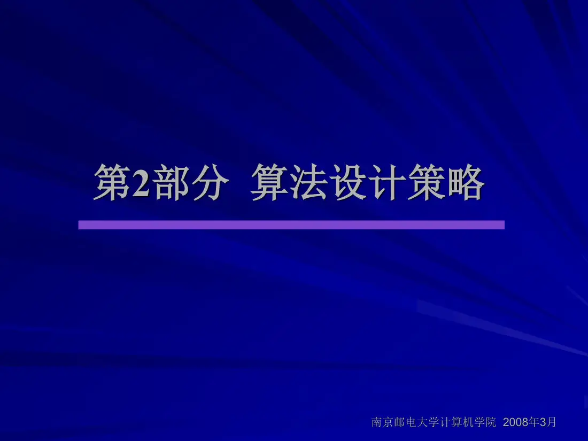

原文：

第2部分 算法设计策略

南京邮电大学计算机学院 2008年3月

### 第7章 动态规划法

原文：

第7章 动态规划法

南京邮电大学计算机学院 2008年3月

### 7.1 一般方法和基本要素

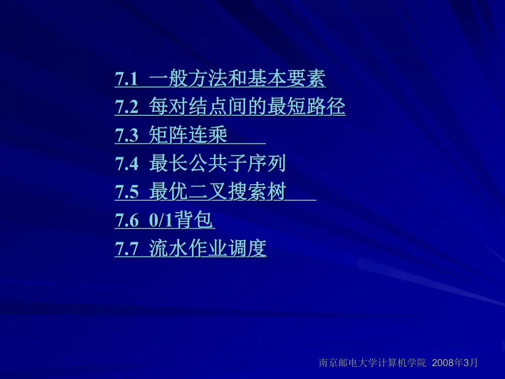

原文：

7.1 一般方法和基本要素

7.2 每对结点间的最短路径

7.3 矩阵连乘

7.4 最长公共子序列

7.5 最优二叉搜索树

7.6 0/1背包

7.7 流水作业调度

南京邮电大学计算机学院 2008年3月

### 7.1 一般方法和基本要素

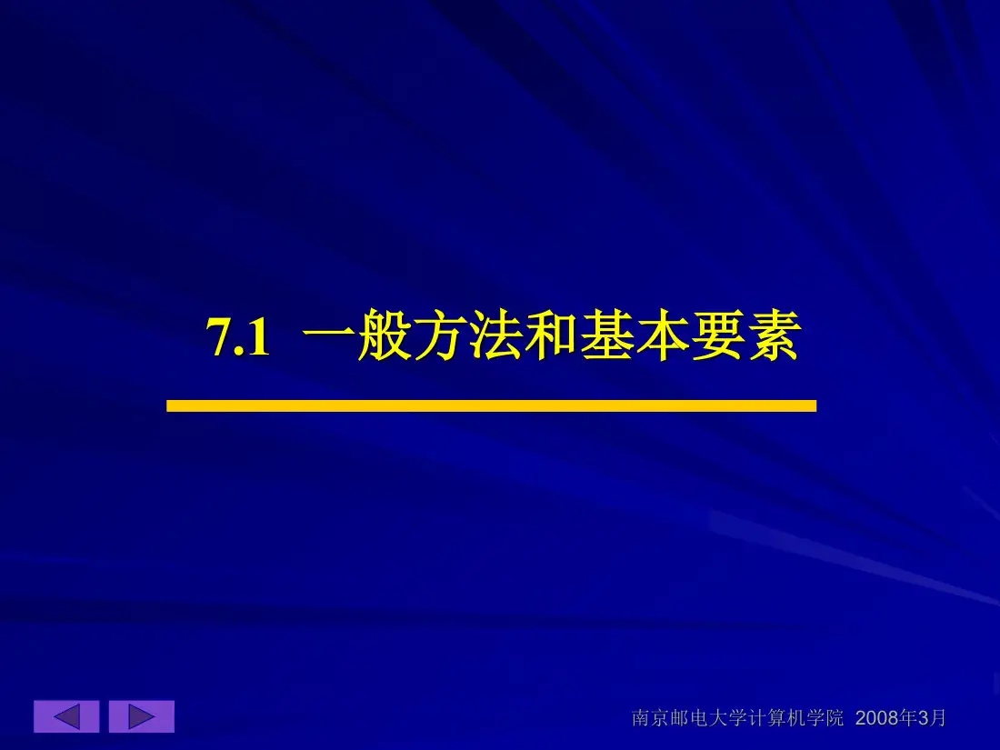

原文：

7.1 一般方法和基本要素

南京邮电大学计算机学院 2008年3月

### 南京邮电大学计算机学院 2008年3月

原文：

动态规划法的实质也是将较大问题分解为较小的同类子问题，这一点上它与分治法和贪心法类似。但动态规划法有自己的特点。分治法的子问题相互独立，相同的子问题被重复计算，动态规划法解决这种子问题重叠现象。贪心法要求针对问题设计最优量度标准，但这在很多情况下并不容易。动态规划法利用最优子结构，自底向上从子问题的最优解逐步构造出整个问题的最优解，动态规划则可以处理不具备贪心准则的问题。

南京邮电大学计算机学院 2008年3月

### 7.1.1 一般方法

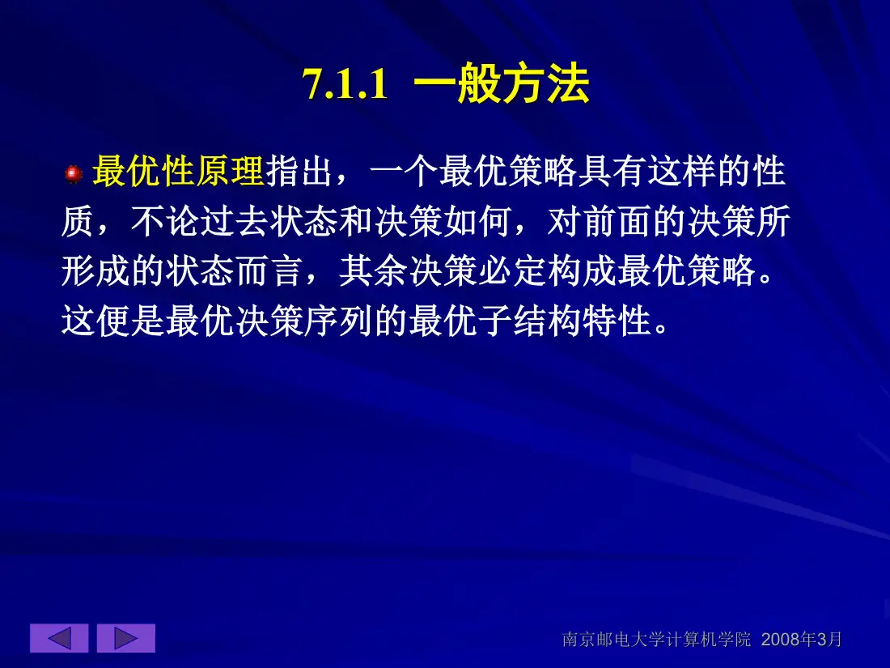

原文：

7.1.1 一般方法

最优性原理指出，一个最优策略具有这样的性质，不论过去状态和决策如何，对前面的决策所形成的状态而言，其余决策必定构成最优策略。这便是最优决策序列的最优子结构特性。

△

南京邮电大学计算机学院 2008年3月

### 设计一个动态规划算法，通常可以按以下几个步骤进行：

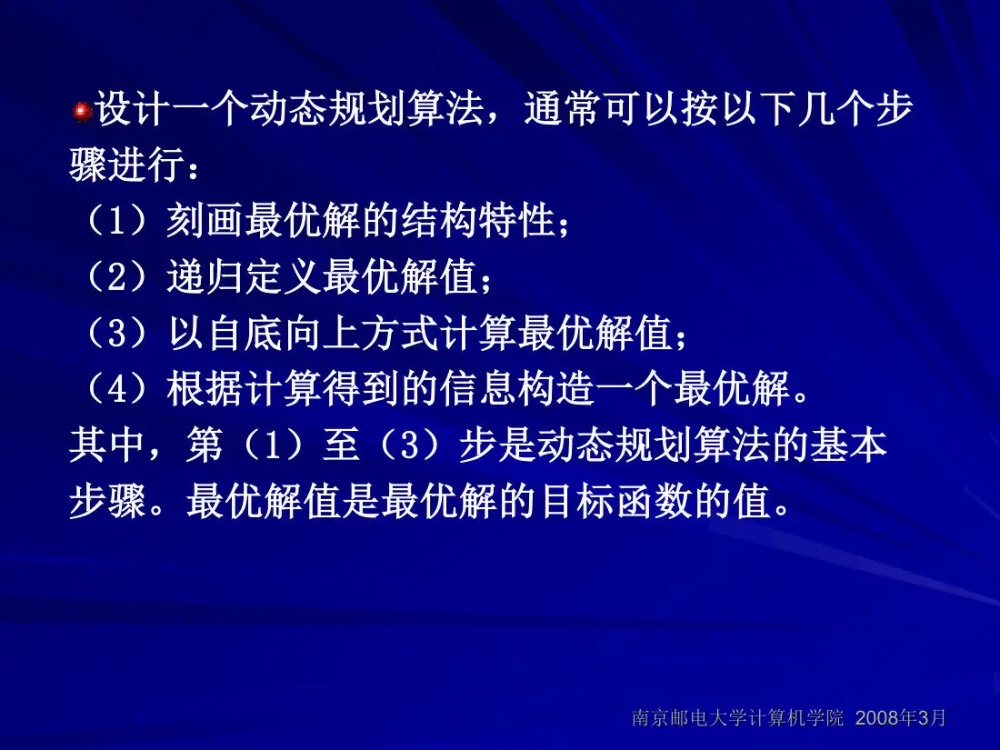

原文：

设计一个动态规划算法，通常可以按以下几个步骤进行：

（1）刻画最优解的结构特性；

（2）递归定义最优解值；

（3）以自底向上方式计算最优解值；

（4）根据计算得到的信息构造一个最优解。其中，第（1）至（3）步是动态规划算法的基本步骤。最优解值是最优解的目标函数的值。

南京邮电大学计算机学院 2008年3月

### 7.1.2 基本要素

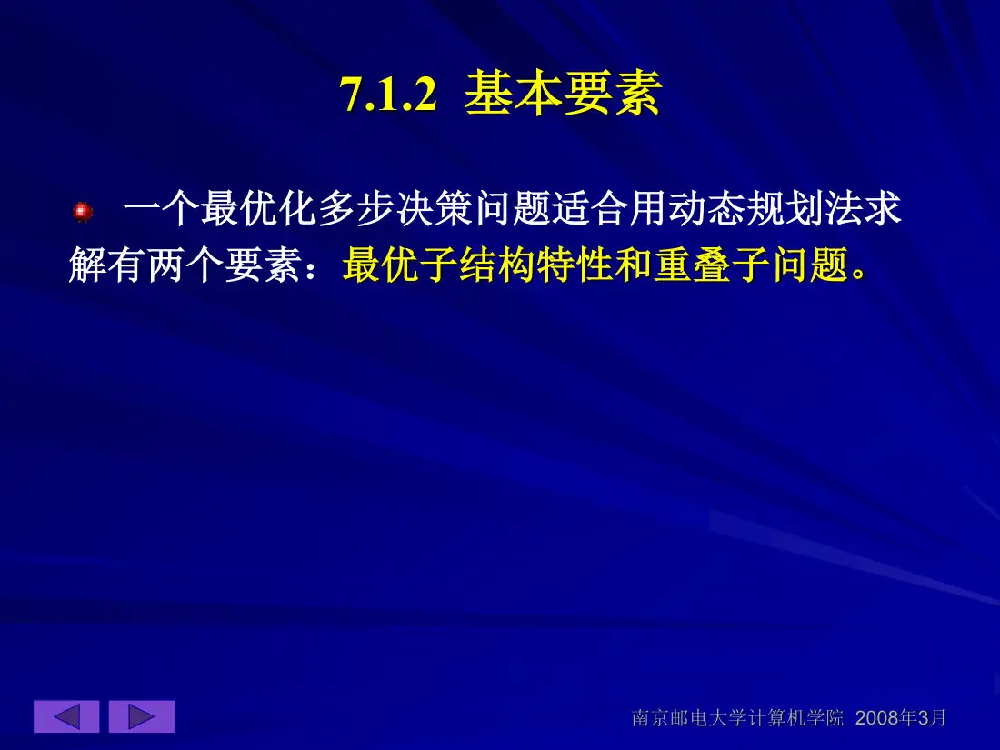

原文：

7.1.2 基本要素

一个最优化多步决策问题适合用动态规划法求解有两个要素：最优子结构特性和重叠子问题。

△

南京邮电大学计算机学院 2008年3月

### 7.1.3 多段图问题

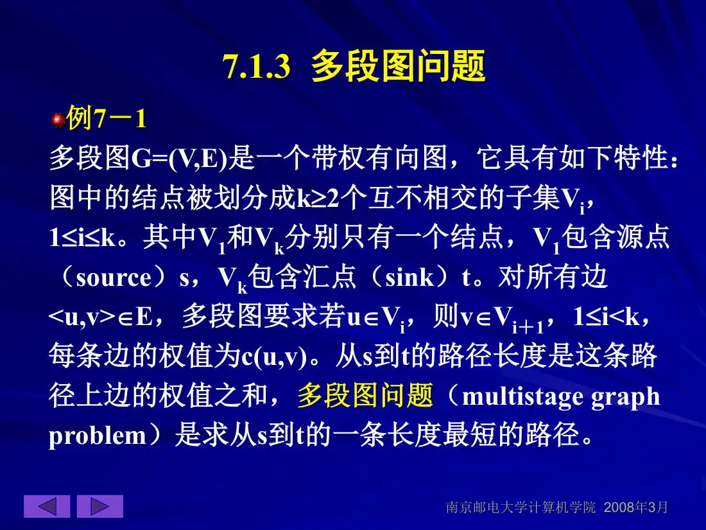

原文：

7.1.3 多段图问题

例7－1

多段图G=(V,E)是一个带权有向图，它具有如下特性：图中的结点被划分成 $1 0 0 2$ 个互不相交的子集 $\pmb { \mathbb { P } }$ $1 5 - 1 1 = 1 5$ 其中 $\pmb { \mathbb { Y } }$ 和 $1 7 - 2 = 1 7$ 分别只有一个结点， $\mathbb { X }$ 包含源点（source） $\mathbb { S }$ $1 7 5$ 包含汇点（sink）t。对所有边$3 1 1 0 - x = 1 0$ 多段图要求若 $U = \mathbb { 1 } \backslash I \backslash = \mathbb { 1 } \backslash I \backslash$ 则 $V _ { 1 } = V _ { 2 } = \frac { V } { 1 2 } = \frac { V } { 1 2 }$ $1 1 \leq x < 1 5$ 每条边的权值为 $\mathbb { G } ( \mathbb { m } \mathbb { n } )$ 。从s到t的路径长度是这条路径上边的权值之和，多段图问题（multistage graphproblem）是求从s到t的一条长度最短的路径。

南京邮电大学计算机学院 2008年3月

### 南京邮电大学计算机学院 2008年3月

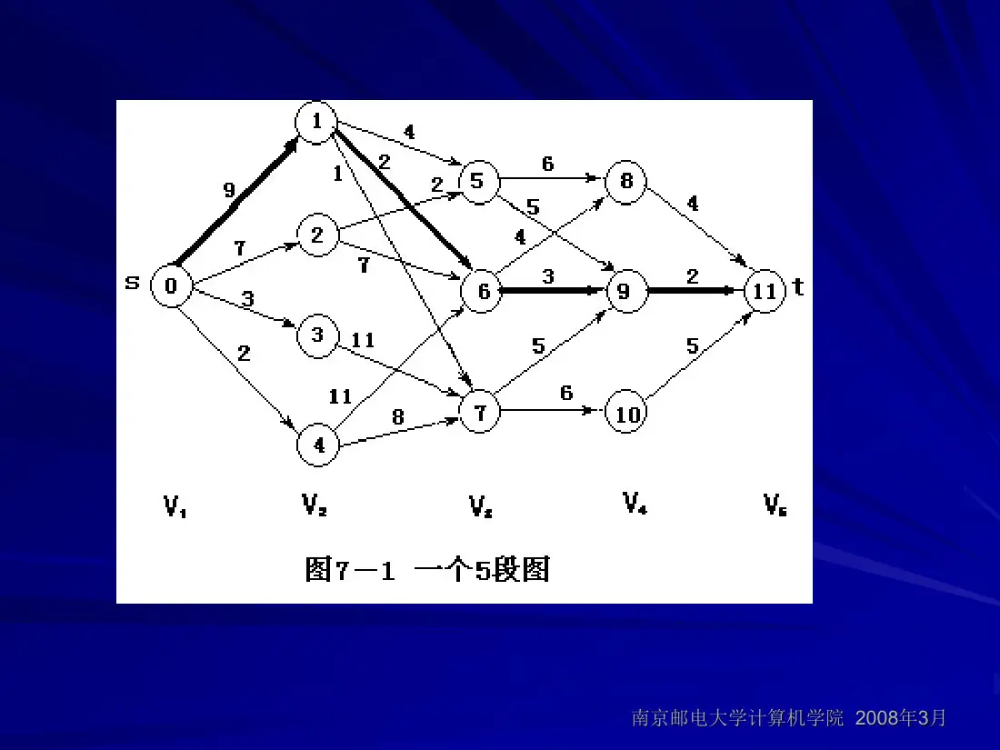

原文：

南京邮电大学计算机学院 2008年3月

### 南京邮电大学计算机学院 2008年3月

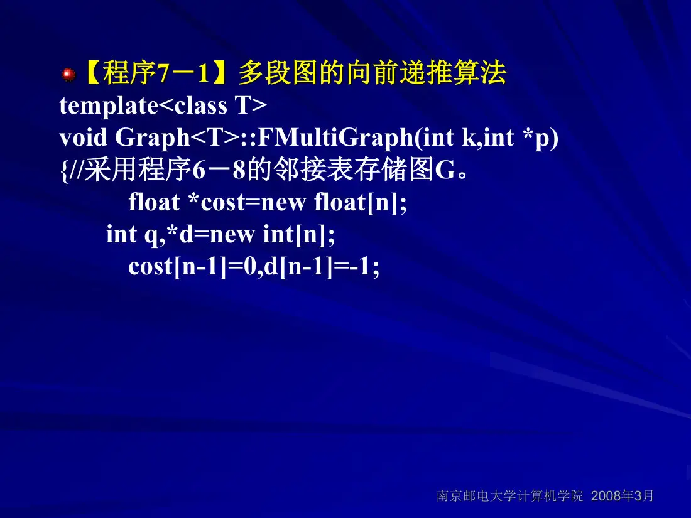

原文：

【程序7－1】多段图的向前递推算法template<class T>void Graph<T>::FMultiGraph(int k,int \*p){//采用程序6－8的邻接表存储图G。float \*cost=new float[n];int q,\*d=new int[n];cost[n-1]=0,d[n-1]=-1;

南京邮电大学计算机学院 2008年3月

### 南京邮电大学计算机学院 2008年3月

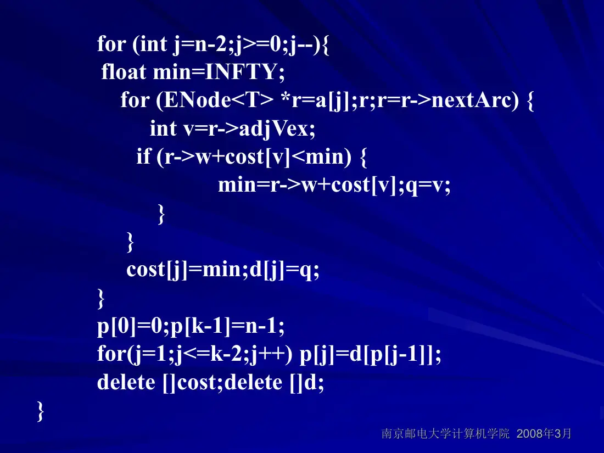

原文：

for (int j=n-2;j>=0;j--){ float min=INFTY; for (ENode<T> \*r=a[j];r;r=r->nextArc) { int v=r->adjVex; if (r->w+cost[v]<min) { min=r->w+cost[v];q=v;

p[0]=0;p[k-1]=n-1; for(j=1;j<=k-2;j++) p[j]=d[p[j-1]]; delete []cost;delete []d;

南京邮电大学计算机学院 2008年3月

### 7.1.4 资源分配问题

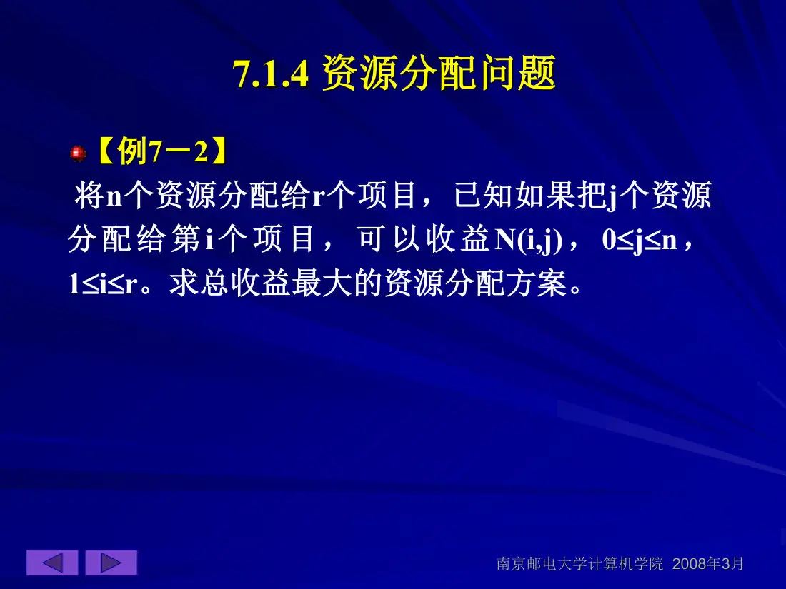

原文：

7.1.4 资源分配问题

【例7－2】

将n个资源分配给r个项目，已知如果把j个资源分配给第i个项目，可以收益N(i,j)，0≤j≤n，1≤i≤r。求总收益最大的资源分配方案。

△

南京邮电大学计算机学院 2008年3月

### 南京邮电大学计算机学院 2008年3月

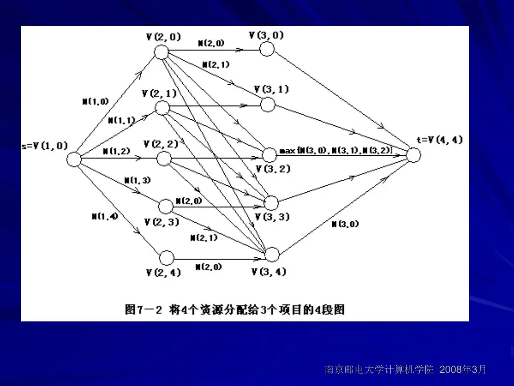

原文：

南京邮电大学计算机学院 2008年3月

### 7.2 每对结点间的最短路径

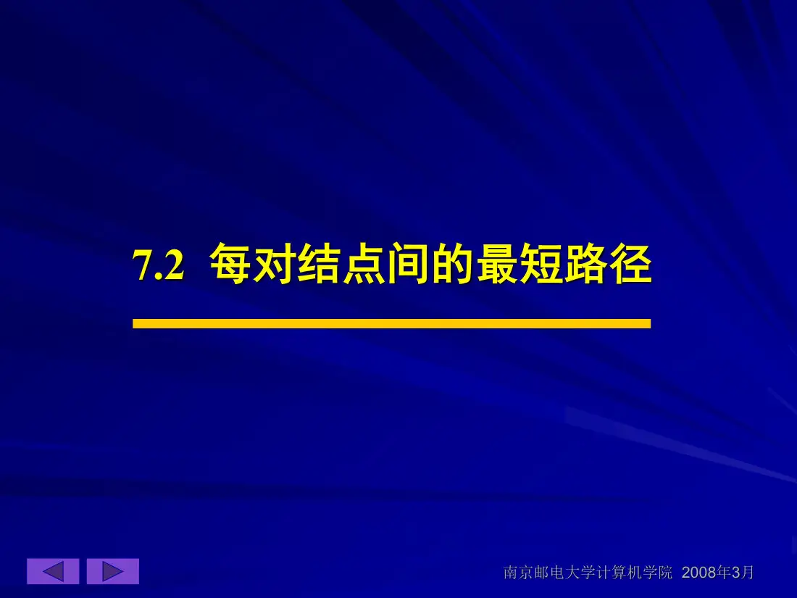

原文：

7.2 每对结点间的最短路径

△

南京邮电大学计算机学院 2008年3月

### 7.2.1 问题描述

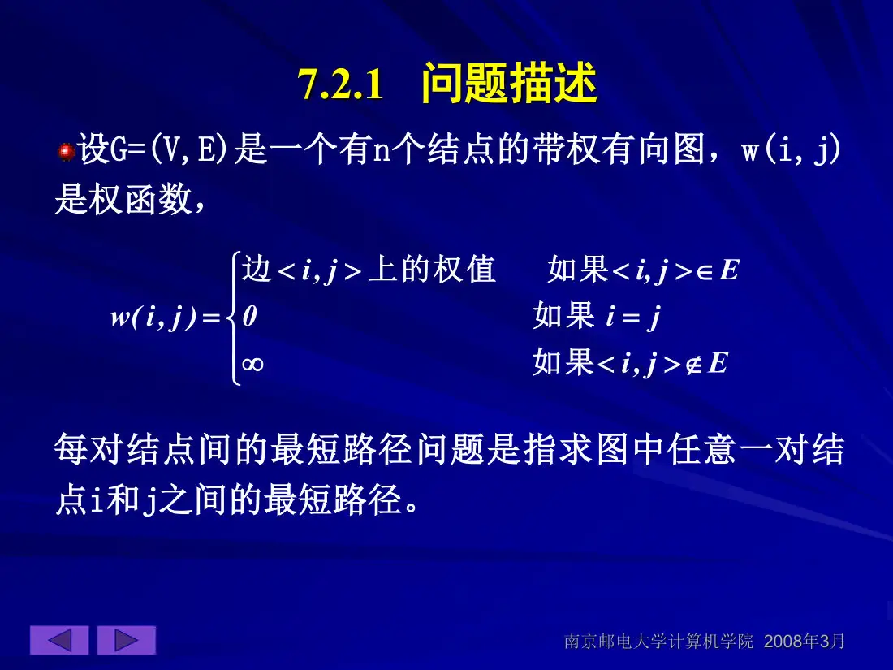

原文：

7.2.1 问题描述

设G=(V,E)是一个有n个结点的带权有向图，w(i,j)是权函数，

边 $\sin \angle D A B =$ 上的权值 如果 $\angle B D E = 1 0$

$$
w (i, j) = \left\{ \begin{array}{l} 0 \\ \infty \end{array} \right.
$$

如果 $n = 1 9$

如果 $\angle B D C = 1 0 ^ { \circ }$

每对结点间的最短路径问题是指求图中任意一对结点i和j之间的最短路径。

南京邮电大学计算机学院 2008年3月

### 7.2.2 动态规划法求解

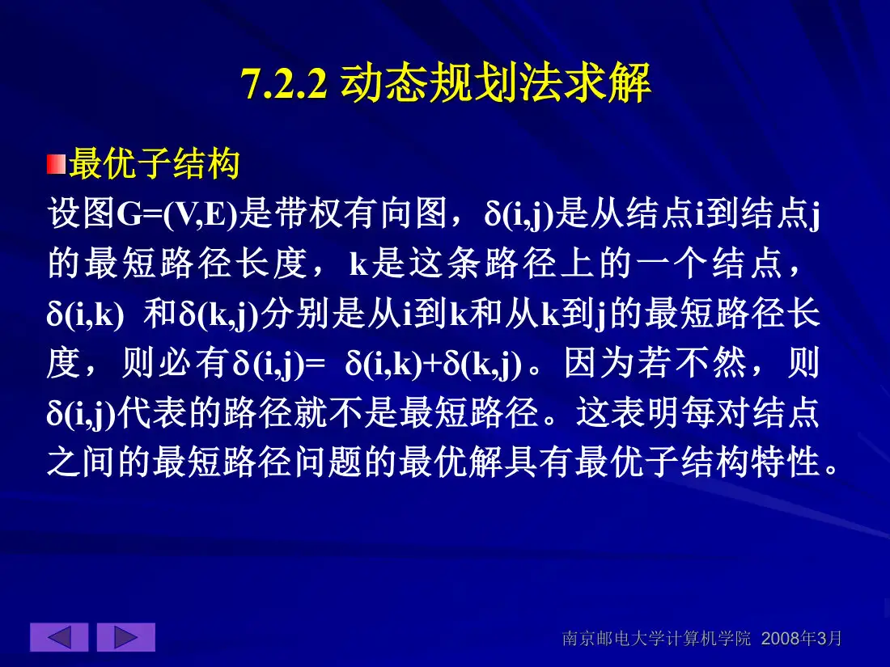

原文：

7.2.2 动态规划法求解

最优子结构

设图G=(V,E)是带权有向图， $\Re \{ \pm \}$ 是从结点i到结点j的最短路径长度，k是这条路径上的一个结点，(i,k) 和 $\pmb { \bigstar } ( 0 , 0 )$ 分别是从i到k和从k到j的最短路径长度，则必有 $\langle \langle \langle | \langle | \langle | \rangle | - \langle | | \langle | \langle | | \langle | \langle | | \langle | | \langle | | \langle | | \langle | | \langle | | \rangle |$ 。因为若不然，则$\Re ( \mathbb { H } )$ 代表的路径就不是最短路径。这表明每对结点之间的最短路径问题的最优解具有最优子结构特性。

南京邮电大学计算机学院 2008年3月

### 最优解的递推关系

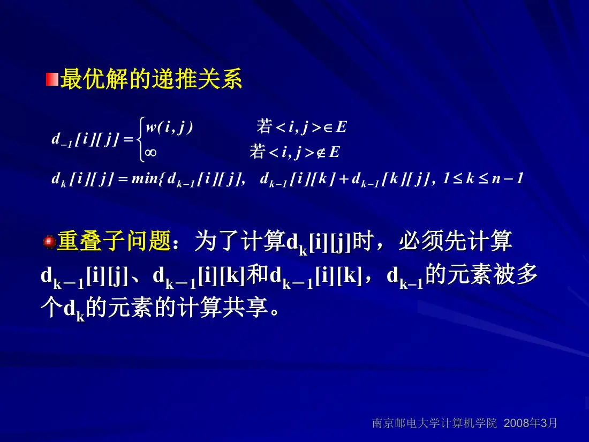

原文：

最优解的递推关系

$$
d _ {- 1} [ i ] [ j ] = \left\{ \begin{array}{l} w (i, j) \\ \infty \end{array} \right.
$$

若 $\angle B D E = 1 0 ^ { \circ }$

若<i,j>∉E

$$
d _ {k} [ i ] [ j ] = \min \{d _ {k - 1} [ i ] [ j ], d _ {k - 1} [ i ] [ k ] + d _ {k - 1} [ k ] [ j ], 1 \leq k \leq n - 1
$$

重叠子问题：为了计算 $0 . 0 1 \boxed { 1 } \boxed { 1 } \boxed { 1 }$ 时，必须先计算$0 . 0 1 \dot { 0 } 0 . 1 0 1 \dot { 0 }$ $\mathrm { \Delta }$ 和 $\textcircled { 1 } \textcircled { 1 } \textcircled { 1 } \textcircled { 2 }$ $0 . 5 \times 1 0 ^ { 3 } k g / m ^ { 3 }$ 的元素被多个 $\textcircled { 1 }$ 的元素的计算共享。

南京邮电大学计算机学院 2008年3月

### 7.2.3 弗洛伊德算法

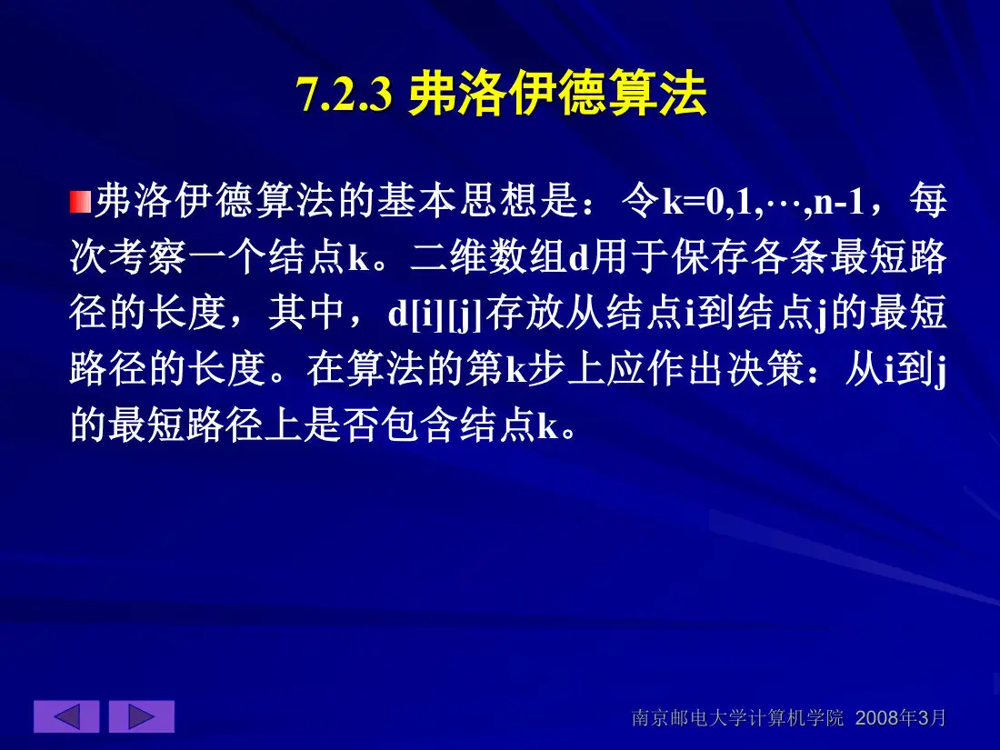

原文：

7.2.3 弗洛伊德算法

弗洛伊德算法的基本思想是：令 $1 5 - 1 1 = 1 5 \times 1 5 = 1 5 1$ ，每次考察一个结点k。二维数组d用于保存各条最短路径的长度，其中，d[i][j]存放从结点i到结点j的最短路径的长度。在算法的第k步上应作出决策：从i到j的最短路径上是否包含结点k。

南京邮电大学计算机学院 2008年3月

### 南京邮电大学计算机学院 2008年3月

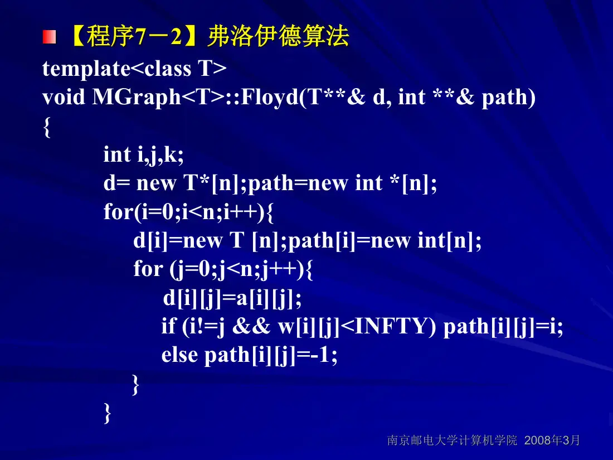

原文：

【程序7－2】弗洛伊德算法template<class T>void MGraph<T>::Floyd(T\*\*& d, int \*\*& path)

int i,j,k; d= new T\*[n];path=new int \*[n]; for(i=0;i<n;i++){ d[i]=new T [n];path[i]=new int[n]; for (j=0;j<n;j++){ d[i][j]=a[i][j]; if (i!=j && w[i][j]<INFTY) path[i][j]=i; else path[i][j]=-1;

南京邮电大学计算机学院 2008年3月

### }弗洛伊德算法的时间复杂度为O(n3)

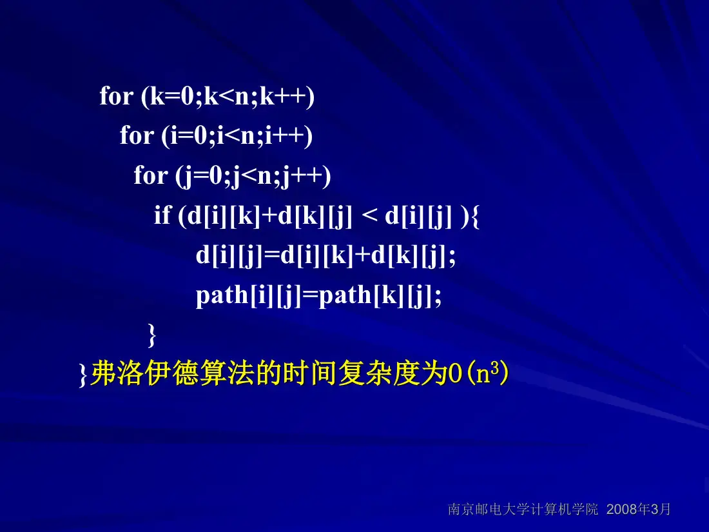

原文：

for (k=0;k<n;k++) for (i=0;i<n;i++) for (j=0;j<n;j++) if (d[i][k]+d[k][j] < d[i][j] ){ d[i][j]=d[i][k]+d[k][j]; path[i][j]=path[k][j];

}弗洛伊德算法的时间复杂度为O(n3)

南京邮电大学计算机学院 2008年3月

### 南京邮电大学计算机学院 2008年3月

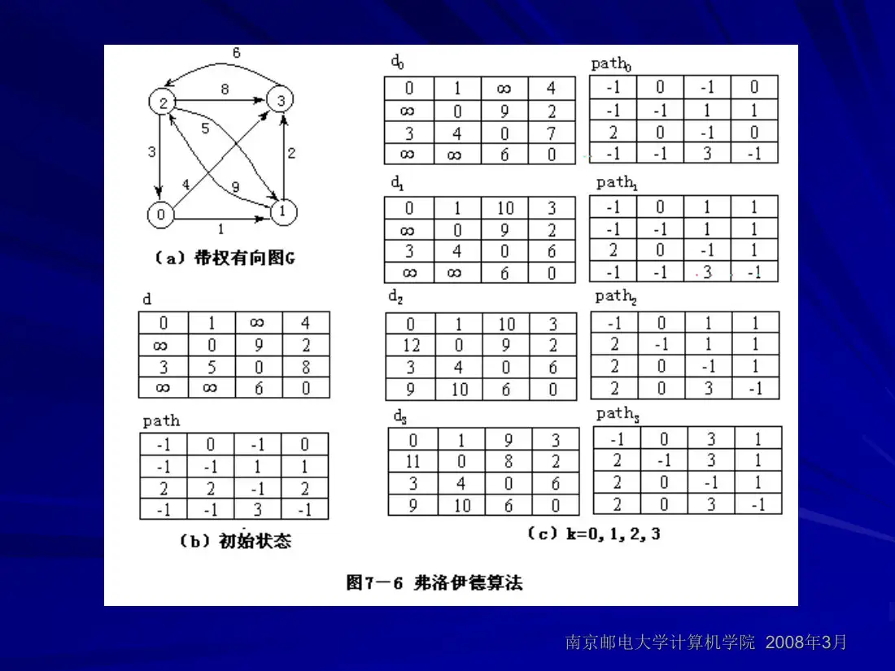

原文：

南京邮电大学计算机学院 2008年3月

### 7.2.4 算法正确性

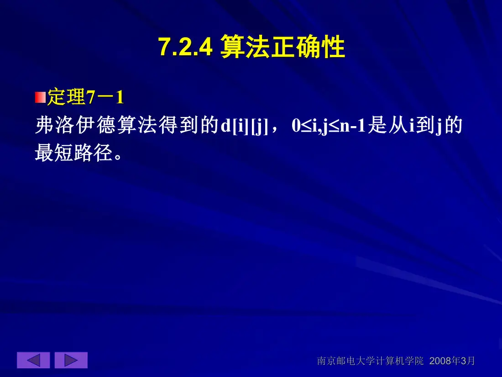

原文：

7.2.4 算法正确性

定理7－1

弗洛伊德算法得到的d[i][j]，0≤i,j≤n-1是从i到j的最短路径。

△

南京邮电大学计算机学院 2008年3月

### 7.3 矩阵连乘

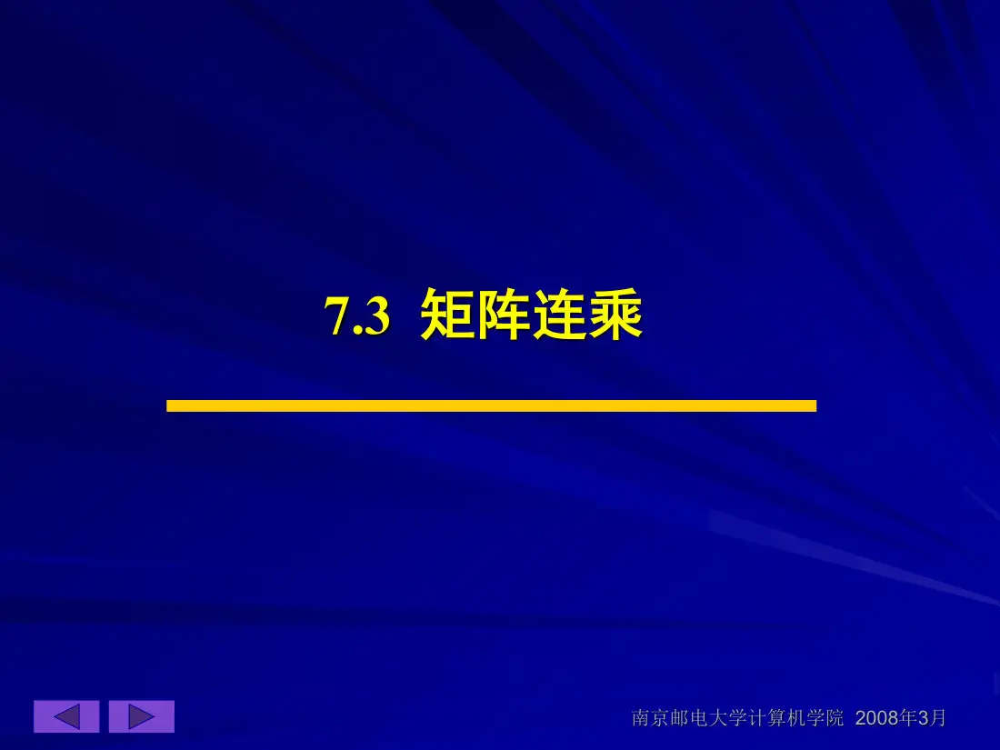

原文：

7.3 矩阵连乘

△

南京邮电大学计算机学院 2008年3月

### 7.3.1 问题描述

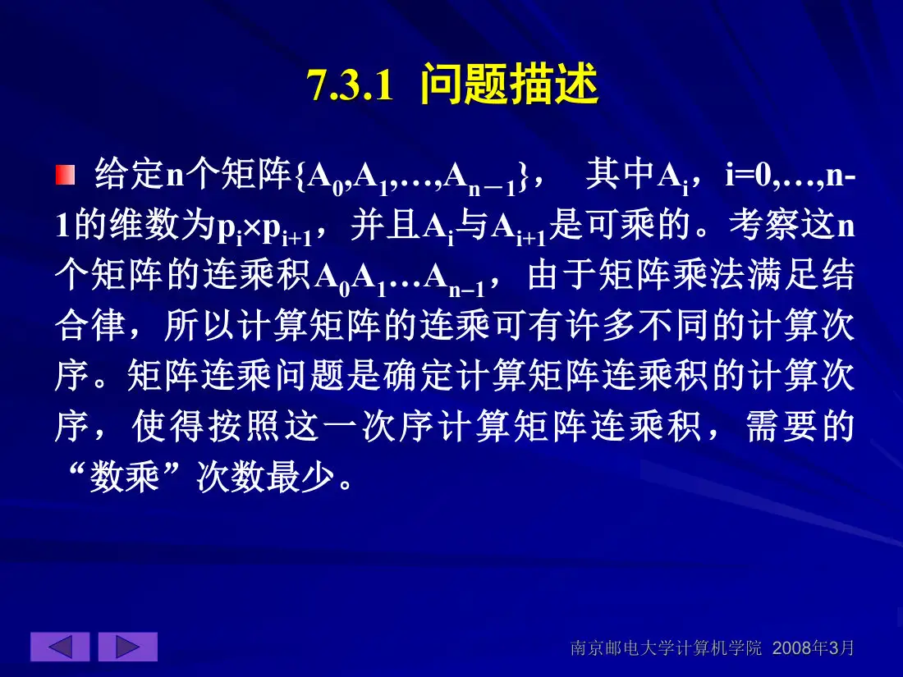

原文：

7.3.1 问题描述

给定n个矩阵 $\angle A C D = \angle B C D = \angle C A C = 1 1 5 ^ { \circ }$ 其中 $1 0 0 - 1 5 = 1 1 ( m o d 1 )$ 1的维数为 $\textcircled { 1 } \textcircled { 2 } \textcircled { 1 } \textcircled { 2 } \textcircled { 5 } \textcircled { 2 }$ 并且 $1 4 - 9 = 1 4$ 与 $\angle A = 9 0 ^ { \circ }$ 是可乘的。考察这n个矩阵的连乘积 $\pm \frac { \sqrt { 2 } } { ( 1 ) ^ { 2 } } = \pm \frac { \sqrt { 2 } } { ( 1 ) ^ { 2 } } = \pm \frac { \sqrt { 2 } } { ( 1 ) ^ { 2 } }$ 由于矩阵乘法满足结合律，所以计算矩阵的连乘可有许多不同的计算次序。矩阵连乘问题是确定计算矩阵连乘积的计算次序，使得按照这一次序计算矩阵连乘积，需要的“数乘”次数最少。

南京邮电大学计算机学院 2008年3月

### 南京邮电大学计算机学院 2008年3月

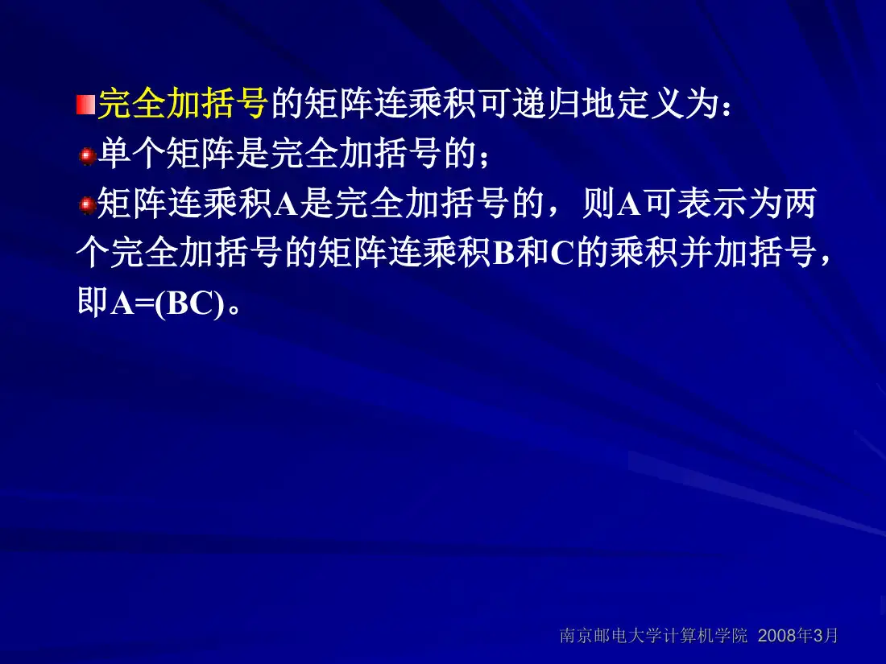

原文：

完全加括号的矩阵连乘积可递归地定义为：单个矩阵是完全加括号的；矩阵连乘积A是完全加括号的，则A可表示为两个完全加括号的矩阵连乘积B和C的乘积并加括号，即 $\pmb { \mathrm { \ell } } = ( 0 . 3 \pmb { \mathrm { \ell } } 0 )$

南京邮电大学计算机学院 2008年3月

### 例7－4

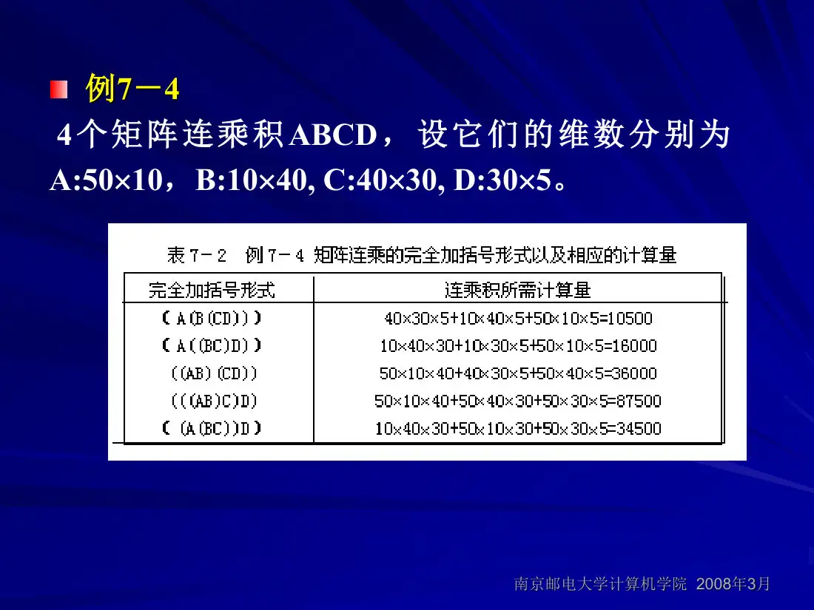

原文：

例7－4

4个矩阵连乘积ABCD，设它们的维数分别为 A:50×10，B:10×40,C:40×30, D:30×5。

表7-2 例7-4 矩阵连乘的完全加括号形式以及相应的计算量
<table><tr><td>完全加括号形式</td><td>连乘积所需计算量</td></tr><tr><td>(A(B(CD))</td><td>40×30×5+10×40×5+50×10×5=10500</td></tr><tr><td>(A(BC)D)</td><td>10×40×30+10×30×5+50×10×5=16000</td></tr><tr><td>((AB)(CD))</td><td>50×10×40+40×30×5+50×40×5=36000</td></tr><tr><td>(((AB)C)D)</td><td>50×10×40+50×40×30+50×30×5=87500</td></tr><tr><td>((A(BC))D)</td><td>10×40×30+50×10×30+50×30×5=34500</td></tr></table>

南京邮电大学计算机学院 2008年3月

### 7.3.2 动态规划法求解

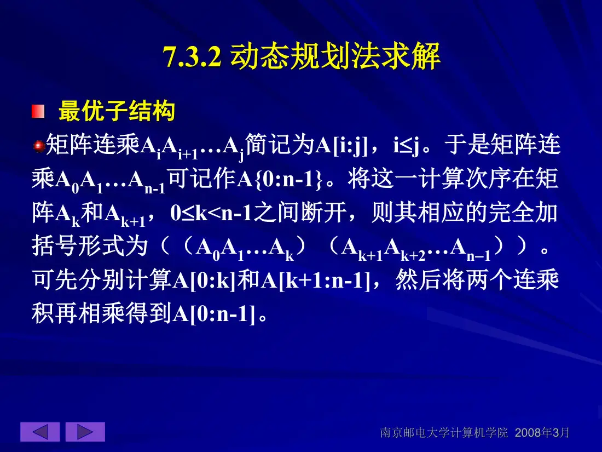

原文：

7.3.2 动态规划法求解

最优子结构

矩阵连乘 $\mathrm { A _ { \Delta } \Psi _ { \mathrm { a } } \Psi _ { \mathrm { a } } \Psi _ { \mathrm { a } } \Psi _ { \mathrm { a } } \Psi _ { \mathrm { a } } \Psi _ { \mathrm { a } } \Psi _ { \mathrm { a } } }$ 简记为A[i:j]，ij。于是矩阵连乘阵 $\pm \frac { \sqrt { 2 } } { 1 2 } = 5 0 0 0 0 0 0$ 可记作 $\pmb { \mathbb { H } } ( \pmb { \mathbb { H } } ) \pmb { \mathbb { H } }$ 。将这一计算次序在矩11 $1 4 - 1 5 = 1 5$ 和 $1 4 5 \div 5 = 1 2$ $\bf { \underline { { ( ) } } \bf { \underline { { \ s ( ) } } \bf { \underline { { \ s ( ) } } \bf { \bar { \Pi } } } } }$ 之间断开，则其相应的完全加括号形式为 $\textcircled { 4 } 2 = \textcircled { 1 } 2 = \textcircled { 1 } 2 = \textcircled { 2 } 2$ $0 . 1 \dot { 0 } 0 0 0 0 0 0 0 0 0 0 0 0 0 0 0 0 0 0 0 0 0 0 0 0 0 0 0 0 0 0 0 0 0 0 0 0 0 0 0 0 0 0 0 0 0 0 0 0 0 0 0 0 0 0 0 0 0 0 0 0 0 0 0 0 0 0 0 0 0 0 0 0 0 0 0 0 0 0 0 0 0 0 0 0 0 0 0 0 0 0 0 0 0 0 0 0 0 0 0 0 0 0 0 0 0 0 0 0 0 0 0 0 0 0 0 0 0 0 0 0 0 0 0 0 0 0 0 0 0 0 0 0 0 0 0 0 0 0 0 0 0 0 0 0 0 0 0 0 0 0 0 0 0 0 0 0 0 0 0 0 0 0 0 0 0 0 0 0 0 0 0 0 0 0 0 0 0 0 0 0 0 0 0 0 0 0 0 0 0 0 0 0 0 0 0 0 0 0 0 0 0 0 0 0 0 0 0 0 0 0 0 0 0 0 0 0 0 0 0 0 0 0 0 0 0 0 0 0 0 0 0 0 0 0 0 0 0 0 0 0 0 0 0 0 0 0 0 0 0 0 0 0 0 0 0 0 0 0 0 0 0 0 0 0 0 0 0 0 0 0 0 0 0 0 0 0 0 0 0 0 0 0 0 0 0 0 0 0 0 0 0 0 0 0 0 0 0 0 0 0 0 0 0 0 0 0 0 0 0 0 0 0 0 0 0 0 0 0 0 0 0 0 0 0 0 0 0 0 0 0 0 0 0 0 0 0 0 0 0 0 0 0 0 0 0 0 0 0 0 0 0 0 0 0 0 0 0 0 0 0 0 0 0 0 0 0 0 0 0 0 0 0 0 0 0 0 0 0 0 0 0 0 0 0 0 0 0 0 0 0 0 0 0 0 0 0 0 0 0 0 0 0 0 0 0 0 0 0 0 0 0 0 0 0 0 0 0 0 0 0 0 0 0 0 0 0 0 0 0 0 0 0 0 0 0 0 0 0 0 0 0 0 0 0 0 0 0 0 0 0 0 0 0 0 0 0 0 0 0 0 0 0 0 0 0 0 0 0 0 0 0 0 0 0 0 0 0 0 0 0 0 0 0 0 0 0 0 0 0 0 0 0 0 0 0 0 0 0 0 0 0 0 0 0 0 0 0 0 0 0 0 0 0 0 0 0 0 0 0 0 0 0 0 0 0 0 0 0 0 0 0 0 0 0 0 0 0 0 0 0 0 0 0 0 0 0 0 0 0 0 0 0 0 0 0 0 0 0 0 0 0 0 0 0 0 0 0 0 $ 可先分别计算A[0:k]和A[k+1:n-1]，然后将两个连乘积再相乘得到 $\pmb { \mathbb { A } } \pmb { \mathbb { I } } \pmb { \mathbb { B } } \pmb { \mathbb { I } } \pmb { \mathbb { I } }$ a

南京邮电大学计算机学院 2008年3月

### 南京邮电大学计算机学院 2008年3月

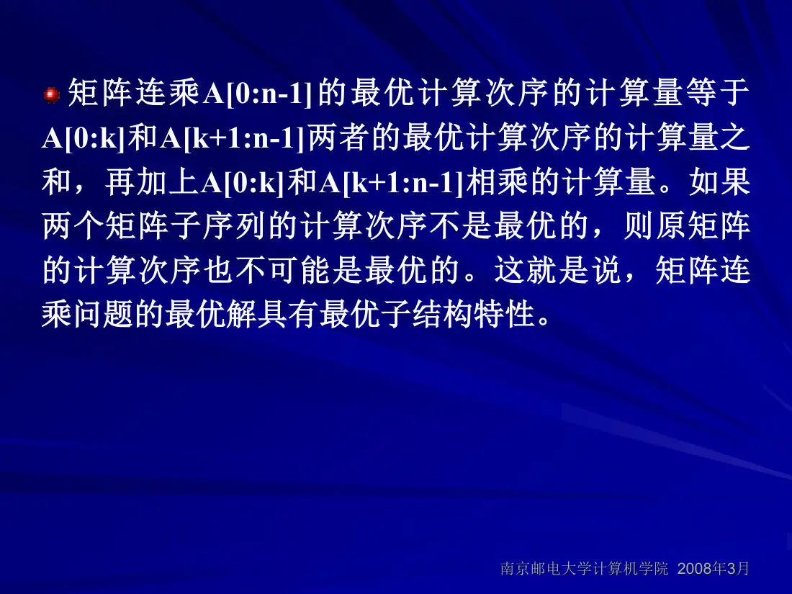

原文：

矩阵连乘A[0:n-1]的最优计算次序的计算量等于A[0:k]和A[k+1:n-1]两者的最优计算次序的计算量之和，再加上A[0:k]和A[k+1:n-1]相乘的计算量。如果两个矩阵子序列的计算次序不是最优的，则原矩阵的计算次序也不可能是最优的。这就是说，矩阵连乘问题的最优解具有最优子结构特性。

南京邮电大学计算机学院 2008年3月

### 最优解的递推关系先定义一个二维数组m，用来保存矩阵连乘时所需的最少计算量。

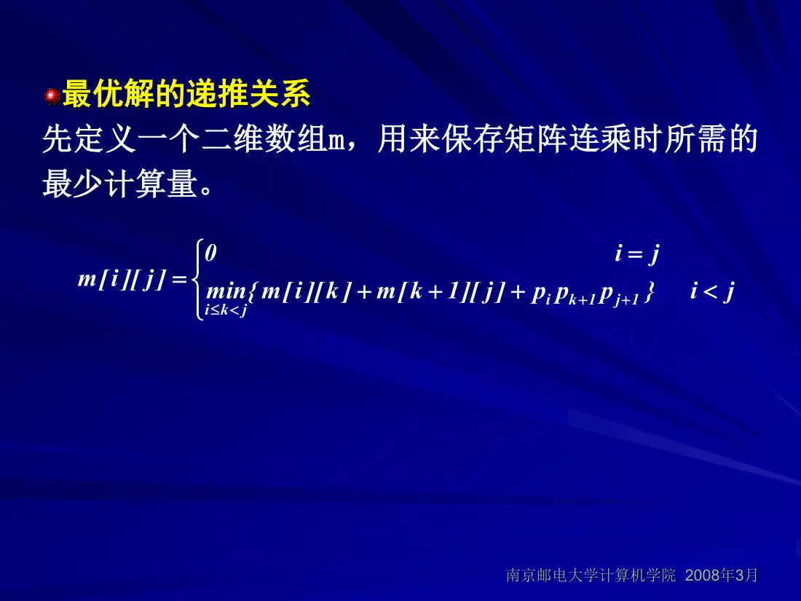

原文：

最优解的递推关系先定义一个二维数组m，用来保存矩阵连乘时所需的最少计算量。

$$
m [ i ] [ j ] = \left\{ \begin{array}{l l} 0 & i = j \\ m i n _ {i \leq k <   j} \{m [ i ] [ k ] + m [ k + 1 ] [ j ] + p _ {i} p _ {k + 1} p _ {j + 1} \} & i <   j \end{array} \right.
$$

南京邮电大学计算机学院 2008年3月

### 7.3.3 矩阵连乘算法

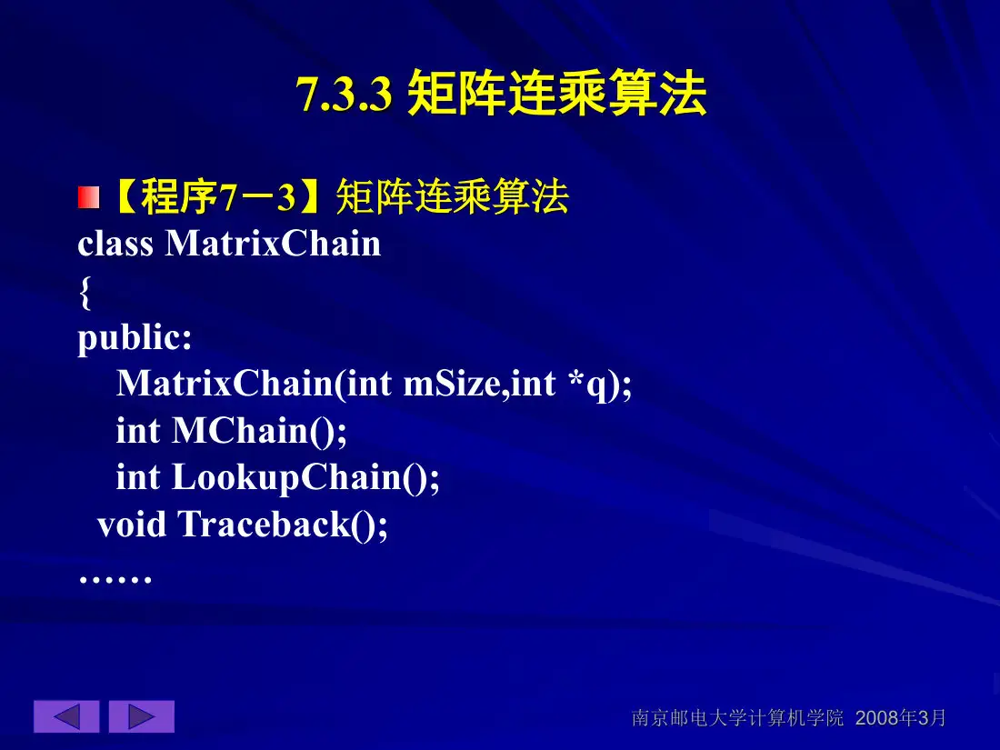

原文：

7.3.3 矩阵连乘算法

【程序7－3】矩阵连乘算法class MatrixChain

public: MatrixChain(int mSize,int \*q); int MChain(); int LookupChain(); void Traceback();

南京邮电大学计算机学院 2008年3月

### 南京邮电大学计算机学院 2008年3月

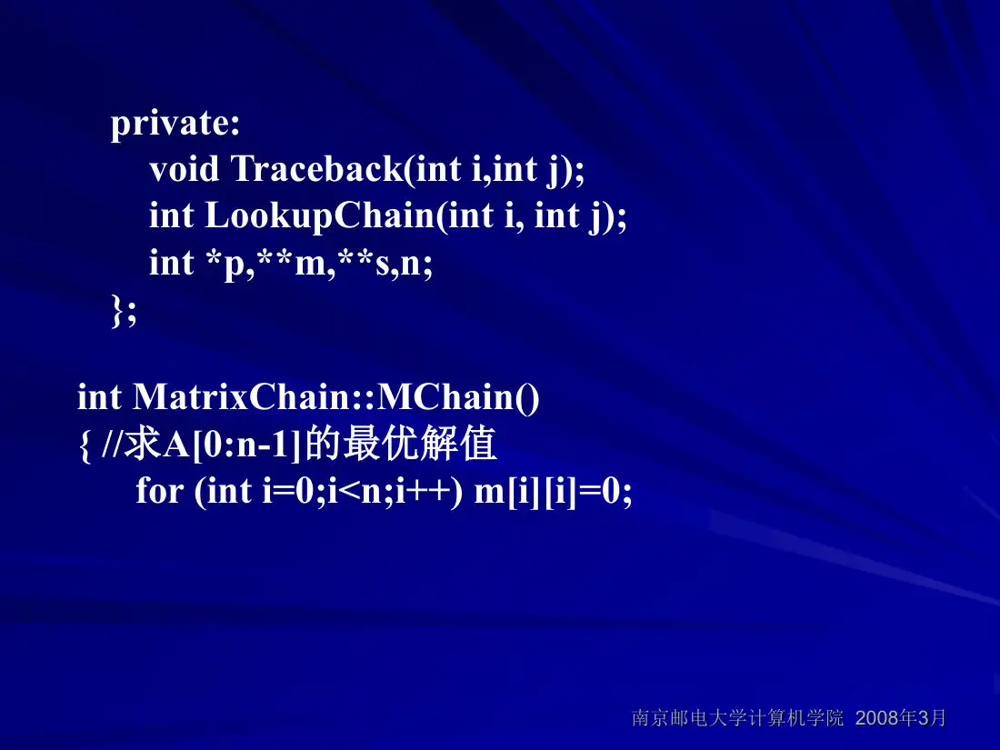

原文：

private: void Traceback(int i,int j); int LookupChain(int i, int j); int \*p,\*\*m,\*\*s,n; };

int MatrixChain::MChain(){ //求A[0:n-1]的最优解值for (int i=0;i<n;i++) m[i][i]=0;

南京邮电大学计算机学院 2008年3月

### return m[0][n-1];

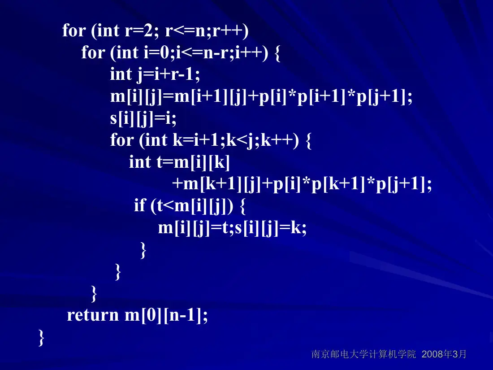

原文：

for (int r=2; r<=n;r++) for (int i=0;i<=n-r;i++) { int j=i+r-1; m[i][j]=m[i+1][j]+p[i]\*p[i+1]\*p[j+1]; s[i][j]=i; for (int k=i+1;k<j;k++) { int t=m[i][k] +m[k+1][j]+p[i]\*p[k+1]\*p[j+1]; if (t<m[i][j]) { m[i][j]=t;s[i][j]=k;

return m[0][n-1];

南京邮电大学计算机学院 2008年3月

### void MatrixChain::Traceback(int i,int j)

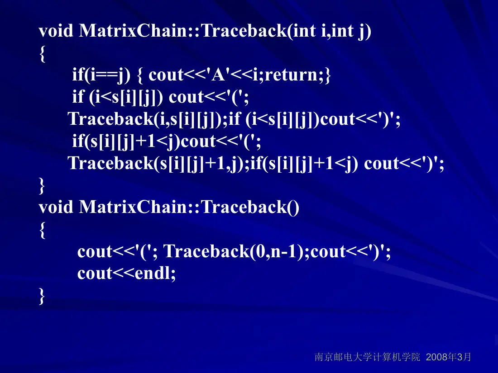

原文：

void MatrixChain::Traceback(int i,int j)

if(i==j) { cout<<'A'<<i;return;} if (i<s[i][j]) cout<<'('; Traceback(i,s[i][j]);if (i<s[i][j])cout<<')'; if(s[i][j]+1<j)cout<<'('; Traceback(s[i][j]+1,j);if(s[i][j]+1<j) cout<<')';

void MatrixChain::Traceback()

cout<<'('; Traceback(0,n-1);cout<<')'; cout<<endl;

南京邮电大学计算机学院 2008年3月

### 例7－5

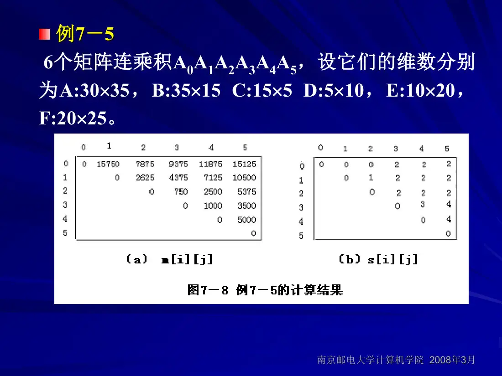

原文：

例7－5

6个矩阵连乘积 $\angle A = 1 2 0 ^ { \circ } - \angle A = 1 2 0 ^ { \circ } - \angle A = 1 2 0 ^ { \circ }$ 设它们的维数分别 为 $\pmb { \mathrm { R e 1 0 2 3 } }$ B:35×15 C:15×5 D:5×10, $| \Im \mathrm { e q } | \mathbb { I } \Re \mathrm { d } \mathbb { I } | .$ $| \Psi \mathcal { W } \mathcal { Z } |$

南京邮电大学计算机学院 2008年3月

### 7.3.4 备忘录方法

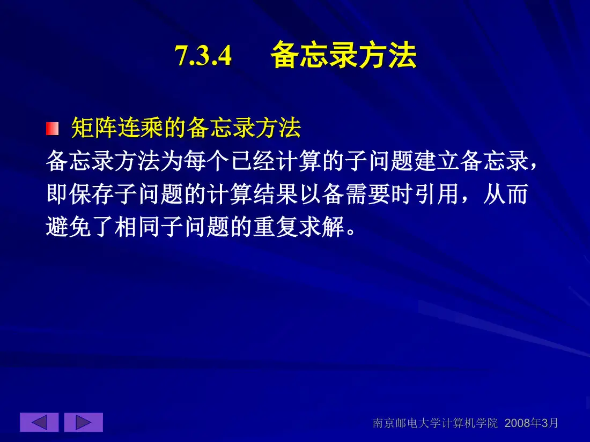

原文：

7.3.4 备忘录方法

矩阵连乘的备忘录方法备忘录方法为每个已经计算的子问题建立备忘录，即保存子问题的计算结果以备需要时引用，从而避免了相同子问题的重复求解。

△

南京邮电大学计算机学院 2008年3月

### if (t<u) { u=t; s[i][j]=k;

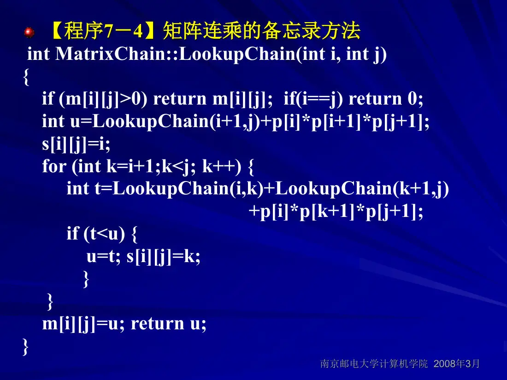

原文：

【程序7－4】矩阵连乘的备忘录方法int MatrixChain::LookupChain(int i, int j)

if (m[i][j]>0) return m[i][j]; if(i==j) return 0; int u=LookupChain(i+1,j)+p[i]\*p[i+1]\*p[j+1]; s[i][j]=i;

for (int k=i+1;k<j; k++) { int t=LookupChain(i,k)+LookupChain(k+1,j) +p[i]\*p[k+1]\*p[j+1];

if (t<u) { u=t; s[i][j]=k;

m[i][j]=u; return u;

南京邮电大学计算机学院 2008年3月

### 南京邮电大学计算机学院 2008年3月

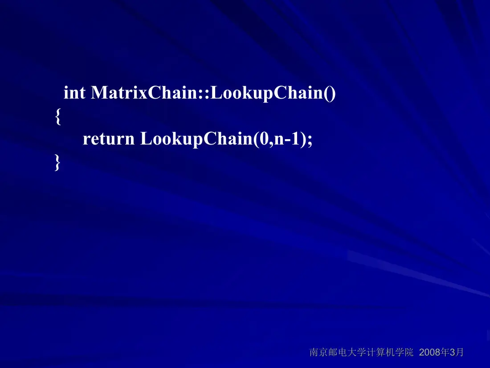

原文：

int MatrixChain::LookupChain()return LookupChain(0,n-1);

南京邮电大学计算机学院 2008年3月

### 7.5 最优二叉搜索树

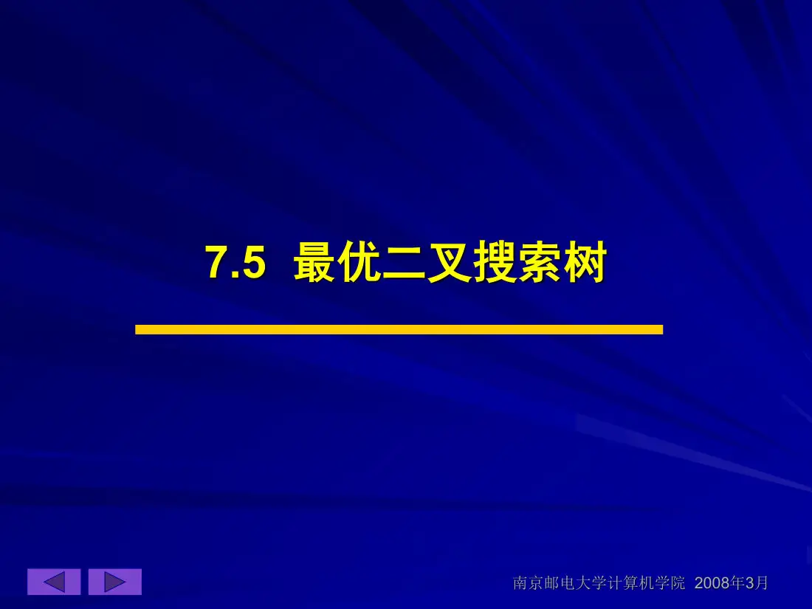

原文：

7.5 最优二叉搜索树

△

南京邮电大学计算机学院 2008年3月

### 7.5.1 问题描述

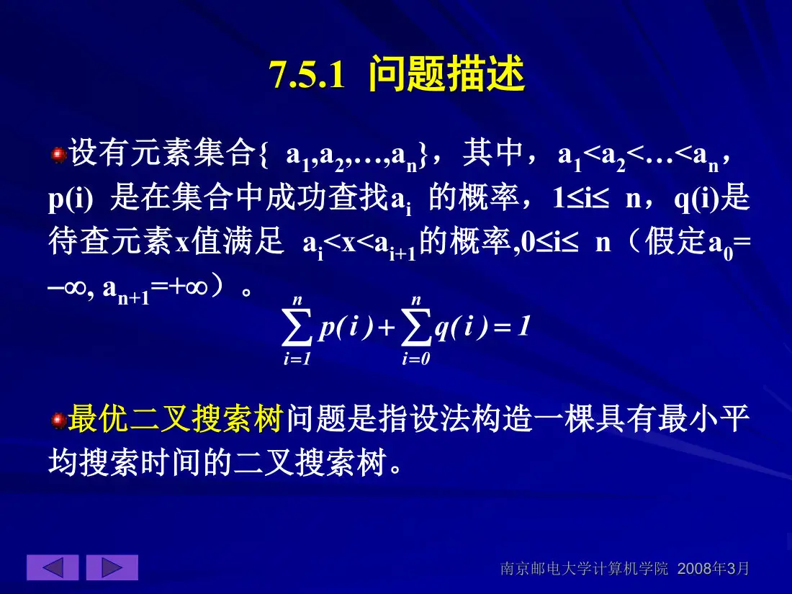

原文：

7.5.1 问题描述

设有元素集合{ $: 1 0 : 1 0 : 1 0 : 1 0 : 1 0 : 1 0 : 1 0 : 1 0 : 1 0 : 1 0 : 1 0 : 1 0 : 1 0 : 1 0 : 1 0 : 1 0 : 1 0 : 1 0 : 1 0 : 1 0 : 1 0 : 1 0 : 1 0 : 1 0 : 1 0 : 1 0 : 1 0 : 1 0 : 1 0 : 1 0 : 1 0 : 1 0 : 1 0 : 1 0 : 1 0 : 1 0 : 1 0 : 1 0 : 1 0 : 1 0 : 1 0 : 1 0 : 1 0 : 1 0 : 1 0 : 1 0 : 0 : 1 0 : 0 : 1 0 : 0 : 1 0 : 0 : 1 0 : 0 : 1 0 : 0 : 0 : 1 0 : 0 : 0 : 1 0 : 0 : 0 : 1 0 : 0 : 0 : 0 : 0 : 1 0 : 0 : 0 : 0 : 0 0 : 0 : 0 : 0 0 : 0 : 0 : 0 : 0 0 : 0 : 0 : 0 0 : 0 : 0 0 : 0 : 0 0 : 0 : 0 0 : 0 : 0 0 : 0 : 0 0 : 0 : 0 0 : 0 : 0 0 : 0 : 0 0 : 0 0 : 0 : 0 0 : 0 0 : 0 : 0 0 : 0 0 : 0 0 : 0 : 0 0 : 0 0 : 0 0 : 0 0 : 0 : 0 0 : 0 0 : 0 0 : 0 0 : 0 0 : 0 0 : 0 0 : 0 0 : 0 0 : 0 0 : 0 0 0 : 0 0 : 0 0 0 : 0 0 : 0 0 0 : 0 0 : 0 0 0 : 0 0 0 : 0 0 0 0 : 0 0 0 : 0 0 0 : 0 0 0 0 0 : 0 0 0 0 0 : 0 0 0 0 0 0 0 0 : 0 0 0 0 0 0 0 0 0 0 0 0 0 0 0 0 0 0 0 0 0 0 0 0 0 0 0 0 0 0 0 0 0 0 0 0 0 0 0 0 0 0 0 0 0 0 0 0 0 0 0 0 0 0 0 0 0 0 0 0 0 0 0 0 0 0 0 0 0 0 0 0 0 0 0 0 0 0 0 0 0 0 0 0 0 0 0 0 0 0 0 0 0 0 0 0 0 0 0 0 0 0 0 0 0 0 0 0 0 0 0 0 0 0 0 0 0 0 0 0 0 0 0 0 0 0 0 0 0 0 0 0 0 0 0 0 0 0 0 0 0 0 0 0 0 0 0 0 0 0 0 0 0 0 0 0 0 0 0 0 0 0 0 0 0 0 0 0 0 0 0 0 0 0 0 0 0$ 其中， $\frac { 1 } { 1 1 } + \frac { 1 } { 1 1 } + \frac { 1 } { 1 1 } + \frac { 1 } { 1 1 } + \frac { 1 } { 1 1 }$ $\textcircled { 1 } \textcircled { 0 }$ 是在集合中成功查找 $\mathrm { \Delta \sf R }$ 的概率，1≤i≤ n，q(i)是待查元素x值满足 $\mathrm { B E } \approx \mathrm { C E } \cdot \mathrm { B E }$ 的概率, $0 . 5 \times 1 0 ^ { 3 }$ （假定 $\mathrm { \Delta \ell ^ { 2 } }$ $- \cos \theta = - \cos \theta$ n n

$$
\sum_ {i = 1} ^ {n} p (i) + \sum_ {i = 0} ^ {n} q (i) = 1
$$

最优二叉搜索树问题是指设法构造一棵具有最小平均搜索时间的二叉搜索树。

南京邮电大学计算机学院 2008年3月

### 7.5.2 动态规划法求解

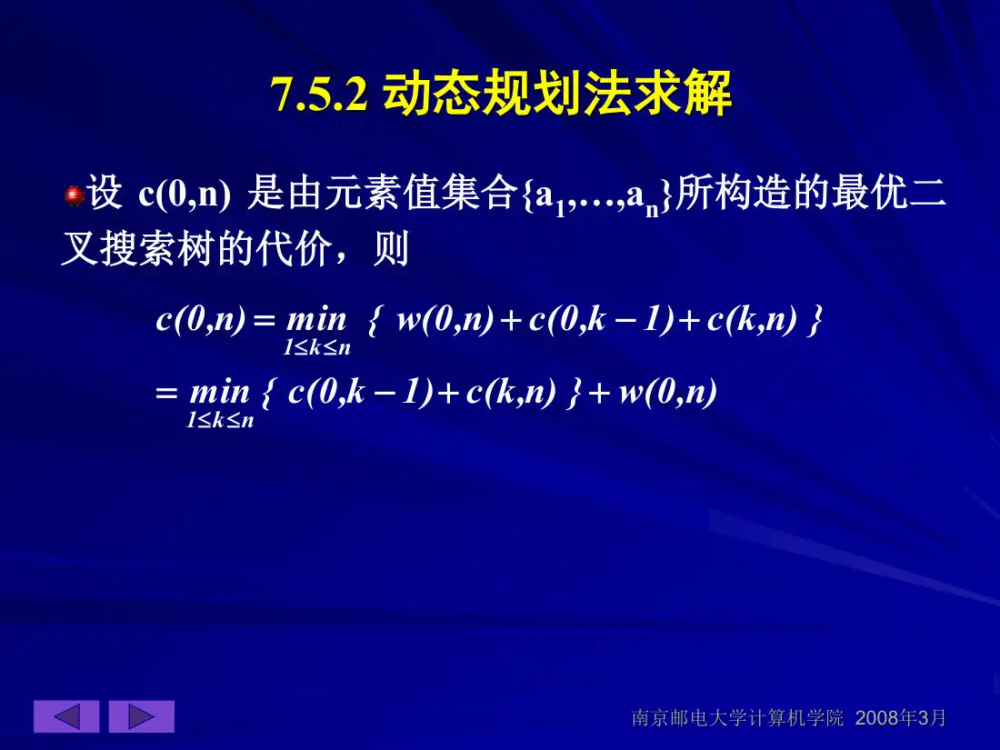

原文：

7.5.2 动态规划法求解

设 $\bf \Pi ^ { \mathrm { ( g ( 0 ) ) } }$ 是由元素值集合 $\Re \Re \Re \Re \Re \Re \Re ^ { \prime } $ 所构造的最优二叉搜索树的代价，则

$$
\begin{array}{l} c (0, n) = \underset {1 \leq k \leq n} {\min} \left\{w (0, n) + c (0, k - 1) + c (k, n) \right\} \\ = \underset {1 \leq k \leq n} {\min} \left\{c (0, k - 1) + c (k, n) \right\} + w (0, n) \end{array}
$$

△

南京邮电大学计算机学院 2008年3月

### $$

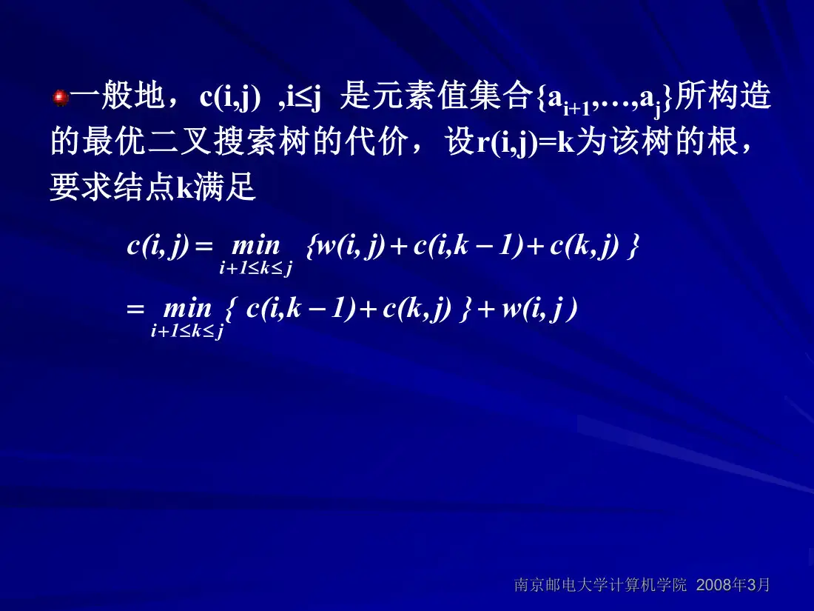

原文：

一般地， $\mathbb { G } ( \mathbb { H } )$ ,ij 是元素值集合 $\lbrace \pm \rbrace$ 所构造的最优二叉搜索树的代价，设r(i,j)=k为该树的根，要求结点k满足

$$
\begin{array}{l} c (i, j) = \underset {i + 1 \leq k \leq j} {\min} \left\{w (i, j) + c (i, k - 1) + c (k, j) \right\} \\ = \underset {i + 1 \leq k \leq j} {\min} \left\{c (i, k - 1) + c (k, j) \right\} + w (i, j) \end{array}
$$

南京邮电大学计算机学院 2008年3月

### 例7－7

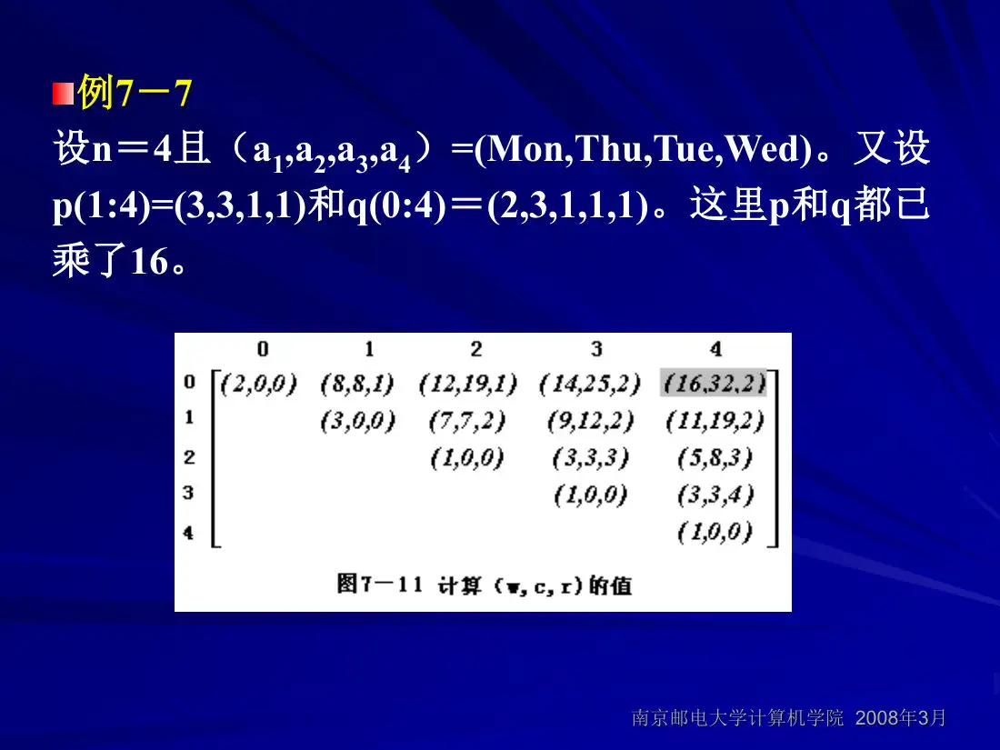

原文：

例7－7

设n＝4且 $( \mathrm { e } , \mathrm { e } , \mathrm { e } , \mathrm { e } , \mathrm { e } , \mathrm { e } , \mathrm { e } , \mathrm { e } , \mathrm { e } , \mathrm { e } , \mathrm { e } , \mathrm { e } , \mathrm { e } , \mathrm { e } , \mathrm { e } , \mathrm { e } , \mathrm { e } , \mathrm { e } , \mathrm { e } , \mathrm { e } , \mathrm { e } , \mathrm { e } , \mathrm { e } , \mathrm { e } , \mathrm { e } , \mathrm { e } , \mathrm { e } , \mathrm { e } , \mathrm { e } , \mathrm { e } , \mathrm { e } , \mathrm { e } , \mathrm { e } , \mathrm { e } , \mathrm { e } , \mathrm { e } )$ 。又设 p(1:4)=(3,3,1,1)和q(0:4)＝(2,3,1,1,1)。这里p和q都已 乘了16。

图7-11 计算 $[ \overline { { \mathbf { \Gamma } } } _ { \overline { { \mathbf { \Gamma } } } } , ~ \mathbf { \Gamma } _ { \overline { { \mathbf { \Gamma } } } } , ~ \mathbf { \Gamma } _ { \overline { { \mathbf { \Gamma } } } } ]$ 的值
<table><tr><td></td><td>0</td><td>1</td><td>2</td><td>3</td><td>4</td></tr><tr><td>0</td><td>(2,0,0)</td><td>(8,8,1)</td><td>(12,19,1)</td><td>(14,25,2)</td><td>(16,32,2)</td></tr><tr><td>1</td><td></td><td>(3,0,0)</td><td>(7,7,2)</td><td>(9,12,2)</td><td>(11,19,2)</td></tr><tr><td>2</td><td></td><td></td><td>(1,0,0)</td><td>(3,3,3)</td><td>(5,8,3)</td></tr><tr><td>3</td><td></td><td></td><td></td><td>(1,0,0)</td><td>(3,3,4)</td></tr><tr><td>4</td><td></td><td></td><td></td><td></td><td>(1,0,0)</td></tr></table>

南京邮电大学计算机学院 2008年3月

### 南京邮电大学计算机学院 2008年3月

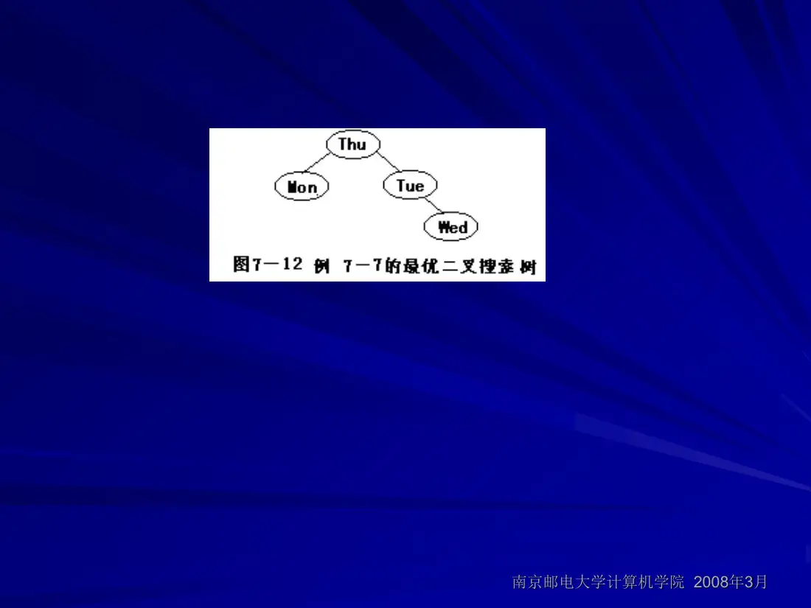

原文：

南京邮电大学计算机学院 2008年3月

### 7.5.3 最优二叉搜索树算法

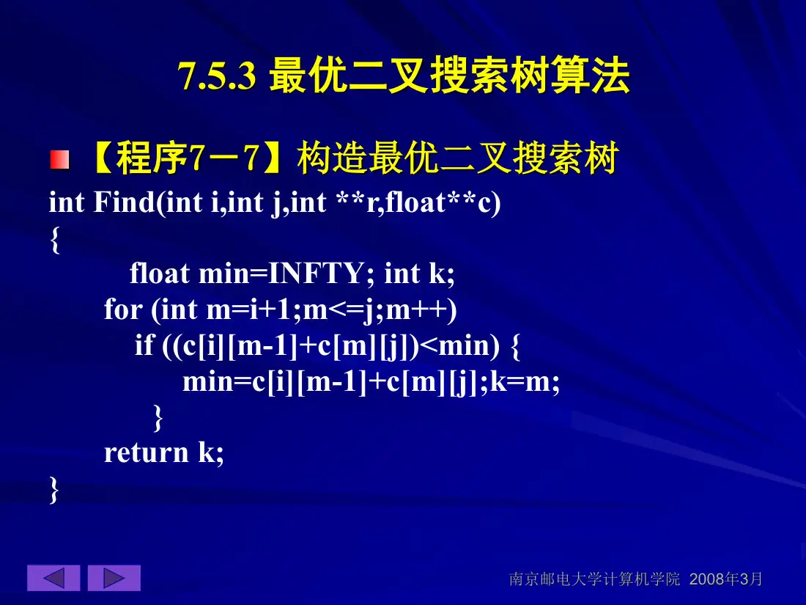

原文：

7.5.3 最优二叉搜索树算法

【程序7－7】构造最优二叉搜索树int Find(int i,int j,int \*\*r,float\*\*c)

float min=INFTY; int k; for (int m=i+1;m<=j;m++) if ((c[i][m-1]+c[m][j])<min) { min=c[i][m-1]+c[m][j];k=m; return k;

南京邮电大学计算机学院 2008年3月

### w[n][n]=q[n];c[n][n]=0.0;r[n][n]=0;

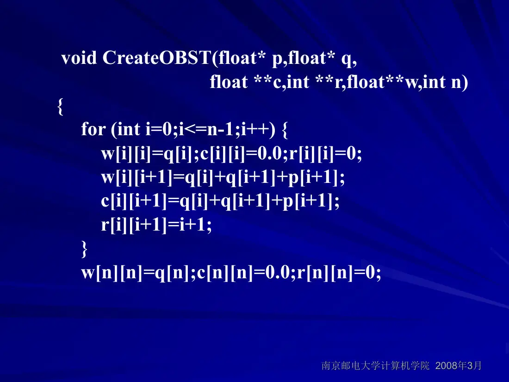

原文：

void CreateOBST(float\* p,float\* q, float \*\*c,int \*\*r,float\*\*w,int n)

for (int i=0;i<=n-1;i++) { w[i][i]=q[i];c[i][i]=0.0;r[i][i]=0; w[i][i+1]=q[i]+q[i+1]+p[i+1]; c[i][i+1]=q[i]+q[i+1]+p[i+1]; r[i][i+1]=i+1;

w[n][n]=q[n];c[n][n]=0.0;r[n][n]=0;

南京邮电大学计算机学院 2008年3月

### $$

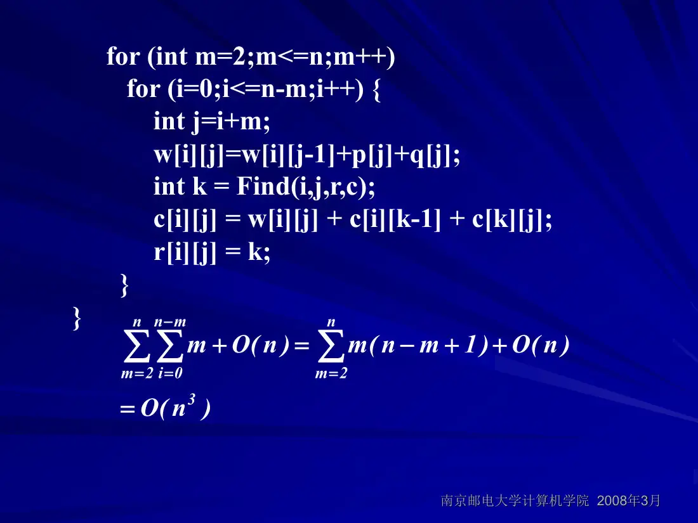

原文：

for (int m=2;m<=n;m++) for (i=0;i<=n-m;i++) { int j=i+m; w[i][j]=w[i][j-1]+p[j]+q[j]; int k = Find(i,j,r,c); c[i][j] = w[i][j] + c[i][k-1] + c[k][j]; r[i][j] = k;

$$
\begin{array}{l} \sum_ {m = 2} ^ {n} \sum_ {i = 0} ^ {n - m} m + O (n) = \sum_ {m = 2} ^ {n} m (n - m + 1) + O (n) \\ = O (n ^ {3}) \end{array}
$$

南京邮电大学计算机学院 2008年3月

### 7.6 0/1背包

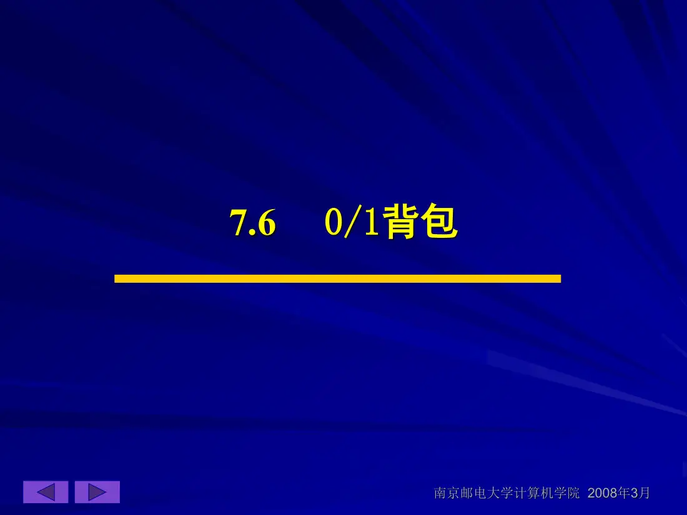

原文：

7.6 0/1背包

△

南京邮电大学计算机学院 2008年3月

### 7.6.1 问题描述

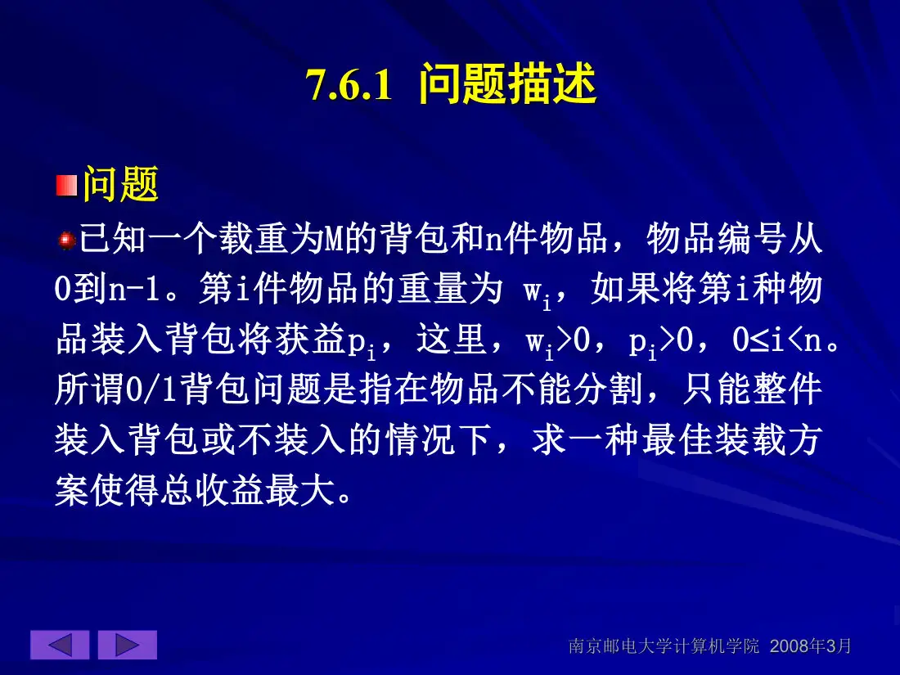

原文：

7.6.1 问题描述

问题

已知一个载重为M的背包和n件物品，物品编号从0到n-1。第i件物品的重量为 $\because$ 如果将第i种物品装入背包将获益 $\textcircled { 1 } 2$ 这里， $\because \angle C D E = 9 0 ^ { \circ }$ $\bigstar$ $[ 0 ] \leq [ 1 , 1 ]$ 所谓0/1背包问题是指在物品不能分割，只能整件装入背包或不装入的情况下，求一种最佳装载方案使得总收益最大。

南京邮电大学计算机学院 2008年3月

### 7.6.2 动态规划法求解

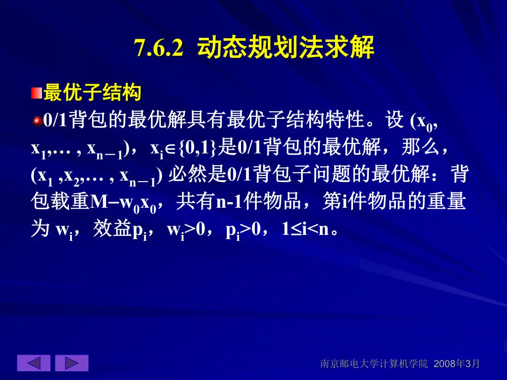

原文：

7.6.2 动态规划法求解

最优子结构

$\mathbb { m }$ 背包的最优解具有最优子结构特性。设 $\textcircled { 6 4 }$ $: \sqrt { 1 + \frac { 1 } { 2 } } \times \frac { 1 } { 2 } \times \frac { 1 } { 2 } \times \frac { 1 } { 2 } \times \frac { 1 } { 2 } \times \frac { 1 } { 2 } \times \frac { 1 } { 2 } \times \frac { 1 } { 2 } \times \frac { 1 } { 2 } \times \frac { 1 } { 2 } \times \frac { 1 } { 2 } \times \frac { 1 } { 2 } \times \frac { 1 } { 2 } \times \frac { 1 } { 2 } \times \frac { 1 } { 2 } \times \frac { 1 } { 2 } \times \frac { 1 } { 2 } \times \frac { 1 } { 2 } \times \frac { 1 } { 2 } \times \frac { 1 } { 2 } \times \frac { 1 } { 2 } \times \frac { 1 } { 2 } \times \frac { 1 } { 2 } \times \frac { 1 } { 2 } \times \frac { 1 } { 2 } \times \frac { 1 } { 2 } \times \frac { 1 } { 2 } \times \frac { 1 } { 2 } \times \frac { 1 } { 2 } \times \frac { 1 } { 2 } \times \frac { 1 } { 2 } \times \frac { 1 } { 2 } \times \frac { 1 } { 2 } \times \frac { 1 } { 2 } \times \frac { 1 } { 2 } \times \frac { 1 } { 2 } \times \frac { 1 } { 2 } \times \frac { 1 } { 2 } \times \frac { 1 } { 2 } \times \frac { 1 } \times \frac { 1 } { 2 } \times \frac { 1 } \times \frac { 1 } { 2 } \times \frac { 1 } \times \frac { 1 } \times \frac { 1 } \times \frac { } 1 \times \frac { } 1  \times \frac { 1 } \times \frac { 1 } \times \frac { \frac 1 } { } \times \frac { 1 } \times \frac { \frac 1 } \times \frac { } \frac { 1 } \times \frac { \frac 1 } \times \frac { \frac 1 } \times \frac { } \frac { 1 } \times \frac \frac { \frac 1 } \times \frac { \frac 1 } \times \frac { \frac \frac 1 } \times \frac { \frac 1 } \times \frac { \frac \frac 1 } \frac  \frac \frac 1 \times \frac \frac { } \frac { } \frac \frac 1 \frac \frac { \frac 1 } \frac \frac { \frac 1 } \frac \frac \frac { \frac \frac 1 } \frac $ $\therefore \angle C = \angle B = 9$ 是0/1背包的最优解，那么，$( 1 0 , 1 0 , 1 0 , 1 0 , 1 0 , 1 )$ 必然是0/1背包子问题的最优解：背包载重 $\mathbb { N } \mathrm { \Longleftrightarrow \ " { o } }$ 共有n-1件物品，第i件物品的重量为 $\therefore \angle C A E = 9 0 ^ { \circ }$ 效益 $\textcircled { 1 9 }$ $\therefore \angle D$ $1 2 0$ 1i<n。

南京邮电大学计算机学院 2008年3月

### 递归式

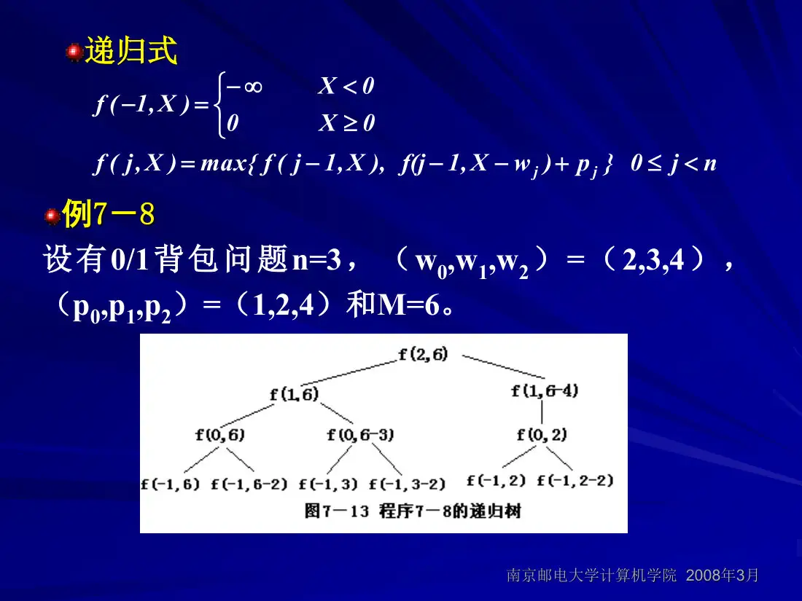

原文：

递归式

8 X < 0f(−1,X )=0 X≥0f(j,X)=max{f(j−1,X),f(j−1,X−wj)+p} 0≤j<n例7－8设有0/1背包问题 $\scriptstyle | 1 | \dotsc | 3$ $( 1 ) ( 1 2 \times 1 0 \times 2 ) = ( 1 0 \times 1 0 )$ $( 9 0 0 0 0 0 0 0 0 0 0 0 0 0 0 0 0 0 0 0 0 0 0 0 0 0 0 0 0 0 0 0 0 0 0 0 0 0 0 0 0 0 0 0 0 0 0 0 0 0 0 0 0 0 0 0 0 0 0 0 0 0 0 0 0 0 0 0 0 0 0 0 0 0 0 0 0 0 0 0 0 0 0 0 0 0 0 0 0 0 0 0 0 0 0 0 0 0 0 0 0 0 0 0 0 0 0 0 0 0 0 0 0 0 0 0 0 0 0 0 0 0 0 0 0 0 0 0 0 0 0 0 0 0 0 0 0 0 0$ 和 $\mathbb { M } \mathbb { E } ( \mathbb { i }$ 0

南京邮电大学计算机学院 2008年3月

### 7.6.3 0/1背包算法框架

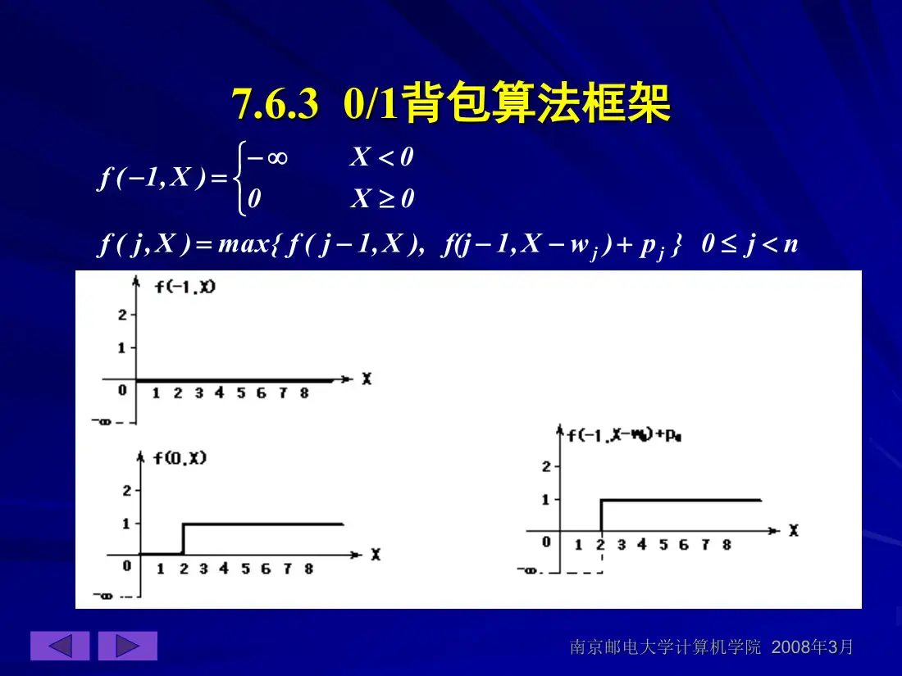

原文：

7.6.3 0/1背包算法框架

$$
\begin{array}{l} {f (- 1, X) = \left\{ \begin{array}{l l} - \infty & X <   0 \\ 0 & X \geq 0 \end{array} \right.} \\ {f (j, X) = m a x \{f (j - 1, X), f (j - 1, X - w _ {j}) + p _ {j} \} 0 \leq j <   n} \end{array}
$$

南京邮电大学计算机学院 2008年3月

### 南京邮电大学计算机学院 2008年3月

原文：

南京邮电大学计算机学院 2008年3月

### 南京邮电大学计算机学院 2008年3月

原文：

现用Sj表示函数曲线f(j,X)的全部阶跃点的集合，$\Delta B C D \cong \Delta B C$ 函数曲线 $\mathrm { I } ( 0 . 0 3 )$ 的全部阶跃点}，-1≤j≤n-1其中 $\mathfrak { S } \equiv \{ 0 \} \mathrm { m }$ 。用 $\mathfrak { L }$ 表示函数曲线 $1 1 0 5 0 0 0 0 0 0 0 0 0 0 0 0 0 0 0 0 0 0 0 0 0 0 0 0 0 0 0 0 0 0 0 0 0 0 0 0 0 0 0 0 0 0 0 0 0 0 0 0 0 0 0 0 0 0 0 0 0 0 0 0 0 0 0 0 0 0 0 0 0 0 0 0 0 0 0 0 0 0 0$ 的全部阶跃点的集合， $3 n - 1 0 = 9 9 9$ 函数曲线f(j-1,X-$\because \textcircled { 2 } 2 = 1 4$ 的全部阶跃点}， $( 1 ) \leq 1 \leq 1 1 = 1 1$

南京邮电大学计算机学院 2008年3月

### 南京邮电大学计算机学院 2008年3月

原文：

计算所有Sj和 $\mathfrak { S }$ 的步骤如下：$\infty , \Re \Re \Re \Re \Re \Re ^ { ( 0 ) }$ 函数f(-1,X)只有一个阶跃点；$\cos ^ { 2 } = ( 0 . 0 3 ) ( 0 . 0 7 ) ( 2 0 ) = ( 2 0 ) ( 2 0 )$ 也就是说，由集合 $\pmb { \triangleright }$ 中的每个阶跃点 $( 0 . 9 9 )$ ，得到集合 $\mathfrak { s h }$ 中的一个阶跃点 $\textcircled { 4 } \textcircled { < } \textcircled { < } \textcircled { < } \textcircled { < } \textcircled { < } \textcircled { < } \textcircled { < } \textcircled { < } \textcircled { < } \textcircled { < }$ $\mathbf { x }$ 是合并集合 $\bigcirc$ 舍弃其中被支配的阶跃点和所有X>M的阶跃点得到。

南京邮电大学计算机学院 2008年3月

### 南京邮电大学计算机学院 2008年3月

原文：

对于例7－8有 $\therefore \angle 1 = \angle C D A = \angle A C B = \angle C B A = 9 0 ^ { \circ }$ $\mathrm { S U } = \{ \mathrm { ( I I I ) } X ( \mathrm { e B ) } \} \mathrm { e } \mathrm { e } \mathrm { e } \mathrm { e } \mathrm { e } \mathrm { e } \mathrm { e } \mathrm { e } \mathrm { e } \mathrm { e } \mathrm { e } \mathrm { e } \mathrm { e } \mathrm { e } \mathrm { e } \mathrm { e } \mathrm { e } \mathrm { e } \mathrm { e } \mathrm { e } \mathrm { e } \mathrm { e } \mathrm { e } \mathrm { e } \mathrm { e } \mathrm { e } \mathrm { e } \mathrm { e } \mathrm { e } \mathrm { e } \mathrm { e } \mathrm { e } \mathrm { e } \mathrm { e } \mathrm { e } \mathrm { e } \mathrm { e } \mathrm { e } \mathrm { e } \mathrm { e } \mathrm { e } \mathrm { e } \mathrm { e } \mathrm { e } \mathrm { e } \mathrm { e } \mathrm { e } \mathrm { e } \mathrm { e } \mathrm { e } \mathrm { e } \mathrm { e } \mathrm { e } \mathrm { e } \mathrm { e } \mathrm { e } \mathrm { e } \mathrm { e } \mathrm { e } \mathrm { e } \mathrm { e } \mathrm { e } \mathrm { e } \mathrm { e } \mathrm { e } \mathrm { e } \mathrm { e } \mathrm { e } \mathrm { e } \mathrm { e } \mathrm { e } \mathrm { e } \mathrm { e } \mathrm { e } \mathrm { e } \mathrm { e } \mathrm { e } \mathrm { e } \mathrm { e } \mathrm { e } \mathrm { e } \mathrm { e } \mathrm { e } \mathrm { e } \mathrm { e } \mathrm { e } \mathrm { e } \mathrm { e } \mathrm { e } \mathrm { e } \mathrm { e } \mathrm { e } \mathrm { e } \mathrm { e } \mathrm { e } \mathrm { e } \mathrm { e } \mathrm { e } \mathrm { e } \mathrm { e } \mathrm { e } \mathrm { e } \mathrm { e } \mathrm { e } \mathrm { e } \mathrm { e } \mathrm { e } \mathrm { e } \mathrm { e } \mathrm { e } \mathrm { e } \mathrm { e } \mathrm { e } \mathrm { e } \mathrm { e } \mathrm { e } \mathrm { e } \mathrm { e } \mathrm { e } \mathrm { e } \mathrm { e } \mathrm { e } \mathrm { e } \mathrm { e } \mathrm { e } \mathrm { e } \mathrm { e } \mathrm { e } \mathrm { e } \mathrm { e } \mathrm { e } \mathrm { e } \mathrm { e } \mathrm { e } \mathrm { e } \mathrm { e } \mathrm { e } \mathrm { e } \mathrm$ $\begin{array} { r } { \langle \mathbf { y } \vert = \langle ( \vert \mathbf { I } \vert ) \vert ( p \vert ) \vert ( p \vert ) \rangle ( \vert \mathbf { \mathcal { S } } \vert ) \vert ( \mathbf { \mathcal { S } } \vert ) \vert ( \mathbf { \mathcal { S } } \vert ) \vert \vert ^ { 2 } } \end{array}$ $\begin{array} { r } { \begin{array} { r l } { \langle \Psi _ { 1 } | } & { { } = \langle ( C _ { \mathrm { - } } ) \chi ( y _ { \mathrm { - } } ) , \langle \Psi ( y _ { \mathrm { - } } ) \chi ( z _ { \mathrm { - } } ) \rangle } \end{array} } \end{array}$ S2={(0,0),(2,1),(3,2),(4,4),(6,5)}

南京邮电大学计算机学院 2008年3月

### 南京邮电大学计算机学院 2008年3月

原文：

【程序7－9】0/1背包算法的粗略描述void DKP(float \*p,float \*w,int n,float M, float &P,int \*x)

S－1={(0,0)}; for (i=0;i<n-1;i++){ S1i={(X,P)|(X-w₁,P-pi)∈Si-1 and X≤M}; Si=MergerPurge(Si-1,S i);

南京邮电大学计算机学院 2008年3月

### 南京邮电大学计算机学院 2008年3月

原文：

$( 1 3 , 1 2 , 1 3 , 2 3 , 1 5 , 3 )$ 中最后一个阶跃点;$( 1 3 , 1 3 , 2 ) = ( 1 3 , 1 3 , 1 5 , 1 3 , 1 3 , 1 3 )$ 其中(X,P)是 $\pmb { \triangleright }$ 中使得 $) 3 \leq 2 \leq 3 \leq 2 \leq 1 \leq 1 \leq 2 \leq 1 \leq 2 \leq 1 \leq 2 \leq 2 \leq 2 \leq 2 \leq 2 \leq 2 \leq 2 \leq 2 \leq 2 \leq 2 \leq 2 \leq 2 \leq 2 \leq 2 \leq 2 \leq 2 \leq 2 \leq 2 \leq 2 \leq 2 \leq 2 \leq 2 \leq 2 \leq 2 \leq 2 \leq 2 \leq 2 \leq 2 \leq 2 \leq 2 \leq 2 \leq 2 \leq 2 \leq 2 \leq 2 \leq 2 \leq 2 \leq 2 \leq 2 \leq 2 \leq 2 \leq 2 \leq 2 \leq 2 \leq 2 \leq 2 \leq 2 \leq 2 \leq 2 \leq 2 \leq 2 \leq 2 \leq 2 \leq 2 \leq 2 \leq 2 \leq 2 \leq 2 \leq 2 \leq 2 \leq 2 \leq 2 \leq 2 \leq 2 \leq 2 \leq 2 \leq 2 \leq 2 \leq 2 \leq 2 \leq 2 \leq 2 \leq 2 \leq 2 \leq 2 \leq 2 \leq 2 \leq \leq 2 \leq 2 \leq 2 \leq 2 \leq \leq 2 \leq 2 \leq 2 \leq $ 的最大的阶跃点;$1 2 - 1 1 1 \cdot 3 \cdot 3 1 2 \cdot 1 2 \cdot 3 \cdot 2$ $1 1 ( 1 2 - 2 1 ) \div 7 = 1 1$ else $1 1 0 = 1 1 0$ 回溯确定 $\therefore \angle B = \angle A = \angle B = \angle C A = \angle C D = \angle C$

南京邮电大学计算机学院 2008年3月

### 7.6.5 性能分析

原文：

7.6.5 性能分析

$$
\sum_ {i = 0} ^ {n - 1} | S ^ {i} | = \sum_ {i = 1} ^ {n} 2 ^ {i} = O (2 ^ {n})
$$

在最坏情况下，算法的空间复杂度是O(2n)。

在最坏情况下，算法的时间复杂度是O(2n)。

南京邮电大学计算机学院 2008年3月

### 7.7 流水作业调度

原文：

7.7 流水作业调度

△

南京邮电大学计算机学院 2008年3月

### 7.7.1 问题描述

原文：

7.7.1 问题描述

假定处理一个作业需要执行若干项不同类型的任务，每一类任务只能在某一台设备上执行。设一条流水线上有n个作业 $0 . 1 \dot { 5 } 0 0 0 0 0 0 0 0 0 0 0 0 0 0 0 0 0 0 0 0 0 0 0 0 0 0 0 0 0 0 0 0 0 0 0 0 0 0 0 0 0 0 0 0 0 0 0 0 0 0 0 0 0 0 0 0 0 0 0 0 0 0 0 0 0 0 0 0 0 0 0 0 0 0 0 0 0 0 0 0 0 0 0 0 0 0 0 0 0 0 0 0 0 0 0 0 0 0 0 0 0 0 0 0 0 0 0 0 0 0 0 0 0 0 0 0 0 0 0 0 0 0 0 0 0 0 0 0 0 0 0 0 0 0 0 0 0 0 0 0 0 0 0 0 0 0 0 0 0 0 0 0 0 0 0 0 0 0 0 0 0 0 0 0 0 0 0 0 0 0 0 0 0 0 0 0 0 0 0 0 0 0 0 0 0 0 0 0 0 0 0 0 0 0 0 0 0 0 0 0 0 0 0 0 0 0 0 0 0 0 0 0 0 0 0 0 0 0 0 0 0 0 0 0 0 0 0 0 0 0 0 0 0 0 0 0 0 0 0 0 0 0 0 0 0 0 0 0 0 0 0 0 0 0 0 0 0 0 0 0 0 0 0 0 0 0 0 0 0 0 0 0 0 0 0 0 0 0 0 0 0 0 0 0 0 0 0 0 0 0 0 0 0 0 0 0 0 0 0 0 0 0 0 0 0 0 0 0 0 0 0 0 0 0 0 0 0 0 0 0 0 0 0 0 0 0 0 0 0 0 0 0 0 0 0 0 0 0 0 0 0 0 0 0 0 0 0 0 0 0 0 0 0 0 0 0 0 0 0 0 0 0 0 0 0 0 0 0 0 0 0 0 0 0 0 0 0 0 0 0 0 0 0 0 0 0 0 0 0 0 0 0 0 0 0 0 0 0 0 0 0 0 0 0 0 0 0 0 0 0 0 0 0 0 0 0 0 0 0 0 0 0 0 0 0 0 0 0 0 0 0 0 0 0 0 0 0 0 0 0 0 0 0 0 0 0 0 0 0 0 0 0 0 0 0 0 0 0 0 0 0 0 0 0 0 0 0 0 0 0 0 0 0 0 0 0 0 0 0 0 0 0 0 0 0 0 0 0 0 0 0 0 0 0 0 0 0 0 0 0 0 0 0 0 0 0 0 0 0 0 0 0 0 0 0 0 0 0 0 0 0 0 0 0 0 0 0 0 0 0 0 0 0 0 0 0 0 0 0 0 0 0 0 0 0 0 0 0 0 0 0 0 0 0 0 0 0 0 0 0 0 0 0 0 0 0 0 0 $ 和m台设备$1 2 - 1 1 = 1 1 2 . 5 ( m o d ) = 1 1 1$ 。每个作业需依次执行m个任务，其中第j个任务只能在第j台设备上执行，1≤j≤m。设第i个作业的第j项任务 $1 4 9 \div m \cdots 1$ 所需时间为 $( \frac { 1 } { 1 1 } ) \times ( \frac { 1 } { 1 1 } - \frac { 1 } { 1 1 } ) \times ( \frac { 1 } { 1 1 } - \frac { 1 } { 1 1 } ) \times ( \frac { 1 } { 1 1 } - \frac { 1 } { 1 1 } )$ 1≤j≤m,$0 . 5 7 5 < 0$ 。如何将这nm个任务分配给着m台设备，使得这n个作业都能顺利完成。这就是流水线作业调度(flow shop schedule)问题。

南京邮电大学计算机学院 2008年3月

### 例7－10

原文：

例7－10

设有三台设备两个作业，每个作业包含三项任务。完成这些任务的时间由矩阵M给定。

$$
\mathrm{M} = \left[ \begin{array}{l l} 2 & 0 \\ 3 & 3 \\ 5 & 2 \end{array} \right] \begin{array}{l} \mathrm{P} _ {1} \\ \mathrm{P} _ {2} \\ \mathrm{P} _ {3} \end{array}
$$

(a)任务所需时间

流水线作业调度

南京邮电大学计算机学院 2008年3月

### $$

原文：

作业i的完成时间f(S)是指在调度方案S下，该作业的所有任务都已完成的时间。完成时间F(S)是所有作业都完成的时间。

$$
F (S) = \max _ {0 \leq i <   n} \{f _ {i} (S) \}
$$

平均流动时间(mean flow time)MFT(S)定义为：

$$
M F T (S) = \frac {1}{n} \sum_ {i = 0} ^ {n - 1} f _ {i} (S)
$$

南京邮电大学计算机学院 2008年3月

### 一组给定的作业的最优完成时间是F(S)的最小值。

原文：

一组给定的作业的最优完成时间是F(S)的最小值。

OFT表示指非抢先调度最优完成时间

POFT表示抢先调度最优完成时间。

OMFT表示非抢先调度最优平均完成时间，

POMFT表示抢先调度最优平均完成时间。

本节只讨论当m=2时获得OFT的调度方案的算法，

这就是双机流水作业调度问题。

南京邮电大学计算机学院 2008年3月

### 南京邮电大学计算机学院 2008年3月

原文：

双机流水作业调度描述为：设有n个作业的集合{0，1，…，n-1}，每个作业都有两项任务要求在2台设备P1和P 组成的流水线上完成加工。每个作业加工的顺序总是先在P 上加工，然后在P 上加工。$\textcircled { 1 9 }$ 和P 加工作业i所需的时间分别为 $\mathbf { \delta E }$ 和 $\mathbf { \epsilon }$ 。流水作业调度问题要求确定这n个作业的最优加工顺序使得从第一个作业在设备 $\textcircled { 1 } \frac { 1 } { 1 1 }$ 上开始加工，到最后一个作业在设备 $\textcircled { 1 }$ 上加工完成所需的时间最少。即求使F(S)有最小值的调度方案S。

南京邮电大学计算机学院 2008年3月

### 7.7.2 动态规划法求解

原文：

7.7.2 动态规划法求解

在两台设备的情况下，存在一个最优非抢先调度方案，使得在P 和 $1 4$ 上的作业完全以相同次序处理（若m>2则不然）。

南京邮电大学计算机学院 2008年3月

### 定理7－3 流水作业调度问题具有最优子结构的性质。

原文：

定理7－3 流水作业调度问题具有最优子结构的性质。

南京邮电大学计算机学院 2008年3月

### 可以设计下列作业排列方法。这样做能得到最优调度方案

原文：

如果在调度方案的作业排列中，作业i和j满足$1 1 1 1 1 1 2 0 2 9 2 9 1 1 1 1 2 9 2 9 2$ 则称作业i和j满足Johnson不等式。

可以设计下列作业排列方法。这样做能得到最优调度方案

(1)如果 $1 1 1 1 1 1 2 2 1 2 2 3 2 2 3 2 2 1 2 1 2 2 1 2 2 2 2 1 2 2 2 2 1 2 2 1 2 2$ 是 $\mathrm { \Delta E P }$ ，则 $\textcircled { 2 } \textcircled { 1 }$ 是最优排列的第一个作业；

(2)如果 $1 1 1 1 1 1 2 . 1 2 . 1 6 2 . 1 . 1 . 1 . 1 . 1 . 1 . 1 . 1 . 1 . 1 . 1 . 1 . 1 . 1 . 1 . 1 .$ 是 $\textcircled { 1 }$ ，则 $\textcircled { 1 }$ 应是最优排列的最后一个作业；

(3) 继续（1）和（2）的做法，直到完成所有作业的排列。

南京邮电大学计算机学院 2008年3月

### 南京邮电大学计算机学院 2008年3月

原文：

例7－11设n＝4， $( 4 , 1 5 , 1 5 , 2 , 3 ) = ( 8 , 1 5 , 3 , 1 1 )$ $( 4 ) ( 1 2 0 - 1 ) \times ( 2 0 - 2 ) = ( 1 2 0 - 2 0 ) ( 2 0 - 2 )$ 设 $\mathrm { \langle 0 \rangle } = ( \mathrm { \overline { { 9 } } ( 0 ) } \mathrm { E q } ( 0 ) \mathrm { E q } ( 0 ) \mathrm { E q } ( 0 ) \mathrm { E q } ( 0 ) ) \mathrm { \cdot } \mathrm { \bullet } ( 0 ) )$ 是最优作业排列。先将任务按处理时间的非减次序排列成：$( 1 ) ( 1 0 0 0 0 0 0 0 0 0 0 0 0 0 0 0 0 0 0 0 0 0 0 0 0 0 0 0 0 0 0 0 0 0 0 0 0 0 0 0 0 0 0 0 0 0 0 0 0 0 0 0 0 0 0 0 0 0 0 0 0 0 0 0 0 0 0 0 0 0 0 0 0 0 0 0 0 0 0 0 0 0 0 0 0 0 0 0 0 0 0 0 0 0 0 0 0 0 0 0 0 0 0 0 0 0 0 0 0 0 0 0 0 0 0 0 0 0 0 0 0 0 0 0 0 0 0 0 0 0 0 0 0 0 0 0 0 0 0 0 0 0 0 0 0 0 0 0 0 0 0 0 0 0 0 0 0 0 0 0 0 0 0 0 0 0 0 0 0 0 0 0 0 0 0 0 0 0 0 0 0 0 0 0 0 0 0 0 0 0 0 0 0 0 0 0 0 0 0 0 0 0 0 0 0 0 0 0 0 0 0 0 0 0 0 0 0 0 0 0 0 0 0 0 0 0 0 0 0 0 0 0 0 0 0 0 0 0 0 0 0 0 0 0 0 0 0 0 0 0 0 0 0 0 0 0 0 0 0 0 0 0 0 0 0 0 0 0 0 0 0 0 0 0 0 0 0 0 0 0 0 0 0 0 0 0 0 0 0 0 0 0 0 0 0 0 0 0 0 0 0 0 0 0 0 0 0 0 0 0 0 0 0 0 0 0 0 0 0 0 0 0 0 0 0 0 0 0 0 0 0 0 0 0 0 0 0 0 0 0 0 0 0 0 0 0 0 0 0 0 0 0 0 0 0 0 0 0 0 0 0 0 0 0 0 0 0 0 0 0 0 0 0 0 0 0 0 0 0 0 0 0 0 0 0 0 0 0 0 0 0 0 0 0 0 0 0 0 0 0 0 0 0 0 0 0 0 0 0 0 0 0 0 0 0 0 0 0 0 0 0 0 0 0 0 0 0 0 0 0 0 0 0 0 0 0 0 0 0 0 0 0 0 0 0 0 0 0 0 0 0 0 0 0 0 0 0 0 0 0 0 0 0 0 0 0 0 0 0 0 0 0 0 0 0 0 0 0 0 0 0 0 0 0 0 0 0 0 0 0 0 0 0 0 0 0 0 0 0 0 0 0 0 0 0 0 0 0 0 0 0 0 0 0 0 0 0 0 0 0 0 0 0 0 0 0 0 0 0 0 0 0 0 0 0 0 0 0 0 0 0 0 0 0 0 0 0 0 0 0 0 0 0 0 0 0 0 0 0 0 0 0 0 0 0 0 0 0 0 0 0 0$ 先选 $\mathbf { D }$ 将其加在最优作业排列的最后，故 $( \bullet ( \bullet ) ) = 1 1$ 再选 $\Theta$ 应加在最优作业排列的最前面，故 $\mathbf { \dot { o } } ( 0 ) { = } 0$ 考察 $\mathbf { Q }$ 和 $\vartriangleleft$ ， 因作业1和0已调度，接着考察 $\mathbf { \delta } _ { \mathbf { Q } } ^ { 2 } = \mathbf { \frac { \partial B _ { 0 } } { \partial \mathbf { Q } } }$ 应有 $\mathrm { c d } \left( 0 \mathrm { l l } \right) = 0 . 2$ 再考察 $\blacktriangle$ 和 $\mathrm { \Delta E P }$ $\mathbf { G } ( \pmb { \nu } _ { 4 } ) \mathbf { \equiv } \mathbf { 8 }$ 所以最优解为： $( \mathrm { e } _ { 1 } ( 0 ) \mathrm { e } _ { 2 } ( 0 ) \mathrm { e } _ { 3 } ( \ell _ { 2 } ( 0 ) \mathrm { e } _ { 1 } ( \ell _ { 2 } ( 0 ) ) ) = ( 0 . 0 8 \mathrm { e } _ { 3 } ( \ell _ { 2 } ( 0 ) \mathrm { e } _ { 2 } ( 0 ) )$

南京邮电大学计算机学院 2008年3月

### 7.7.3 Johnson算法

原文：

7.7.3 Johnson算法

Johnson算法具体描述如下：设a[i]和b[i]，0i<n分别为作业i在两台设备上的处理时间。建立由三元组（作业号,处理时间,设备号）组成的三元组表d。

对三元组表按处理时间排序，得到排序后的三元组表d。

对三元组表的每一项d[i]，0i<n，从左和右两端生成最优作业排列c[j], 0j<n，c[j]是作业号。如果d[i]的设备号为1，则将作业i置于c的左端末尾，否则置于c的右端末尾。

M

南京邮电大学计算机学院 2008年3月

### 南京邮电大学计算机学院 2008年3月

原文：

【程序7－12】Johnson算法struct Triplet{int operator <(Triplet b)const { return t<b.t;}int jobNo,t,ab;

南京邮电大学计算机学院 2008年3月

### 南京邮电大学计算机学院 2008年3月

原文：

void FlowShop(int n, int \*a,int \*b,int \*c)

Triplet d[mSize]={{0,0,0}}; for(int i=0;i<n;i++) if(a[i]<b[i]) { d[i].jobNo=i;d[i].ab=0;d[i].t=a[i]; else { d[i].jobNo=i;d[i].ab=1;d[i].t=b[i];

Sort(d,n); int left=0,right=n-1; for (i=0;i<n;i++) if(d[i].ab==0) c[left++]=d[i].jobNo; else c[right--]=d[i].jobNo;

南京邮电大学计算机学院 2008年3月

### (a)三元组表

原文：

(a)三元组表
<table><tr><td></td><td>作业号</td><td>处理时间</td><td>设备号</td></tr><tr><td>0</td><td>0</td><td>3</td><td>1</td></tr><tr><td>1</td><td>1</td><td>2</td><td>2</td></tr><tr><td>2</td><td>2</td><td>8</td><td>1</td></tr><tr><td>3</td><td>3</td><td>10</td><td>1</td></tr></table>

(b)按处理时间排序 (0, 2, 3, 1) (c) 最优作业排列
<table><tr><td></td><td>作业号</td><td>处理时间</td><td>设备号</td></tr><tr><td>0</td><td>1</td><td>2</td><td>2</td></tr><tr><td>1</td><td>0</td><td>3</td><td>1</td></tr><tr><td>2</td><td>2</td><td>8</td><td>1</td></tr><tr><td>3</td><td>3</td><td>10</td><td>1</td></tr></table>

Johnson算法的时间取决于对作业集合的排序，因此，在最坏情况下算法的时间复杂度为O(nlogn)，所需的空间复杂度为O(n)。

南京邮电大学计算机学院 2008年3月
