# 《算法设计与分析》第8章 回溯法（课件）

原件的每一页，下面附识别出的文字。

### 算法设计与分析

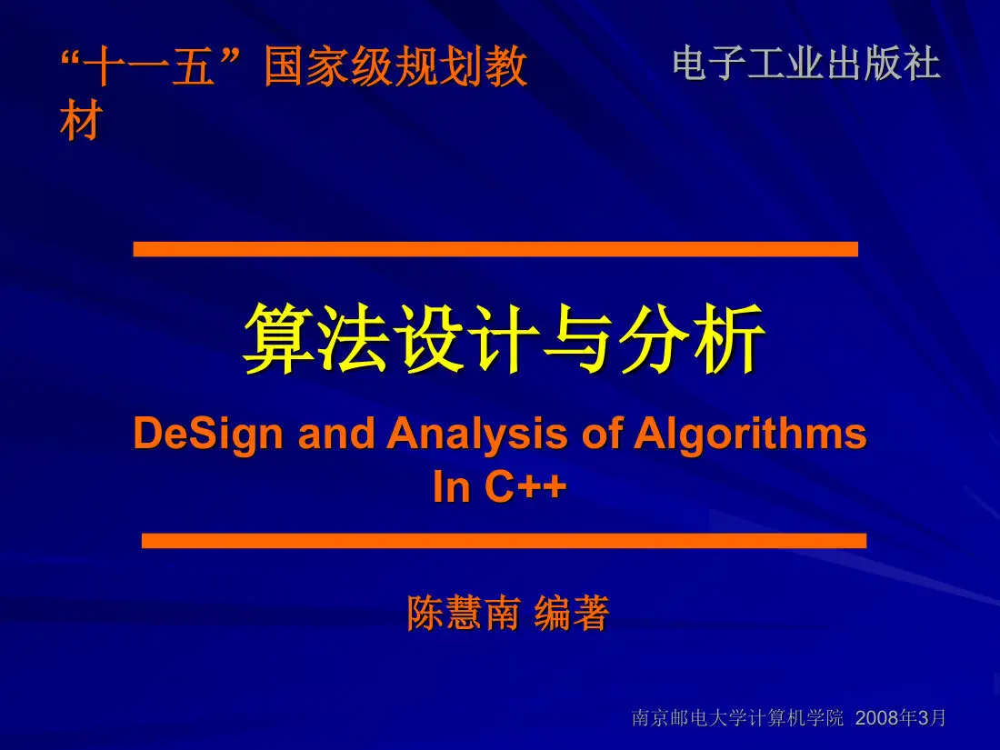

原文：

算法设计与分析

DeSign and Analysis of Algorithms In C++

陈慧南 编著

南京邮电大学计算机学院 2008年3月

“十一五”国家级规划教材

电子工业出版社

### 第2部分 算法设计策略

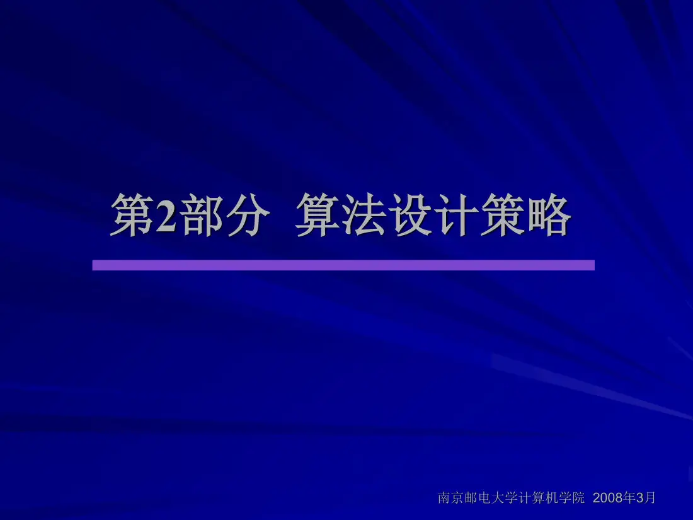

原文：

第2部分 算法设计策略

南京邮电大学计算机学院 2008年3月

### 第8章 回溯法

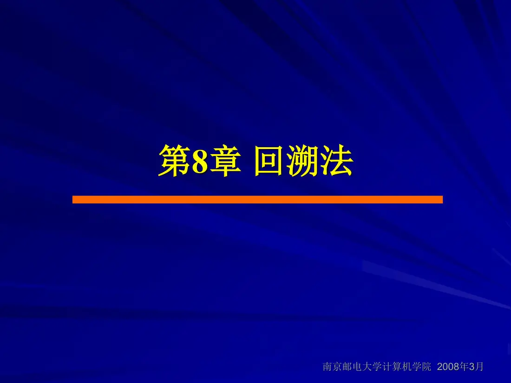

原文：

第8章 回溯法

南京邮电大学计算机学院 2008年3月

### 8.1 一般方法

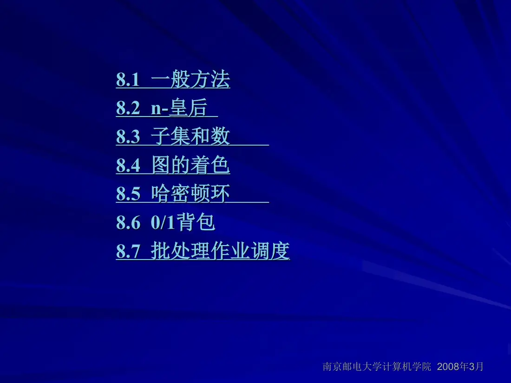

原文：

8.1 一般方法
8.2 n-皇后
8.3 子集和数
8.4 图的着色
8.5 哈密顿环
8.6 0/1背包
8.7 批处理作业调度

南京邮电大学计算机学院 2008年3月

### 8.1 一般方法

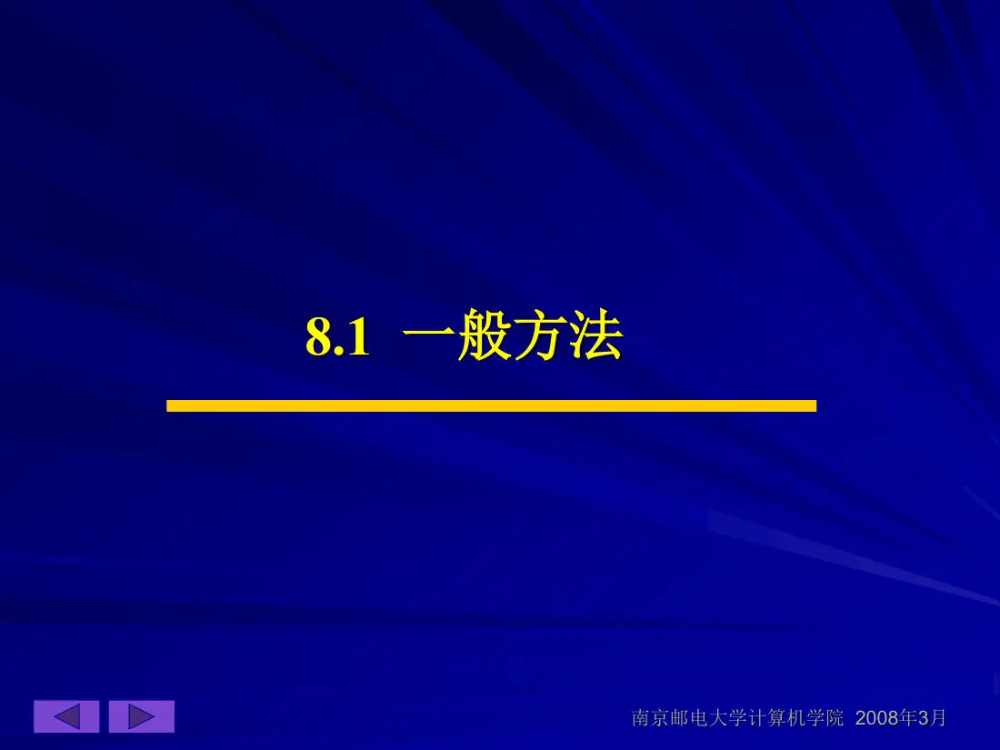

原文：

8.1 一般方法

△

南京邮电大学计算机学院 2008年3月

### 8.1.1 基本概念

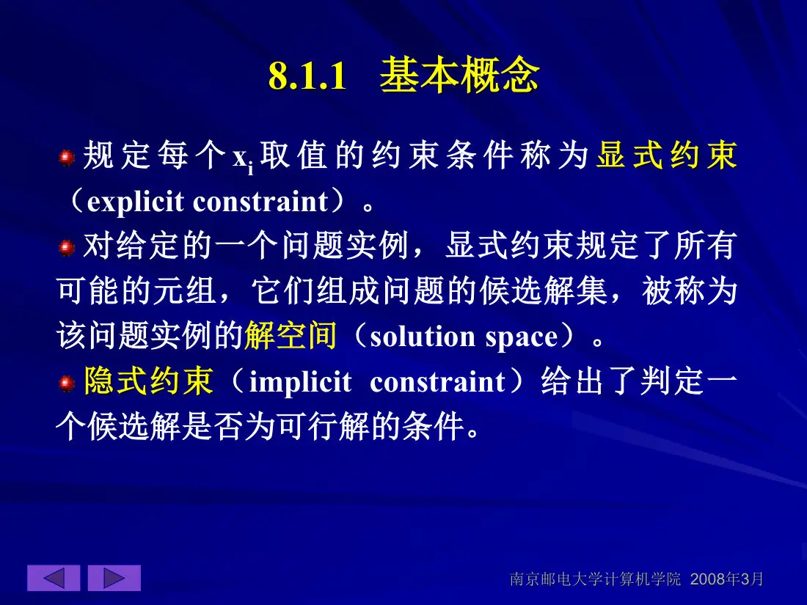

原文：

8.1.1 基本概念

规定每个 $\because$ 取值的约束条件称为显式约束（explicit constraint）。

对给定的一个问题实例，显式约束规定了所有可能的元组，它们组成问题的候选解集，被称为该问题实例的解空间（solution space）。

隐式约束（implicit constraint）给出了判定一个候选解是否为可行解的条件。

南京邮电大学计算机学院 2008年3月

### 南京邮电大学计算机学院 2008年3月

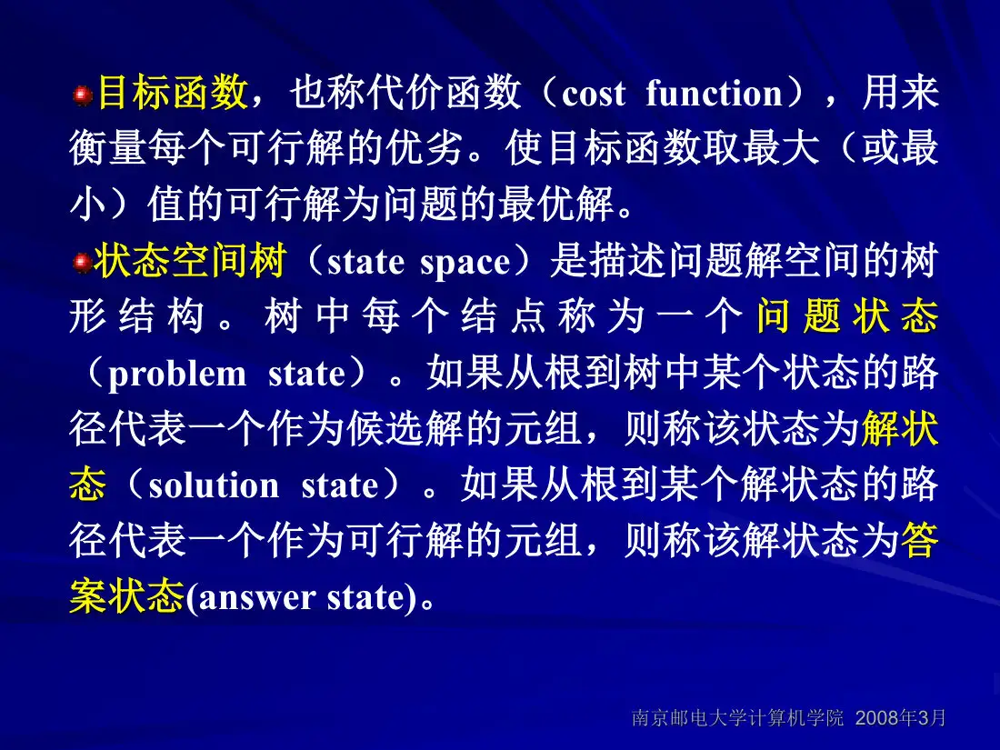

原文：

目标函数，也称代价函数（cost function），用来衡量每个可行解的优劣。使目标函数取最大（或最小）值的可行解为问题的最优解。

状态空间树（state space）是描述问题解空间的树形 结 构 。 树 中 每 个 结 点 称 为 一 个 问 题 状 态（problem state）。如果从根到树中某个状态的路径代表一个作为候选解的元组，则称该状态为解状态（solution state）。如果从根到某个解状态的路径代表一个作为可行解的元组，则称该解状态为答案状态(answer state)。

南京邮电大学计算机学院 2008年3月

### 8.1.2剪枝函数和回溯法

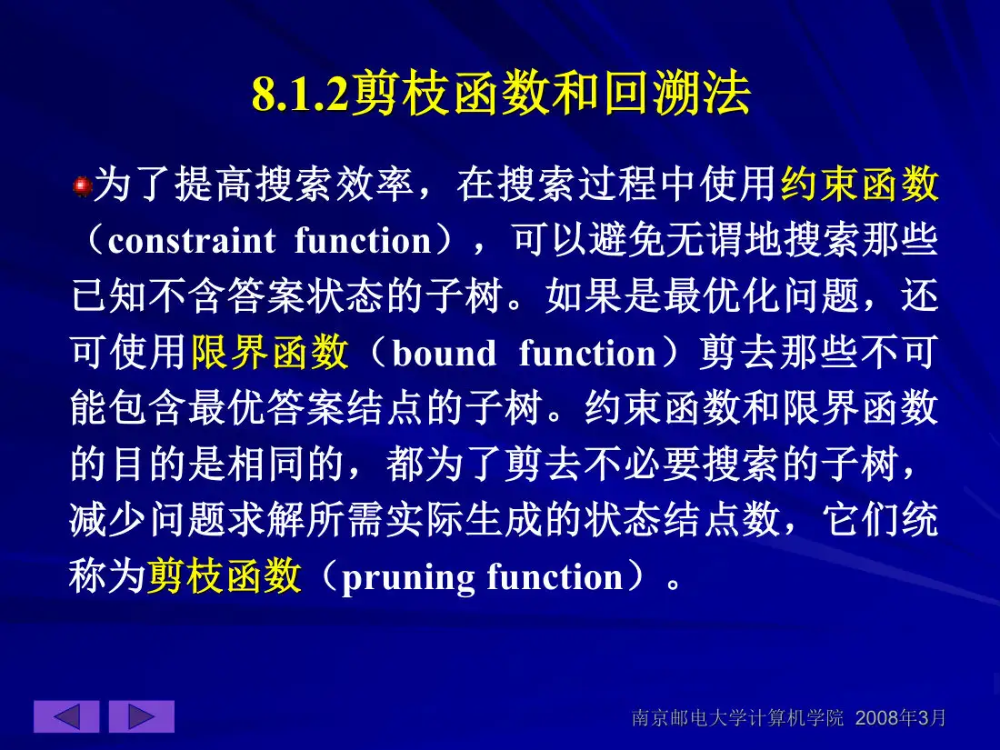

原文：

8.1.2剪枝函数和回溯法

为了提高搜索效率，在搜索过程中使用约束函数（constraint function），可以避免无谓地搜索那些已知不含答案状态的子树。如果是最优化问题，还可使用限界函数（bound function）剪去那些不可能包含最优答案结点的子树。约束函数和限界函数的目的是相同的，都为了剪去不必要搜索的子树，减少问题求解所需实际生成的状态结点数，它们统称为剪枝函数（pruning function）。

南京邮电大学计算机学院 2008年3月

### 南京邮电大学计算机学院 2008年3月

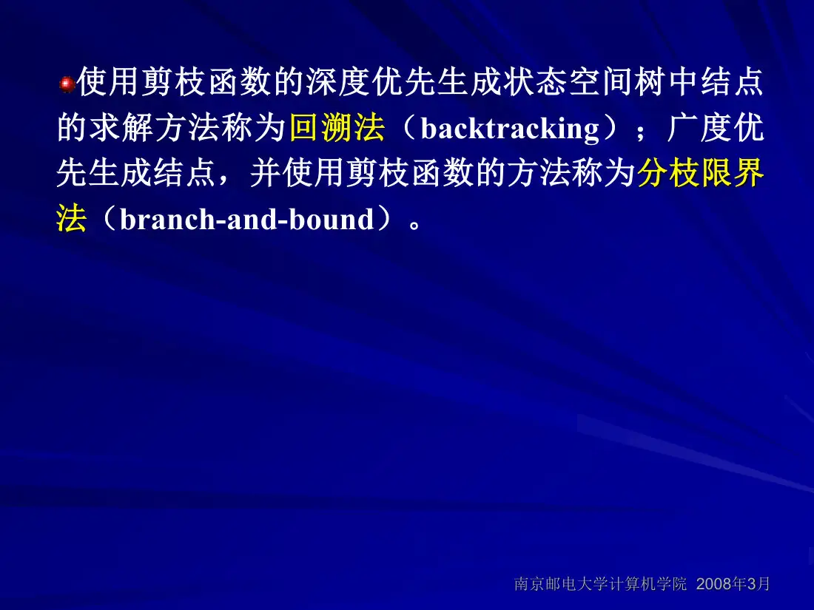

原文：

使用剪枝函数的深度优先生成状态空间树中结点的求解方法称为回溯法（backtracking）；广度优先生成结点，并使用剪枝函数的方法称为分枝限界法（branch-and-bound）。

南京邮电大学计算机学院 2008年3月

### 南京邮电大学计算机学院 2008年3月

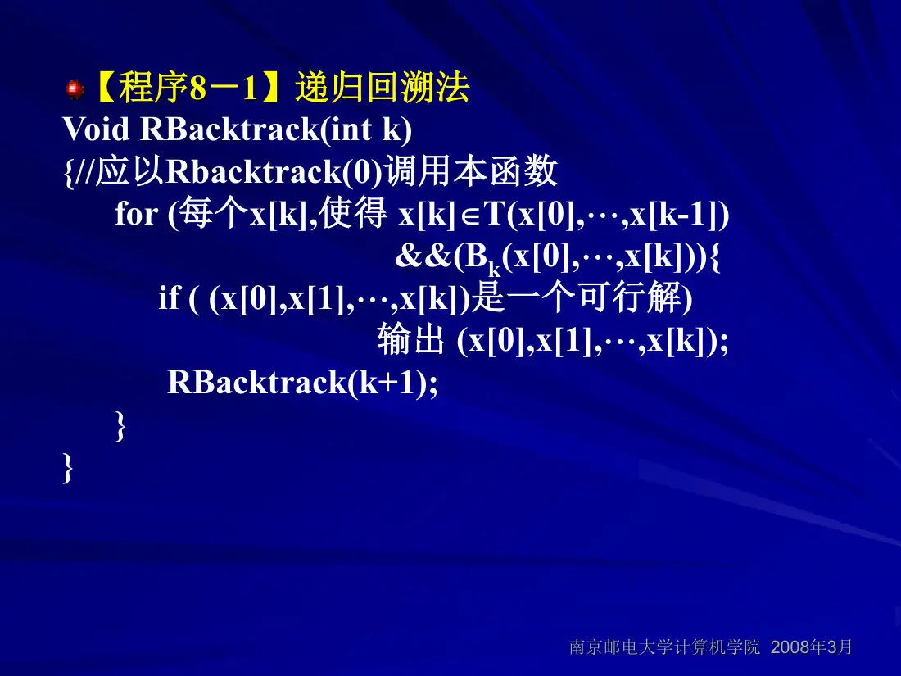

原文：

【程序8－1】递归回溯法Void RBacktrack(int k){//应以Rbacktrack(0)调用本函数for (每个x[k],使得 $\therefore B C = \angle B C D = \angle C A B = \angle B C D$ $\because ( 1 3 , 1 2 , 1 1 , 1 3 , 1 1 , 1 2 , 1 3 , 1 5 , 1 5 , 1 5 , 1 5 , 1 5 , 1 5 , 1 5 , 1 5 , 1 5 , 1 5 , 1 5 , 1 5 , 1 5 , 1 5 , 1 5 , 1 5 , 1 5 , 1 5 , 1 5 , 1 5 , 1 5 , 1 5 , 1 5 , 1 5 , 1 5 , 1 5 , 1 5 , 1 5 , 1 5 , 1 5 , 1 5 , 1 5 , 1 5 , 1 5 , 1 5 , 1 5 , 1 5 , 1 5 , 1 5 , 1 5 , 1 5 , 1 5 , 1 5 , 1 5 , 1 5 , 1 5 , 1 5 , 1 5 , 1 5 , 1 5 , 1 5 , 1 5 , 1 5 , 1 5 , 1 5 , 1 5 , 1 5 , 1 5 , 1 5 , 1 5 , 1 5 , 1 5 , 1 5 , 1 5 , 1 5 , 1 5 , 1 5 , 1 5 , 1 5 , 1 5 , 1 5 , 1 5 , 1 5 , 1 5 , 1 5 , 1 5 , 1 5 , 1 5 , 1 5 , 1 5 , 1 5 , 1 5 , 1 5 , 1 5 , 1 5 , 1 5 , 1 5 , 1 5 , 1 5 , 1 5 , 1 5 , 1 5 , 1 5 , 1 5 5 , 1 5 , 1 5 , 1 5 , 1 5 5 , 1 5 , 1 5 , 1 5 5 , 1 5 , 1 5 5 , 1 5 , 1 5 5 , 1 5 , 1 5 5 , 1 5 5 , 1 5 , 1 5 5 , 1 5 5 , 1 5 5 , 1 5 5 , 1 5 5 , 1 5 5 , 1 5 5 , 5 5 5 , 1 5 5 , 1 5 5 5 , 5 5 5 , 5 5 5 , 1 5 5 5 , 5 5 5 5 ,$ if ( (x[0],x[1],,x[k])是一个可行解)输出 (x[0],x[1],,x[k]);RBacktrack(k+1);

南京邮电大学计算机学院 2008年3月

### 【程序8-2】 迭代回溯法Void IBacktrack(int n)

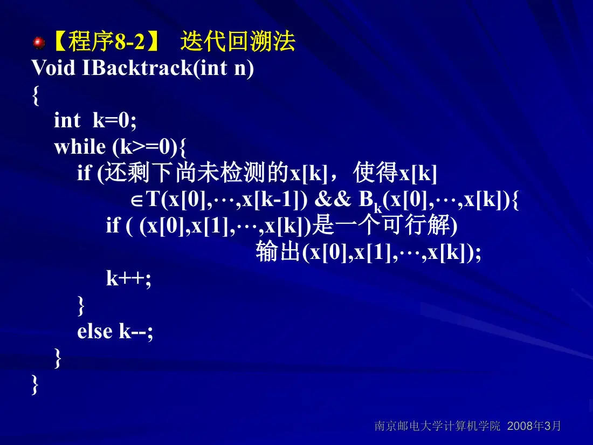

原文：

【程序8-2】 迭代回溯法Void IBacktrack(int n)

if (还剩下尚未检测的x[k]，使得x[k] ∈T(x[0],…,x[k-1]) && Bk(x[0],,x[k]){ if ( (x[0],x[1],,x[k])是一个可行解) 输出(x[0],x[1],,x[k]);

k++;

else k--;

南京邮电大学计算机学院 2008年3月

### 8.1.3 回溯法的效率分析

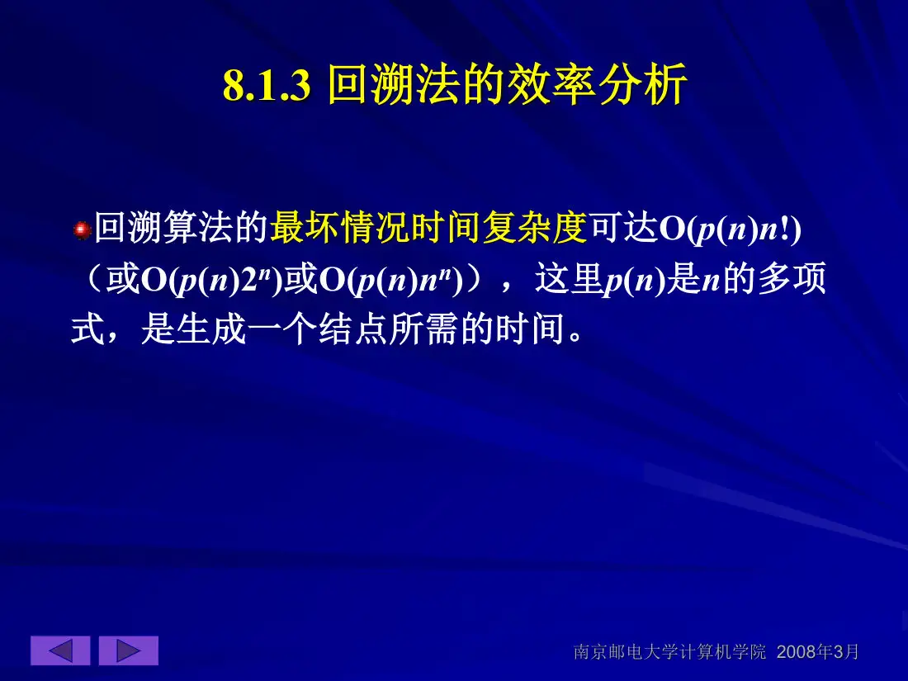

原文：

8.1.3 回溯法的效率分析

回溯算法的最坏情况时间复杂度可达 $\textcircled { 1 } \textcircled { 1 } \textcircled { 1 } \textcircled { 1 } \textcircled { 2 } \textcircled { 2 }$ （或 $\textcircled { 1 } \textcircled { 1 } \textcircled { 1 } \textcircled { 1 } \textcircled { 2 } \textcircled { 2 }$ 或 $\textcircled { 1 } \textcircled { 1 } \textcircled { 1 } \textcircled { 1 } \textcircled { 2 } \textcircled { 1 } \textcircled { 2 }$ ），这里 $| \pmb { \mathcal { V } } | | \pmb { \mathcal { W } }$ 是n的多项式，是生成一个结点所需的时间。

△

南京邮电大学计算机学院 2008年3月

### 整个状态空间树上将实际生成的结点数估计为

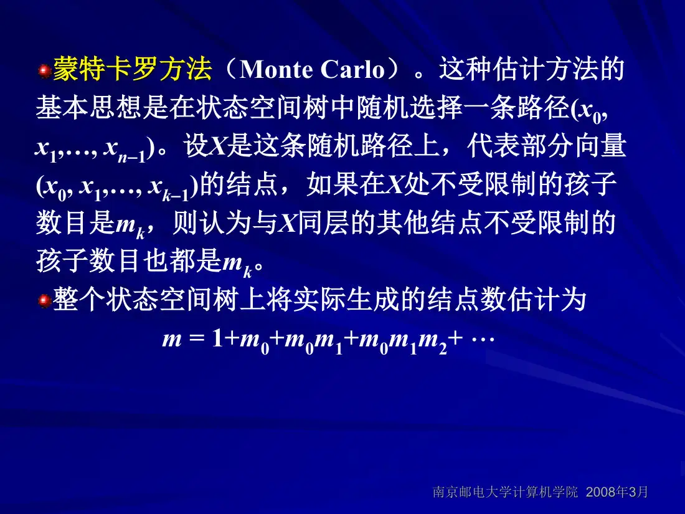

原文：

蒙特卡罗方法（Monte Carlo）。这种估计方法的基本思想是在状态空间树中随机选择一条路径 $( 0 . 9 \times 1 . 5 ) \times 1 . 5 \times 1 . 5 \times 1 . 5 \times 1 . 5 \times 1 . 5 \times 1 . 5 \times 1 . 5 \times 1 . 5 \times 1 . 5 \times 1 . 5 \times 1 . 5 \times 1 . 5 \times 1 . 5 \times 1 . 5 \times 1 . 5 \times 1 . 5 \times 1 . 5 \times 1 . 5 \times 1 . 5 \times 1 . 5 \times 1 . 5 \times 1 . 5 \times 1 . 5 \times 1 . 5 \times 1 . 5 \times 1 . 5 \times 1 . 5 \times 1 . 5 \times 1 . 5 \times 1 . 5 \times 1 . 5 \times 1 . 5 \times 1 . 5 \times 1 . 5 \times 1 . 5 \times 1 . 5 \times 1 . 5 \times 1 .$ $\cos \angle A C D = \cos \angle B C D = \angle C$ 设X是这条随机路径上，代表部分向量$\textcircled { 6 } \textcircled { 1 } \textcircled { 2 } \textcircled { 6 } \textcircled { 2 } \textcircled { 6 } \textcircled { 2 } \textcircled { 6 } \textcircled { 7 } \textcircled { 6 }$ 的结点，如果在X处不受限制的孩子数目是 $\textcircled { 1 } \textcircled { 1 2 }$ 则认为与X同层的其他结点不受限制的孩子数目也都是 $\textcircled { 1 } \textcircled { 2 } \textcircled { 2 }$

整个状态空间树上将实际生成的结点数估计为

$$
m = 1 + m _ {0} + m _ {0} m _ {1} + m _ {0} m _ {1} m _ {2} + \dots
$$

南京邮电大学计算机学院 2008年3月

### 【程序8-3】 蒙特卡罗算法int Estimate(SType\* x)

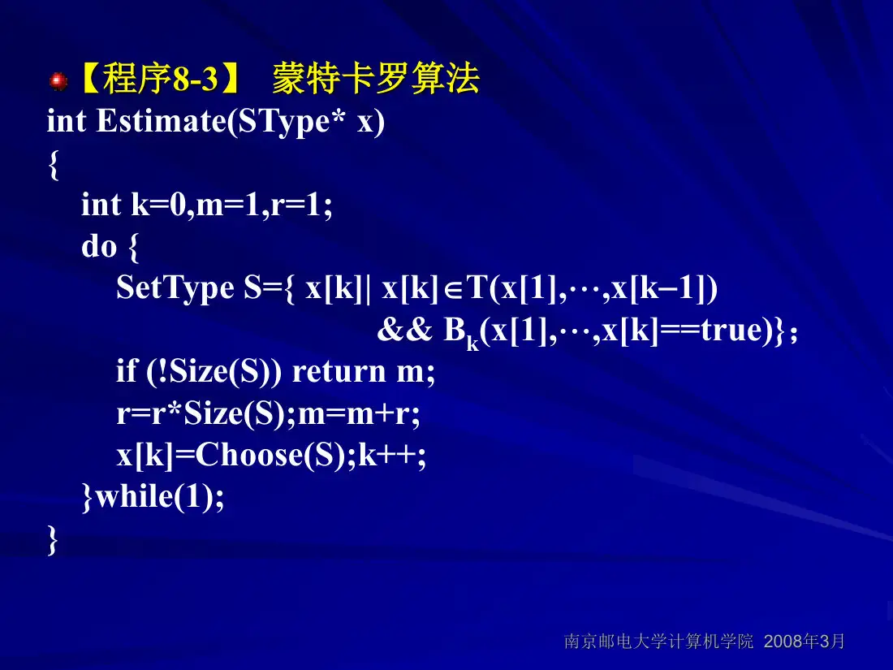

原文：

【程序8-3】 蒙特卡罗算法int Estimate(SType\* x)

int $1 5 - 1 1 0 = 1 5 - 1 5 = 1 8$ do { SetType S={ x[k]| x[k]∈T(x[1],···,x[k-1]) $\langle \langle \mathcal { F } ( \cdot , \cdot , \cdot , \mathcal { S } ) , \mathcal { S } ( \cdot , \cdot , \cdot , \cdot , \cdot , \cdot ) \rangle = \langle \mathcal { F } ( \cdot , \cdot , \cdot , \cdot ) \rangle$ if (!Size(S)) return m; r=r\*Size(S);m=m+r; x[k]=Choose(S);k++; }while(1);

南京邮电大学计算机学院 2008年3月

### 8.2 n-皇后

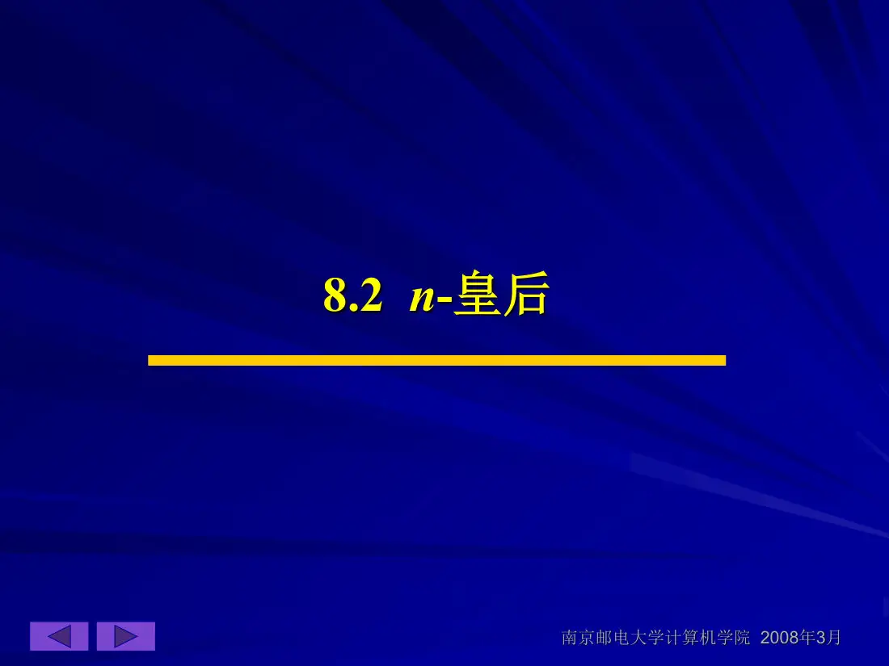

原文：

8.2 n-皇后

△

南京邮电大学计算机学院 2008年3月

### 8.2.1 问题描述

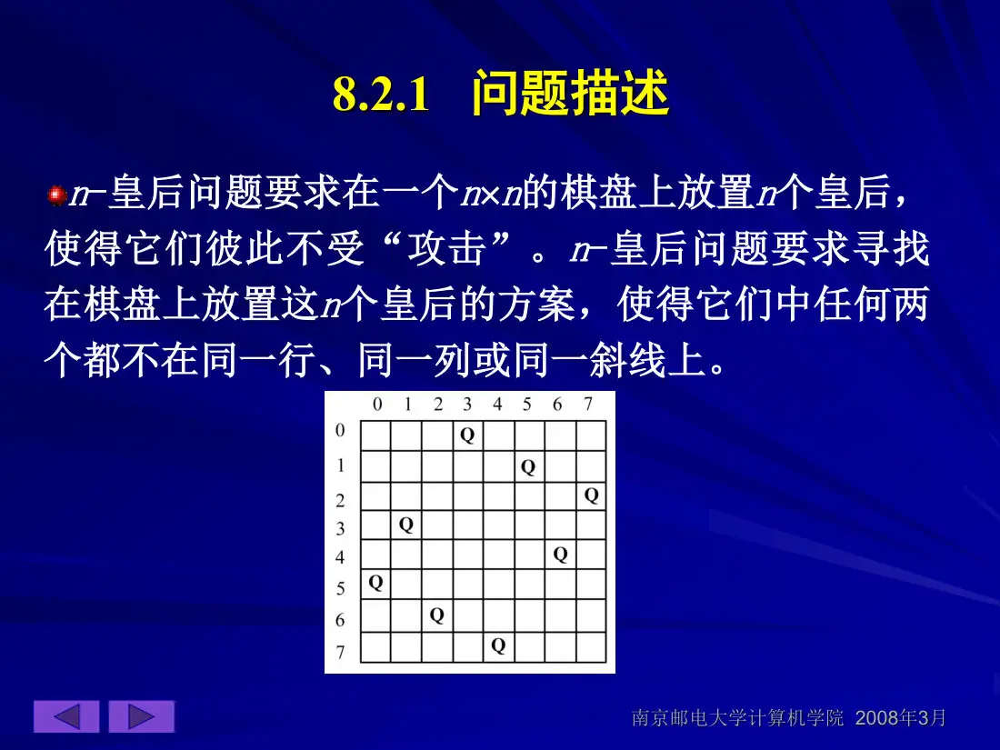

原文：

8.2.1 问题描述

-皇后问题要求在一个  的棋盘上放置 个皇后，使得它们彼此不受“攻击”。n-皇后问题要求寻找在棋盘上放置这n个皇后的方案，使得它们中任何两个都不在同一行、同一列或同一斜线上。

<table><tr><td></td><td>0</td><td>1</td><td>2</td><td>3</td><td>4</td><td>5</td><td>6</td><td>7</td></tr><tr><td>0</td><td></td><td></td><td></td><td>Q</td><td></td><td></td><td></td><td></td></tr><tr><td>1</td><td></td><td></td><td></td><td></td><td></td><td>Q</td><td></td><td></td></tr><tr><td>2</td><td></td><td></td><td></td><td></td><td></td><td></td><td></td><td>Q</td></tr><tr><td>3</td><td></td><td>Q</td><td></td><td></td><td></td><td></td><td></td><td></td></tr><tr><td>4</td><td></td><td></td><td></td><td></td><td></td><td></td><td>Q</td><td></td></tr><tr><td>5</td><td>Q</td><td></td><td></td><td></td><td></td><td></td><td></td><td></td></tr><tr><td>6</td><td></td><td></td><td>Q</td><td></td><td></td><td></td><td></td><td></td></tr><tr><td>7</td><td></td><td></td><td></td><td></td><td>Q</td><td></td><td></td><td></td></tr></table>

南京邮电大学计算机学院 2008年3月

### 8.2.2 回溯法求解

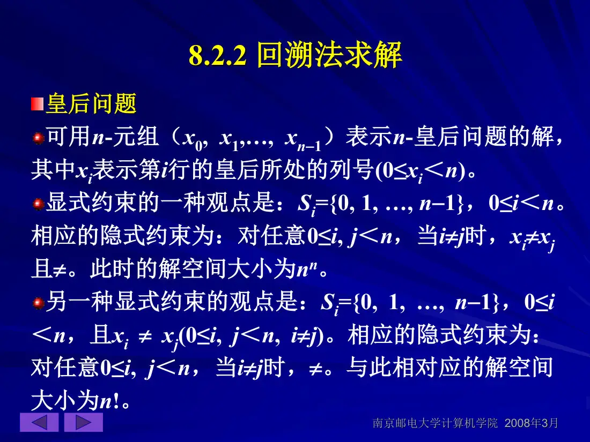

原文：

8.2.2 回溯法求解

可用n-元组 $\frac { 1 } { 2 } \times \frac { 1 } { 3 } = \frac { 1 } { 2 } ( c m ) = \frac { 1 } { 2 } ( 1 2 - 1 )$ 表示n-皇后问题的解，其中 $a = \frac { 1 } { 2 }$ 表示第i行的皇后所处的列号 $( 0 , 0 ) = ( 0 , 0 )$ 显式约束的一种观点是： $y = ( 1 3 0 - \frac { 1 } { 2 } ) \cdot ( 1 3 0 - \frac { 1 } { 2 } )$ 相应的隐式约束为：对任意 $0 \leq x < 0$ 当ij时， $\frac { 3 } { 4 } = \frac { 3 } { 2 }$ 且。此时的解空间大小为 $\varpi$ 。另一种显式约束的观点是： $\angle A = \angle B = \angle C A C = \angle C = \angle B = \angle C = \angle C$ $\otimes$ 且 $\angle B = \angle A C D = \angle A C F = \angle B$ ij)。相应的隐式约束为：对任意0≤i, $V _ { 1 } = \sqrt { 1 0 }$ 当ij时，≠。与此相对应的解空间大小为n!。

南京邮电大学计算机学院 2008年3月

### 南京邮电大学计算机学院 2008年3月

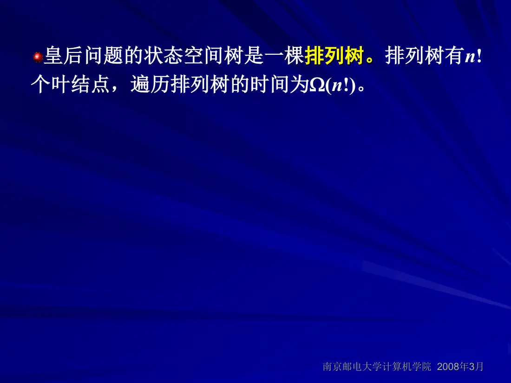

原文：

皇后问题的状态空间树是一棵排列树。排列树有n!个叶结点，遍历排列树的时间为(n!)。

南京邮电大学计算机学院 2008年3月

### 南京邮电大学计算机学院 2008年3月

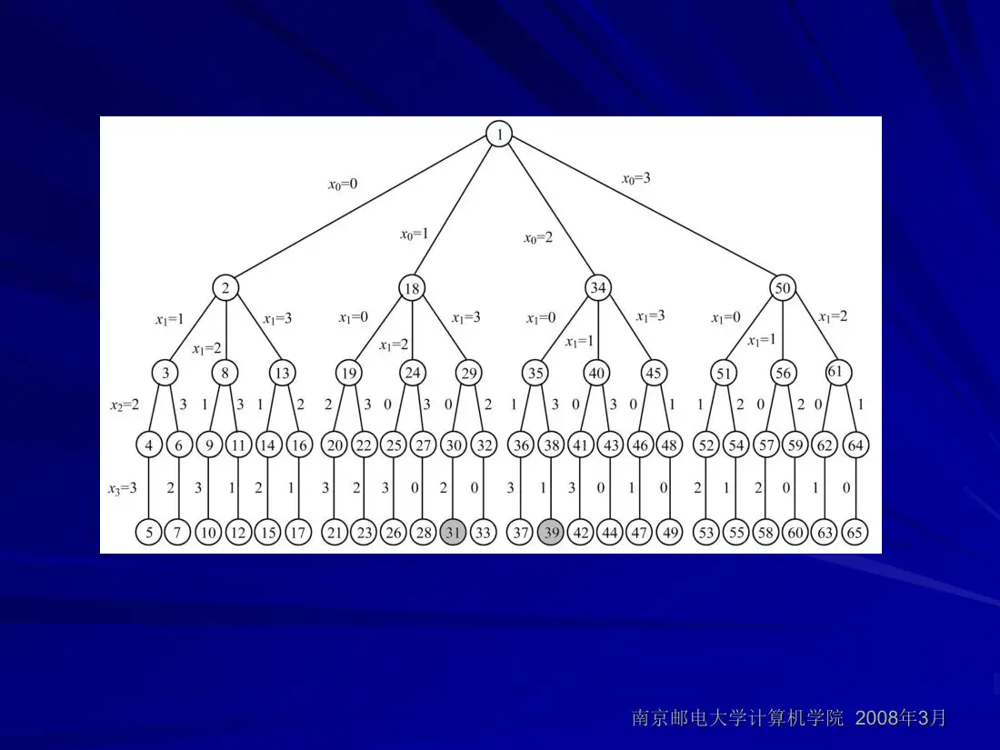

原文：

南京邮电大学计算机学院 2008年3月

### 8.2.3 n-皇后算法

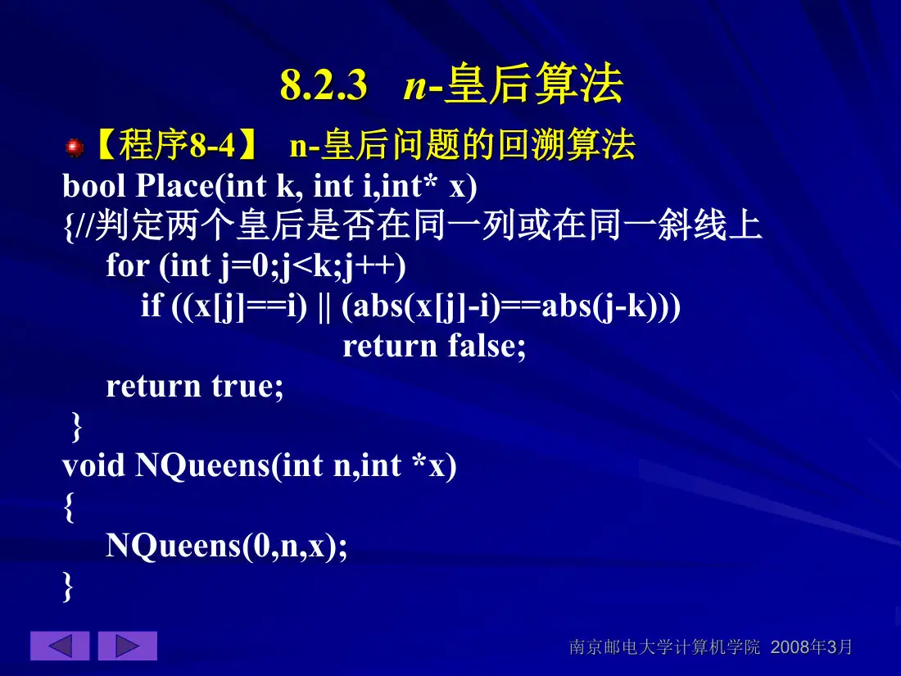

原文：

8.2.3 n-皇后算法

【程序8-4】 n-皇后问题的回溯算法bool Place(int k, int i,int\* x){//判定两个皇后是否在同一列或在同一斜线上for (int j=0;j<k;j++)if ((x[j]==i) || (abs(x[j]-i)==abs(j-k)))return false;

return true;

void NQueens(int n,int \*x)

NQueens(0,n,x);

南京邮电大学计算机学院 2008年3月

### void NQueens(int k,int n,int \*x)

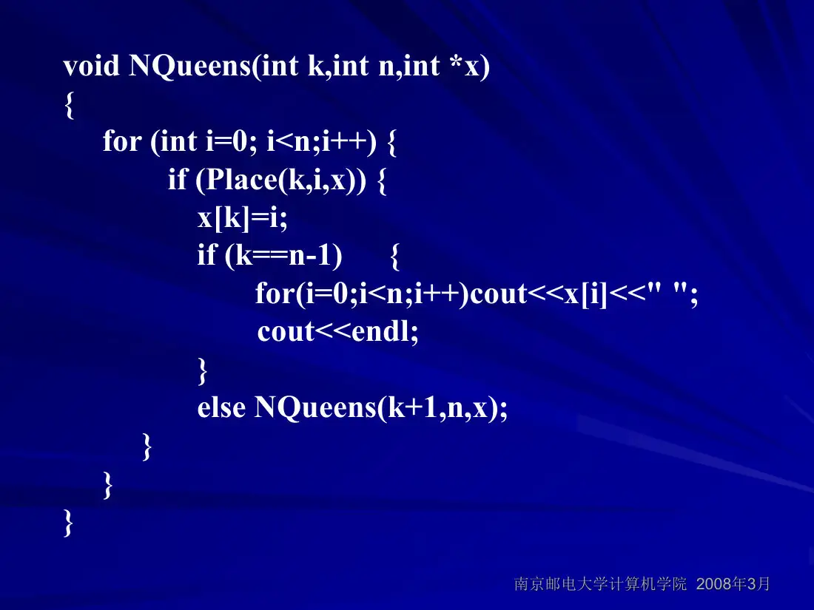

原文：

void NQueens(int k,int n,int \*x)

for (int i=0; i<n;i++) { if (Place(k,i,x)) { x[k]=i; if (k==n-1) { for(i=0;i<n;i++)cout<<x[i]<<" "; cout<<endl;

else NQueens(k+1,n,x);

南京邮电大学计算机学院 2008年3月

### (a)

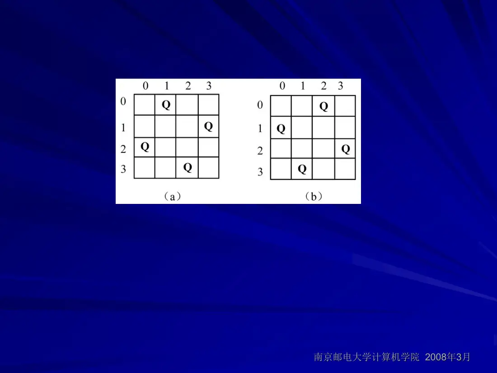

原文：

(a)
<table><tr><td></td><td>0</td><td>1</td><td>2</td><td>3</td></tr><tr><td>0</td><td></td><td>Q</td><td></td><td></td></tr><tr><td>1</td><td></td><td></td><td></td><td>Q</td></tr><tr><td>2</td><td>Q</td><td></td><td></td><td></td></tr><tr><td>3</td><td></td><td></td><td>Q</td><td></td></tr></table>

(b)
<table><tr><td></td><td>0</td><td>1</td><td>2</td><td>3</td></tr><tr><td>0</td><td></td><td></td><td>Q</td><td></td></tr><tr><td>1</td><td>Q</td><td></td><td></td><td></td></tr><tr><td>2</td><td></td><td></td><td></td><td>Q</td></tr><tr><td>3</td><td></td><td>Q</td><td></td><td></td></tr></table>

南京邮电大学计算机学院 2008年3月

### 南京邮电大学计算机学院 2008年3月

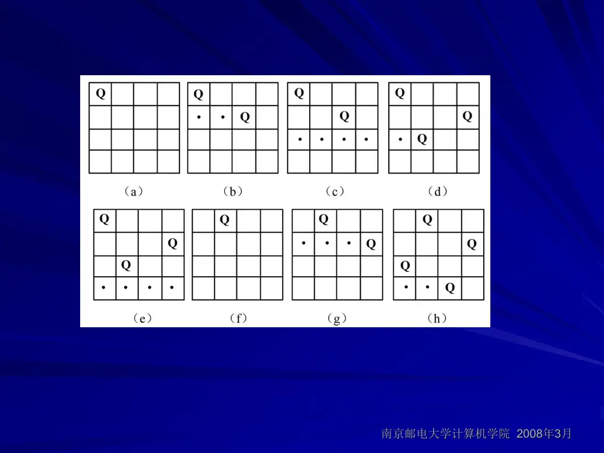

原文：

南京邮电大学计算机学院 2008年3月

### 南京邮电大学计算机学院 2008年3月

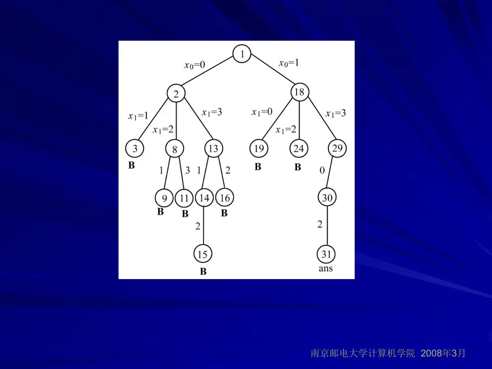

原文：

南京邮电大学计算机学院 2008年3月

### 8.2.4 时间分析

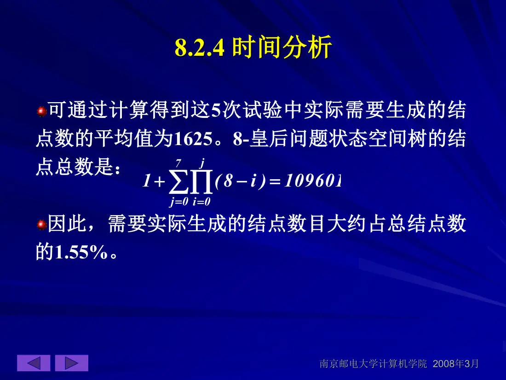

原文：

8.2.4 时间分析

可通过计算得到这5次试验中实际需要生成的结点数的平均值为1625。8-皇后问题状态空间树的结点总数是： $( 2 ) 2 1 ( c m ) = 1 8 ( c m )$ 因此，需要实际生成的结点数目大约占总结点数的1.55%。

南京邮电大学计算机学院 2008年3月

### 南京邮电大学计算机学院 2008年3月

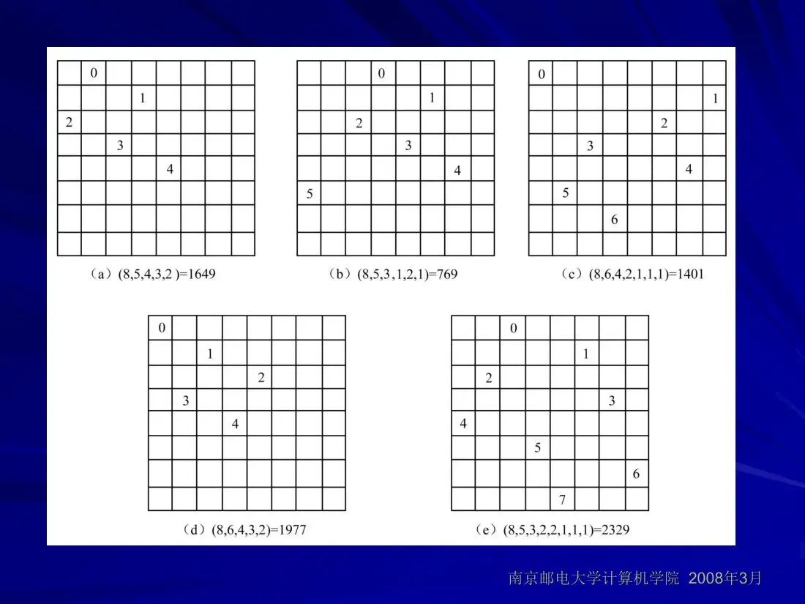

原文：

南京邮电大学计算机学院 2008年3月

### 8.3 子集和数

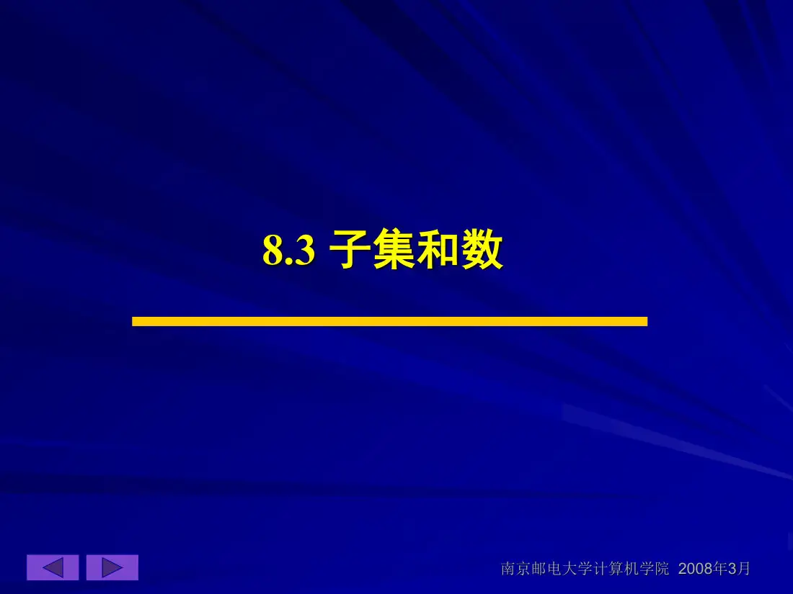

原文：

8.3 子集和数

△

南京邮电大学计算机学院 2008年3月

### 8.3.1 问题描述

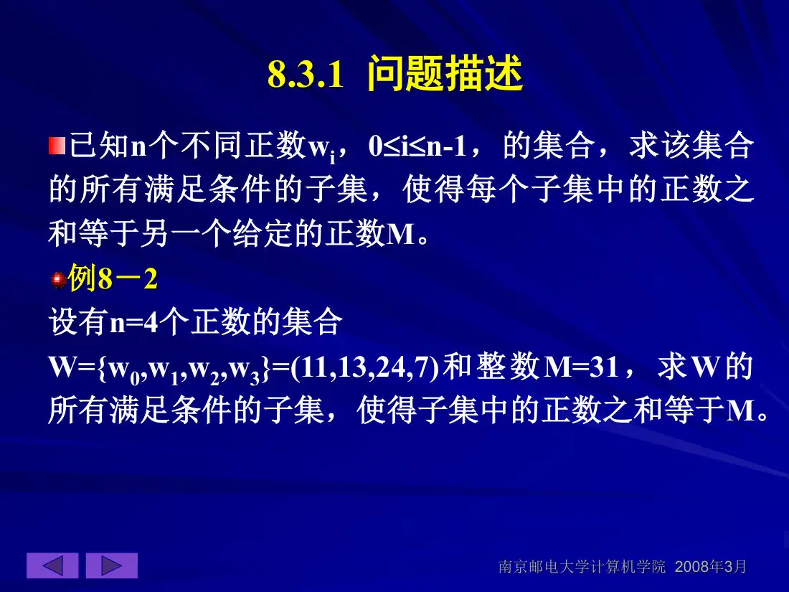

原文：

8.3.1 问题描述

已知n个不同正数w.，0≤i≤n-1，的集合，求该集合的所有满足条件的子集，使得每个子集中的正数之和等于另一个给定的正数M。

例8－2

设有n=4个正数的集合 $\mathrm { C } ^ { \prime } = \mathrm { C D } \mathrm { A } / / \mathrm { D } \mathrm { C } / / \mathrm { D } \mathrm { C } / / \mathrm { D } \mathrm { C } / / \mathrm { D } \mathrm { C } / / \mathrm { D } \mathrm { C } / / \mathrm { D } \mathrm { C } / / \mathrm { D } \mathrm { C } / / \mathrm { D } \mathrm { C }$ 7)和整数M=31，求W的 所有满足条件的子集，使得子集中的正数之和等于M。

南京邮电大学计算机学院 2008年3月

### 8.3.2 回溯法求解

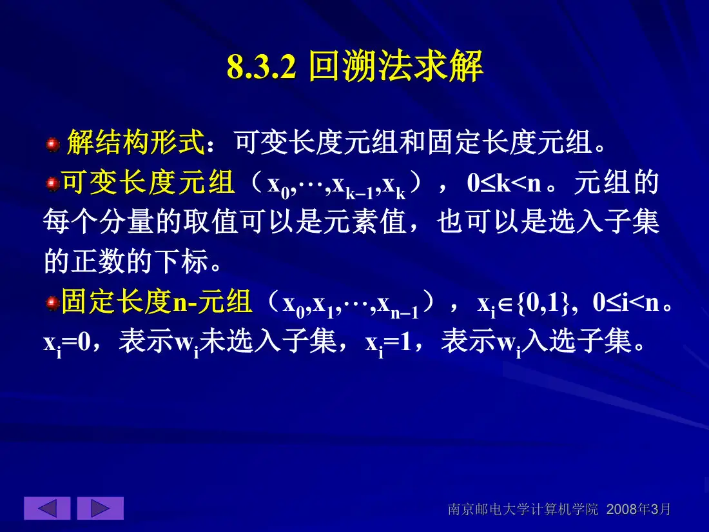

原文：

8.3.2 回溯法求解

解结构形式：可变长度元组和固定长度元组。可变长度元组 $( 4 , 1 2 ) = 1 2$ $0 . 3 5 < 0 . 1 1$ 。元组的每个分量的取值可以是元素值，也可以是选入子集的正数的下标。固定长度n-元组 $( \frac { 1 } { 2 } , \frac { 1 } { 3 } , \frac { 1 } { 3 } , \frac { 1 } { 3 } , \frac { 1 } { 3 } , \frac { 1 } { 3 } )$ $\cdot \angle C = \angle B A E = 9 0 ^ { \circ }$ $: 0 = 0$ 表示 $\aleph$ 未选入子集， $: 5 = 1 1$ ，表示 $\therefore \overrightarrow { a }$ 选子集。

南京邮电大学计算机学院 2008年3月

### 南京邮电大学计算机学院 2008年3月

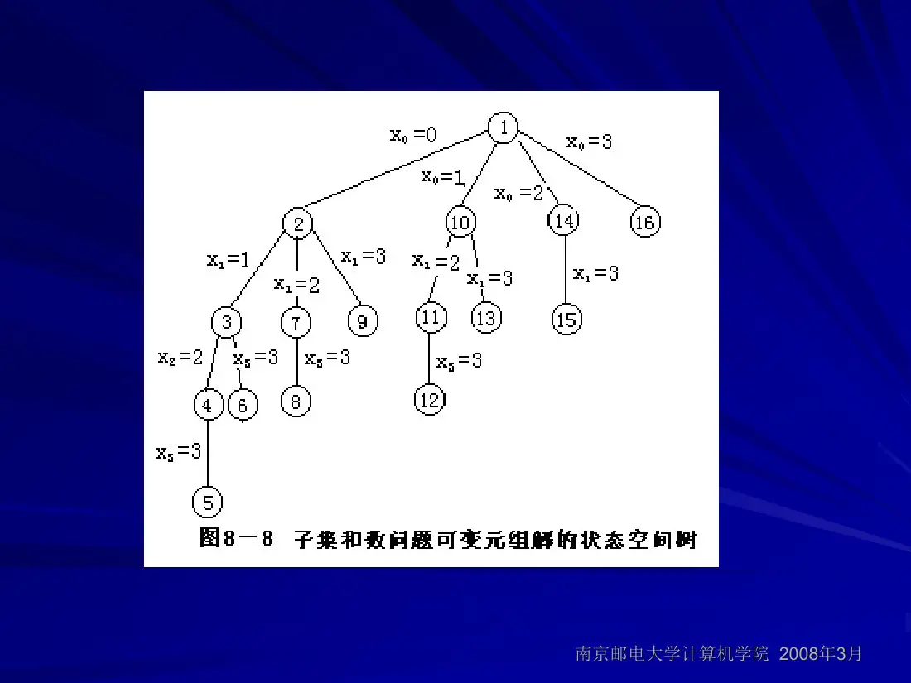

原文：

南京邮电大学计算机学院 2008年3月

### 南京邮电大学计算机学院 2008年3月

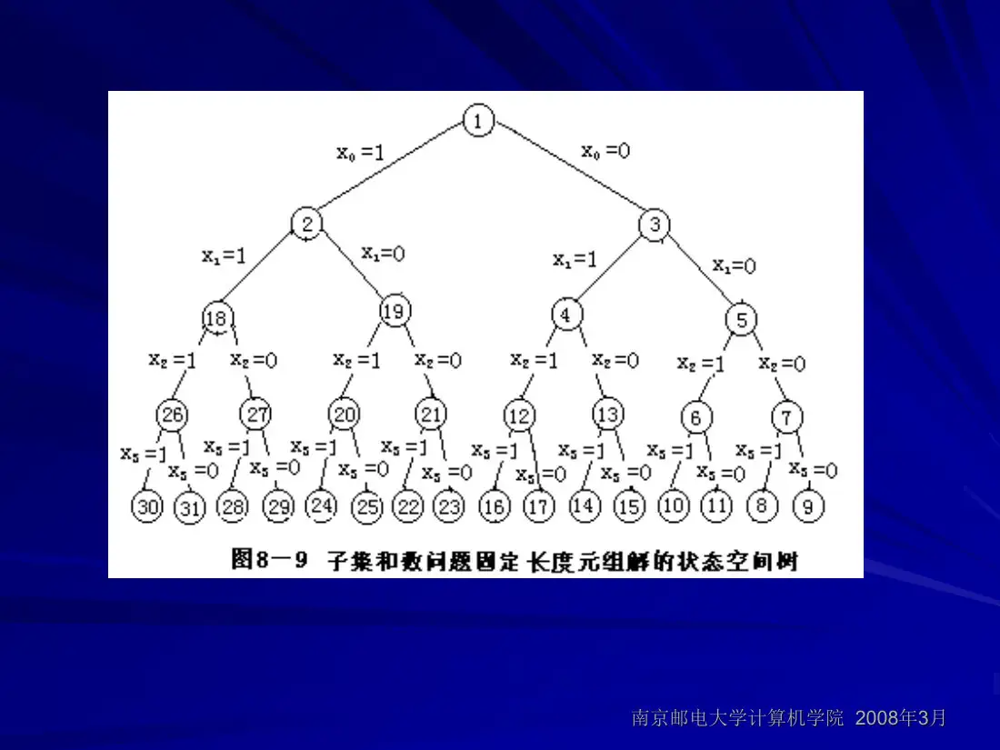

原文：

南京邮电大学计算机学院 2008年3月

### 南京邮电大学计算机学院 2008年3月

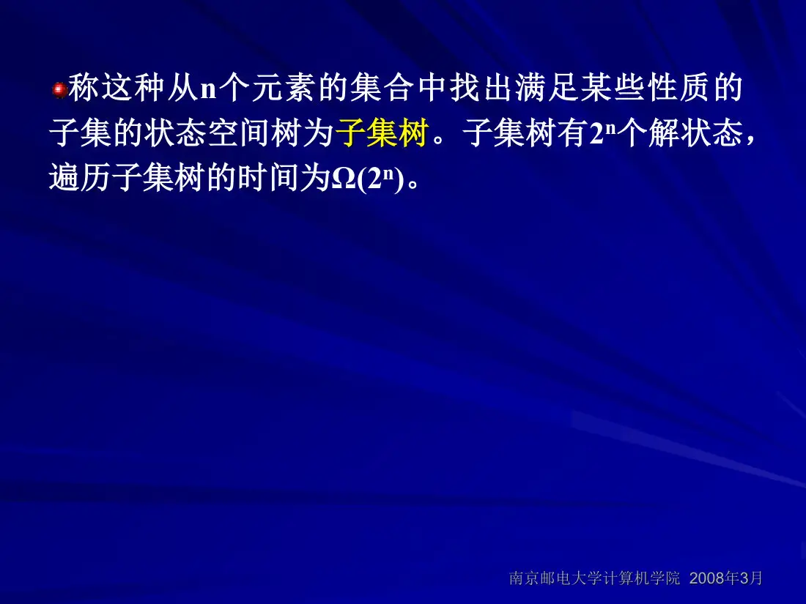

原文：

称这种从n个元素的集合中找出满足某些性质的子集的状态空间树为子集树。子集树有2n个解状态，遍历子集树的时间为Ω(2n)。

南京邮电大学计算机学院 2008年3月

### 约束函数：

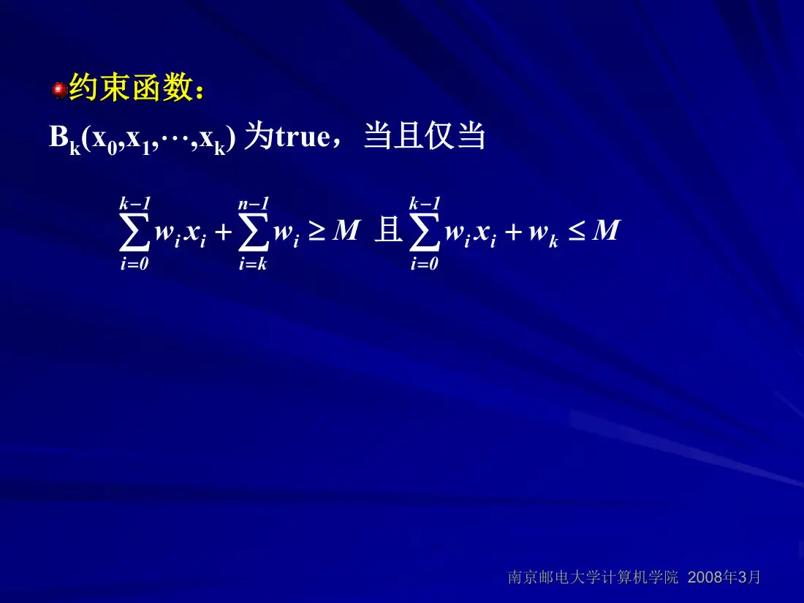

原文：

约束函数：

$1 3 \times ( 1 2 . 5 \times 2 0 0 0 0 ) = 1 2$ 为true，当且仅当

$$
\sum_ {i = 0} ^ {k - 1} w _ {i} x _ {i} + \sum_ {i = k} ^ {n - 1} w _ {i} \geq M \text {且} \sum_ {i = 0} ^ {k - 1} w _ {i} x _ {i} + w _ {k} \leq M
$$

南京邮电大学计算机学院 2008年3月

### 8.3.3 子集和数算法

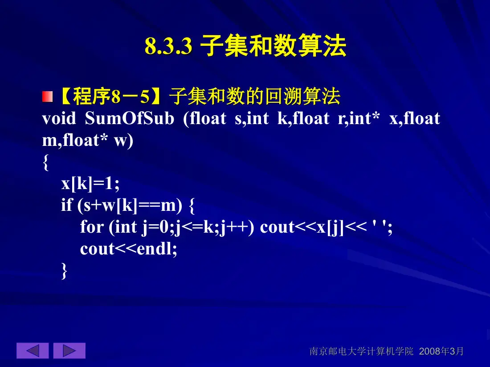

原文：

8.3.3 子集和数算法

【程序8－5】子集和数的回溯算法void SumOfSub (float s,int k,float r,int\* x,floatm,float\* w)

x[k]=1; if (s+w[k]==m) { for (int j=0;j<=k;j++) cout<<x[j]<< ' ' cout<<endl;

南京邮电大学计算机学院 2008年3月

### 南京邮电大学计算机学院 2008年3月

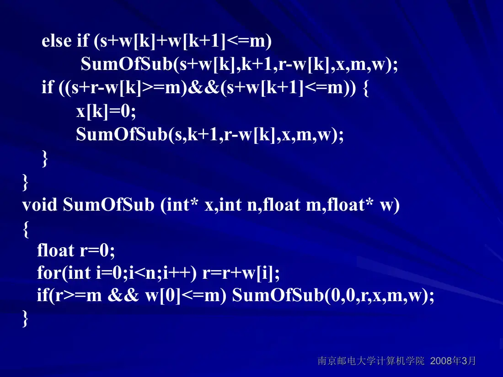

原文：

else if (s+w[k]+w[k+1]<=m) SumOfSub(s+w[k],k+1,r-w[k],x,m,w); if ((s+r-w[k]>=m)&&(s+w[k+1]<=m)) { x[k]=0; SumOfSub(s,k+1,r-w[k],x,m,w);

void SumOfSub (int\* x,int n,float m,float\* w)

float r=0; for(int i=0;i<n;i++) r=r+w[i]; if(r>=m && w[0]<=m) SumOfSub(0,0,r,x,m,w);

南京邮电大学计算机学院 2008年3月

### 例8－3

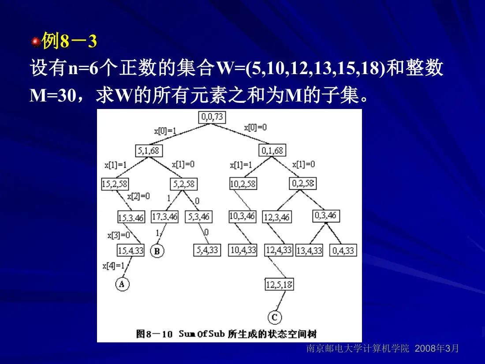

原文：

例8－3

设有n=6个正数的集合W=(5,10,12,13,15,18)和整数M=30，求W的所有元素之和为M的子集。

南京邮电大学计算机学院 2008年3月

### 8.4 图的着色

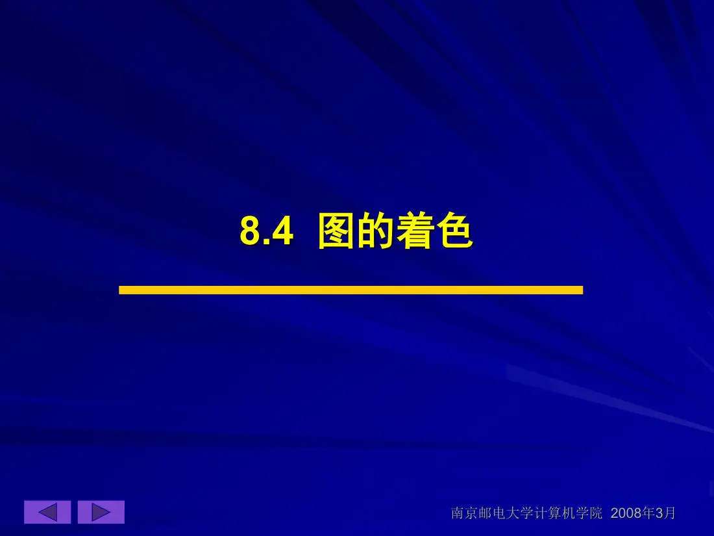

原文：

8.4 图的着色

△

南京邮电大学计算机学院 2008年3月

### 8.4.1 问题描述

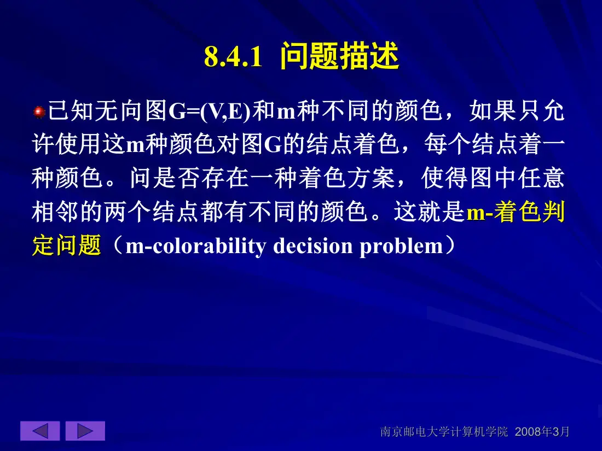

原文：

8.4.1 问题描述

已知无向图G=(V,E)和m种不同的颜色，如果只允许使用这m种颜色对图G的结点着色，每个结点着种颜色。问是否存在一种着色方案，使得图中任意相邻的两个结点都有不同的颜色。这就是m-着色判定问题（m-colorability decision problem）

南京邮电大学计算机学院 2008年3月

### 南京邮电大学计算机学院 2008年3月

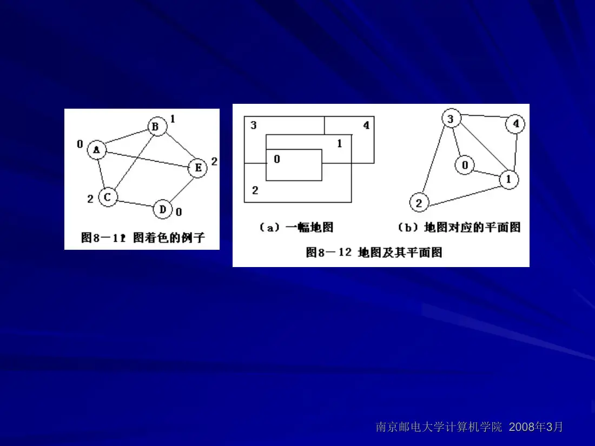

原文：

南京邮电大学计算机学院 2008年3月

### 8.4.2 回溯法求解

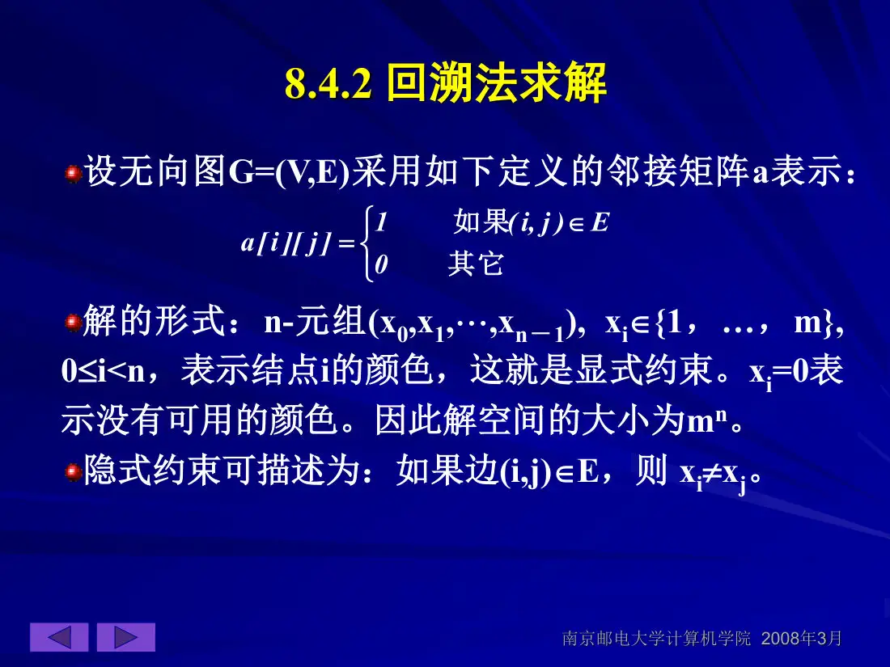

原文：

8.4.2 回溯法求解

设无向图 $\textcircled { 6 } = \textcircled { 6 } \textcircled { 3 }$ 采用如下定义的邻接矩阵a表示：

$( 1 ) \frac { 1 } { 2 } \times 1 0 0 = \frac { 1 } { 2 }$ 如果 $\textcircled { 1 } m = 1 0$ 其它

解的形式：n-元组 $\textcircled { 1 } \because \textcircled { 1 } \textcircled { 2 } \textcircled { 2 } \textcircled { 2 } \textcircled { 1 } \textcircled { 2 } \textcircled { 1 } \textcircled { 2 } \textcircled { 1 }$ $: \angle A C = \angle B C$ m},$0 . 5 1 < 0 . 1 1$ 表示结点i的颜色，这就是显式约束。 $\therefore c = 0$ 表示没有可用的颜色。因此解空间的大小为 $\pmb { \bigtriangledown } | \pmb { \bigtriangledown } | ^ { \pmb { \| } }$ 。隐式约束可描述为：如果边 $( [ [ 1 , 1 ] ) ] = 1 0$ 则 $\therefore \frac { 1 } { 4 } = \frac { 3 } { 4 }$ a

南京邮电大学计算机学院 2008年3月

### 南京邮电大学计算机学院 2008年3月

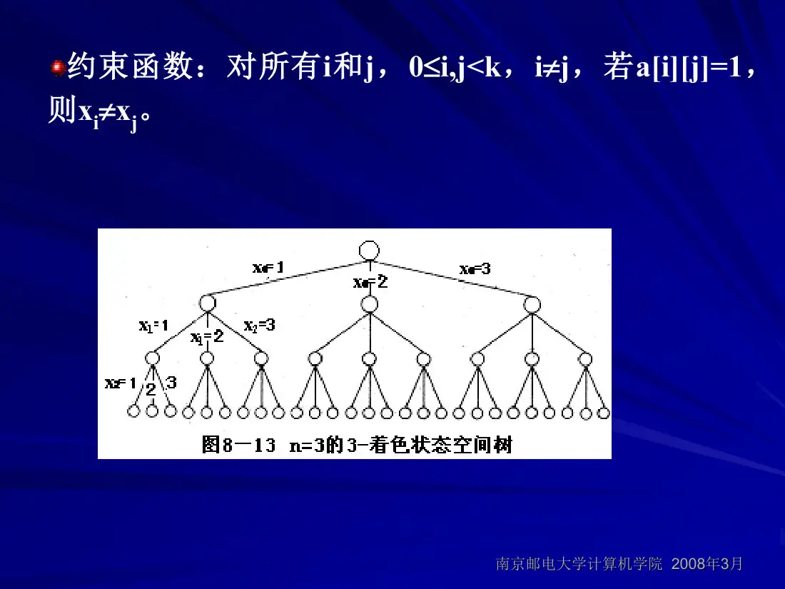

原文：

约束函数：对所有i和j，0≤i,j<k，i≠j，若a[ilj]=1，则 $: \overrightarrow { a } \overrightarrow { b } \cdot \overrightarrow { b } \cdot \overrightarrow { b } \cdot \overrightarrow { b } \cdot \overrightarrow { b } = 0 ,$

南京邮电大学计算机学院 2008年3月

### 8.4.3 图着色算法

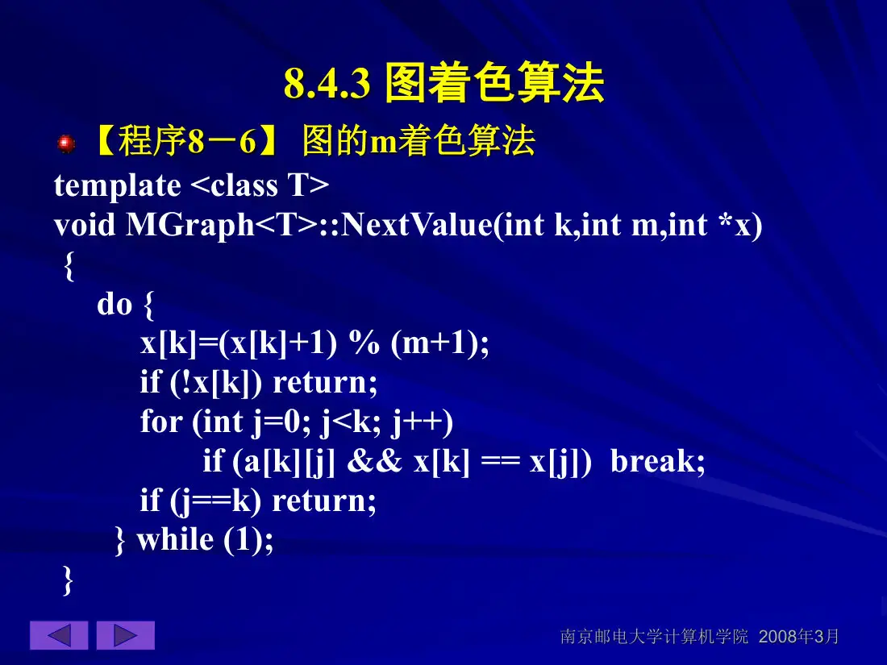

原文：

8.4.3 图着色算法

【程序8－6】 图的m着色算法template <class T>void MGraph<T>::NextValue(int k,int m,int \*x)

do { x[k]=(x[k]+1) % (m+1); if (!x[k]) return; for (int j=0; j<k; j++) if (a[k][j] && x[k] == x[j]) break; if (j==k) return; } while (1);

南京邮电大学计算机学院 2008年3月

### 南京邮电大学计算机学院 2008年3月

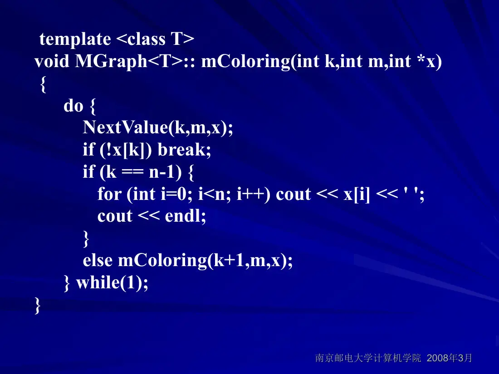

原文：

template <class T> void MGraph<T>:: mColoring(int k,int m,int \*x)

do { NextValue(k,m,x); if (!x[k]) break; if (k == n-1) { for (int i=0; i<n; i++) cout << x[i] << ' '; cout << endl; } else mColoring(k+1,m,x); } while(1);

南京邮电大学计算机学院 2008年3月

### 南京邮电大学计算机学院 2008年3月

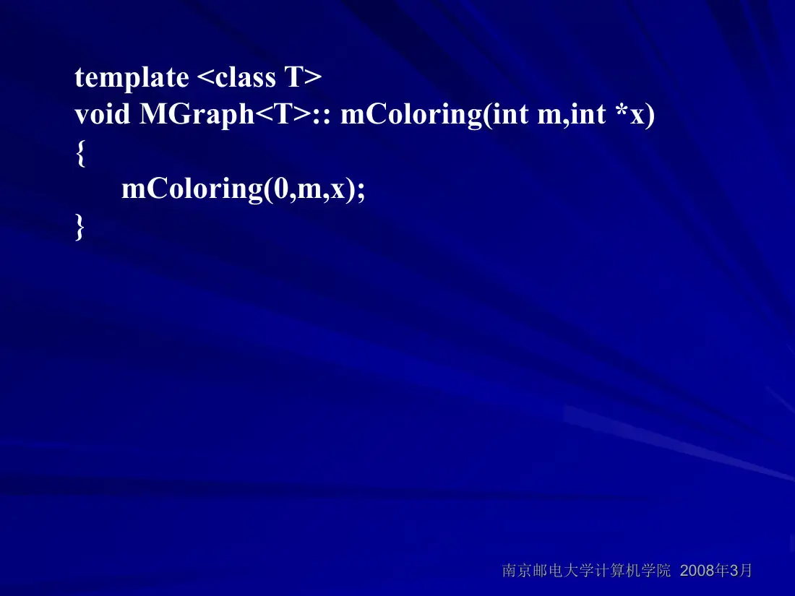

原文：

template <class T> void MGraph<T>:: mColoring(int m,int \*x) mColoring(0,m,x);

南京邮电大学计算机学院 2008年3月

### 8.4.4 时间分析算法的计算时间上界可由状态空间树的结点数

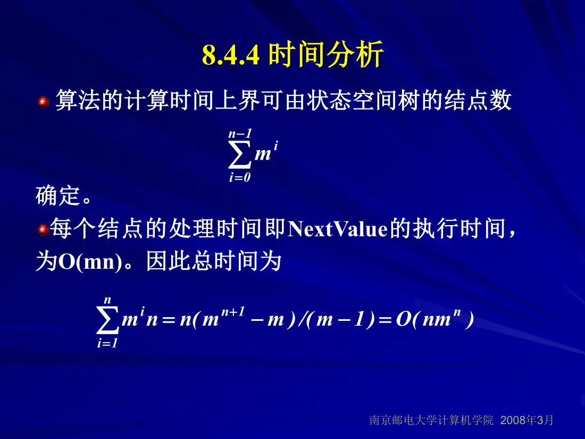

原文：

8.4.4 时间分析算法的计算时间上界可由状态空间树的结点数

$$
\sum_ {i = 0} ^ {n - 1} m ^ {i}
$$

确定。

每个结点的处理时间即NextValue的执行时间，为 $\textcircled { 1 } \textcircled { 1 0 0 1 }$ 。因此总时间为

$$
\sum_ {i = 1} ^ {n} m ^ {i} n = n (m ^ {n + 1} - m) / (m - 1) = O (n m ^ {n})
$$

南京邮电大学计算机学院 2008年3月

### 8. 5 哈密顿环

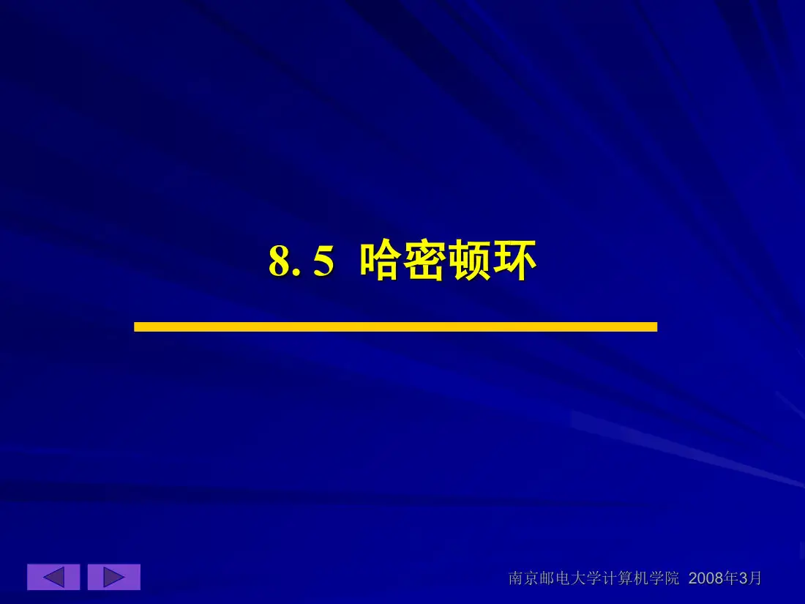

原文：

8. 5 哈密顿环

△

南京邮电大学计算机学院 2008年3月

### 8.5.1 问题描述

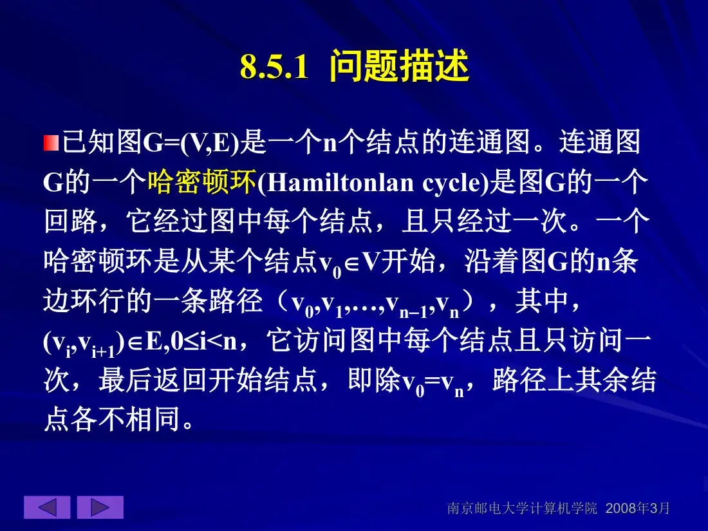

原文：

8.5.1 问题描述

已知图G=(V,E)是一个n个结点的连通图。连通图G的一个哈密顿环(Hamiltonlan cycle)是图G的一个回路，它经过图中每个结点，且只经过一次。一个哈密顿环是从某个结点 $\because a = - 1$ 开始，沿着图G的n条边环行的一条路径 $\operatorname { s u m } ( 0 \leq x - \frac { 1 } { 2 } ) = \operatorname { s u m } ( 0 \leq x - \frac { 1 } { 2 } )$ ，其中，$( 1 0 0 \times 1 0 0 ) = 1 0 0 ( 1 ) = 1 0 0 ( 1 )$ 它访问图中每个结点且只访问一次，最后返回开始结点，即除 $\operatorname { v m } = \operatorname { v }$ 路径上其余结点各不相同。

南京邮电大学计算机学院 2008年3月

### 南京邮电大学计算机学院 2008年3月

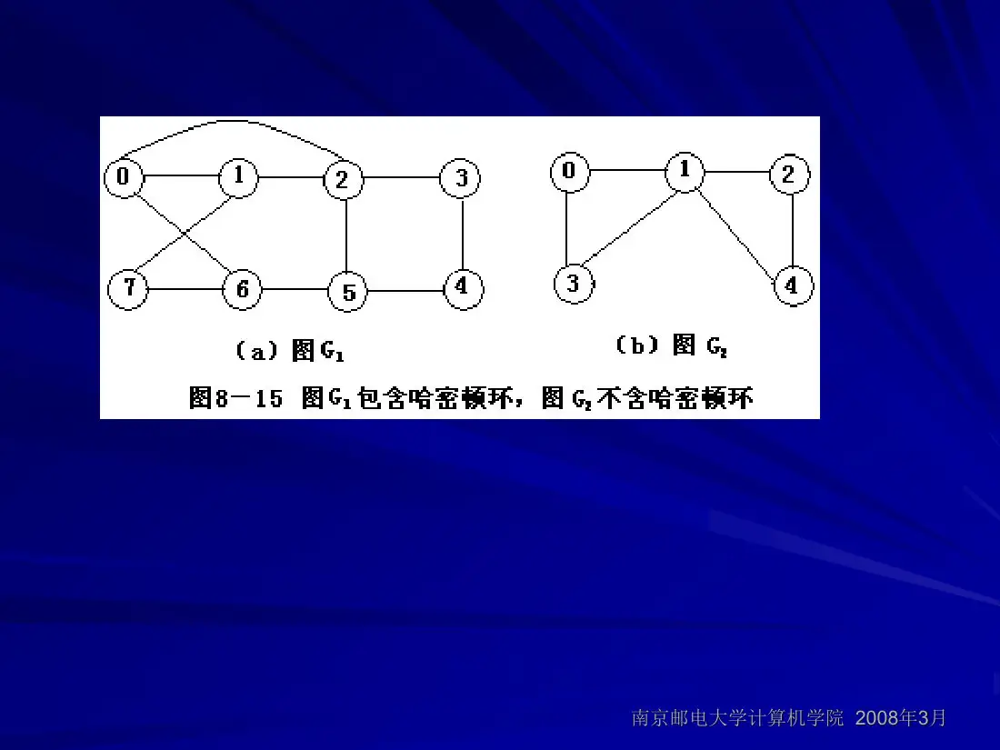

原文：

南京邮电大学计算机学院 2008年3月

### 8.5.2 哈密顿环算法

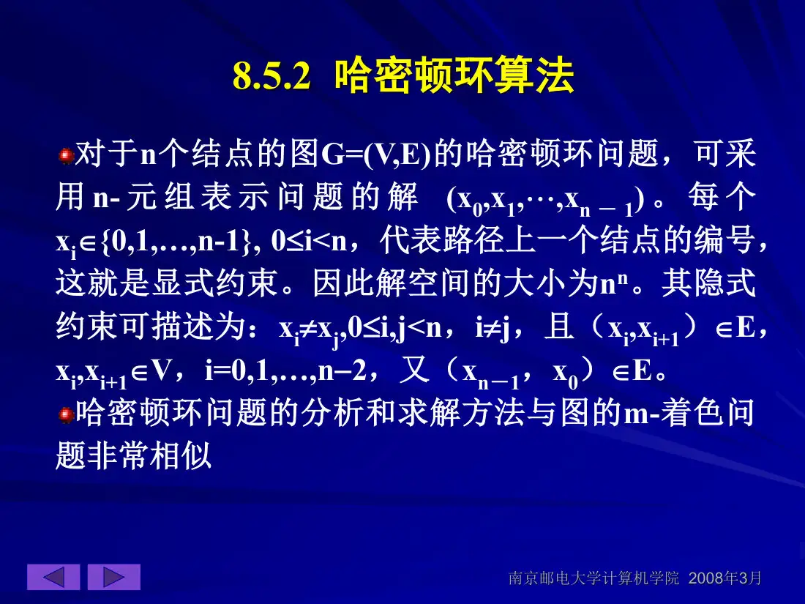

原文：

8.5.2 哈密顿环算法

对于n个结点的图 $\textcircled { 6 } = \textcircled { 1 } \textcircled { 6 } \textcircled { 3 }$ 的哈密顿环问题，可采用n-元组表示问题的解 $( 1 ) \because \frac { 1 } { 2 } \times ( 1 + \frac { 1 } { 2 } ) \times ( 1 + \frac { 1 } { 2 } ) \times ( 1 + \frac { 1 } { 2 } )$ 。 每个$\scriptstyle 1 = \{ 1 , \dots , n \} \cdot \ln ( 1 , \dots , n )$ 代表路径上一个结点的编号，这就是显式约束。因此解空间的大小为 $\textcircled { 1 1 }$ 。其隐式约束可描述为： $\angle E = \angle C D A = \angle A B C = \angle 1$ ij，且 $( 6 , 9 , 9 , 0 ) = 1 0$ $\angle D = \angle B = \angle C = \angle A = \angle C = 9 0 ^ { \circ }$ 又 $( 5 , 7 , 7 , 9 , 9 , 9 , 9 ) = 1 0$ 哈密顿环问题的分析和求解方法与图的m-着色问题非常相似

南京邮电大学计算机学院 2008年3月

### } while(1);

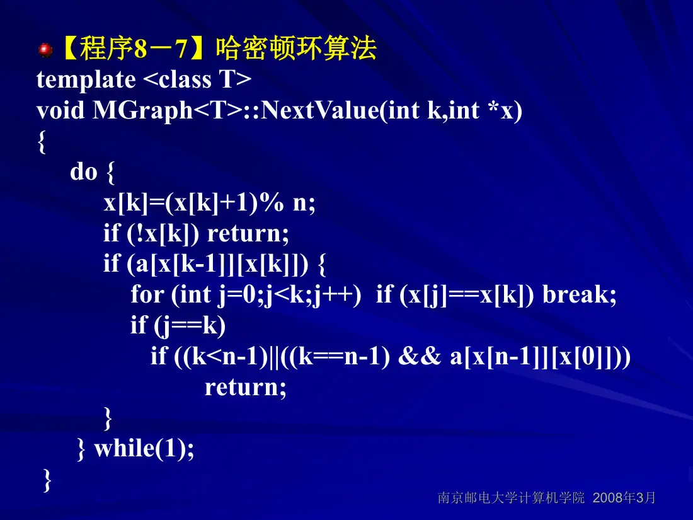

原文：

【程序8－7】哈密顿环算法template <class T>void MGraph<T>::NextValue(int k,int \*x)

do { x[k]=(x[k]+1)% n; if (!x[k]) return; if (a[x[k-1]][x[k]]) { for (int j=0;j<k;j++) if (x[j]==x[k]) break; if (j==k) if ((k<n-1)||((k==n-1) && a[x[n-1]][x[0]])) return;

} while(1);

南京邮电大学计算机学院 2008年3月

### 南京邮电大学计算机学院 2008年3月

原文：

template <class T> void ExtMGraph<T>::Hamiltonian(int k,int \*x)

do { NextValue(k,x); if (!x[k]) return; if (k==n-1) { for (int i=0; i<n; i++) cout<<x[i]<< ' '; cout $\bigotimes \bigotimes \bigotimes \bigotimes \bigotimes \bigotimes \bigotimes \bigotimes \bigotimes$ } else Hamiltonian(k+1,x); while (1);

南京邮电大学计算机学院 2008年3月

### Hamiltonian(1,x);

原文：

template <class T> void ExtMGraph<T>:: Hamiltonian(int \*x)

Hamiltonian(1,x);

南京邮电大学计算机学院 2008年3月

### 8.7 批处理作业调度

原文：

8.7 批处理作业调度

△

南京邮电大学计算机学院 2008年3月

### 8.7.1 问题描述

原文：

8.7.1 问题描述

设有n个作业的集合 $\textcircled { 1 0 } \textcircled { 1 } \textcircled { 2 } \textcircled { 2 } \textcircled { 1 0 } \textcircled { 1 } \textcircled { 2 } \textcircled { 1 }$ ，每个作业有两项任务要求分别在2台设备 $\textcircled { 1 9 }$ 和P 上完成。每个作业必须先在 $\textcircled { 1 }$ 上加工，然后在 $\textcircled { 1 }$ 上加工。 $\textcircled { 1 9 }$ 和P 加工作业i所需的时间分别为 $\mathbf { \delta E }$ 和 $\mathbf { \epsilon }$ 。作业i的完成时间 $1 1 \frac { 1 3 } { 1 9 } \times 1 = 1 9$ 是指在调度方案S下，该作业的所有任务得以完成的时间，则 1 n-1

$$
M F T (S) = \frac {1}{n} \sum_ {i = 0} ^ {n - 1} f _ {i} (S)
$$

是采用调度方案S的平均完成时间。

Λ

南京邮电大学计算机学院 2008年3月

### $$

原文：

批处理作业调度(batch job schedule)问题要求确定这n个作业的最优作业调度方案使其MFT最小。这等价于求使得所有作业的完成时间之和

$$
F T (S) = \sum_ {i = 0} ^ {n - 1} f _ {i} (S)
$$

最小的调度方案。

南京邮电大学计算机学院 2008年3月

### 南京邮电大学计算机学院 2008年3月

原文：

设有三个作业和两台设备，作业任务的处理时间为$( 4 , 1 1 , 2 , 3 , 4 , 5 , 7 ) = ( 4 , 3 , 4 , 3 )$ 和 $( 4 ) ( 1 2 , 1 2 , 1 2 ) = ( 1 5 , 1 5 )$ 。这三个作业有6种可能的调度方案： $( ( 1 ) ( 1 0 - 2 ) \times ( 1 2 - 2 ) \times ( 1 2 - 2 )$ $( 1 1 0 \% ) \times ( 1 1 0 \% ) \times ( 1 1 0 \% )$ 它们相应的完成时间之和分别是$1 0 0 0 0 0 0 0 0 0 0 0 0 0 0 0 0 0 0 0 0 0 0 0 0 0 0 0 0 0 0 0 0 0 0 0 0 0 0 0 0 0 0 0 0 0 0 0 0 0 0 0 0 0 0 0 0 0 0 0 0 0 0 0 0 0 0 0 0 0 0 0 0 0 0 0 0 0 0 0 0 0 0 0 0 0 0 0 0 0 0 0 0 0 0 0 0 0 0 0 0 0 0 0 0 0 0 0 0 0 0 0 0 0 0 0 0 0 0 0 0 0 0 0$ 。其中，最佳调度方案 $\circledast = ( 0 . 2 5 1 1 )$ 在这一调度方案下， $( 1 ) ( 2 ) \because P ( ( 0 ) = 1 / ( 1 0 - 1 ) = 2 / ( 2 ) = 3$ $| \gamma _ { 4 } | = 8 \sqrt { 1 - 4 } \times 3 = 1 8 :$

南京邮电大学计算机学院 2008年3月

### 8.7.2 回溯法求解

原文：

8.7.2 回溯法求解

对于双机批处理作业调度问题，其可行解是n个作业所有可能的排列，每一种排列代表一种作业调度方案S，其目标函数是 n-1

$$
F T (S) = \sum_ {i = 0} ^ {n - 1} f _ {i} (S)
$$

使FT(S)具有最小值的调度方案或作业排列是问题的最优解。

对于双机作业调度，存在一个最优非抢先调度方案，使得在 $1 4$ 和 $1 4 - 1 = 1 4$ 上的作业完全以相同次序处理。 批处理作业调度问题的状态空间树解空间的大小为 n！。

M

南京邮电大学计算机学院 2008年3月

### 南京邮电大学计算机学院 2008年3月

原文：

求解这一问题没有有效的约束函数，但可以使用最优解的上界值U进行剪枝。如果对于已经调度的作业子集的某种排列，所需的完成时间和已经大于迄今为止所记录下的关于最优调度方案的完成时间和的上界值U,则该分枝可以剪去。

南京邮电大学计算机学院 2008年3月

### 8.7.3 批处理作业调度算法

原文：

8.7.3 批处理作业调度算法

【程序8－9】批处理作业调度算法class BatchJob{public:

BatchJob(int sz, int \*aa,int \*bb,int up)

n=sz; U=up; f=f1=0; a=new int[n];b=new int[n]; f2=new int[n];y=new int[n]; for(int i=0;i<n;i++){ a[i]=aa[i];b[i]=bb[i];y[i]=i;

南京邮电大学计算机学院 2008年3月

### int JobSch(int \*x);

原文：

int JobSch(int \*x);

private:

void JobSch(int i,int \*x); int \*a,\*b,n,U, f,f1,\*f2,\*y;

南京邮电大学计算机学院 2008年3月

### void BatchJob::JobSch(int i,int \*x)

原文：

void BatchJob::JobSch(int i,int \*x)

if (i==n) { for (int j=0; j<n;j++) x[j]=y[j]; U=f;

else

南京邮电大学计算机学院 2008年3月

### 南京邮电大学计算机学院 2008年3月

原文：

for (int j=i;j<n;j++) { f1+=a[y[j]]; f2[i]=((f2[i-1]>f1)?f2[i−1]:f1)+b[y[j]]; f+=f2[i]; if (f<U) { Swap(y,i,j); JobSch(i+1,x); Swap(y,i,j); f1-=a[y[j]];f-=f2[i];

南京邮电大学计算机学院 2008年3月

### 南京邮电大学计算机学院 2008年3月

原文：

int BatchJob::JobSch(int \*x) JobSch(0,x); return U;

南京邮电大学计算机学院 2008年3月
