# 《算法设计与分析》第9章 分支限界法（课件）

原件的每一页，下面附识别出的文字。

### 算法设计与分析

原文：

算法设计与分析

DeSign and Analysis of Algorithms In C++

陈慧南 编著

南京邮电大学计算机学院 2008年3月

“十一五”国家级规划教材

电子工业出版社

### 第2部分 算法设计策略

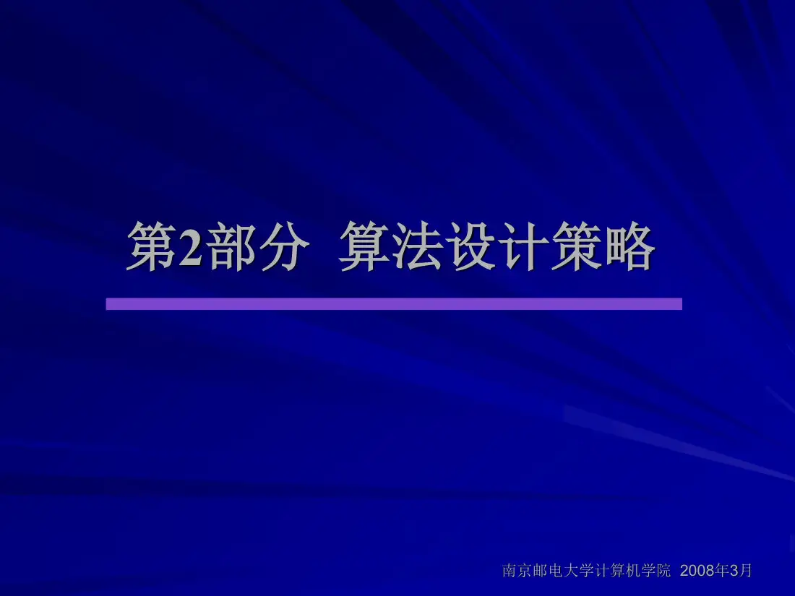

原文：

第2部分 算法设计策略

南京邮电大学计算机学院 2008年3月

### 第9章 分支限界法

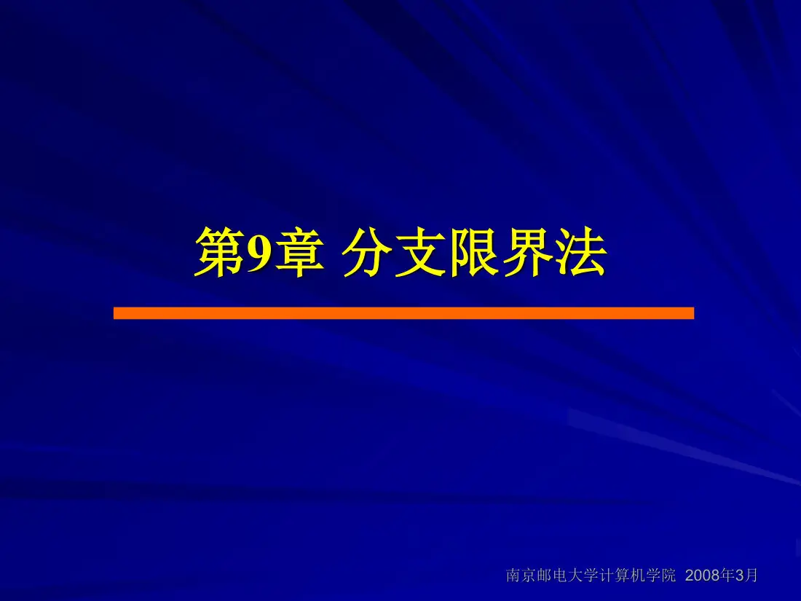

原文：

第9章 分支限界法

南京邮电大学计算机学院 2008年3月

### 9.1 一般方法

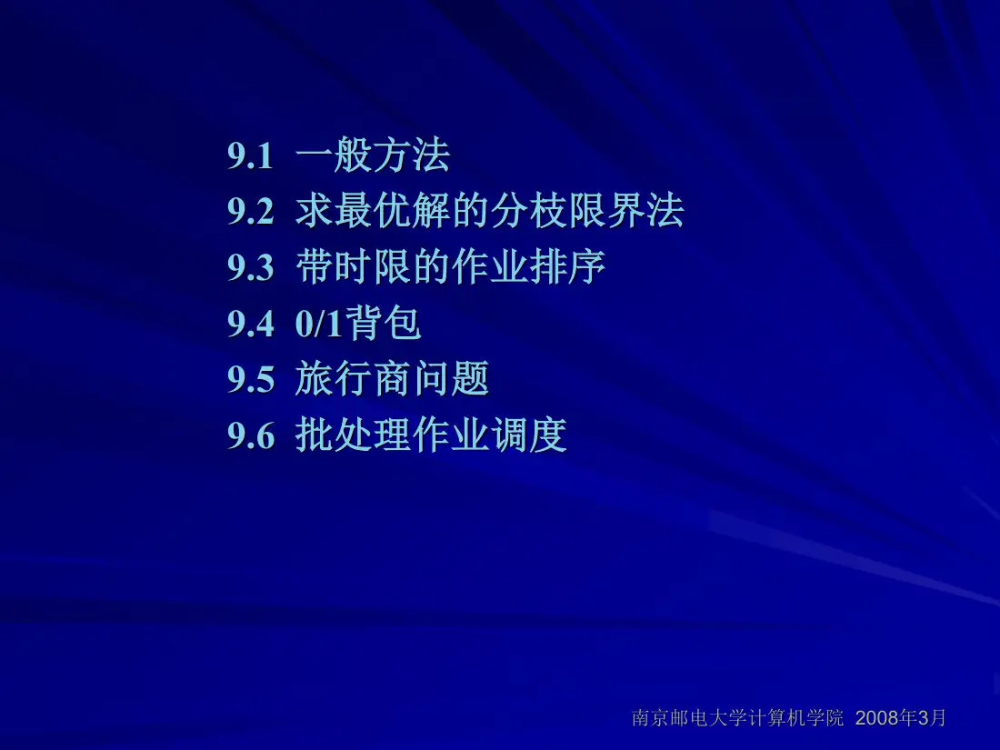

原文：

9.1 一般方法
9.2 求最优解的分枝限界法
9.3 带时限的作业排序
9.4 0/1背包
9.5 旅行商问题
9.6 批处理作业调度

南京邮电大学计算机学院 2008年3月

### 9.1 一般方法

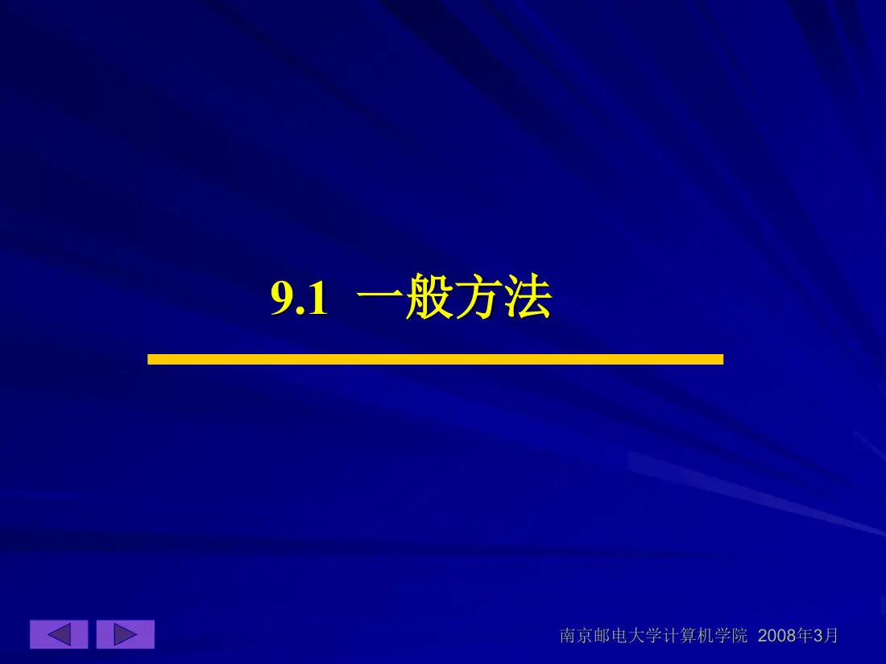

原文：

9.1 一般方法

△

南京邮电大学计算机学院 2008年3月

### 9.1.1 分枝限界法概述

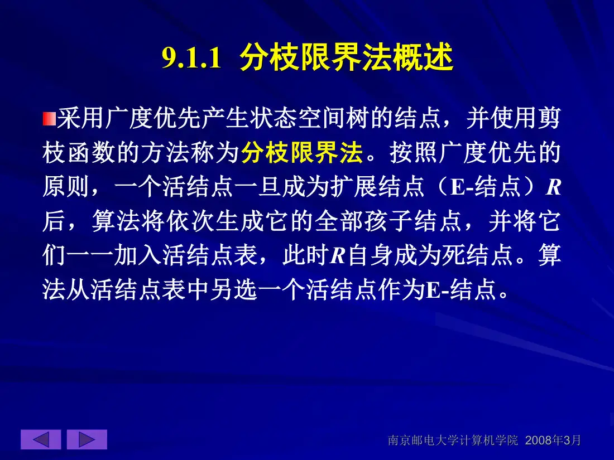

原文：

9.1.1 分枝限界法概述

采用广度优先产生状态空间树的结点，并使用剪枝函数的方法称为分枝限界法。按照广度优先的原则，一个活结点一旦成为扩展结点（E-结点）R后，算法将依次生成它的全部孩子结点，并将它们一一加入活结点表，此时R自身成为死结点。算法从活结点表中另选一个活结点作为E-结点。

南京邮电大学计算机学院 2008年3月

### 南京邮电大学计算机学院 2008年3月

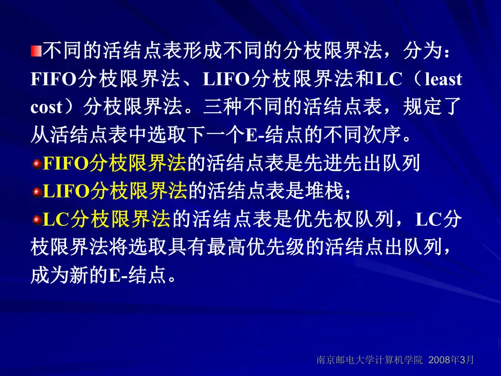

原文：

不同的活结点表形成不同的分枝限界法，分为：FIFO分枝限界法、LIFO分枝限界法和LC（leastcost）分枝限界法。三种不同的活结点表，规定了从活结点表中选取下一个E-结点的不同次序。FIFO分枝限界法的活结点表是先进先出队列LIFO分枝限界法的活结点表是堆栈；LC分枝限界法的活结点表是优先权队列，LC分枝限界法将选取具有最高优先级的活结点出队列，成为新的E-结点。

南京邮电大学计算机学院 2008年3月

### 例9－1 (4-皇后问题) FIFO分枝限界法求解

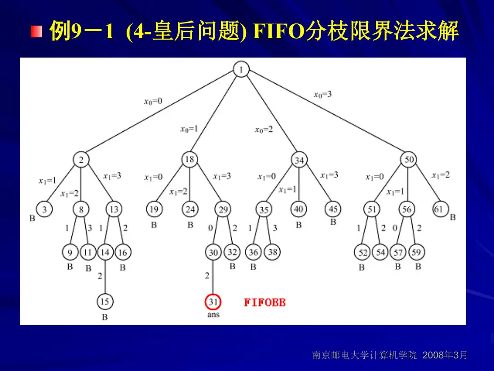

原文：

例9－1 (4-皇后问题) FIFO分枝限界法求解

南京邮电大学计算机学院 2008年3月

### 南京邮电大学计算机学院 2008年3月

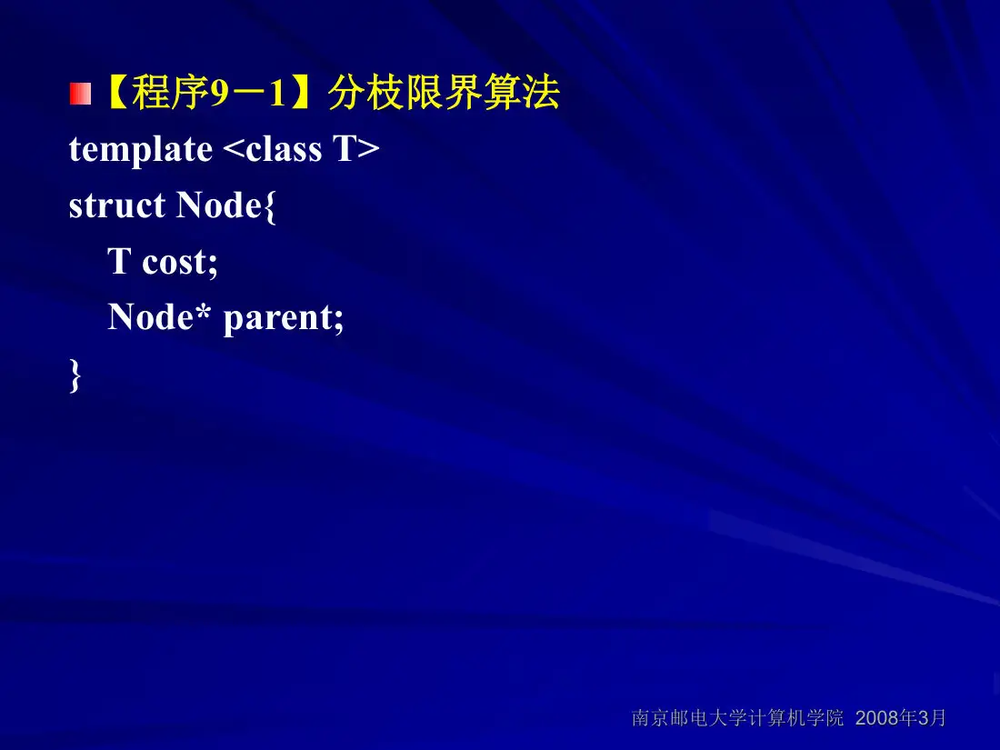

原文：

【程序9－1】分枝限界算法template <class T>struct Node{T cost;Node\* parent;

南京邮电大学计算机学院 2008年3月

### template void BranchBound(Node\* t)

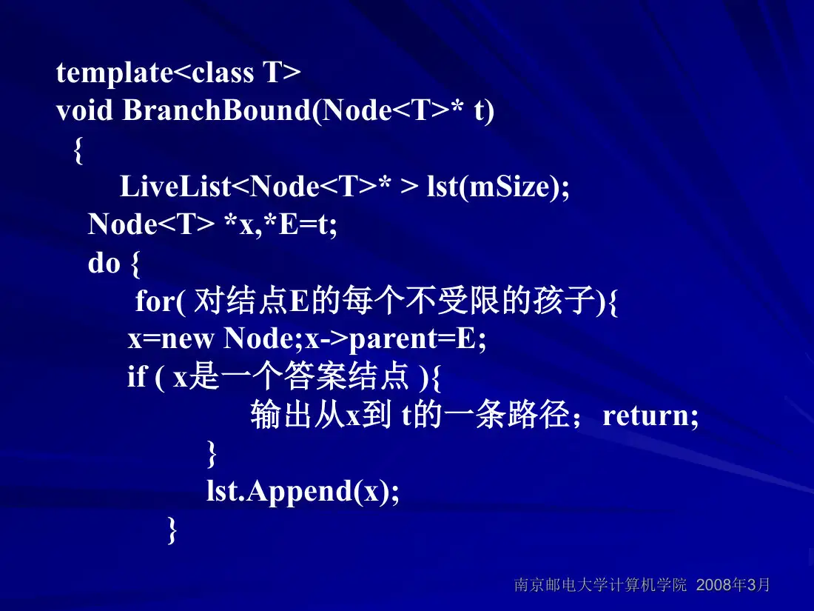

原文：

template<class T> void BranchBound(Node<T>\* t)

LiveList<Node<T>\* > lst(mSize); Node<T> \*x,\*E=t; do {

for( 对结点E的每个不受限的孩子){x=new Node;x->parent=E;if ( x是一个答案结点 ){输出从x到 t的一条路径；return;

lst.Append(x);

南京邮电大学计算机学院 2008年3月

### if(lst.IsEmpty()){cout<<“没有答案结点”；return；

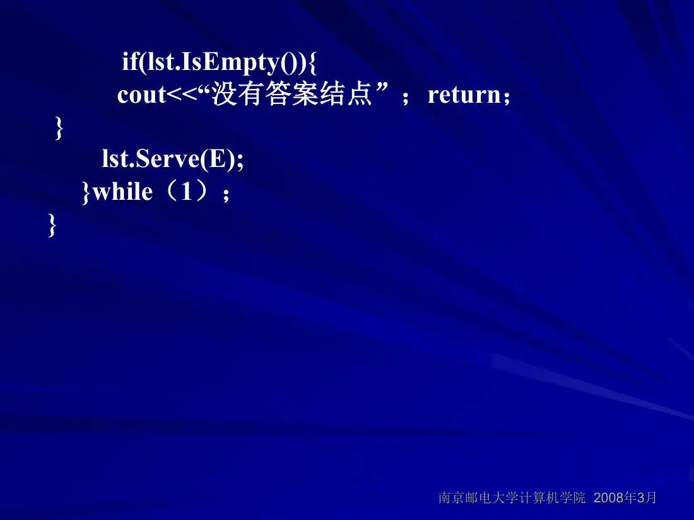

原文：

if(lst.IsEmpty()){cout<<“没有答案结点”；return；

lst.Serve(E);}while（1）；

南京邮电大学计算机学院 2008年3月

### 9.1.2 LC分枝限界法

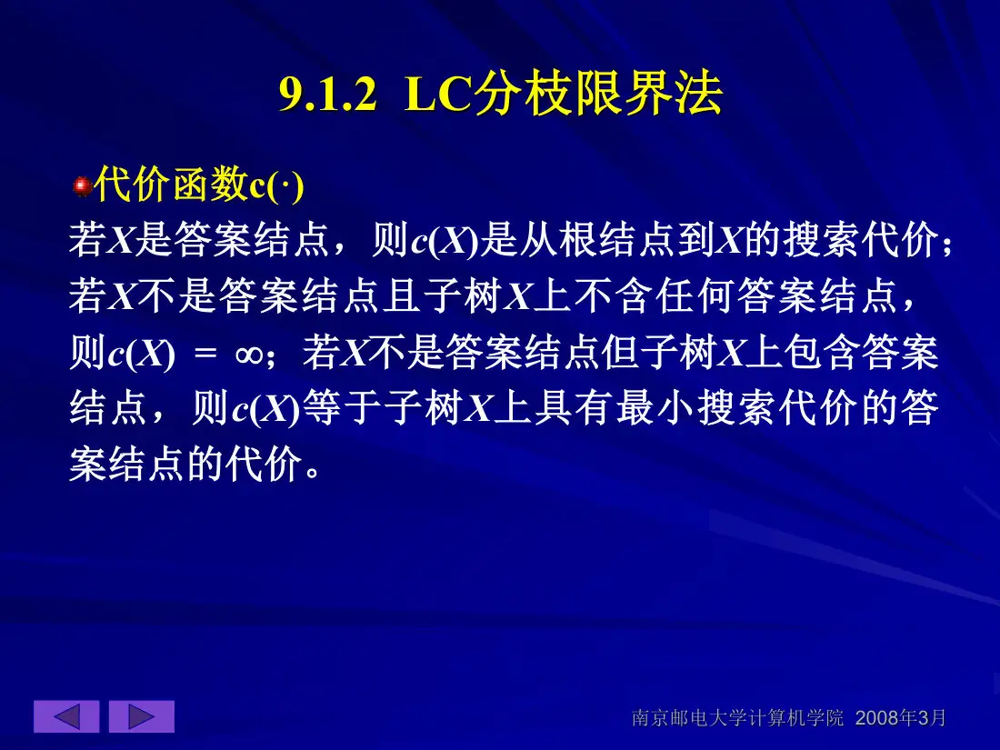

原文：

9.1.2 LC分枝限界法

若X是答案结点，则c(X)是从根结点到X的搜索代价；若X不是答案结点且子树X上不含任何答案结点，则c(X) = ；若X不是答案结点但子树X上包含答案结点，则c(X)等于子树X上具有最小搜索代价的答案结点的代价。

南京邮电大学计算机学院 2008年3月

### 南京邮电大学计算机学院 2008年3月

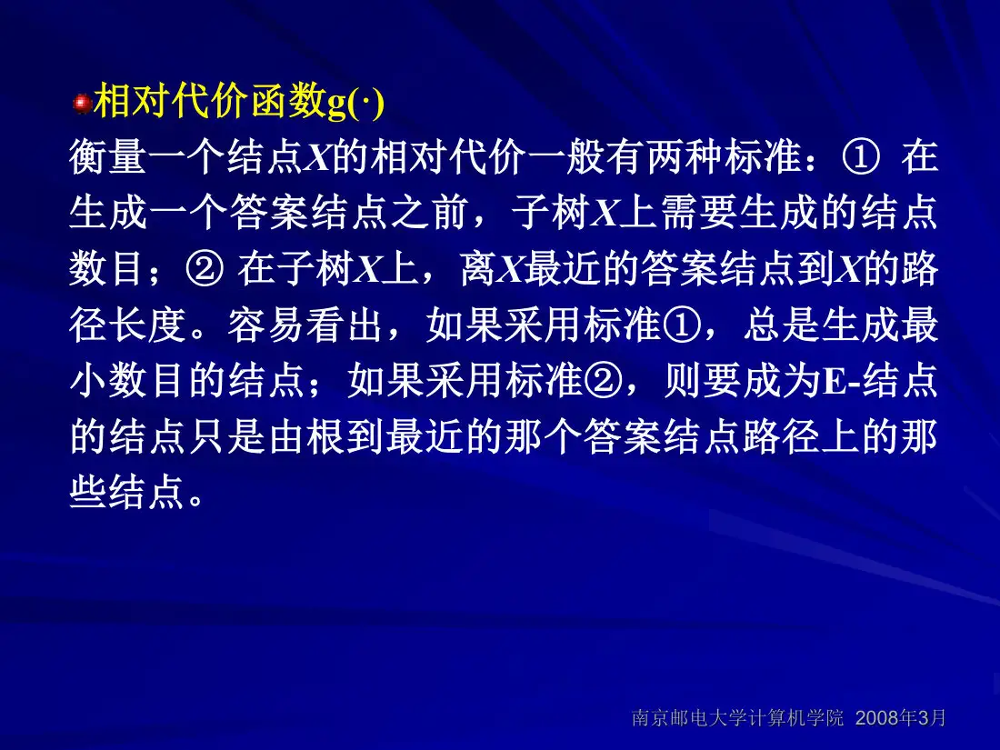

原文：

衡量一个结点X的相对代价一般有两种标准：① 在生成一个答案结点之前，子树X上需要生成的结点数目；② 在子树X上，离X最近的答案结点到X的路径长度。容易看出，如果采用标准①，总是生成最小数目的结点；如果采用标准②，则要成为E-结点的结点只是由根到最近的那个答案结点路径上的那些结点。

南京邮电大学计算机学院 2008年3月

### 南京邮电大学计算机学院 2008年3月

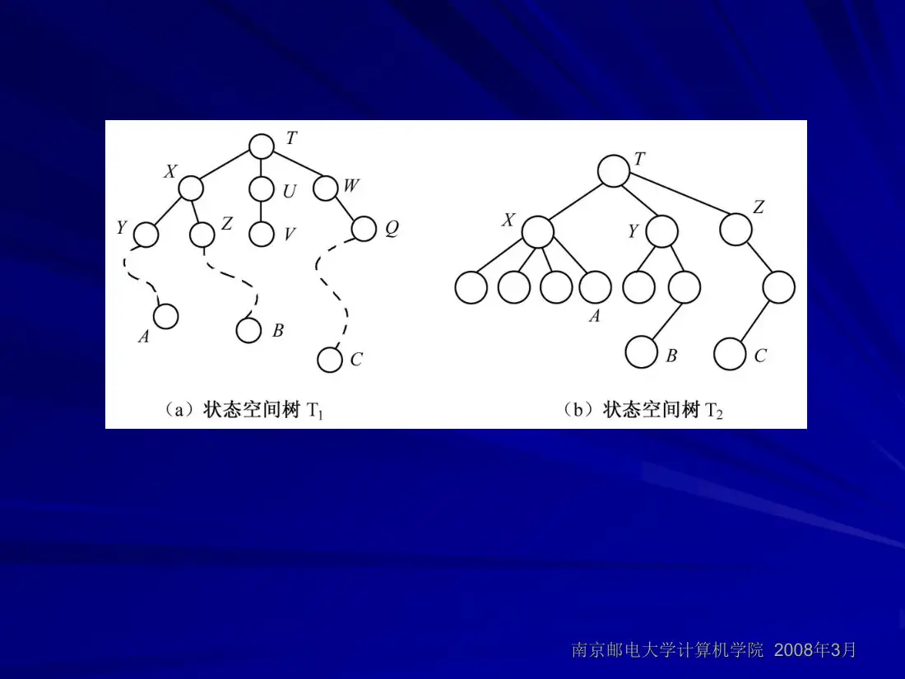

原文：

南京邮电大学计算机学院 2008年3月

### 相对代价估计函数ĝ(.)

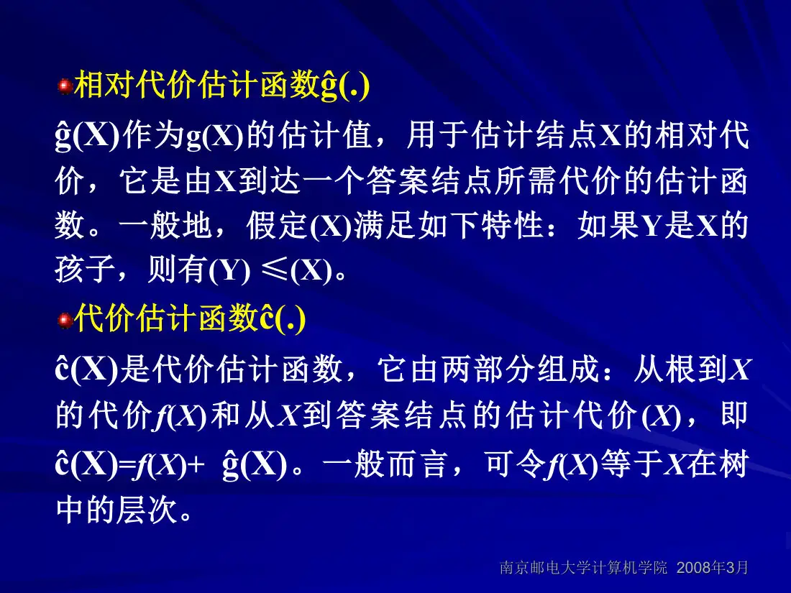

原文：

相对代价估计函数ĝ(.)

ĝ(X)作为g(X)的估计值，用于估计结点X的相对代价，它是由X到达一个答案结点所需代价的估计函数。一般地，假定(X)满足如下特性：如果Y是X的孩子，则有(Y) ≤(X)。

代价估计函数ĉ(.)

ĉ(X)是代价估计函数，它由两部分组成：从根到X的代价f(X)和从X到答案结点的估计代价(X)，即ĉ(X)=f(X)+ ĝ(X)。一般而言，可令f(X)等于X在树中的层次。

南京邮电大学计算机学院 2008年3月

### 9.1.3 15谜问题

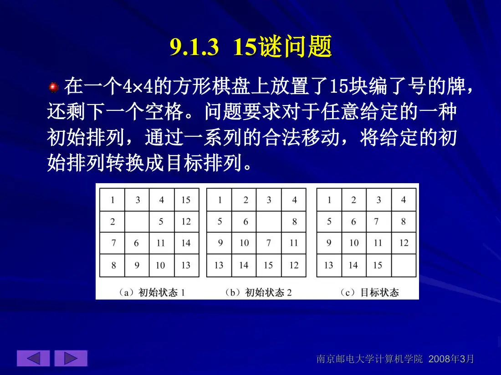

原文：

9.1.3 15谜问题

在一个44的方形棋盘上放置了15块编了号的牌，还剩下一个空格。问题要求对于任意给定的一种初始排列，通过一系列的合法移动，将给定的初始排列转换成目标排列。

<table><tr><td>1</td><td>3</td><td>4</td><td>15</td></tr><tr><td>2</td><td></td><td>5</td><td>12</td></tr><tr><td>7</td><td>6</td><td>11</td><td>14</td></tr><tr><td>8</td><td>9</td><td>10</td><td>13</td></tr></table>
(a) 初始状态1

<table><tr><td>1</td><td>2</td><td>3</td><td>4</td></tr><tr><td>5</td><td>6</td><td></td><td>8</td></tr><tr><td>9</td><td>10</td><td>7</td><td>11</td></tr><tr><td>13</td><td>14</td><td>15</td><td>12</td></tr></table>
(b) 初始状态2

<table><tr><td>1</td><td>2</td><td>3</td><td>4</td></tr><tr><td>5</td><td>6</td><td>7</td><td>8</td></tr><tr><td>9</td><td>10</td><td>11</td><td>12</td></tr><tr><td>13</td><td>14</td><td>15</td><td></td></tr></table>
(c) 目标状态

△

南京邮电大学计算机学院 2008年3月

### 南京邮电大学计算机学院 2008年3月

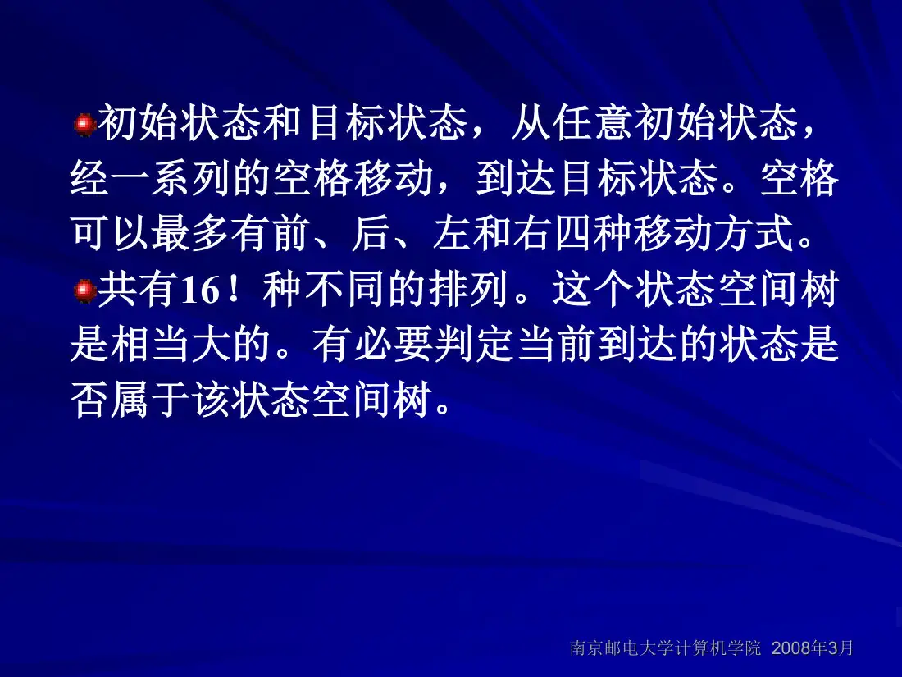

原文：

初始状态和目标状态，从任意初始状态，经一系列的空格移动，到达目标状态。空格可以最多有前、后、左和右四种移动方式。共有16！种不同的排列。这个状态空间树是相当大的。有必要判定当前到达的状态是否属于该状态空间树。

南京邮电大学计算机学院 2008年3月

### 定理9-1 对给定的初始状态，当且仅当

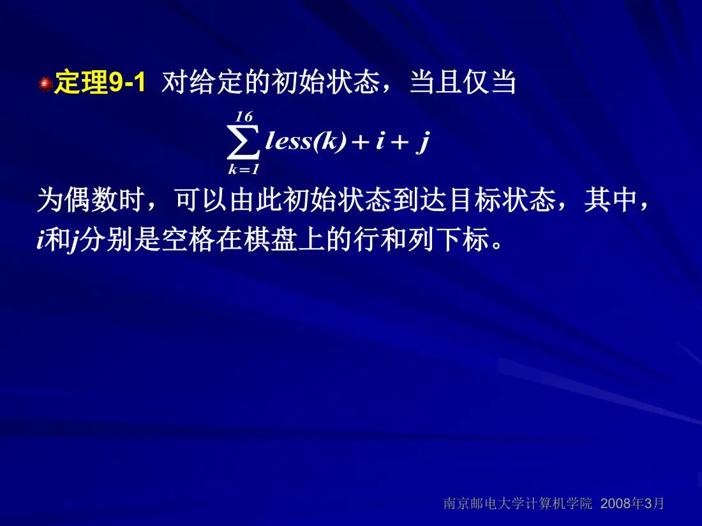

原文：

定理9-1 对给定的初始状态，当且仅当

$$
\sum_ {k = 1} ^ {1 6} \operatorname{less} (k) + i + j
$$

为偶数时，可以由此初始状态到达目标状态，其中，i和j分别是空格在棋盘上的行和列下标。

南京邮电大学计算机学院 2008年3月

### 15谜问题的部分状态空间树(FIFOBB)

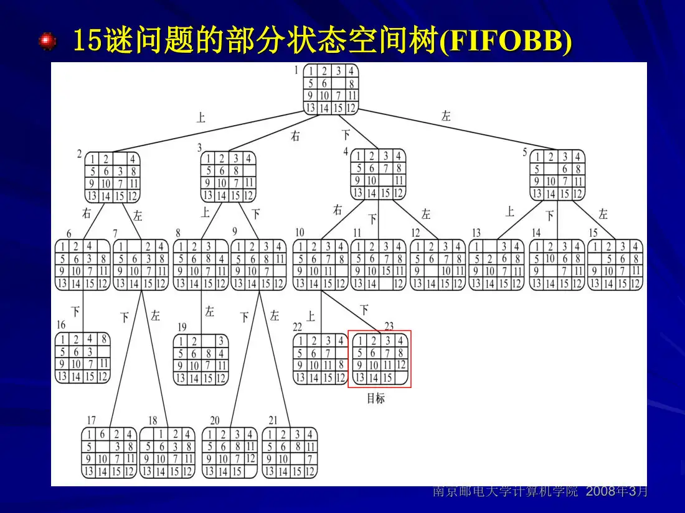

原文：

15谜问题的部分状态空间树(FIFOBB)

南京邮电大学计算机学院 2008年3月

### 15谜问题的部分状态空间树(LCBB)

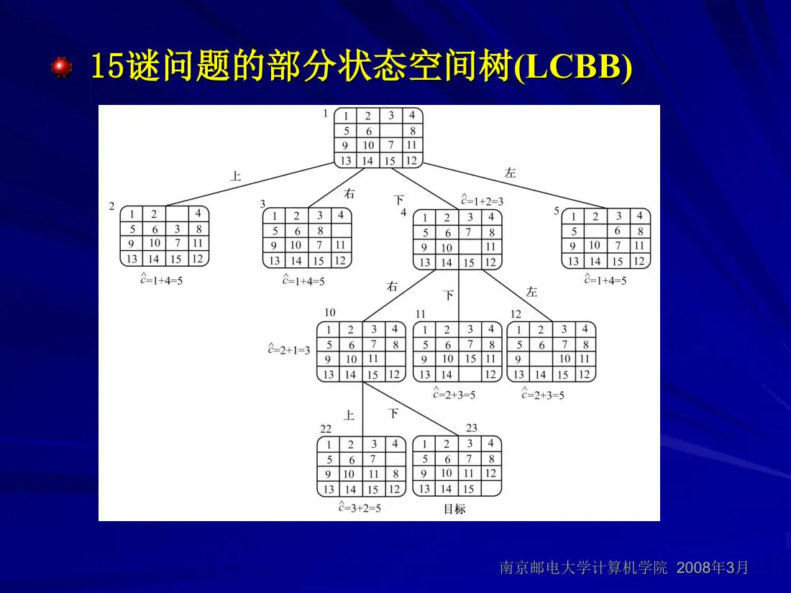

原文：

15谜问题的部分状态空间树(LCBB)

南京邮电大学计算机学院 2008年3月

### 9.2 求最优解的分枝限界法

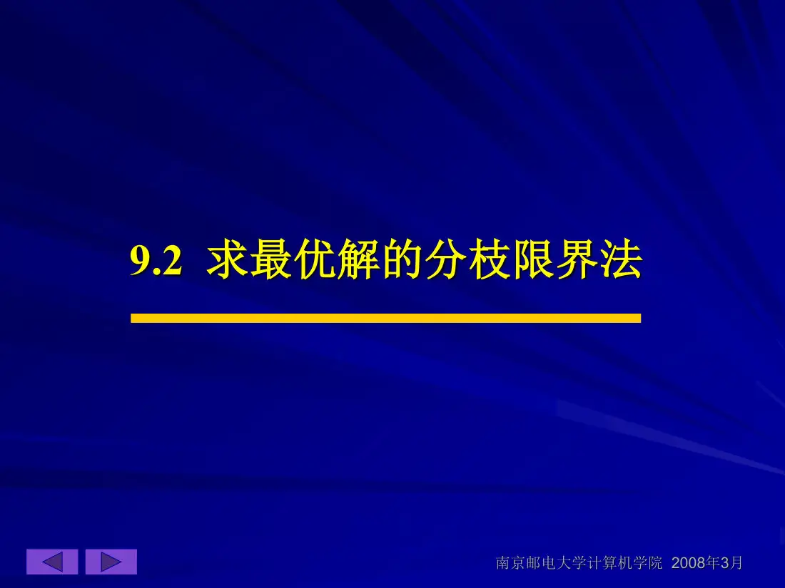

原文：

9.2 求最优解的分枝限界法

△

南京邮电大学计算机学院 2008年3月

### 9.2.1 上下界函数

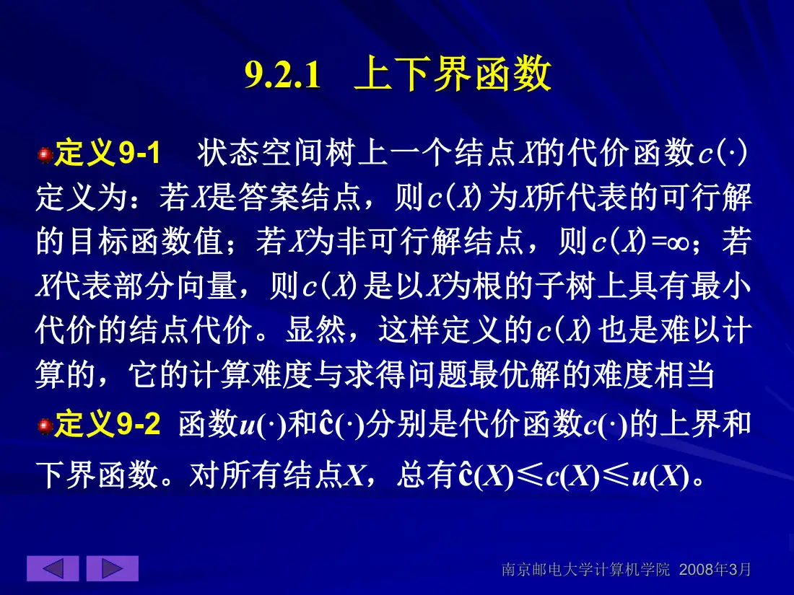

原文：

9.2.1 上下界函数

定义9-1 状态空间树上一个结点X的代价函数c(·)定义为：若X是答案结点，则c(X)为X所代表的可行解的目标函数值；若X为非可行解结点，则 $\mathrm { c } \bullet ( \bullet , \bullet ) = \mathrm { c } \bullet$ 若代表部分向量，则 ( )是以 为根的子树上具有最小代价的结点代价。显然，这样定义的c(X)也是难以计算的，它的计算难度与求得问题最优解的难度相当定义9-2 函数u(·)和ĉ(·)分别是代价函数c(·)的上界和下界函数。对所有结点X，总有ĉ $( 1 0 - 1 0 ) \div ( 2 0 - 9 ) = ( 1 1 0 - 9 )$

南京邮电大学计算机学院 2008年3月

### 基于上下界函数的分枝限界法的限界方法

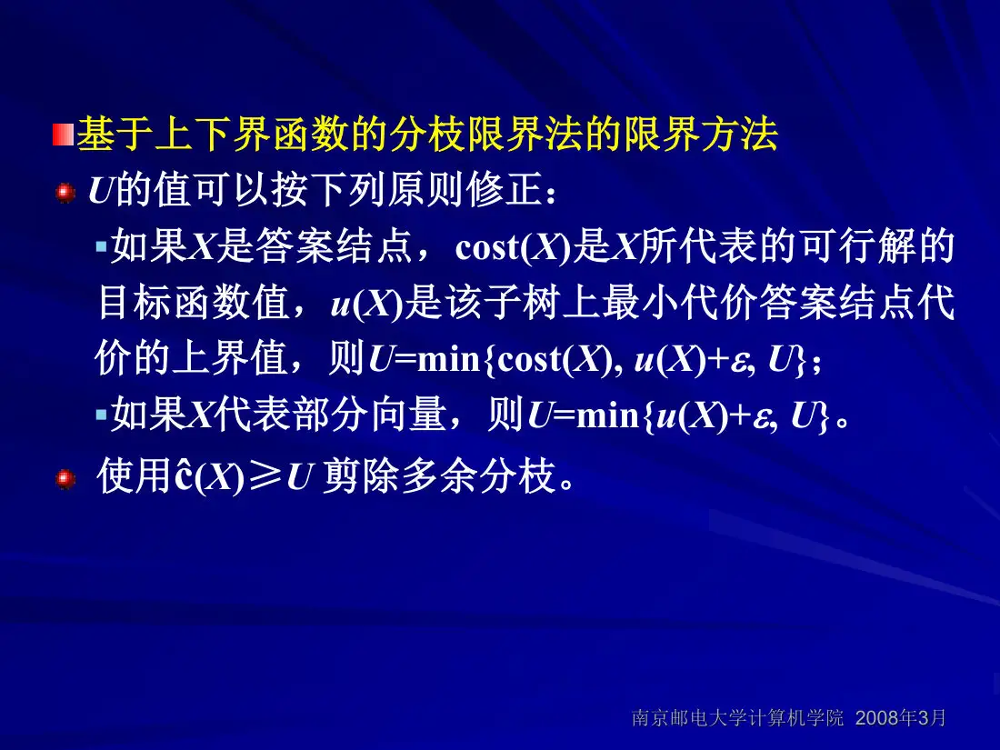

原文：

基于上下界函数的分枝限界法的限界方法

U的值可以按下列原则修正：▪如果X是答案结点，cost(X)是X所代表的可行解的目标函数值，u(X)是该子树上最小代价答案结点代价的上界值，则 $\langle D | \widehat { \operatorname { m i n h } } | \rangle \langle \operatorname { w i n h } | \langle \dot { \psi } , \dot { \psi } \rangle | \langle \dot { \psi } , \dot { \psi } | | \psi \rangle | \langle \dot { \psi } , \dot { \psi } | | \psi \rangle$ ▪如果X代表部分向量，则 $U _ { 2 } = 1 1 1 1 1 1 0 : 1 1 0 0 : 9 : 1 : 1 0 : 1 : 1 0 :$ 使用ĉ $\textcircled { + } \textcircled { + } \textcircled { = } \textcircled { + }$ 剪除多余分枝。

南京邮电大学计算机学院 2008年3月

### 9.2.2 FIFO分枝限界法

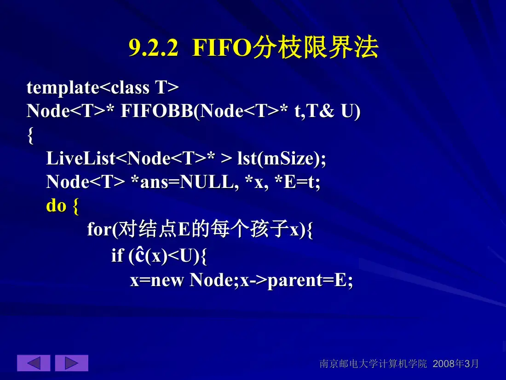

原文：

9.2.2 FIFO分枝限界法

template<class T> Node<T>\* FIFOBB(Node<T>\* t,T& U)

LiveList<Node<T>\* > lst(mSize); Node<T> \*ans=NULL, \*x, \*E=t; do {

for(对结点E的每个孩子x){if (ĉ(x)<U){x=new Node;x->parent=E;

南京邮电大学计算机学院 2008年3月

### 南京邮电大学计算机学院 2008年3月

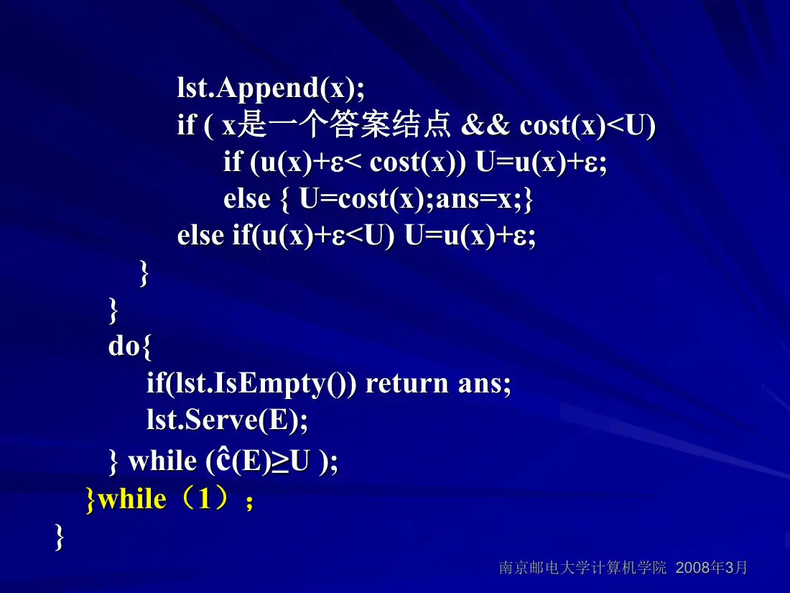

原文：

lst.Append(x);if ( x是一个答案结点 && cost(x)<U)if (u(x)+ε< cost(x)) U=u(x)+ε;else { U=cost(x);ans=x;}else if(u(x)+ε<U) U=u(x)+ε;

if(lst.IsEmpty()) return ans;lst.Serve(E);} while (ĉ(E)≥U );}while（1）；

南京邮电大学计算机学院 2008年3月

### 南京邮电大学计算机学院 2008年3月

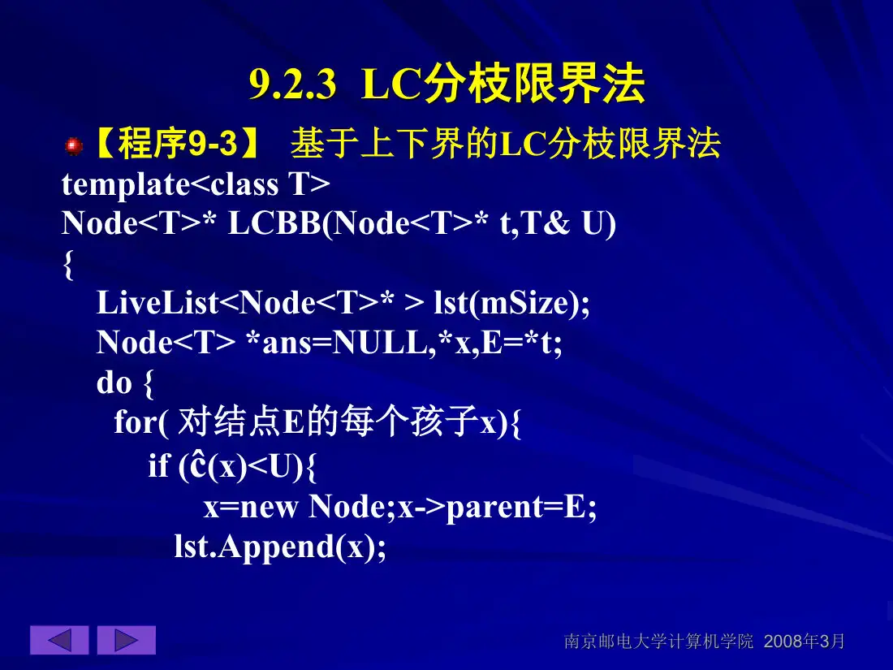

原文：

9.2.3 LC分枝限界法【程序9-3】 基于上下界的LC分枝限界法template<class T>Node<T>\* LCBB(Node<T>\* t,T& U)

LiveList<Node<T>\* > lst(mSize); Node<T> \*ans=NULL,\*x,E=\*t; do {

for( 对结点E的每个孩子x){if (ĉ(x)<U){x=new Node;x->parent=E;lst.Append(x);

南京邮电大学计算机学院 2008年3月

### else return ans;}while（1）；

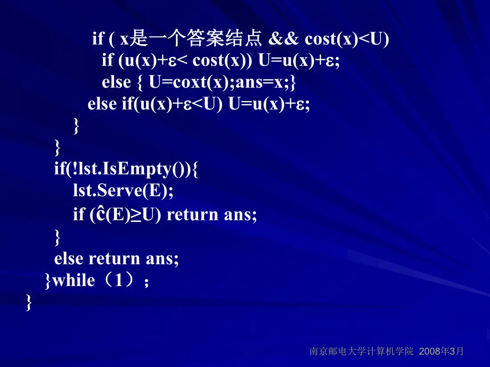

原文：

if ( x是一个答案结点 && cost(x)<U)if (u(x)+ε< cost(x)) U=u(x)+ε;else { U=coxt(x);ans=x;}else if(u(x)+ε<U) U=u(x)+ε;

if(!lst.IsEmpty()){ lst.Serve(E); if (ĉ(E)≥U) return ans;

else return ans;}while（1）；

南京邮电大学计算机学院 2008年3月

### 9.3 带时限的作业排序

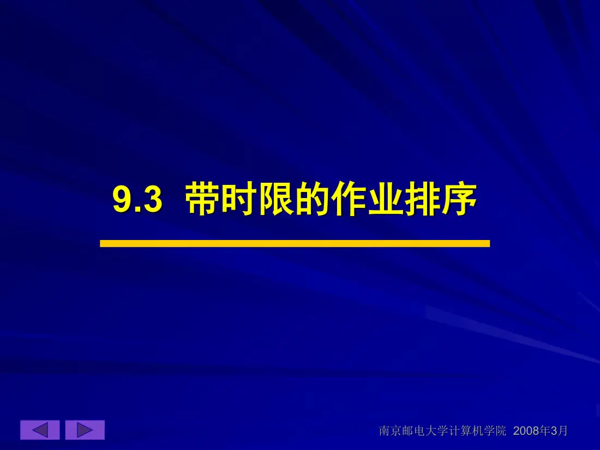

原文：

9.3 带时限的作业排序

△

南京邮电大学计算机学院 2008年3月

### 9.3.1 问题描述

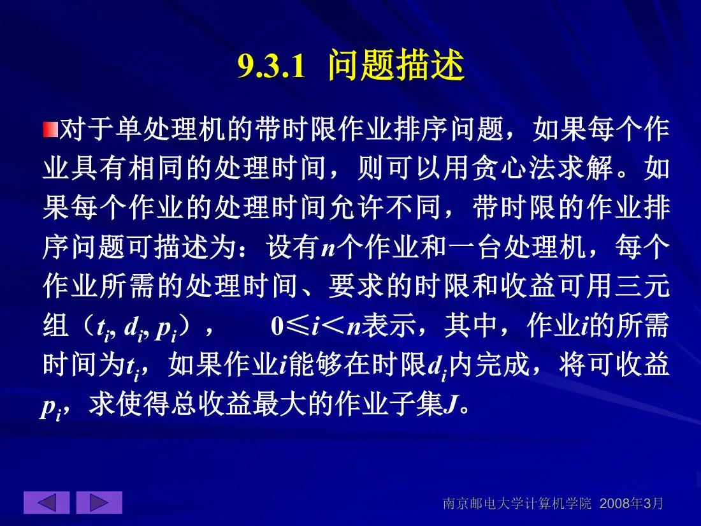

原文：

9.3.1 问题描述

对于单处理机的带时限作业排序问题，如果每个作业具有相同的处理时间，则可以用贪心法求解。如果每个作业的处理时间允许不同，带时限的作业排序问题可描述为：设有n个作业和一台处理机，每个作业所需的处理时间、要求的时限和收益可用三元组 $( 1 5 , 7 ) = 1 5$ 0≤i＜n表示，其中，作业i的所需时间为 $1 4 2$ 如果作业i能够在时限 $a = \frac { 1 } { 2 }$ 内完成，将可收益$1 4 2$ 求使得总收益最大的作业子集J。

南京邮电大学计算机学院 2008年3月

### 例9－1

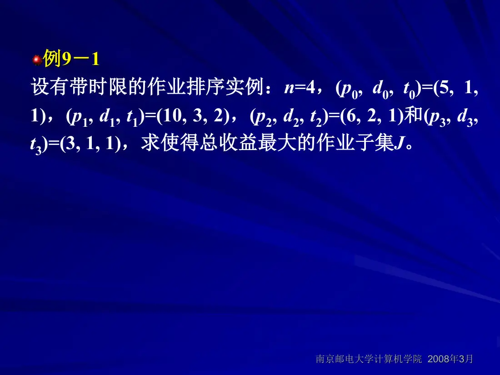

原文：

例9－1

设有带时限的作业排序实例：n=4， $( 1 ) ( 1 ) ( 1 ) ( 1 ) ( 1 ) = ( - 2 ) ( - 2 ) ( - 2 )$ 1)， $( 1 2 5 0 , 1 5 0 0 ) = ( 1 1 1 , 1 5 0 0 )$ $( 1 2 2 , 1 5 2 , 1 5 ) = ( 1 2 2 , 1 5 )$ 1)和 $( 1 2 - 2 ) \times 2 = 1 2$ $( \pmb { \mathscr { L } } ) = ( \pmb { \mathscr { L } } ) \pmb { \mathscr { L } } ( \pmb { \mathscr { L } } )$ ，求使得总收益最大的作业子集J。

南京邮电大学计算机学院 2008年3月

### 9.3.2 分枝限界法求解

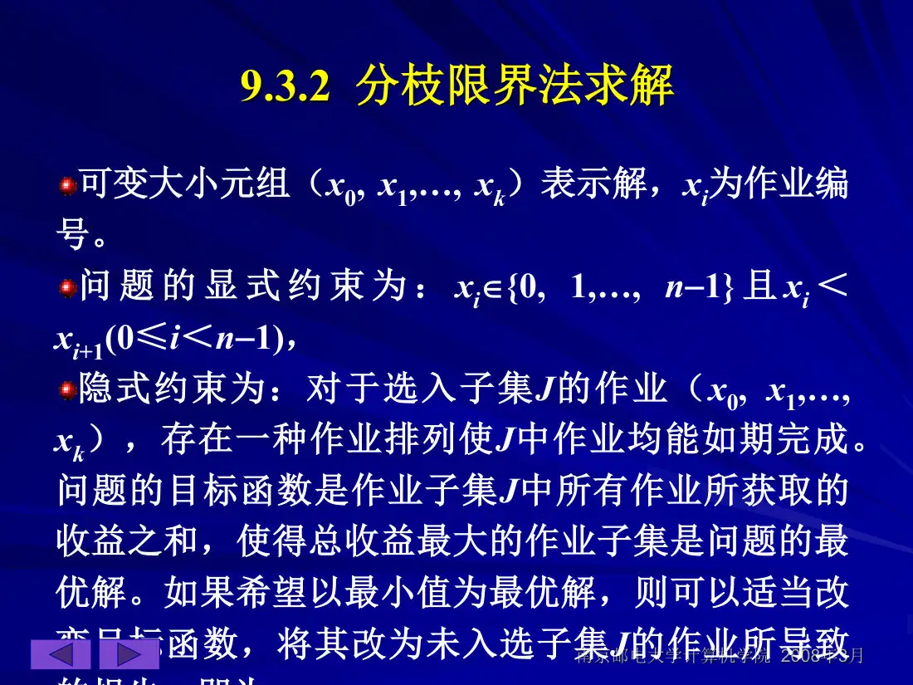

原文：

9.3.2 分枝限界法求解

可变大小元组 $( 4 , 7 ) = 1 2 , 7 , 9 , 9 , 1 2 , 9 , 1 2 , 9 , 9 , 9 , 9 , 9 , 9 , 9 , 9 , 9 , 9 , 9 , 9 , 9 , 9 , 9 , 9 , 9 , 9 , 9 , 9 , 9 , 9 , 9 , 9 , 9 , 9 , 9 , 9 , 9 , 9 , 9 , 9 , 9 , 9 , 9 , 9 , 9 , 9 , 9 , 9 , 9 , 9 , 9 , 9 , 9 , 9 , 9 , 9 , 9 , 9 , 9 , 9 , 9 , 9 , 9 , 9 , 9 , 9 , 9 , 9 , 9 , 9 , 9 , 9 , 9 , 9 , 9 , 9 , 9 , 9 , 9 , 9 , 9 , 9 , 9 , 9 , 9 , 9 , 9 , 9 , 9 , 9 , 9 , 9 , 9 , 9 , 9 , 9 , 9 , 9 , 9 , 9 , 9 , 9 , 9 , 9 , 9 , 9 , 9 , 9 , 9 , 9 , 9 , 9 , 9 , 9 , 9 , 9 , 9 , 9 , 9 , 9 , 9 , 9 , 9 , 9 , 9 , 9 , 9 , 9 , 9 , 9 , 9 , 9 , 9 , 9 , 9 , 9 , 9 , 9 , 9 , 9 , 9 , 9 , 9 , 9 , 9 , 9 , 9 , 9 , 9 , 9 , 9 , 9 , 9 , 9 , 9 , 9 , 9 , 9 , 9 , 9 , 9 , 9 , 9 , 9 , 9 , 9 , 9 , 9 , 9 , 9 , 9 , 9 , 9 , 9 , 9 , 9 , 9 , 9 , 9 , 9 , 9 , 9 , 9 , 9 , 9 , 9 , 9 , 9 , 9 , 9 , 9 , 9 , 9 , 9 , 9 , 9 , 9 , 9 , 9 , 9 , 9 , 9 , 9 , 9 , 9 , 9 , 9 , 9 , 9 , 9 , 9 , 9 , 9 9 , 9 , 9 , 9 , 9 , 9 , 9 , 9 , 9 , 9 , 9 9 , 9 , 9 , 9 , 9 , 9 9 , 9 , 9 , 9 , 9 , 9 , 9 9 , 9 , 9 , 9 , 9 , 9 9 , 5 9 , 9 , 9 , 9 5 0 , 9 , 5 9 , 9 5 0 , 9 , 0 9 5 , 0 0 0 0 , 9 , 0 9 , 0 0 0 , 0 0 0 0 0 , 0 0 0 , 9 0 , 9 0 , 0 0 0 0 , 0 0 0 0 , 0 0 0 0 , 0 0 0 , 0 0 0 0 0 , 0 0 0 0 ,$ 表示解，x为作业编号。问 题 的 显 式 约 束 为 ： x {0, 1,…, n−1} 且 $x = - \frac { 1 } { 2 }$ $2 0 0 0 0 0 0 0 0 0 0 0 0 0 0 0 0 0 0 0 0 0 0 0 0 0 0 0 0 0 0 0 0 0 0 0 0 0 0 0 0 0 0 0 0 0 0 0 0 0 0 0 0 0 0 0 0 0 0 0 0 0 0 0 0 0 0 0 0 0 0 0 0 0 0 0 0 0 0 0 0 0 0 0 0 0 0 0 0 0 0 0 0 0 0 0 0 0 0 0 0 0 0 0 0 0 0 0 0 0 0 0 0 0 0 0 0 0 0 0 0 0$ 隐式约束为：对于选入子集J的作业 $( 4 0 - 1 ) \times ( 1 2 0 - 1 ) \times ( 1 2 0 - 1 ) \times ( 2 0 - 1 ) \times ( 2 0 - 1 ) \times ( 2 0 - 1 ) \times ( 2 0 - 1 ) \times ( 2 0 - 1 ) \times ( 2 0 - 1 ) \times ( 2 0 - 1 ) \times ( 2 0 - 1 ) \times ( 2 0 - 1 ) \times ( 2 0 - 1 ) \times ( 2 0 - 1 )$ $2 \times 2 = 1 2$ ，存在一种作业排列使J中作业均能如期完成。问题的目标函数是作业子集J中所有作业所获取的收益之和，使得总收益最大的作业子集是问题的最优解。如果希望以最小值为最优解，则可以适当改南京邮电大学计算机学院 2008年3变目标函数，将其改为未入选子集J的作业所导致可变大小元组 $( \frac { 1 } { 2 } , \frac { 1 } { 3 } ) = \frac { 1 } { 2 } ( \frac { 1 } { 2 } + \frac { 1 } { 3 } ) = \frac { 1 } { 3 }$ 表示解，x为作业编号。显式约束为： $A = ( 1 ) \because \angle B = \angle C = \angle B = \angle C = \angle C \angle B = \angle C$ 隐式约束为：对于选入子集J的作业 $( 4 , 7 ) = ( 7 , 7 ) = ( 7 , 7 )$ 存在一种作业排列使J中作业均能如期完成。问题的目标函数是作业子集J中所有作业所获取的收益之和，使得总收益最大的作业子集是问题的最优解。如果希望以最小值为最优解，则可以适当改变目标函数，将其改为未入选子集J的作业所导致的损失，即为：

### min{ ∑pi} i∉J,i=1..n

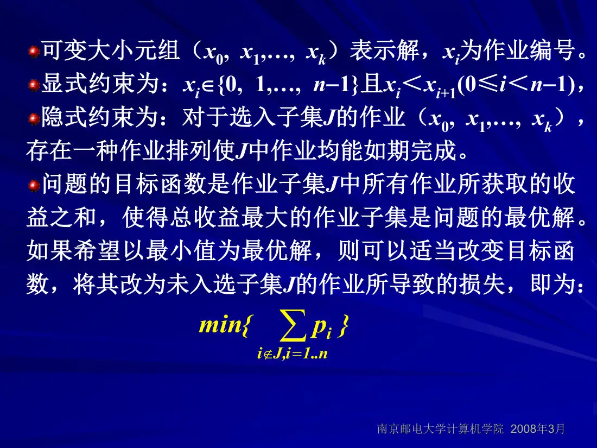

原文：

min{ ∑pi} i∉J,i=1..n

南京邮电大学计算机学院 2008年3月

### ĉ(X)

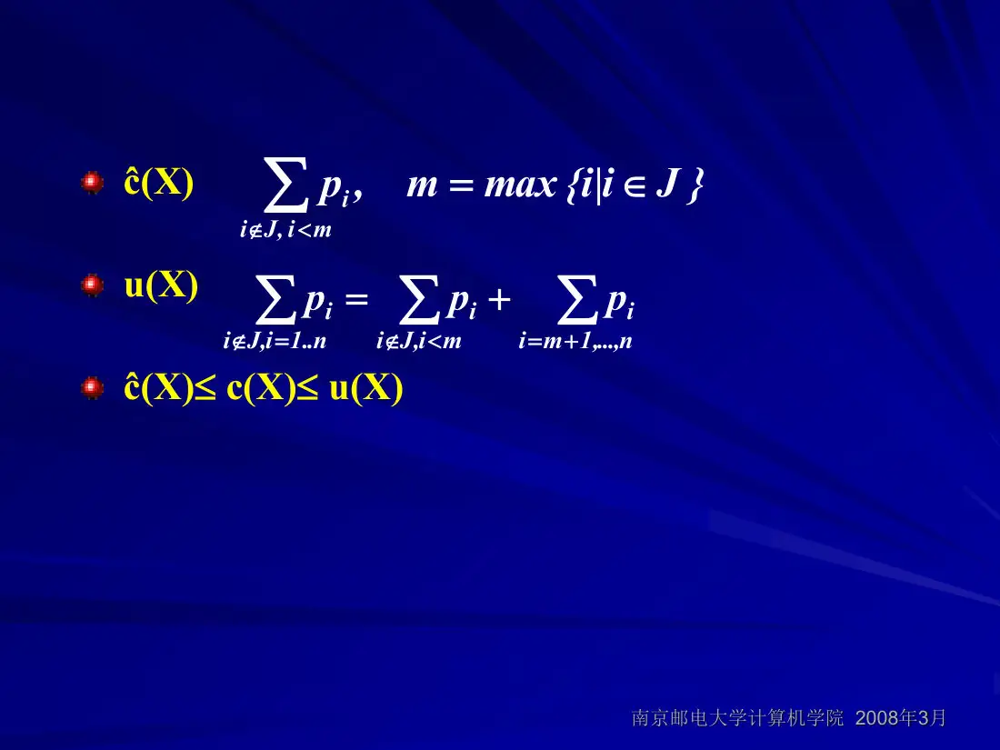

原文：

ĉ(X)

u(X)

$$
\sum_ {i \notin J, i = 1.. n} p _ {i} = \sum_ {i \notin J, i <   m} p _ {i} + \sum_ {i = m + 1, \dots , n} p _ {i}
$$

ê(X)≤ c(X)≤ u(X)

南京邮电大学计算机学院 2008年3月

### 可变大小元组状态空间树

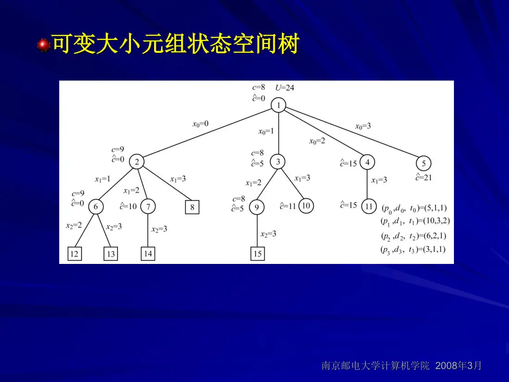

原文：

可变大小元组状态空间树

南京邮电大学计算机学院 2008年3月

### 9.3.3 带时限作业排序算法

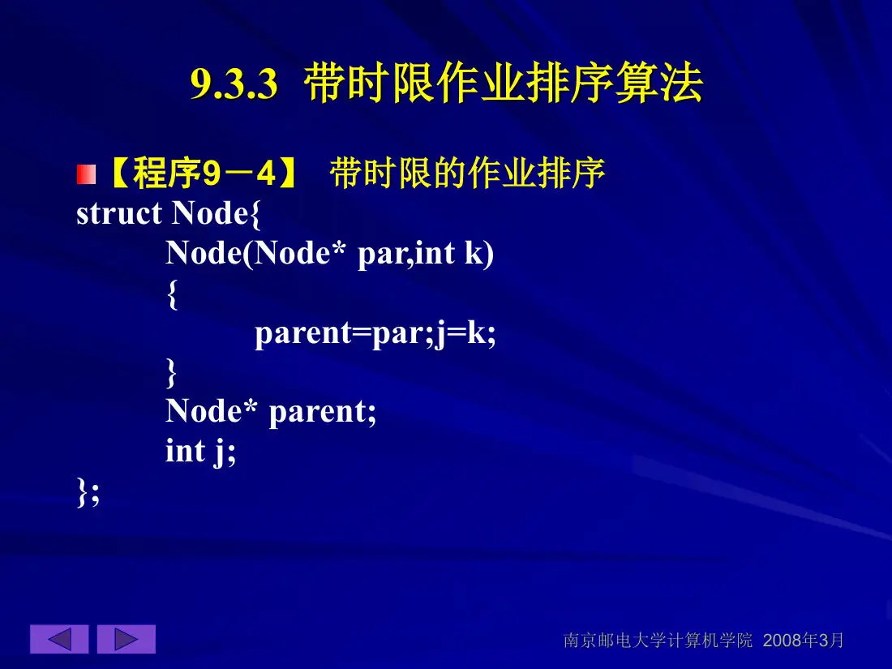

原文：

9.3.3 带时限作业排序算法

【程序9－4】 带时限的作业排序

struct Node{ Node(Node\* par,int k)

parent=par;j=k;

Node\* parent;

int j;

南京邮电大学计算机学院 2008年3月

### T prof,loss; Node\* ptr;

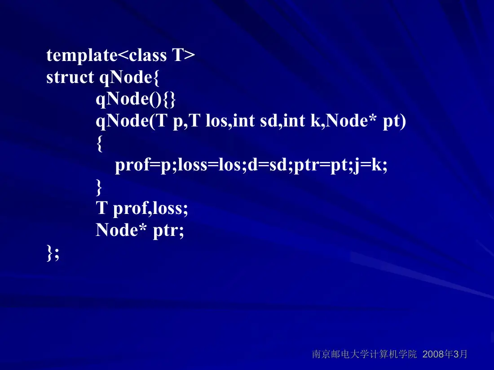

原文：

T prof,loss; Node\* ptr;

南京邮电大学计算机学院 2008年3月

### template class JS{ public:

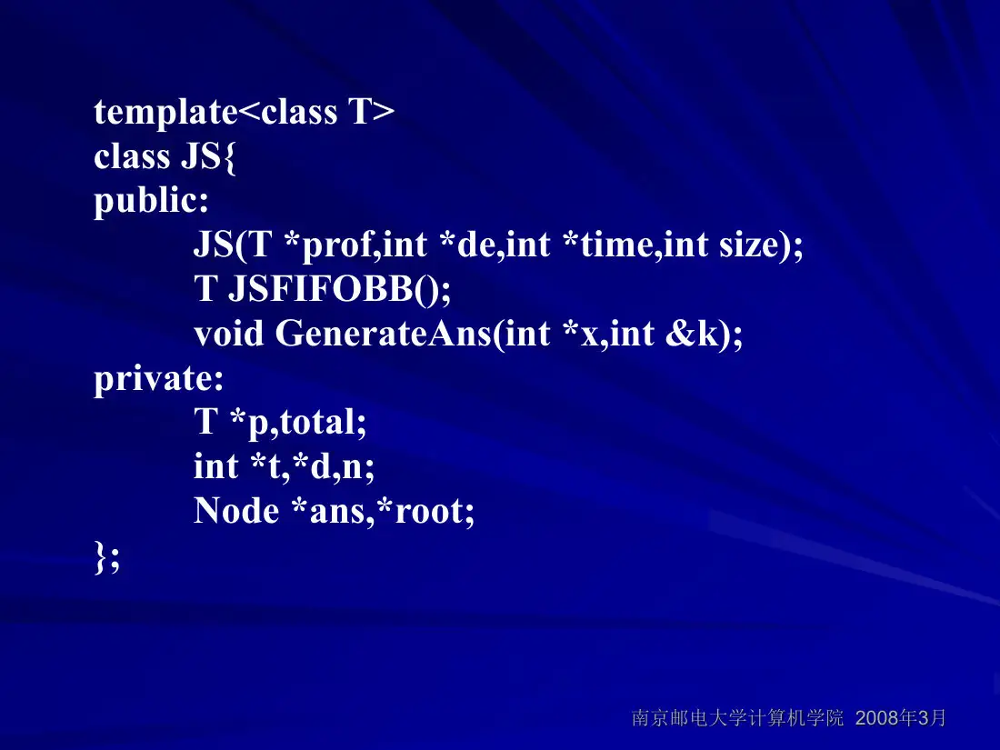

原文：

template<class T> class JS{ public:

JS(T \*prof,int \*de,int \*time,int size); T JSFIFOBB(); void GenerateAns(int \*x,int &k);

private:

T \*p,total; int \*t,\*d,n; Node \*ans,\*root;

南京邮电大学计算机学院 2008年3月

### template T JS::JSFIFOBB ()

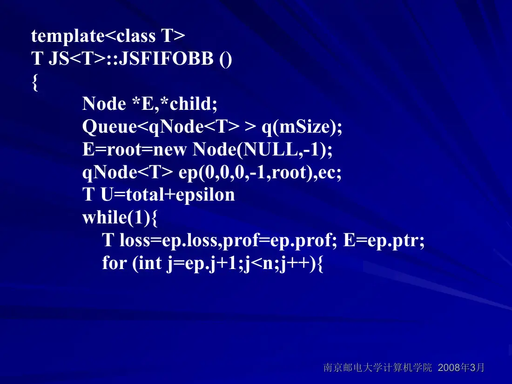

原文：

template<class T> T JS<T>::JSFIFOBB ()

Node \*E,\*child; Queue<qNode<T> > q(mSize); E=root=new Node(NULL,-1); qNode<T> ep(0,0,0,-1,root),ec; T U=total+epsilon while(1){ T loss=ep.loss,prof=ep.prof; E=ep.ptr; for (int j=ep.j+1;j<n;j++){

南京邮电大学计算机学院 2008年3月

### loss=loss+p[j];

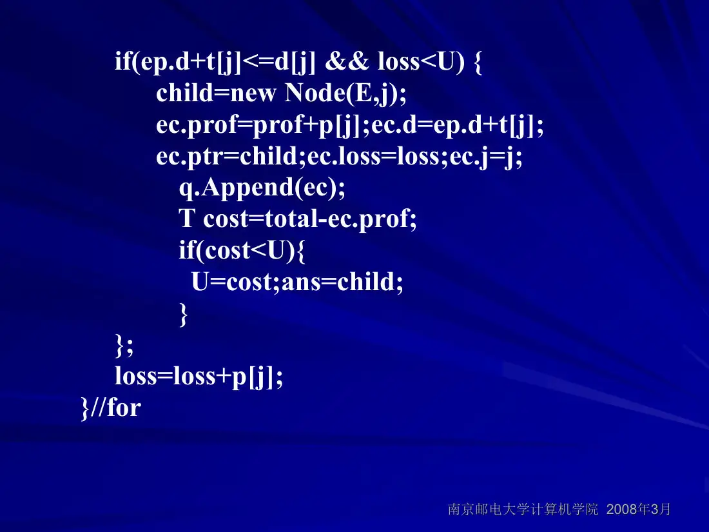

原文：

if(ep.d+t[j]<=d[j] && loss<U) { child=new Node(E,j); ec.prof=prof+p[j];ec.d=ep.d+t[j]; ec.ptr=child;ec.loss=loss;ec.j=j; q.Append(ec); T cost=total-ec.prof; if(cost<U){ U=cost;ans=child;

loss=loss+p[j];

}//for

南京邮电大学计算机学院 2008年3月

### }//while

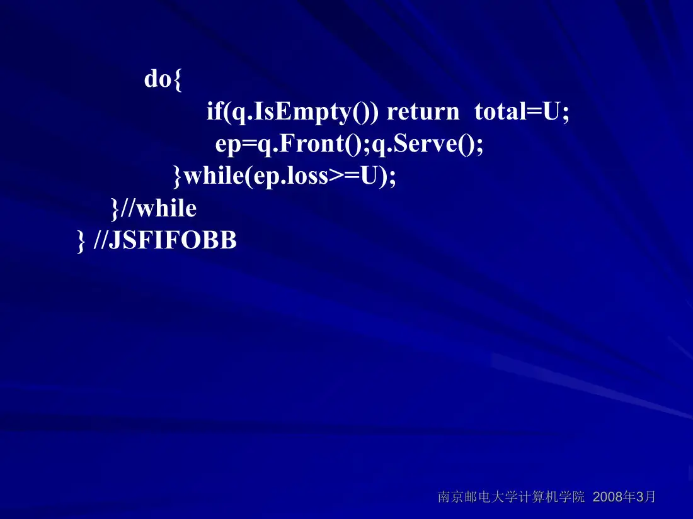

原文：

if(q.IsEmpty()) return total=U; ep=q.Front();q.Serve(); }while(ep.loss>=U);

}//while

} //JSFIFOBB

do{

南京邮电大学计算机学院 2008年3月

### 9.4 0/1背包

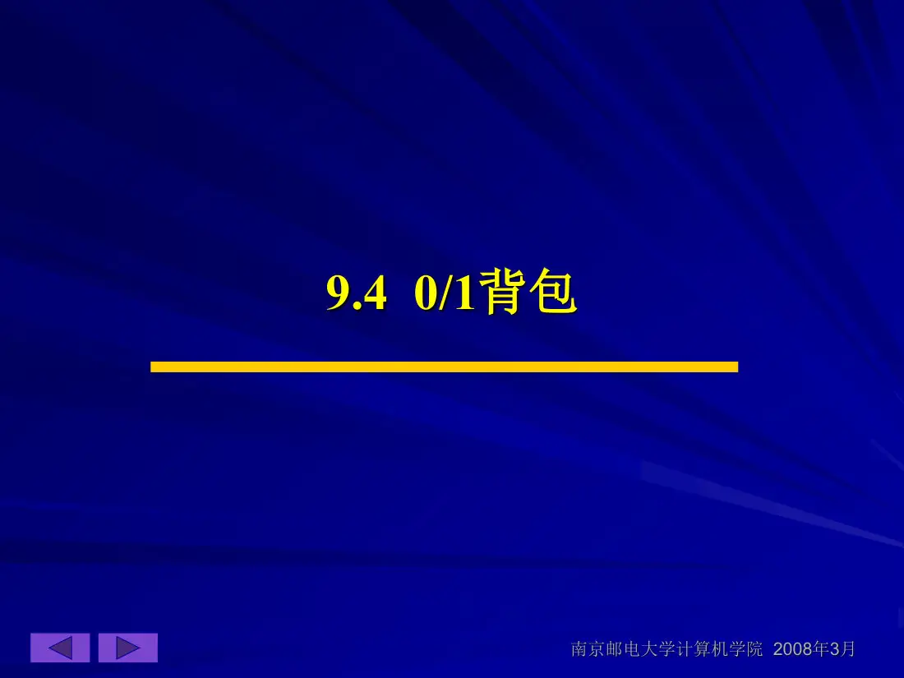

原文：

9.4 0/1背包

△

南京邮电大学计算机学院 2008年3月

### 9.4.1 问题描述

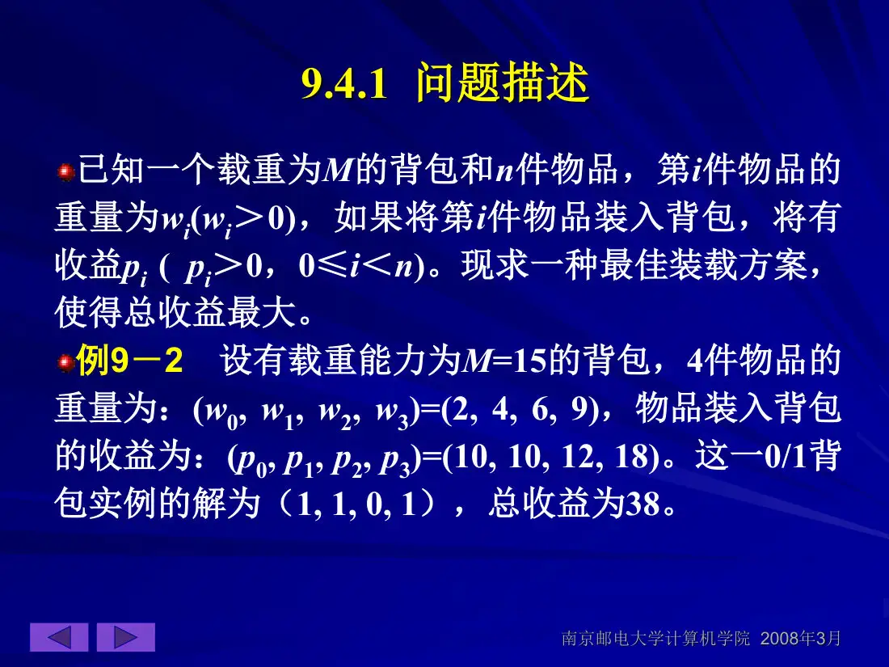

原文：

9.4.1 问题描述

已知一个载重为M的背包和n件物品，第i件物品的重量为 $1 2 0 0 0 0$ 如果将第i件物品装入背包，将有收益 $1 2 \times 1 2 = 1 1 2 ( c m ^ { 2 } )$ 。现求一种最佳装载方案，使得总收益最大。

例9－2 设有载重能力为M=15的背包，4件物品的重量为： $( 1 ) ( 1 2 0 - 1 0 0 ) \times ( 1 2 0 - 1 ) \times ( 1 2 0 - 1 ) \times ( 1 2 0 - 1 )$ 物品装入背包的收益为： $( 1 2 0 \times 2 0 \times 2 0 \times 2 0 = 1 1 1 0 0 ( c m ) \times 2 0 \times 2 0 )$ 。这一0/1背包实例的解为（1, 1,0, 1），总收益为38。

南京邮电大学计算机学院 2008年3月

### 9.4.2 分枝限界法求解

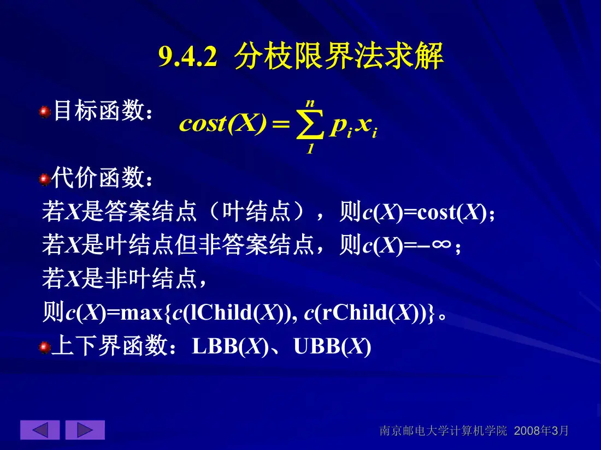

原文：

9.4.2 分枝限界法求解

目标函数： $( \frac { 1 } { 2 } ) \times ( \frac { 1 } { 2 } - \frac { 1 } { 3 } ) = \frac { 1 } { 2 } ( \frac { 1 } { 2 } - \frac { 1 } { 3 } )$

代价函数：若X是答案结点（叶结点），则 $\cos ( \theta - \theta ) = \cos ( \theta - \theta ) ( \theta - \theta )$ 若X是叶结点但非答案结点，则 $( 9 ( 9 3 9 ) = 1 0 0 0$ 若X是非叶结点，则 $[ \langle \Phi , \mathbf { g } \rangle ] = \langle \mathbf { 1 } \mathrm { R } \mathbf { 1 } \rangle , \mathbf { 4 } [ \langle \mathbf { d } \left( \mathbf { 1 } \right) \mathrm { i } \Pi \mathrm { ( \langle \Phi , \mathbf { g } \rangle ) } ] , \mathbf { 4 } [ \langle \mathbf { 1 } \mathrm { R } \mathbf { ( \Phi ) } \mathrm { i } \Pi \mathrm { ( \langle \Phi , \mathbf { g } \rangle ) } ] , \mathbf { 4 } [ \langle \mathbf { 1 } \mathrm { R } \mathbf { ( \Phi ) } \mathrm { i } \Pi \mathrm { ( \langle \Phi , \mathbf { g } \rangle ) } ] \mathrm { R } \mathbf { ( \Phi ) } , \mathbf { 4 } [ \mathbf { 1 } \mathrm { R } \mathbf { ( \Phi ) } \mathrm { R } \mathbf { ( \Phi ) } \mathrm { R } \mathbf { ( \Phi ) } ] \rangle .$ 上下界函数：LBB(X)、UBB(X)

南京邮电大学计算机学院 2008年3月

### 南京邮电大学计算机学院 2008年3月

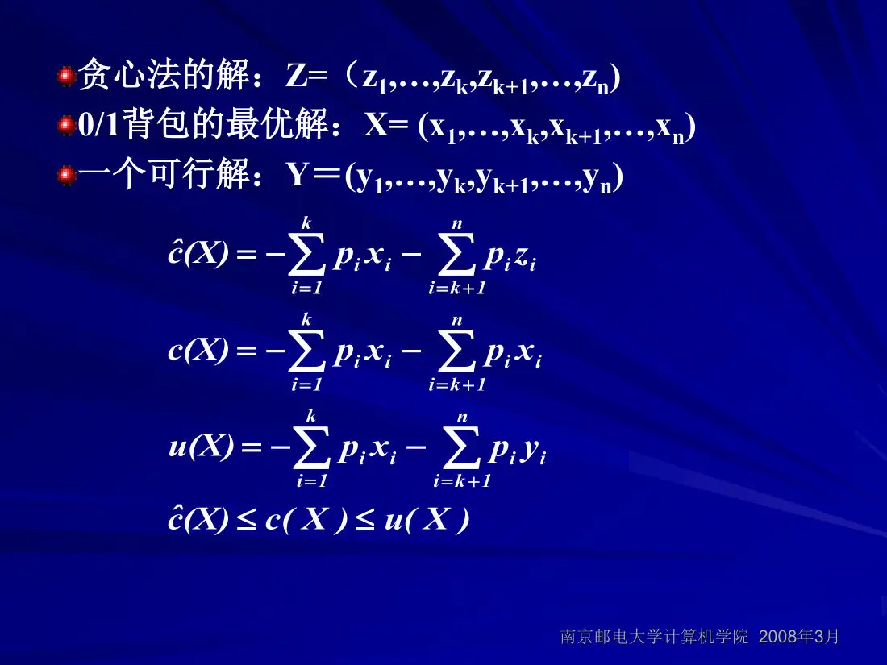

原文：

贪心法的解： $\angle B = \angle C _ { 1 } = \angle C _ { 2 } = \angle C _ { 1 } = \angle C _ { 2 } = \angle C _ { 2 } = 9 0 ^ { \circ }$ 0/1背包的最优解： $\therefore \frac { 1 } { 2 } = ( \frac { 1 } { 2 } , \frac { 1 } { 2 } , \frac { 1 } { 2 } , \frac { 1 } { 2 } , \frac { 1 } { 2 } , \frac { 1 } { 2 } )$ 一个可行解： $\therefore \angle C _ { 1 } = \angle C _ { 2 } = \angle A = \angle C _ { 2 } = \angle C _ { 2 } = \angle C _ { 2 } = 9 0 ^ { \circ }$ k n ê(X)=-∑ pixi − ∑ pizi i=1 i=k+1 k n c(X)=-∑p}x−∑pixi i=1 i=k+1 k n u(X) =-∑ pixi − ∑ piyi i=1 i=k+1 ê(X)≤c(X)≤u(X)

南京邮电大学计算机学院 2008年3月

### 9.4.3 0/1背包算法

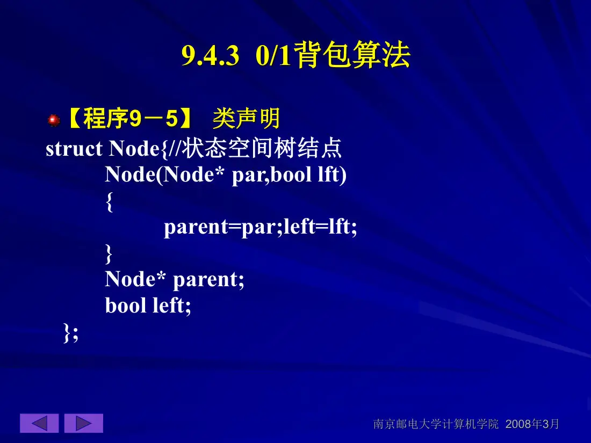

原文：

9.4.3 0/1背包算法

【程序9－5】 类声明struct Node{//状态空间树结点Node(Node\* par,bool lft)

parent=par;left=lft;

Node\* parent; bool left;

南京邮电大学计算机学院 2008年3月

### float cu;

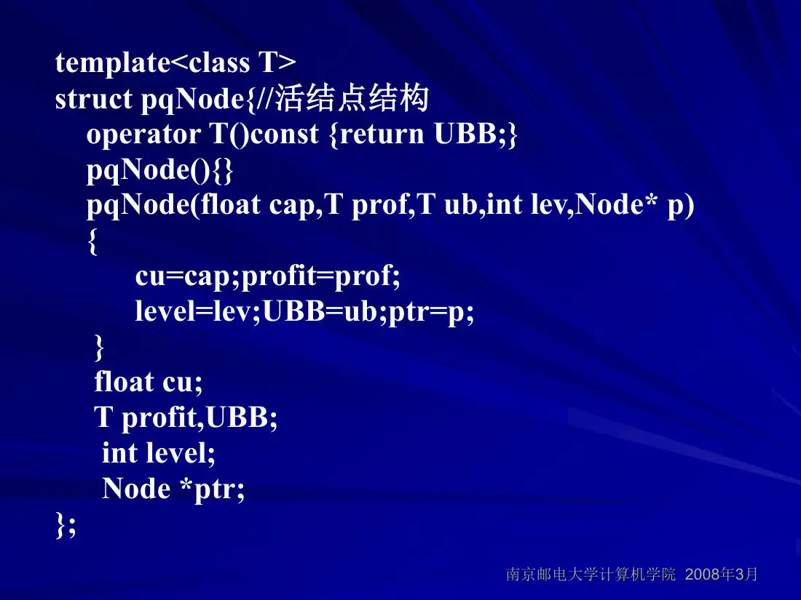

原文：

template<class T> struct pqNode{//活结点结构 operator T()const {return UBB;} pqNode(){} pqNode(float cap,T prof,T ub,int lev,Node\* p)

cu=cap;profit=prof; level=lev;UBB=ub;ptr=p;

float cu;

T profit,UBB;

int level;

Node \*ptr;

南京邮电大学计算机学院 2008年3月

### 南京邮电大学计算机学院 2008年3月

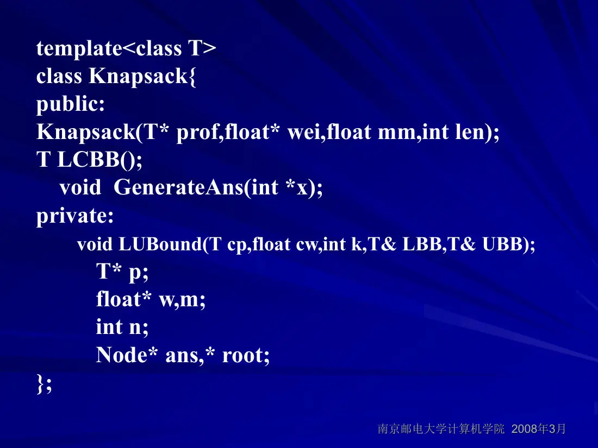

原文：

template<class T> class Knapsack{ public: Knapsack(T\* prof,float\* wei,float mm,int len); T LCBB(); void GenerateAns(int \*x);

void LUBound(T cp,float cw,int k,T& LBB,T& UBB); T\* p; float\* w,m; int n; Node\* ans,\* root;

南京邮电大学计算机学院 2008年3月

### 【程序9－6】上下界函数

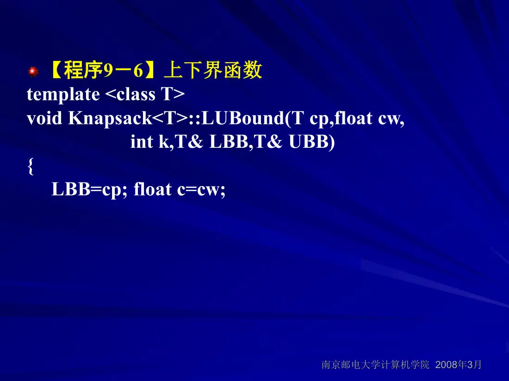

原文：

【程序9－6】上下界函数

template <class T>

LBB=cp; float c=cw;

南京邮电大学计算机学院 2008年3月

### 南京邮电大学计算机学院 2008年3月

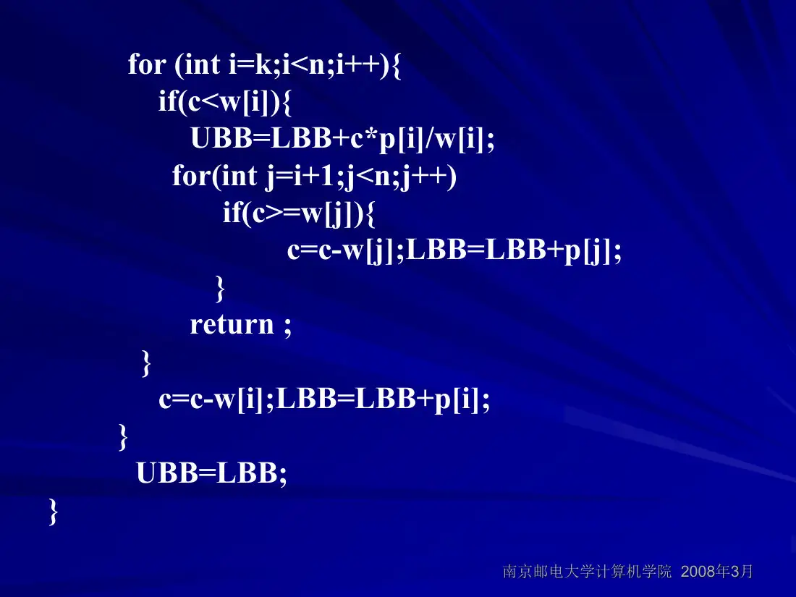

原文：

for (int i=k;i<n;i++){ if(c<w[i]){ UBB=LBB+c\*p[i]/w[i]; for(int j=i+1;j<n;j++) if(c>=w[j]){ c=c-w[j];LBB=LBB+p[j]; return c=c-w[i];LBB=LBB+p[i]; UBB=LBB;

南京邮电大学计算机学院 2008年3月

### 南京邮电大学计算机学院 2008年3月

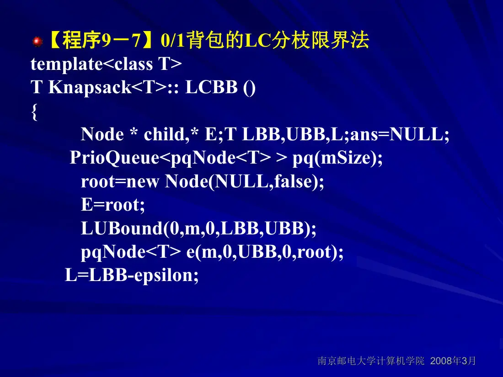

原文：

【程序9－7】0/1背包的LC分枝限界法template<class T>T Knapsack<T>:: LCBB ()

Node \* child,\* E;T LBB,UBB,L;ans=NULL; PrioQueue<pqNode<T> > pq(mSize); root=new Node(NULL,false); E=root; LUBound(0,m,0,LBB,UBB); pqNode<T> e(m,0,UBB,0,root); L=LBB-epsilon;

南京邮电大学计算机学院 2008年3月

### 南京邮电大学计算机学院 2008年3月

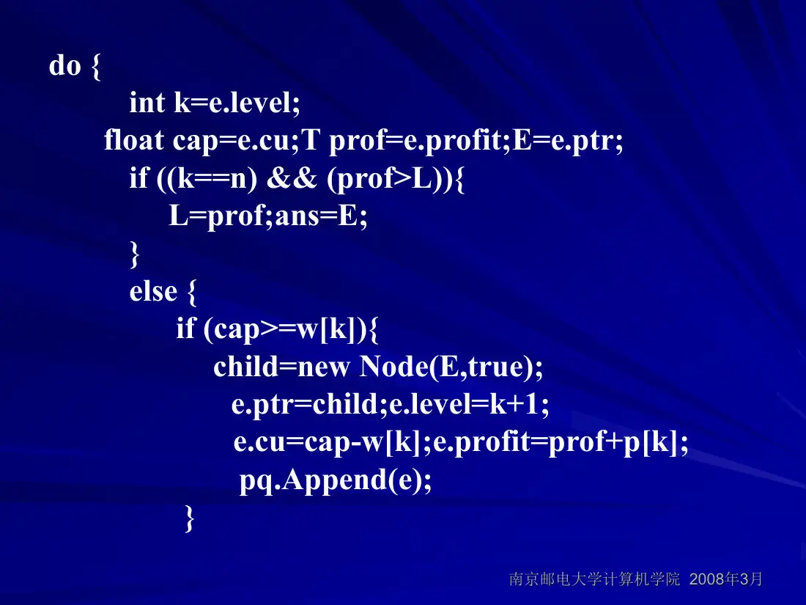

原文：

int k=e.level; float cap=e.cu;T prof=e.profit;E=e.ptr; if ((k==n) && (prof>L)){ L=prof;ans=E;

else { if (cap>=w[k]){ child=new Node(E,true); e.ptr=child;e.level=k+1; e.cu=cap-w[k];e.profit=prof+p[k]; pq.Append(e);

南京邮电大学计算机学院 2008年3月

### 南京邮电大学计算机学院 2008年3月

原文：

LUBound(prof,cap,k+1,LBB,UBB); if (UBB>L){ child=new Node(E,false); e.ptr=child;e.level=k+1; e.cu=cap;e.profit=prof;e.UBB=UBB; pq.Append(e); if (L<LBB-epsilon) L=LBB-epsilon;

if(pq.IsEmpty()) return Zero; pq.Serve(e); }while (e.UBB>L); return L;

南京邮电大学计算机学院 2008年3月

### 南京邮电大学计算机学院 2008年3月

原文：

南京邮电大学计算机学院 2008年3月

### 9. 5 旅行商问题

原文：

9. 5 旅行商问题

△

南京邮电大学计算机学院 2008年3月

### 9.5.1 问题描述

原文：

9.5.1 问题描述

旅行商问题（travelling salesperson）是一个看似简单其实十分难解的著名难题之一，至今仍有许多人在研究它。此问题描述为：一个旅行商准备到n个村庄售货。他从A村出发经过其它n-1个村庄，又回到出发地A村。现要求一条最短路径，使得每个村庄都经过且仅经过一次。

南京邮电大学计算机学院 2008年3月

### 9.5.2 分枝限界法求解

原文：

9.5.2 分枝限界法求解

设带权有向图G=(V,E)，|V|=n，表示连接n个村庄的道路交通图，边上的权值为两个村庄间的路程，$\mathbf { \Theta } ^ { \mathrm { ( y m ) } } \mathbf { \Theta } ^ { \mathrm { ( m ) } }$ 是该图的邻接矩阵，下面也称代价矩阵。旅行商问题的解是一条回路： $\frac { 1 } { 1 2 } \cdot \frac { 1 } { 1 2 } \cdot \frac { 1 } { 1 2 } \cdot \frac { 1 } { 1 2 } \cdot \frac { 1 } { 1 2 } \cdot \frac { 1 } { 1 2 } \cdot$ $\operatorname { a x } _ { 0 } = \operatorname { a x } _ { 0 }$ 0≤x;<n；x;≠xi，当i≠j 和 $1 5 \div 3 = 1 1$ $: \frac { 1 } { 2 } \times \frac { 1 } { 3 } = 1 0$ $0 . 5 7 5 7$ 。其状态空间树结构见图9－11的例子。图中采用的解结构形式为 $( \infty , \infty , 0 ) = \frac { 1 } { 1 2 } \times ( \frac { 1 } { 2 } - 1 ) \times ( \frac { 1 } { 2 } - 1 ) \times ( \frac { 1 } { 2 } - 1 )$ ，这里假定 $v ( 0 ) = 0 . 5 m = 0$ 。本问题的目标函数是路径长度。

南京邮电大学计算机学院 2008年3月

### 南京邮电大学计算机学院 2008年3月

原文：

南京邮电大学计算机学院 2008年3月

### 南京邮电大学计算机学院 2008年3月

原文：

定义9－3 如果矩阵的一行（或列）中至少包含一个零且其余元素均非负，则称此行（或列）已归约。定义9－4 如果一个矩阵的所有行和列均已归约，则称此矩阵为归约矩阵（reduced matrix）。对矩阵的一行（列）进行归约，可以通过将该行(列)中的每个元素减去该行（列）的最小数进行，此最小数称为该行（列）的约数。通过逐行逐列的归约，可得到一个代价矩阵的归约矩阵。假定第i行的约数为t ，第j列的约数为r ，0i,j<n，则所有行和列约数之和称为矩阵约数，设为L，。

南京邮电大学计算机学院 2008年3月

### $$

原文：

对矩阵的一行（列）进行归约，可以通过将该行(列)中的每个元素减去该行（列）的最小数进行，此最小数称为该行（列）的约数。通过逐行逐列的归约，可得到一个代价矩阵的归约矩阵。假定第i行的约数为$1 0 0 0$ 第j列的约数为r ，0i,j<n，则所有行和列约数 $5 0 \div b \cdots a$ 之和称为矩阵约数，设为L，

$$
L = \sum_ {i = 0} ^ {n - 1} t _ {i} + \sum_ {j = 0} ^ {n - 1} r _ {j}
$$

南京邮电大学计算机学院 2008年3月

### 南京邮电大学计算机学院 2008年3月

原文：

南京邮电大学计算机学院 2008年3月

### 代价矩阵

原文：

代价矩阵

归约矩阵

$$
\left[ \begin{array}{l l l l l} \infty & 2 0 & 3 0 & 1 0 & 1 1 \\ 1 5 & \infty & 1 6 & 4 & 2 \\ 3 & 5 & \infty & 2 & 4 \\ 1 9 & 6 & 1 8 & \infty & 3 \\ 1 6 & 4 & 7 & 1 6 & \infty \end{array} \right]
$$

$$
\left[ \begin{array}{l l l l l} \infty & 1 0 & 1 7 & 0 & 1 \\ 1 2 & \infty & 1 1 & 2 & 0 \\ 0 & 3 & \infty & 0 & 2 \\ 1 5 & 3 & 1 2 & \infty & 0 \\ 1 1 & 0 & 0 & 1 2 & \infty \end{array} \right]
$$

南京邮电大学计算机学院 2008年3月

### 归约行

原文：

归约行

$$
\left[ \begin{array}{l l l l l} \infty & 2 0 & 3 0 & 1 0 & 1 1 \\ 1 5 & \infty & 1 6 & 4 & 2 \\ 3 & 5 & \infty & 2 & 4 \\ 1 9 & 6 & 1 8 & \infty & 3 \\ 1 6 & 4 & 7 & 1 6 & \infty \end{array} \right]
$$

$$
\left[ \begin{array}{c c c c c} \infty & 1 0 & 2 0 & 0 & 1 \\ 1 3 & \infty & 1 4 & 2 & 0 \\ 1 & 3 & \infty & 0 & 2 \\ 1 6 & 3 & 1 5 & \infty & 0 \\ 1 2 & 0 & 3 & 1 2 & \infty \end{array} \right] \begin{array}{l} 1 0 \\ 2 \\ 2 \\ 3 \\ 4 \end{array}
$$

南京邮电大学计算机学院 2008年3月

### 归约列

原文：

归约列

$$
\left[ \begin{array}{c c c c c} \infty & 1 0 & 2 0 & 0 & 1 \\ 1 3 & \infty & 1 4 & 2 & 0 \\ 1 & 3 & \infty & 0 & 2 \\ 1 6 & 3 & 1 5 & \infty & 0 \\ 1 2 & 0 & 3 & 1 2 & \infty \\ \hline \infty & 1 0 & 1 7 & 0 & 1 \\ 1 2 & \infty & 1 1 & 2 & 0 \\ 0 & 3 & \infty & 0 & 2 \\ 1 5 & 3 & 1 2 & \infty & 0 \\ 1 1 & 0 & 0 & 1 2 & \infty \\ \hline 1 & 0 & 3 & 0 & 0 \end{array} \right] \text {知}
$$

矩阵约数L=25

南京邮电大学计算机学院 2008年3月

### 叶状态S的下界函数ĉ(S)=c(S)，c(S)为从根到S的路径长度。

原文：

下界函数计算方法根结点R的归约矩阵是对邻接矩阵直接归约得到，其下界函数ĉ(R)=L，L是矩阵约数。树中任意非叶状态X的归约矩阵B，可由其双亲状态P的归约矩阵A，先变换成A’后再归约得到B；X的下界函数ĉ(X)= ĉ(P)+A[i][j]+r，r是从A’归约到B的矩阵约数。

叶状态S的下界函数ĉ(S)=c(S)，c(S)为从根到S的路径长度。

南京邮电大学计算机学院 2008年3月

### 上界函数对于树中任何状态结点X，令上界函数值u(X)=。

原文：

上界函数对于树中任何状态结点X，令上界函数值u(X)=。

南京邮电大学计算机学院 2008年3月

### $$

原文：

$$
\left[ \begin{array}{c c c c c} \infty & 1 0 & 1 7 & 0 & 1 \\ 1 2 & \infty & 1 1 & 2 & 0 \\ 0 & 3 & \infty & 0 & 2 \\ 1 5 & 3 & 1 2 & \infty & 0 \\ 1 1 & 0 & 0 & 1 2 & \infty \end{array} \right]
$$

$$
\left[ \begin{array}{c c c c c} \infty & \infty & \infty & \infty & \infty \\ \infty & \infty & 1 1 & 2 & 0 \\ 0 & \infty & \infty & 0 & 2 \\ 1 5 & \infty & 1 2 & \infty & 0 \\ 1 1 & \infty & 0 & 1 2 & \infty \end{array} \right]
$$

$$
\left[ \begin{array}{c c c c c} \infty & \infty & \infty & \infty & \infty \\ 1 & \infty & \infty & 2 & 0 \\ \infty & 3 & \infty & 0 & 2 \\ 4 & 3 & \infty & \infty & 0 \\ 0 & 0 & \infty & 1 2 & \infty \end{array} \right]
$$

(a)根结点1

(b) 结点2

(c)结点3

$$
\left[ \begin{array}{c c c c c} \infty & \infty & \infty & \infty & \infty \\ 1 2 & \infty & 1 1 & \infty & 0 \\ 0 & 3 & \infty & \infty & 2 \\ \infty & 3 & 1 2 & \infty & 0 \\ 1 1 & 0 & 0 & \infty & \infty \end{array} \right]
$$

$$
\left[ \begin{array}{c c c c c} \infty & \infty & \infty & \infty & \infty \\ 1 0 & \infty & 9 & 0 & \infty \\ 0 & 3 & \infty & 0 & \infty \\ 1 2 & 0 & 9 & \infty & \infty \\ \infty & 0 & 0 & 1 2 & \infty \end{array} \right]
$$

(d)结点4

$$
\left[ \begin{array}{c c c c c} \infty & \infty & \infty & \infty & \infty \\ \infty & \infty & 1 1 & \infty & 0 \\ 0 & \infty & \infty & \infty & 2 \\ \infty & \infty & \infty & \infty & 0 \\ 1 1 & \infty & 0 & \infty & \infty \end{array} \right]
$$

$$
\left[ \begin{array}{c c c c c} \infty & \infty & \infty & \infty & \infty \\ 1 & \infty & \infty & \infty & 0 \\ \infty & 1 & \infty & \infty & 0 \\ \infty & \infty & \infty & \infty & \infty \\ 0 & 0 & \infty & \infty & \infty \end{array} \right]
$$

(e)结点5

(f)结点6

(g)结点7

$$
\left[ \begin{array}{c c c c c} \infty & \infty & \infty & \infty & \infty \\ 1 & \infty & 0 & \infty & \infty \\ 0 & 3 & \infty & \infty & \infty \\ \infty & \infty & \infty & \infty & \infty \\ \infty & 0 & 0 & \infty & \infty \end{array} \right]
$$

(h)结点8

$$
\left[ \begin{array}{c c c c c} \infty & \infty & \infty & \infty & \infty \\ \infty & \infty & \infty & \infty & \infty \\ \infty & \infty & \infty & \infty & 0 \\ \infty & \infty & \infty & \infty & \infty \\ 0 & \infty & \infty & \infty & \infty \end{array} \right]
$$

$$
\left[ \begin{array}{c c c c c} \infty & \infty & \infty & \infty & \infty \\ \infty & \infty & \infty & \infty & \infty \\ 0 & \infty & \infty & \infty & \infty \\ \infty & \infty & \infty & \infty & \infty \\ \infty & \infty & 0 & \infty & \infty \end{array} \right]
$$

(i)结点9

(j) 结点10

图9-15 图9-14 结点的归约矩阵

南京邮电大学计算机学院 2008年3月
