# 《密码学》第10章 认证码（课件）

原件的每一页，下面附识别出的文字。

### 第十章认 证 码

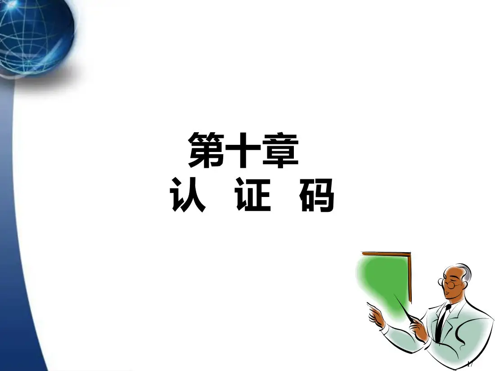

原文：

第十章认 证 码

### 消息认证

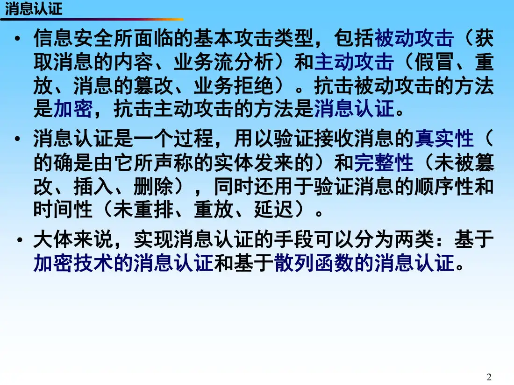

原文：

消息认证

信息安全所面临的基本攻击类型，包括被动攻击（获取消息的内容、业务流分析）和主动攻击（假冒、重放、消息的篡改、业务拒绝）。抗击被动攻击的方法是加密，抗击主动攻击的方法是消息认证。

• 消息认证是一个过程，用以验证接收消息的真实性（的确是由它所声称的实体发来的）和完整性（未被篡改、插入、删除），同时还用于验证消息的顺序性和时间性（未重排、重放、延迟）。

• 大体来说，实现消息认证的手段可以分为两类：基于加密技术的消息认证和基于散列函数的消息认证。

2

### 基于加密技术的消息认证

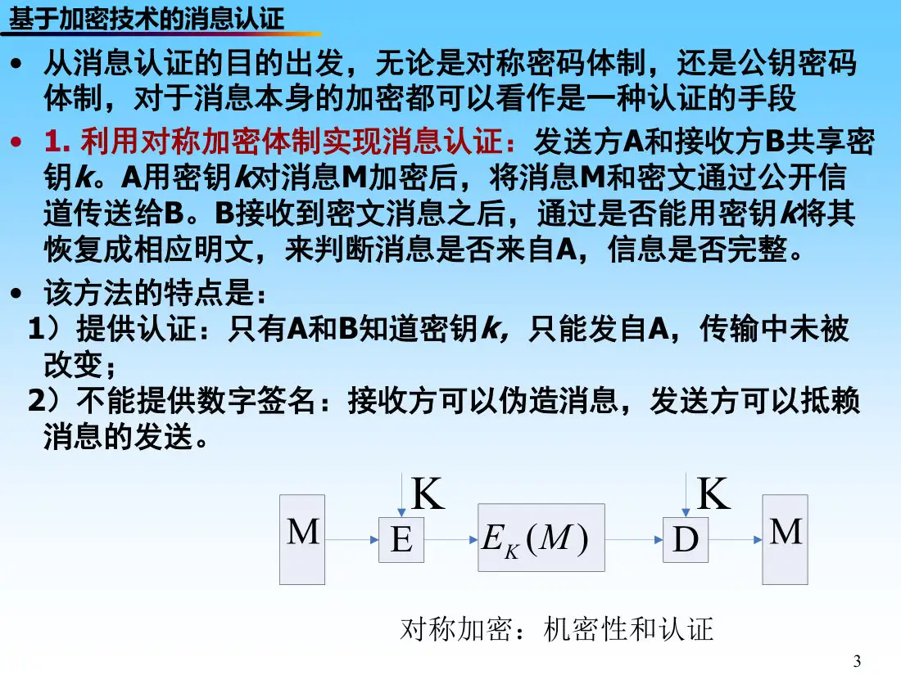

原文：

基于加密技术的消息认证

• 从消息认证的目的出发，无论是对称密码体制，还是公钥密码体制，对于消息本身的加密都可以看作是一种认证的手段

• 1. 利用对称加密体制实现消息认证：发送方A和接收方B共享密钥k。A用密钥k对消息M加密后，将消息M和密文通过公开信道传送给B。B接收到密文消息之后，通过是否能用密钥k将其恢复成相应明文，来判断消息是否来自A，信息是否完整。

• 该方法的特点是：

1）提供认证：只有A和B知道密钥k 只能发自A，传输中未被改变；

2）不能提供数字签名：接收方可以伪造消息，发送方可以抵赖消息的发送。

3

### 基于加密技术的消息认证

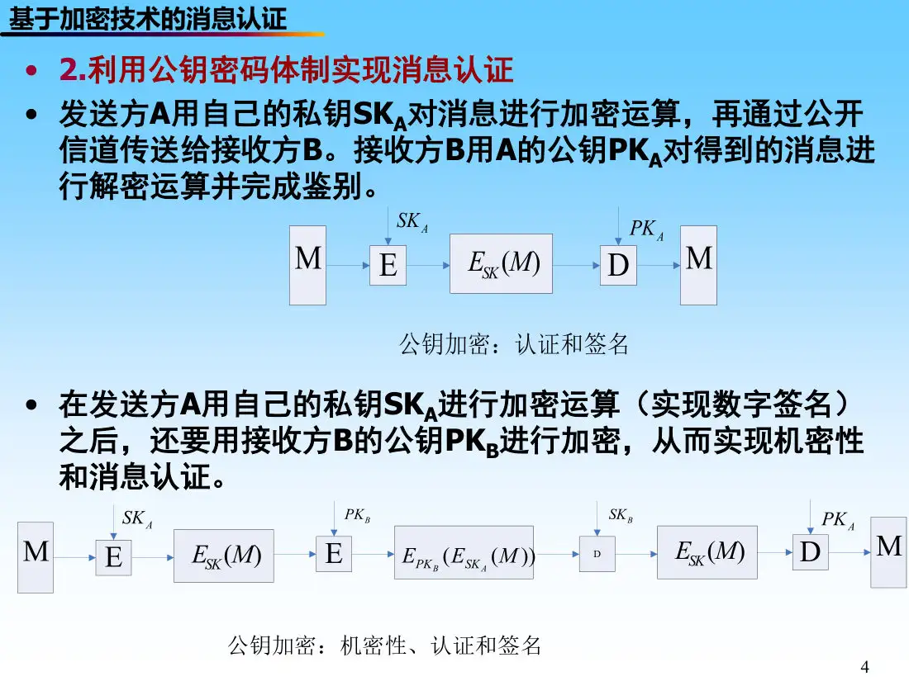

原文：

基于加密技术的消息认证

2.利用公钥密码体制实现消息认证

发送方A用自己的私钥 $\mathsf { S K } _ { \mathsf { A } }$ 对消息进行加密运算，再通过公开信道传送给接收方B。接收方B用A的公钥 $\mathsf { P K } _ { \mathsf { A } }$ 对得到的消息进行解密运算并完成鉴别。

• 在发送方A用自己的私钥 $\mathsf { S K } _ { \mathsf { A } }$ 进行加密运算（实现数字签名）之后，还要用接收方B的公钥 $\mathsf { P K } _ { \mathsf { B } }$ 进行加密，从而实现机密性和消息认证。

4

### 基于散列函数的消息认证

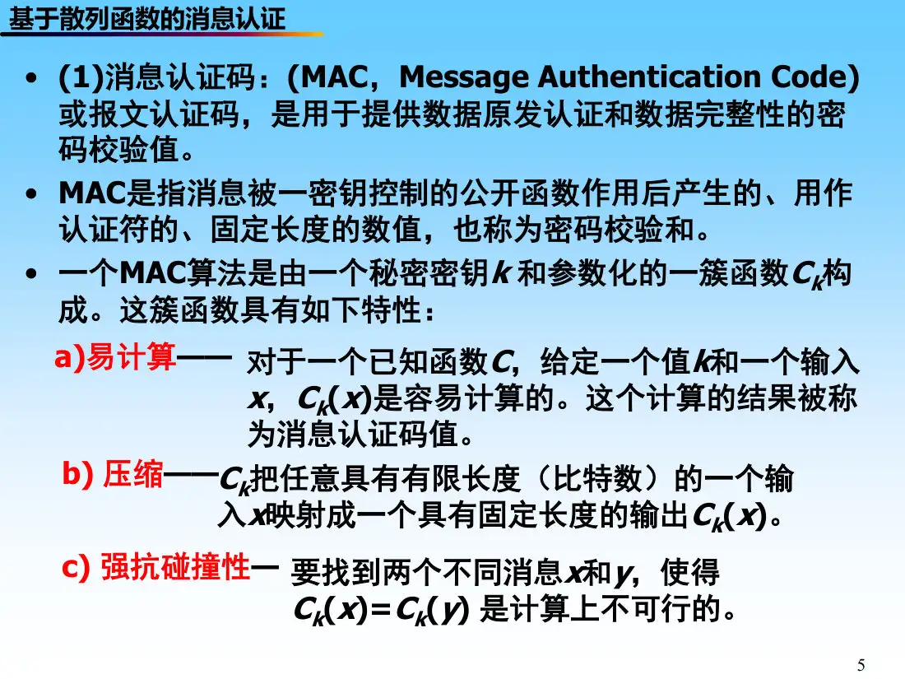

原文：

基于散列函数的消息认证

• (1)消息认证码：(MAC，Message Authentication Code)或报文认证码，是用于提供数据原发认证和数据完整性的密码校验值。

• MAC是指消息被一密钥控制的公开函数作用后产生的、用作认证符的、固定长度的数值，也称为密码校验和。

• 一个MAC算法是由一个秘密密钥k和参数化的一簇函数 $c _ { k }$ 构成。这簇函数具有如下特性：

a)易计算—— 对于一个已知函数 $c ,$ 给定一个值k和一个输入$x , ~ C _ { k } ( x )$ 是容易计算的。这个计算的结果被称为消息认证码值。

b) 压缩— $c _ { k }$ 把任意具有有限长度（比特数）的一个输入x映射成一个具有固定长度的输出 $c _ { k } ( x )$ 。

c) 强抗碰撞性— 要找到两个不同消息x和y，使得$C _ { k } ( x ) { = } C _ { k } ( \gamma )$ 是计算上不可行的。

5

### 基于散列函数的消息认证

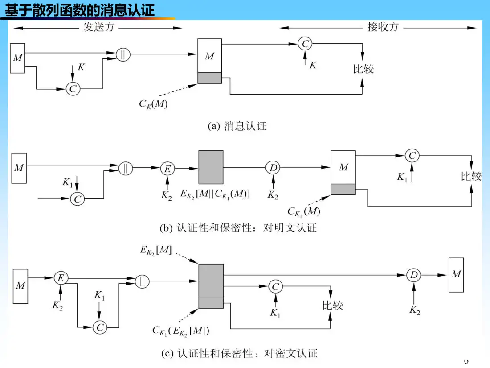

原文：

基于散列函数的消息认证

6

### MAC函数与加密算法的比较

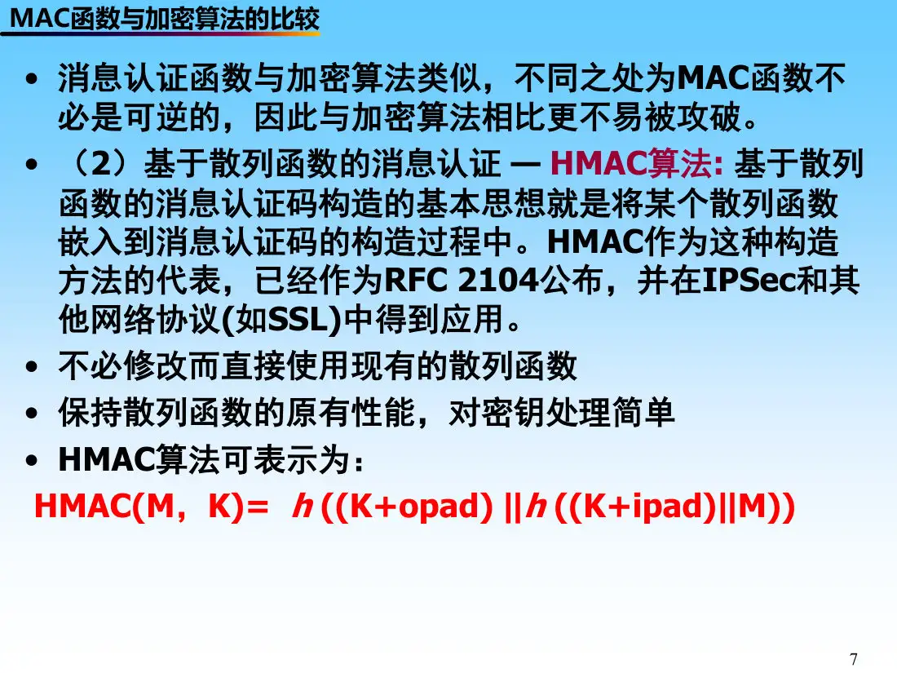

原文：

MAC函数与加密算法的比较

消息认证函数与加密算法类似，不同之处为MAC函数不必是可逆的，因此与加密算法相比更不易被攻破。

• （2）基于散列函数的消息认证 — HMAC算法: 基于散列函数的消息认证码构造的基本思想就是将某个散列函数嵌入到消息认证码的构造过程中。HMAC作为这种构造方法的代表，已经作为RFC 2104公布，并在IPSec和其他网络协议(如SSL)中得到应用。

• 不必修改而直接使用现有的散列函数

• 保持散列函数的原有性能，对密钥处理简单

• HMAC算法可表示为：

$$
\operatorname{HMAC} (M, K) = h ((K + \text {opad}) | | h ((K + \text {ipad}) | | M))
$$

7

### 第 8 页

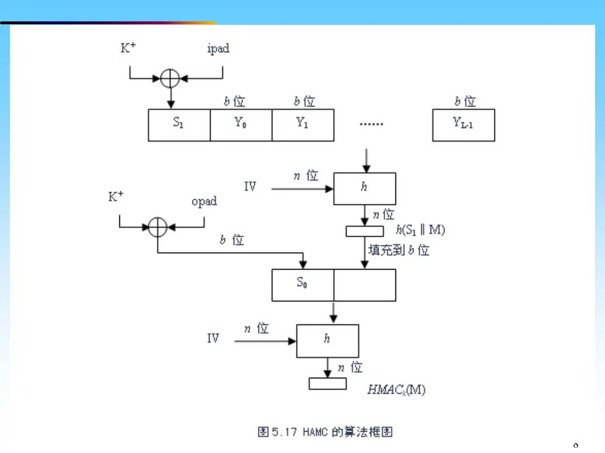

原文：

8

### HMAC

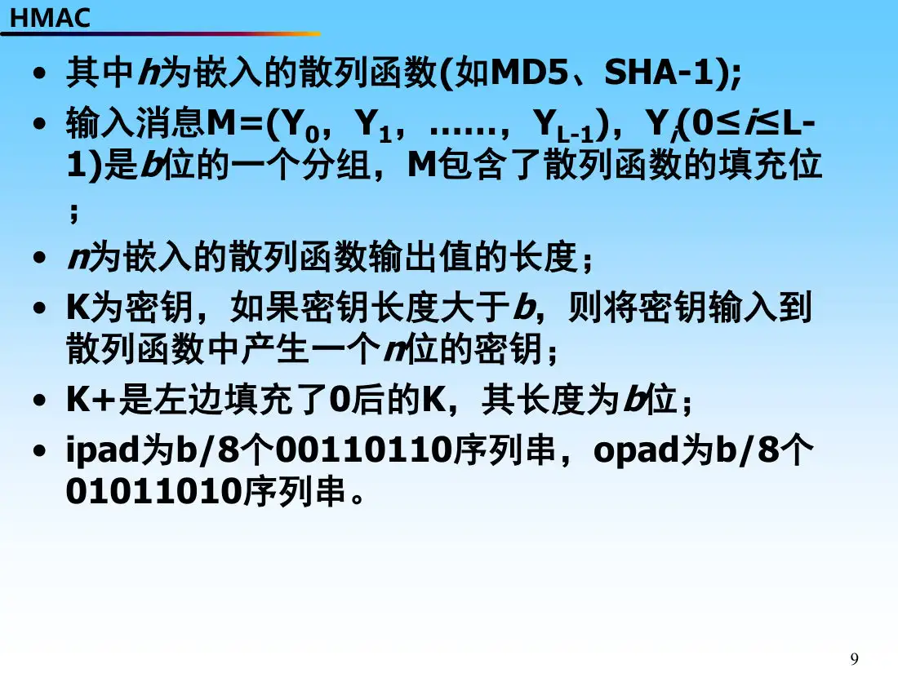

原文：

HMAC

• 其中h为嵌入的散列函数(如MD5、SHA-1);

输入消息 ${ \bf M } = ( { \sf Y } _ { 0 } , \ { \sf Y } _ { 1 } , \mathrm { ~ \dots ~ } , \ { \sf Y } _ { \mathrm { L - 1 } } ) , \ { \sf Y } _ { \mathrm { \ell } } ( 0 \leq i \leq \mathrm { L - 1 } $ 1)是b位的一个分组，M包含了散列函数的填充位

• n为嵌入的散列函数输出值的长度；

• K为密钥，如果密钥长度大于 $\theta _ { \mathfrak { g } }$ 则将密钥输入到散列函数中产生一个n位的密钥；

• K+是左边填充了0后的K，其长度为b位；

• ipad为b/8个00110110序列串，opad为b/8个01011010序列串。

9

### HMAC的安全性

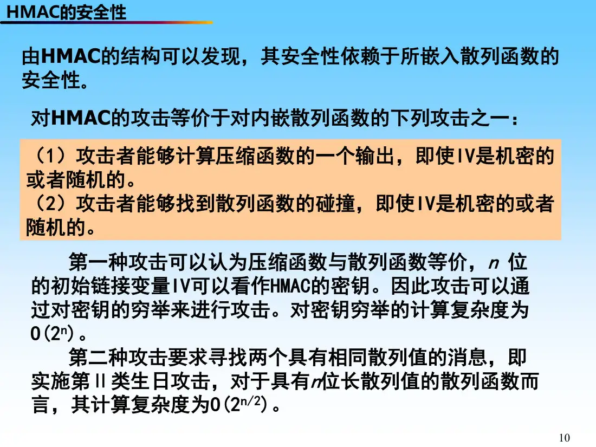

原文：

HMAC的安全性

由HMAC的结构可以发现，其安全性依赖于所嵌入散列函数的安全性。

对HMAC的攻击等价于对内嵌散列函数的下列攻击之一：

（1）攻击者能够计算压缩函数的一个输出，即使IV是机密的或者随机的。

（2）攻击者能够找到散列函数的碰撞，即使IV是机密的或者随机的。

第一种攻击可以认为压缩函数与散列函数等价，n 位的初始链接变量IV可以看作HMAC的密钥。因此攻击可以通过对密钥的穷举来进行攻击。对密钥穷举的计算复杂度为O(2n)。

第二种攻击要求寻找两个具有相同散列值的消息，即实施第Ⅱ类生日攻击，对于具有n位长散列值的散列函数而言，其计算复杂度为O(2n/2)。

10

### CMAC

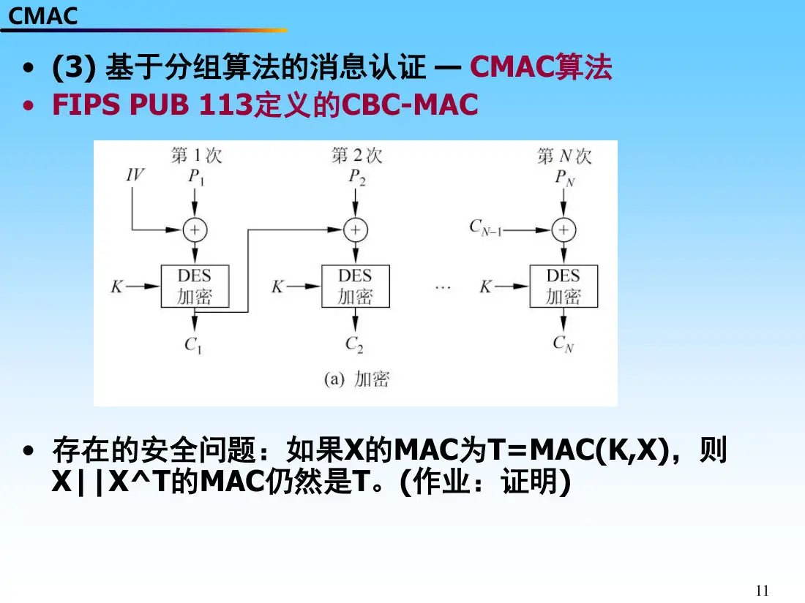

原文：

• (3) 基于分组算法的消息认证 — CMAC算法FIPS PUB 113定义的CBC-MAC

• 存在的安全问题：如果X的MAC为 ${ \sf T } = { \sf M A C } ( { \sf K } , { \sf X } )$ ，则$\mathbf { \pmb { X } } | \mathbf { \Delta } | \mathbf { \pmb { X } } ^ { \pmb { \wedge } }$ T的MAC仍然是T。(作业：证明)

CMAC

11

### CMAC的改进

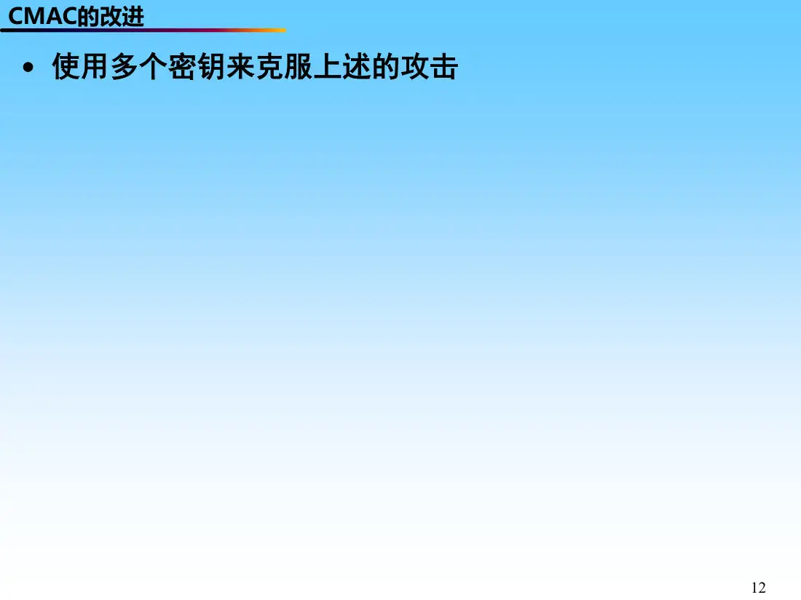

原文：

CMAC的改进

• 使用多个密钥来克服上述的攻击

12
