# 《密码学》第11章 密钥管理（课件）

原件的每一页，下面附识别出的文字。

### 第十一章密 钥 管 理

原文：

第十一章密 钥 管 理

### 密钥管理技术

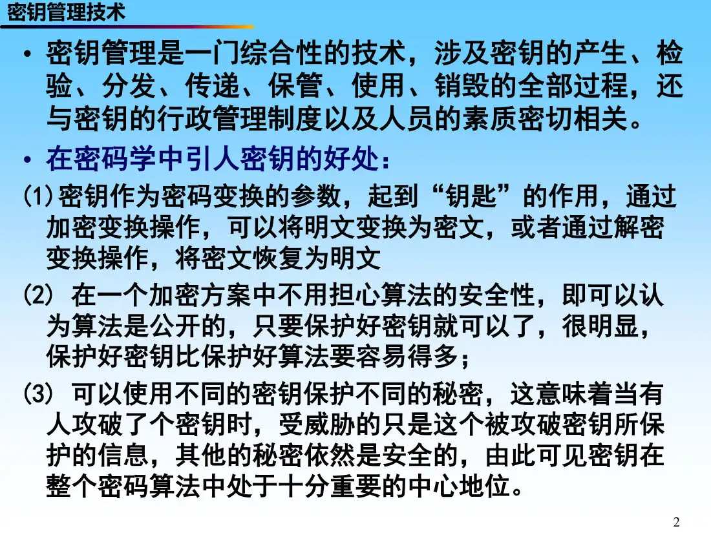

原文：

密钥管理技术

密钥管理是一门综合性的技术，涉及密钥的产生、检验、分发、传递、保管、使用、销毁的全部过程，还与密钥的行政管理制度以及人员的素质密切相关。

• 在密码学中引人密钥的好处：

(1)密钥作为密码变换的参数，起到“钥匙”的作用，通过加密变换操作，可以将明文变换为密文，或者通过解密变换操作，将密文恢复为明文

(2) 在一个加密方案中不用担心算法的安全性，即可以认为算法是公开的，只要保护好密钥就可以了，很明显，保护好密钥比保护好算法要容易得多；

(3) 可以使用不同的密钥保护不同的秘密，这意味着当有人攻破了个密钥时，受威胁的只是这个被攻破密钥所保护的信息，其他的秘密依然是安全的，由此可见密钥在整个密码算法中处于十分重要的中心地位。

2

### 密钥管理的原则

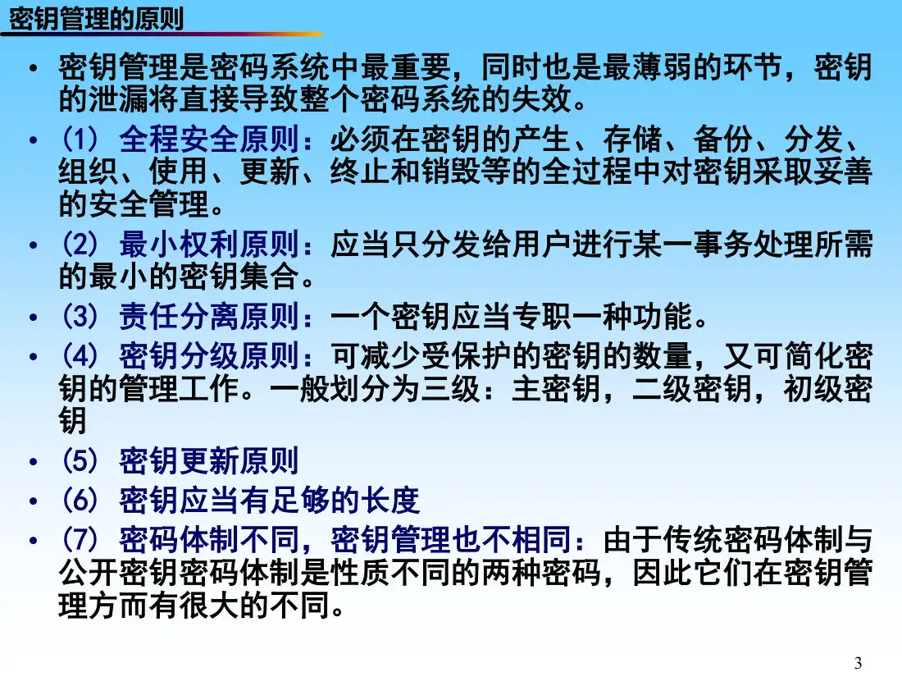

原文：

密钥管理的原则

• 密钥管理是密码系统中最重要，同时也是最薄弱的环节，密钥的泄漏将直接导致整个密码系统的失效。

• (1) 全程安全原则：必须在密钥的产生、存储、备份、分发、组织、使用、更新、终止和销毁等的全过程中对密钥采取妥善的安全管理。

• (2) 最小权利原则：应当只分发给用户进行某一事务处理所需的最小的密钥集合。

• (3) 责任分离原则：一个密钥应当专职一种功能。

• (4) 密钥分级原则：可减少受保护的密钥的数量，又可简化密钥的管理工作。一般划分为三级：主密钥，二级密钥，初级密钥

• (5) 密钥更新原则

• (6) 密钥应当有足够的长度

• (7) 密码体制不同，密钥管理也不相同：由于传统密码体制与公开密钥密码体制是性质不同的两种密码，因此它们在密钥管理方而有很大的不同。

3

### 密钥的层次结构

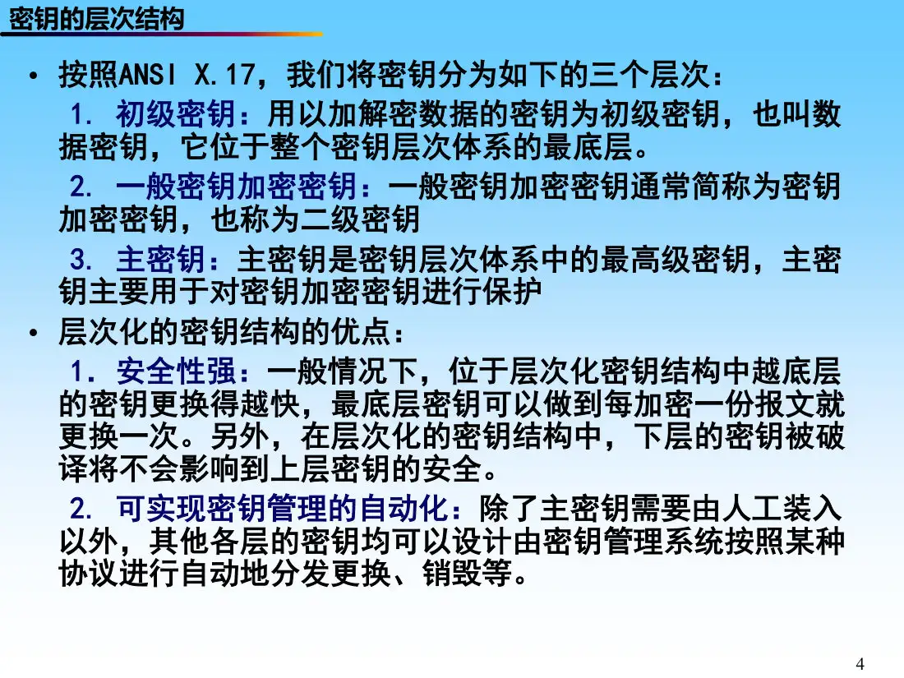

原文：

密钥的层次结构

• 按照ANSI X.17，我们将密钥分为如下的三个层次：

1. 初级密钥：用以加解密数据的密钥为初级密钥，也叫数据密钥，它位于整个密钥层次体系的最底层。

2. 一般密钥加密密钥：一般密钥加密密钥通常简称为密钥加密密钥，也称为二级密钥

3. 主密钥：主密钥是密钥层次体系中的最高级密钥，主密钥主要用于对密钥加密密钥进行保护

• 层次化的密钥结构的优点：

1．安全性强：一般情况下，位于层次化密钥结构中越底层的密钥更换得越快，最底层密钥可以做到每加密一份报文就更换一次。另外，在层次化的密钥结构中，下层的密钥被破译将不会影响到上层密钥的安全。

2. 可实现密钥管理的自动化：除了主密钥需要由人工装入以外，其他各层的密钥均可以设计由密钥管理系统按照某种协议进行自动地分发更换、销毁等。

4

### 密钥种类（对用户而言）

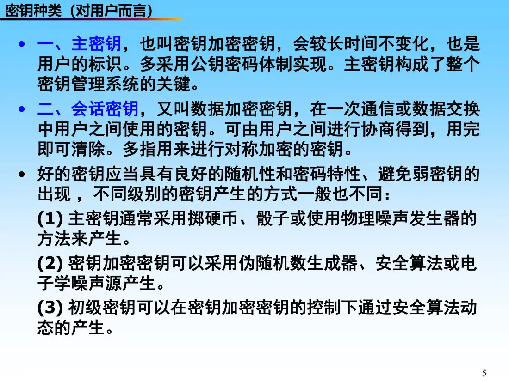

原文：

密钥种类（对用户而言）

一、主密钥，也叫密钥加密密钥，会较长时间不变化，也是用户的标识。多采用公钥密码体制实现。主密钥构成了整个密钥管理系统的关键。

• 二、会话密钥，又叫数据加密密钥，在一次通信或数据交换中用户之间使用的密钥。可由用户之间进行协商得到，用完即可清除。多指用来进行对称加密的密钥。

• 好的密钥应当具有良好的随机性和密码特性、避免弱密钥的出现 ，不同级别的密钥产生的方式一般也不同：

(1) 主密钥通常采用掷硬币、骰子或使用物理噪声发生器的方法来产生。

(2) 密钥加密密钥可以采用伪随机数生成器、安全算法或电子学噪声源产生。

(3) 初级密钥可以在密钥加密密钥的控制下通过安全算法动态的产生。

5

### 密钥分发

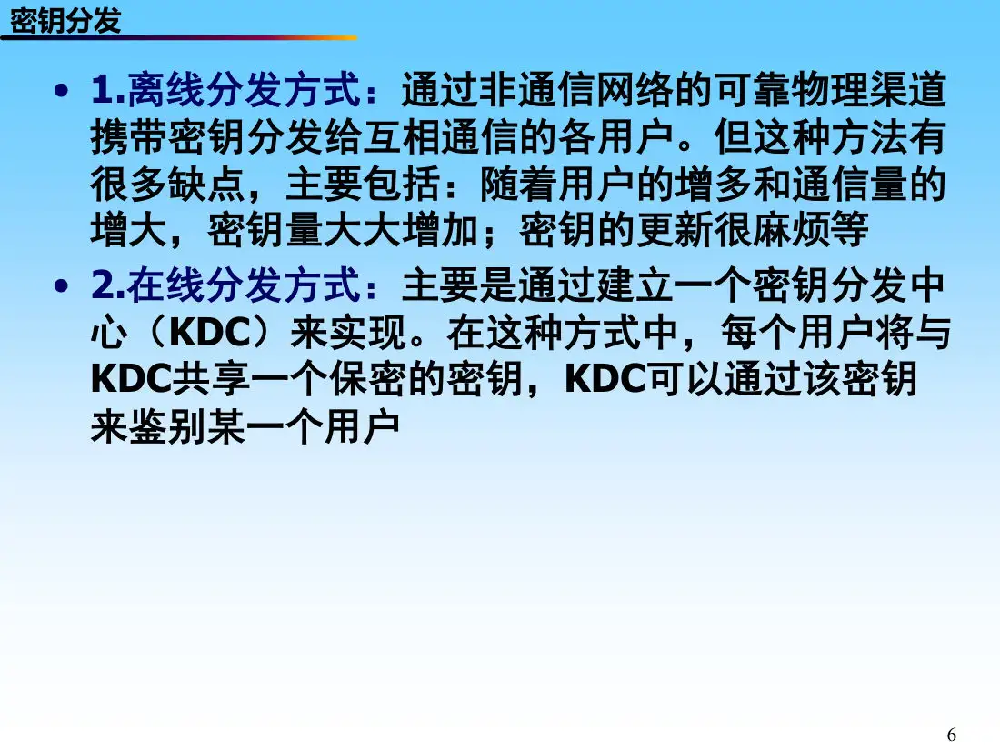

原文：

密钥分发

1.离线分发方式：通过非通信网络的可靠物理渠道携带密钥分发给互相通信的各用户。但这种方法有很多缺点，主要包括：随着用户的增多和通信量的增大，密钥量大大增加；密钥的更新很麻烦等

2.在线分发方式：主要是通过建立一个密钥分发中心（KDC）来实现。在这种方式中，每个用户将与KDC共享一个保密的密钥，KDC可以通过该密钥来鉴别某一个用户

6

### 在线密钥分发

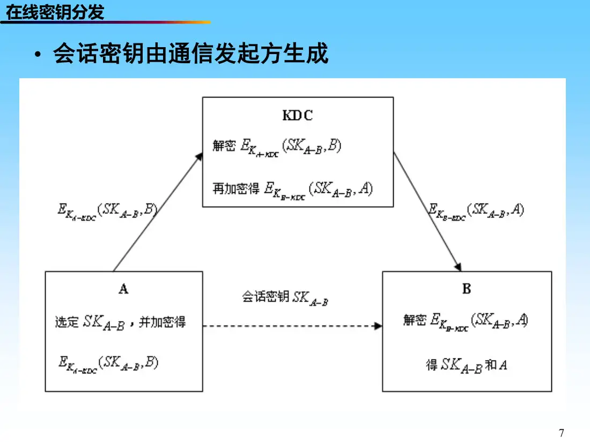

原文：

在线密钥分发

• 会话密钥由通信发起方生成

7

### 在线密钥分发

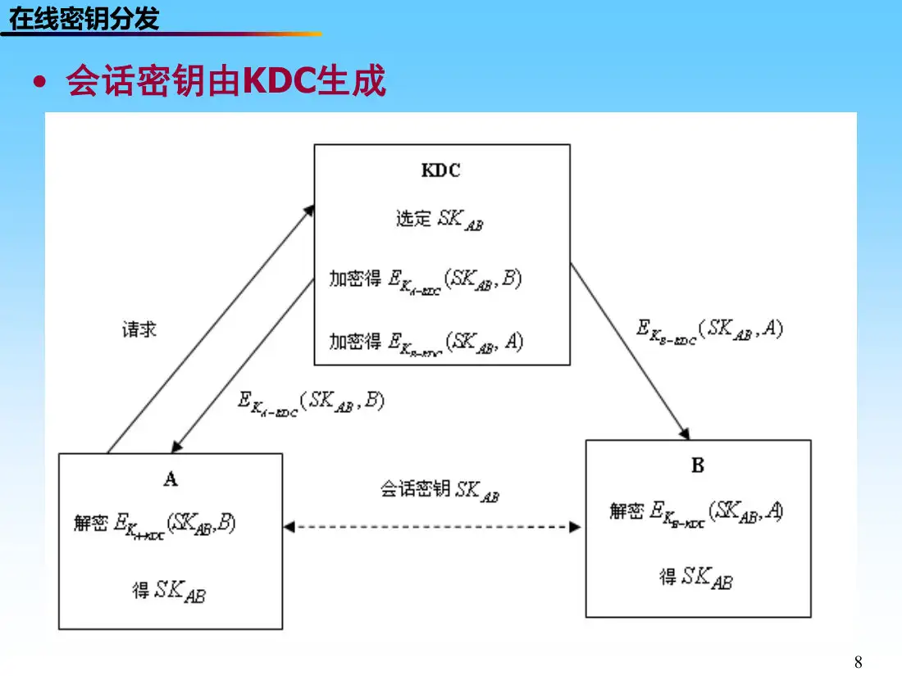

原文：

在线密钥分发

会话密钥由KDC生成

8

### Kerborose协议

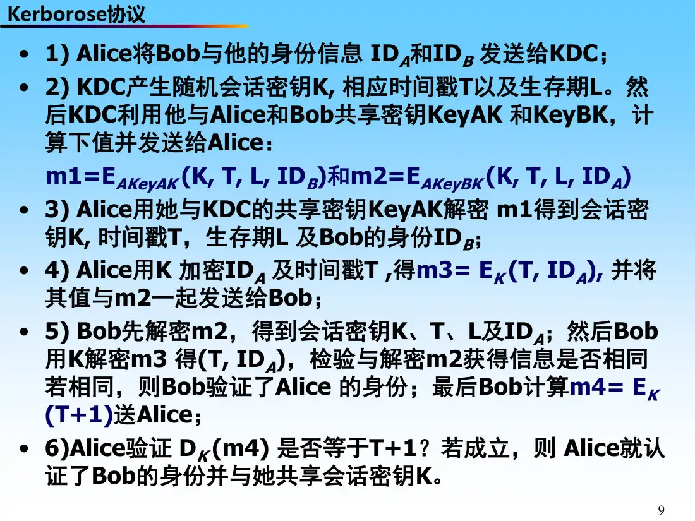

原文：

Kerborose协议

• 1) Alice将Bob与他的身份信息 $\mathbf { I D } _ { A } \mathbf { \mathcal { \bar { \kappa } } } \mathbf { \Pi } \mathbf { I } \mathbf { D } _ { B }$ 发送给KDC；

• 2) KDC产生随机会话密钥K, 相应时间戳T以及生存期L。然后KDC利用他与Alice和Bob共享密钥KeyAK 和KeyBK，计算下值并发送给Alice：

$$
\mathrm{m} 1 = \mathrm{E} _ {A K e y A K} (\mathrm{K}, \mathrm{T}, \mathrm{L}, \mathrm{ID} _ {B}) \text {和} \mathrm{m} 2 = \mathrm{E} _ {A K e y B K} (\mathrm{K}, \mathrm{T}, \mathrm{L}, \mathrm{ID} _ {A})
$$

• 3) Alice用她与KDC的共享密钥KeyAK解密 m1得到会话密钥K, 时间戳T，生存期L 及Bob的身份 $\mathbf { I D } _ { B } \mathbf { ; }$

• 4) Alice用K 加密 $\pmb { \mathrm { I D } } _ { \pmb { A } }$ 及时间戳T ,得 $\mathsf { m } 3 = \mathsf { E } _ { K } ( \mathsf { T } , \mathsf { T } \mathsf { D } _ { A } )$ , 并将其值与m2一起发送给Bob；

• 5) Bob先解密m2，得到会话密钥 $K , T , L \mathcal { J } \mathcal { L } \mathbf { I } \mathbf { D } _ { A } ,$ 然后Bob用K解密m3 得 $( \mathbb { T } , \mathbb { I } \mathbb { D } _ { A } )$ ，检验与解密m2获得信息是否相同若相同，则Bob验证了Alice 的身份；最后Bob计算 $\mathtt { m } 4 \equiv \mathtt { E } _ { \kappa }$ $( \mathsf { T } + \pmb { 1 } )$ 送 $\mathbb { A } \mathbb { i } \mathbb { c } \mathbb { e }$

• 6)Alice验证 $\mathsf { D } _ { K } ( \mathsf { m } 4 )$ 是否等于T+1？若成立，则 Alice就认证了Bob的身份并与她共享会话密钥 $\mathbf { K }$ 。

9

### 密钥协商

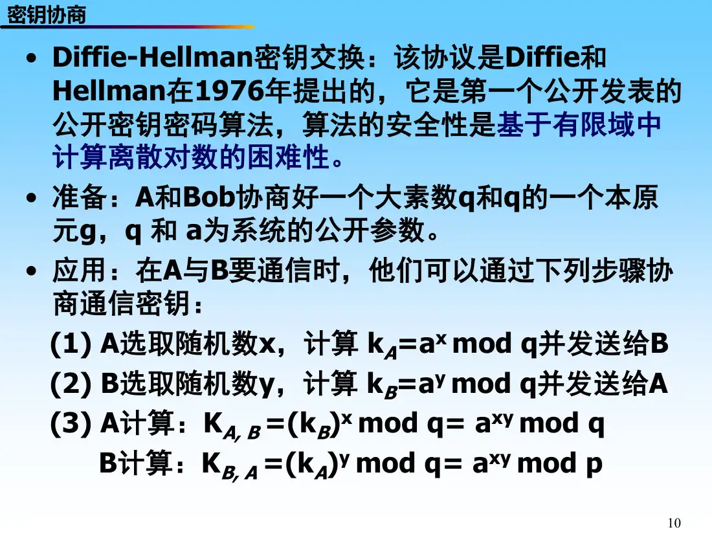

原文：

密钥协商

Diffie-Hellman密钥交换：该协议是Diffie和Hellman在1976年提出的，它是第一个公开发表的公开密钥密码算法，算法的安全性是基于有限域中计算离散对数的困难性。

• 准备：A和Bob协商好一个大素数q和q的一个本原元g，q 和 a为系统的公开参数。

• 应用：在A与B要通信时，他们可以通过下列步骤协商通信密钥：

(1) A选取随机数x，计算 $\mathbf { k } _ { A } { = } \mathbf { a } ^ { \mathbf { x } } \mathbf { m o d } \ \mathbf { q }$ 并发送给B

(2) B选取随机数y，计算 $\mathbf { k } _ { B } { = } \mathbf { a } ^ { \mathrm { { y } } } \mathbf { m o d } \ \mathbf { q }$ 并发送给A

(3) A计算： ${ \sf K } _ { { \cal A } , { \cal B } } = ( { \sf k } _ { B } ) ^ { \sf x } \sf m o d { \sf q } = \sf a ^ { \sf x v } \sf m o d { \sf q }$

B计算： ${ \sf K } _ { B , A } = ( { \sf k } _ { A } ) ^ { \sf y } \mathrm { m o d ~ q = a ^ { \sf x y } \mathrm { m o d ~ p } ~ }$

10

### Diff

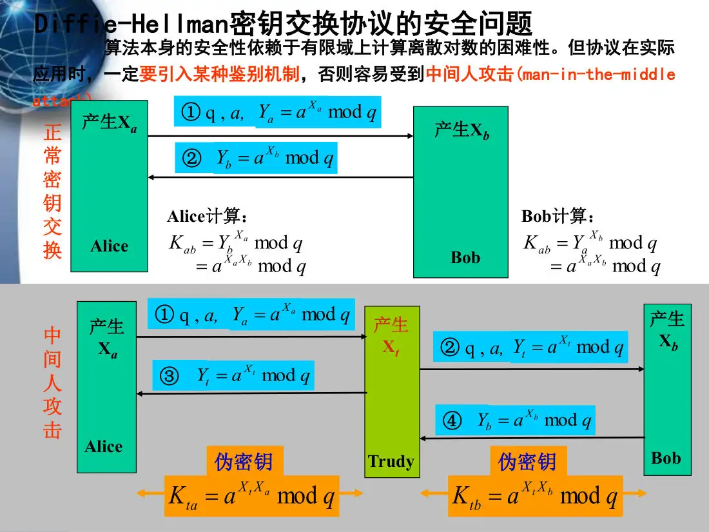

原文：

Diff

e-Hellman密钥交换协议的安全问题

算法本身的安全性依赖于有限域上计算离散对数的困难性。但协议在实际应用时，一定要引入某种鉴别机制，否则容易受到中间人攻击(man-in-the-middle

atta

正
常
密
钥
交
换中
间
人
攻
击

产生 $\mathbf { X } _ { a }$

$$
① q, a, Y _ {a} = a ^ {X _ {a}} \bmod q
$$

产生 $\mathbf { X } _ { b }$

$$
② Y _ {b} = a ^ {X _ {b}} \bmod q
$$

Alice

Alice计算：

Bob计算：

$$
\begin{array}{r} K _ {a b} = Y _ {b} ^ {X _ {a}} \bmod q \\ = a ^ {X _ {a} X _ {b}} \bmod q \end{array}
$$

Bob

$$
\begin{array}{r} K _ {a b} = Y _ {a} ^ {X _ {b}} \bmod q \\ = a ^ {X _ {a} X _ {b}} \bmod q \end{array}
$$

产生 Xa

$$
① \mathrm{q}, a, Y _ {a} = a ^ {X _ {a}} \bmod q
$$

$$
③ Y _ {t} = a ^ {X _ {t}} \bmod q
$$

$$
② \mathrm{q}, a, Y _ {t} = a ^ {X _ {t}} \bmod q
$$

$$
④ Y _ {b} = a ^ {X _ {b}} \bmod q
$$

Alice

伪密钥

Trudy

$$
K _ {t a} = a ^ {X _ {t} X _ {a}} \bmod q
$$

伪密钥

Bob

$$
K _ {t b} = a ^ {X _ {t} X _ {b}} \bmod q
$$

### 端—端密钥协商协议

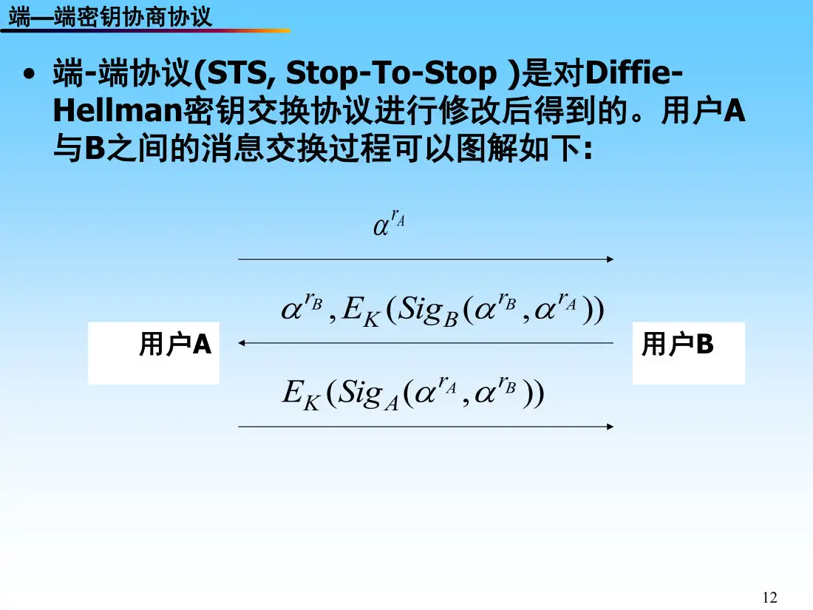

原文：

端—端密钥协商协议

端-端协议(STS, Stop-To-Stop )是对Diffie-Hellman密钥交换协议进行修改后得到的。用户A与B之间的消息交换过程可以图解如下:

$$
\begin{array}{c c} & \alpha^ {r _ {A}} \\ \text {用户} \mathbf {A} & \xleftarrow {\alpha^ {r _ {B}} , E _ {K} (S i g _ {B} (\alpha^ {r _ {B}} , \alpha^ {r _ {A}}))} \\ & E _ {K} (S i g _ {A} (\alpha^ {r _ {A}}, \alpha^ {r _ {B}})) \end{array} \text {用户} \mathbf {B}
$$

12

### 秘密共享

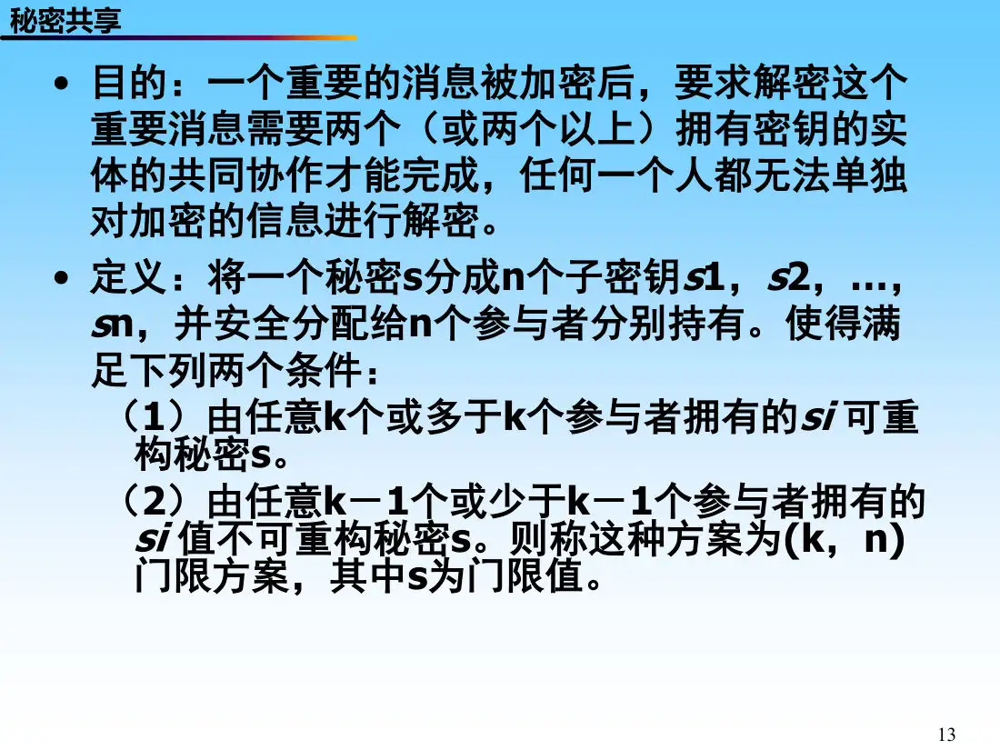

原文：

秘密共享

目的：一个重要的消息被加密后，要求解密这个重要消息需要两个（或两个以上）拥有密钥的实体的共同协作才能完成，任何一个人都无法单独对加密的信息进行解密。

定义：将一个秘密s分成n个子密钥s1，s2，…，n，并安全分配给n个参与者分别持有。使得满足下列两个条件：

（1）由任意k个或多于k个参与者拥有的si可重构秘密s。

（2）由任意k－1个或少于k－1个参与者拥有的值不可重构秘密s。则称这种方案为(k，n)门限方案，其中s为门限值。

13

### Shamir秘密共享方案

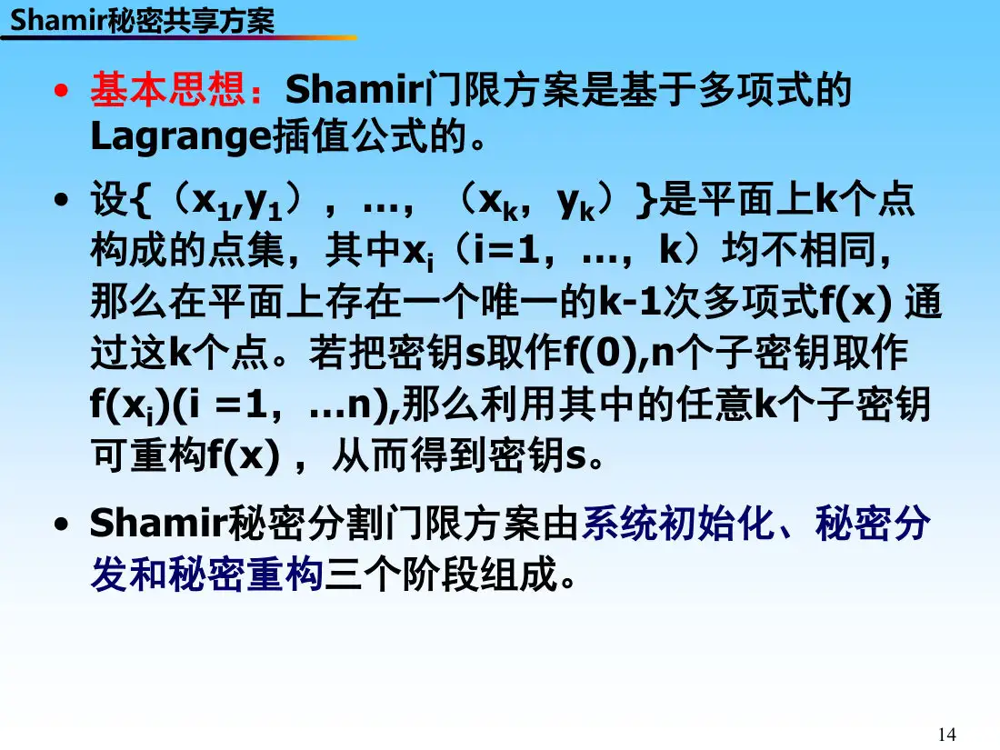

原文：

Shamir秘密共享方案

基本思想：Shamir门限方案是基于多项式的Lagrange插值公式的。

设{ $( \mathbf { x _ { 1 } } , \mathbf { y _ { 1 } } )$ $( \times _ { k } , \ y _ { k } )$ }是平面上k个点构成的点集，其中 $\mathbf { x } _ { \mathrm { i } } ( \mathrm { i } { = } 1 , \ldots , \mathrm { k } )$ 均不相同，那么在平面上存在一个唯一的k-1次多项式f(x) 通过这k个点。若把密钥s取作f $( 0 ) , \mathsf { n }$ 个子密钥取作$\mathsf { f } ( \mathsf { x } _ { \mathrm { i } } ) ( \mathsf { i } = \mathsf { 1 } , \mathsf { \Gamma } _ { \mathsf { n } = \mathsf { n } } )$ ,那么利用其中的任意k个子密钥可重构f(x) ，从而得到密钥s。

• Shamir秘密分割门限方案由系统初始化、秘密分发和秘密重构三个阶段组成。

14

### • 1、系统初始化

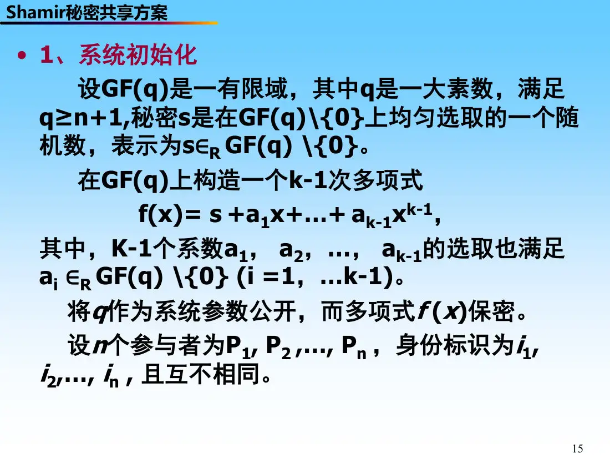

原文：

• 1、系统初始化

设GF(q)是一有限域，其中q是一大素数，满足$\pmb { \mathrm { q } } \geq \boldsymbol { \mathrm { n } } + \pmb { \mathrm { 1 } }$ ,秘密s是在 $\mathbf G \mathbb { F } ( \mathbf q ) \backslash \{ \mathbf { 0 } \}$ 上均匀选取的一个随机数，表示为 ${ \mathsf { S } } { \mathsf { E } } _ { \mathbb { R } } { \mathsf { G F } } ( { \mathsf { q } } ) \ \backslash \{ { \mathsf { 0 } } \}$

在GF(q)上构造一个k-1次多项式

$$
f (x) = s + a _ {1} x + \dots + a _ {k - 1} x ^ {k - 1},
$$

其中，K-1个系数 $a _ { 1 } , ~ \mathsf { a } _ { 2 } , ~ \mathsf { a } = \mathsf { a } , ~ \mathsf { a } _ { \mathsf { k } - 1 }$ 的选取也满足$\mathsf { a } _ { \mathrm { i } } \in _ { \mathsf { R } } \mathsf { G F } ( \mathsf { q } ) \ \backslash \{ \mathsf { 0 } \} \ ( \mathsf { i } = \mathbf { 1 } , \quad \mathsf { a . c . } \mathbf { k } - \mathbf { 1 } )$ 0

将 $q ^ { \dag }$ 作为系统参数公开，而多项式 $\pmb { f } ( \pmb { X } )$ 保密。

设n个参与者为 $\mathsf { P _ { 1 } } , \mathsf { P _ { 2 } } , \mathsf { \Pi } _ { 2 } , \mathsf { \Pi } _ { 1 } , \mathsf { P _ { n } }$ ，身份标识为 $\bar { I } _ { 1 } ,$ $j _ { 2 \prime } = \Im _ { \prime } \tilde { I _ { \mathrm { n } } }$ , 且互不相同。

Shamir秘密共享方案

15

### • 2. 秘密分发

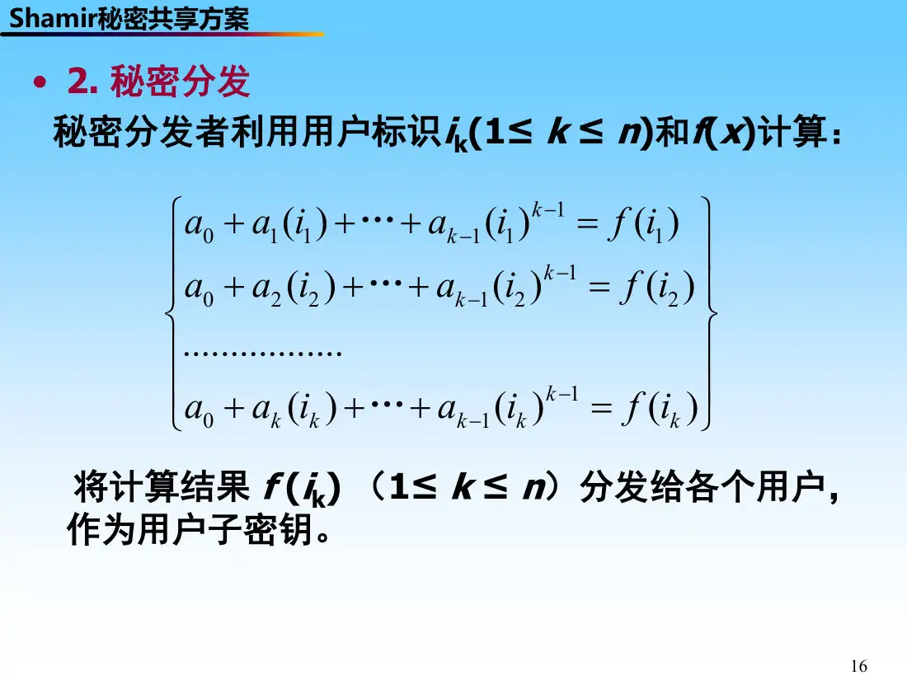

原文：

• 2. 秘密分发

秘密分发者利用用户标识 $j _ { \mathrm { k } } ( 1 \le K \le n )$ 和 $\pmb { \mathscr { n } } ( x )$ 计算：

$$
\left\{ \begin{array}{l} a _ {0} + a _ {1} (i _ {1}) + \dots + a _ {k - 1} (i _ {1}) ^ {k - 1} = f (i _ {1}) \\ a _ {0} + a _ {2} (i _ {2}) + \dots + a _ {k - 1} (i _ {2}) ^ {k - 1} = f (i _ {2}) \\ \dots\dots\\ a _ {0} + a _ {k} (i _ {k}) + \dots + a _ {k - 1} (i _ {k}) ^ {k - 1} = f (i _ {k}) \end{array} \right\}
$$

将计算结果 $f ( \bar { I } _ { \mathrm { k } } ) ( 1 \leq k \leq n )$ 分发给各个用户，作为用户子密钥。

Shamir秘密共享方案

16

### Shamir秘密共享方案

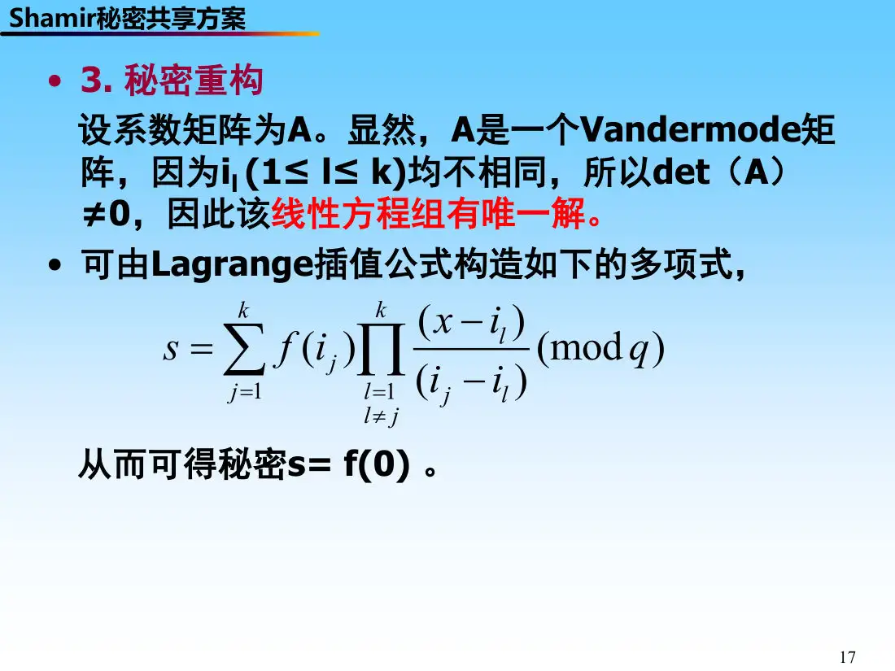

原文：

Shamir秘密共享方案

• 3. 秘密重构

设系数矩阵为A。显然，A是一个Vandermode矩阵，因为i $( 1 \leq 1 \leq \mathsf { k } )$ 均不相同，所以det（A）$\neq 0$ 因此该线性方程组有唯一解。

• 可由Lagrange插值公式构造如下的多项式，

$$
s = \sum_ {j = 1} ^ {k} f (i _ {j}) \prod_ {\substack {l = 1 \\ l \neq j}} ^ {k} \frac {(x - i _ {l})}{(i _ {j} - i _ {l})} (\mathrm{mod} q)
$$

从而可得秘密 $\mathbf { s } \mathbf { = f ( 0 ) }$ 0

17
