# 《密码学》第3章 古典密码学（课件）

原件的每一页，下面附识别出的文字。

### 古典密码技术

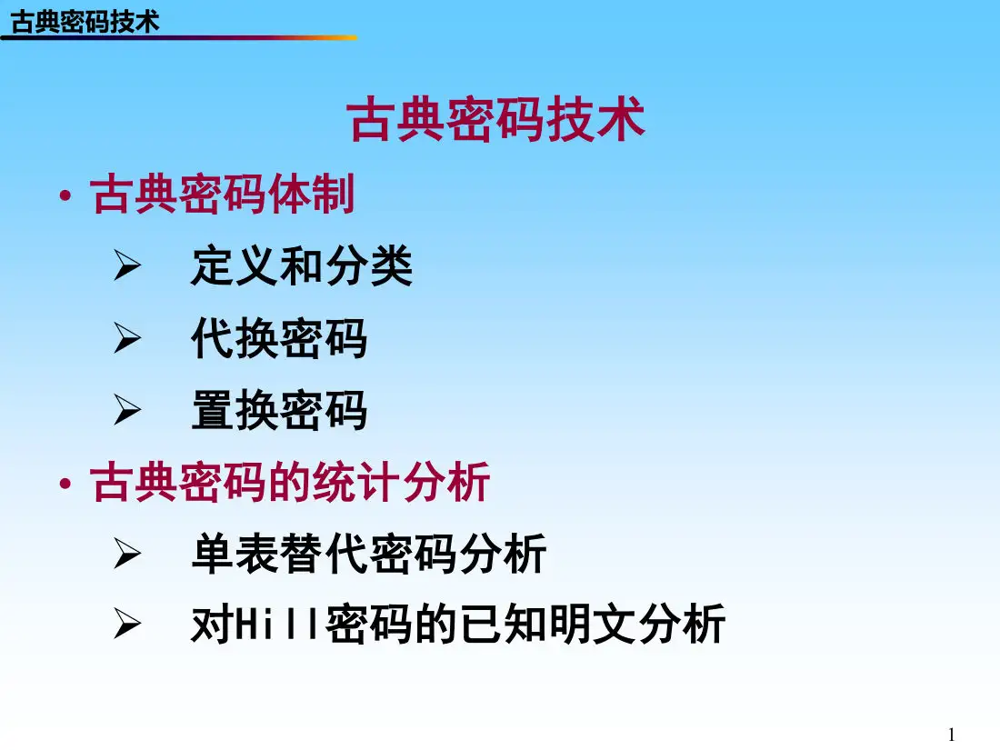

原文：

古典密码技术

\- 古典密码体制

定义和分类

代换密码

置换密码

\- 古典密码的统计分析

单表替代密码分析

对Hill密码的已知明文分析

古典密码技术

1

### 古典密码技术

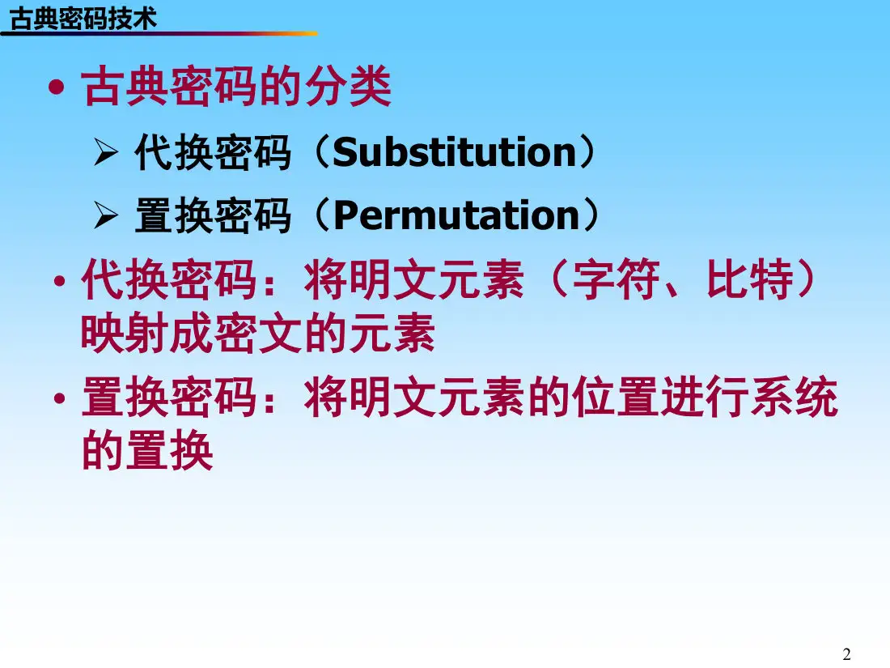

原文：

古典密码技术

\- 古典密码的分类

代换密码（Substitution）

置换密码（Permutation）

\- 代换密码：将明文元素（字符、比特）映射成密文的元素

\- 置换密码：将明文元素的位置进行系统的置换

2

### 古典密码技术

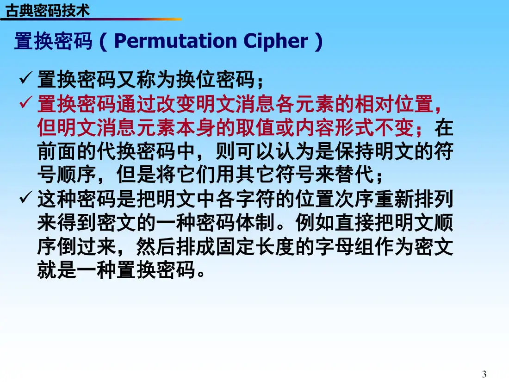

原文：

古典密码技术

置换密码 (Permutation Cipher)

√ 置换密码又称为换位密码；

√ 置换密码通过改变明文消息各元素的相对位置，但明文消息元素本身的取值或内容形式不变；在前面的代换密码中，则可以认为是保持明文的符号顺序，但是将它们用其它符号来替代；

√ 这种密码是把明文中各字符的位置次序重新排列来得到密文的一种密码体制。例如直接把明文顺序倒过来，然后排成固定长度的字母组作为密文就是一种置换密码。

3

### 置换密码(周期置换密码)

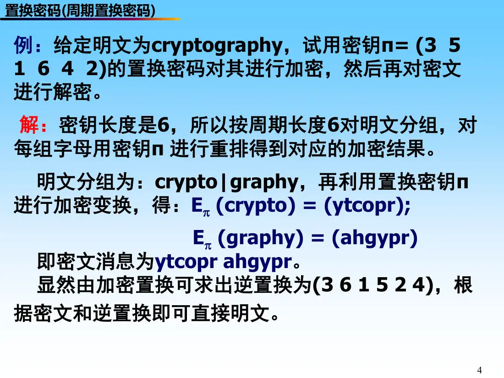

原文：

置换密码(周期置换密码)

例：给定明文为cryptography，试用密钥n= (3 5 1 6 4 2)的置换密码对其进行加密，然后再对密文进行解密。

解：密钥长度是6，所以按周期长度6对明文分组，对每组字母用密钥n进行重排得到对应的加密结果。

明文分组为：crypto | graphy，再利用置换密钥n进行加密变换，得： $E_{\pi}$ (crypto) = (ytcopr);

$$
E _ {\pi} (\text {graphy}) = (\text {ahgypr})
$$

即密文消息为ytcopr ahgypr。

显然由加密置换可求出逆置换为(361524)，根据密文和逆置换即可直接明文。

4

### 代换密码（替代密码）

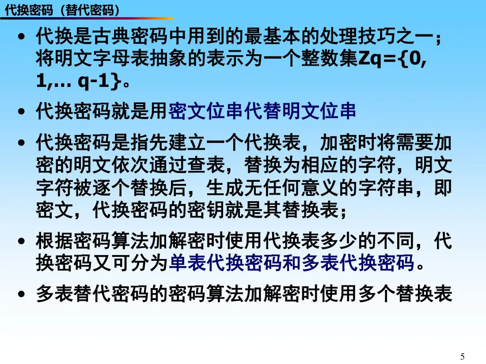

原文：

代换密码（替代密码）

\- 代换是古典密码中用到的最基本的处理技巧之一; 将明文字母表抽象的表示为一个整数集 $Zq = \{0, 1, \ldots, q - 1\}$ 。

\- 代换密码就是用密文位串代替明文位串

\- 代换密码是指先建立一个代换表，加密时将需要加密的明文依次通过查表，替换为相应的字符，明文字符被逐个替换后，生成无任何意义的字符串，即密文，代换密码的密钥就是其替换表；

\- 根据密码算法加解密时使用代换表多少的不同，代换密码又可分为单表代换密码和多表代换密码。

\- 多表替代密码的密码算法加解密时使用多个替换表

5

### 单表代换密码

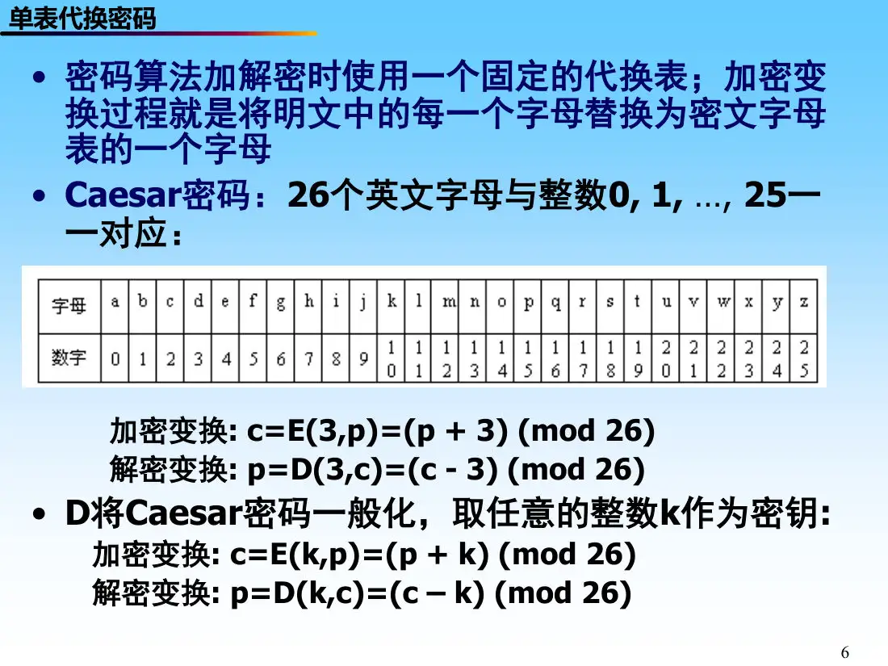

原文：

单表代换密码

\- 密码算法加解密时使用一个固定的代换表；加密变换过程就是将明文中的每一个字母替换为密文字母表的一个字母

\- Caesar密码：26个英文字母与整数0, 1, ..., 25—一对应：

<table><tr><td>字母</td><td>a</td><td>b</td><td>c</td><td>d</td><td>e</td><td>f</td><td>g</td><td>h</td><td>i</td><td>j</td><td>k</td><td>l</td><td>m</td><td>n</td><td>o</td><td>p</td><td>q</td><td>r</td><td>s</td><td>t</td><td>u</td><td>v</td><td>w</td><td>x</td><td>y</td><td>z</td></tr><tr><td>数字</td><td>0</td><td>1</td><td>2</td><td>3</td><td>4</td><td>5</td><td>6</td><td>7</td><td>8</td><td>9</td><td>10</td><td>11</td><td>12</td><td>13</td><td>14</td><td>15</td><td>16</td><td>17</td><td>18</td><td>19</td><td>20</td><td>21</td><td>22</td><td>23</td><td>24</td><td>25</td></tr></table>

加密变换: c=E(3,p)=(p + 3) (mod 26)

解密变换: $p=D(3,c)=(c-3)$ (mod 26)

\- D将Caesar密码一般化，取任意的整数k作为密钥：

加密变换: c=E(k,p)=(p+k) (mod 26)

解密变换: $p=D(k,c)=(c-k)$ (mod 26)

6

### 一般单表代换密码

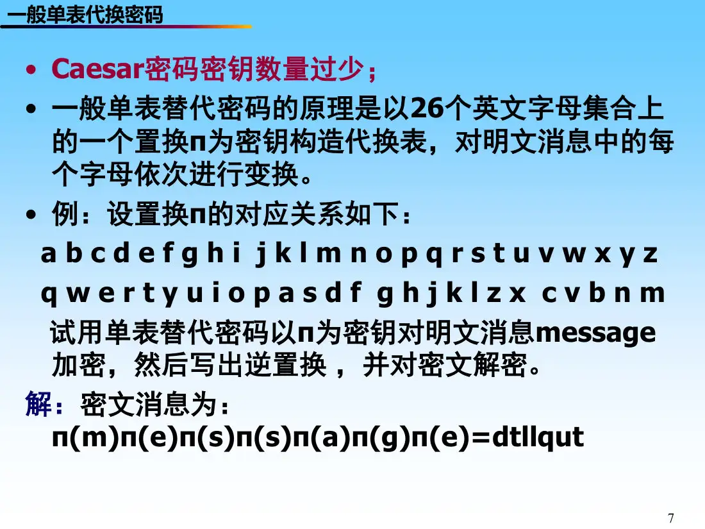

原文：

一般单表代换密码

\- Caesar密码密钥数量过少;

\- 一般单表替代密码的原理是以26个英文字母集合上的一个置换n为密钥构造代换表，对明文消息中的每个字母依次进行变换。

\- 例：设置换n的对应关系如下：

abcdefghijklmnopqrstuvwxyz
qwertyuiopasdfghjklzxcvbnm
试用单表替代密码以n为密钥对明文消息message
加密，然后写出逆置换，并对密文解密。

解：密文消息为：

$$
\pi (m) \pi (e) \pi (s) \pi (s) \pi (a) \pi (g) \pi (e) = d t l l q u t
$$

7

### 一般单表代换密码

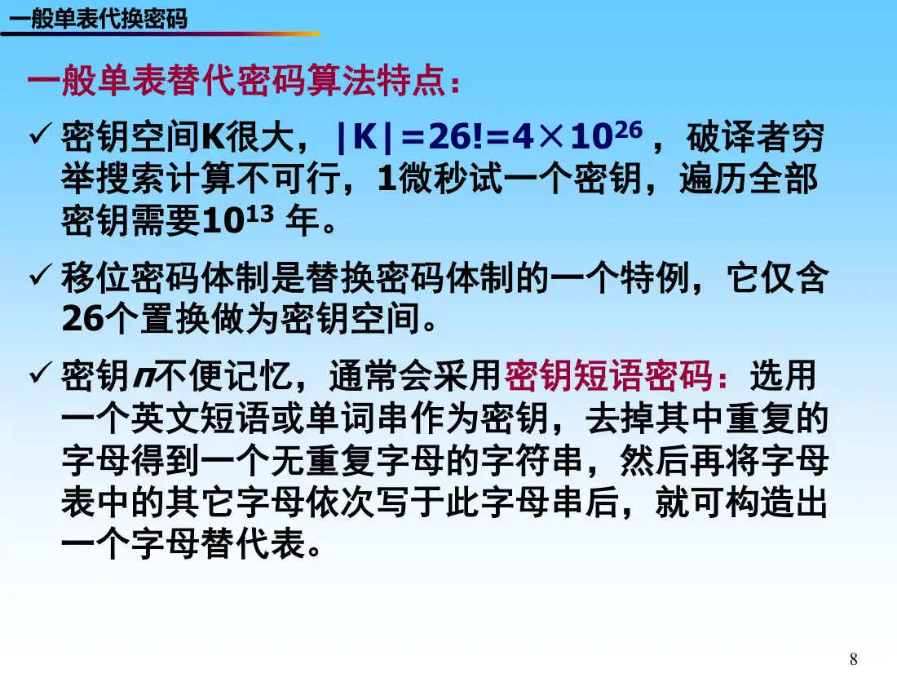

原文：

一般单表代换密码

一般单表替代密码算法特点：

√ 密钥空间K很大， $|K|=26!=4\times10^{26}$ ，破译者穷举搜索计算不可行，1微秒试一个密钥，遍历全部密钥需要 $10^{13}$ 年。

√ 移位密码体制是替换密码体制的一个特例，它仅含26个置换做为密钥空间。

√ 密钥n不便记忆，通常会采用密钥短语密码：选用一个英文短语或单词串作为密钥，去掉其中重复的字母得到一个无重复字母的字符串，然后再将字母表中的其它字母依次写于此字母串后，就可构造出一个字母替代表。

8

### 仿射密码

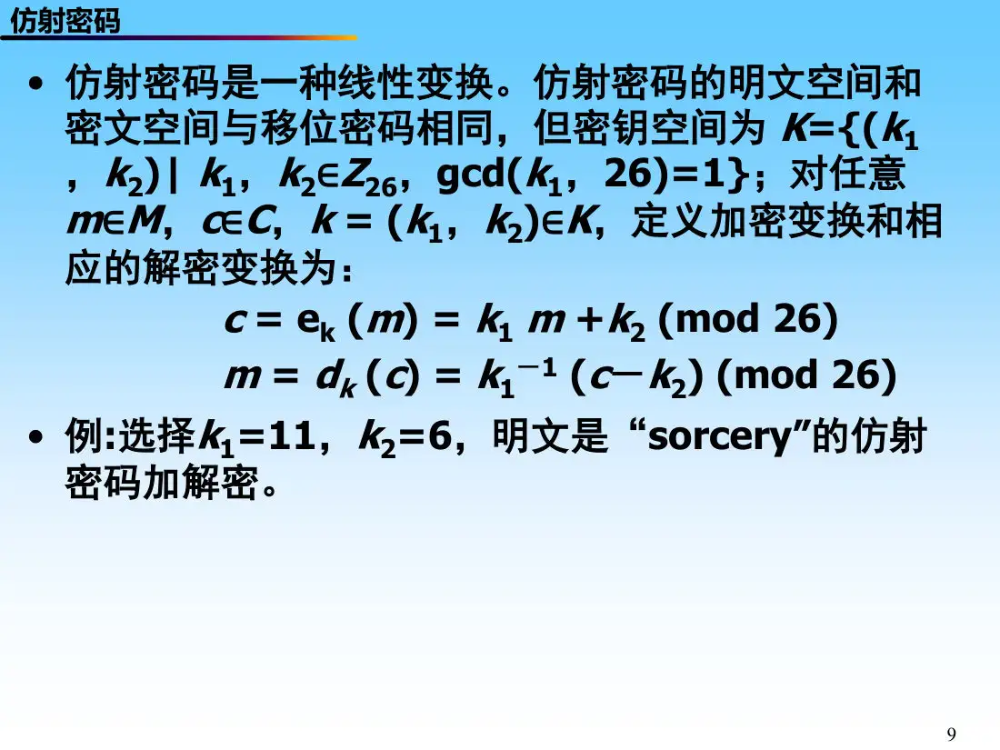

原文：

仿射密码

\- 仿射密码是一种线性变换。仿射密码的明文空间和密文空间与移位密码相同，但密钥空间为 $K = \{(k_{1}, k_{2}) | k_{1}, k_{2} \in Z_{26}, \gcd(k_{1}, 26) = 1\}$ ; 对任意 $m \in M, c \in C, k = (k_{1}, k_{2}) \in K$ ，定义加密变换和相应的解密变换为：

$$
\begin{array}{l} c = \mathrm{e} _ {k} (m) = k _ {1} m + k _ {2} (\mathrm{mod} 2 6) \\ m = d _ {k} (c) = k _ {1} ^ {- 1} (c - k _ {2}) (\mathrm{mod} 2 6) \end{array}
$$

\- 例:选择 $k_{1}=11$ ， $k_{2}=6$ ，明文是“sorcery”的仿射密码加解密。

9

### 多表代换密码

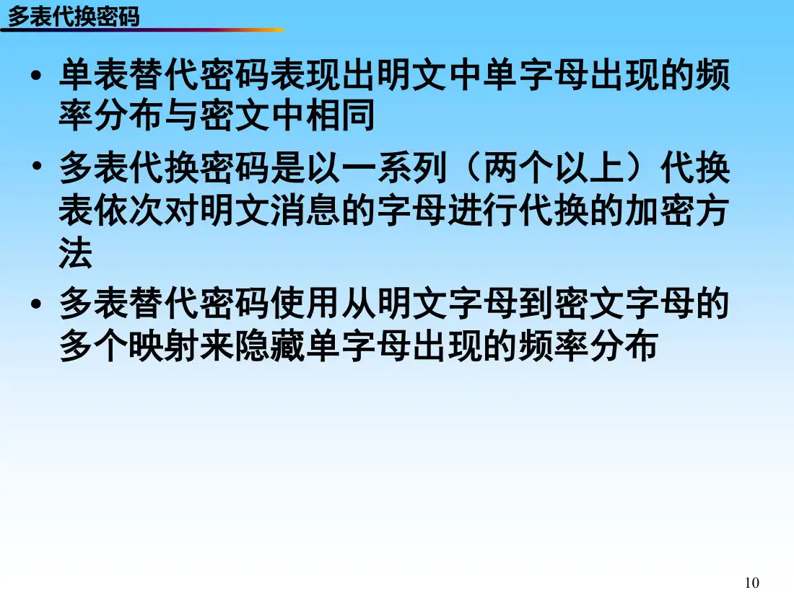

原文：

多表代换密码

\- 单表替代密码表现出明文中单字母出现的频率分布与密文中相同

\- 多表代换密码是以一系列（两个以上）代换表依次对明文消息的字母进行代换的加密方法

\- 多表替代密码使用从明文字母到密文字母的多个映射来隐藏单字母出现的频率分布

10

### 多表代换密码

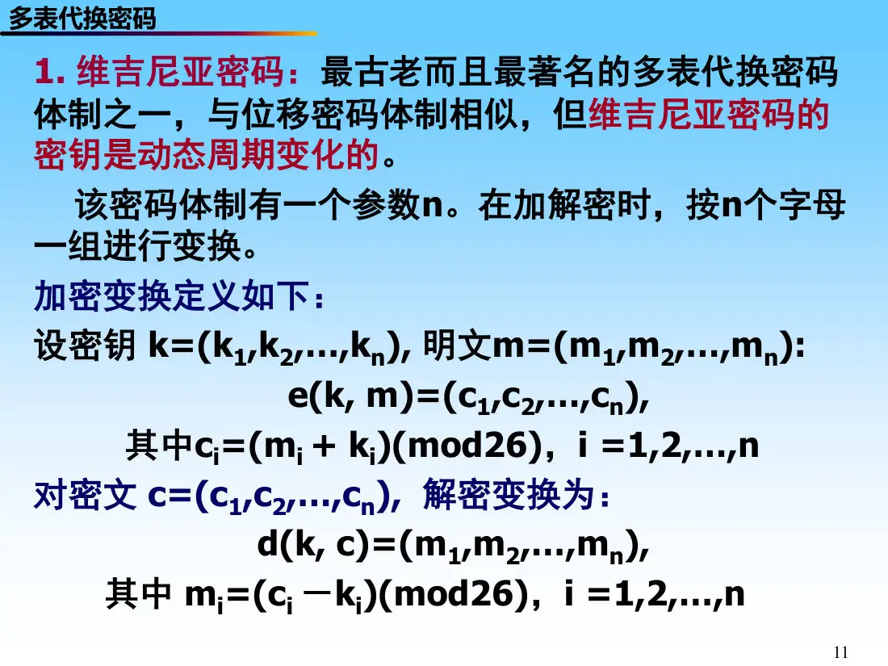

原文：

多表代换密码

1. 维吉尼亚密码：最古老而且最著名的多表代换密码体制之一，与位移密码体制相似，但维吉尼亚密码的密钥是动态周期变化的。

该密码体制有一个参数n。在加解密时，按n个字母一组进行变换。

加密变换定义如下:

设密钥 $k=(k_{1},k_{2},\ldots,k_{n})$ ，明文 $m=(m_{1},m_{2},\ldots,m_{n})$ :

$$
\mathbf {e} (\mathbf {k}, \mathbf {m}) = (\mathbf {c _ {1}}, \mathbf {c _ {2}}, \dots , \mathbf {c _ {n}}),
$$

其中 $c_{i}=(m_{i}+k_{i})\pmod{26}$ ， $i=1,2,\ldots,n$ 对密文 $c=(c_{1},c_{2},\ldots,c_{n})$ ，解密变换为：

$$
\mathbf {d} (\mathbf {k}, \mathbf {c}) = \left(\mathsf {m} _ {1}, \mathsf {m} _ {2}, \dots , \mathsf {m} _ {n}\right),
$$

其中 $m_{i}=(c_{i}-k_{i})\pmod{26},\quad i=1,2,\ldots,n$

11

### 维吉尼亚密码

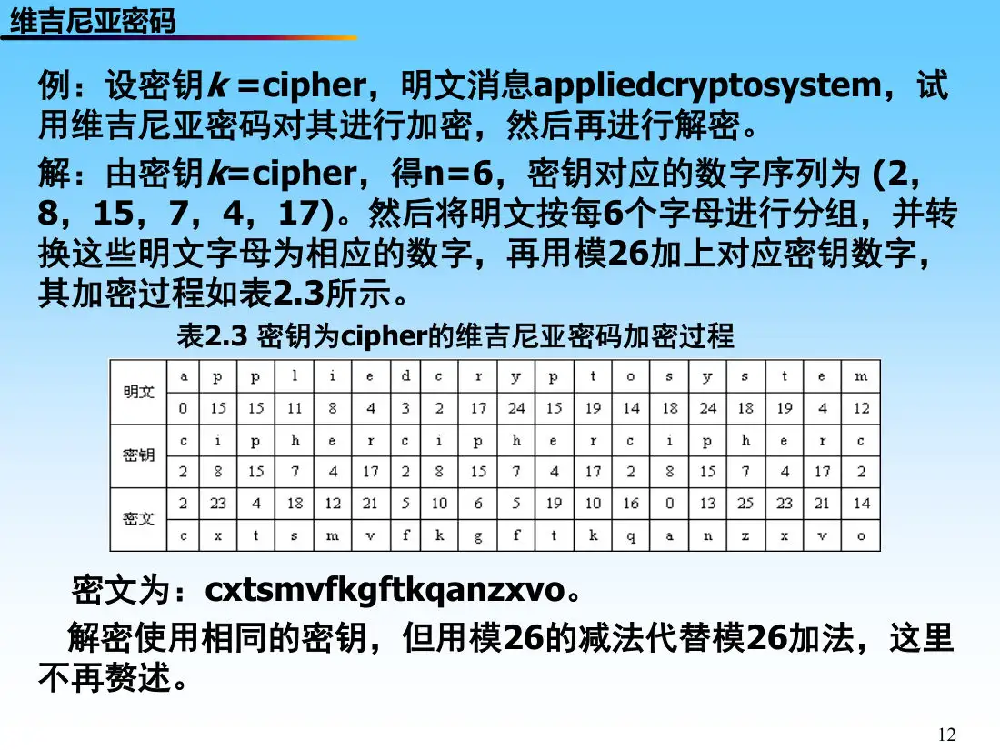

原文：

维吉尼亚密码

例：设密钥 $k =$ cipher，明文消息appliedcryptosystem，试用维吉尼亚密码对其进行加密，然后再进行解密。

解: 由密钥 $k = \text{cipher}$ , 得 $n = 6$ , 密钥对应的数字序列为 (2, 8, 15, 7, 4, 17)。然后将明文按每6个字母进行分组, 并转换这些明文字母为相应的数字, 再用模26加上对应密钥数字, 其加密过程如表2.3所示。

表2.3 密钥为cipher的维吉尼亚密码加密过程
<table><tr><td rowspan="2">明文</td><td>a</td><td>p</td><td>p</td><td>l</td><td>i</td><td>e</td><td>d</td><td>c</td><td>r</td><td>y</td><td>p</td><td>t</td><td>o</td><td>s</td><td>y</td><td>s</td><td>t</td><td>e</td><td>m</td></tr><tr><td>0</td><td>15</td><td>15</td><td>11</td><td>8</td><td>4</td><td>3</td><td>2</td><td>17</td><td>24</td><td>15</td><td>19</td><td>14</td><td>18</td><td>24</td><td>18</td><td>19</td><td>4</td><td>12</td></tr><tr><td rowspan="2">密钥</td><td>c</td><td>i</td><td>p</td><td>h</td><td>e</td><td>r</td><td>c</td><td>i</td><td>p</td><td>h</td><td>e</td><td>r</td><td>c</td><td>i</td><td>p</td><td>h</td><td>e</td><td>r</td><td>c</td></tr><tr><td>2</td><td>8</td><td>15</td><td>7</td><td>4</td><td>17</td><td>2</td><td>8</td><td>15</td><td>7</td><td>4</td><td>17</td><td>2</td><td>8</td><td>15</td><td>7</td><td>4</td><td>17</td><td>2</td></tr><tr><td rowspan="2">密文</td><td>2</td><td>23</td><td>4</td><td>18</td><td>12</td><td>21</td><td>5</td><td>10</td><td>6</td><td>5</td><td>19</td><td>10</td><td>16</td><td>0</td><td>13</td><td>25</td><td>23</td><td>21</td><td>14</td></tr><tr><td>c</td><td>x</td><td>t</td><td>s</td><td>m</td><td>v</td><td>f</td><td>k</td><td>g</td><td>f</td><td>t</td><td>k</td><td>q</td><td>a</td><td>n</td><td>z</td><td>x</td><td>v</td><td>o</td></tr></table>

密文为：cxtsmvfkgftkqanzxvo。

解密使用相同的密钥，但用模26的减法代替模26加法，这里不再赘述。

12

### 多表代换密码

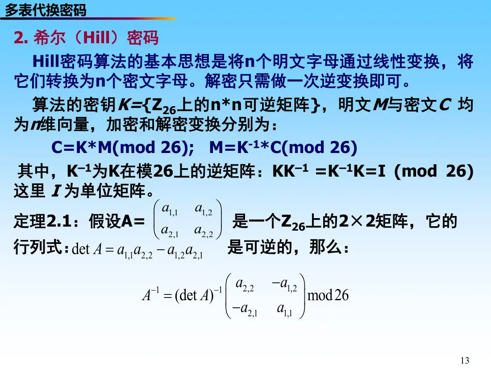

原文：

多表代换密码

2. 希尔（Hill）密码

Hill密码算法的基本思想是将n个明文字母通过线性变换，将它们转换为n个密文字母。解密只需做一次逆变换即可。

算法的密钥 $K = \{Z_{26}$ 上的 $n^{*} n$ 可逆矩阵 $\}$ ，明文 $M$ 与密文 $C$ 均为 $n$ 维向量，加密和解密变换分别为：

$$
\mathrm{C} = \mathrm{K} ^ {*} \mathrm{M} (\mathrm{mod} 2 6); \quad \mathrm{M} = \mathrm{K} ^ {- 1} * \mathrm{C} (\mathrm{mod} 2 6)
$$

其中， $K^{-1}$ 为K在模26上的逆矩阵： $KK^{-1} = K^{-1}K = I \pmod{26}$ 这里 $I$ 为单位矩阵。

定理2.1：假设 $A=\begin{pmatrix}a_{1,1}&a_{1,2}\\a_{2,1}&a_{2,2}\end{pmatrix}$ 是一个 $Z_{26}$ 上的 $2\times2$ 矩阵，它的是可逆的，那么：

$$
A ^ {- 1} = (\det A) ^ {- 1} \left( \begin{array}{c c} a _ {2, 2} & - a _ {1, 2} \\ - a _ {2, 1} & a _ {1, 1} \end{array} \right) \bmod 2 6
$$

13

### Hill密码

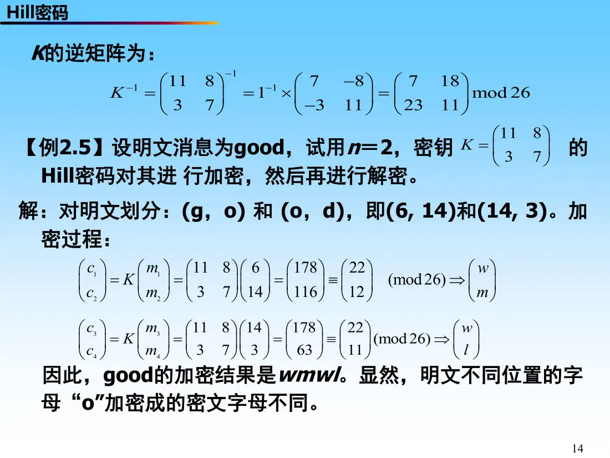

原文：

Hill密码

K的逆矩阵为：

$$
K ^ {- 1} = \left( \begin{array}{c c} 1 & 8 \\ 3 & 7 \end{array} \right) ^ {- 1} = 1 ^ {- 1} \times \left( \begin{array}{c c} 7 & - 8 \\ - 3 & 1 1 \end{array} \right) = \left( \begin{array}{c c} 7 & 1 8 \\ 2 3 & 1 1 \end{array} \right) \bmod 2 6
$$

【例2.5】设明文消息为good，试用n=2，密钥 $K=\begin{pmatrix}11 & 8 \\ 3 & 7\end{pmatrix}$ 的 Hill密码对其进行加密，然后再进行解密。

解：对明文划分：(g, o) 和 (o, d)，即(6, 14)和(14, 3)。加密过程：

$$
\binom {c _ {1}} {c _ {2}} = K \binom {m _ {1}} {m _ {2}} = \left( \begin{array}{l l} 1 1 & 8 \\ 3 & 7 \end{array} \right) \binom {6} {1 4} = \binom {1 7 8} {1 1 6} \equiv \binom {2 2} {1 2} \pmod {2 6} \Rightarrow \binom {w} {m}
$$

$$
\binom {c _ {3}} {c _ {4}} = K \binom {m _ {3}} {m _ {4}} = \left( \begin{array}{c c} 1 1 & 8 \\ 3 & 7 \end{array} \right) \binom {1 4} {3} = \binom {1 7 8} {6 3} \equiv \binom {2 2} {1 1} (\mathrm{mod} 2 6) \Rightarrow \binom {w} {l}
$$

因此，good的加密结果是wmwl。显然，明文不同位置的字母“o”加密成的密文字母不同。

14

### Hill密码

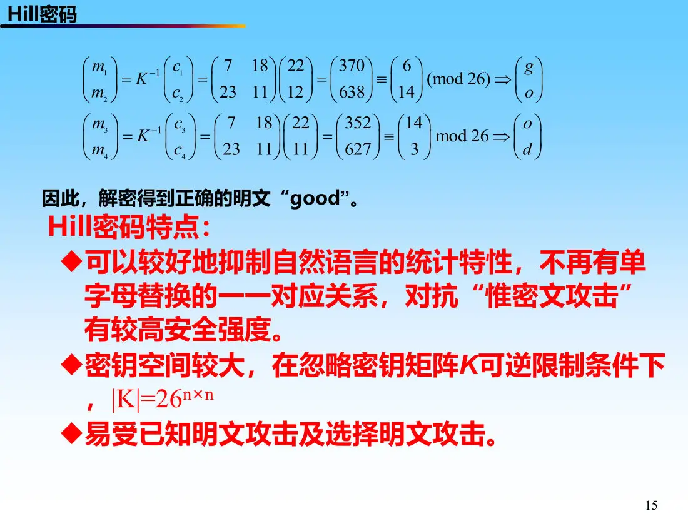

原文：

Hill密码

$$
\binom {m _ {1}} {m _ {2}} = K ^ {- 1} \binom {c _ {1}} {c _ {2}} = \left( \begin{array}{l l} 7 & 1 8 \\ 2 3 & 1 1 \end{array} \right) \binom {2 2} {1 2} = \binom {3 7 0} {6 3 8} \equiv \binom {6} {1 4} (\mathrm{mod} 2 6) \Rightarrow \binom {g} {o}
$$

$$
\binom {m _ {3}} {m _ {4}} = K ^ {- 1} \binom {c _ {3}} {c _ {4}} = \left( \begin{array}{l l} 7 & 1 8 \\ 2 3 & 1 1 \end{array} \right) \binom {2 2} {1 1} = \binom {3 5 2} {6 2 7} \equiv \binom {1 4} {3} \bmod 2 6 \Rightarrow \binom {o} {d}
$$

因此，解密得到正确的明文“good”。

Hill密码特点:

◆可以较好地抑制自然语言的统计特性，不再有单字母替换的一一对应关系，对抗“惟密文攻击”有较高安全强度。

◆密钥空间较大，在忽略密钥矩阵K可逆限制条件下， $|K|=26^{n\times n}$

◆ 易受已知明文攻击及选择明文攻击。

15

### 多表代换密码

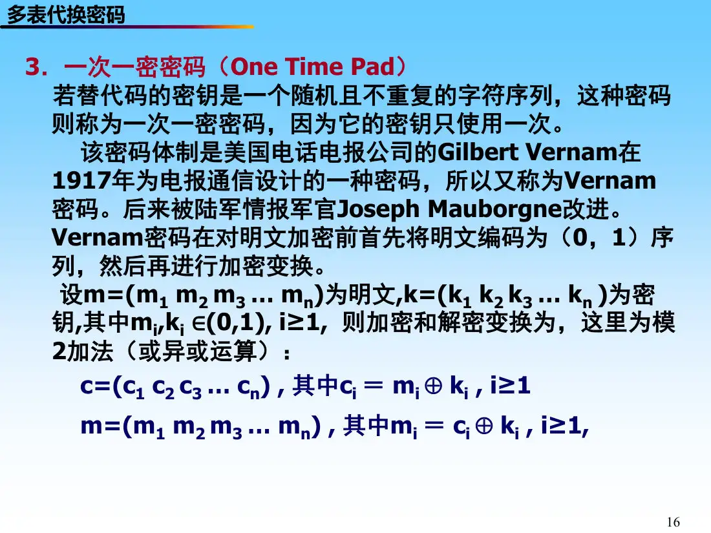

原文：

多表代换密码

3. 一次一密密码（One Time Pad）

若替代码的密钥是一个随机且不重复的字符序列，这种密码则称为一次一密密码，因为它的密钥只使用一次。

该密码体制是美国电话电报公司的Gilbert Vernam在1917年为电报通信设计的一种密码，所以又称为Vernam密码。后来被陆军情报军官Joseph Mauborgne改进。

Vernam密码在对明文加密前首先将明文编码为（0，1）序列，然后再进行加密变换。

设 $m=(m_{1}m_{2}m_{3}\ldots m_{n})$ 为明文， $k=(k_{1}k_{2}k_{3}\ldots k_{n})$ 为密钥，其中 $m_{i},k_{i}\in(0,1),i\geq1$ ，则加密和解密变换为，这里为模2加法（或异或运算）：

$$
\mathbf {c} = \left(\mathbf {c} _ {1} \mathbf {c} _ {2} \mathbf {c} _ {3} \dots \mathbf {c} _ {n}\right), \text {其中} \mathbf {c} _ {\mathrm{i}} = \mathbf {m} _ {\mathrm{i}} \oplus \mathbf {k} _ {\mathrm{i}}, \mathrm{i} \geq 1
$$

$m=(m_{1}m_{2}m_{3}\ldots m_{n})$ ，其中 $m_{i}=c_{i}\oplus k_{i},i\geq1,$

16

### 一次一密密码

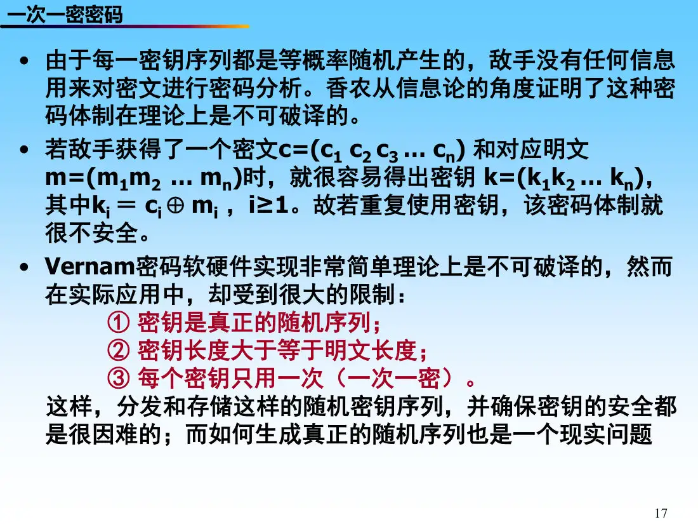

原文：

一次一密密码

\- 由于每一密钥序列都是等概率随机产生的，敌手没有任何信息用来对密文进行密码分析。香农从信息论的角度证明了这种密码体制在理论上是不可破译的。

\- 若敌手获得了一个密文 $c = (c_{1} c_{2} c_{3} \ldots c_{n})$ 和对应明文 $m = (m_{1} m_{2} \ldots m_{n})$ 时，就很容易得出密钥 $k = (k_{1} k_{2} \ldots k_{n})$ ，其中 $k_{i} = c_{i} \oplus m_{i}$ ， $i \geq 1$ 。故若重复使用密钥，该密码体制就很不安全。

\- Vernam密码软硬件实现非常简单理论上是不可破译的，然而在实际应用中，却受到很大的限制：

① 密钥是真正的随机序列；

② 密钥长度大于等于明文长度；

③ 每个密钥只用一次（一次一密）。

这样，分发和存储这样的随机密钥序列，并确保密钥的安全都是很困难的；而如何生成真正的随机序列也是一个现实问题

17

### 轮转密码机-ENIGMA

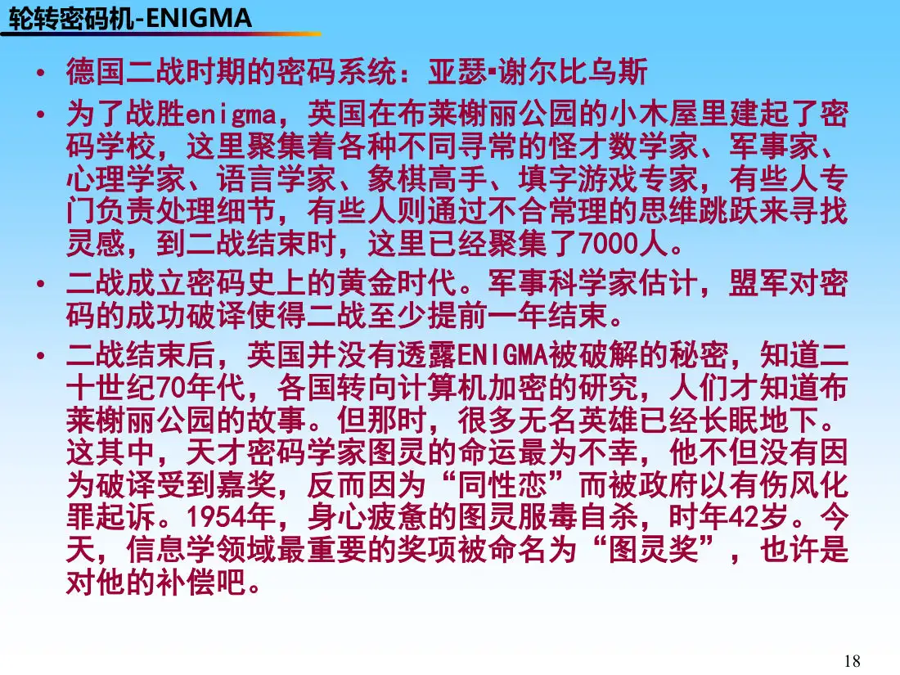

原文：

轮转密码机-ENIGMA

- 德国二战时期的密码系统：亚瑟·谢尔比乌斯

\- 为了战胜enigma，英国在布莱榭丽公园的小木屋里建起了密码学校，这里聚集着各种不同寻常的怪才数学家、军事家、心理学家、语言学家、象棋高手、填字游戏专家，有些人专门负责处理细节，有些人则通过不合常理的思维跳跃来寻找灵感，到二战结束时，这里已经聚集了7000人。

\- 二战成立密码史上的黄金时代。军事科学家估计，盟军对密码的成功破译使得二战至少提前一年结束。

\- 二战结束后，英国并没有透露ENIGMA被破解的秘密，知道二十世纪70年代，各国转向计算机加密的研究，人们才知道布莱榭丽公园的故事。但那时，很多无名英雄已经长眠地下。这其中，天才密码学家图灵的命运最为不幸，他不但没有因为破译受到嘉奖，反而因为“同性恋”而被政府以有伤风化罪起诉。1954年，身心疲惫的图灵服毒自杀，时年42岁。今天，信息学领域最重要的奖项被命名为“图灵奖”，也许是对他的补偿吧。

18

### 19

原文：

19

### 转轮加密算法

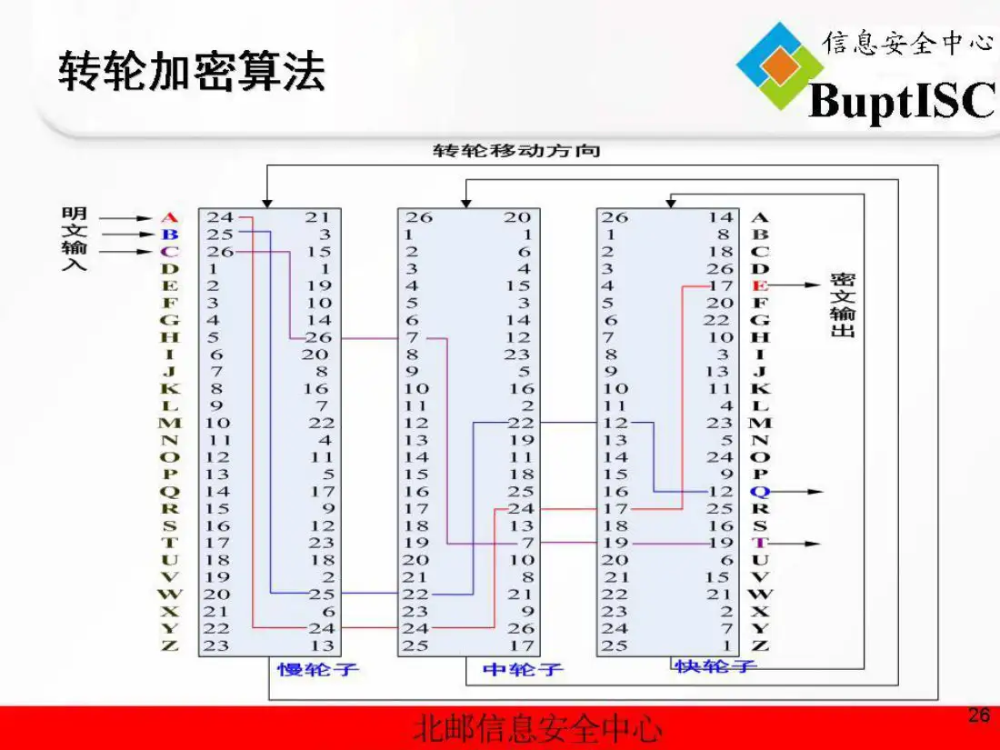

原文：

转轮加密算法

信息安全中心
BuptISC

北邮信息安全中心

26

### 密码分析（或攻击）的分类

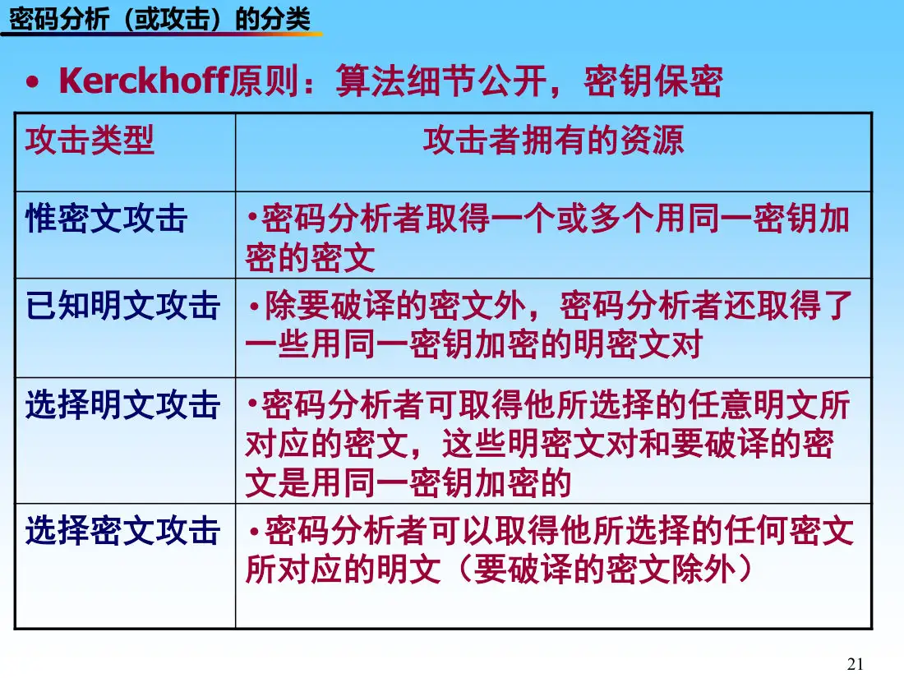

原文：

密码分析（或攻击）的分类

\- Kerckhoff原则：算法细节公开，密钥保密

<table><tr><td>攻击类型</td><td>攻击者拥有的资源</td></tr><tr><td>惟密文攻击</td><td>·密码分析者取得一个或多个用同一密钥加密的密文</td></tr><tr><td>已知明文攻击</td><td>·除要破译的密文外,密码分析者还取得了一些用同一密钥加密的明密文对</td></tr><tr><td>选择明文攻击</td><td>·密码分析者可取得他所选择的任意明文所对应的密文,这些明密文对和要破译的密文是用同一密钥加密的</td></tr><tr><td>选择密文攻击</td><td>·密码分析者可以取得他所选择的任何密文所对应的明文(要破译的密文除外)</td></tr></table>

21

### 古典密码的分析

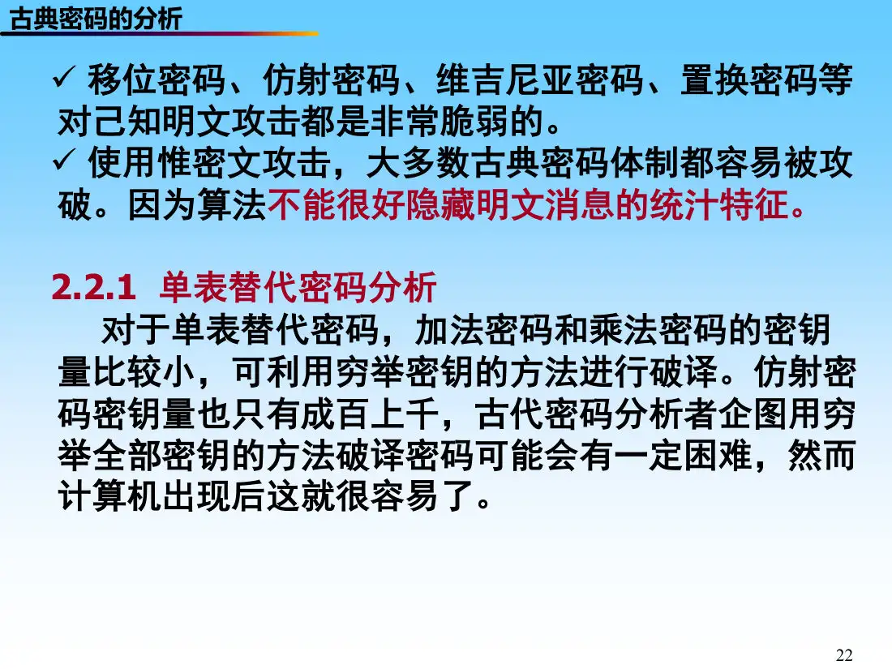

原文：

古典密码的分析

√ 移位密码、仿射密码、维吉尼亚密码、置换密码等对已知明文攻击都是非常脆弱的。

√ 使用惟密文攻击，大多数古典密码体制都容易被攻破。因为算法不能很好隐藏明文消息的统计特征。

2.2.1 单表替代密码分析

对于单表替代密码，加法密码和乘法密码的密钥量比较小，可利用穷举密钥的方法进行破译。仿射密码密钥量也只有成百上千，古代密码分析者企图用穷举全部密钥的方法破译密码可能会有一定困难，然而计算机出现后这就很容易了。

22

### 单表密码的分析

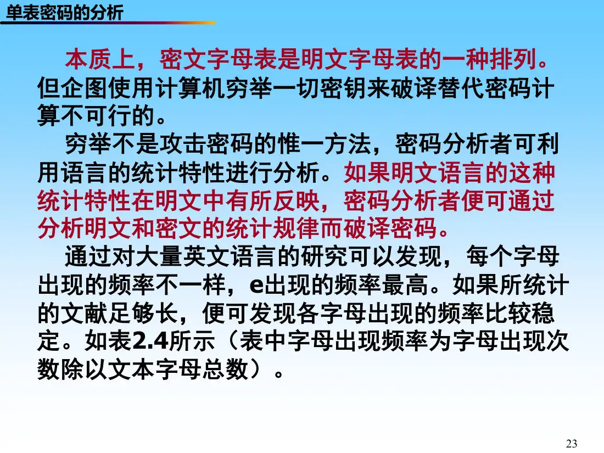

原文：

单表密码的分析

本质上，密文字母表是明文字母表的一种排列。但企图使用计算机穷举一切密钥来破译替代密码计算不可行的。

穷举不是攻击密码的惟一方法，密码分析者可利用语言的统计特性进行分析。如果明文语言的这种统计特性在明文中有所反映，密码分析者便可通过分析明文和密文的统计规律而破译密码。

通过对大量英文语言的研究可以发现，每个字母出现的频率不一样，e出现的频率最高。如果所统计的文献足够长，便可发现各字母出现的频率比较稳定。如表2.4所示（表中字母出现频率为字母出现次数除以文本字母总数）。

23

### 密码分析技术

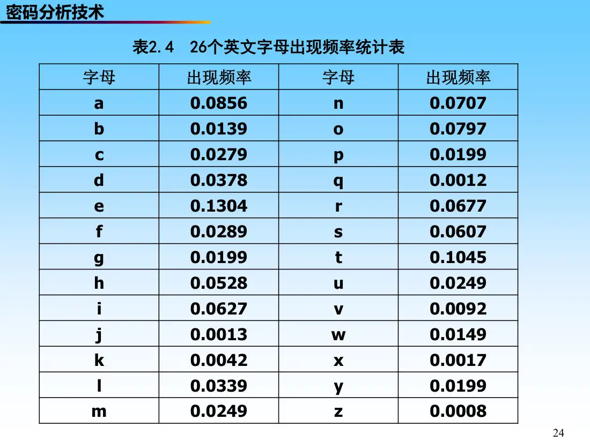

原文：

密码分析技术

表2.4 26个英文字母出现频率统计表
<table><tr><td>字母</td><td>出现频率</td><td>字母</td><td>出现频率</td></tr><tr><td>a</td><td>0.0856</td><td>n</td><td>0.0707</td></tr><tr><td>b</td><td>0.0139</td><td>o</td><td>0.0797</td></tr><tr><td>c</td><td>0.0279</td><td>p</td><td>0.0199</td></tr><tr><td>d</td><td>0.0378</td><td>q</td><td>0.0012</td></tr><tr><td>e</td><td>0.1304</td><td>r</td><td>0.0677</td></tr><tr><td>f</td><td>0.0289</td><td>s</td><td>0.0607</td></tr><tr><td>g</td><td>0.0199</td><td>t</td><td>0.1045</td></tr><tr><td>h</td><td>0.0528</td><td>u</td><td>0.0249</td></tr><tr><td>i</td><td>0.0627</td><td>v</td><td>0.0092</td></tr><tr><td>j</td><td>0.0013</td><td>w</td><td>0.0149</td></tr><tr><td>k</td><td>0.0042</td><td>x</td><td>0.0017</td></tr><tr><td>l</td><td>0.0339</td><td>y</td><td>0.0199</td></tr><tr><td>m</td><td>0.0249</td><td>z</td><td>0.0008</td></tr></table>

24

### 单表代换密码的分析

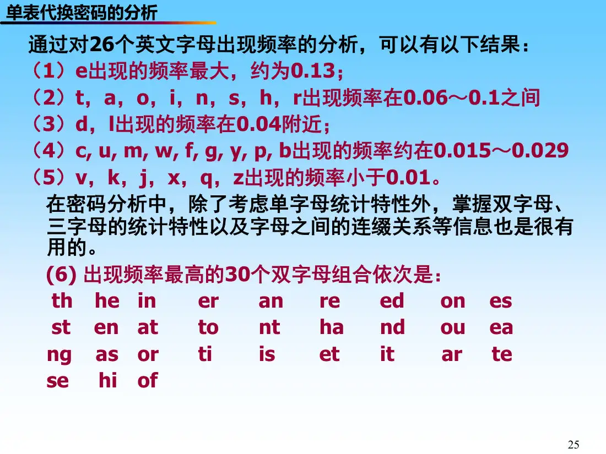

原文：

单表代换密码的分析

通过对26个英文字母出现频率的分析，可以有以下结果：

(1) e出现的频率最大, 约为0.13;

(2) t, a, o, i, n, s, h, r出现频率在0.06\~0.1之间

(3) d, I出现的频率在0.04附近;

(4) c, u, m, w, f, g, y, p, b出现的频率约在0.015\~0.029

(5) v, k, j, x, q, z出现的频率小于0.01。

在密码分析中，除了考虑单字母统计特性外，掌握双字母、三字母的统计特性以及字母之间的连缀关系等信息也是很有用的。

(6) 出现频率最高的30个双字母组合依次是:

<table><tr><td>th</td><td>he</td><td>in</td><td>er</td><td>an</td><td>re</td><td>ed</td><td>on</td><td>es</td></tr><tr><td>st</td><td>en</td><td>at</td><td>to</td><td>nt</td><td>ha</td><td>nd</td><td>ou</td><td>ea</td></tr><tr><td>ng</td><td>as</td><td>or</td><td>ti</td><td>is</td><td>et</td><td>it</td><td>ar</td><td>te</td></tr><tr><td>se</td><td>hi</td><td>of</td><td></td><td></td><td></td><td></td><td></td><td></td></tr></table>

25

### 单表代换密码的分析

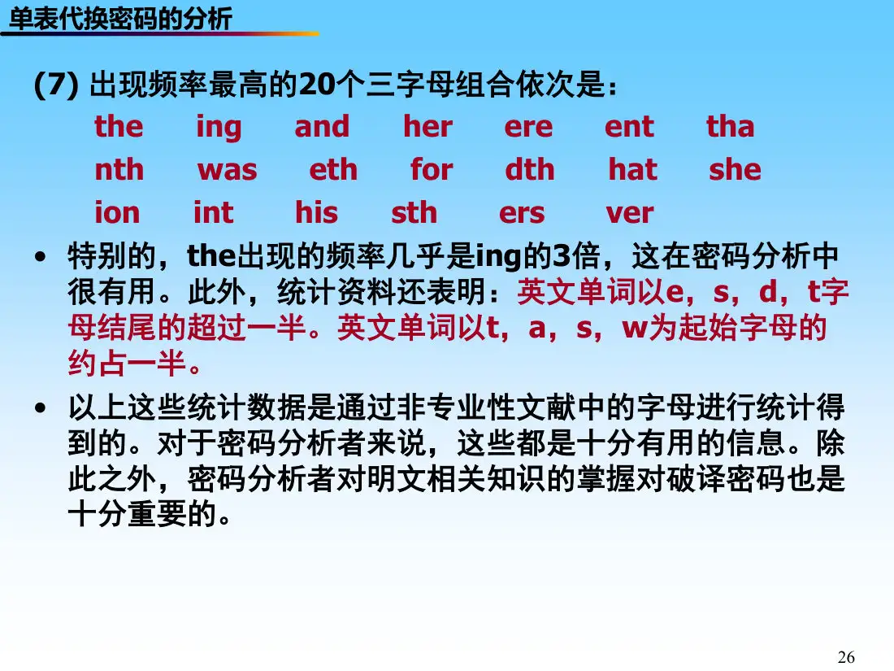

原文：

单表代换密码的分析

(7) 出现频率最高的20个三字母组合依次是:

the ing and her ere ent tha

nth was eth for dth hat she

ion int his sth ers ver

\- 特别的，the出现的频率几乎是ing的3倍，这在密码分析中很有用。此外，统计资料还表明：英文单词以e，s，d，t字母结尾的超过一半。英文单词以t，a，s，w为起始字母的约占一半。

\- 以上这些统计数据是通过非专业性文献中的字母进行统计得到的。对于密码分析者来说，这些都是十分有用的信息。除此之外，密码分析者对明文相关知识的掌握对破译密码也是十分重要的。

26

### 单表代换密码的分析

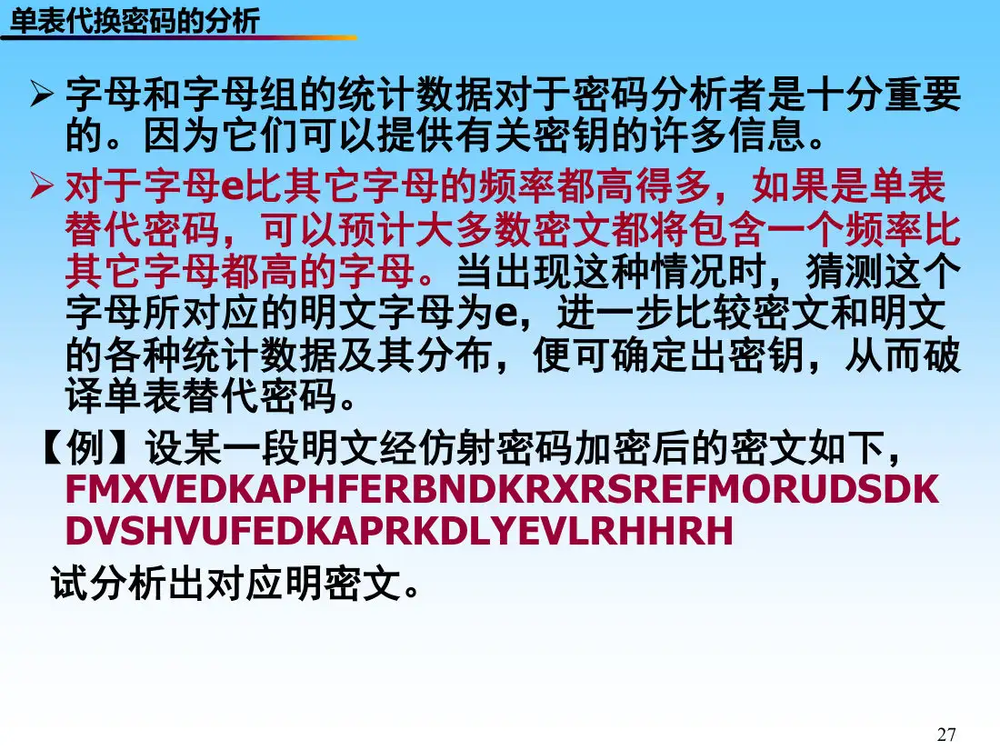

原文：

单表代换密码的分析

➢ 字母和字母组的统计数据对于密码分析者是十分重要的。因为它们可以提供有关密钥的许多信息。

对于字母e比其它字母的频率都高得多，如果是单表替代密码，可以预计大多数密文都将包含一个频率比其它字母都高的字母。当出现这种情况时，猜测这个字母所对应的明文字母为e，进一步比较密文和明文的各种统计数据及其分布，便可确定出密钥，从而破译单表替代密码。

【例】设某一段明文经仿射密码加密后的密文如下，FMXVEDKAPHFERBNDKRXRSREFMORUDSDK DVSHVUFEDKAPRKDLYEVLRHHRH 试分析出对应明密文。

27

### 假设：1. R-e；D-t 错

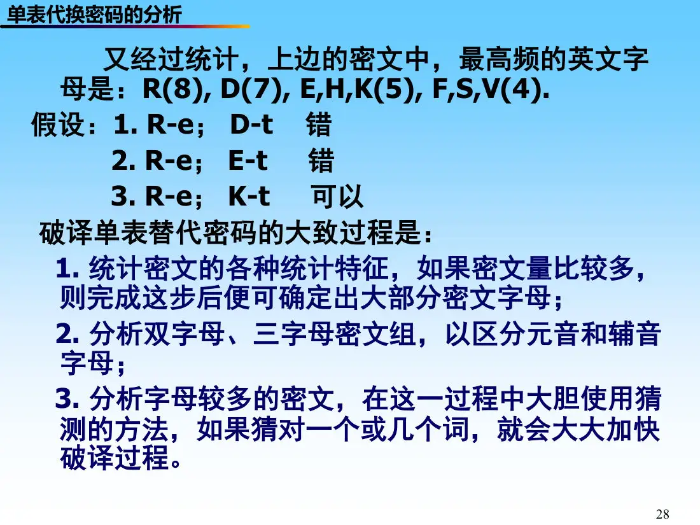

原文：

又经过统计，上边的密文中，最高频的英文字母是：R(8), D(7), E,H,K(5), F,S,V(4).

假设：1. R-e；D-t 错

2. R-e; E-t 错

3. R-e; K-t 可以

破译单表替代密码的大致过程是：

1. 统计密文的各种统计特征，如果密文量比较多，则完成这步后便可确定出大部分密文字母；

2. 分析双字母、三字母密文组，以区分元音和辅音字母；

3. 分析字母较多的密文，在这一过程中大胆使用猜测的方法，如果猜对一个或几个词，就会大大加快破译过程。

单表代换密码的分析

28

### 对Hill密码的已知明文分析

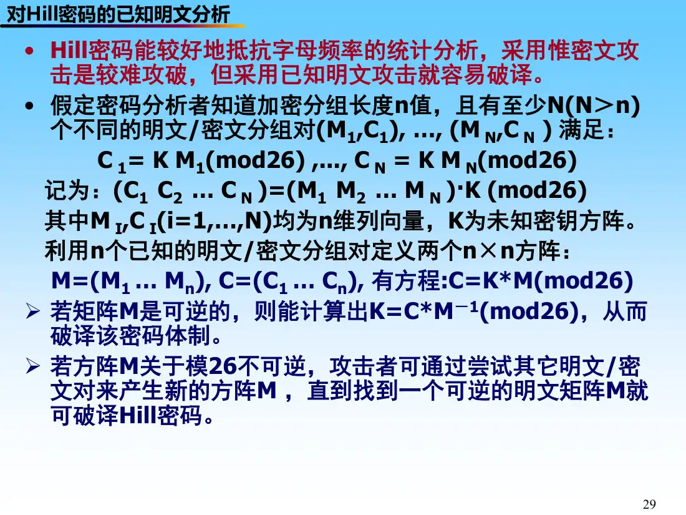

原文：

对Hill密码的已知明文分析

\- Hill密码能较好地抵抗字母频率的统计分析，采用惟密文攻击是较难攻破，但采用已知明文攻击就容易破译。

\- 假定密码分析者知道加密分组长度n值，且有至少N(N>n)个不同的明文/密文分组对(M₁,C₁), ..., (Mₙ,Cₙ) 满足：

$C_{1}=K M_{1}(\text{mod }26),\ldots,C_{N}=K M_{N}(\text{mod }26)$ 记为： $(C_{1}C_{2}\ldots C_{N})=(M_{1}M_{2}\ldots M_{N})\cdot K(\text{mod }26)$ 其中 $M_{I},C_{I}(i=1,\ldots,N)$ 均为n维列向量，K为未知密钥方阵。
利用n个已知的明文/密文分组对定义两个 $n\times n$ 方阵： $M=(M_{1}\ldots M_{n}),C=(C_{1}\ldots C_{n})$ ，有方程： $C=K*M(\text{mod }26)$

若矩阵M是可逆的，则能计算出 $K=C*M^{-1}$ (mod26)，从而破译该密码体制。

若方阵M关于模26不可逆，攻击者可通过尝试其它明文/密文对来产生新的方阵M，直到找到一个可逆的明文矩阵M就可破译Hill密码。

29

### Hill密码的分析

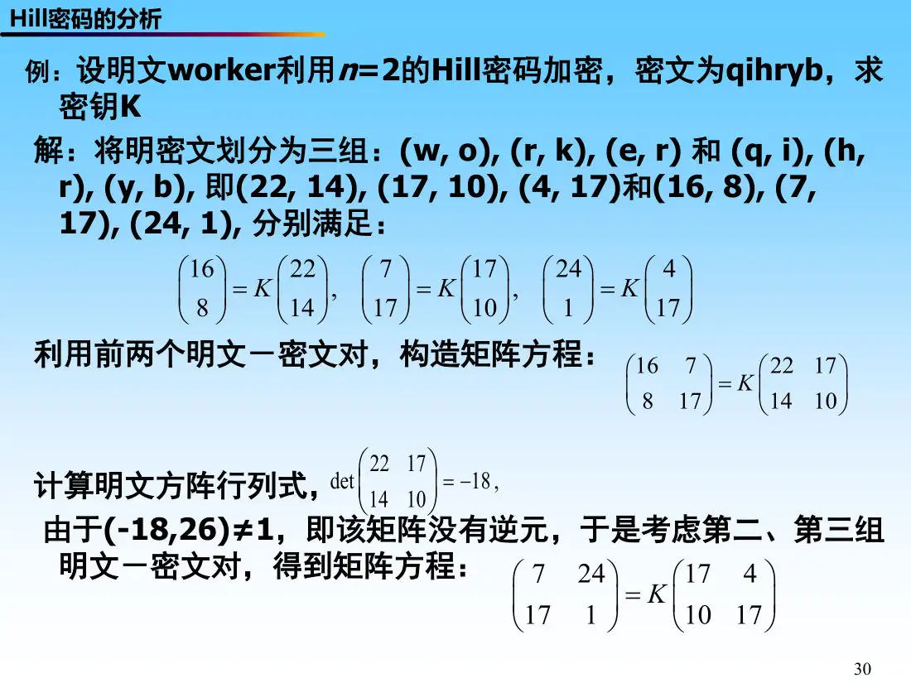

原文：

Hill密码的分析

例：设明文worker利用 $n = 2$ 的Hill密码加密，密文为qihryb，求密钥K

解：将明密文划分为三组：(w, o), (r, k), (e, r) 和 (q, i), (h, r), (y, b), 即 (22, 14), (17, 10), (4, 17) 和 (16, 8), (7, 17), (24, 1), 分别满足：

$$
\binom {1 6} {8} = K \binom {2 2} {1 4}, \quad \binom {7} {1 7} = K \binom {1 7} {1 0}, \quad \binom {2 4} {1} = K \binom {4} {1 7}
$$

利用前两个明文一密文对，构造矩阵方程： $\left( \begin{array}{ll}16 & 7 \\ 8 & 17 \end{array} \right) = K\left( \begin{array}{ll}22 & 17 \\ 14 & 10 \end{array} \right)$ 计算明文方阵行列式， $\det \left( \begin{array}{ll}22 & 17 \\ 14 & 10 \end{array} \right) = -18$ ，

由于(-18,26)≠1，即该矩阵没有逆元，于是考虑第二、第三组

明文一密文对，得到矩阵方程： $\left( \begin{array}{ll}7 & 24 \\ 17 & 1 \end{array} \right) = K\left( \begin{array}{ll}17 & 4 \\ 10 & 17 \end{array} \right)$

30

### Hill密码的分析

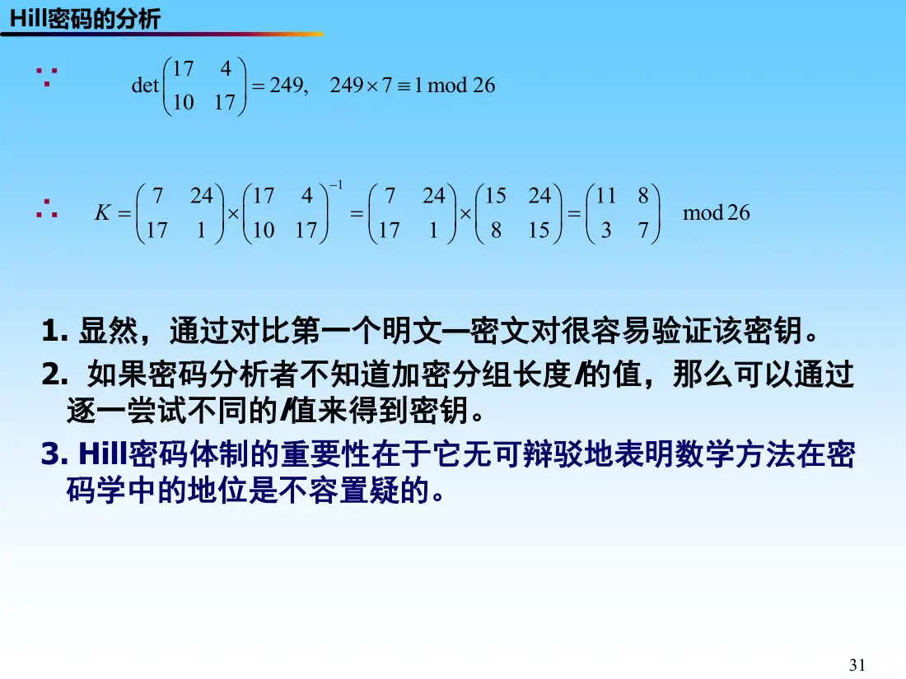

原文：

Hill密码的分析

$$
\det \left( \begin{array}{c c} 1 7 & 4 \\ 1 0 & 1 7 \end{array} \right) = 2 4 9, \quad 2 4 9 \times 7 \equiv 1 \bmod 2 6
$$

$$
\therefore \quad K = \left( \begin{array}{l l} 7 & 2 4 \\ 1 7 & 1 \end{array} \right) \times \left( \begin{array}{l l} 1 7 & 4 \\ 1 0 & 1 7 \end{array} \right) ^ {- 1} = \left( \begin{array}{l l} 7 & 2 4 \\ 1 7 & 1 \end{array} \right) \times \left( \begin{array}{l l} 1 5 & 2 4 \\ 8 & 1 5 \end{array} \right) = \left( \begin{array}{l l} 1 1 & 8 \\ 3 & 7 \end{array} \right) \mod 2 6
$$

1. 显然，通过对比第一个明文—密文对很容易验证该密钥。

2. 如果密码分析者不知道加密分组长度/的值，那么可以通过逐一尝试不同的/值来得到密钥。

3. Hill密码体制的重要性在于它无可辩驳地表明数学方法在密码学中的地位是不容置疑的。

31
