# 《密码学》第4章 分组密码（课件）

原件的每一页，下面附识别出的文字。

### 第四章分 组 密 码

原文：

第四章分 组 密 码

### 分组密码概述

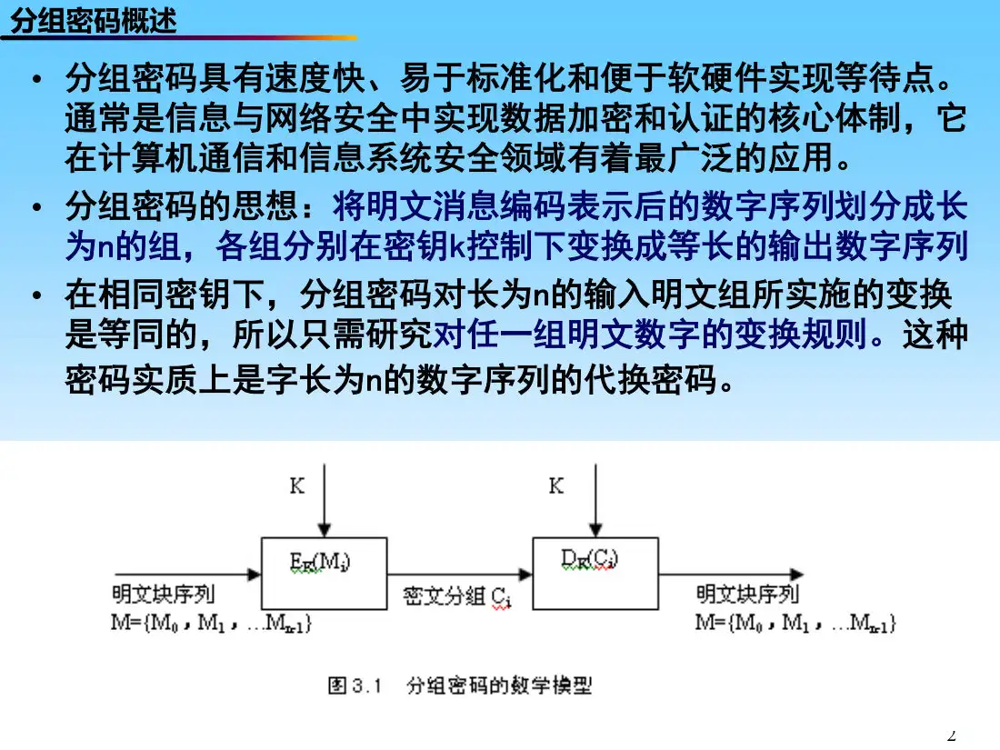

原文：

分组密码概述

分组密码具有速度快、易于标准化和便于软硬件实现等待点。通常是信息与网络安全中实现数据加密和认证的核心体制，它在计算机通信和信息系统安全领域有着最广泛的应用。

• 分组密码的思想：将明文消息编码表示后的数字序列划分成长为n的组，各组分别在密钥k控制下变换成等长的输出数字序列

在相同密钥下，分组密码对长为n的输入明文组所实施的变换是等同的，所以只需研究对任一组明文数字的变换规则。这种密码实质上是字长为n的数字序列的代换密码。

2

### 分组密码的设计原则

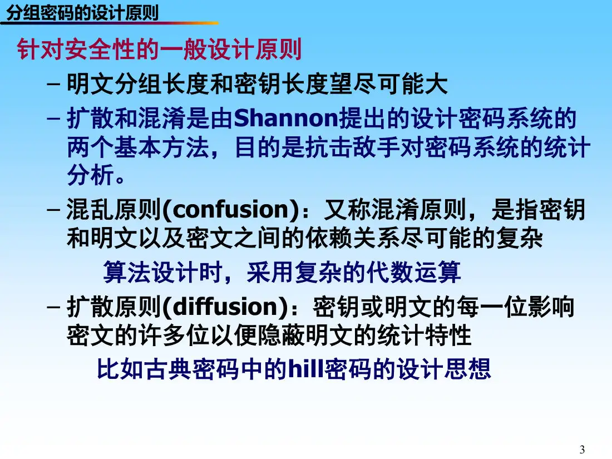

原文：

分组密码的设计原则

针对安全性的一般设计原则

– 明文分组长度和密钥长度望尽可能大

– 扩散和混淆是由Shannon提出的设计密码系统的两个基本方法，目的是抗击敌手对密码系统的统计分析。

混乱原则(confusion)：又称混淆原则，是指密钥和明文以及密文之间的依赖关系尽可能的复杂

算法设计时，采用复杂的代数运算

– 扩散原则(diffusion)：密钥或明文的每一位影响密文的许多位以便隐蔽明文的统计特性

比如古典密码中的hill密码的设计思想

3

### 分组密码的常见结构

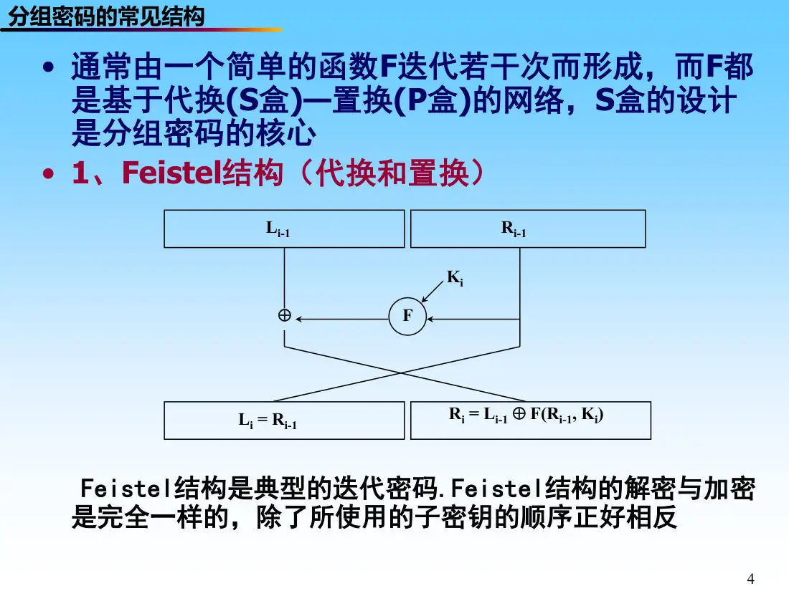

原文：

分组密码的常见结构

通常由一个简单的函数F迭代若干次而形成，而F都是基于代换(S盒)—置换(P盒)的网络，S盒的设计是分组密码的核心

• 1、Feistel结构（代换和置换）

Feistel结构是典型的迭代密码.Feistel结构的解密与加密是完全一样的，除了所使用的子密钥的顺序正好相反

4

### 分组密码的常见结构

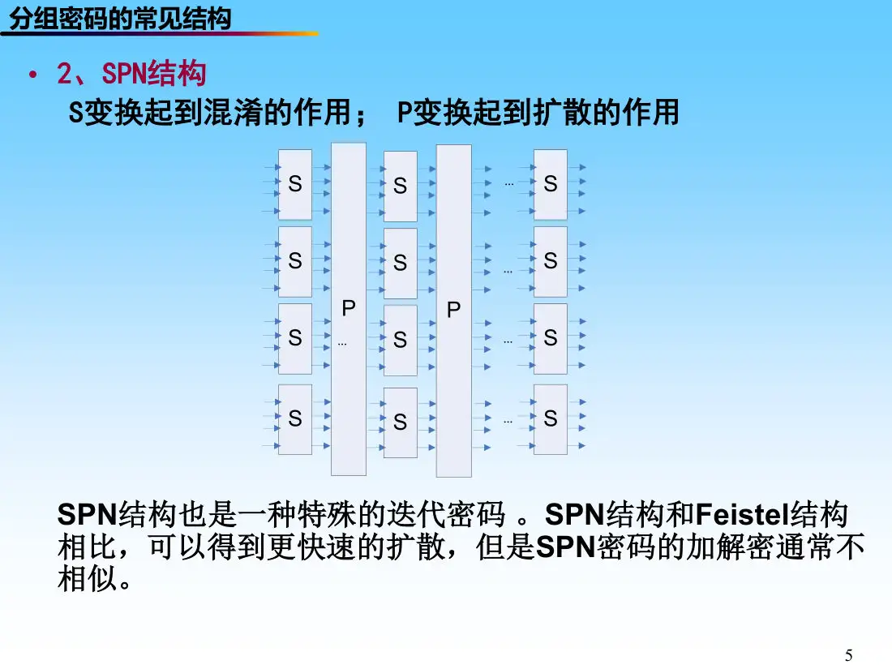

原文：

分组密码的常见结构

• 2、SPN结构

S变换起到混淆的作用； P变换起到扩散的作用

$$
\begin{array}{c c c} \text {S} & \text {P} & \text {P} \\ \text {S} & \text {...} & \text {S} \\ \text {S} & \text {S} & \text {S} \\ \text {S} & \text {S} & \text {S} \end{array} \quad \begin{array}{c c c} \text {..} & \text {S} \\ \text {..} & \text {S} \\ \text {..} & \text {S} \\ \text {..} & \text {S} \end{array}
$$

SPN结构也是一种特殊的迭代密码 。SPN结构和Feistel结构相比，可以得到更快速的扩散，但是SPN密码的加解密通常不相似。

5

### Feistel网络参数

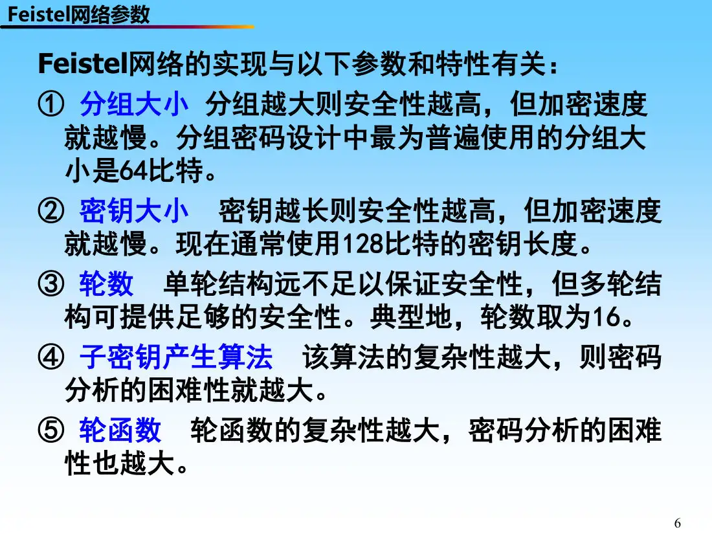

原文：

Feistel网络参数

Feistel网络的实现与以下参数和特性有关：

① 分组大小 分组越大则安全性越高，但加密速度就越慢。分组密码设计中最为普遍使用的分组大小是64比特。

② 密钥大小 密钥越长则安全性越高，但加密速度就越慢。现在通常使用128比特的密钥长度。

③ 轮数 单轮结构远不足以保证安全性，但多轮结构可提供足够的安全性。典型地，轮数取为16。

④ 子密钥产生算法 该算法的复杂性越大，则密码分析的困难性就越大。

⑤ 轮函数 轮函数的复杂性越大，密码分析的困难性也越大。

6

### Feistel单轮的加解密

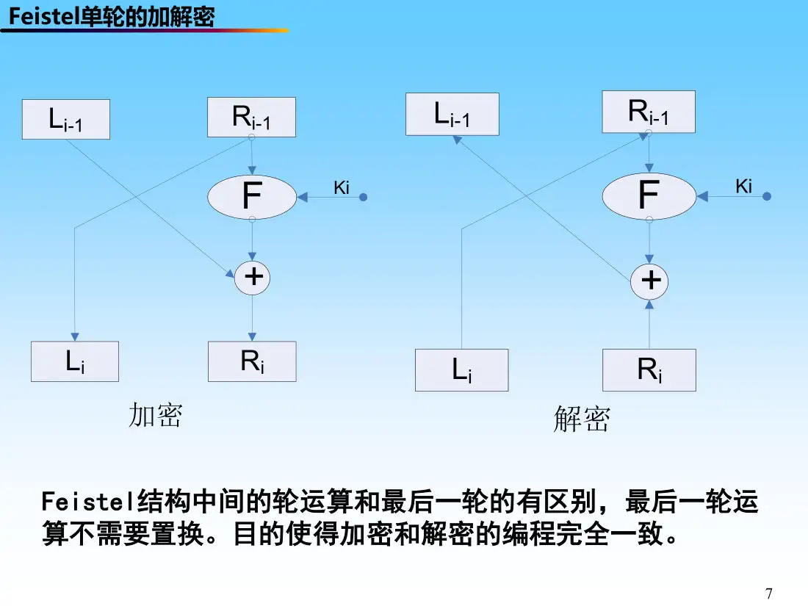

原文：

Feistel单轮的加解密

Feistel结构中间的轮运算和最后一轮的有区别，最后一轮运算不需要置换。目的使得加密和解密的编程完全一致。

7

### 数据加密标准-DES

原文：

数据加密标准-DES

• DES的历史

1971年，IBM，由Horst Feistel领导的密码研究项目组研究出LUCIFER算法。并应用于商业领域。1973年，美国标准局征求标准，IBM提交结果1977年，被选为数据加密标准。

1994年，美国决定98年12月以后不再使用DES算法

DES是一种明文分组为64比特，有效密钥56比特，输出密文64比特的，具有16轮迭代的分组对称密码算法，DES由初始置换，16轮迭代，初始逆置换组成。

• DES的解密算法与加密算法相同，只是解密子密钥与加密子密钥的使用顺序刚好相反。

8

### DES的加密算法

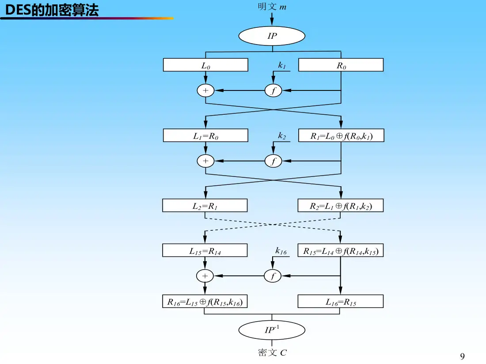

原文：

DES的加密算法

9

### 初始置换IP和逆置换IP-1

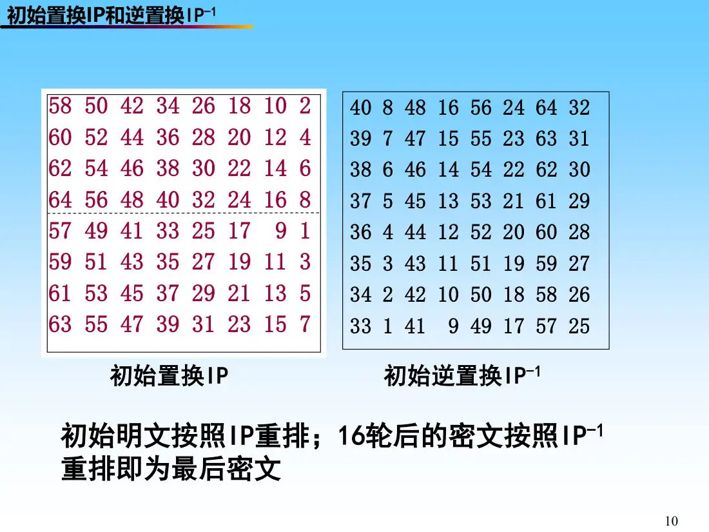

原文：

初始置换IP和逆置换IP-1

$$
\begin{array}{c c c c c c c c} \hline 5 8 & 5 0 & 4 2 & 3 4 & 2 6 & 1 8 & 1 0 & 2 \\ 6 0 & 5 2 & 4 4 & 3 6 & 2 8 & 2 0 & 1 2 & 4 \\ 6 2 & 5 4 & 4 6 & 3 8 & 3 0 & 2 2 & 1 4 & 6 \\ 6 4 & 5 6 & 4 8 & 4 0 & 3 2 & 2 4 & 1 6 & 8 \\ \hline \hline 5 7 & 4 9 & 4 1 & 3 3 & 2 5 & 1 7 & 9 & 1 \\ 5 9 & 5 1 & 4 3 & 3 5 & 2 7 & 1 9 & 1 1 & 3 \\ 6 1 & 5 3 & 4 5 & 3 7 & 2 9 & 2 1 & 1 3 & 5 \\ 6 3 & 5 5 & 4 7 & 3 9 & 3 1 & 2 3 & 1 5 & 7 \\ \hline \end{array}
$$

$$
\begin{array}{c c c c c c c c} \hline 4 0 & 8 & 4 8 & 1 6 & 5 6 & 2 4 & 6 4 & 3 2 \\ 3 9 & 7 & 4 7 & 1 5 & 5 5 & 2 3 & 6 3 & 3 1 \\ 3 8 & 6 & 4 6 & 1 4 & 5 4 & 2 2 & 6 2 & 3 0 \\ 3 7 & 5 & 4 5 & 1 3 & 5 3 & 2 1 & 6 1 & 2 9 \\ 3 6 & 4 & 4 4 & 1 2 & 5 2 & 2 0 & 6 0 & 2 8 \\ 3 5 & 3 & 4 3 & 1 1 & 5 1 & 1 9 & 5 9 & 2 7 \\ 3 4 & 2 & 4 2 & 1 0 & 5 0 & 1 8 & 5 8 & 2 6 \\ 3 3 & 1 & 4 1 & 9 & 4 9 & 1 7 & 5 7 & 2 5 \\ \hline \end{array}
$$

初始置换IP

初始逆置换IP-1

初始明文按照IP重排；16轮后的密文按照IP-1重排即为最后密文

10

### DES轮结构

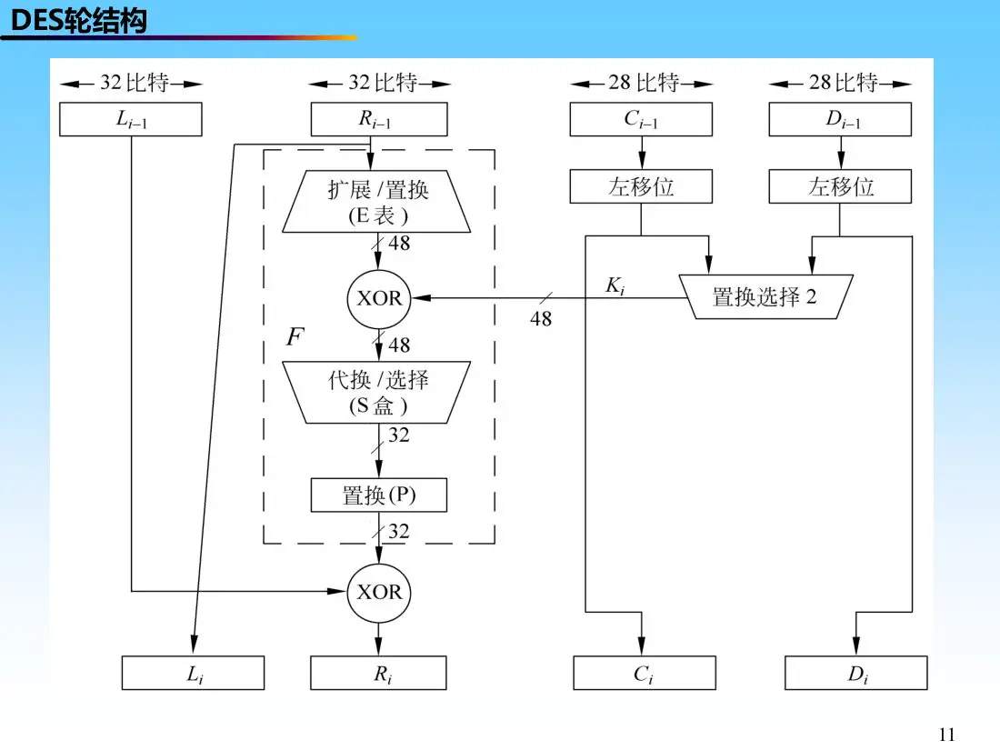

原文：

DES轮结构

11

### E-扩展运算

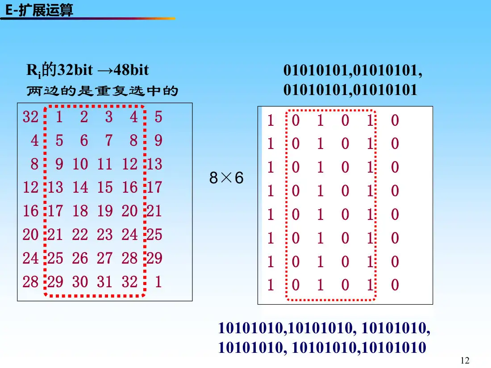

原文：

E-扩展运算

$\mathbf { R _ { i } }$ 的32bit →48bit两边的是重复选中的

$$
\begin{array}{c c c c c c} \hline 3 2 & 1 & 2 & 3 & 4 & 5 \\ 4 & 5 & 6 & 7 & 8 & 9 \\ 8 & 9 & 1 0 & 1 1 & 1 2 & 1 3 \\ 1 2 & 1 3 & 1 4 & 1 5 & 1 6 & 1 7 \\ 1 6 & 1 7 & 1 8 & 1 9 & 2 0 & 2 1 \\ 2 0 & 2 1 & 2 2 & 2 3 & 2 4 & 2 5 \\ 2 4 & 2 5 & 2 6 & 2 7 & 2 8 & 2 9 \\ 2 8 & 2 9 & 3 0 & 3 1 & 3 2 & 1 \\ \hline \end{array}
$$

01010101,01010101, 01010101,01010101

$$
8 \times 6 \boxed { \begin{array}{c c c c c c} 1 & 0 & 1 & 0 & 1 & 0 \\ 1 & 0 & 1 & 0 & 1 & 0 \\ 1 & 0 & 1 & 0 & 1 & 0 \\ 1 & 0 & 1 & 0 & 1 & 0 \\ 1 & 0 & 1 & 0 & 1 & 0 \\ 1 & 0 & 1 & 0 & 1 & 0 \\ 1 & 0 & 1 & o & 1 & o \\ 1 & 0 & 1 & o & 1 & o \\ 1 & o & 1 & o & 1 & o \\ 1 & o & 1 & o & 1 & o \\ 1 & o & 1 & o & 1 \end{array} }
$$

10101010,10101010, 10101010, 10101010, 10101010,10101010

12

### E盒的作用

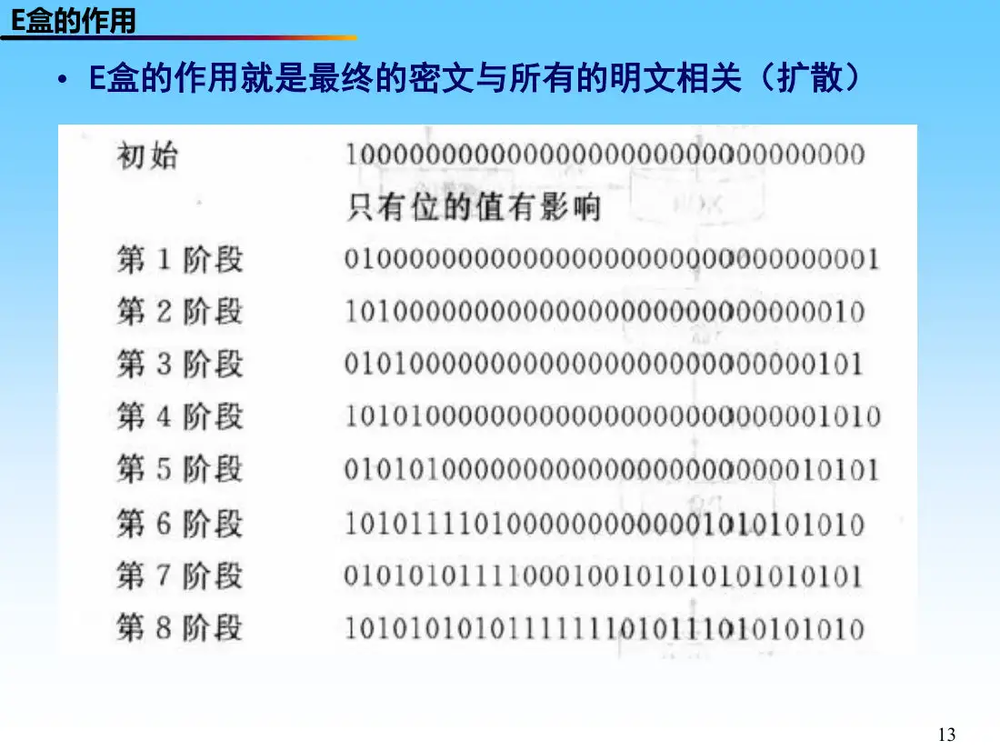

原文：

<table><tr><td>初始</td><td>10000000000000000000000000000000000000000000000000000000000000000000000000000000000000000000000000000</td></tr><tr><td></td><td>只有位的值有影响</td></tr><tr><td>第1阶段</td><td>0100000000000000000000000000000000000000000000000000000000000000000000000000000000000000000000000000</td></tr></table>

E盒的作用

• E盒的作用就是最终的密文与所有的明文相关（扩散）

13

### • 1 S-盒运算由8个S-盒函数构成，

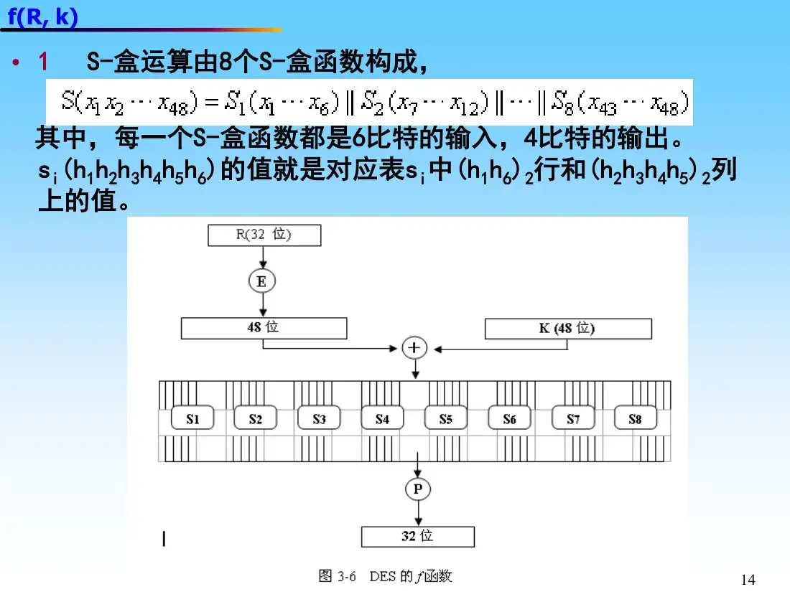

原文：

• 1 S-盒运算由8个S-盒函数构成，

$$
S \left(x _ {1} x _ {2} \dots x _ {4 8}\right) = S _ {1} \left(x _ {1} \dots x _ {6}\right) \| S _ {2} \left(x _ {7} \dots x _ {1 2}\right) \| \dots \| S _ {8} \left(x _ {4 3} \dots x _ {4 8}\right)
$$

其中，每一个S-盒函数都是6比特的输入，4比特的输出。

$\mathsf { s } _ { \mathrm { i } } ( \mathsf { h } _ { 1 } \mathsf { h } _ { 2 } \mathsf { h } _ { 3 } \mathsf { h } _ { 4 } \mathsf { h } _ { 5 } \mathsf { h } _ { 6 } )$ 的值就是对应表 $s _ { \mathrm { i } }$ 中 $( \boldsymbol { \mathsf { h } } _ { 1 } \boldsymbol { \mathsf { h } } _ { 6 } ) _ { 2 }$ 行和 $( h _ { 2 } h _ { 3 } h _ { 4 } h _ { 5 } ) _ { 2 } \mathbf { \overline { { { 5 } } } } \mathbf { I } ,$ 上的值。

f(R, k)

14

### S盒

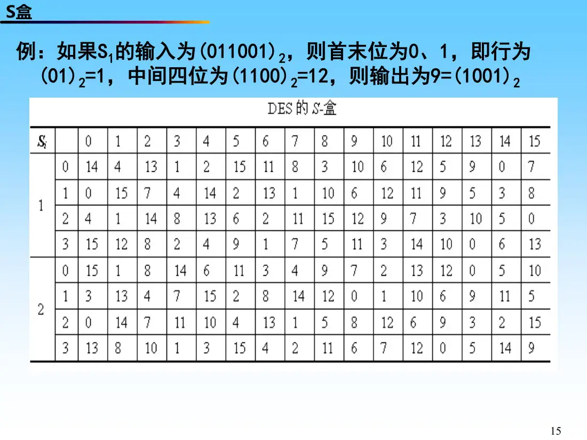

原文：

S盒

例：如果 $\pmb { S } _ { 1 }$ 的输入为(011001)2，则首末位为0、1，即行为(01) $2 ^ { = 1 }$ ，中间四位为 $\left( 1 1 0 0 \right) _ { 2 } = 1 2$ 则输出为9=(1001)2

<table><tr><td colspan="17">DES的S-盒</td><td></td></tr><tr><td> $S_i$ </td><td></td><td>0</td><td>1</td><td>2</td><td>3</td><td>4</td><td>5</td><td>6</td><td>7</td><td>8</td><td>9</td><td>10</td><td>11</td><td>12</td><td>13</td><td>14</td><td>15</td></tr><tr><td rowspan="4">1</td><td>0</td><td>14</td><td>4</td><td>13</td><td>1</td><td>2</td><td>15</td><td>11</td><td>8</td><td>3</td><td>10</td><td>6</td><td>12</td><td>5</td><td>9</td><td>0</td><td>7</td></tr><tr><td>1</td><td>0</td><td>15</td><td>7</td><td>4</td><td>14</td><td>2</td><td>13</td><td>1</td><td>10</td><td>6</td><td>12</td><td>11</td><td>9</td><td>5</td><td>3</td><td>8</td></tr><tr><td>2</td><td>4</td><td>1</td><td>14</td><td>8</td><td>13</td><td>6</td><td>2</td><td>11</td><td>15</td><td>12</td><td>9</td><td>7</td><td>3</td><td>10</td><td>5</td><td>0</td></tr><tr><td>3</td><td>15</td><td>12</td><td>8</td><td>2</td><td>4</td><td>9</td><td>1</td><td>7</td><td>5</td><td>11</td><td>3</td><td>14</td><td>10</td><td>0</td><td>6</td><td>13</td></tr><tr><td rowspan="4">2</td><td>0</td><td>15</td><td>1</td><td>8</td><td>14</td><td>6</td><td>11</td><td>3</td><td>4</td><td>9</td><td>7</td><td>2</td><td>13</td><td>12</td><td>0</td><td>5</td><td>10</td></tr><tr><td>1</td><td>3</td><td>13</td><td>4</td><td>7</td><td>15</td><td>2</td><td>8</td><td>14</td><td>12</td><td>0</td><td>1</td><td>10</td><td>6</td><td>9</td><td>11</td><td>5</td></tr><tr><td>2</td><td>0</td><td>14</td><td>7</td><td>11</td><td>10</td><td>4</td><td>13</td><td>1</td><td>5</td><td>8</td><td>12</td><td>6</td><td>9</td><td>3</td><td>2</td><td>15</td></tr><tr><td>3</td><td>13</td><td>8</td><td>10</td><td>1</td><td>3</td><td>15</td><td>4</td><td>2</td><td>11</td><td>6</td><td>7</td><td>12</td><td>0</td><td>5</td><td>14</td><td>9</td></tr></table>

15

### 置换P

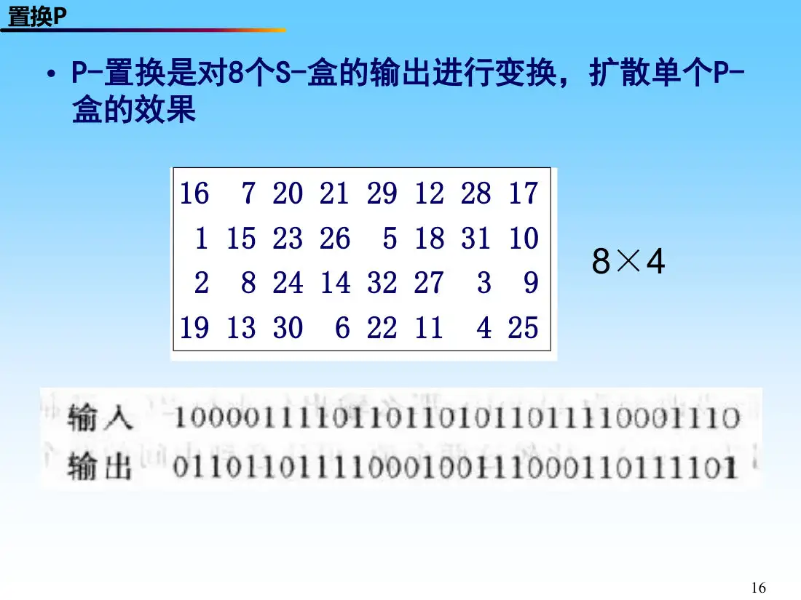

原文：

置换P

• P-置换是对8个S-盒的输出进行变换，扩散单个P-盒的效果

$$
\begin{array}{c c c c c c c c} \hline 1 6 & 7 & 2 0 & 2 1 & 2 9 & 1 2 & 2 8 & 1 7 \\ 1 & 1 5 & 2 3 & 2 6 & 5 & 1 8 & 3 1 & 1 0 \\ 2 & 8 & 2 4 & 1 4 & 3 2 & 2 7 & 3 & 9 \\ 1 9 & 1 3 & 3 0 & 6 & 2 2 & 1 1 & 4 & 2 5 \\ \hline \end{array}
$$

$$
8 \times 4
$$

输入10000111101101101011011110001110

输出01101101111000100111000110111101

16

### 子密钥的生成

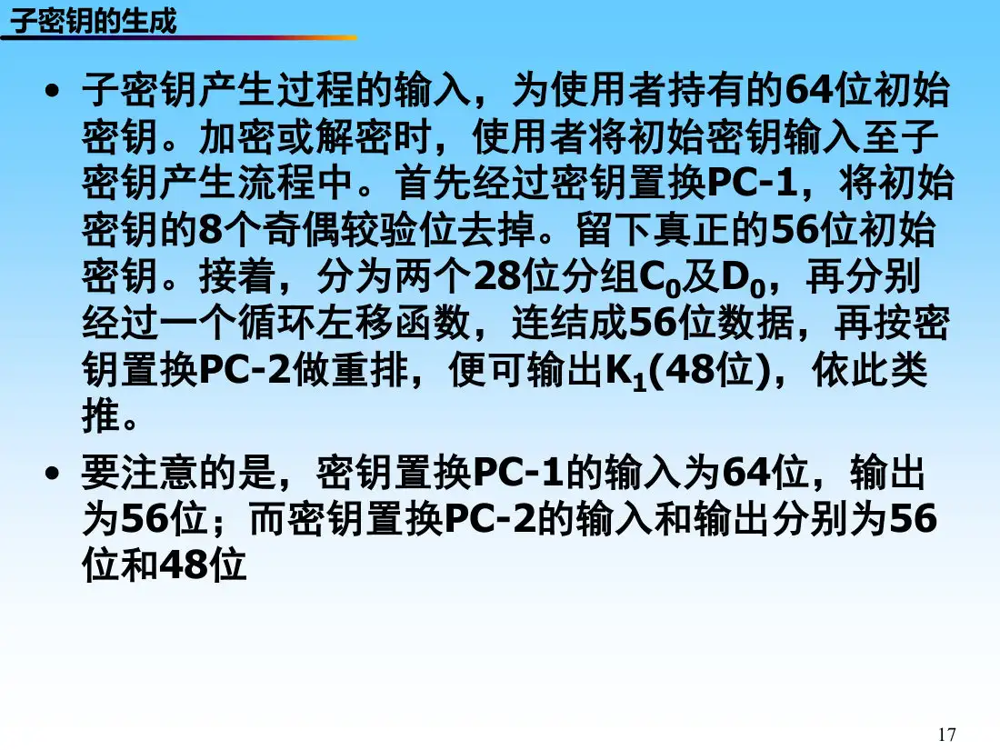

原文：

子密钥的生成

子密钥产生过程的输入，为使用者持有的64位初始密钥。加密或解密时，使用者将初始密钥输入至子密钥产生流程中。首先经过密钥置换PC-1，将初始密钥的8个奇偶较验位去掉。留下真正的56位初始密钥。接着，分为两个28位分组 $\scriptstyle \mathbf { C _ { 0 } }$ 及 $\mathbf { D _ { 0 } }$ ，再分别经过一个循环左移函数，连结成56位数据，再按密钥置换PC-2做重排，便可输出 $\mathsf { K } _ { 1 }$ (48位)，依此类推。

要注意的是，密钥置换PC-1的输入为64位，输出为56位；而密钥置换PC-2的输入和输出分别为56位和48位

17

### 子密钥的生成

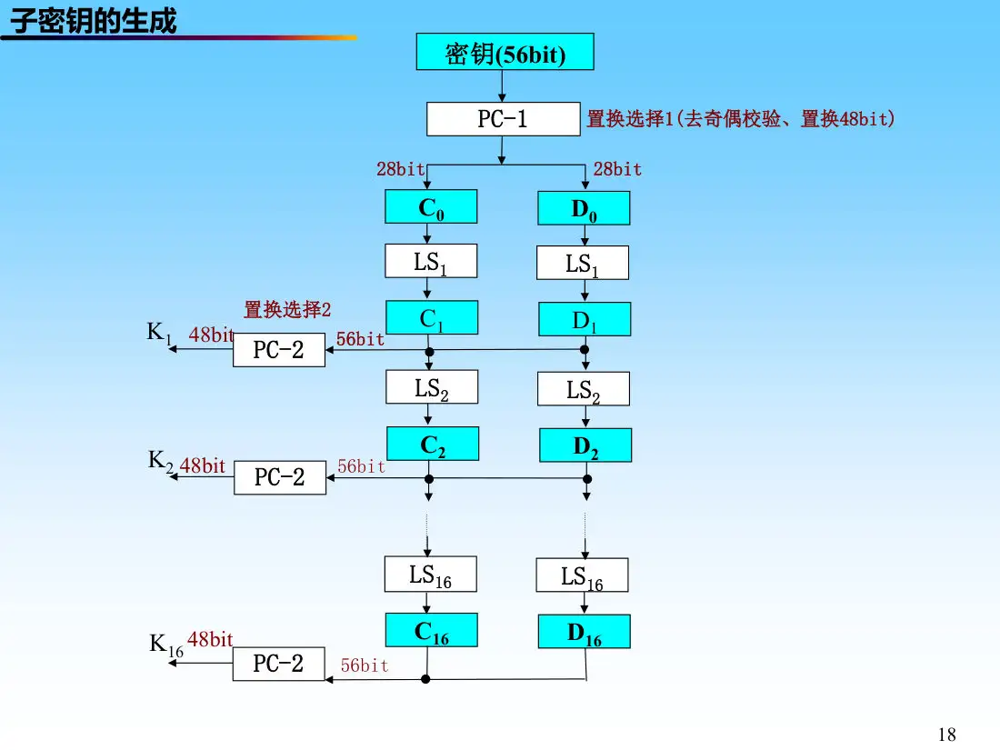

原文：

子密钥的生成

置换选择1(去奇偶校验、置换48bit)

18

### 置换PC-1

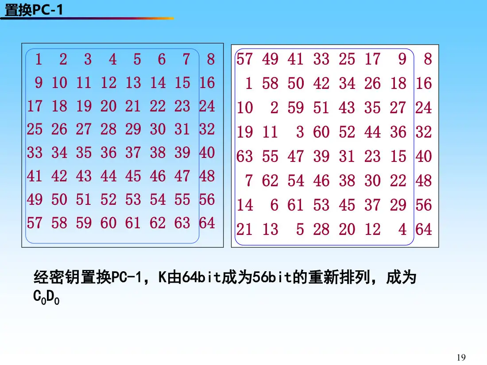

原文：

置换PC-1

$$
\begin{array}{c c c c c c c c} 1 & 2 & 3 & 4 & 5 & 6 & 7 & 8 \\ 9 & 1 0 & 1 1 & 1 2 & 1 3 & 1 4 & 1 5 & 1 6 \\ 1 7 & 1 8 & 1 9 & 2 0 & 2 1 & 2 2 & 2 3 & 2 4 \\ 2 5 & 2 6 & 2 7 & 2 8 & 2 9 & 3 0 & 3 1 & 3 2 \\ 3 3 & 3 4 & 3 5 & 3 6 & 3 7 & 3 8 & 3 9 & 4 0 \\ 4 1 & 4 2 & 4 3 & 4 4 & 4 5 & 4 6 & 4 7 & 4 8 \\ 4 9 & 5 0 & 5 1 & 5 2 & 5 3 & 5 4 & 5 5 & 5 6 \\ 5 7 & 5 8 & 5 9 & 6 0 & 6 1 & 6 2 & 6 3 & 6 4 \end{array}
$$

$$
\begin{array}{c c c c c c c} \hline 5 7 & 4 9 & 4 1 & 3 3 & 2 5 & 1 7 & 9 \\ 1 & 5 8 & 5 0 & 4 2 & 3 4 & 2 6 & 1 8 \\ 1 0 & 2 & 5 9 & 5 1 & 4 3 & 3 5 & 2 7 \\ 1 9 & 1 1 & 3 & 6 0 & 5 2 & 4 4 & 3 6 \\ 6 3 & 5 5 & 4 7 & 3 9 & 3 1 & 2 3 & 1 5 \\ 7 & 6 2 & 5 4 & 4 6 & 3 8 & 3 0 & 2 2 \\ 1 4 & 6 & 6 1 & 5 3 & 4 5 & 3 7 & 2 9 \\ 2 1 & 1 3 & 5 & 2 8 & 2 0 & 1 2 & 4 \\ \hline \end{array} \quad \begin{array}{c c c c c c c} \hline \text {8} \\ \text {16} \\ \text {24} \\ \text {32} \\ \text {40} \\ \text {48} \\ \text {56} \\ \text {64} \end{array}
$$

经密钥置换PC-1，K由64bit成为56bit的重新排列，成为${ \tt O } _ { 0 } { \tt D } _ { 0 }$

19

### 循环左移位数和PC-2

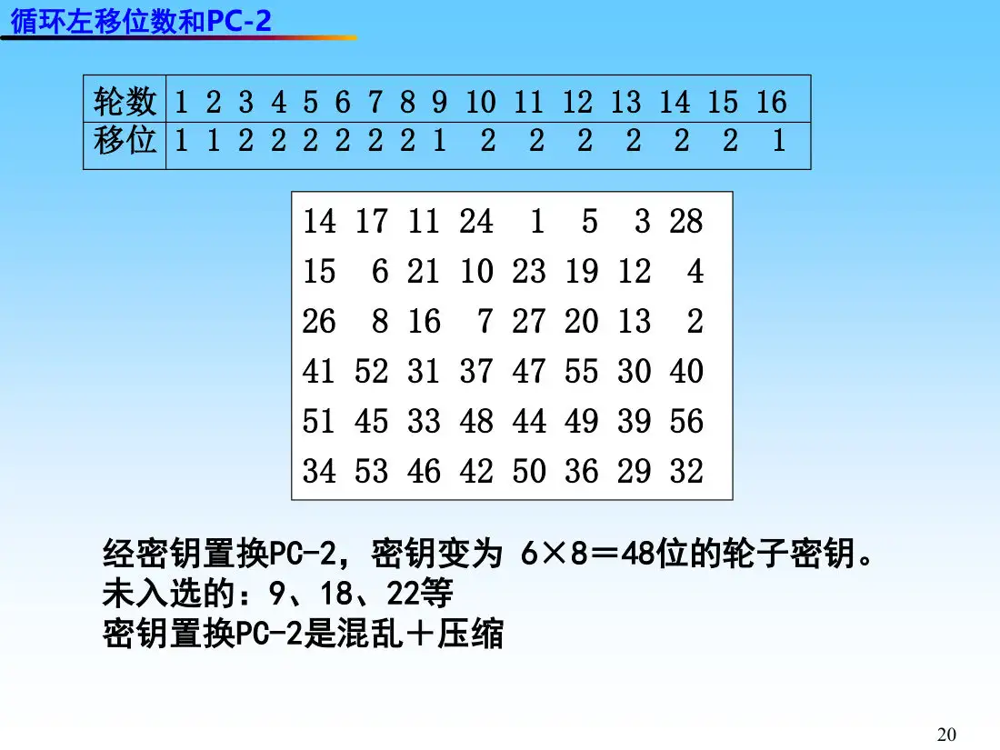

原文：

循环左移位数和PC-2

<table><tr><td>轮数</td><td>1 2 3 4 5 6 7 8 9 10 11 12 13 14 15 16</td></tr><tr><td>移位</td><td>1 1 2 2 2 2 2 2 1 2 2 2 2 2 2 2 1</td></tr></table>

$$
\begin{array}{l l l l l l l l} 1 4 & 1 7 & 1 1 & 2 4 & 1 & 5 & 3 & 2 8 \\ 1 5 & 6 & 2 1 & 1 0 & 2 3 & 1 9 & 1 2 & 4 \\ 2 6 & 8 & 1 6 & 7 & 2 7 & 2 0 & 1 3 & 2 \\ 4 1 & 5 2 & 3 1 & 3 7 & 4 7 & 5 5 & 3 0 & 4 0 \\ 5 1 & 4 5 & 3 3 & 4 8 & 4 4 & 4 9 & 3 9 & 5 6 \\ 3 4 & 5 3 & 4 6 & 4 2 & 5 0 & 3 6 & 2 9 & 3 2 \end{array}
$$

经密钥置换PC-2，密钥变为 6×8＝48位的轮子密钥。

未入选的：9、18、22等

密钥置换PC-2是混乱＋压缩

20

### 举例

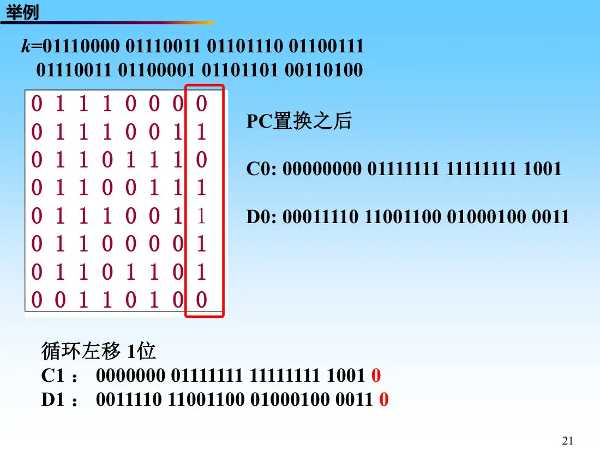

原文：

举例

k=01110000 01110011 01101110 01100111 01110011 01100001 01101101 00110100

$$
\begin{array}{c c c c c c c c} \hline 0 & 1 & 1 & 1 & 0 & 0 & 0 & 0 \\ 0 & 1 & 1 & 1 & 0 & 0 & 1 & 1 \\ 0 & 1 & 1 & 0 & 1 & 1 & 1 & 0 \\ 0 & 1 & 1 & 0 & 0 & 1 & 1 & 1 \\ 0 & 1 & 1 & 1 & 0 & 0 & 1 & 1 \\ 0 & 1 & 1 & 0 & 0 & 0 & 0 & 1 \\ 0 & 1 & 1 & 0 & 1 & 1 & 0 & 1 \\ 0 & 0 & 1 & 1 & 0 & 1 & 0 & 0 \\ \hline \end{array}
$$

PC置换之后

C0: 00000000 01111111 11111111 1001

D0: 00011110 11001100 01000100 0011

循环左移 1位

C1 ： 0000000 01111111 11111111 1001 0

D1 ： 0011110 11001100 01000100 0011 0

21

### $$

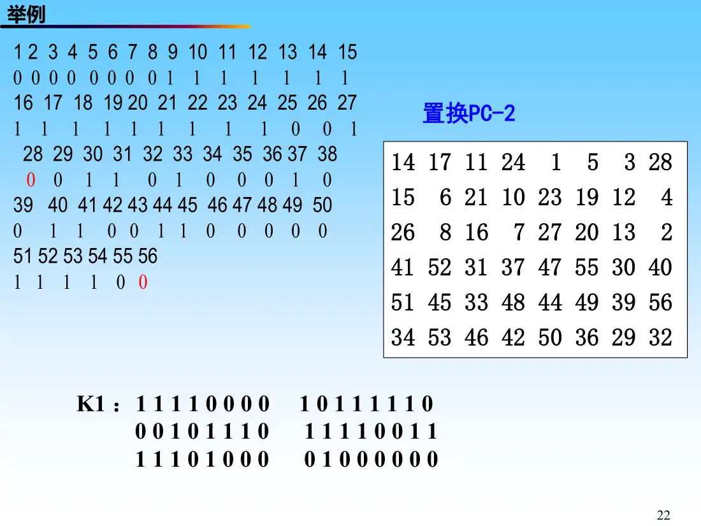

原文：

$$
\begin{array}{c c c c c c c c c c c c c c c c} 1 & 2 & 3 & 4 & 5 & 6 & 7 & 8 & 9 & 1 0 & 1 1 & 1 2 & 1 3 & 1 4 & 1 5 \\ 0 & 0 & 0 & 0 & 0 & 0 & 0 & 0 & 1 & 1 & 1 & 1 & 1 & 1 & 1 \\ 1 6 & 1 7 & 1 8 & 1 9 & 2 0 & 2 1 & 2 2 & 2 3 & 2 4 & 2 5 & 2 6 & 2 7 \\ 1 & 1 & 1 & 1 & 1 & 1 & 1 & 1 & 1 & 1 & 0 & 0 & 1 \\ \hline \text {28} & \text {29} & \text {30} & \text {31} & \text {32} & \text {33} & \text {34} & \text {35} & \text {36} & \text {37} & \text {38} \\ \text {0} & \text {0} & \text {1} & \text {1} & \text {0} & \text {1} & \text {0} & \text {0} & \text {0} & \text {1} & \text {0} \\ \text {39} & \text {40} & \text {41} & \text {42} & \text {43} & \text {44} & \text {45} & \text {46} & \text {47} & \text {48} & \text {49} & \text {50} \\ \text {0} & \text {1} & \text {1} & \text {0} & \text {0} & \text {1} & \text {1} & \text {0} & \text {0} & \text {0} & \text {0} \\ \text {51} & \text {52} & \text {53} & \text {54} & \text {55} & \text {56} \\ \text {1} & \text {1} & \text {1} & \text {1} & \text {0} & \text {0} \\ \end{array}
$$

K1 ：1 1 1 1 0 0 0 00 0 1 0 1 1 1 01 1 1 0 1 0 0 0置换PC-2

<table><tr><td>14</td><td>17</td><td>11</td><td>24</td><td>1</td><td>5</td><td>3</td><td>28</td></tr><tr><td>15</td><td>6</td><td>21</td><td>10</td><td>23</td><td>19</td><td>12</td><td>4</td></tr><tr><td>26</td><td>8</td><td>16</td><td>7</td><td>27</td><td>20</td><td>13</td><td>2</td></tr><tr><td>41</td><td>52</td><td>31</td><td>37</td><td>47</td><td>55</td><td>30</td><td>40</td></tr><tr><td>51</td><td>45</td><td>33</td><td>48</td><td>44</td><td>49</td><td>39</td><td>56</td></tr><tr><td>34</td><td>53</td><td>46</td><td>42</td><td>50</td><td>36</td><td>29</td><td>32</td></tr></table>

1 0 1 1 1 1 1 0 1 1 1 1 0 0 1 1 0 1 0 0 0 0 0 0

22

### DES的安全分析

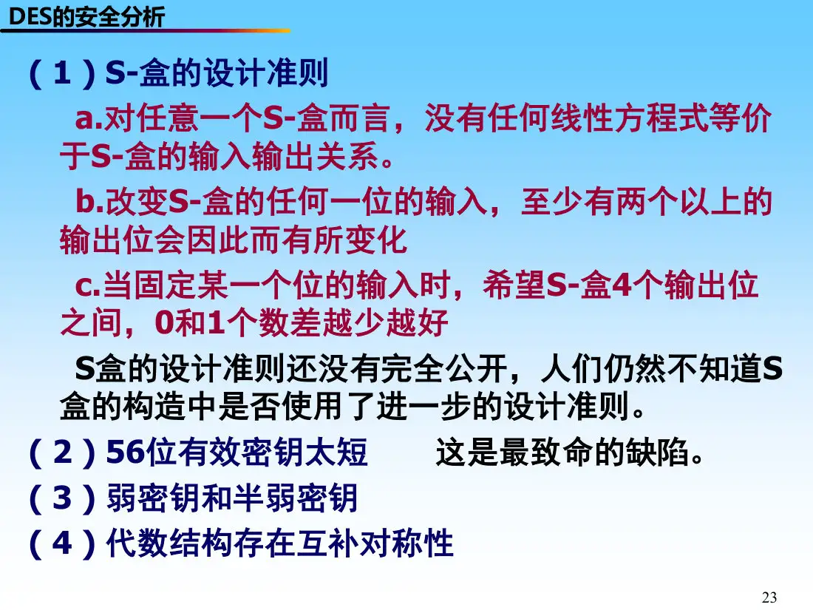

原文：

DES的安全分析

( 1 ) S-盒的设计准则

a.对任意一个S-盒而言，没有任何线性方程式等价于S-盒的输入输出关系。

b.改变S-盒的任何一位的输入，至少有两个以上的输出位会因此而有所变化

c.当固定某一个位的输入时，希望S-盒4个输出位之间，0和1个数差越少越好

S盒的设计准则还没有完全公开，人们仍然不知道S盒的构造中是否使用了进一步的设计准则。

( 2 ) 56位有效密钥太短 这是最致命的缺陷。

( 3 ) 弱密钥和半弱密钥

( 4 ) 代数结构存在互补对称性

23

### 弱密钥

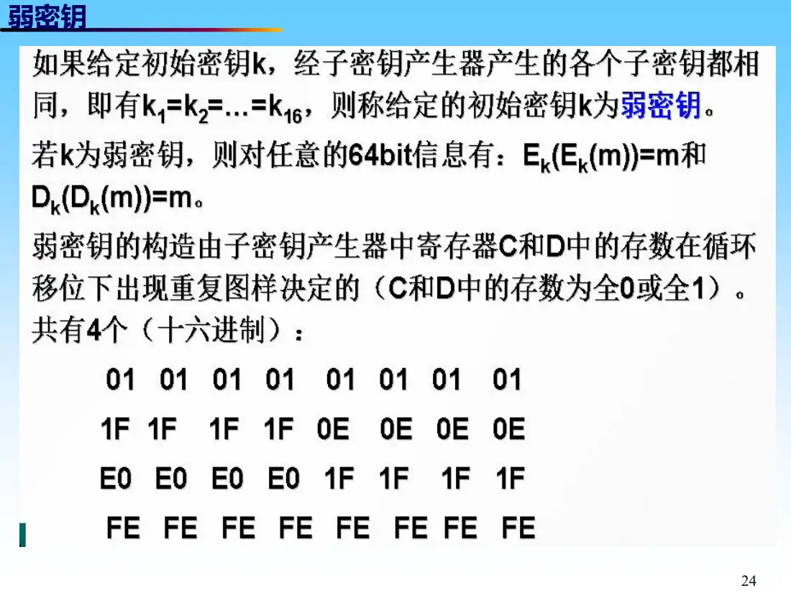

原文：

弱密钥

如果给定初始密钥k，经子密钥产生器产生的各个子密钥都相同，即有 $k _ { 1 } = k _ { 2 } = \cdots = k _ { 1 6 }$ ，则称给定的初始密钥k为弱密钥。

若k为弱密钥，则对任意的64bit信息有： $\in \epsilon ( E _ { k } ( m ) ) = m$ 和$\mathsf { D } _ { \kappa } ( \mathsf { D } _ { \kappa } ( { \mathsf { m } } ) ) { = } _ { \mathsf { m } }$ 0

弱密钥的构造由子密钥产生器中寄存器C和D中的存数在循环移位下出现重复图样决定的(C和D中的存数为全0或全1)。共有4个（十六进制）：

<table><tr><td>01</td><td>01</td><td>01</td><td>01</td><td>01</td><td>01</td><td>01</td><td>01</td></tr><tr><td>1F</td><td>1F</td><td>1F</td><td>1F</td><td>0E</td><td>0E</td><td>0E</td><td>0E</td></tr><tr><td>E0</td><td>E0</td><td>E0</td><td>E0</td><td>1F</td><td>1F</td><td>1F</td><td>1F</td></tr><tr><td>FE</td><td>FE</td><td>FE</td><td>FE</td><td>FE</td><td>FE</td><td>FE</td><td>FE</td></tr></table>

24

### 半弱密钥

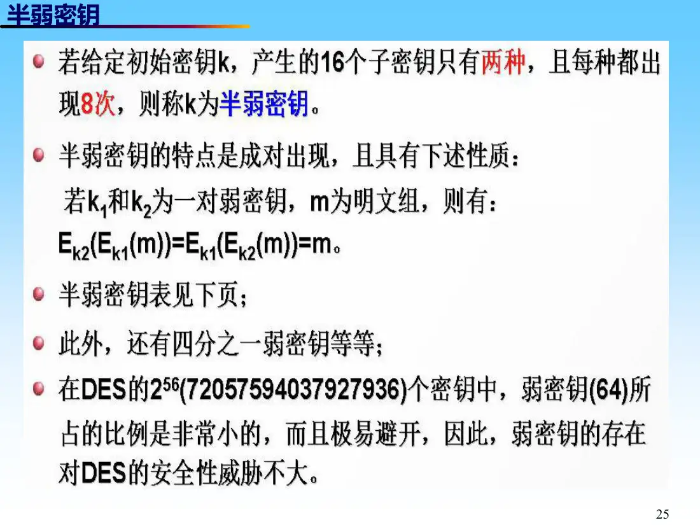

原文：

半弱密钥

若给定初始密钥k，产生的16个子密钥只有两种，且每种都出现8次，则称k为半弱密钥。

半弱密钥的特点是成对出现，且具有下述性质：若 $k _ { 1 }$ 和 $k _ { 2 }$ 为一对弱密钥，m为明文组，则有：$\mathsf { E } _ { \mathsf { k } 2 } ( \mathsf { E } _ { \mathsf { k } 1 } ( \mathsf { m } ) ) { = } \mathsf { E } _ { \mathsf { k } 1 } ( \mathsf { E } _ { \mathsf { k } 2 } ( \mathsf { m } ) ) { = } \mathsf { m } .$

半弱密钥表见下页；

此外，还有四分之一弱密钥等等；

在DES的256(72057594037927936)个密钥中，弱密钥(64)所占的比例是非常小的，而且极易避开，因此，弱密钥的存在对DES的安全性威胁不大。

25

### 差分分析法和线性分析

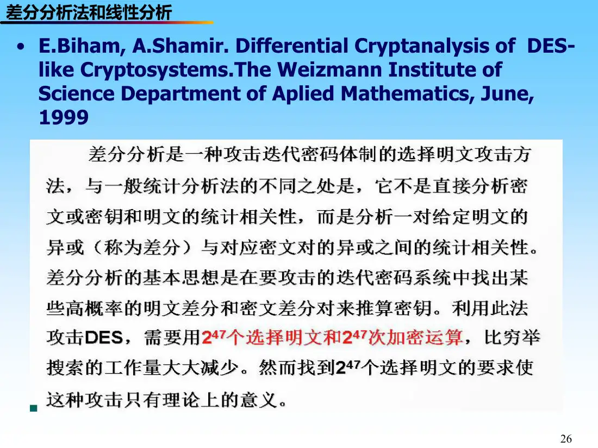

原文：

差分分析法和线性分析

E.Biham, A.Shamir. Differential Cryptanalysis of DESlike Cryptosystems.The Weizmann Institute of Science Department of Aplied Mathematics, June, 1999

差分分析是一种攻击迭代密码体制的选择明文攻击方法，与一般统计分析法的不同之处是，它不是直接分析密文或密钥和明文的统计相关性，而是分析一对给定明文的异或（称为差分）与对应密文对的异或之间的统计相关性。差分分析的基本思想是在要攻击的迭代密码系统中找出某些高概率的明文差分和密文差分对来推算密钥。利用此法攻击DES，需要用247个选择明文和247次加密运算，比穷举搜索的工作量大大减少。然而找到247个选择明文的要求使这种攻击只有理论上的意义。

26

### 差分分析法和线性分析

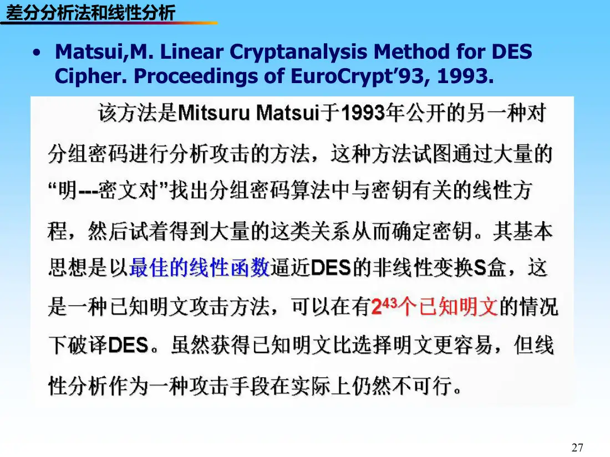

原文：

差分分析法和线性分析

Matsui,M. Linear Cryptanalysis Method for DES Cipher. Proceedings of EuroCrypt’93, 1993.

该方法是MitsuruMatsui于1993年公开的另一种对分组密码进行分析攻击的方法，这种方法试图通过大量的“明---密文对”找出分组密码算法中与密钥有关的线性方程，然后试着得到大量的这类关系从而确定密钥。其基本思想是以最佳的线性函数逼近DES的非线性变换S盒，这是一种已知明文攻击方法，可以在有243个已知明文的情况下破译DES。虽然获得已知明文比选择明文更容易，但线性分析作为一种攻击手段在实际上仍然不可行。

27

### • 编程示例：

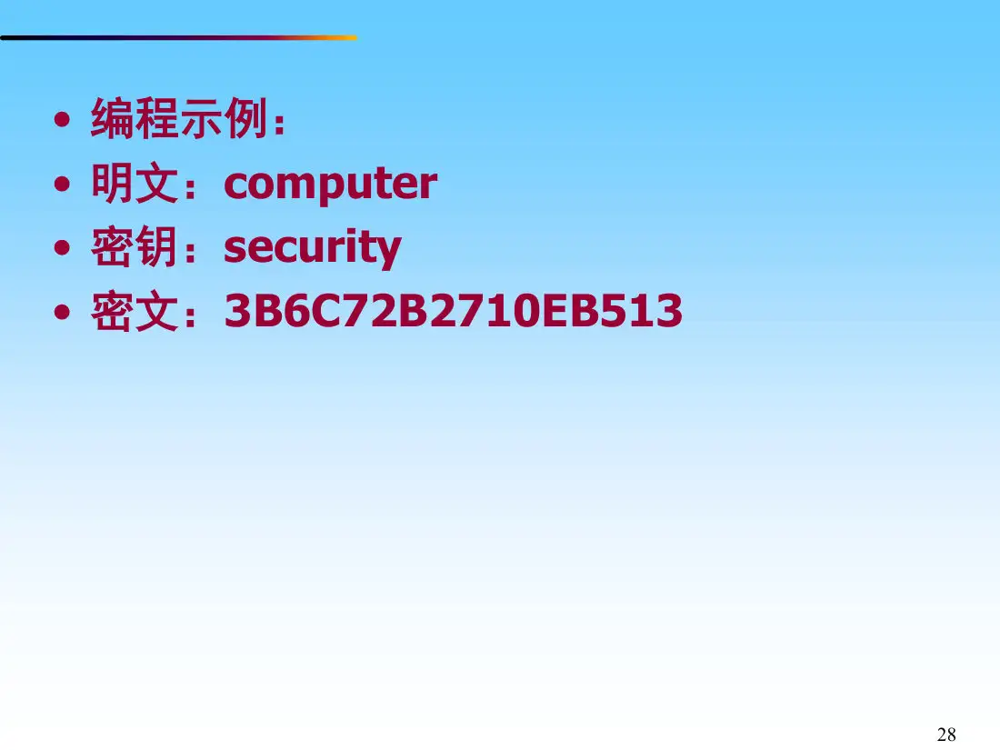

原文：

• 编程示例：

• 明文：computer

密钥：security

• 密文：3B6C72B2710EB513

28

### 三重DES

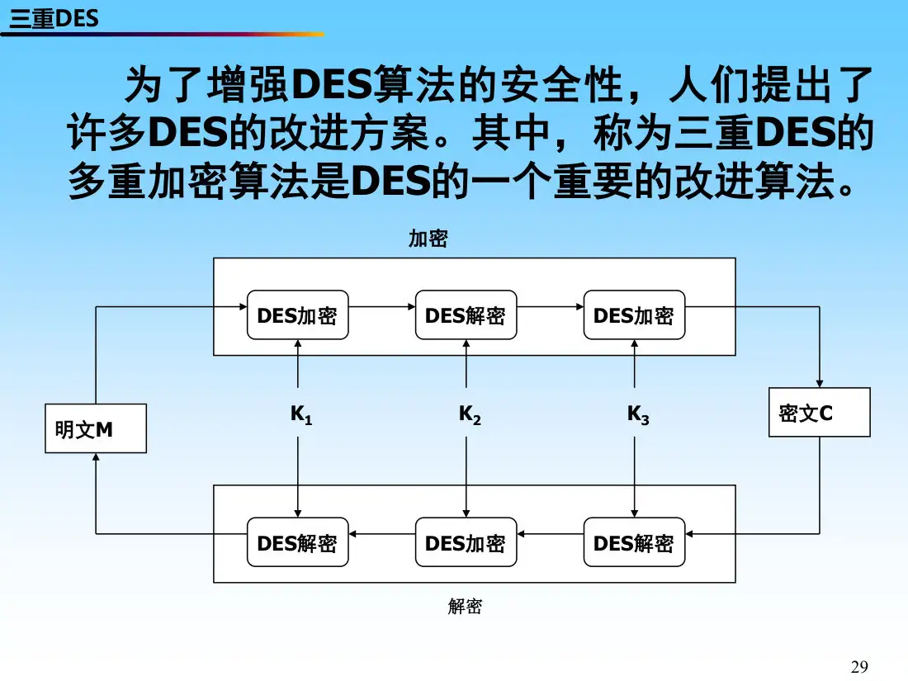

原文：

三重DES

为了增强DES算法的安全性，人们提出了许多DES的改进方案。其中，称为三重DES的多重加密算法是DES的一个重要的改进算法。

29

### 二重DES

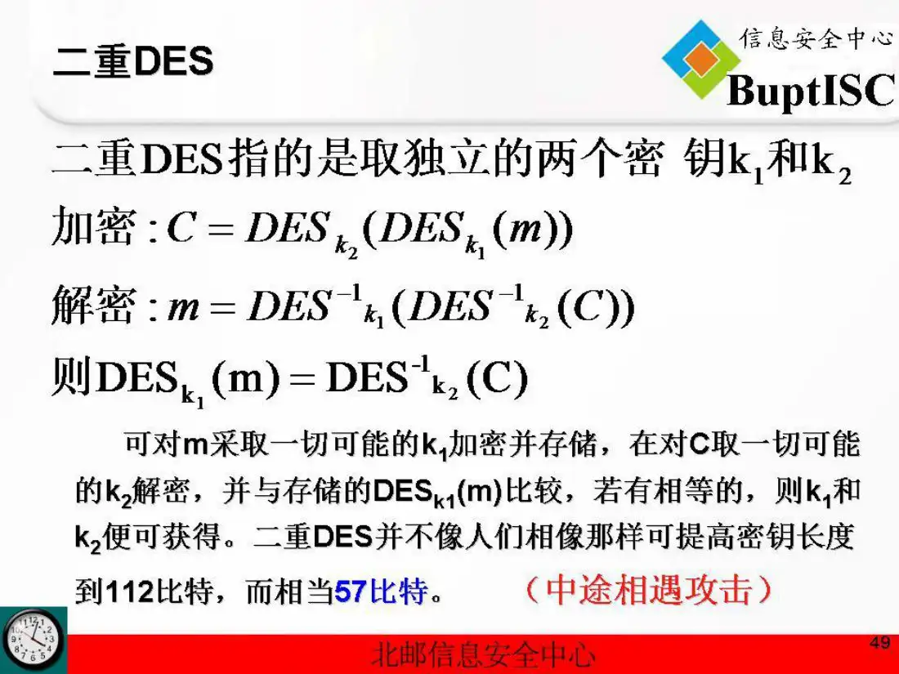

原文：

二重DES指的是取独立的两个密钥 $\mathbf { k } _ { \mathbf { l } }$ 和 $\mathbf { k } _ { 2 }$

加密： $C = D E S _ { k _ { 2 } } ( D E S _ { k _ { 1 } } ( m ) )$

解密： $m = D E S ^ { - 1 } { } _ { k _ { 1 } } ( D E S ^ { - 1 } { } _ { k _ { 2 } } ( C ) )$

则DE $\mathbf { S _ { k _ { 1 } } ( m ) } = \mathbf { D E S ^ { - 1 } } _ { \mathbf { k } _ { 2 } } ( \mathbf { C } )$

可对m采取一切可能的 $k _ { 1 }$ 加密并存储，在对C取一切可能的 $k _ { 2 }$ 解密，并与存储的 $\mathsf { D E S } _ { \kappa 1 } ( \mathsf { m } )$ 比较，若有相等的，则 $k _ { 1 }$ 和$k _ { 2 }$ 便可获得。二重DES并不像人们相像那样可提高密钥长度到112比特，而相当57比特。 (中途相遇攻击)

二重DES

信息安全中心BuptISC

北邮信息安全中心

49

### BuptISC

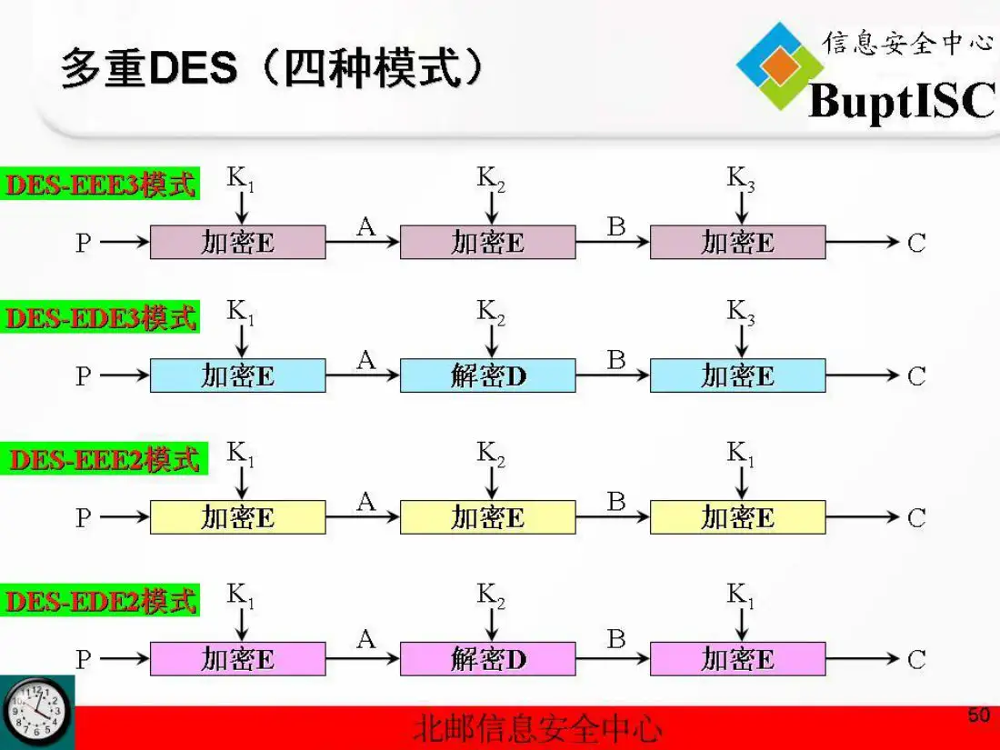

原文：

BuptISC

多重DES（四种模式）

信息安全中心

北邮信息安全中心

50

### 高级数据加密标准AES

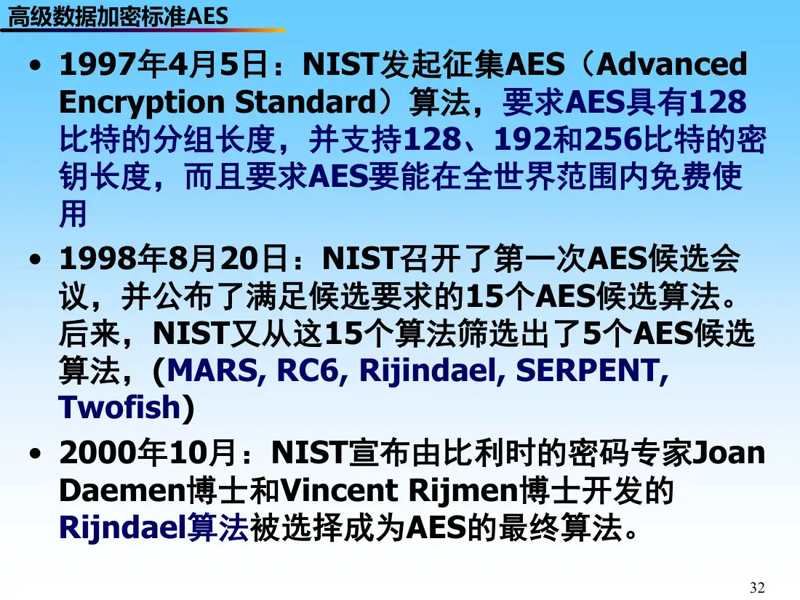

原文：

高级数据加密标准AES

1997年4月5日：NIST发起征集AES（AdvancedEncryption Standard）算法，要求AES具有128比特的分组长度，并支持128、192和256比特的密钥长度，而且要求AES要能在全世界范围内免费使用

1998年8月20日：NIST召开了第一次AES候选会议，并公布了满足候选要求的15个AES候选算法。后来，NIST又从这15个算法筛选出了5个AES候选算法，(MARS, RC6, Rijindael, SERPENT,Twofish)

2000年10月：NIST宣布由比利时的密码专家JoanDaemen博士和Vincent Rijmen博士开发的Rijndael算法被选择成为AES的最终算法。

32

### AES的数学基础 群

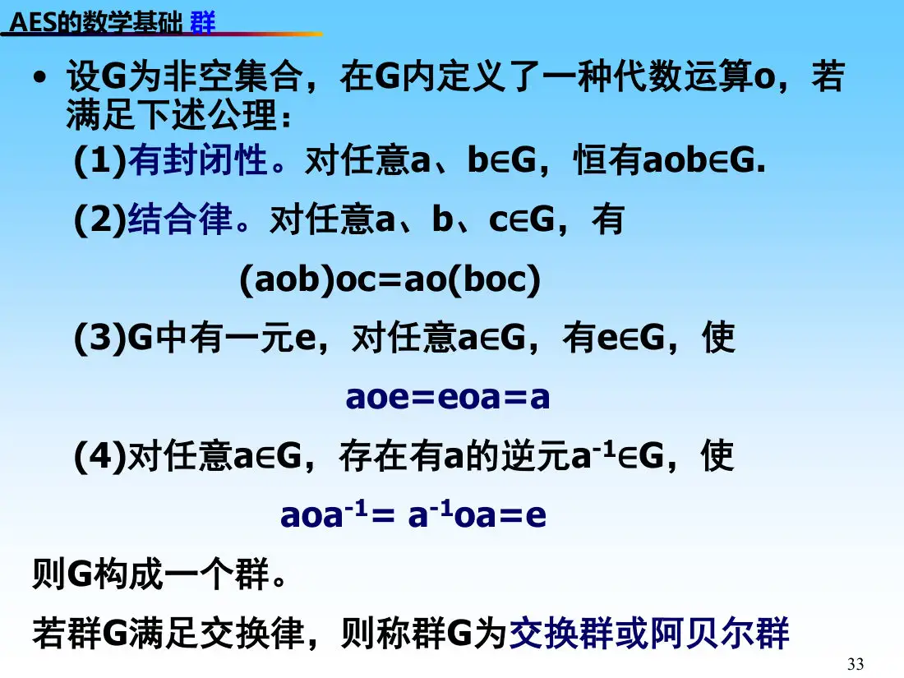

原文：

AES的数学基础 群

设G为非空集合，在G内定义了一种代数运算ο，若满足下述公理：

(1)有封闭性。对任意a、b∈G，恒有aοb∈G.

(2)结合律。对任意a、b、c∈G，有

$$
(a o b) o c = a o (b o c)
$$

(3)G中有一元e，对任意a∈G，有e∈G，使

$$
a o e = e o a = a
$$

(4)对任意a∈G，存在有a的逆元 $\mathbf { a } ^ { - 1 } \in \mathbf { G }$ ，使

$$
\mathsf {a o a} ^ {- 1} = \mathsf {a} ^ {- 1} \mathsf {o a} = \mathsf {e}
$$

则G构成一个群。

若群G满足交换律，则称群G为交换群或阿贝尔群

33

### （1）封闭性；

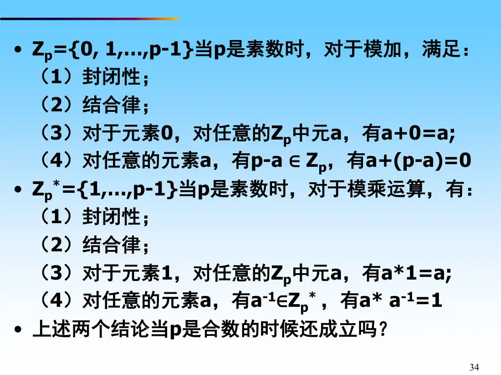

原文：

• $z _ { \mathrm { p } } { = } \{ 0 , 1 , { \ldots } , | \mathsf { p } { - } 1 \}$ 当p是素数时，对于模加，满足：

（1）封闭性；

（2）结合律；

（3）对于元素0，对任意的 $z _ { p }$ 中元a，有 $\mathbf { a } + \mathbf { 0 } = \mathbf { a } _ { I } ^ { \mathbf { 0 } }$

（4）对任意的元素a，有 $\mathsf { p - a } \in \mathsf { Z } _ { \mathsf { p } } ,$ ，有 $\bf { a } + ( \bf { p } - \bf { a } ) = \bf { 0 }$

• $z _ { \mathrm { p } } ^ { * } { = } \{ 1 , { \scriptstyle \ldots } , { \mathsf { p } } { - } 1 \}$ 当p是素数时，对于模乘运算，有：

（1）封闭性；

（2）结合律；

（3）对于元素1，对任意的 $z _ { p }$ 中元a，有 $\mathbf { a } ^ { * } \mathbf { 1 } \mathbf { = a } _ { I } ^ { * }$

（4）对任意的元素a，有 $\mathbf { \hat { a } } ^ { - 1 } \in \mathbb { Z } _ { \mathbf { p } } { } ^ { * }$ ，有 $\mathbf { a } ^ { * } \mathbf { a } ^ { * 1 } \mathbf { = 1 }$

• 上述两个结论当p是合数的时候还成立吗？

34

### 多项式同余

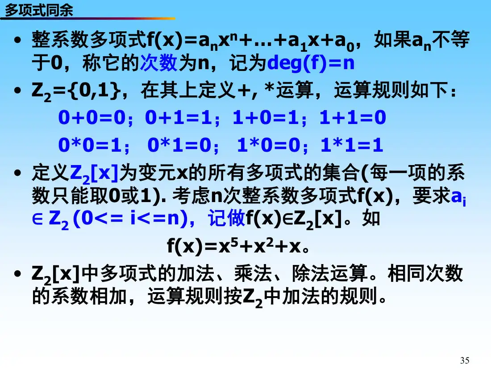

原文：

多项式同余

• 整系数多项式f $\ l ( \mathbf { x } ) { = } \ l \mathbf { a } _ { \mathrm { n } } \mathbf { x } ^ { \mathrm { n } } { + } \ l { \mathbf { \ l \ l } } { + } \ l \mathbf { a } _ { \mathrm { 1 } } \mathbf { x } { + } \ l \mathbf { a } _ { 0 }$ 如果 $\Xi _ { \mathfrak { n } }$ 不等于0，称它的次数为n，记为 $\mathbf { d e g ( f ) = n }$

$Z _ { 2 } = \{ 0 , 1 \}$ 在其上定义+, \*运算，运算规则如下：$0 + 0 = 0 ; 0 + 1 = 1 ; 1 + 0 = 1 ; 1 + 1 = 0$ $\scriptstyle 0 ^ { * } 0 = 1 ; \quad 0 ^ { * } 1 = 0 ; \quad 1 ^ { * } 0 = 0 ; \ 1 ^ { * } 1 = 1$

定义 $\mathbf { \bar { z } } _ { 2 } [ \mathbf { x } ]$ 为变元x的所有多项式的集合(每一项的系数只能取0或1). 考虑n次整系数多项式f(x)，要求 $\mathbf { a } _ { \mathrm { i } }$ $\in Z _ { 2 } \left( 0 < = \mathrm { l } < = \mathrm { n } \right)$ ，记做f $\mathbf { \widetilde { \Gamma } } ( \mathbf { x } ) { \in } Z _ { 2 } [ \mathbf { x } ]$ 。如$f ( \mathbf { x } ) = \mathbf { x } ^ { 5 } + \mathbf { x } ^ { 2 } + \mathbf { x } _ { \circ }$

$\mathbf { Z } _ { 2 } [ \mathbf { x } ]$ 中多项式的加法、乘法、除法运算。相同次数的系数相加，运算规则按 $z _ { 2 }$ 中加法的规则。

35

### 不可约多项式

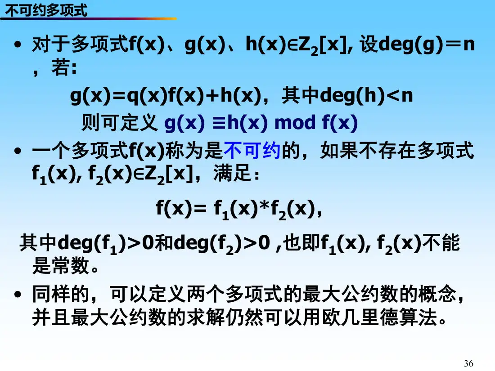

原文：

不可约多项式

• 对于多项式f(x)、 ${ \mathfrak { g } } ( \mathbf { x } ) , \ { \mathfrak { h } } ( \mathbf { x } ) { \in } Z _ { 2 } \lbrack \mathbf { x } \rbrack$ 设 ${ \bf d e g } ( { \bf g } ) = { \bf n }$ ，若:

${ \mathfrak { g } } ( \mathbf { x } ) { = } { \mathfrak { q } } ( \mathbf { x } ) { \mathfrak { f } } ( \mathbf { x } ) { + } { \mathfrak { h } } ( \mathbf { x } )$ ，其中 ${ \bf d e g ( h ) < n }$

则可定义 ${ \mathfrak { g } } ( \mathbf { x } ) \equiv \mathbf { h } ( \mathbf { x } ) { \mathrm { ~ } } { \bmod { \mathrm { ~ } } } \mathbf { f } ( \mathbf { x } )$

• 一个多项式f(x)称为是不可约的，如果不存在多项式$\mathsf { f } _ { 1 } ( \mathbf { x } ) , \mathsf { f } _ { 2 } ( \mathbf { x } ) { \in } \mathsf { Z } _ { 2 } [ \mathbf { x } ]$ ，满足：

$$
f (x) = f _ {1} (x) * f _ {2} (x),
$$

其中 $\bf d e g ( f _ { 1 } ) { > } 0$ 和 $\mathrm { d e g } ( \mathsf { f } _ { 2 } ) { > } 0$ ,也即 $\mathbb { f } _ { 1 } ( \mathbb { x } ) , \mathbb { f } _ { 2 } ( \mathbb { x } )$ 不能是常数。

• 同样的，可以定义两个多项式的最大公约数的概念，并且最大公约数的求解仍然可以用欧几里德算法。

36

### AES的数学基础

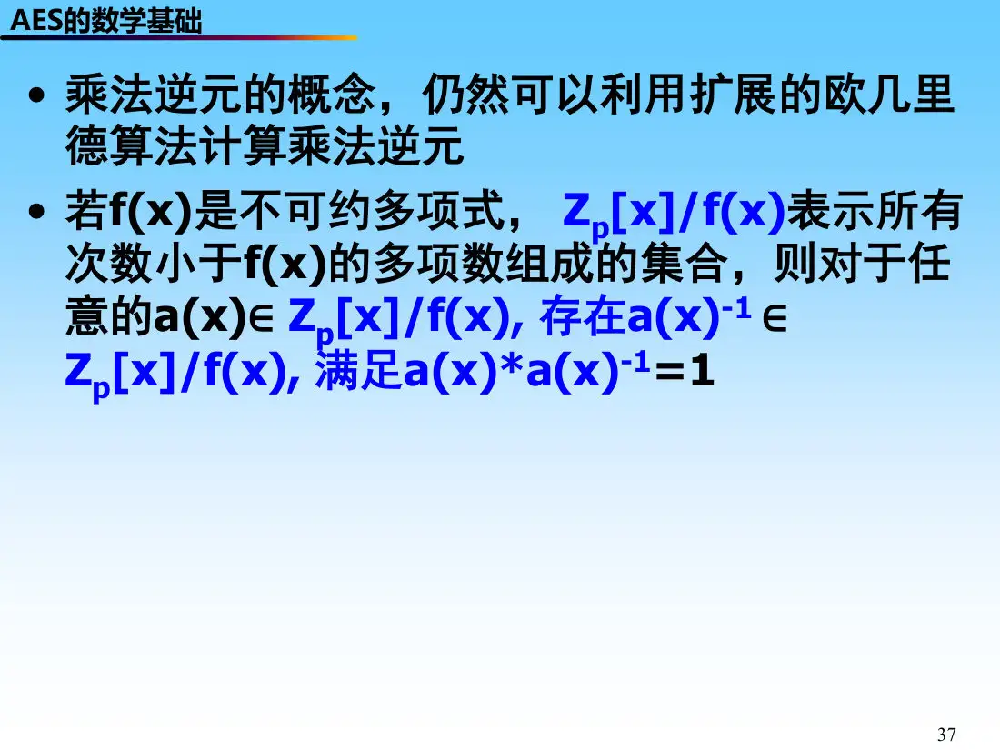

原文：

AES的数学基础

乘法逆元的概念，仍然可以利用扩展的欧几里德算法计算乘法逆元

若f(x)是不可约多项式， ${ \bf Z } _ { \mathrm { p } } [ { \bf x } ] / \mathrm { f } ( { \bf x } )$ 表示所有次数小于f(x)的多项数组成的集合，则对于任意的 $\mathsf { a } ( \mathbf { x } ) { \in } \mathbb { Z } _ { \mathrm { { o } } } [ \mathbf { x } ] / { \mathsf { f } } ( \mathbf { x } )$ 存在a $( \mathbf { x } ) ^ { - 1 } \in$ $Z _ { \mathrm { p } } [ \mathbf { x } ] / \mathsf { f } ( \mathbf { x } )$ 满足a $( \mathbf { x } ) ^ { * } \mathbf { a } ( \mathbf { x } ) ^ { - 1 } { = } 1$

37

### AES的数学基础

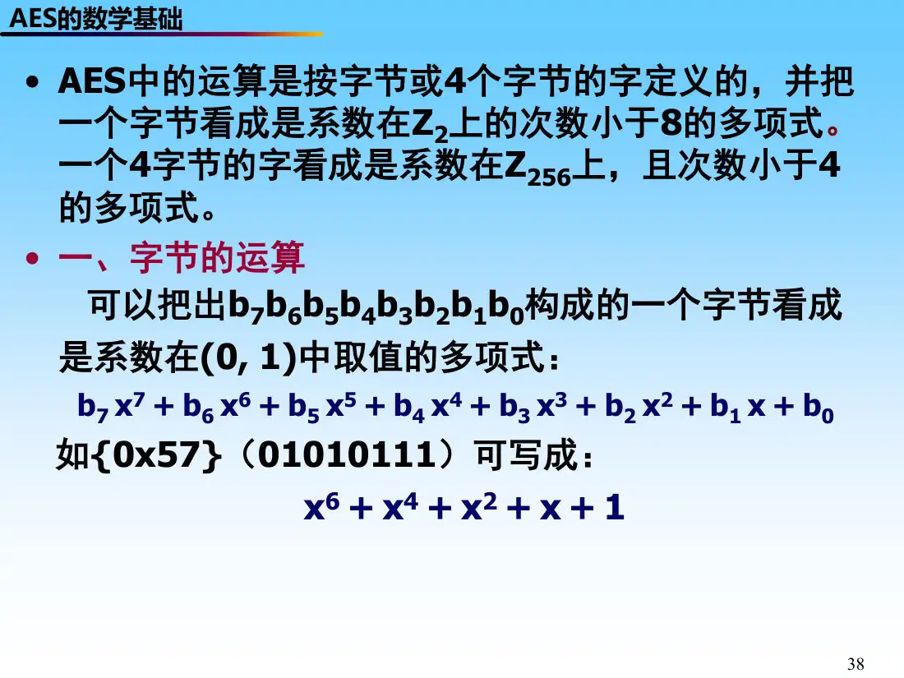

原文：

AES的数学基础

AES中的运算是按字节或4个字节的字定义的，并把一个字节看成是系数在 $\mathbb { Z } _ { 2 }$ 上的次数小于8的多项式。一个4字节的字看成是系数在 $z _ { 2 5 6 } \pm$ 且次数小于4的多项式。

• 一、字节的运算

可以把出 $\mathbf { b _ { 7 } b _ { 6 } b _ { 5 } b _ { 4 } b _ { 3 } b _ { 2 } b _ { 1 } b _ { 0 } }$ 构成的一个字节看成是系数在(0, 1)中取值的多项式：

${ \mathfrak { b } } _ { 7 } \times ^ { 7 } + { \mathfrak { b } } _ { 6 } \times ^ { 6 } + { \mathfrak { b } } _ { 5 } \times ^ { 5 } + { \mathfrak { b } } _ { 4 } \times ^ { 4 } + { \mathfrak { b } } _ { 3 } \times ^ { 3 } + { \mathfrak { b } } _ { 2 } \times ^ { 2 } + { \mathfrak { b } } _ { 1 } \times + { \mathfrak { b } } _ { 0 }$ 如{0x57}（01010111）可写成：

$$
\mathbf {x} ^ {6} + \mathbf {x} ^ {4} + \mathbf {x} ^ {2} + \mathbf {x} + \mathbf {1}
$$

38

### 多项式的加法和乘法

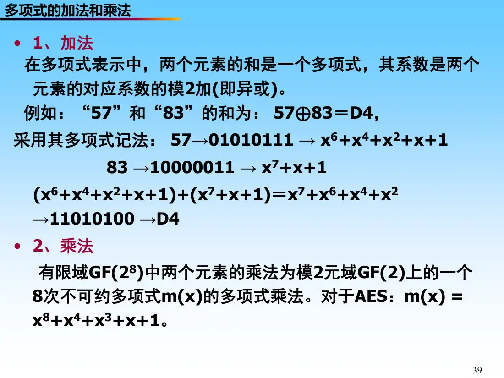

原文：

多项式的加法和乘法

• 1、加法

在多项式表示中，两个元素的和是一个多项式，其系数是两个元素的对应系数的模2加(即异或)。

例如：“57”和“83”的和为： $5 7 \oplus 8 3 = \mathbf { D } 4$

采用其多项式记法： $\mathbf { S 7 } { \longrightarrow } 0 1 0 1 0 1 1 1 \ { \longrightarrow } \ \mathbf { x ^ { 6 } } + \mathbf { x ^ { 4 } } + \mathbf { x ^ { 2 } } + \mathbf { x } + \mathbf { 1 }$

83 →10000011 → x7+x+1

$$
\begin{array}{l}(x ^ {6} + x ^ {4} + x ^ {2} + x + 1) + (x ^ {7} + x + 1) = x ^ {7} + x ^ {6} + x ^ {4} + x ^ {2}\\\rightarrow 1 1 0 1 0 1 0 0 \rightarrow D 4\end{array}
$$

• 2、乘法

有限域GF(28)中两个元素的乘法为模2元域GF(2)上的一个8次不可约多项式m(x)的多项式乘法。对于AES： $\mathbf { m } ( \mathbf { x } ) =$ $x ^ { 8 } + x ^ { 4 } + x ^ { 3 } + x + 1$

39

### 【例】 计算： $5 7 \cdot 8 3 = ?$

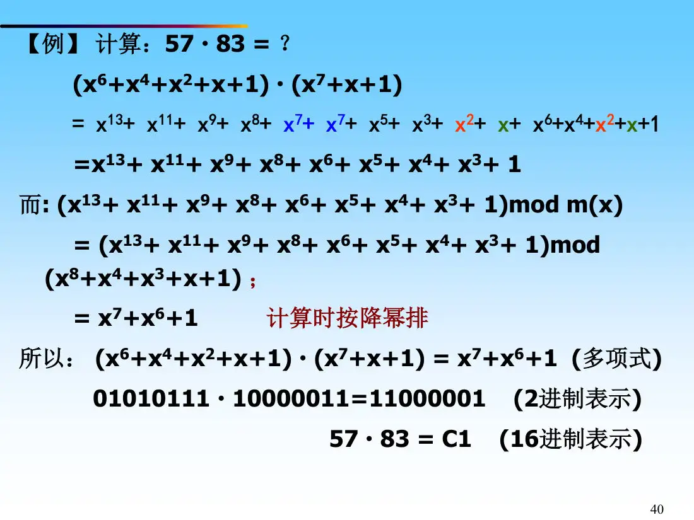

原文：

【例】 计算： $5 7 \cdot 8 3 = ?$

$$
\begin{array}{r l} & {(x ^ {6} + x ^ {4} + x ^ {2} + x + 1) \cdot (x ^ {7} + x + 1)} \\ & {= x ^ {1 3} + x ^ {1 1} + x ^ {9} + x ^ {8} + x ^ {7} + x ^ {7} + x ^ {5} + x ^ {3} + x ^ {2} + x + x ^ {6} + x ^ {4} + x ^ {2} + x + 1} \\ & {= x ^ {1 3} + x ^ {1 1} + x ^ {9} + x ^ {8} + x ^ {6} + x ^ {5} + x ^ {4} + x ^ {3} + 1} \end{array}
$$

$$
\begin{array}{r l} \text {而:} & (x ^ {1 3} + x ^ {1 1} + x ^ {9} + x ^ {8} + x ^ {6} + x ^ {5} + x ^ {4} + x ^ {3} + 1) \bmod m (x) \\ & = (x ^ {1 3} + x ^ {1 1} + x ^ {9} + x ^ {8} + x ^ {6} + x ^ {5} + x ^ {4} + x ^ {3} + 1) \bmod \\ & (x ^ {8} + x ^ {4} + x ^ {3} + x + 1); \\ & = x ^ {7} + x ^ {6} + 1 \quad \text {计算时按降幂排} \end{array}
$$

所以： $\left( \mathbf { x } ^ { 6 } + \mathbf { x } ^ { 4 } + \mathbf { x } ^ { 2 } + \mathbf { x } + \mathbf { 1 } \right) \cdot \left( \mathbf { x } ^ { 7 } + \mathbf { x } + \mathbf { 1 } \right) = \mathbf { x } ^ { 7 } + \mathbf { x } ^ { 6 } + \mathbf { 1 }$ (多项式)01010111  10000011=11000001 (2进制表示)57  83 = C1 (16进制表示)

40

### x乘法

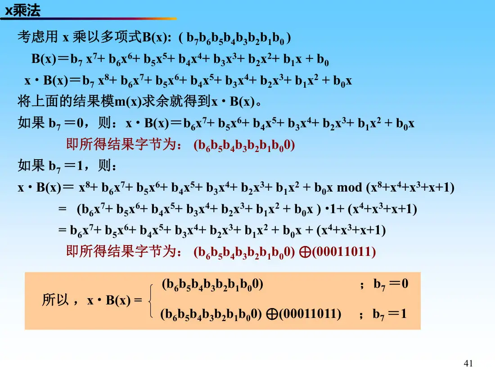

原文：

x乘法

考虑用 x 乘以多项式B(x): $( \mathbf { \Delta b _ { 7 } b _ { 6 } b _ { 5 } b _ { 4 } b _ { 3 } b _ { 2 } b _ { 1 } b _ { 0 } } )$

$$
\mathbf {B} (\mathbf {x}) = \mathbf {b} _ {7} \mathbf {x} ^ {7} + \mathbf {b} _ {6} \mathbf {x} ^ {6} + \mathbf {b} _ {5} \mathbf {x} ^ {5} + \mathbf {b} _ {4} \mathbf {x} ^ {4} + \mathbf {b} _ {3} \mathbf {x} ^ {3} + \mathbf {b} _ {2} \mathbf {x} ^ {2} + \mathbf {b} _ {1} \mathbf {x} + \mathbf {b} _ {0}
$$

$$
\mathbf {x} \cdot \mathbf {B} (\mathbf {x}) = \mathbf {b} _ {7} \mathbf {x} ^ {8} + \mathbf {b} _ {6} \mathbf {x} ^ {7} + \mathbf {b} _ {5} \mathbf {x} ^ {6} + \mathbf {b} _ {4} \mathbf {x} ^ {5} + \mathbf {b} _ {3} \mathbf {x} ^ {4} + \mathbf {b} _ {2} \mathbf {x} ^ {3} + \mathbf {b} _ {1} \mathbf {x} ^ {2} + \mathbf {b} _ {0} \mathbf {x}
$$

将上面的结果模m(x)求余就得到 $\bf \Pi _ { X } \bullet _ { B \left( \mathbf { X } \right) }$ 。

如果 $\mathbf { b } _ { 7 } = \mathbf { 0 }$ ，则： $\mathbf { x } \bullet \mathbf { B } ( \mathbf { x } ) = \mathbf { b } _ { 6 } \mathbf { x } ^ { 7 } + \mathbf { b } _ { 5 } \mathbf { x } ^ { 6 } + \mathbf { b } _ { 4 } \mathbf { x } ^ { 5 } + \mathbf { b } _ { 3 } \mathbf { x } ^ { 4 } + \mathbf { b } _ { 2 } \mathbf { x } ^ { 3 } + \mathbf { b } _ { 1 } \mathbf { x } ^ { 2 } + \mathbf { b } _ { 0 } \mathbf { x }$

即所得结果字节为： $( \mathbf { b } _ { 6 } \mathbf { b } _ { 5 } \mathbf { b } _ { 4 } \mathbf { b } _ { 3 } \mathbf { b } _ { 2 } \mathbf { b } _ { 1 } \mathbf { b } _ { 0 } \mathbf { 0 } )$

如果 $\mathbf { b } _ { 7 } { = } 1$ ，则：

$$
\begin{array}{r l} \mathbf {x} \cdot \mathbf {B} (\mathbf {x}) & = \mathbf {x} ^ {8} + \mathbf {b} _ {6} \mathbf {x} ^ {7} + \mathbf {b} _ {5} \mathbf {x} ^ {6} + \mathbf {b} _ {4} \mathbf {x} ^ {5} + \mathbf {b} _ {3} \mathbf {x} ^ {4} + \mathbf {b} _ {2} \mathbf {x} ^ {3} + \mathbf {b} _ {1} \mathbf {x} ^ {2} + \mathbf {b} _ {0} \mathbf {x} \bmod (\mathbf {x} ^ {8} + \mathbf {x} ^ {4} + \mathbf {x} ^ {3} + \mathbf {x} + 1) \\ & = (\mathbf {b} _ {6} \mathbf {x} ^ {7} + \mathbf {b} _ {5} \mathbf {x} ^ {6} + \mathbf {b} _ {4} \mathbf {x} ^ {5} + \mathbf {b} _ {3} \mathbf {x} ^ {4} + \mathbf {b} _ {2} \mathbf {x}^{3} + \mathbf {b}_{1}\mathbf{x}^{2} + \mathbf{b}_{0}\mathbf{x})\cdot \mathbf{1} + (\mathbf{x}^{4} + \mathbf{x}^{3} + \mathbf{x} + 1) \\ & = \mathbf{b}_{6}\mathbf{x}^{7} + \mathbf{b}_{5}\mathbf{x}^{6} + \mathbf{b}_{4}\mathbf{x}^{5} + \mathbf{b}_{3}\mathbf{x}^{4} + \mathbf{b}_{2}\mathbf{x}^{3} + \mathbf{b}_{1}\mathbf{x}^{2} + \mathbf{b}_{0}\mathbf{x} + (\mathbf{x}^{4} + \mathbf{x}^{3} + \mathbf{x} + 1) \end{array}
$$

即所得结果字节为： $( \mathbf { b } _ { 6 } \mathbf { b } _ { 5 } \mathbf { b } _ { 4 } \mathbf { b } _ { 3 } \mathbf { b } _ { 2 } \mathbf { b } _ { 1 } \mathbf { b } _ { 0 } \mathbf { 0 } )$ ⊕(00011011)

$$
\text {所以，} \mathbf {x} \cdot \mathbf {B} (\mathbf {x}) = \left\{ \begin{array}{l l} \left(\mathbf {b} _ {6} \mathbf {b} _ {5} \mathbf {b} _ {4} \mathbf {b} _ {3} \mathbf {b} _ {2} \mathbf {b} _ {1} \mathbf {b} _ {0} 0\right) & ; \quad \mathbf {b} _ {7} = 0 \\ \left(\mathbf {b} _ {6} \mathbf {b} _ {5} \mathbf {b} _ {4} \mathbf {b} _ {3} \mathbf {b} _ {2} \mathbf {b} _ {1} \mathbf {b} _ {0} 0\right) \oplus (0 0 0 1 1 0 1 1) & ; \quad \mathbf {b} _ {7} = 1 \end{array} \right.
$$

41

### AES的评估准则

原文：

AES的评估准则

安全性

安全性是评估准则中最重要因素，包括下述要点：算法抗密码分析的强度，稳定的数学基础，算法输出的随机性，与其他候选算法比较的相对安全性。

代价

代价也是评估准则中的重要因素，主要包括：许可要求，在各种平台上的计算效率（速度）和内存空间的需求。

算法和实现特性

算法和实现特性主要包括：灵活性、硬件和软件适应性、算法的简单性等。

42

### 43

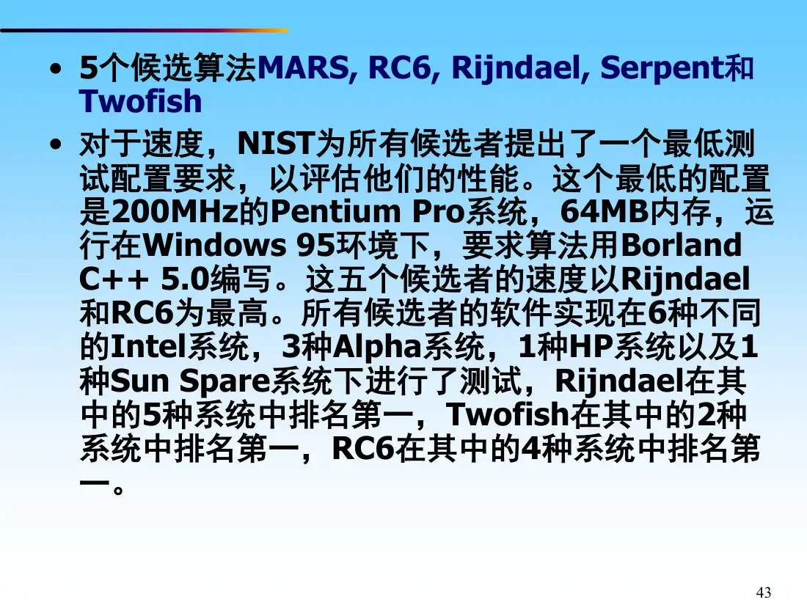

原文：

5个候选算法MARS, RC6, Rijndael, Serpent和 Twofish

对于速度，NIST为所有候选者提出了一个最低测试配置要求，以评估他们的性能。这个最低的配置是200MHz的Pentium Pro系统，64MB内存，运行在Windows 95环境下，要求算法用BorlandC++ 5.0编写。这五个候选者的速度以Rijndael和RC6为最高。所有候选者的软件实现在6种不同的Intel系统，3种Alpha系统，1种HP系统以及1种Sun Spare系统下进行了测试，Rijndael在其中的5种系统中排名第一，Twofish在其中的2种系统中排名第一，RC6在其中的4种系统中排名第

43

### Rijndael算法相关术语

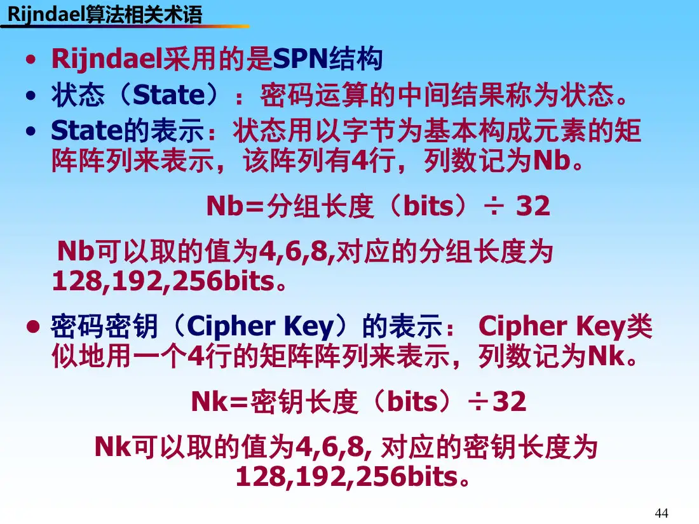

原文：

Rijndael算法相关术语

• Rijndael采用的是SPN结构

• 状态（State）：密码运算的中间结果称为状态。

State的表示：状态用以字节为基本构成元素的矩阵阵列来表示，该阵列有4行，列数记为Nb。

Nb=分组长度（bits）÷ 32

Nb可以取的值为4,6,8,对应的分组长度为128,192,256bits。

密码密钥（Cipher Key）的表示： Cipher Key类似地用一个4行的矩阵阵列来表示，列数记为Nk。

Nk=密钥长度（bits）÷32

Nk可以取的值为4,6,8, 对应的密钥长度为128,192,256bits。

44

### Rijndael算法

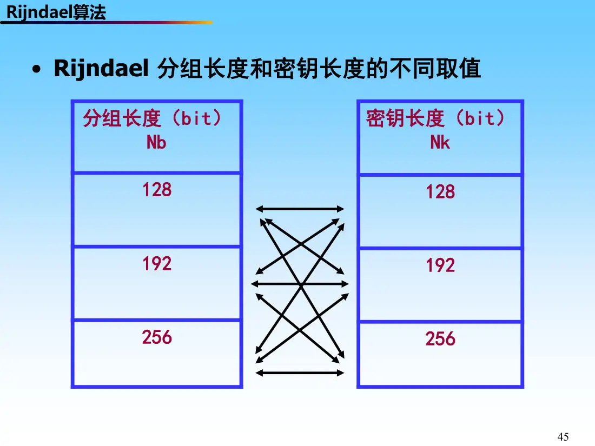

原文：

Rijndael算法

• Rijndael 分组长度和密钥长度的不同取值

45

### State矩阵

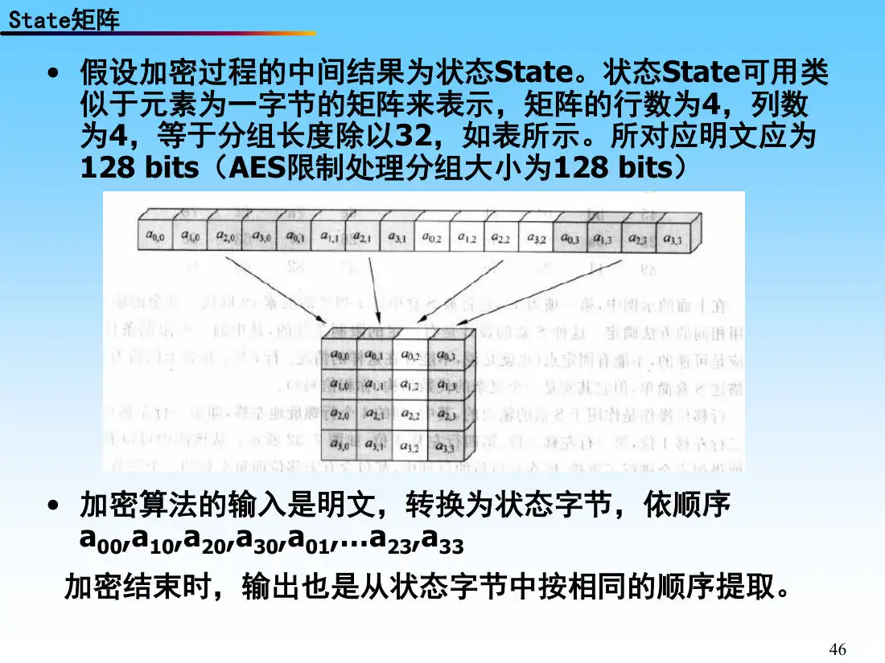

原文：

State矩阵

假设加密过程的中间结果为状态State。状态State可用类似于元素为一字节的矩阵来表示，矩阵的行数为4，列数为4，等于分组长度除以32，如表所示。所对应明文应为128 bits（AES限制处理分组大小为128 bits）

• 加密算法的输入是明文，转换为状态字节，依顺序$\mathbf { a _ { 0 0 } } _ { 1 0 r } \mathbf { a _ { 1 0 } } _ { r } \mathbf { a _ { 2 0 r } } \mathbf { a _ { 3 0 r } } \mathbf { a _ { 0 1 r } } \mathbf { a _ { 2 3 r } } \mathbf { a _ { 3 3 } }$

加密结束时，输出也是从状态字节中按相同的顺序提取。

46

### • 明文分组和密钥的组织排列方式

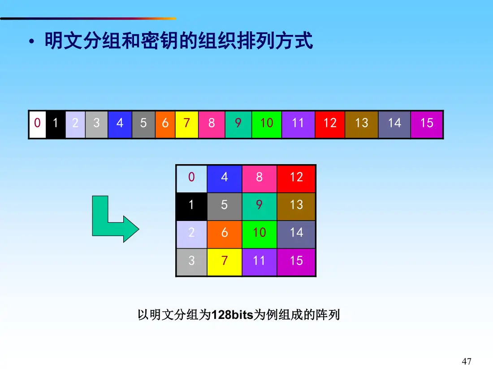

原文：

• 明文分组和密钥的组织排列方式

<table><tr><td>0</td><td>1</td><td>2</td><td>3</td><td>4</td><td>5</td><td>6</td><td>7</td><td>8</td><td>9</td><td>10</td><td>11</td><td>12</td><td>13</td><td>14</td><td>15</td></tr></table>

<table><tr><td>0</td><td>4</td><td>8</td><td>12</td></tr><tr><td>1</td><td>5</td><td>9</td><td>13</td></tr><tr><td>2</td><td>6</td><td>10</td><td>14</td></tr><tr><td>3</td><td>7</td><td>11</td><td>15</td></tr></table>

以明文分组为128bits为例组成的阵列

47

### Rijndael算法

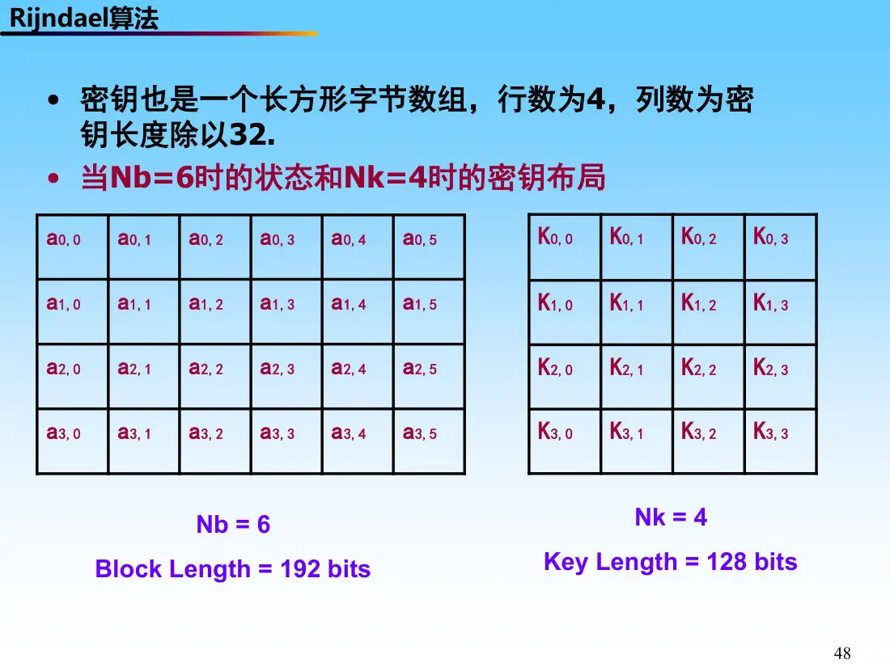

原文：

Rijndael算法

密钥也是一个长方形字节数组，行数为4，列数为密钥长度除以32.

• 当Nb=6时的状态和Nk=4时的密钥布局

<table><tr><td>a0, 0</td><td>a0, 1</td><td>a0, 2</td><td>a0, 3</td><td>a0, 4</td><td>a0, 5</td></tr><tr><td>a1, 0</td><td>a1, 1</td><td>a1, 2</td><td>a1, 3</td><td>a1, 4</td><td>a1, 5</td></tr><tr><td>a2, 0</td><td>a2, 1</td><td>a2, 2</td><td>a2, 3</td><td>a2, 4</td><td>a2, 5</td></tr><tr><td>a3, 0</td><td>a3, 1</td><td>a3, 2</td><td>a3, 3</td><td>a3, 4</td><td>a3, 5</td></tr></table>

$$
\mathbf {N b} = 6
$$

Block Length = 192 bits

<table><tr><td> $K_{0,0}$ </td><td> $K_{0,1}$ </td><td> $K_{0,2}$ </td><td> $K_{0,3}$ </td></tr><tr><td> $K_{1,0}$ </td><td> $K_{1,1}$ </td><td> $K_{1,2}$ </td><td> $K_{1,3}$ </td></tr><tr><td> $K_{2,0}$ </td><td> $K_{2,1}$ </td><td> $K_{2,2}$ </td><td> $K_{2,3}$ </td></tr><tr><td> $K_{3,0}$ </td><td> $K_{3,1}$ </td><td> $K_{3,2}$ </td><td> $K_{3,3}$ </td></tr></table>
Nk = 4 Key Length = 128 bits

48

### Rijndael算法

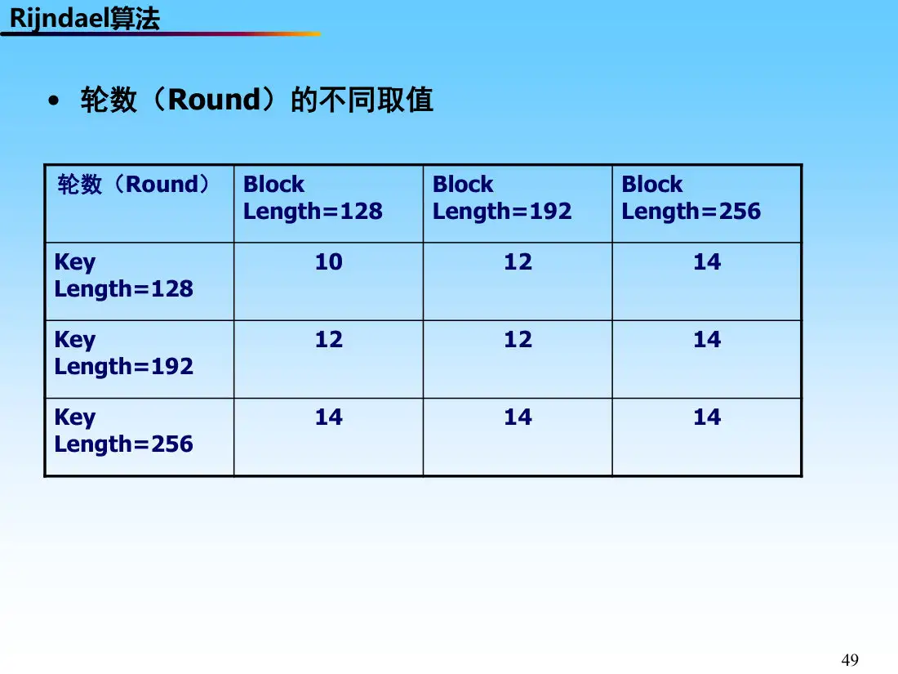

原文：

Rijndael算法

轮数（Round）的不同取值

<table><tr><td>轮数(Round)</td><td>BlockLength=128</td><td>BlockLength=192</td><td>BlockLength=256</td></tr><tr><td>KeyLength=128</td><td>10</td><td>12</td><td>14</td></tr><tr><td>KeyLength=192</td><td>12</td><td>12</td><td>14</td></tr><tr><td>KeyLength=256</td><td>14</td><td>14</td><td>14</td></tr></table>

49

### 算法的整体描述

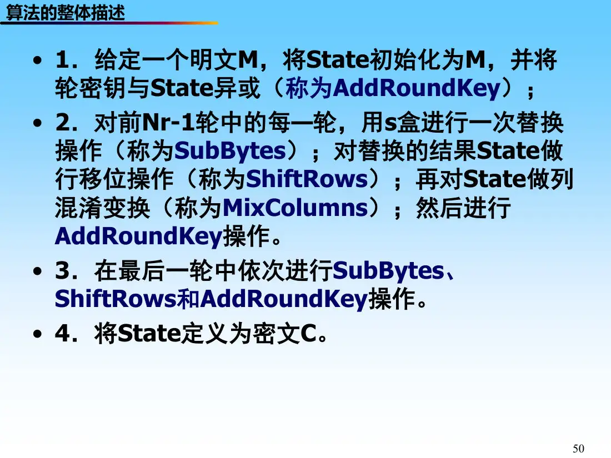

原文：

算法的整体描述

1．给定一个明文M，将State初始化为M，并将轮密钥与State异或（称为AddRoundKey）；

2．对前Nr-1轮中的每—轮，用s盒进行一次替换操作（称为SubBytes）；对替换的结果State做行移位操作（称为ShiftRows）；再对State做列混淆变换（称为MixColumns）；然后进行AddRoundKey操作。

• 3．在最后一轮中依次进行SubBytes、ShiftRows和AddRoundKey操作。

• 4．将State定义为密文C。

50

### 51

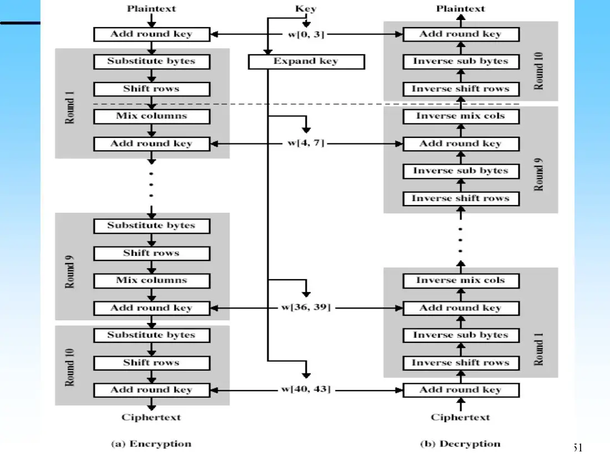

原文：

51

### Rijndael的轮变换

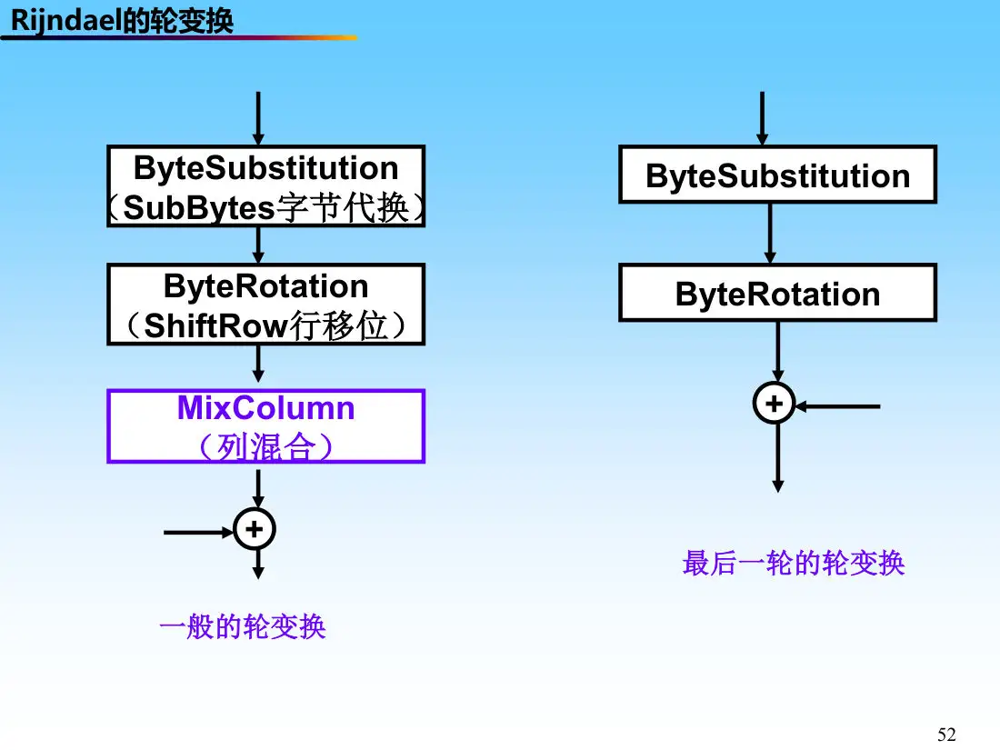

原文：

Rijndael的轮变换

52

### 字节代换（SubBytes）

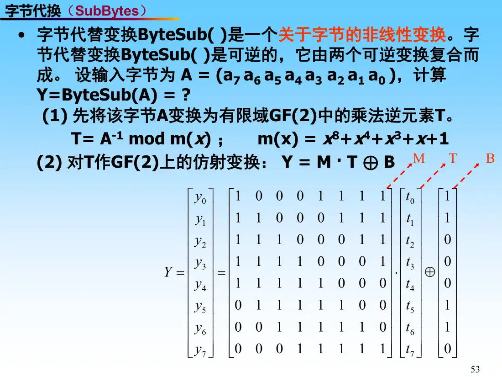

原文：

字节代换（SubBytes）

字节代替变换ByteSub( )是一个关于字节的非线性变换。字节代替变换ByteSub( )是可逆的，它由两个可逆变换复合而成。 设输入字节为 $\boldsymbol { \mathsf { A } } = ( \mathsf { a } _ { 7 } \mathsf { a } _ { 6 } \mathsf { a } _ { 5 } \mathsf { a } _ { 4 } \mathsf { a } _ { 3 } \mathsf { a } _ { 2 } \mathsf { a } _ { 1 } \mathsf { a } _ { 0 } )$ 计算$\mathsf { Y } { = } \mathsf { B } \mathsf { y t e } \mathsf { S u b } ( \mathsf { A } ) = \mathsf { ? }$

(1) 先将该字节A变换为有限域GF(2)中的乘法逆元素T。

$\mathbf { T } { = } \mathbf { A } ^ { - 1 } \mathbf { m o d } \mathbf { \Sigma } \mathbf { m } ( x )$ $m ( x ) = x ^ { 8 } + x ^ { 4 } + x ^ { 3 } + x + 1$

(2) 对T作GF(2)上的仿射变换： $\mathbf { \gamma } \mathbf { \times } \mathbf { \times } \mathbf { \times } \mathbf { \alpha } \mathbf { \times } \mathbf { \alpha } \mathbf { \times } \mathbf { \alpha } \mathbf { \times } \mathbf { \alpha } \mathbf { \times } \mathbf { \alpha } \mathbf { \times } \mathbf { \alpha } \mathbf { \times } \mathbf { \alpha } \mathbf { \times } \mathbf { \alpha } \mathbf { \times } \mathbf { \alpha } \mathbf { \times } \mathbf { \alpha } \mathbf { \alpha } \mathbf { \times } \mathbf { \alpha } \mathbf { \alpha } \mathbf { \times } \mathbf { \alpha } \mathbf { \alpha } \mathbf { \times } \mathbf { \alpha } \mathbf { \alpha } \mathbf { \alpha } \mathbf { \times } \mathbf { \alpha } \mathbf { \alpha } \mathbf { \alpha } \mathbf { \times } \mathbf { \alpha } \mathbf { \alpha } \mathbf { \alpha } \mathbf { \alpha } \mathbf { \times } \mathbf { \alpha } \mathbf { \alpha } \mathbf { \alpha } \mathbf { \alpha } \mathbf { \alpha } \mathbf { \times } \mathbf { \alpha } \mathbf { \alpha } \mathbf { \alpha } \mathbf { \alpha } \mathbf { \alpha } \mathbf { \alpha } \mathbf { \alpha } \mathbf { \alpha } \mathbf { \alpha } \mathbf { \alpha } \mathbf { \alpha } \mathbf { \alpha } \mathbf { \alpha } \mathbf { \alpha } \mathbf { \alpha } \mathbf { \alpha } \mathbf { \alpha } \mathbf { \alpha } \mathbf { \alpha } \mathbf { \alpha } \mathbf { \alpha } \mathbf { \alpha } \mathbf { \alpha } \mathbf { \alpha } \mathbf { \alpha } \mathbf { \alpha } \mathbf { \alpha } \mathbf { \alpha } \mathbf { \alpha } \mathbf { \alpha } \mathbf { \alpha } \mathbf { \alpha } \mathbf { \alpha } \mathbf { \alpha } \mathbf { \alpha } \mathbf { \alpha } \mathbf { \alpha } \mathbf \mathbf { \alpha } \mathbf { \alpha } \mathbf { \alpha \alpha } \mathbf \mathbf { \alpha } \mathbf { \alpha } \mathbf \mathbf { \alpha \alpha } \mathbf \mathbf { \alpha } \mathbf \mathbf { \alpha \alpha } \mathbf \mathbf { \alpha \alpha \alpha \alpha } \mathbf \mathbf { \alpha \alpha \mathbf \alpha } \mathbf \mathbf  \alpha \alpha \alpha \mathbf \alpha \alpha \mathbf \alpha \mathbf { } \mathbf \alpha \alpha \mathbf \alpha \mathbf \alpha \alpha \alpha \mathbf \alpha \mathbf \alpha \mathbf \alpha \alpha \mathbf \alpha \mathbf \alpha \alpha \mathbf \alpha \mathbf \alpha \alpha \mathbf \alpha \mathbf \alpha \alpha $

$$
Y = \left[ \begin{array}{l} y _ {0} \\ y _ {1} \\ y _ {2} \\ y _ {3} \\ y _ {4} \\ y _ {5} \\ y _ {6} \\ y _ {7} \end{array} \right] = \left[ \begin{array}{l l l l l l l l} 1 & 0 & 0 & 0 & 1 & 1 & 1 & 1 \\ 1 & 1 & 0 & 0 & 0 & 1 & 1 & 1 \\ 1 & 1 & 1 & 0 & 0 & 0 & 1 & 1 \\ 1 & 1 & 1 & 1 & 0 & 0 & 0 & 1 \\ 1 & 1 & 1 & 1 & 1 & 0 & 0 & 0 \\ 0 & 1 & 1 & 1 & 1 & 1 & 0 & 0 \\ 0 & 0 & 1 & 1 & 1 & 1 & 1 & 0 \\ 0 & 0 & 0 & 1 & 1 & 1 & 1 & 1 \end{array} \right]. \left[ \begin{array}{l} t _ {0} \\ t _ {1} \\ t _ {2} \\ t _ {3} \\ t _ {4} \\ t _ {5} \\ t _ {6} \\ t _ {7} \end{array} \right] \oplus \left[ \begin{array}{l} 1 \\ 1 \\ 0 \\ 0 \\ 0 \\ 1 \\ 1 \\ 0 \end{array} \right]
$$

53

### 字节代换

原文：

字节代换

列的每个元素作为输入用来指定S盒的地址：前4位指定S盒的行，后4位指定S盒的列。有行和列所确定S盒位置的元素取代输入矩阵中相应位置的元素，例如“12” ，行1，列2，因此输入“12” ，输出“c9”

54

### S-Box

原文：

<table><tr><td>X\Y</td><td>0</td><td>1</td><td>2</td><td>3</td><td>4</td><td>5</td><td>6</td><td>7</td><td>8</td><td>9</td><td>A</td><td>B</td><td>C</td><td>D</td><td>E</td><td>F</td></tr><tr><td>0</td><td>63</td><td>7C</td><td>77</td><td>7B</td><td>F2</td><td>6B</td><td>6F</td><td>C5</td><td>30</td><td>01</td><td>67</td><td>2B</td><td>FE</td><td>D7</td><td>AB</td><td>76</td></tr><tr><td>1</td><td>CA</td><td>82</td><td>C9</td><td>7D</td><td>FA</td><td>59</td><td>47</td><td>F0</td><td>AD</td><td>D4</td><td>A2</td><td>AF</td><td>9C</td><td>A4</td><td>72</td><td>C0</td></tr><tr><td>2</td><td>B7</td><td>FD</td><td>93</td><td>26</td><td>36</td><td>3F</td><td>F7</td><td>CC</td><td>34</td><td>A5</td><td>E5</td><td>F1</td><td>71</td><td>D8</td><td>31</td><td>15</td></tr><tr><td>3</td><td>04</td><td>C7</td><td>23</td><td>C3</td><td>18</td><td>96</td><td>05</td><td>9A</td><td>07</td><td>12</td><td>80</td><td>E2</td><td>EB</td><td>27</td><td>B2</td><td>75</td></tr><tr><td>4</td><td>09</td><td>83</td><td>2C</td><td>1A</td><td>1B</td><td>6E</td><td>5A</td><td>A0</td><td>52</td><td>3B</td><td>D6</td><td>B3</td><td>29</td><td>E3</td><td>2F</td><td>84</td></tr><tr><td>5</td><td>53</td><td>D1</td><td>00</td><td>ED</td><td>20</td><td>FC</td><td>B1</td><td>5B</td><td>6A</td><td>CB</td><td>BE</td><td>39</td><td>4A</td><td>4C</td><td>58</td><td>CF</td></tr><tr><td>6</td><td>D0</td><td>EF</td><td>AA</td><td>FB</td><td>43</td><td>4D</td><td>33</td><td>85</td><td>45</td><td>F9</td><td>02</td><td>7F</td><td>50</td><td>3C</td><td>9F</td><td>A8</td></tr><tr><td>7</td><td>51</td><td>A3</td><td>40</td><td>8F</td><td>92</td><td>9D</td><td>38</td><td>F5</td><td>BC</td><td>B6</td><td>DA</td><td>21</td><td>10</td><td>FF</td><td>F3</td><td>D2</td></tr><tr><td>8</td><td>CD</td><td>0C</td><td>13</td><td>EC</td><td>5F</td><td>97</td><td>44</td><td>17</td><td>C4</td><td>A7</td><td>7E</td><td>3D</td><td>64</td><td>5D</td><td>19</td><td>73</td></tr><tr><td>9</td><td>60</td><td>81</td><td>4F</td><td>DC</td><td>22</td><td>2A</td><td>90</td><td>88</td><td>46</td><td>EE</td><td>B8</td><td>14</td><td>DE</td><td>5E</td><td>0B</td><td>DB</td></tr><tr><td>A</td><td>E0</td><td>32</td><td>3A</td><td>0A</td><td>49</td><td>06</td><td>24</td><td>5C</td><td>C2</td><td>D3</td><td>AC</td><td>62</td><td>91</td><td>95</td><td>E4</td><td>79</td></tr><tr><td>B</td><td>E7</td><td>C8</td><td>37</td><td>6D</td><td>8D</td><td>D5</td><td>4E</td><td>A9</td><td>6C</td><td>56</td><td>F4</td><td>EA</td><td>65</td><td>7A</td><td>AE</td><td>08</td></tr><tr><td>C</td><td>BA</td><td>78</td><td>25</td><td>2E</td><td>1C</td><td>A6</td><td>B4</td><td>C6</td><td>E8</td><td>DD</td><td>74</td><td>1F</td><td>4B</td><td>BD</td><td>8B</td><td>8A</td></tr><tr><td>D</td><td>70</td><td>3E</td><td>B5</td><td>66</td><td>48</td><td>03</td><td>F6</td><td>0E</td><td>61</td><td>35</td><td>57</td><td>B9</td><td>86</td><td>C1</td><td>1D</td><td>9E</td></tr><tr><td>E</td><td>E1</td><td>F8</td><td>98</td><td>11</td><td>69</td><td>D9</td><td>8E</td><td>94</td><td>9B</td><td>1E</td><td>87</td><td>E9</td><td>CE</td><td>55</td><td>28</td><td>DF</td></tr><tr><td>F</td><td>8C</td><td>A1</td><td>89</td><td>0D</td><td>BF</td><td>E6</td><td>42</td><td>68</td><td>41</td><td>99</td><td>2D</td><td>0F</td><td>B0</td><td>54</td><td>BB</td><td>16</td></tr></table>

S-Box

55

### 字节移位 ShiftRows()

原文：

字节移位 ShiftRows()

在ByteRotation变换中，状态阵列的后3行循环移位不同的偏移量。第1行循环移位C1字节，第2行循环移位C2字节，第3行循环移位C3字节。偏移量C1、C2、C3与分组长度Nb

有关，如下表所示：

<table><tr><td>Nb</td><td>C1</td><td>C2</td><td>C3</td></tr><tr><td>4</td><td>1</td><td>2</td><td>3</td></tr><tr><td>6</td><td>1</td><td>2</td><td>3</td></tr><tr><td>8</td><td>1</td><td>3</td><td>4</td></tr></table>

$$
\left[ \begin{array}{l l l l} S _ {0 0} & S _ {0 1} & S _ {0 2} & S _ {0 3} \\ S _ {1 0} & S _ {1 1} & S _ {1 2} & S _ {1 3} \\ S _ {2 0} & S _ {2 1} & S _ {2 2} & S _ {2 3} \\ S _ {3 0} & S _ {3 1} & S _ {3 2} & S _ {3 3} \end{array} \right]
$$

第0行不变

循环左移1字节

循环左移2字节

循环左移3字节

$$
\left[ \begin{array}{l l l l} S _ {0 0} & S _ {0 1} & S _ {0 2} & S _ {0 3} \\ S _ {1 1} & S _ {1 2} & S _ {1 3} & S _ {1 0} \\ S _ {2 2} & S _ {2 3} & S _ {2 0} & S _ {2 1} \\ S _ {3 3} & S _ {3 0} & S _ {3 1} & S _ {3 2} \end{array} \right]
$$

56

### 列混合变换 MixColumns()

原文：

列混合变换 MixColumns()

列混合变换MixColumns()对一个状态逐列进行变换，它将个状态的每一列视为 $\mathbf { Z _ { 2 5 6 } }$ 上的一个多项式。

• 列混合变换中，每一列所表示的多项式将乘以一个固定的多项式a(x)，

$$
a (x) = \{0 3 \} x ^ {3} + \{0 1 \} x ^ {2} + \{0 1 \} x + \{0 2 \}
$$

对应4字节向量为( 03 01 01 02)，模多项式为 $( \times ^ { 4 } \pm 1 )$ 。

<table><tr><td> $A_{0,0}$ </td><td> $A_{0,1}$ </td><td> $A_{0,2}$ </td><td> $A_{0,3}$ </td></tr><tr><td> $A_{1,0}$ </td><td> $A_{1,1}$ </td><td> $A_{1,2}$ </td><td> $A_{1,3}$ </td></tr><tr><td> $A_{2,0}$ </td><td> $A_{2,1}$ </td><td> $A_{2,2}$ </td><td> $A_{2,3}$ </td></tr><tr><td> $A_{3,0}$ </td><td> $A_{3,1}$ </td><td> $A_{3,2}$ </td><td> $A_{3,3}$ </td></tr></table>

<table><tr><td> $B_{0,0}$ </td><td> $B_{0,1}$ </td><td> $B_{0,2}$ </td><td> $B_{0,3}$ </td></tr><tr><td> $B_{1,0}$ </td><td> $B_{1,1}$ </td><td> $B_{1,2}$ </td><td> $B_{1,3}$ </td></tr><tr><td> $B_{2,0}$ </td><td> $B_{2,1}$ </td><td> $B_{2,2}$ </td><td> $B_{2,3}$ </td></tr><tr><td> $B_{3,0}$ </td><td> $B_{3,1}$ </td><td> $B_{3,2}$ </td><td> $B_{3,3}$ </td></tr></table>

57

### 列混合变换

原文：

列混合变换

• 设行列式第j列列元素相应多项式为：

则：

$$
\begin{array}{r l r} {s _ {j} (x) = s _ {3 j} x ^ {3} + s _ {2 j} x ^ {2} + s _ {1 j} x + s _ {0 j};} & & {0 \leq j \leq 3} \\ {s _ {j} ^ {\prime} (x) = s _ {3 j} ^ {\prime} x ^ {3} + s _ {2 j} ^ {\prime} x ^ {2} + s _ {1 j} ^ {\prime} x + s _ {0 j} ^ {\prime};} & & {0 \leq j \leq 3} \\ {s _ {j} ^ {\prime} (x) = a (x) s _ {j} (x);} & & {0 \leq j \leq 3} \end{array}
$$

其中， $\scriptstyle \mathbf { a } ( \mathrm { x } ) = \{ \mathbf { 0 } 3 \} \ \mathrm { x } ^ { 3 } + \{ \mathbf { 0 } 1 \} \ \mathrm { x } ^ { 2 } + \{ \mathbf { 0 } 1 \} \mathrm { x } + \{ \mathbf { 0 } 2 \}$ 表示模； $( \mathbf { X } ^ { 4 } + 1 )$ 乘法。

将 $\mathrm { s _ { j } ^ { \prime } ( x ) = a ( x ) \ \otimes \mathrm { s _ { j } ( x ) } }$ 表示为矩阵乘法：

输出阵列第j列元素

$$
\left[ \begin{array}{c} s _ {0 j} ^ {\prime} \\ s _ {1 j} ^ {\prime} \\ s _ {2 j} ^ {\prime} \\ s _ {3 j} ^ {\prime} \end{array} \right] = \left[ \begin{array}{l l l l} 0 2 & 0 3 & 0 1 & 0 1 \\ 0 1 & 0 2 & 0 3 & 0 1 \\ 0 1 & 0 1 & 0 2 & 0 3 \\ 0 3 & 0 1 & 0 1 & 0 2 \end{array} \right], \left[ \begin{array}{c} s _ {0 j} \\ s _ {1 j} \\ s _ {2 j} \\ s _ {3 j} \end{array} \right]
$$

输入阵列第j列元素

58

### AddRoundKey(轮密钥加)

原文：

AddRoundKey(轮密钥加)

将轮密钥与状态按比特异或。轮密钥是通过KeySchedule过程从密码密钥中得到的，轮密钥长度等于分组长度。

<table><tr><td>A0, 0</td><td>A0, 1</td><td>A0, 2</td><td>A0, 3</td></tr><tr><td>A1, 0</td><td>A1, 1</td><td>A1, 2</td><td>A1, 3</td></tr><tr><td>A2, 0</td><td>A2, 1</td><td>A2, 2</td><td>A2, 3</td></tr><tr><td>A3, 0</td><td>A3, 1</td><td>A3, 2</td><td>A3, 3</td></tr></table>

＋

<table><tr><td> $B_{0,0}$ </td><td> $B_{0,1}$ </td><td> $B_{0,2}$ </td><td> $B_{0,3}$ </td></tr><tr><td> $B_{1,0}$ </td><td> $B_{1,1}$ </td><td> $B_{1,2}$ </td><td> $B_{1,3}$ </td></tr><tr><td> $B_{2,0}$ </td><td> $B_{2,1}$ </td><td> $B_{2,2}$ </td><td> $B_{2,3}$ </td></tr><tr><td> $B_{3,0}$ </td><td> $B_{3,1}$ </td><td> $B_{3,2}$ </td><td> $B_{3,3}$ </td></tr></table>

<table><tr><td> $K_{0,0}$ </td><td> $K_{0,1}$ </td><td> $K_{0,2}$ </td><td> $K_{0,3}$ </td></tr><tr><td> $K_{1,0}$ </td><td> $K_{1,1}$ </td><td> $K_{1,2}$ </td><td> $K_{1,3}$ </td></tr><tr><td> $K_{2,0}$ </td><td> $K_{2,1}$ </td><td> $K_{2,2}$ </td><td> $K_{2,3}$ </td></tr><tr><td> $K_{3,0}$ </td><td> $K_{3,1}$ </td><td> $K_{3,2}$ </td><td> $K_{3,3}$ </td></tr></table>

$\mathbf { A } _ { 3 , 3 } \oplus \mathsf { K } _ { 3 , 3 } = \mathsf { B } _ { 3 , 3 }$ (mod 2)

59

### 子密钥生成算法

原文：

子密钥生成算法

• 密钥调度包括两个部分：密钥扩展和轮密钥选取。

密钥bit的总数＝分组长度×（轮数 $\mathsf { R o u n d } \pm 1 )$ 例如当分组长度为128bits和轮数Round为10时，轮密钥长度为 $1 2 8 \times ( 1 0 + 1 ) = 1 4 0 8 \mathrm { b } \mathrm { i t s }$

• 将密码密钥扩展成一个扩展密钥。

从扩展密钥中取出轮密钥：第一个轮密钥由扩展密钥的第一个Nb个字（其实就是Nb 列），第二个轮密钥由接下来的Nb个字组成，以此类推。

60

### 密钥扩展

原文：

密钥扩展

61

### 密钥扩展

原文：

密钥扩展

62

### 密钥扩展 RotByte

原文：

密钥扩展 RotByte

在 密 钥 扩 展 中 ， 函 数 RotByte $( \mathbf { a } , \mathbf { b } , \mathbf { c } , \mathbf { d } ) =$ $( \log , \mathbf { c } , \mathbf { d } , \mathbf { a } )$ ,即是输入字的1字节循环

<table><tr><td> $K_{0,0}$ </td><td> $K_{0,1}$ </td><td> $K_{0,2}$ </td><td> $K_{0,3}$ </td></tr><tr><td> $K_{1,0}$ </td><td> $K_{1,1}$ </td><td> $K_{1,2}$ </td><td> $K_{1,3}$ </td></tr><tr><td> $K_{2,0}$ </td><td> $K_{2,1}$ </td><td> $K_{2,2}$ </td><td> $K_{2,3}$ </td></tr><tr><td> $K_{3,0}$ </td><td> $K_{3,1}$ </td><td> $K_{3,2}$ </td><td> $K_{3,3}$ </td></tr></table>

<table><tr><td>K0,0</td><td>K0,1</td><td>K0,2</td><td>K1,3</td></tr><tr><td>K1,0</td><td>K1,1</td><td>K1,2</td><td>K2,3</td></tr><tr><td>K2,0</td><td>K2,1</td><td>K2,2</td><td>K3,3</td></tr><tr><td>K3,0</td><td>K3,1</td><td>K3,2</td><td>K0,3</td></tr></table>

63

### 密钥扩展算法

原文：

密钥扩展算法

密钥按照矩阵列进行分组，如果前4列为k(0),k(1),k(2),k(3),那么新的列如下递归：

• 如果k(i)中，i不是4的倍数，那么i列由如下等式确定：

$$
k (i) = k (i - 4) X O R k (i - 1)
$$

如果k(i)中，i是4的倍数，那么i列由如下等式确定：

$$
\mathrm{k} (\mathrm{i}) = \mathrm{k} (\mathrm{i} - 4) \text { XOR } \mathrm{T} [ \mathrm{k} (\mathrm{i} - 1) ]
$$

其中T[k(i-1)]是k(i-1)的一种转换形式，按以下方式实现：

(1)循环地将k(i-1)的元素左移位，每次一个字节，如 abcd 变成bcda

(2)将这4个字节作为S盒的输入，输出新的4个字节efgh

(3)计算一轮的常量 $r ( \mathbf { i } ) { = } 2 \ ^ { ( \mathbf { i } - \mathbf { 1 } ) / 4 }$

(4)这样生成转换后的列：[e $\mathsf { X O R } \mathsf { r } ( \bar { \mathsf { I } } ) , \mathsf { f } , \mathsf { g } , \mathsf { h } ]$

第i轮的轮密钥组成了列 $\begin{array} { r l } {  { \operatorname { k } ( 4 \mathrm { i } ) , \operatorname { k } ( 4 \mathrm { i } + 1 ) , \operatorname { k } ( 4 \mathrm { i } + 2 ) , \operatorname { k } ( 4 \mathrm { i } + 3 ) } \quad } & { { } } \end{array}$

64

### 轮密钥的选取

原文：

轮密钥的选取

<table><tr><td> $K_0$ </td><td> $K_1$ </td><td> $K_2$ </td><td> $K_3$ </td><td> $K_4$ </td><td> $K_5$ </td><td> $K_6$ </td><td> $K_7$ </td><td> $K_8$ </td><td> $K_9$ </td><td> $K_{10}$ </td><td>......</td></tr><tr><td colspan="12"></td></tr></table>

轮密钥0

轮密钥1

轮密钥2

65

### AES解密算法

原文：

AES解密算法

• 自学。。。。

66

### 分组密码的工作模式

原文：

分组密码的工作模式

• 增强密码算法或者使算法适应具体的应用

实际的应用中，即使有了安全的分组密码算法，也需要采用适当的工作模式来隐蔽明文的统计特性、数据的格式等，以提高整体的安全性，降低删除、重放、插入和伪造成功的机会。美国在FIPS中定义了五种运行模式。

电码本模式(ECB)

密码分组链接模式(CBC)

输出反馈模式(OFB)

密码反馈模式(CFB)

计数器模式(CTR)

67

### 电码本模式-以DES算法为例

原文：

电码本模式-以DES算法为例

• 明文分成64的分组进行加密，必要时填充，每个分组用同一密钥加密，同样明文分组得相同密文

Padding：给定加密消息的长度是随机的，按64 bit分组时，最后一组消息长度可能不足64 bit。可以填充一些数字，通常用最后1字节作为填充指示符(PI)。它所表示的十进制数字就是填充占有的字节数。数据尾部、填充字符和填充指示符一起作为一组进行加密。

$$
C _ {i} = E _ {k} (M _ {i}), i = 1, 2, \dots , n.
$$

特点 ：

(1) 最简易；

(2) 相同密钥作用下，在相同的明文加密后将产生相同的密文，易于暴露明文的固有格式和统计特性；

(3) 各密文块间缺乏相关性，信息易于受到块替换攻击。分组的重发

68

### 密码分组链接模式（CBC）

原文：

密码分组链接模式（CBC）

加密输入是当前明文分组和前一密文分组的异或，形成一条链，使用相同的密钥。这样加密算法的输入与明文分组之间不再有固定的关系

(b) 解密

69

### 密码分组链接模式（CBC）

原文：

密码分组链接模式（CBC）

初始矢量IV(Initial Vector)：第一组明文加密时无反馈密文，为此需要在寄存器中预先置入一个，收发双方必须选用同一IV。

• 各密文组不仅与当前明文组有关，而且通过反馈作用还与以前的明文组有关

• CBC的传播错误

1. 明文有一组中有错，会使以后的密文组都受影响但经解密后的恢复结果，除原来有误的一组外，其后各组明文都正确地恢复。

2.若在传送过程中，某组密文组出错时，则该组恢复的明文和下一组恢复数据出错。再后面的组将不会受中错误比特的影响。

70

### 密码反馈模式（CFB）

原文：

密码反馈模式（CFB）

71

### CFB

原文：

CFB

• CFB实际上是将加密算法DES作为一个密钥流产生器，当j＝1时就退化为流密码了。

• 解密：采用相同方案，但是使用加密函数而非解密函数。

• CFB的错误传输

1、明文某一组中有错，会使以后的密文组都受影响，但经解密后的恢复结果，除原有误的一组外，其后各组明文都正确地恢复。

2、密文里的一位错误会引起明文的一个单独错误，此处，错误进入移位寄存器，导致密文成为无用信息，直到该错误从移位寄存器中移出。

72

### 73

原文：

73

### OFB

原文：

OFB

将分组密码算法作为一个密钥流产生器，其输出的j-bit密钥直接反馈至分组密码的输入端，同时这j-bit密钥和输入的j-bit明文段进行对应位模2相加。

OFB模式具有普通序列密码的优缺点，如可加密任意长度的数据（即不需要进行分组填充），没有错误传播，适于加密冗余度较大的数据、语音和图像数据，但对密文的篡改难以检测。

74

### 比较和选用

原文：

比较和选用

ECB模式，简单、高速，但最弱、易受重发攻击，一般不推荐。

• CBC适用于文件加密，但较ECB慢。安全性加强。

OFB和CFB较CBC慢许多。每次迭代只有少数bit完成加密。若可以容忍少量错误扩展，此时用CFB。在字符为单元的流密码中多选CFB模式。

• OFB用于高速同步系统，没有错误传播。

• CTR适用于对实时性和速度要求比较高的场合

75

### 比较和选用

原文：

比较和选用

<table><tr><td>模式</td><td>描述</td><td>特点</td><td>用途</td></tr><tr><td>ECB</td><td>每个明文组独立地以同一密钥加密</td><td>文明相同,密文相同;操作简单,容易受到重复和代换攻击;无差错传播</td><td>传送短数据(如一个加密密钥)</td></tr><tr><td>CBC</td><td>加密算法的输入是当前明文组和前一密文组</td><td>初始向量IV保密和完整性,密文差错传播</td><td>传输数据分组;认证</td></tr><tr><td>CRT</td><td>加密算法的输入为当前计数器的值,该输出值与当前明文异或以产生密文</td><td>只需加密,没有解密;简单,可预处理,并行处理</td><td>实时性和速度要求比较高的加密场合</td></tr><tr><td>OFB</td><td>与CFB相似,不同之处是本次加密算法的输入为前一次加密算法的输出</td><td>分组密码算法作为一个密钥流产生器,对于密文被篡改难以进行检测</td><td>有挠信道上(如卫星通讯)传送数据流</td></tr><tr><td>CFB</td><td>每次只处理输入的j比特,将上一次密文用作加密算法的输入以产生伪随机输出,该输出与当前明文异或以产生密文</td><td>有差错传播</td><td>传送数据流,认证</td></tr></table>

76
