# 《密码学》第5章 序列密码（课件）

原件的每一页，下面附识别出的文字。

### 第五章序 列 密 码

原文：

第五章序 列 密 码

### 序列密码--概述

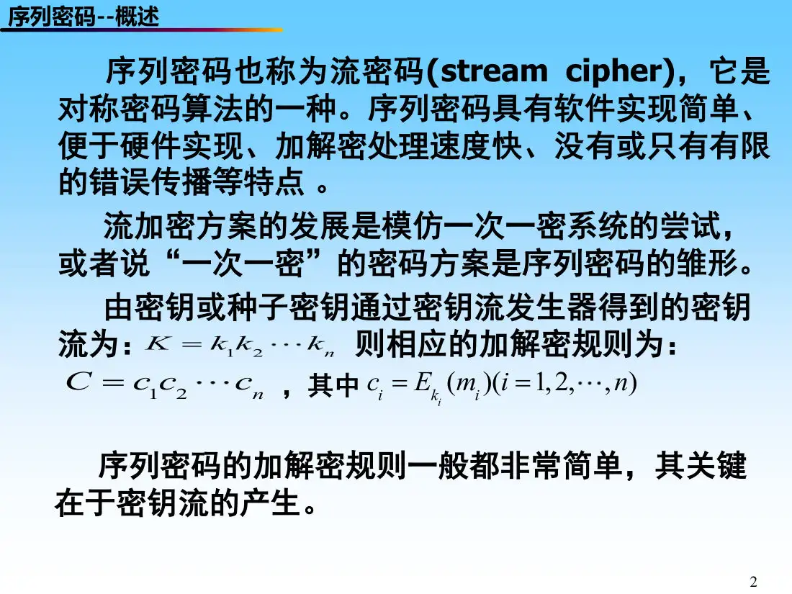

原文：

序列密码--概述

序列密码也称为流密码(stream cipher)，它是对称密码算法的一种。序列密码具有软件实现简单、便于硬件实现、加解密处理速度快、没有或只有有限的错误传播等特点 。

流加密方案的发展是模仿一次一密系统的尝试，或者说“一次一密”的密码方案是序列密码的雏形。

由密钥或种子密钥通过密钥流发生器得到的密钥流为： $K = k _ { 1 } k _ { 2 } \cdots k _ { \ast } ,$ 则相应的加解密规则为：$C = c _ { 1 } c _ { 2 } \cdots c _ { n }$ ，其中 $c _ { i } = E _ { k _ { i } } ( m _ { i } ) ( i = 1 , 2 , \cdots , n )$

序列密码的加解密规则一般都非常简单，其关键在于密钥流的产生。

2

### 概述(续)

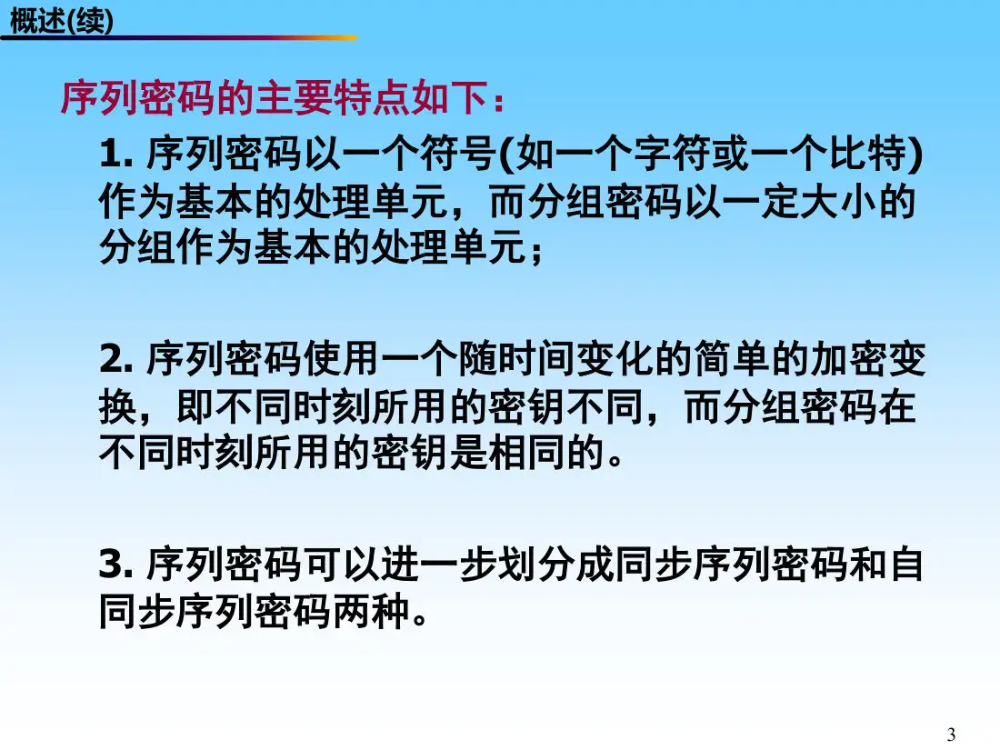

原文：

概述(续)

序列密码的主要特点如下：

1. 序列密码以一个符号(如一个字符或一个比特)作为基本的处理单元，而分组密码以一定大小的分组作为基本的处理单元；

2. 序列密码使用一个随时间变化的简单的加密变换，即不同时刻所用的密钥不同，而分组密码在不同时刻所用的密钥是相同的。

3. 序列密码可以进一步划分成同步序列密码和自 同步序列密码两种。

3

### 序列密码的分类

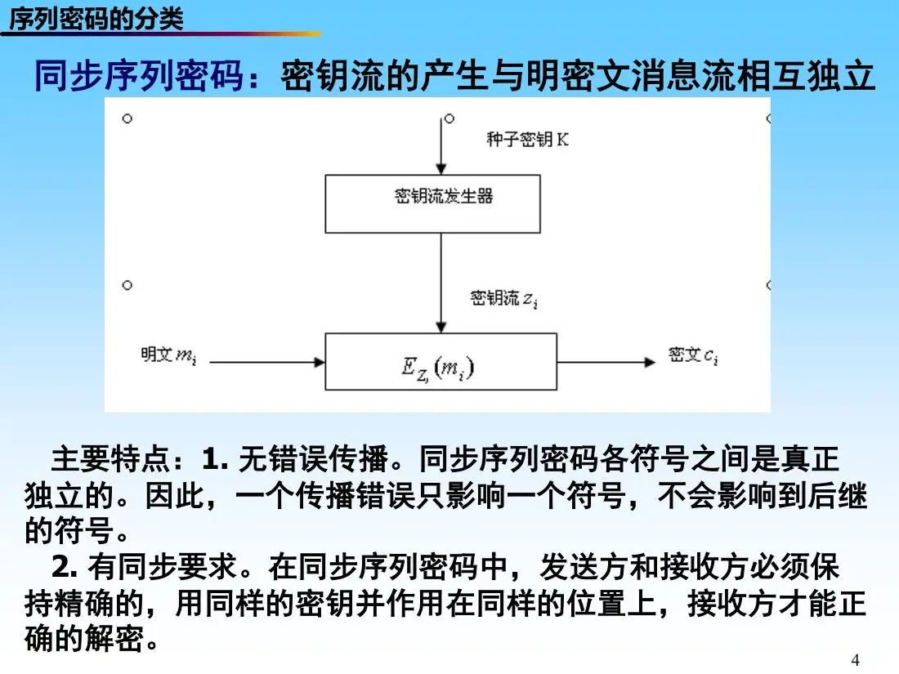

原文：

序列密码的分类

同步序列密码：密钥流的产生与明密文消息流相互独立

主要特点：1. 无错误传播。同步序列密码各符号之间是真正独立的。因此，一个传播错误只影响一个符号，不会影响到后继的符号。

2. 有同步要求。在同步序列密码中，发送方和接收方必须保持精确的，用同样的密钥并作用在同样的位置上，接收方才能正确的解密。

4

### 序列密码的分类

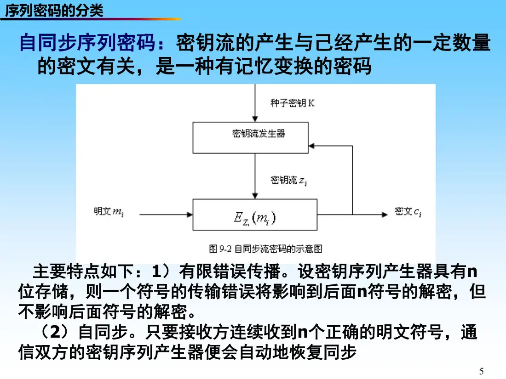

原文：

序列密码的分类

自同步序列密码：密钥流的产生与己经产生的一定数量的密文有关，是一种有记忆变换的密码

主要特点如下：1）有限错误传播。设密钥序列产生器具有n位存储，则一个符号的传输错误将影响到后面n符号的解密，但不影响后面符号的解密。

（2）自同步。只要接收方连续收到n个正确的明文符号，通 信双方的密钥序列产生器便会自动地恢复同步

5

### 线性反馈移位寄存器-LFSR

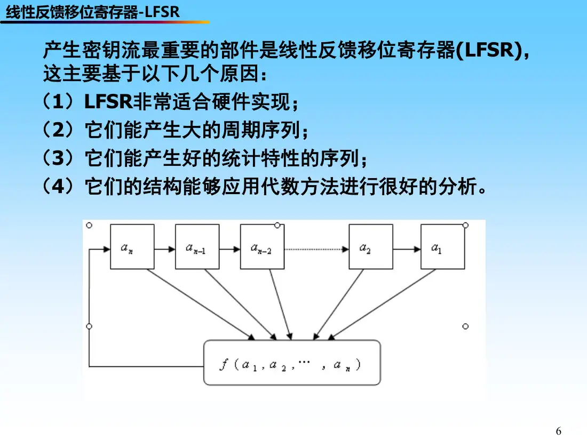

原文：

线性反馈移位寄存器-LFSR

产生密钥流最重要的部件是线性反馈移位寄存器(LFSR)，这主要基于以下几个原因：

（1）LFSR非常适合硬件实现；

（2）它们能产生大的周期序列；

（3）它们能产生好的统计特性的序列；

（4）它们的结构能够应用代数方法进行很好的分析。

6

### $$

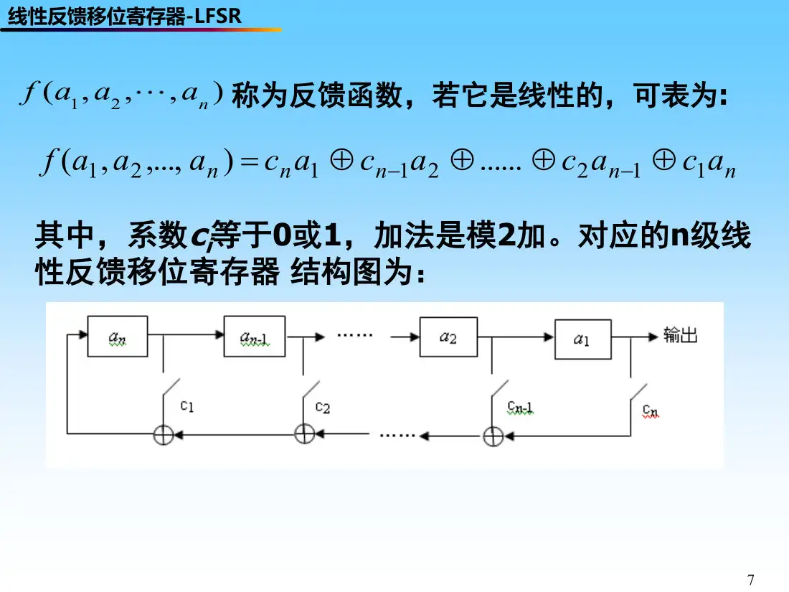

原文：

$f ( a _ { 1 } , a _ { 2 } , \cdots , a _ { n } )$ 称为反馈函数，若它是线性的，可表为:

$$
f (a _ {1}, a _ {2}, \dots , a _ {n}) = c _ {n} a _ {1} \oplus c _ {n - 1} a _ {2} \oplus \dots \oplus c _ {2} a _ {n - 1} \oplus c _ {1} a _ {n}
$$

其中，系数ci等于0或1，加法是模2加。对应的n级线性反馈移位寄存器 结构图为：

线性反馈移位寄存器-LFSR

7

### 对一个LFSR进行非线性组合：

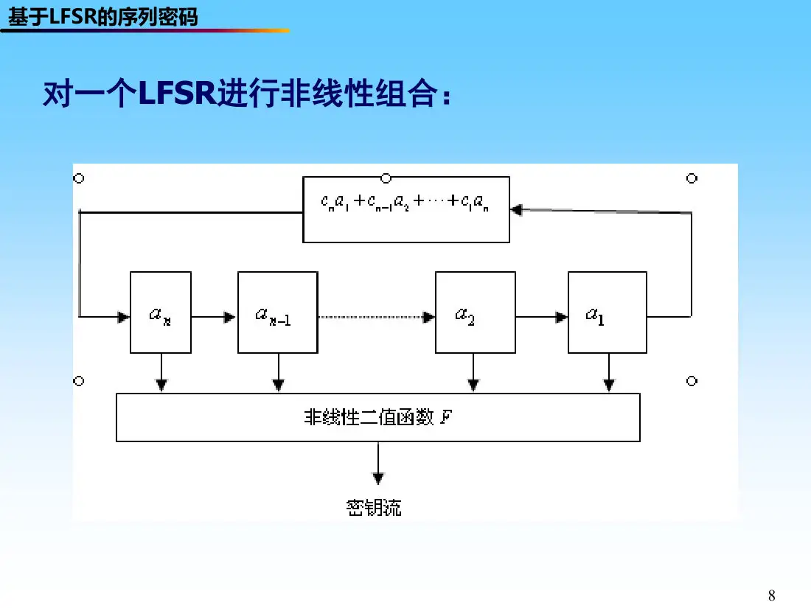

原文：

对一个LFSR进行非线性组合：

基于LFSR的序列密码

8

### 多个LFSR进行非线性组合:

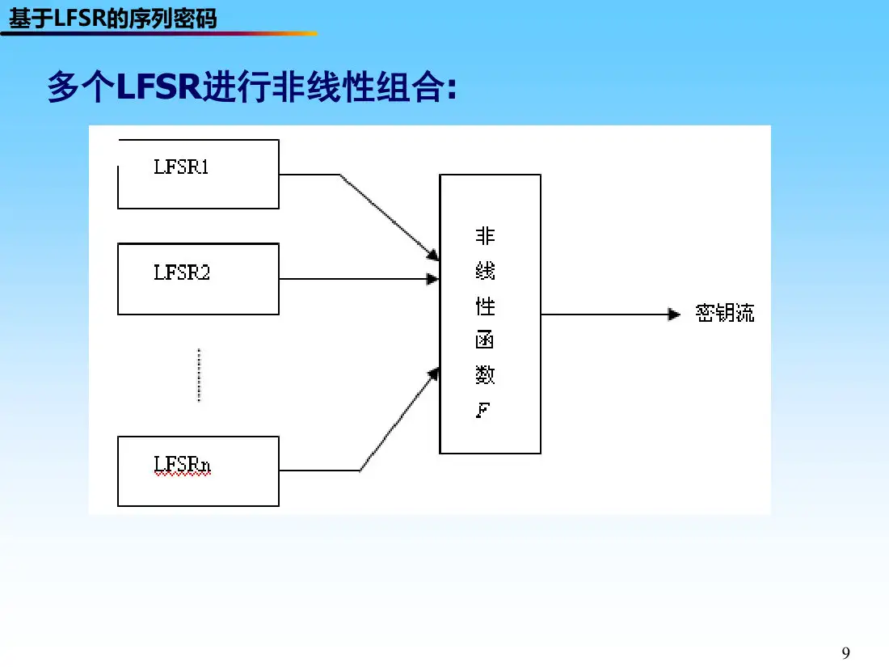

原文：

多个LFSR进行非线性组合:

基于LFSR的序列密码

9

### 基于LFSR的序列密码

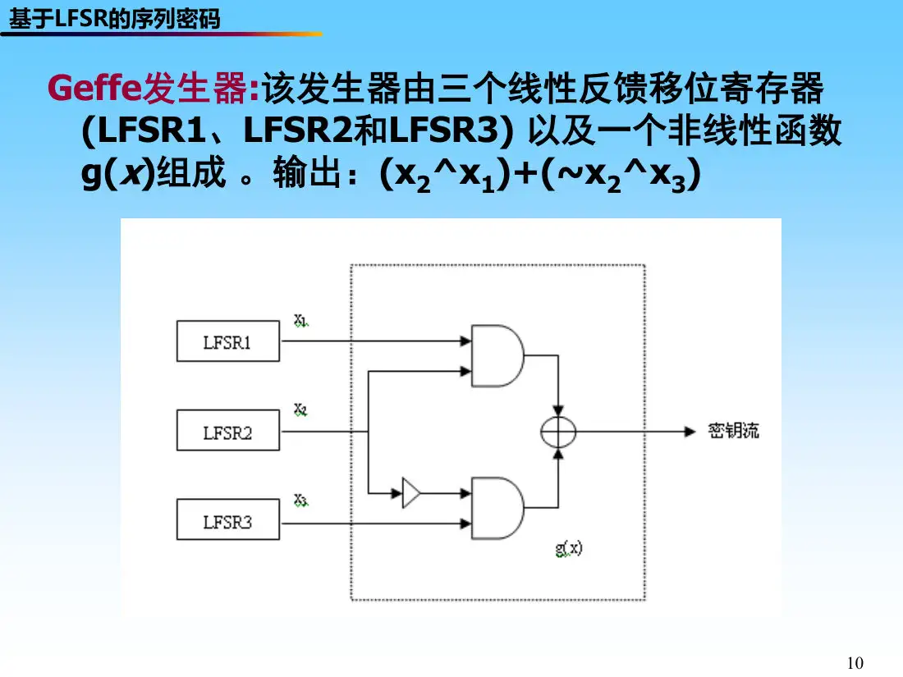

原文：

Geffe发生器:该发生器由三个线性反馈移位寄存器(LFSR1、LFSR2和LFSR3) 以及一个非线性函数g(x)组成 。输出： $( \mathbf { x } _ { 2 } \mathbf { \hat { \mu } } ^ { \wedge } \mathbf { x } _ { 1 } ) + ( \mathbf { \hat { \mu } } ^ { \vee } \mathbf { x } _ { 2 } \mathbf { \hat { \mu } } ^ { \wedge } \mathbf { x } _ { 3 } )$

基于LFSR的序列密码

10

### RC4算法

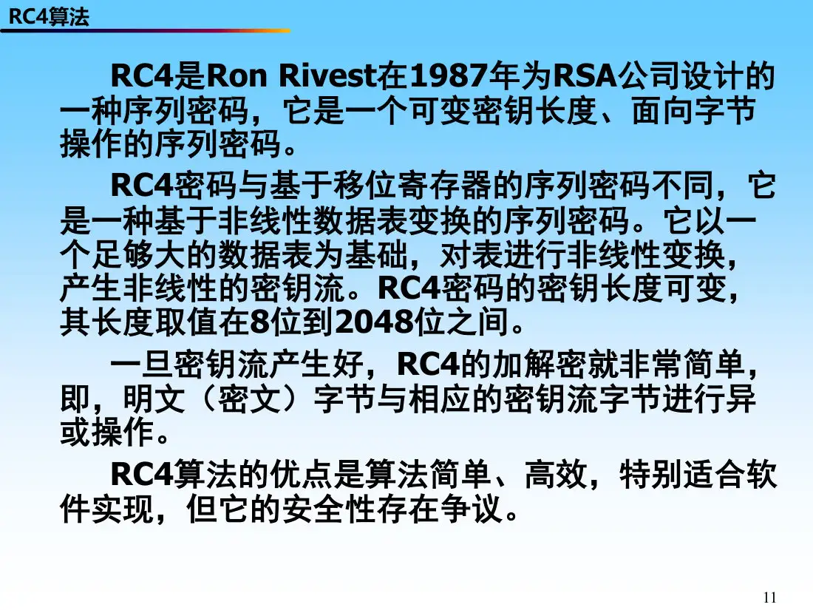

原文：

RC4算法

RC4是Ron Rivest在1987年为RSA公司设计的一种序列密码，它是一个可变密钥长度、面向字节操作的序列密码。

RC4密码与基于移位寄存器的序列密码不同，它是一种基于非线性数据表变换的序列密码。它以一个足够大的数据表为基础，对表进行非线性变换，产生非线性的密钥流。RC4密码的密钥长度可变，其长度取值在8位到2048位之间。

一旦密钥流产生好，RC4的加解密就非常简单，即，明文（密文）字节与相应的密钥流字节进行异或操作。

RC4算法的优点是算法简单、高效，特别适合软件实现，但它的安全性存在争议。

11

### RC4算法

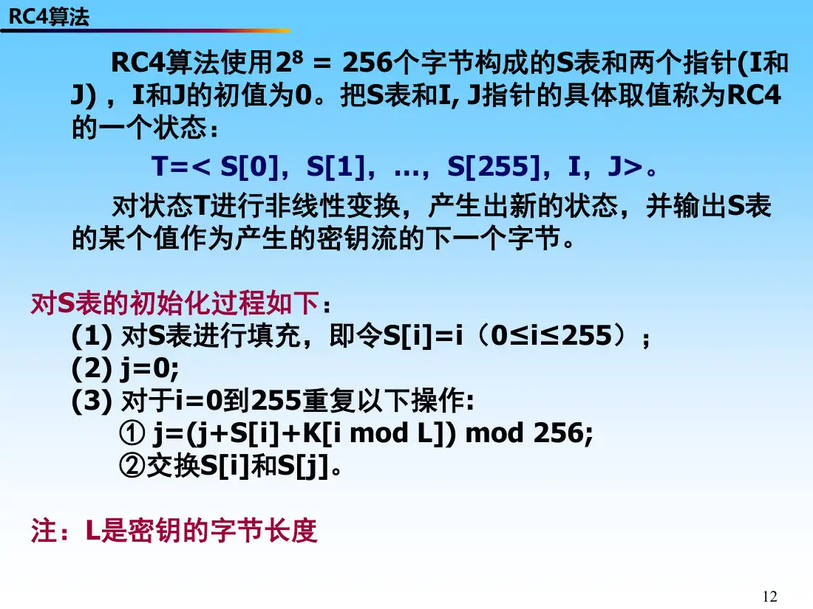

原文：

RC4算法

RC4算法使用 $2 ^ { 8 } = 2 5 6$ 个字节构成的S表和两个指针(I和J) ，I和J的初值为0。把S表和I, J指针的具体取值称为RC4的一个状态：

T=< S[0]，S[1]，…，S[255]，I，J>。

对状态T进行非线性变换，产生出新的状态，并输出S表的某个值作为产生的密钥流的下一个字节。

对S表的初始化过程如下：

(1) 对S表进行填充，即令 $\mathbf { S } [ \mathbf { i } ] { = } \mathbf { i } ( \mathbf { 0 \leq i } { \leq } 2 5 5 )$ ）；

(2) j=0;

(3) 对于i=0到255重复以下操作:

① j=(j+S[i]+K[i mod L]) mod 256;

②交换S[i]和S[j]。

注：L是密钥的字节长度

12

### RC4算法

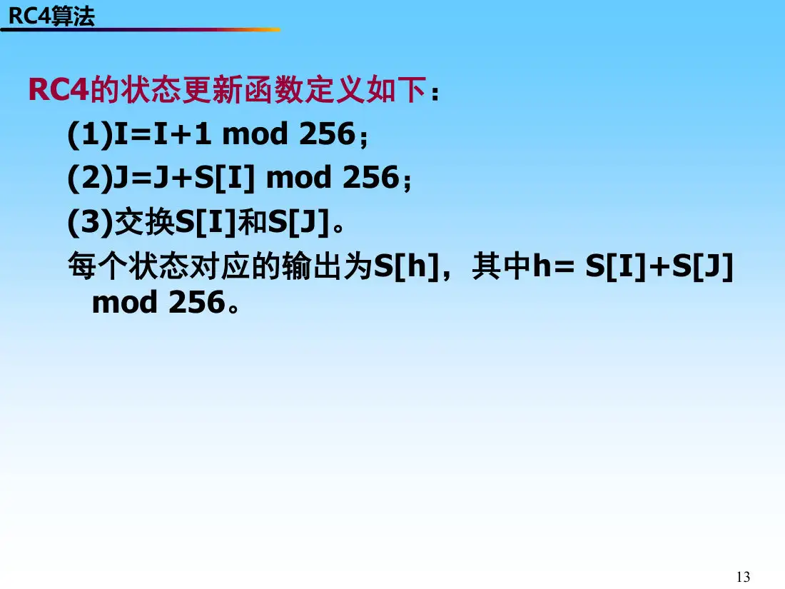

原文：

RC4算法

RC4的状态更新函数定义如下：

(1)I=I+1 mod 256；

(2)J=J+S[I] mod 256；

(3)交换S[I]和S[J]。

每个状态对应的输出为S[h]，其中h= S[I]+S[J]mod 256。

13
