# 《密码学》第6章 Hash函数（课件）

原件的每一页，下面附识别出的文字。

### 第六章杂 凑 函 数

原文：

第六章杂 凑 函 数

### 杂凑函数(Hash函数）

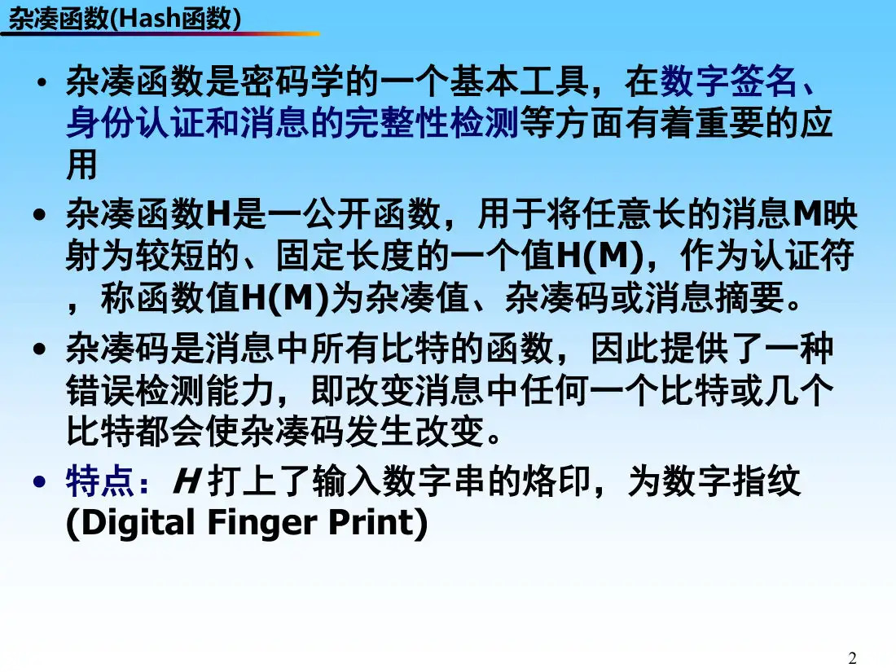

原文：

杂凑函数(Hash函数）

杂凑函数是密码学的一个基本工具，在数字签名、身份认证和消息的完整性检测等方面有着重要的应用

杂凑函数H是一公开函数，用于将任意长的消息M映射为较短的、固定长度的一个值H(M)，作为认证符，称函数值H(M)为杂凑值、杂凑码或消息摘要。

杂凑码是消息中所有比特的函数，因此提供了一种错误检测能力，即改变消息中任何一个比特或几个比特都会使杂凑码发生改变。

• 特点：H打上了输入数字串的烙印，为数字指纹 (Digital Finger Print)

2

### 散列函数的性质

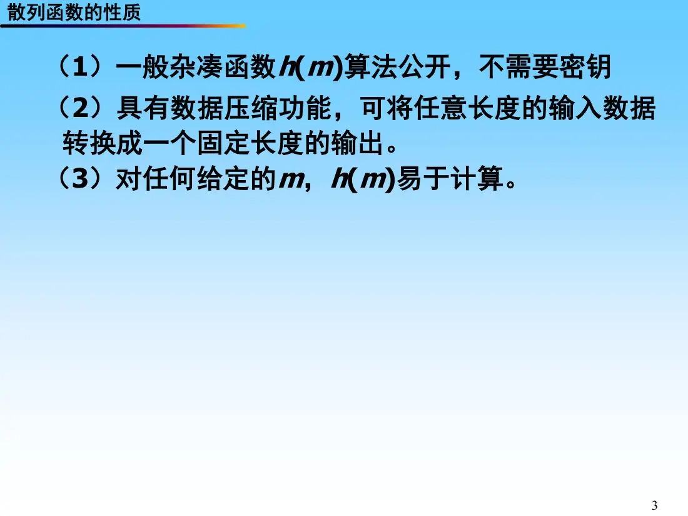

原文：

散列函数的性质

（1）一般杂凑函数h(m)算法公开，不需要密钥

（2）具有数据压缩功能，可将任意长度的输入数据转换成一个固定长度的输出。

（3）对任何给定的m， $/ m ( m )$ 易于计算。

3

### Hash函数的应用

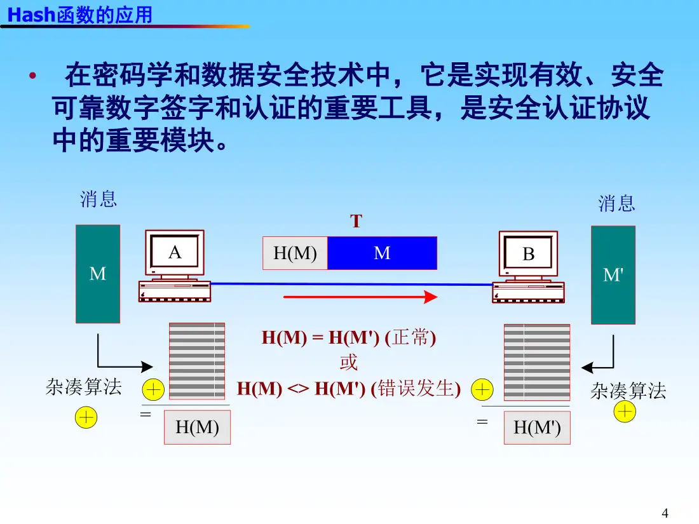

原文：

Hash函数的应用

在密码学和数据安全技术中，它是实现有效、安全可靠数字签字和认证的重要工具，是安全认证协议中的重要模块。

4

### Hash函数的应用

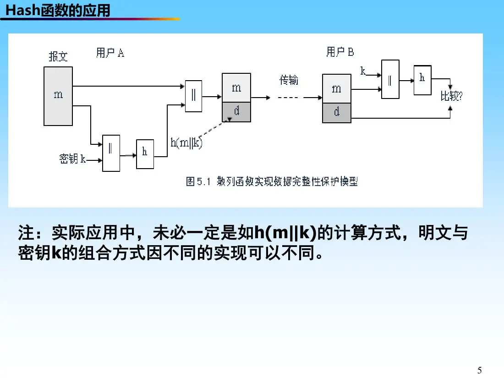

原文：

Hash函数的应用

注：实际应用中，未必一定是如h(m‖k)的计算方式，明文与密钥k的组合方式因不同的实现可以不同。

5

### 单向杂凑函数要求

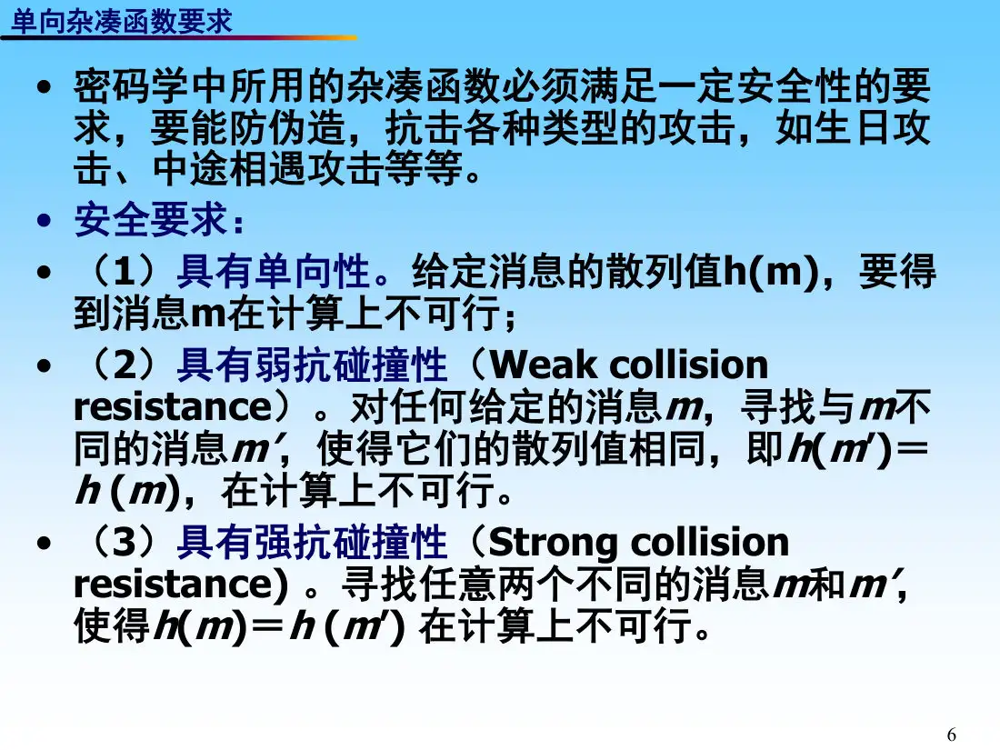

原文：

单向杂凑函数要求

密码学中所用的杂凑函数必须满足一定安全性的要求，要能防伪造，抗击各种类型的攻击，如生日攻击、中途相遇攻击等等。

• 安全要求：

• （1）具有单向性。给定消息的散列值h(m)，要得到消息m在计算上不可行；

• （2）具有弱抗碰撞性（Weak collisionresistance）。对任何给定的消息 $m ,$ 寻找与m不同的消息 $m _ { \textrm { \pmb { \gamma } } } ^ { \prime }$ 使得它们的散列值相同，即 $\pmb { I } ( \pmb { m } ^ { \prime } ) =$ $\pmb { { \cal { h } } } \left( m \right)$ ，在计算上不可行。

• （3）具有强抗碰撞性（Strong collisionresistance) 。寻找任意两个不同的消息m和 $m ^ { \prime }$ 使得 $h ( m ) { = } h ( m ^ { \prime } )$ 在计算上不可行。

6

### H是多对一映射

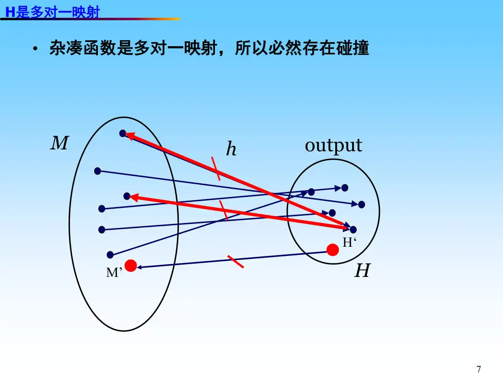

原文：

H是多对一映射

• 杂凑函数是多对一映射，所以必然存在碰撞

7

### Hash函数的无碰撞性

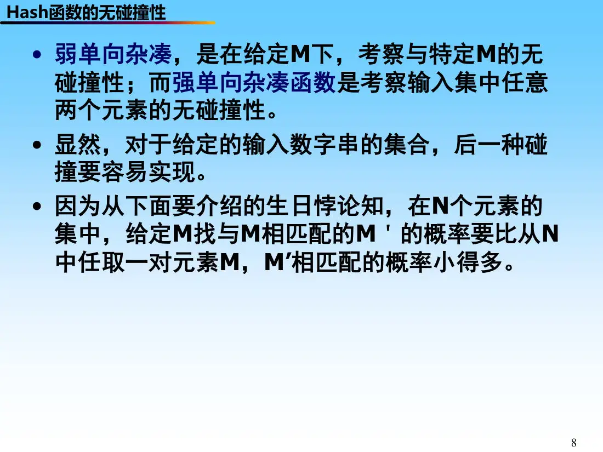

原文：

Hash函数的无碰撞性

弱单向杂凑，是在给定M下，考察与特定M的无碰撞性；而强单向杂凑函数是考察输入集中任意两个元素的无碰撞性。

显然，对于给定的输入数字串的集合，后一种碰撞要容易实现。

因为从下面要介绍的生日悖论知，在N个元素的集中，给定M找与M相匹配的M＇的概率要比从N中任取一对元素M，M’相匹配的概率小得多。

8

### 单向杂凑函数安全性要求

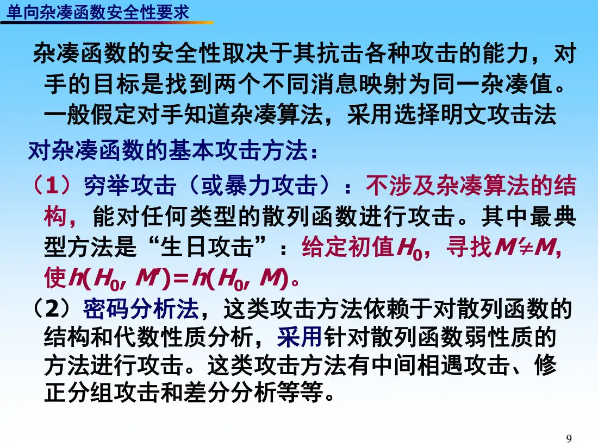

原文：

杂凑函数的安全性取决于其抗击各种攻击的能力，对手的目标是找到两个不同消息映射为同一杂凑值。一般假定对手知道杂凑算法，采用选择明文攻击法对杂凑函数的基本攻击方法：

（1）穷举攻击（或暴力攻击）：不涉及杂凑算法的结构，能对任何类型的散列函数进行攻击。其中最典型方法是“生日攻击”：给定初值 $H _ { 0 }$ ，寻找 $M \neq M$ 使 $h ( H _ { 0 } , M ) = h ( H _ { 0 r } \ M )$

（2）密码分析法，这类攻击方法依赖于对散列函数的结构和代数性质分析，采用针对散列函数弱性质的方法进行攻击。这类攻击方法有中间相遇攻击、修正分组攻击和差分分析等等。

单向杂凑函数安全性要求

9

### 生日攻击

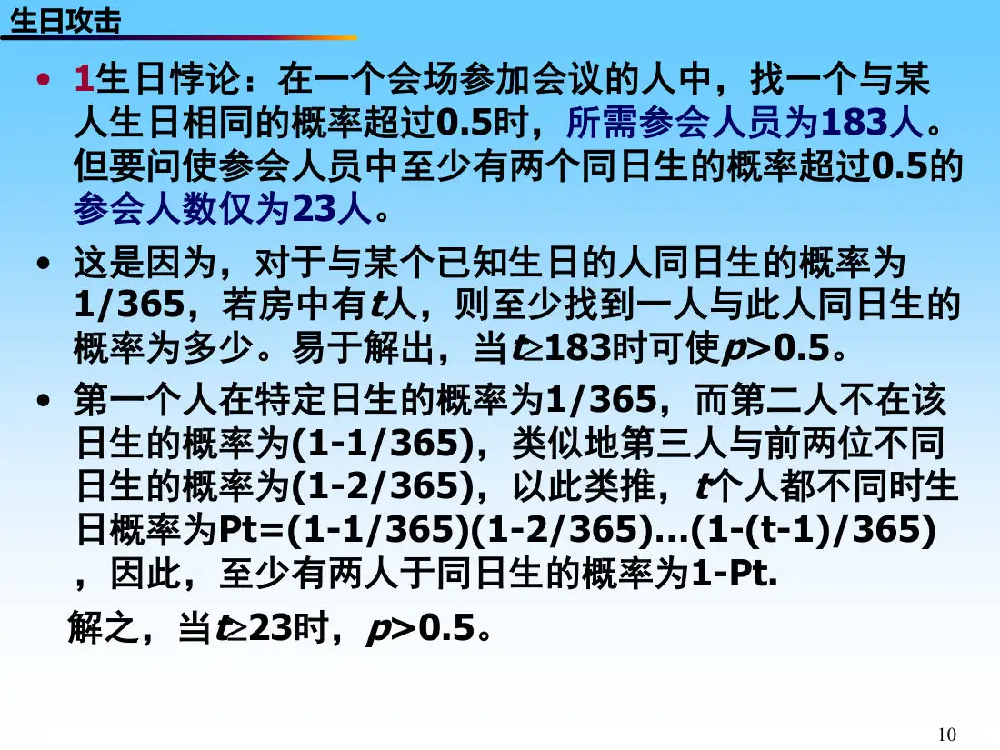

原文：

生日攻击

1生日悖论：在一个会场参加会议的人中，找一个与某人生日相同的概率超过0.5时，所需参会人员为183人。但要问使参会人员中至少有两个同日生的概率超过0.5的参会人数仅为23人。

• 这是因为，对于与某个已知生日的人同日生的概率为1/365，若房中有t人，则至少找到一人与此人同日生的概率为多少。易于解出，当t183时可使p>0.5。

• 第一个人在特定日生的概率为1/365，而第二人不在该日生的概率为(1-1/365)，类似地第三人与前两位不同日生的概率为(1-2/365)，以此类推，t个人都不同时生日概率为Pt=(1-1/365)(1-2/365)…(1-(t-1)/365)，因此，至少有两人于同日生的概率为1-Pt.解之，当t23时，p>0.5。

10

### 对散列函数的生日攻击

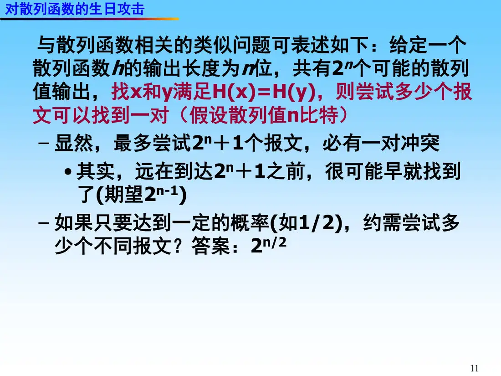

原文：

对散列函数的生日攻击

与散列函数相关的类似问题可表述如下：给定一个散列函数h的输出长度为n位，共有2n个可能的散列值输出，找x和y满足H(x)=H(y)，则尝试多少个报文可以找到一对（假设散列值n比特）

– 显然，最多尝试2n＋1个报文，必有一对冲突

其实，远在到达2n＋1之前，很可能早就找到了(期望2n-1)

– 如果只要达到一定的概率(如1/2)，约需尝试多少个不同报文？答案：2n/2

11

### 杂凑函数的构造(Merkle-Damgard)

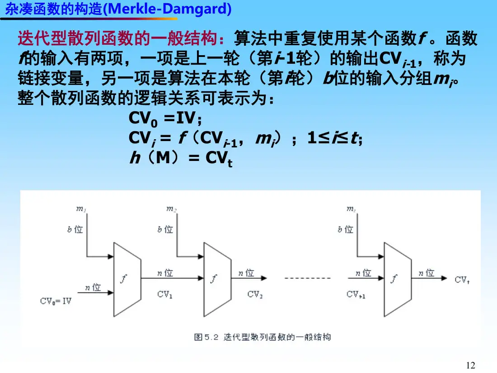

原文：

杂凑函数的构造(Merkle-Damgard)

迭代型散列函数的一般结构：算法中重复使用某个函数f。函数的输入有两项，一项是上一轮（第 -1轮）的输出 $\mathbf { C V _ { \lambda _ { i - 1 } } }$ ，称为链接变量，另一项是算法在本轮（第i轮）b位的输入分组 $m _ { j \circ }$ 整个散列函数的逻辑关系可表示为：

$$
\begin{array}{l} \mathbf {C V} _ {0} = \mathbf {I V}; \\ \mathbf {C V} _ {i} = f (\mathbf {C V} _ {i - 1}, m _ {i}); 1 \leq i \leq t; \\ h (\mathsf {M}) = \mathbf {C V} _ {\mathrm{t}} \end{array}
$$

12

### 直接设计散列函数

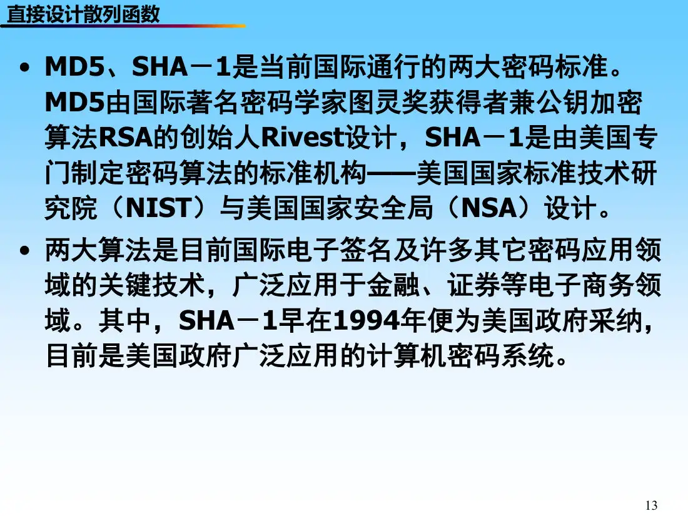

原文：

直接设计散列函数

MD5、SHA－1是当前国际通行的两大密码标准。MD5由国际著名密码学家图灵奖获得者兼公钥加密算法RSA的创始人Rivest设计，SHA－1是由美国专门制定密码算法的标准机构——美国国家标准技术研究院（NIST）与美国国家安全局（NSA）设计。

两大算法是目前国际电子签名及许多其它密码应用领域的关键技术，广泛应用于金融、证券等电子商务领域。其中，SHA－1早在1994年便为美国政府采纳，目前是美国政府广泛应用的计算机密码系统。

13

### 直接设计散列函数

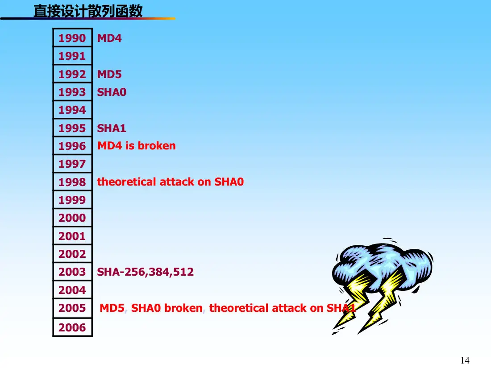

原文：

直接设计散列函数
<table><tr><td>1990</td><td>MD4</td></tr><tr><td>1991</td><td></td></tr><tr><td>1992</td><td>MD5</td></tr><tr><td>1993</td><td>SHA0</td></tr><tr><td>1994</td><td></td></tr><tr><td>1995</td><td>SHA1</td></tr><tr><td>1996</td><td>MD4 is broken</td></tr><tr><td>1997</td><td></td></tr><tr><td>1998</td><td>theoretical attack on SHA0</td></tr><tr><td>1999</td><td></td></tr><tr><td>2000</td><td></td></tr><tr><td>2001</td><td></td></tr><tr><td>2002</td><td></td></tr><tr><td>2003</td><td>SHA-256,384,512</td></tr><tr><td>2004</td><td></td></tr><tr><td>2005</td><td>MD5, SHA0 broken, theoretical attack on S</td></tr><tr><td>2006</td><td></td></tr></table>

14

### MD系列

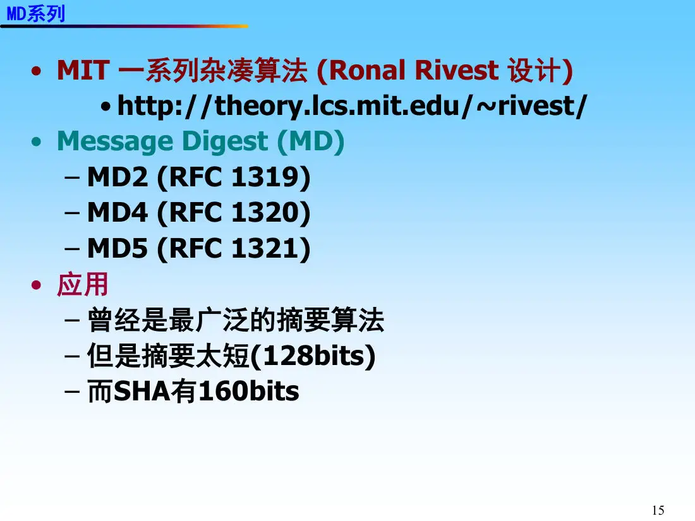

原文：

MD系列

MIT 一系列杂凑算法 (Ronal Rivest 设计)• http://theory.lcs.mit.edu/\~rivest/

• Message Digest (MD)

– MD2 (RFC 1319)

– MD4 (RFC 1320)

– MD5 (RFC 1321)

• 应用

– 曾经是最广泛的摘要算法

– 但是摘要太短(128bits)

– 而SHA有160bits

15

### MD5

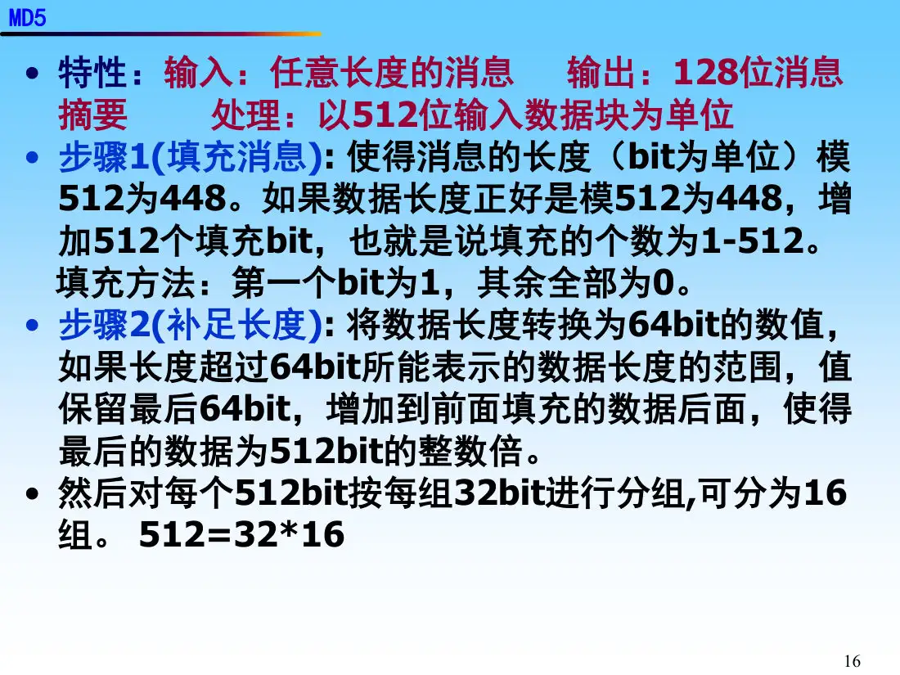

原文：

MD5

• 特性：输入：任意长度的消息 输出：128位消息摘要 处理：以512位输入数据块为单位

步骤1(填充消息): 使得消息的长度（bit为单位）模512为448。如果数据长度正好是模512为448，增加512个填充bit，也就是说填充的个数为1-512。填充方法：第一个bit为1，其余全部为0。

• 步骤2(补足长度): 将数据长度转换为64bit的数值，如果长度超过64bit所能表示的数据长度的范围，值保留最后64bit，增加到前面填充的数据后面，使得最后的数据为512bit的整数倍。

• 然后对每个512bit按每组32bit进行分组,可分为16组。 $5 1 2 { = } 3 2 ^ { * } 1 6$

16

### 17

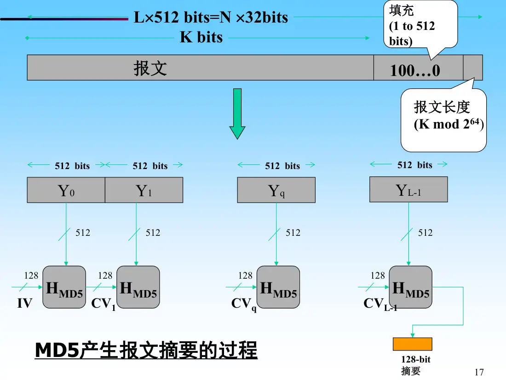

原文：

17

### MD5算法实例

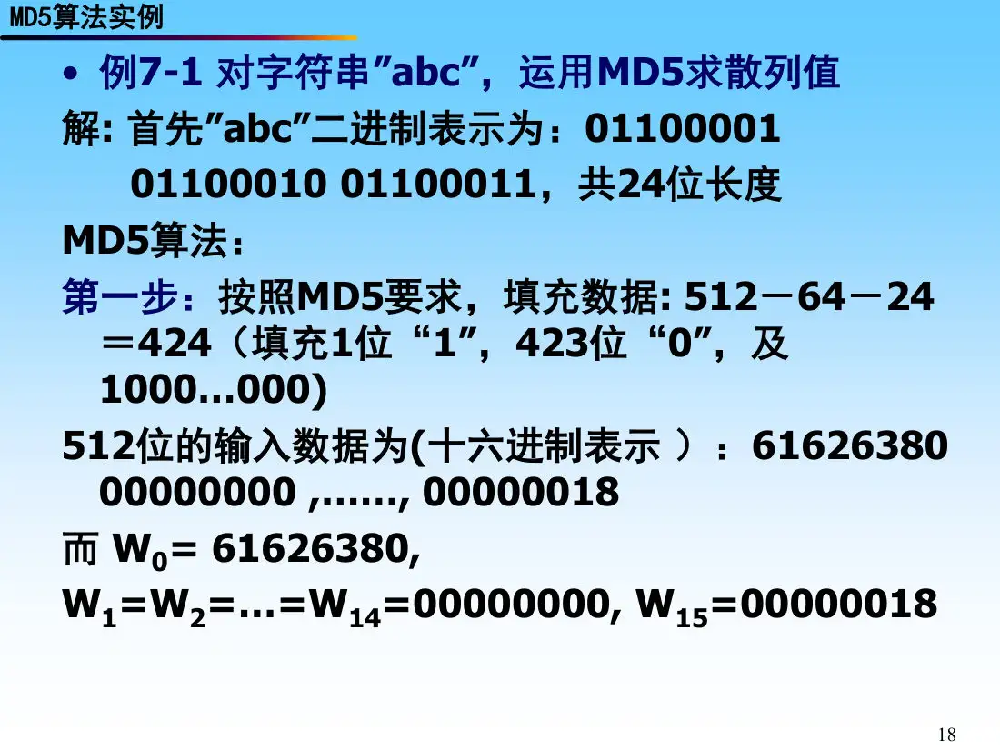

原文：

MD5算法实例

• 例7-1 对字符串”abc”，运用MD5求散列值

解: 首先”abc”二进制表示为：0110000101100010 01100011，共24位长度

MD5算法：

第一步：按照MD5要求，填充数据: 512－64－24＝424（填充1位“1”，423位“0”，及1000…000)

512位的输入数据为(十六进制表示 ）：6162638000000000 00000018

而 $\mathsf { W } _ { 0 } \equiv 6 1 6 2 6 3 8 0 ,$

W1=W2=…=W14=00000000, W15=00000018

18

### MD5算法

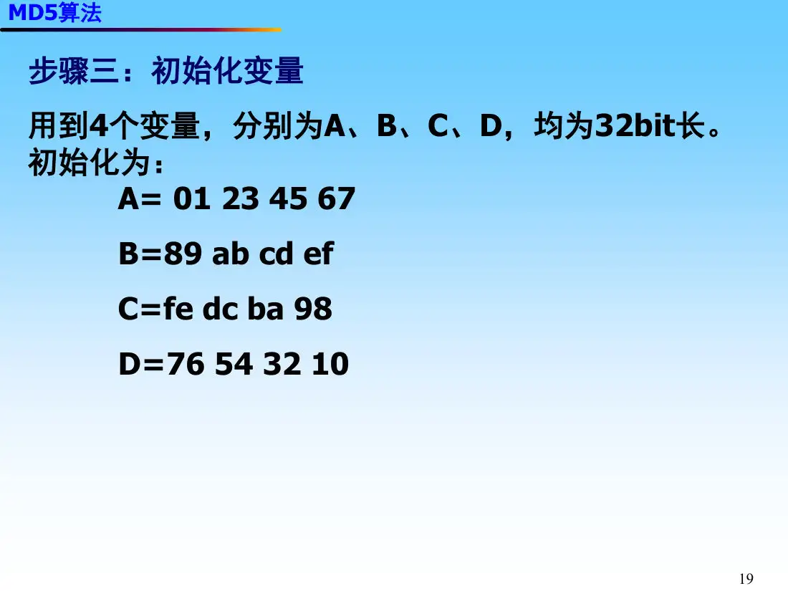

原文：

MD5算法

步骤三：初始化变量

用到4个变量，分别为A、B、C、D，均为32bit长。初始化为：

$$
A = 0 1 2 3 4 5 6 7
$$

$$
\mathbf {B} = 8 9 \text { ab   cd   ef }
$$

C=fe dc ba 98

$$
D = 7 6 5 4 3 2 1 0
$$

19

### MD5算法

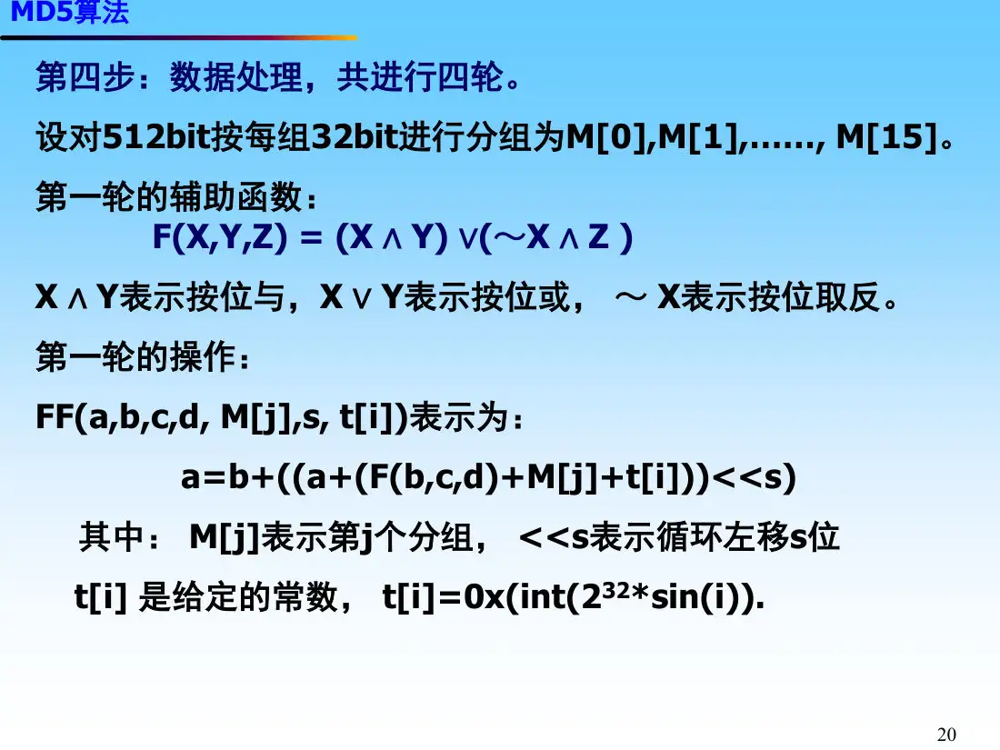

原文：

MD5算法

第四步：数据处理，共进行四轮。

设对512bit按每组32bit进行分组为M[0],M[1],……, M[15]。

第一轮的辅助函数：

$$
F (X, Y, Z) = (X \wedge Y) \vee (\sim X \wedge Z)
$$

X ∧ Y表示按位与，X ∨ Y表示按位或， ～ X表示按位取反。

第一轮的操作：

FF(a,b,c,d, M[j],s, t[i])表示为：

$$
a = b + ((a + (F (b, c, d) + M [ j ] + t [ i ])) <   <   s)
$$

其中： M[j]表示第j个分组， $< < \mathbb { S }$ 表示循环左移s位t[i] 是给定的常数， $\mathbf { t } [ \mathbf { i } ] { = } 0 \mathbf { x } ( \mathsf { i } \mathsf { n t } ( 2 ^ { 3 2 * } s \mathsf { i } \mathsf { n } ( \mathsf { i } ) ) )$

20

### MD5 压缩函数

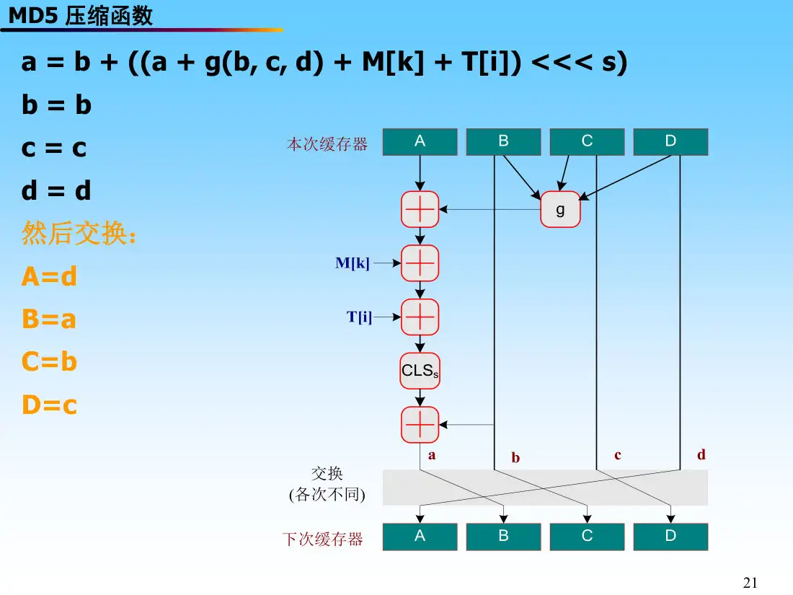

原文：

MD5 压缩函数

$$
\mathbf {a} = \mathbf {b} + ((\mathbf {a} + \mathbf {g} (\mathbf {b}, \mathbf {c}, \mathbf {d}) + \mathbf {M} [ \mathbf {k} ] + \mathbf {T} [ \mathbf {i} ]) <   <   s)
$$

$$
\mathbf {b} = \mathbf {b}
$$

$$
\mathbf {c} = \mathbf {c}
$$

$$
\mathbf {d} = \mathbf {d}
$$

然后交换：

$$
A = d
$$

$$
B = a
$$

$$
\mathbf {C} = \mathbf {b}
$$

$$
D = c
$$

本次缓存器

交换(各次不同)

下次缓存器

21

### 22

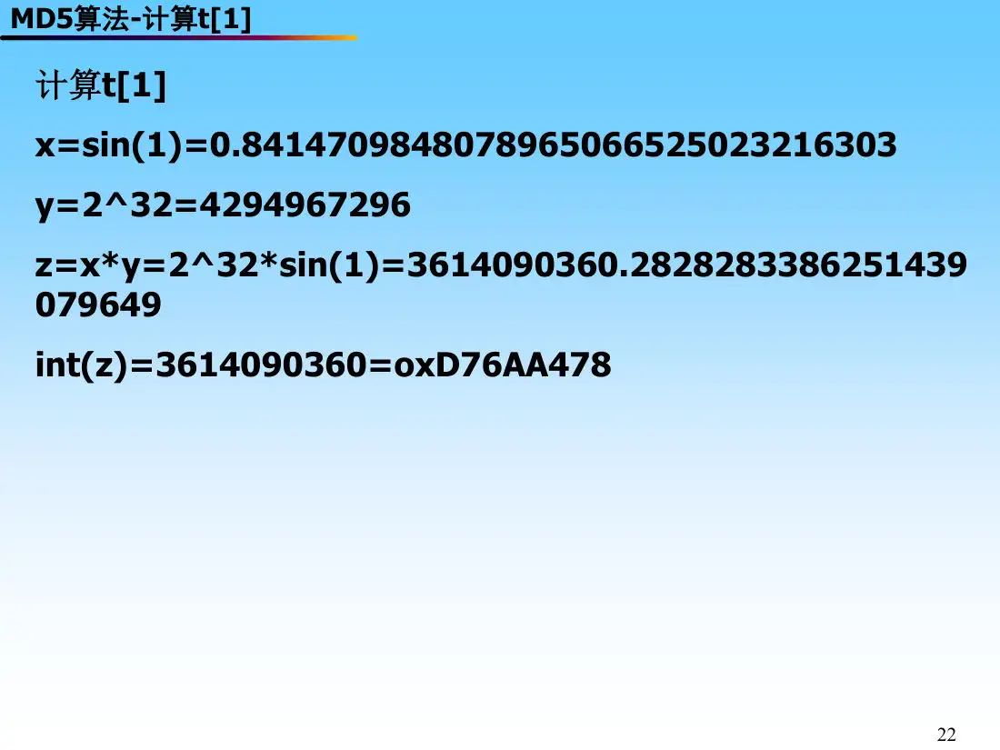

原文：

22

### MD5算法第一轮循环

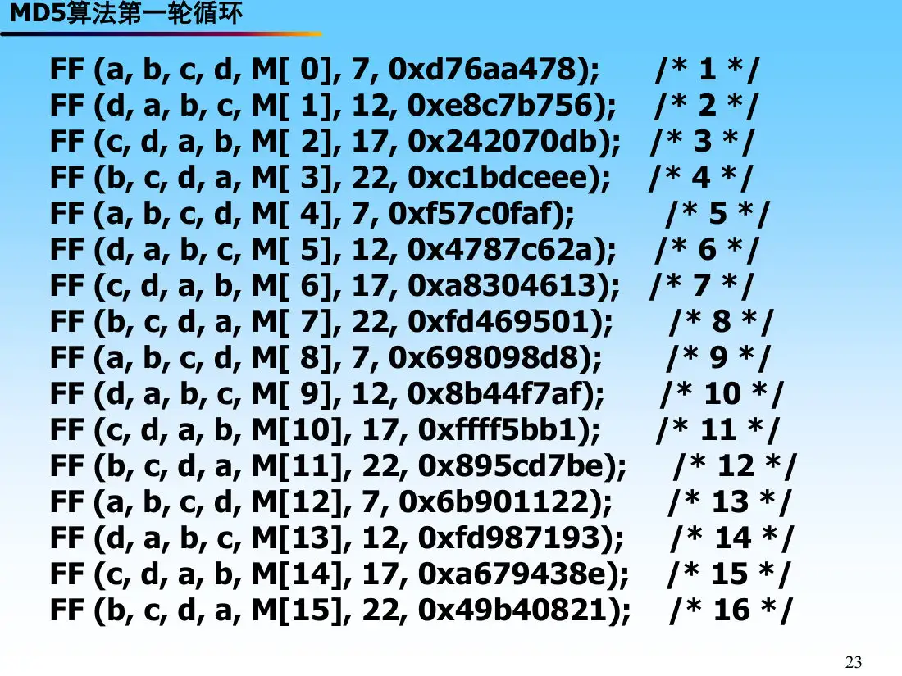

原文：

MD5算法第一轮循环

<table><tr><td>FF (a, b, c, d, M[ 0], 7, 0xd76aa478);</td><td>/* 1 */</td></tr><tr><td>FF (d, a, b, c, M[ 1], 12, 0xe8c7b756);</td><td>/* 2 */</td></tr><tr><td>FF (c, d, a, b, M[ 2], 17, 0x242070db);</td><td>/* 3 */</td></tr><tr><td>FF (b, c, d, a, M[ 3], 22, 0xc1bdceee);</td><td>/* 4 */</td></tr><tr><td>FF (a, b, c, d, M[ 4], 7, 0xf57c0faf);</td><td>/* 5 */</td></tr><tr><td>FF (d, a, b, c, M[ 5], 12, 0x4787c62a);</td><td>/* 6 */</td></tr><tr><td>FF (c, d, a, b, M[ 6], 17, 0xa8304613);</td><td>/* 7 */</td></tr><tr><td>FF (b, c, d, a, M[ 7], 22, 0xfd469501);</td><td>/* 8 */</td></tr><tr><td>FF (a, b, c, d, M[ 8], 7, 0x698098d8);</td><td>/* 9 */</td></tr><tr><td>FF (d, a, b, c, M[ 9], 12, 0x8b44f7af);</td><td>/* 10 */</td></tr><tr><td>FF (c, d, a, b, M[10], 17, 0xffff5bb1);</td><td>/* 11 */</td></tr><tr><td>FF (b, c, d, a, M[11], 22, 0x895cd7be);</td><td>/* 12 */</td></tr><tr><td>FF (a, b, c, d, M[12], 7, 0x6b901122);</td><td>/* 13 */</td></tr><tr><td>FF (d, a, b, c, M[13], 12, 0xfd987193);</td><td>/* 14 */</td></tr><tr><td>FF (c, d, a, b, M[14], 17, 0xa679438e);</td><td>/* 15 */</td></tr><tr><td>FF (b, c, d, a, M[15], 22, 0x49b40821);</td><td>/* 16 */</td></tr></table>

23

### 第二、三、四轮与第一轮非常相似。

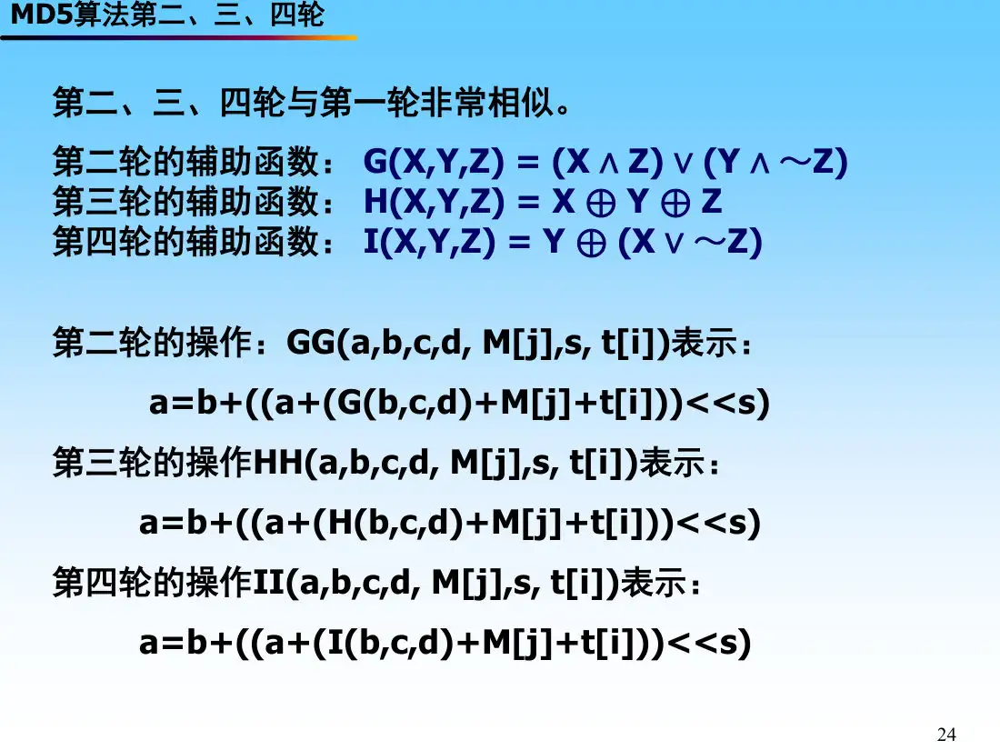

原文：

第二、三、四轮与第一轮非常相似。

第二轮的辅助函数： $\mathtt { G } ( \mathbb { X } , \mathbb { Y } , \mathbb { Z } ) = ( \mathbb { X } \wedge \mathbb { Z } ) \vee ( \mathbb { Y } \wedge { \sim } \mathbb { Z } )$

第三轮的辅助函数： $\mathsf { H } ( \mathsf { X } , \mathsf { Y } , \mathsf { Z } ) = \mathsf { X } \oplus \mathsf { Y } \oplus \mathsf { Z }$

第四轮的辅助函数： $\mathbf { I } ( \mathbf { \mathbb { X } } , \mathbf { \mathbb { Y } } , \mathbf { \mathbb { Z } } ) = \mathbf { \mathbb { Y } } \oplus ( \mathbf { \mathbb { X } } \lor \sim \mathbf { \mathbb { Z } } )$

第二轮的操作： $\mathbf { G G } ( \mathbf { a } , \mathbf { b } , \mathbf { c } _ { I } \mathbf { d } _ { r } , \mathbf { M [ j ] } , s , \mathbf { t [ i ] } )$ 表示：

$$
a = b + ((a + (G (b, c, d) + M [ j ] + t [ i ])) <   <   s)
$$

第三轮的操作 $\mathsf { H H } ( \mathsf { a } , \mathsf { b } , \mathsf { c } _ { I } \mathsf { d } _ { r } \mathsf { M } [ \mathsf { j } ] , s , \mathsf { t } [ \mathsf { i } ] )$ 表示：

$$
a = b + ((a + (H (b, c, d) + M [ j ] + t [ i ])) <   <   s)
$$

第四轮的操作 $\operatorname { I I } ( \mathbf { a } , \mathbf { b } , \mathbf { c } , \mathbf { d } , \mathbf { M } [ \mathbf { j } ] , s , \mathbf { t } [ \mathbf { i } ] )$ 表示：

$$
a = b + ((a + (I (b, c, d) + M [ j ] + t [ i ])) <   <   s)
$$

MD5算法第二、三、四轮

24

### /\* 第二轮循环 \*/

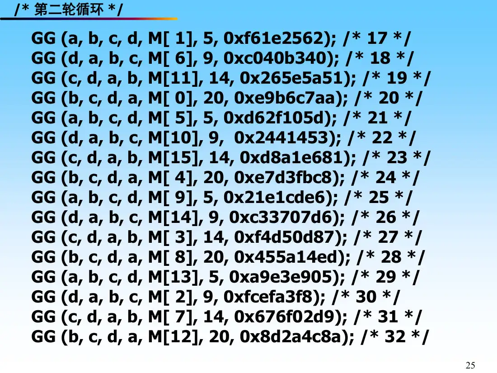

原文：

/\* 第二轮循环 \*/

25

### /\* 第三轮循环 \*/

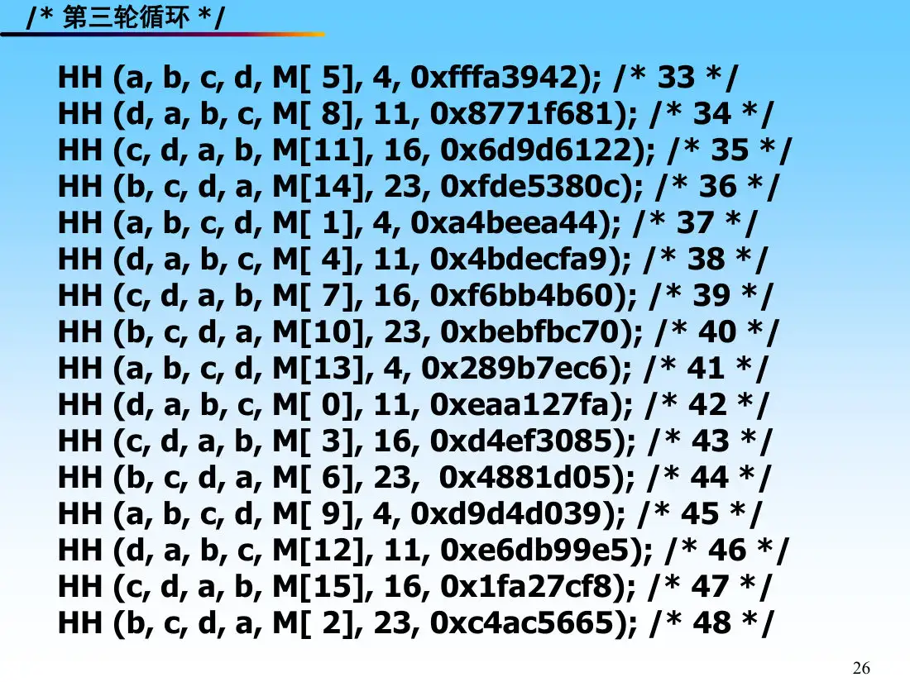

原文：

/\* 第三轮循环 \*/

26

### /\* 第四轮循环 \*/

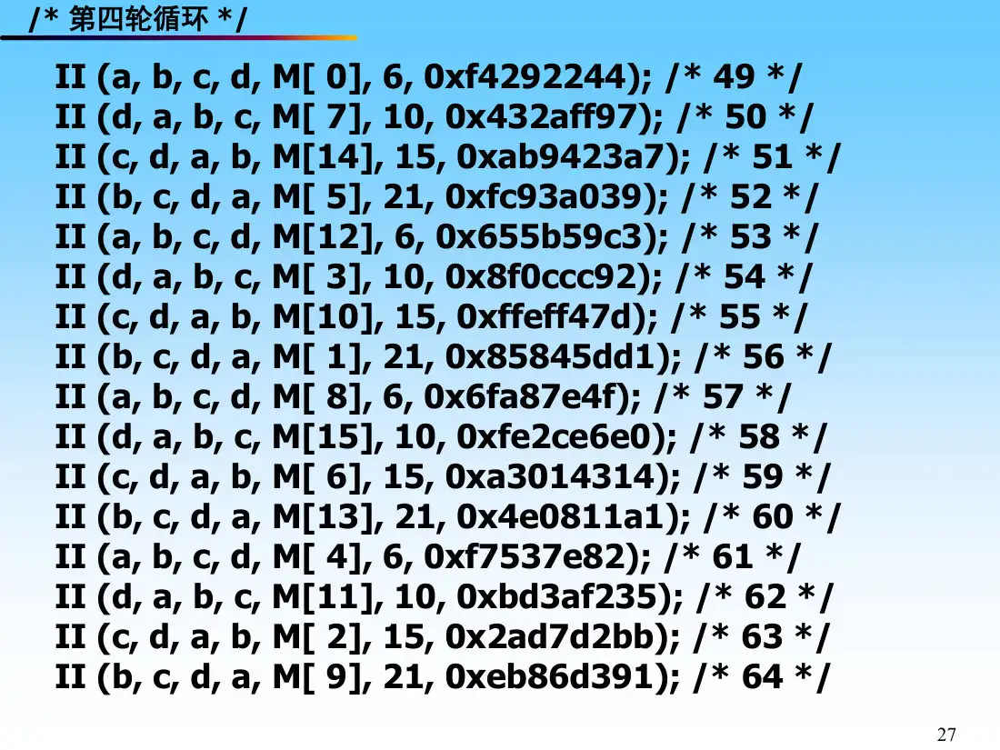

原文：

/\* 第四轮循环 \*/

27

### 做完四轮操作后，执行：

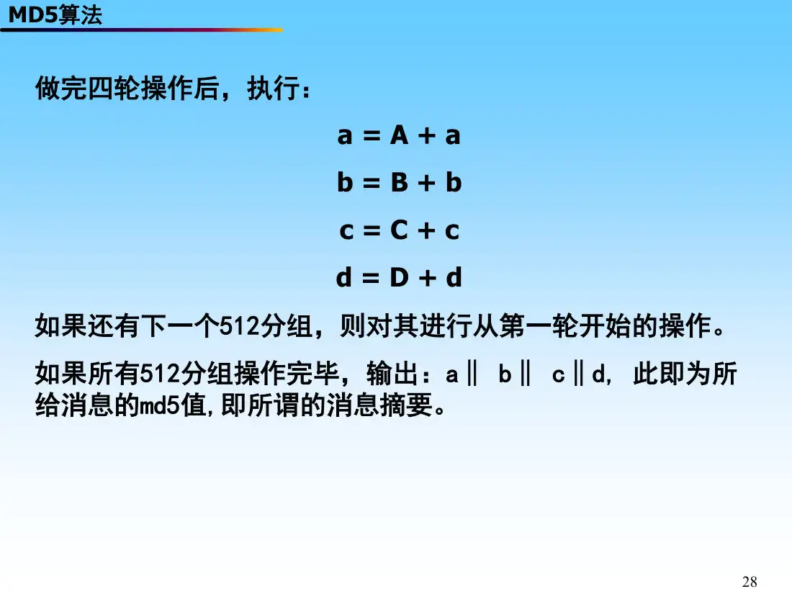

原文：

做完四轮操作后，执行：

$$
\mathbf {a} = \mathbf {A} + \mathbf {a}
$$

$$
\mathbf {b} = \mathbf {B} + \mathbf {b}
$$

$$
\mathbf {c} = \mathbf {C} + \mathbf {c}
$$

$$
\mathbf {d} = \mathbf {D} + \mathbf {d}
$$

如果还有下一个512分组，则对其进行从第一轮开始的操作。

如果所有512分组操作完毕，输出： $\mathbf { a } \parallel \mathbf { b } \parallel \mathbf { c } \parallel \mathbf { d } ,$ 此即为所给消息的md5值,即所谓的消息摘要。

MD5算法

28

### MD5算法

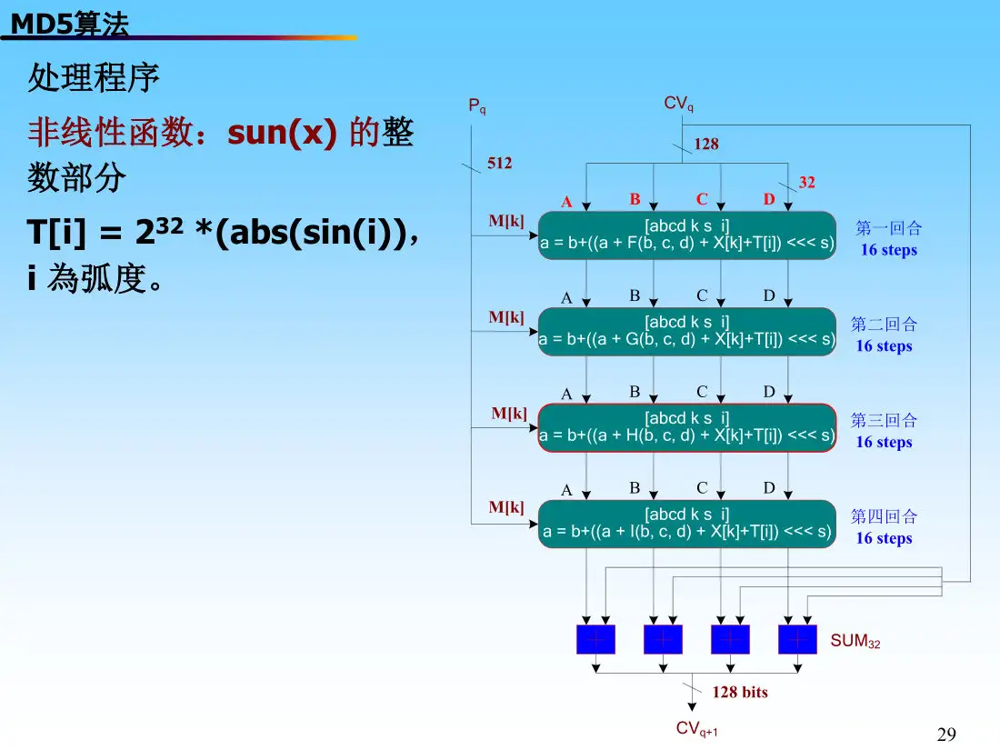

原文：

MD5算法

处理程序

非线性函数：sun(x) 的整数部分

T[i] = 232 \*(abs(sin(i))，i 為弧度。

29

### SHA1: Secure Hash Algorithm-1

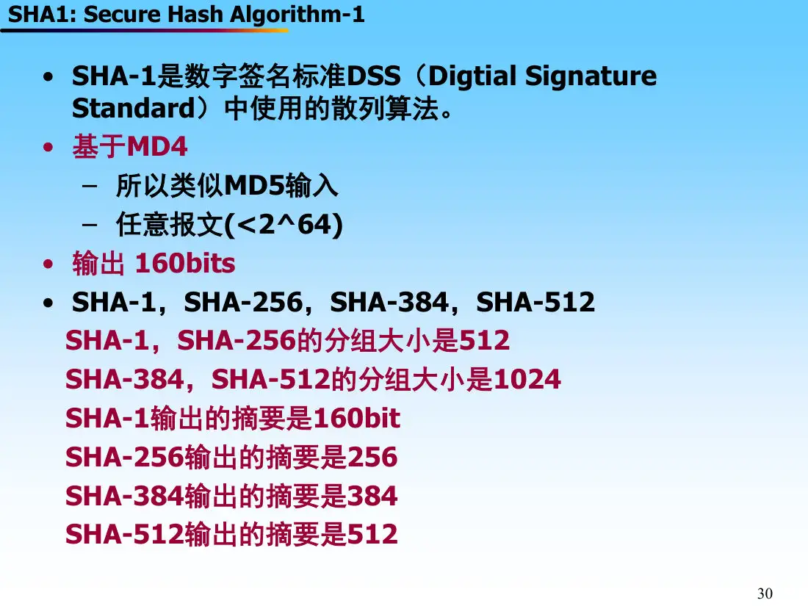

原文：

SHA1: Secure Hash Algorithm-1

SHA-1是数字签名标准DSS（Digtial SignatureStandard）中使用的散列算法。

• 基于MD4

– 所以类似MD5输入

– 任意报文(<2^64)

• 输出 160bits

SHA-1，SHA-256，SHA-384，SHA-512SHA-1，SHA-256的分组大小是512SHA-384，SHA-512的分组大小是1024SHA-1输出的摘要是160bitSHA-256输出的摘要是256SHA-384输出的摘要是384SHA-512输出的摘要是512

30

### SHA5算法第一、二步

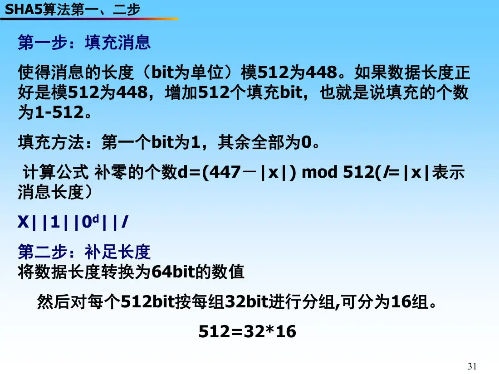

原文：

SHA5算法第一、二步

第一步：填充消息

使得消息的长度（bit为单位）模512为448。如果数据长度正好是模512为448，增加512个填充bit，也就是说填充的个数为1-512。

填充方法：第一个bit为1，其余全部为0。

计算公式 补零的个数d=(447－|x|) mod 512(l=|x|表示消息长度）

X||1||0d||l

第二步：补足长度

将数据长度转换为64bit的数值

然后对每个512bit按每组32bit进行分组,可分为16组。

$$
5 1 2 = 3 2 * 1 6
$$

31

### SHA1 算法原理

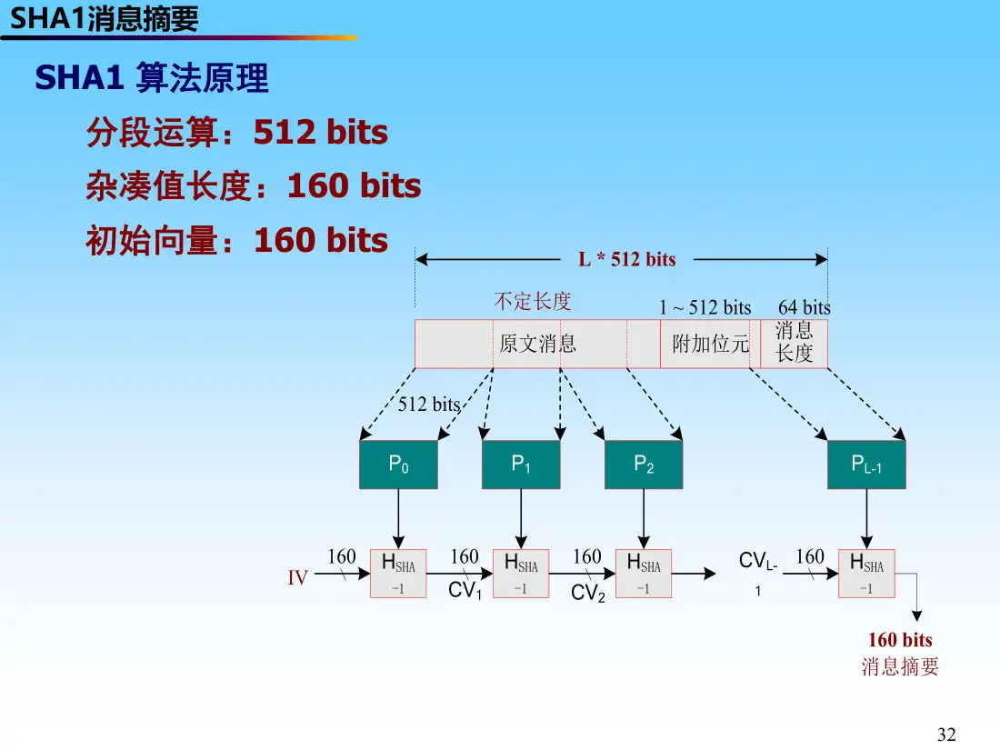

原文：

SHA1 算法原理

分段运算：512 bits

杂凑值长度：160 bits

初始向量：160 bits

SHA1消息摘要

32

### • 处理程序：4 回合，共计 80 次；5 个缓存器

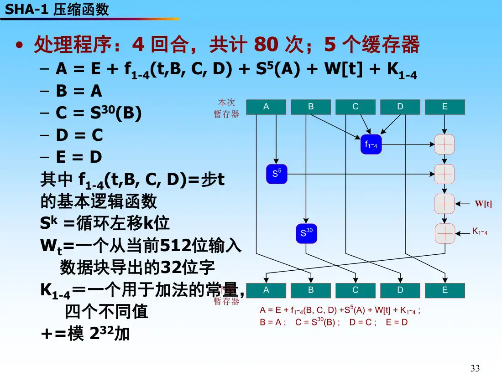

原文：

• 处理程序：4 回合，共计 80 次；5 个缓存器

$$
- \mathsf {A} = \mathsf {E} + \mathsf {f} _ {1 - 4} (\mathsf {t}, \mathsf {B}, \mathsf {C}, \mathsf {D}) + \mathsf {S} ^ {5} (\mathsf {A}) + \mathsf {W} [ \mathsf {t} ] + \mathsf {K} _ {1 - 4}
$$

$$
\begin{array}{l} - \mathsf {A} = \mathsf {E} + \mathsf {f} _ {1 - 4} \\ - \mathsf {B} = \mathsf {A} \\ - \mathsf {C} = \mathsf {S} ^ {3 0} (\mathsf {B}) \\ - \mathsf {D} = \mathsf {C} \\ - \mathsf {E} = \mathsf {D} \end{array}
$$

本次暫存器

其中 $\mathsf { f } _ { 1 - 4 } ( \mathsf { t } , \mathsf { B } , \mathsf { C } , \mathsf { D } ) = \ddagger \mathsf { t }$

的基本逻辑函数

Sk =循环左移k位

${ \boldsymbol W _ { \mathrm { { t } } } } \mathrm { { = } }$ 一个从当前512位输入数据块导出的32位字$\ k _ { 1 - 4 }$ ＝一个用于加法的常量，暫存器四个不同值

+=模 $2 ^ { 3 2 }$ 加

$$
A = E + f _ {1 \sim 4} (B, C, D) + S ^ {5} (A) + W [ t ] + K _ {1 \sim 4};
$$

$$
\mathsf {B} = \mathsf {A}; \quad \mathsf {C} = \mathsf {S} ^ {3 0} (\mathsf {B}); \quad \mathsf {D} = \mathsf {C}; \quad \mathsf {E} = \mathsf {D}
$$

SHA-1 压缩函数

33

### SHA1 的IV初值

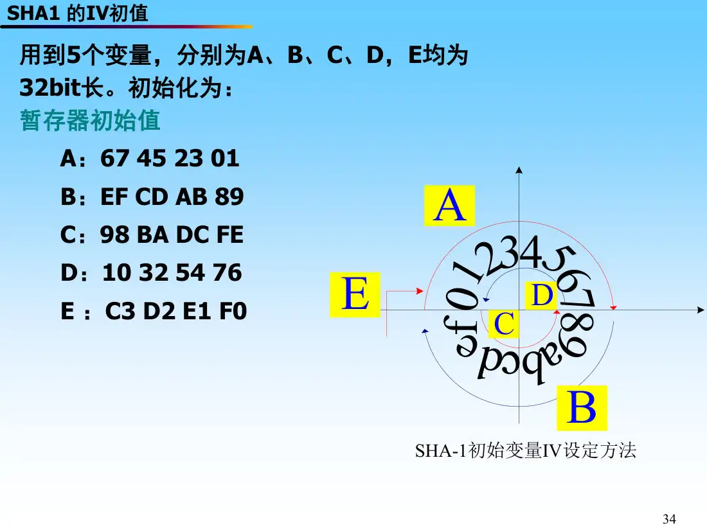

原文：

SHA1 的IV初值

用到5个变量，分别为A、B、C、D，E均为32bit长。初始化为：

暂存器初始值

A：67 45 23 01

B：EF CD AB 89

C：98 BA DC FE

D：10 32 54 76

E ：C3 D2 E1 F0

34

### SHA-1 算法— Kt与 $t _ { 1 - 4 }$

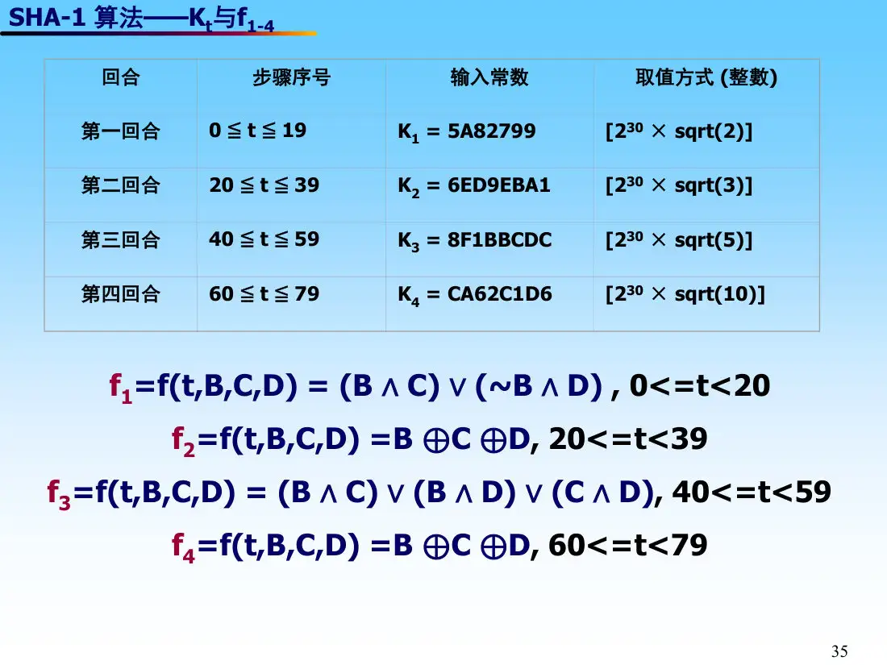

原文：

SHA-1 算法— Kt与 $t _ { 1 - 4 }$
<table><tr><td>回合</td><td>步骤序号</td><td>输入常数</td><td>取值方式(整數)</td></tr><tr><td>第一回合</td><td>0 ≤ t ≤ 19</td><td> $K_1 = 5A82799$ </td><td> $[2^{30} \times sqrt(2)]$ </td></tr><tr><td>第二回合</td><td>20 ≤ t ≤ 39</td><td> $K_2 = 6ED9EBA1$ </td><td> $[2^{30} \times sqrt(3)]$ </td></tr><tr><td>第三回合</td><td>40 ≤ t ≤ 59</td><td> $K_3 = 8F1BBCDC$ </td><td> $[2^{30} \times sqrt(5)]$ </td></tr><tr><td>第四回合</td><td>60 ≤ t ≤ 79</td><td> $K_4 = CA62C1D6$ </td><td> $[2^{30} \times sqrt(10)]$ </td></tr></table>

$$
f _ {1} = f (t, B, C, D) = (B \wedge C) \vee (\sim B \wedge D), 0 <   = t <   2 0
$$

$$
f _ {2} = f (t, B, C, D) = B \oplus C \oplus D, 2 0 <   = t <   3 9
$$

$$
f _ {3} = f (t, B, C, D) = (B \wedge C) \vee (B \wedge D) \vee (C \wedge D), 4 0 <   = t <   5 9
$$

$$
f _ {4} = f (t, B, C, D) = B \oplus C \oplus D, 6 0 <   = t <   7 9
$$

35

### SHA算法:处理步骤

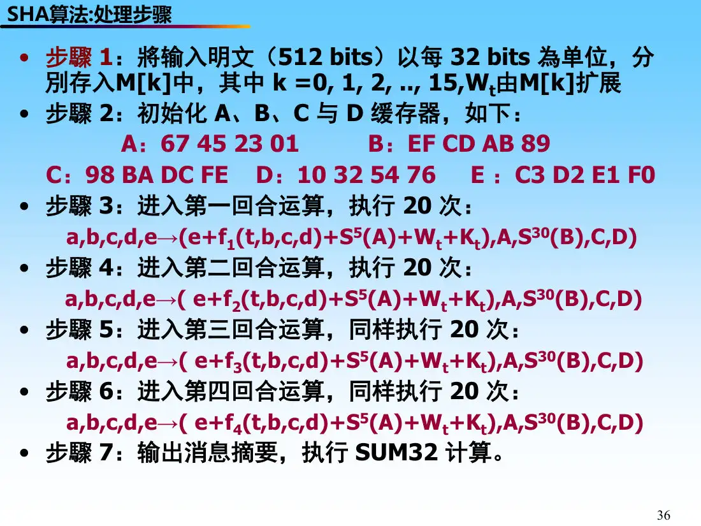

原文：

SHA算法:处理步骤

• 步驟 1：將输入明文（512 bits）以每 32 bits 為单位，分別存入M[k]中，其中 $\ v { k } = \mathbf { 0 } , \ \mathbf { 1 } , \ \mathbf { 2 } , \ \dotsc , \ \mathbf { 1 } 5 , \mathsf { W } _ { \mathrm { t } }$ 由M[k]扩展

步驟 2：初始化 A、B、C 与 D 缓存器，如下：A：67 45 23 01 B：EF CD AB 89C：98 BA DC FE D：10 32 54 76 E ：C3 D2 E1 F0

步驟 3：进入第一回合运算，执行 20 次：$\bar { \alpha } _ { r } \mathsf { b } _ { r } \mathbb { C } _ { r } \mathsf { d } _ { r } \mathsf { e } \longrightarrow ( \mathsf { e } + \mathsf { f } _ { \mathrm { \scriptscriptstyle 1 } } ( \mathsf { t } _ { r } \mathsf { b } _ { r } \mathbb { C } _ { r } \mathsf { d } ) + \mathsf { S } ^ { 5 } ( \mathsf { A } ) + \mathsf { W } _ { \mathrm { t } } + \mathsf { K } _ { \mathrm { t } } ) _ { r } \mathsf { A } _ { r } \mathsf { S } ^ { 3 0 } ( \mathsf { B } ) _ { r } \mathbb { C } _ { r } \mathsf { D } )$

• 步驟 4：进入第二回合运算，执行 20 次：$a _ { r } \mathsf { b } _ { r } \mathsf { D } _ { r } \mathsf { C } _ { r } \mathsf { d } _ { r } \mathsf { e } \longrightarrow ( \mathsf { e } + \mathsf { f } _ { 2 } ( \mathsf { t } _ { r } \mathsf { b } _ { r } \mathsf { C } _ { r } \mathsf { d } ) + S ^ { 5 } ( \mathsf { A } ) + \mathsf { W } _ { \mathrm { t } } + \mathsf { K } _ { \mathrm { t } } ) _ { r } \mathsf { A } _ { r } \mathsf { S } ^ { 3 0 } ( \mathsf { B } ) _ { r } \mathsf { C } _ { r } \mathsf { D } )$

• 步驟 5：进入第三回合运算，同样执行 20 次：$a _ { r } \mathsf { b } _ { r } \mathsf { D } _ { r } \mathsf { C } _ { r } \mathsf { d } _ { r } \mathsf { e } \longrightarrow ( \mathsf { e } + \mathsf { f } _ { 3 } ( \mathsf { t } _ { r } \mathsf { b } _ { r } \mathsf { C } _ { r } \mathsf { d } ) + S ^ { 5 } ( \mathsf { A } ) + \mathsf { W } _ { \mathrm { t } } + \mathsf { K } _ { \mathrm { t } } ) _ { r } \mathsf { A } _ { r } \mathsf { S } ^ { 3 0 } ( \mathsf { B } ) _ { r } \mathsf { C } _ { r } \mathsf { D } )$

• 步驟 6：进入第四回合运算，同样执行 20 次：$a _ { r } \mathsf { b } _ { r } \mathsf { D } _ { r } \mathsf { C } _ { r } \mathsf { d } _ { r } \mathsf { e } \longrightarrow ( \mathsf { e } + \mathsf { f } _ { 4 } ( \dot { \mathsf { t } } _ { r } \mathsf { b } _ { r } \mathsf { C } _ { r } \mathsf { d } ) + S ^ { 5 } ( \mathbb { A } ) + \mathsf { W } _ { \mathrm { t } } + \mathsf { K } _ { \mathrm { t } } ) _ { r } \mathsf { A } _ { r } \mathsf { S } ^ { 3 0 } ( \mathsf { B } ) _ { r } \mathsf { C } _ { r } \mathsf { D } )$

• 步驟 7：输出消息摘要，执行 SUM32 计算。

36

### SHA-1 演算法

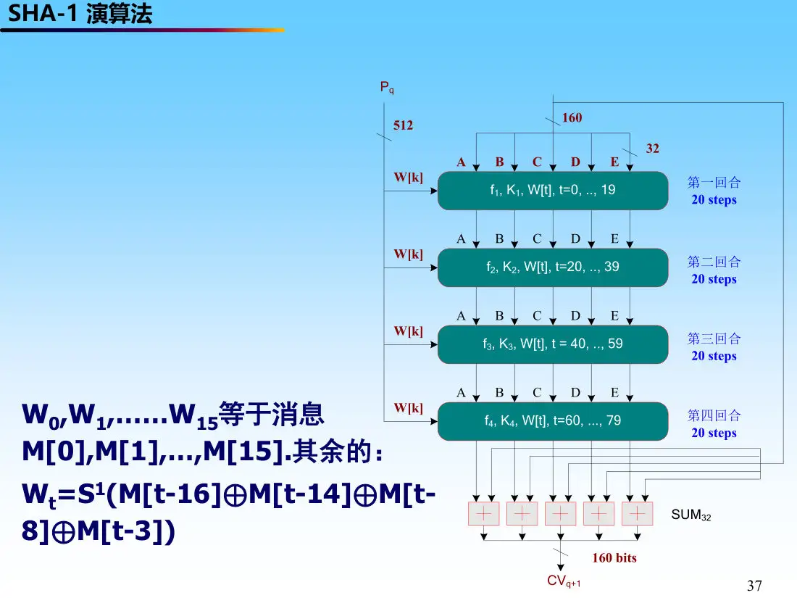

原文：

$\mathsf { W } _ { 0 } , \mathsf { W } _ { 1 / \cdots } \mathsf { \Gamma } _ { 1 5 }$ 等于消息 W[k] M[0],M[1],…,M[15].其余的： Wt=S1(M[t-16]⊕M[t-14]⊕M[t-8]⊕M[t-3])

SHA-1 演算法

37

### 基于对称分组密码算法设计散列函数

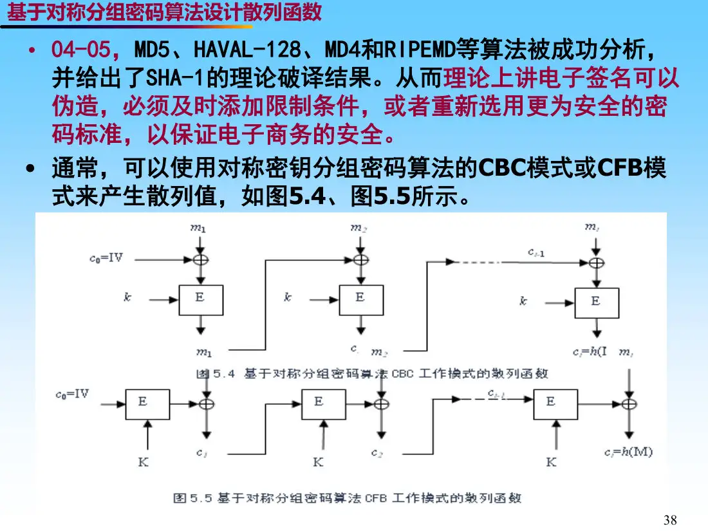

原文：

基于对称分组密码算法设计散列函数

04-05，MD5、HAVAL-128、MD4和RIPEMD等算法被成功分析，并给出了SHA-1的理论破译结果。从而理论上讲电子签名可以伪造，必须及时添加限制条件，或者重新选用更为安全的密码标准，以保证电子商务的安全。

• 通常，可以使用对称密钥分组密码算法的CBC模式或CFB模式来产生散列值，如图5.4、图5.5所示。

38

### 消息认证

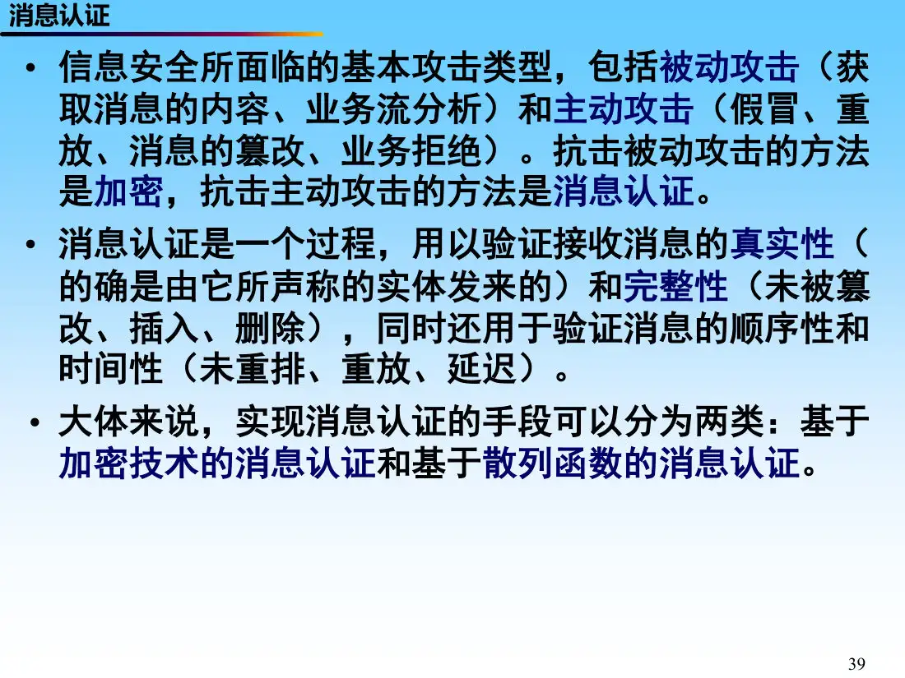

原文：

消息认证

信息安全所面临的基本攻击类型，包括被动攻击（获取消息的内容、业务流分析）和主动攻击（假冒、重放、消息的篡改、业务拒绝）。抗击被动攻击的方法是加密，抗击主动攻击的方法是消息认证。

• 消息认证是一个过程，用以验证接收消息的真实性（的确是由它所声称的实体发来的）和完整性（未被篡改、插入、删除），同时还用于验证消息的顺序性和时间性（未重排、重放、延迟）。

• 大体来说，实现消息认证的手段可以分为两类：基于加密技术的消息认证和基于散列函数的消息认证。

39

### 基于加密技术的消息认证

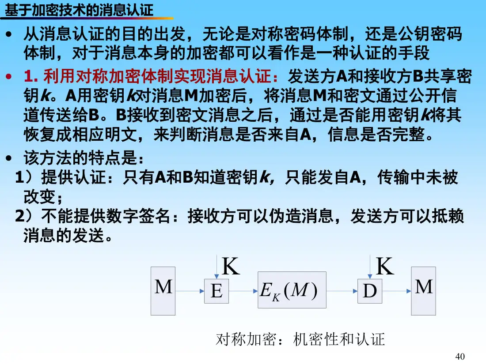

原文：

基于加密技术的消息认证

• 从消息认证的目的出发，无论是对称密码体制，还是公钥密码体制，对于消息本身的加密都可以看作是一种认证的手段

• 1. 利用对称加密体制实现消息认证：发送方A和接收方B共享密钥k。A用密钥k对消息M加密后，将消息M和密文通过公开信道传送给B。B接收到密文消息之后，通过是否能用密钥k将其恢复成相应明文，来判断消息是否来自A，信息是否完整。

• 该方法的特点是：

1）提供认证：只有A和B知道密钥k 只能发自A，传输中未被改变；

2）不能提供数字签名：接收方可以伪造消息，发送方可以抵赖消息的发送。

40

### 基于加密技术的消息认证

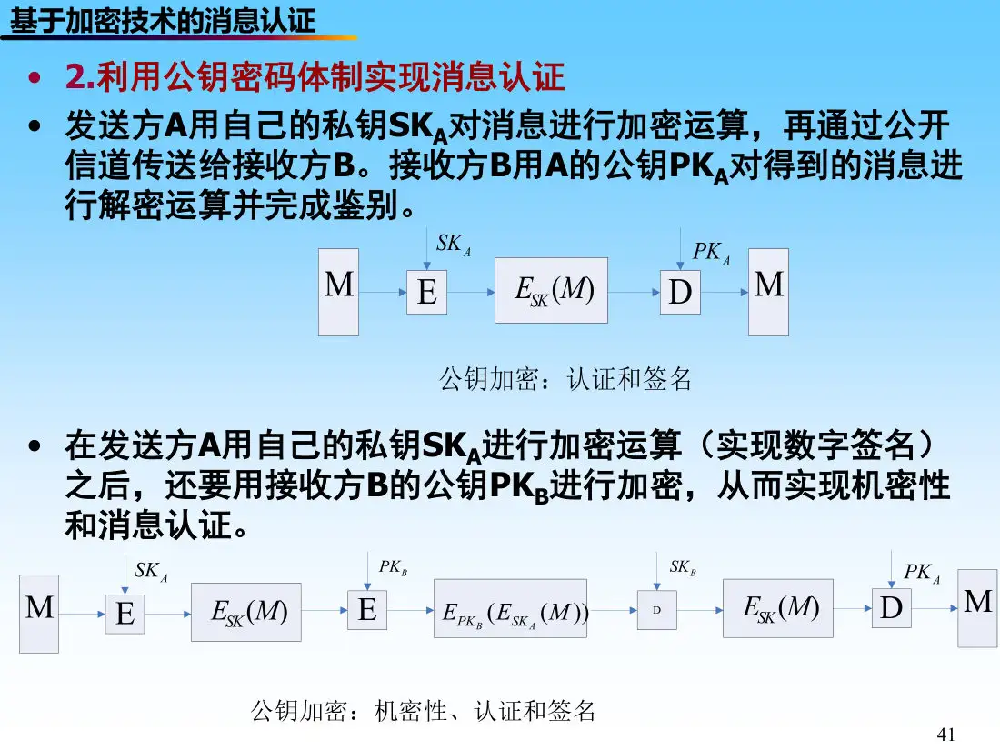

原文：

基于加密技术的消息认证

2.利用公钥密码体制实现消息认证

发送方A用自己的私钥 $\mathsf { S K } _ { \mathsf { A } }$ 对消息进行加密运算，再通过公开信道传送给接收方B。接收方B用A的公钥 $\mathsf { P K } _ { \mathsf { A } }$ 对得到的消息进行解密运算并完成鉴别。

• 在发送方A用自己的私钥 $\mathsf { S K } _ { \mathsf { A } }$ 进行加密运算（实现数字签名）之后，还要用接收方B的公钥 $\mathsf { P K } _ { \mathsf { B } }$ 进行加密，从而实现机密性和消息认证。

41

### 基于散列函数的消息认证

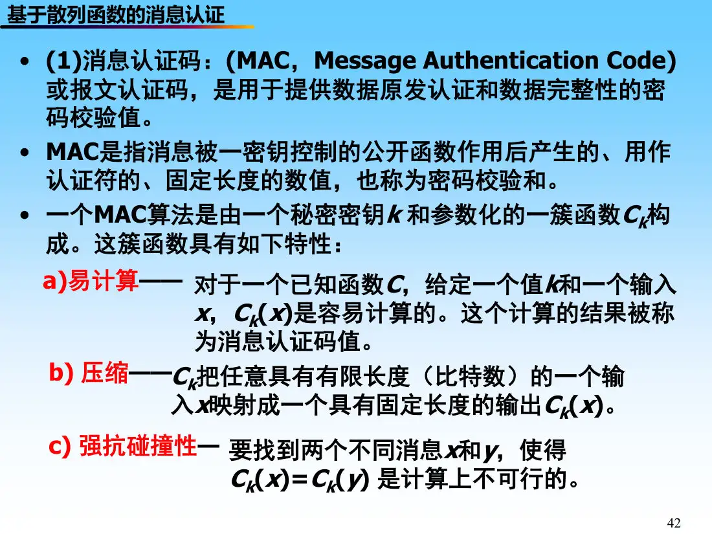

原文：

基于散列函数的消息认证

• (1)消息认证码：(MAC，Message Authentication Code)或报文认证码，是用于提供数据原发认证和数据完整性的密码校验值。

• MAC是指消息被一密钥控制的公开函数作用后产生的、用作认证符的、固定长度的数值，也称为密码校验和。

• 一个MAC算法是由一个秘密密钥k和参数化的一簇函数 $c _ { k }$ 构成。这簇函数具有如下特性：

a)易计算—— 对于一个已知函数 $c ,$ 给定一个值k和一个输入$x , ~ C _ { k } ( x )$ 是容易计算的。这个计算的结果被称为消息认证码值。

b) 压缩— $c _ { k }$ 把任意具有有限长度（比特数）的一个输入x映射成一个具有固定长度的输出 $c _ { k } ( x )$ 。

c) 强抗碰撞性— 要找到两个不同消息x和y，使得$C _ { k } ( x ) { = } C _ { k } ( \gamma )$ 是计算上不可行的。

42

### 基于散列函数的消息认证

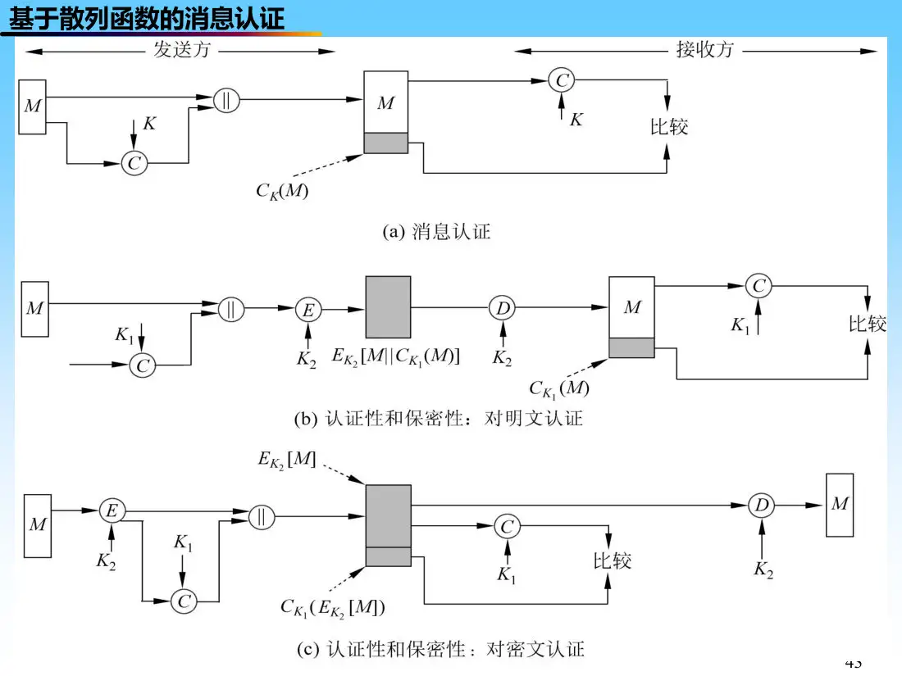

原文：

基于散列函数的消息认证

43

### MAC函数与加密算法的比较

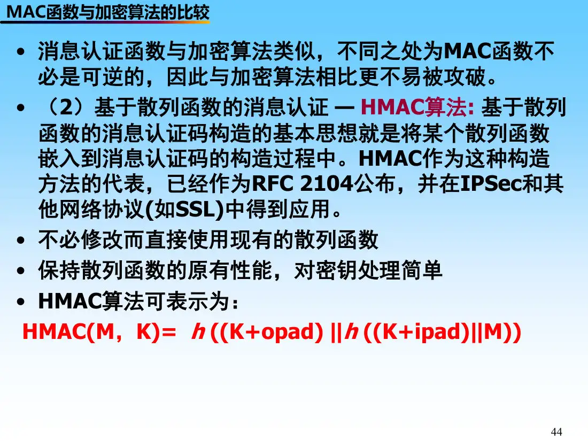

原文：

MAC函数与加密算法的比较

消息认证函数与加密算法类似，不同之处为MAC函数不必是可逆的，因此与加密算法相比更不易被攻破。

• （2）基于散列函数的消息认证 — HMAC算法: 基于散列函数的消息认证码构造的基本思想就是将某个散列函数嵌入到消息认证码的构造过程中。HMAC作为这种构造方法的代表，已经作为RFC 2104公布，并在IPSec和其他网络协议(如SSL)中得到应用。

• 不必修改而直接使用现有的散列函数

• 保持散列函数的原有性能，对密钥处理简单

• HMAC算法可表示为：

$$
\operatorname{HMAC} (M, K) = h ((K + \text {opad}) | | h ((K + \text {ipad}) | | M))
$$

44

### 45

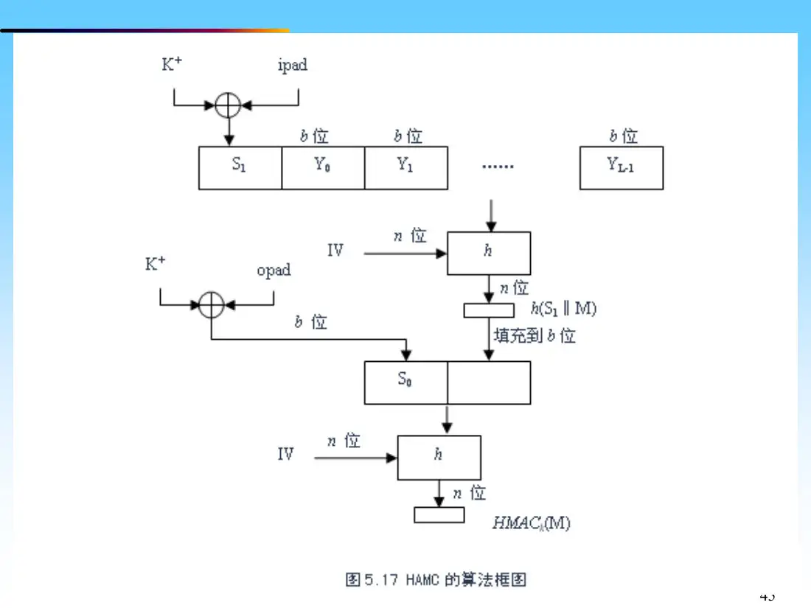

原文：

45

### HMAC

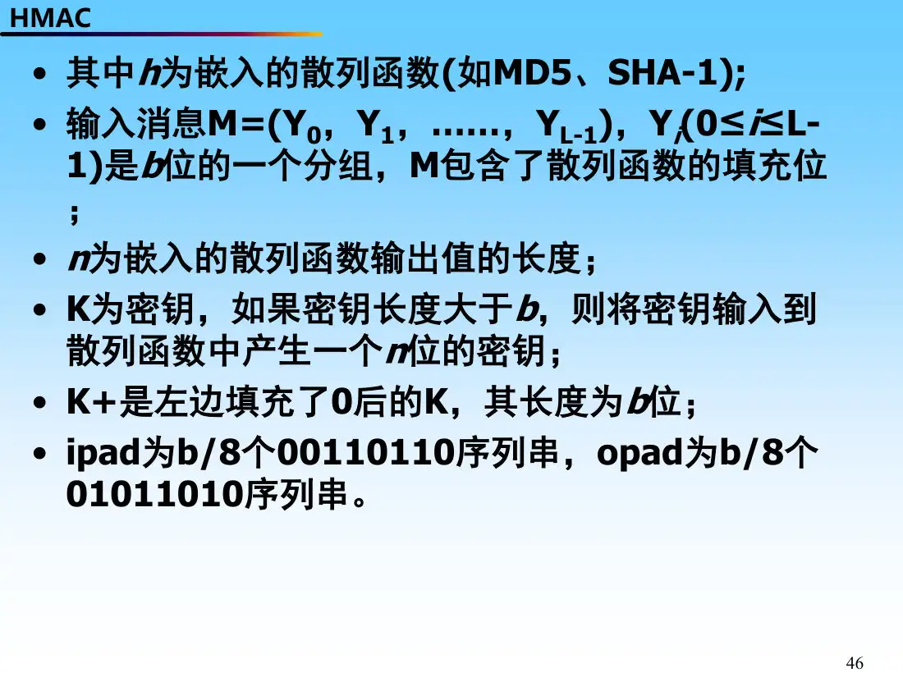

原文：

HMAC

• 其中h为嵌入的散列函数(如MD5、SHA-1);

输入消息 ${ \bf M } = ( { \sf Y } _ { 0 } , \ { \sf Y } _ { 1 } , \mathrm { ~ \dots ~ } , \ { \sf Y } _ { \mathrm { L - 1 } } ) , \ { \sf Y } _ { \mathrm { \ell } } ( 0 \leq i \leq \mathrm { L - 1 } $ 1)是b位的一个分组，M包含了散列函数的填充位

• n为嵌入的散列函数输出值的长度；

• K为密钥，如果密钥长度大于 $\theta _ { \mathfrak { g } }$ 则将密钥输入到散列函数中产生一个n位的密钥；

• K+是左边填充了0后的K，其长度为b位；

• ipad为b/8个00110110序列串，opad为b/8个01011010序列串。

46

### HMAC的安全性

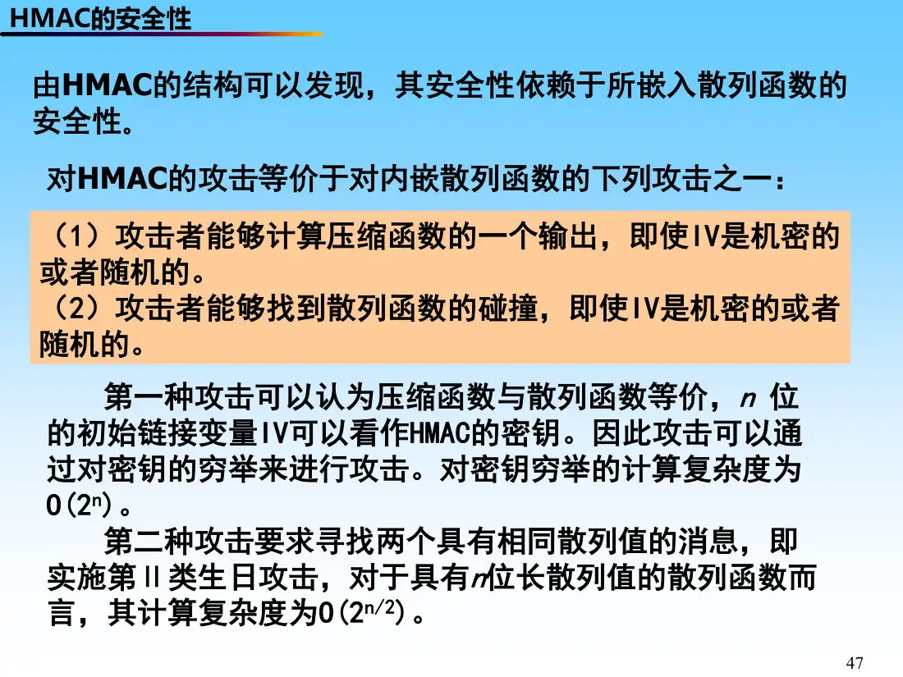

原文：

HMAC的安全性

由HMAC的结构可以发现，其安全性依赖于所嵌入散列函数的安全性。

对HMAC的攻击等价于对内嵌散列函数的下列攻击之一：

（1）攻击者能够计算压缩函数的一个输出，即使IV是机密的或者随机的。

（2）攻击者能够找到散列函数的碰撞，即使IV是机密的或者随机的。

第一种攻击可以认为压缩函数与散列函数等价，n 位的初始链接变量IV可以看作HMAC的密钥。因此攻击可以通过对密钥的穷举来进行攻击。对密钥穷举的计算复杂度为O(2n)。

第二种攻击要求寻找两个具有相同散列值的消息，即实施第Ⅱ类生日攻击，对于具有n位长散列值的散列函数而言，其计算复杂度为O(2n/2)。

47

### CMAC

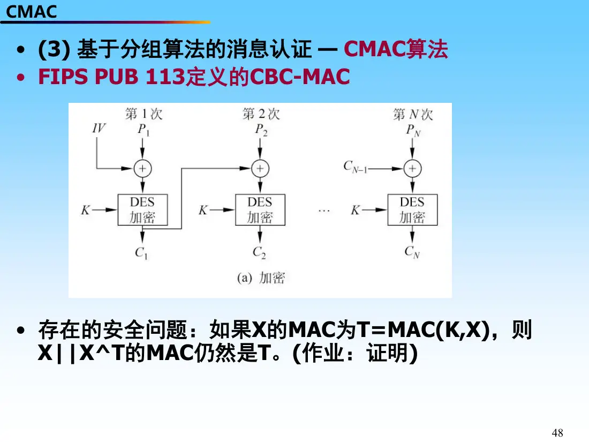

原文：

• (3) 基于分组算法的消息认证 — CMAC算法FIPS PUB 113定义的CBC-MAC

• 存在的安全问题：如果X的MAC为 ${ \sf T } = { \sf M A C } ( { \sf K } , { \sf X } )$ ，则$\mathbf { \pmb { X } } | \mathbf { \Delta } | \mathbf { \pmb { X } } ^ { \pmb { \wedge } }$ T的MAC仍然是T。(作业：证明)

CMAC

48

### CMAC的改进

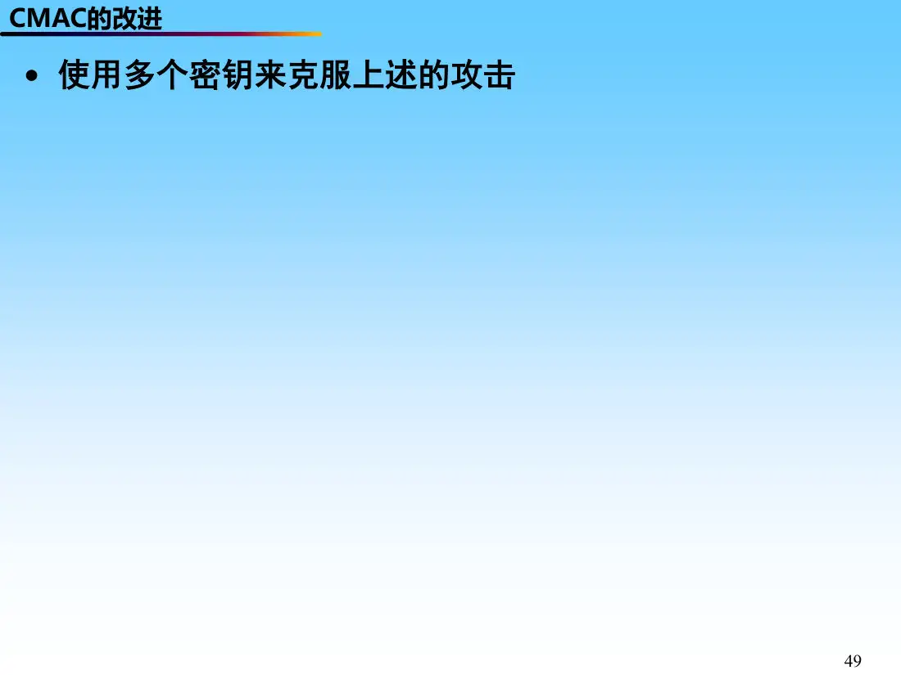

原文：

CMAC的改进

• 使用多个密钥来克服上述的攻击

49
