# 《密码学》第7章 公钥密码学（课件）

原件的每一页，下面附识别出的文字。

### 第六章公钥密码学

原文：

第六章公钥密码学

### 公钥密码学提出的背景

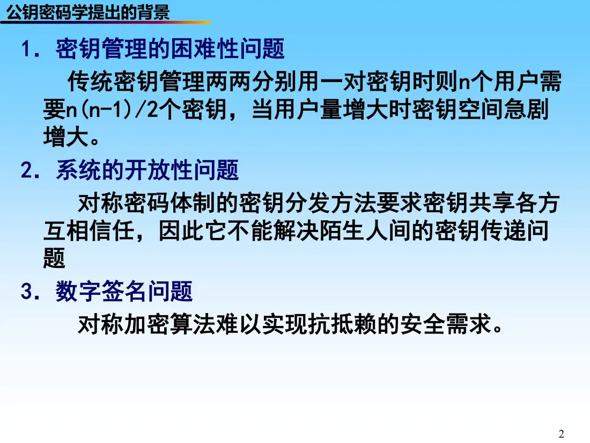

原文：

公钥密码学提出的背景

1．密钥管理的困难性问题

传统密钥管理两两分别用一对密钥时则n个用户需要n(n-1)/2个密钥，当用户量增大时密钥空间急剧增大。

2．系统的开放性问题

对称密码体制的密钥分发方法要求密钥共享各方互相信任，因此它不能解决陌生人间的密钥传递问题

3．数字签名问题

对称加密算法难以实现抗抵赖的安全需求。

2

### 密钥分发

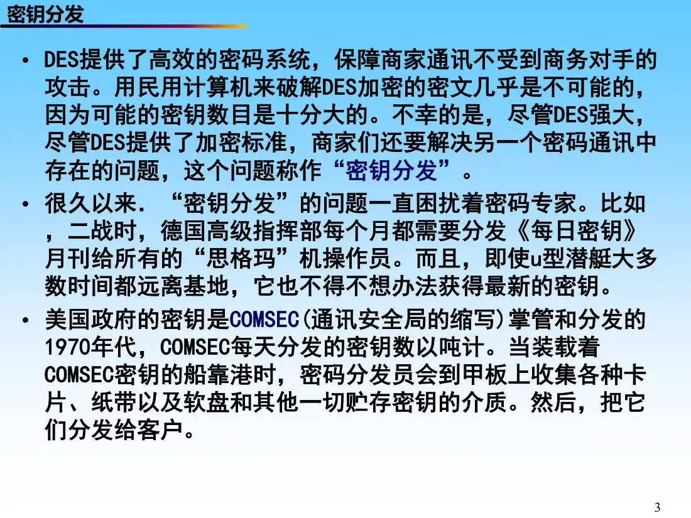

原文：

密钥分发

DES提供了高效的密码系统，保障商家通讯不受到商务对手的攻击。用民用计算机来破解DES加密的密文几乎是不可能的，因为可能的密钥数目是十分大的。不幸的是，尽管DES强大，尽管DES提供了加密标准，商家们还要解决另一个密码通讯中存在的问题，这个问题称作“密钥分发”。

• 很久以来．“密钥分发”的问题一直困扰着密码专家。比如，二战时，德国高级指挥部每个月都需要分发《每日密钥》月刊给所有的“思格玛”机操作员。而且，即使u型潜艇大多数时间都远离基地，它也不得不想办法获得最新的密钥。

美国政府的密钥是COMSEC(通讯安全局的缩写)掌管和分发的1970年代，COMSEC每天分发的密钥数以吨计。当装载着COMSEC密钥的船靠港时，密码分发员会到甲板上收集各种卡片、纸带以及软盘和其他一切贮存密钥的介质。然后，把它们分发给客户。

3

### 公钥密码学的思想

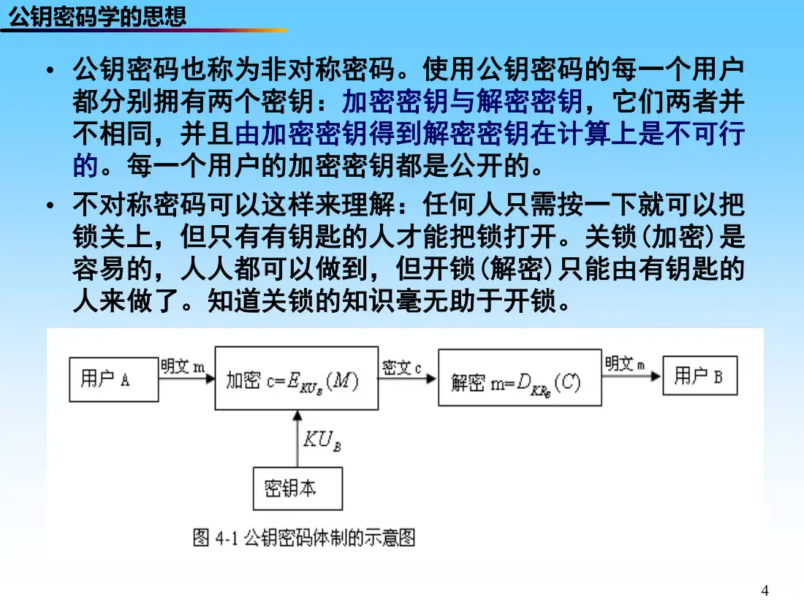

原文：

公钥密码学的思想

• 公钥密码也称为非对称密码。使用公钥密码的每一个用户都分别拥有两个密钥：加密密钥与解密密钥，它们两者并不相同，并且由加密密钥得到解密密钥在计算上是不可行的。每一个用户的加密密钥都是公开的。

不对称密码可以这样来理解：任何人只需按一下就可以把锁关上，但只有有钥匙的人才能把锁打开。关锁(加密)是容易的，人人都可以做到，但开锁(解密)只能由有钥匙的人来做了。知道关锁的知识毫无助于开锁。

4

### 公钥密码算法

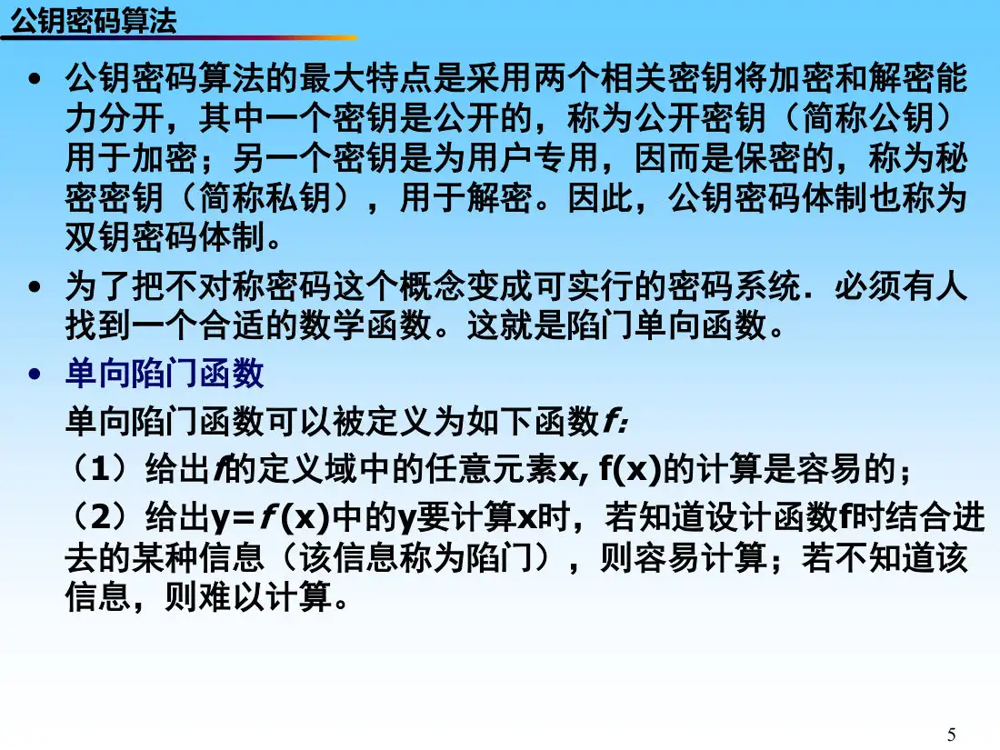

原文：

公钥密码算法

公钥密码算法的最大特点是采用两个相关密钥将加密和解密能力分开，其中一个密钥是公开的，称为公开密钥（简称公钥）用于加密；另一个密钥是为用户专用，因而是保密的，称为秘密密钥（简称私钥），用于解密。因此，公钥密码体制也称为双钥密码体制。

• 为了把不对称密码这个概念变成可实行的密码系统．必须有人找到一个合适的数学函数。这就是陷门单向函数。

• 单向陷门函数

单向陷门函数可以被定义为如下函数f：

（1）给出f的定义域中的任意元素x, f(x)的计算是容易的；

（2）给出y=f(x)中的y要计算x时，若知道设计函数f时结合进去的某种信息（该信息称为陷门），则容易计算；若不知道该信息，则难以计算。

5

### 公钥密码学的应用

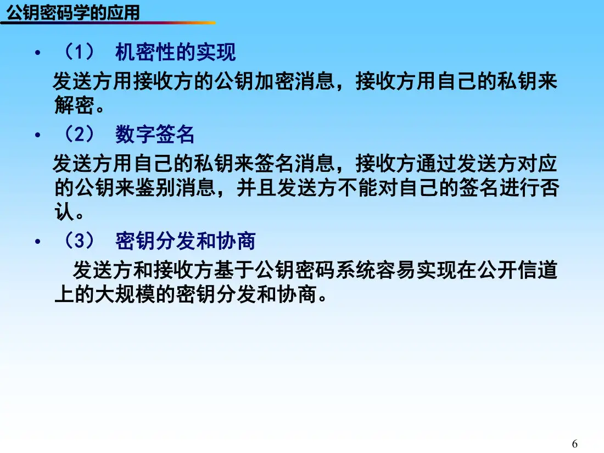

原文：

公钥密码学的应用

• （1） 机密性的实现

发送方用接收方的公钥加密消息，接收方用自己的私钥来解密。

• （2） 数字签名

发送方用自己的私钥来签名消息，接收方通过发送方对应的公钥来鉴别消息，并且发送方不能对自己的签名进行否认。

• （3） 密钥分发和协商

发送方和接收方基于公钥密码系统容易实现在公开信道上的大规模的密钥分发和协商。

6

### 公钥密码体制认证框图

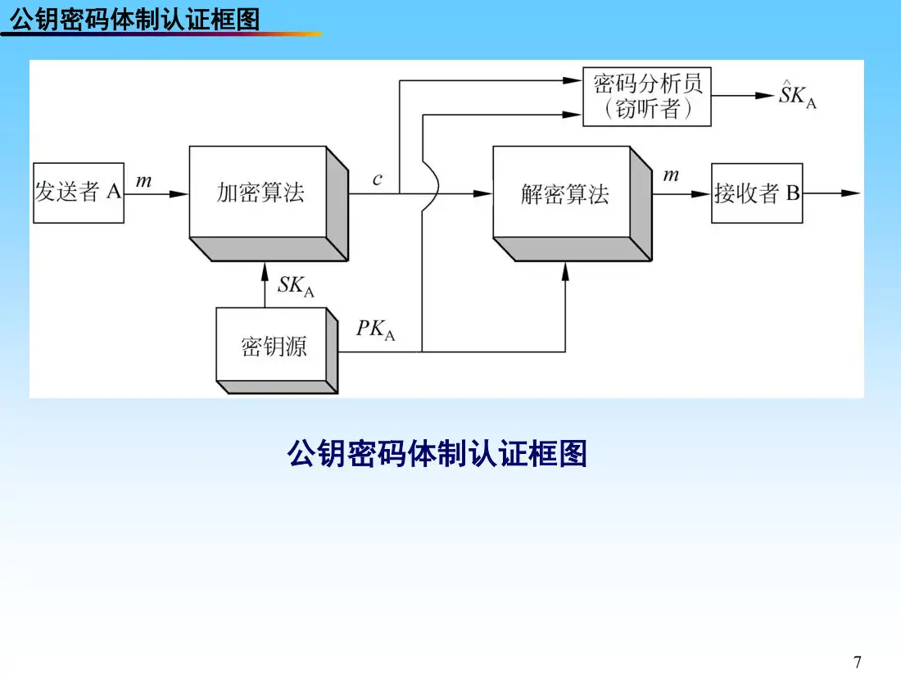

原文：

公钥密码体制认证框图

7

### 公钥密码体制基于的困难问题

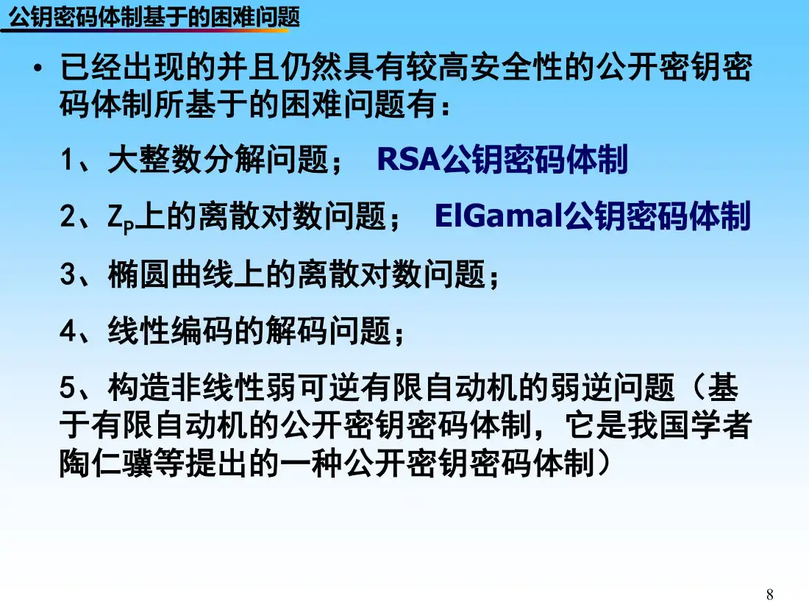

原文：

公钥密码体制基于的困难问题

• 已经出现的并且仍然具有较高安全性的公开密钥密码体制所基于的困难问题有：

1、大整数分解问题； RSA公钥密码体制

2、 $z _ { p }$ 上的离散对数问题； ElGamal公钥密码体制

3、椭圆曲线上的离散对数问题；

4、线性编码的解码问题；

5、构造非线性弱可逆有限自动机的弱逆问题（基于有限自动机的公开密钥密码体制，它是我国学者陶仁骥等提出的一种公开密钥密码体制）

8

### 数学背景

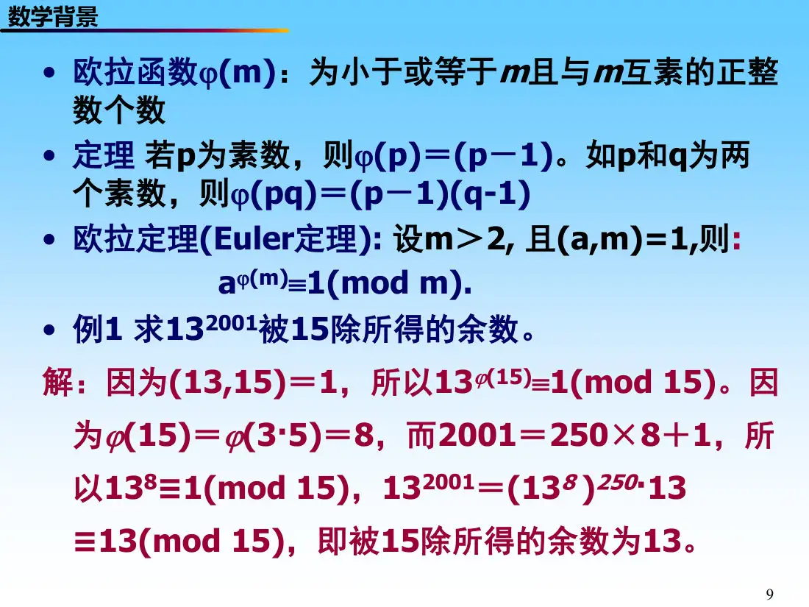

原文：

数学背景

• 欧拉函数(m)：为小于或等于m且与m互素的正整数个数

定理 若p为素数，则 $\scriptstyle \varphi ( { \mathfrak { p } } ) = ( { \mathfrak { p } } - { \mathfrak { 1 } } )$ 。如p和q为两个素数，则 $\scriptstyle \Phi ( \mathbf { p q } ) = ( \mathbf { p - 1 } ) ( \mathbf { q - 1 } )$

• 欧拉定理(Euler定理): 设 ${ \bf m } > { \bf 2 } ,$ 且 $( \mathbf { a } , \mathbf { m } ) { = } 1 _ { i }$ ,则:$\scriptstyle \mathbf { a } ^ { \varphi ( m ) } \equiv \mathbf { 1 } ( \mathbf { m o d } \ m )$

• 例1 求132001被15除所得的余数。

解：因为(13,15)＝1，所以 $1 3 \% 1 5 ) \equiv 1 ( \mathrm { m o d } \ 1 5 )$ 因$\varphi ( 1 5 ) = \varphi ( 3 - 5 ) = 8$ ，而 $2 0 0 1 { = } 2 5 0 \times 8 + 1$ 所$1 3 ^ { 8 } \equiv 1 ( { \bmod { \ 1 5 } } )$ $1 3 ^ { 2 0 0 1 } = ( 1 3 ^ { \delta } ) ^ { 2 5 0 * } 1 3$ $\equiv 1 3 ( \mathrm { m o d } ~ 1 5 )$ ，即被15除所得的余数为13。

9

### RSA密码算法

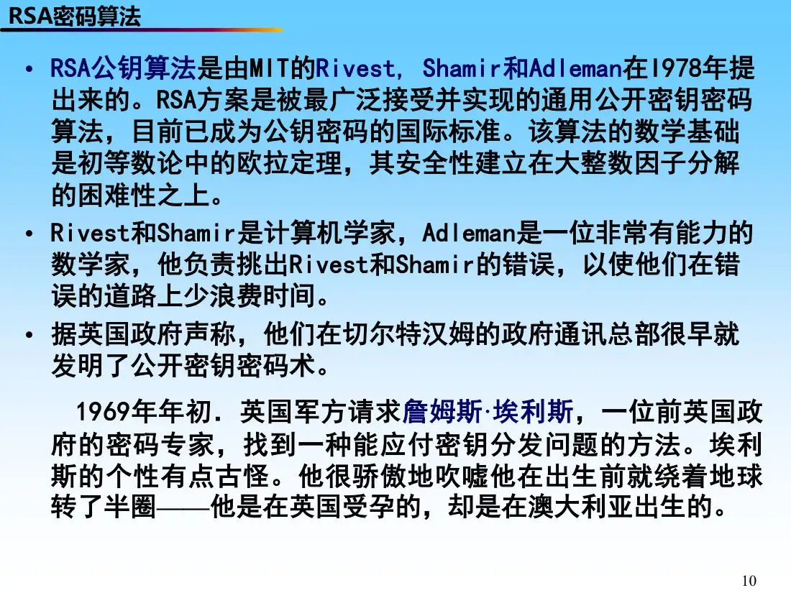

原文：

RSA密码算法

RSA公钥算法是由MIT的Rivest, Shamir和Adleman在I978年提出来的。RSA方案是被最广泛接受并实现的通用公开密钥密码算法，目前已成为公钥密码的国际标准。该算法的数学基础是初等数论中的欧拉定理，其安全性建立在大整数因子分解的困难性之上。

Rivest和Shamir是计算机学家，Adleman是一位非常有能力的数学家，他负责挑出Rivest和Shamir的错误，以使他们在错误的道路上少浪费时间。

据英国政府声称，他们在切尔特汉姆的政府通讯总部很早就发明了公开密钥密码术。

1969年年初．英国军方请求詹姆斯·埃利斯，一位前英国政府的密码专家，找到一种能应付密钥分发问题的方法。埃利斯的个性有点古怪。他很骄傲地吹嘘他在出生前就绕着地球转了半圈——他是在英国受孕的，却是在澳大利亚出生的。

10

### RSA密码算法

原文：

RSA密码算法

埃利斯的想法与Shamir、Rivest和Adleman的很相似，只是比他们提前了好几年。然而，没有人知道埃利斯的工作因为他是英国政府的雇员，而且要发誓保密。到1969年末，埃利斯看来已经陷入了僵局，他已证明公开密钥是可能的，他也发明了公开密钥和私人密钥的概念。

• 接下来的三年中，政府通讯总部的最聪明的头脑努力寻找个能满足埃利斯要求的单向函数，但毫无结果。

• 1973年9月，一个年轻的数学家加入了这个小组，克利福德科克斯。刚刚毕业于剑桥大学，是一个纯粹的数学家。

六个星期后，佩特森告诉科克斯，之所以告诉科克斯这个想法，是因为这是密码学中最让人兴奋的想法，而不是指望他能够解决这个问题。科克斯回忆到：“从开始到结束，我总共没花半个小时的时间，我对自己很满意，我想‘哦，这很好，别人给我提了一个问题，而我解决了。

11

### RSA算法描述

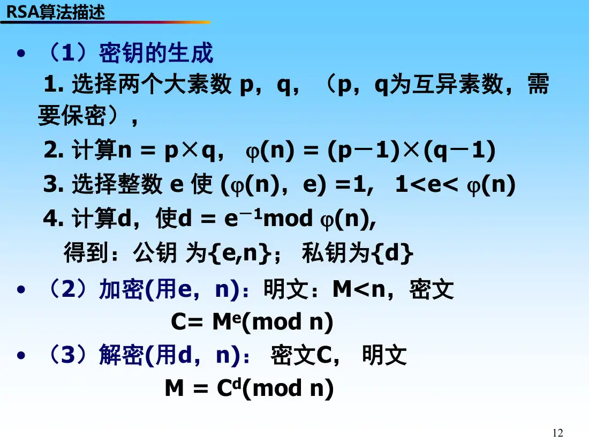

原文：

RSA算法描述

• （1）密钥的生成

1. 选择两个大素数 p，q，（p，q为互异素数，需要保密），

2. 计算 ${ \mathfrak { n } } = { \mathfrak { p } } \times { \mathfrak { q } } , \quad { \mathfrak { q } } ( { \mathfrak { n } } ) = ( { \mathfrak { p } } - \mathbf { 1 } ) \times ( { \mathfrak { q } } - \mathbf { 1 } )$

3. 选择整数 e 使 $( \boldsymbol { \varphi } ( \mathsf { n } ) , \mathsf { e } ) = \mathtt { 1 } , 1 < \mathsf { e } < \boldsymbol { \varphi } ( \mathsf { n } )$

4. 计算d，使 ${ \bf d } = { \bf e } ^ { - 1 } { \bf m o d \ } _ { \boldsymbol { \Phi } } ( { \bf n } )$ ,

得到：公钥 为 $\{ \Theta , n \}$ 私钥为{d}

（2）加密(用e，n)：明文： $\mathsf { M } < \mathsf { n }$ ，密文$\mathbf { C } { = } \mathbf { \Gamma } \mathbf { M } \mathbf { e } _ { \mathbf { ( } \mathbf { m 0 } \mathbf { d } \textbf { n ) } }$

• （3）解密(用 ${ \bf d } , ~ { \bf n } )$ ： 密文C， 明文$\mathbf { M } = \mathbf { C ^ { d } } ( \mathbf { m o d } \ \mathbf { n } )$

12

### 举例

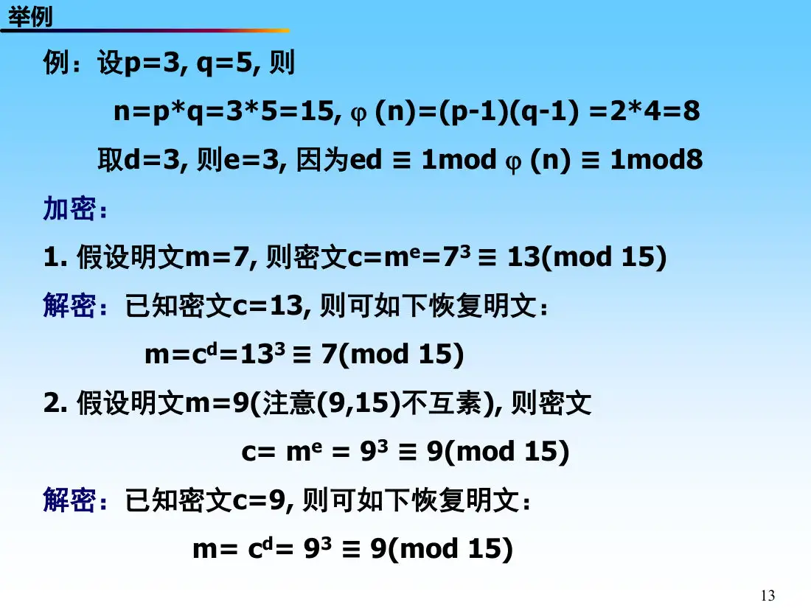

原文：

举例

例：设 $\mathbf { p } { = } 3 , \mathbf { q } { = } 5 ,$ 则

$$
n = p ^ {*} q = 3 ^ {*} 5 = 1 5, \varphi (n) = (p - 1) (q - 1) = 2 ^ {*} 4 = 8
$$

取 $\mathbf { d } = 3 ,$ 则e=3, 因为 $\mathbf { e d } \equiv \mathbf { 1 } { \bmod { \boldsymbol { \Phi } } } \left( \mathbf { n } \right) \equiv \mathbf { 1 } { \bmod { \boldsymbol { 8 } } }$

加密：

1. 假设明文m=7, 则密文 $c { = } \mathsf { m } ^ { \mathrm { e } } { = } 7 ^ { 3 } \equiv 1 3 ( \mathsf { m o d } \ 1 5 )$

解密：已知密文c=13, 则可如下恢复明文：

$$
\mathsf {m} = \mathsf {c} ^ {\mathsf {d}} = 1 3 ^ {3} \equiv 7 (\mathrm{mod} 1 5)
$$

2. 假设明文m=9(注意(9,15)不互素), 则密文

$$
\mathbf {c} = \mathbf {m} ^ {\mathrm{e}} = 9 ^ {3} \equiv 9 (\mathrm{mod} 1 5)
$$

解密：已知密文 $\mathbf { \langle c = 9 }$ , 则可如下恢复明文：

$$
\mathsf {m} = \mathsf {c} ^ {\mathsf {d}} = 9 ^ {3} \equiv 9 (\mathrm{mod} 1 5)
$$

13

### RSA的证明

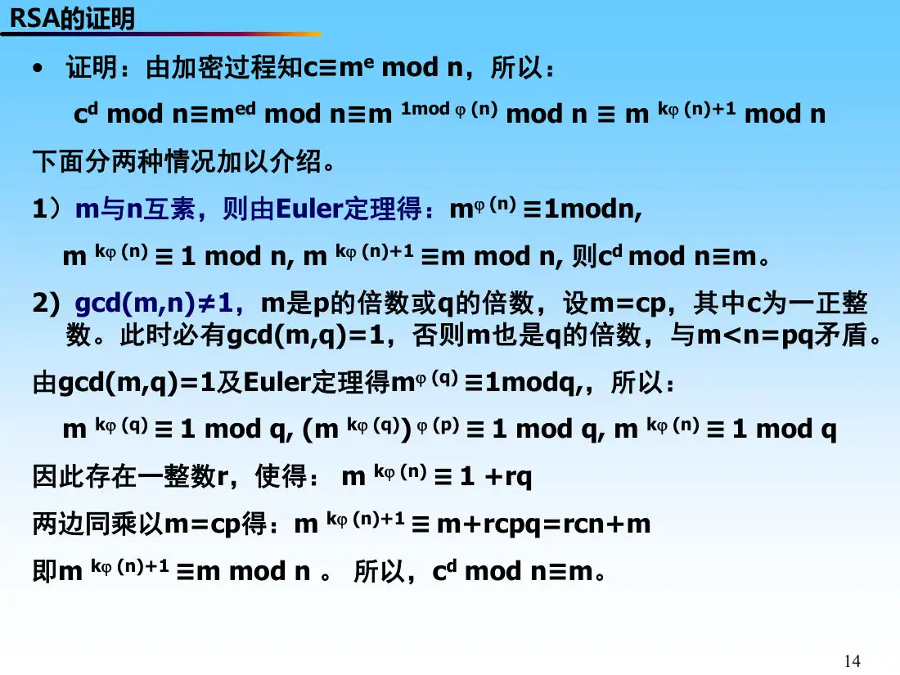

原文：

RSA的证明

• 证明：由加密过程知c≡me mod n，所以：

$\mathbf { c } ^ { \mathrm { d } } \mathrm { ~ m o d ~ } \mathsf { n } \equiv \mathsf { m } ^ { \mathrm { e d } } \mathrm { ~ m o d ~ } \mathsf { n } \equiv \mathsf { m } ^ { \mathrm { ~ \bf ~ 1 ~ m o d ~ } \mathrm { q } \mathrm { ~ ( \mathsf { n } ) ~ } } \mathrm { ~ m o d ~ } \mathsf { n } \equiv \mathsf { m } ^ { \mathrm { ~ \bf ~ k _ { \mathrm { 9 } } ~ ( \mathsf { n } ) + \bf 1 } }$ mod n下面分两种情况加以介绍。

1）m与n互素，则由Euler定理得： ${ \bf m } ^ { \varphi ( \mathsf { n } ) } \equiv \bf { 1 } { \bmod { n } } ,$ 1

2) g $\scriptstyle | \mathbf { c d } ( \mathbf { m } , \mathbf { n } ) \neq 1$ ，m是p的倍数或q的倍数，设 $\mathbf { m } { = } \mathbf { c } \mathbf { p }$ ，其中c为一正整数。此时必有 ${ \bf g c d } ( { \bf m } , { \bf q } ) = { \bf 1 }$ ，否则m也是q的倍数，与 $m < n = p q \mathcal { Z }$ 盾。

由 ${ \bf g c d } ( { \bf m } , { \bf q } ) = { \bf 1 }$ 及Euler定理得 ${ \bf m } ^ { \varphi ( { \bf q } ) } \equiv { \bf 1 } { \bf m o d q } ,$ ，所以：

因此存在一整数r，使得： ${ \bf { m } } \ { \bf { k } } \varphi \left( { \bf { n } } \right) \equiv { \bf { 1 } } + { \bf { r } } { \bf { q } }$

两边同乘以m=cp得： $\mathsf { m } ^ { \mathrm { \tiny ~ k p } \mathrm { \left( n \right) + 1 } } \equiv \mathsf { m } + \mathsf { r c p q } = \mathsf { r c n } + \mathsf { m }$

即 $\mathbf { m } ~ \mathbf { k } \varphi \left( \mathbf { n } \right) + \mathbf { 1 } \equiv \mathbf { m } ~ \mathbf { m } ~ \mathbf { o d } ~ \mathbf { n }$ 。 所以， $\mathbf { c } ^ { \mathbf { d } } \mathbf { m o d } \mathbf { n } \equiv \mathbf { m }$ 。

14

### 对素数的认识

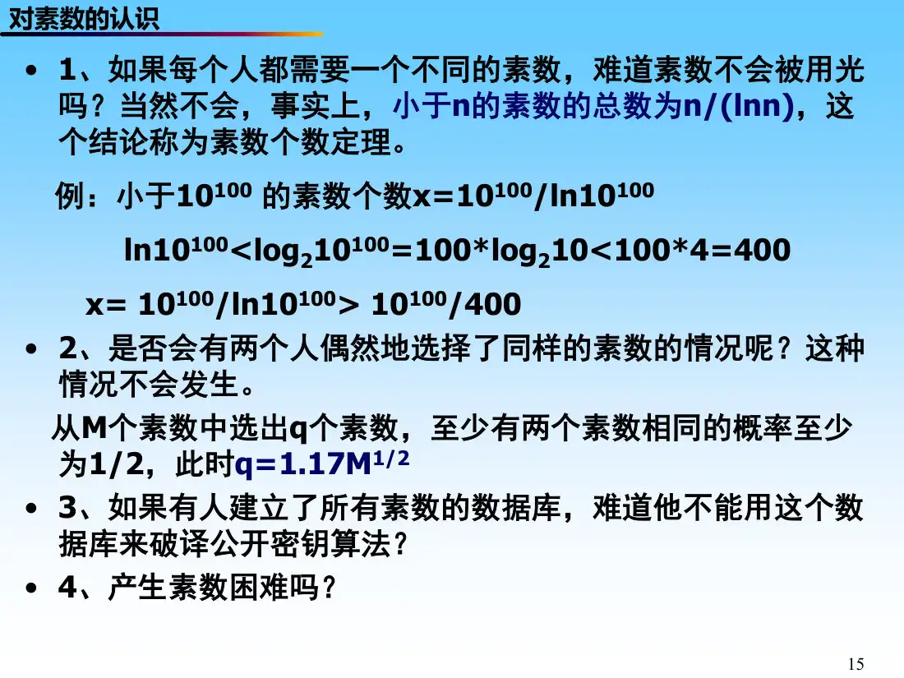

原文：

对素数的认识

1、如果每个人都需要一个不同的素数，难道素数不会被用光吗？当然不会，事实上，小于n的素数的总数为n/(lnn)，这个结论称为素数个数定理。

例：小于10100 的素数个数 $\bf { x } = \bf { 1 0 ^ { 1 0 0 } } / \ln \bf { 1 0 ^ { 1 0 0 } }$

$$
\ln 1 0 ^ {1 0 0} <   \log_ {2} 1 0 ^ {1 0 0} = 1 0 0 * \log_ {2} 1 0 <   1 0 0 * 4 = 4 0 0
$$

$$
x = 1 0 ^ {1 0 0} / \ln 1 0 ^ {1 0 0} > 1 0 ^ {1 0 0} / 4 0 0
$$

• 2、是否会有两个人偶然地选择了同样的素数的情况呢？这种情况不会发生。从M个素数中选出q个素数，至少有两个素数相同的概率至少为1/2，此时 $\bf q = 1 . 1 7 M ^ { 1 / 2 }$

• 3、如果有人建立了所有素数的数据库，难道他不能用这个数据库来破译公开密钥算法？

• 4、产生素数困难吗？

15

### 素数的产生

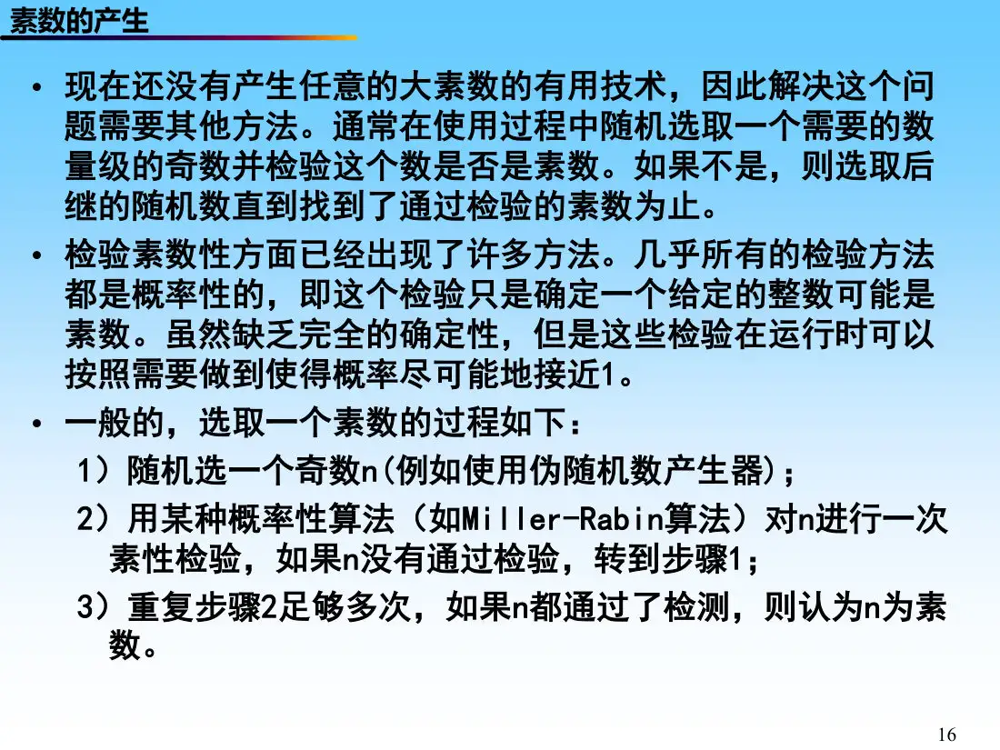

原文：

素数的产生

现在还没有产生任意的大素数的有用技术，因此解决这个问题需要其他方法。通常在使用过程中随机选取一个需要的数量级的奇数并检验这个数是否是素数。如果不是，则选取后继的随机数直到找到了通过检验的素数为止。

检验素数性方面已经出现了许多方法。几乎所有的检验方法都是概率性的，即这个检验只是确定一个给定的整数可能是素数。虽然缺乏完全的确定性，但是这些检验在运行时可以按照需要做到使得概率尽可能地接近1。

• 一般的，选取一个素数的过程如下：

1）随机选一个奇数n(例如使用伪随机数产生器)；

2）用某种概率性算法（如Miller-Rabin算法）对n进行一次素性检验，如果n没有通过检验，转到步骤1；

3）重复步骤2足够多次，如果n都通过了检测，则认为n为素数。

16

### RSA的实现

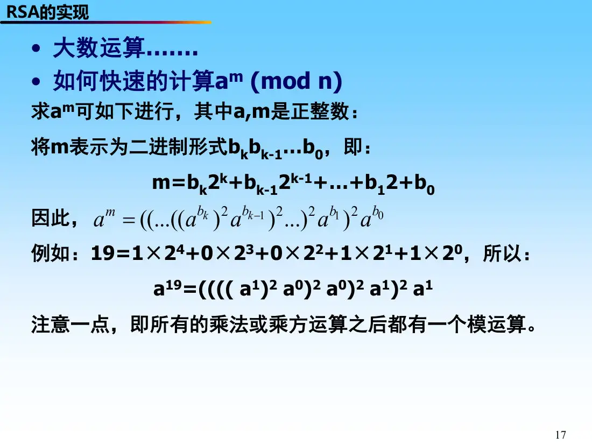

原文：

RSA的实现

• 大数运算

如何快速的计算 $. \hat { \pmb { q } } ^ { \mathbf { m } }$ (mod n)求 $\mathbf { \dot { a } } ^ { \mathbf { m } }$ 可如下进行，其中 $\mathbf { a } , \mathbf { m }$ 是正整数：

将m表示为二进制形式 $\mathbf { b _ { k } } \mathbf { b _ { k - 1 } } \mathbf { \ldots } \mathbf { b _ { 0 } }$ ，即：

$$
m = b _ {k} 2 ^ {k} + b _ {k - 1} 2 ^ {k - 1} + \dots + b _ {1} 2 + b _ {0}
$$

因此， $a ^ { m } = ( ( \ldots ( ( a ^ { b _ { k } } ) ^ { 2 } a ^ { b _ { k - 1 } } ) ^ { 2 } \ldots ) ^ { 2 } a ^ { b _ { 1 } } ) ^ { 2 } a ^ { b _ { 0 } }$

例如： $\bf { 1 9 } = \bf { 1 } \times \bf { 2 ^ { 4 } } + \bf { 0 } \times \bf { 2 ^ { 3 } } + \bf { 0 } \times \bf { 2 ^ { 2 } } + \bf { 1 } \times \bf { 2 ^ { 1 } } + \bf { 1 } \times \bf { 2 ^ { 0 } }$ ，所以：

$$
\mathsf {a} ^ {1 9} = (((\left(\mathsf {a} ^ {1}\right) ^ {2} \mathsf {a} ^ {0}) ^ {2} \mathsf {a} ^ {0}) ^ {2} \mathsf {a} ^ {1}) ^ {2} \mathsf {a} ^ {1}
$$

注意一点，即所有的乘法或乘方运算之后都有一个模运算。

17

### RSA的实现

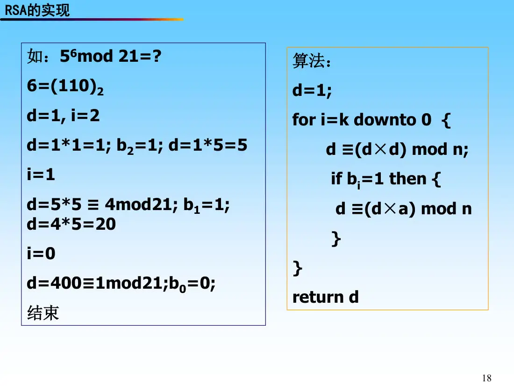

原文：

RSA的实现

18

### RSA的安全性

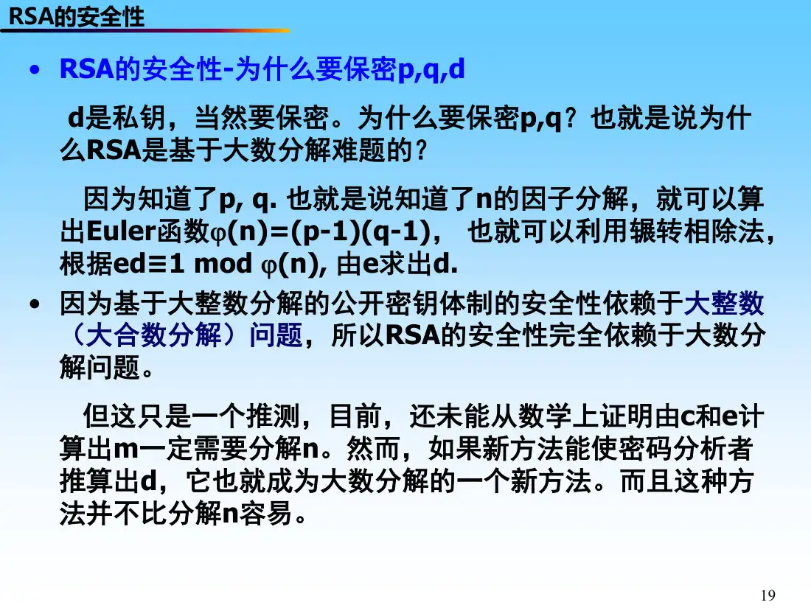

原文：

RSA的安全性

RSA的安全性-为什么要保密p,q,d

d是私钥，当然要保密。为什么要保密p,q？也就是说为什么RSA是基于大数分解难题的？

因为知道 ${ \overline { { \mathbf { J } } } } \mathbf { p } , \mathbf { q } .$ 也就是说知道了n的因子分解，就可以算出Euler函数 $\scriptstyle \varphi ( { \mathfrak { n } } ) = ( { \mathfrak { p } } - { \mathfrak { 1 } } ) ( { \mathfrak { q } } - { \mathfrak { 1 } } )$ 也就可以利用辗转相除法，根据 $\mathbf { e d } { \equiv } 1 \ m { \mathbf { o d } } \ \varphi ( { \mathsf { n } } )$ , 由e求出d.

• 因为基于大整数分解的公开密钥体制的安全性依赖于大整数（大合数分解）问题，所以RSA的安全性完全依赖于大数分解问题。

但这只是一个推测，目前，还未能从数学上证明由c和e计算出m一定需要分解n。然而，如果新方法能使密码分析者推算出d，它也就成为大数分解的一个新方法。而且这种方法并不比分解n容易。

19

### RSA的安全性

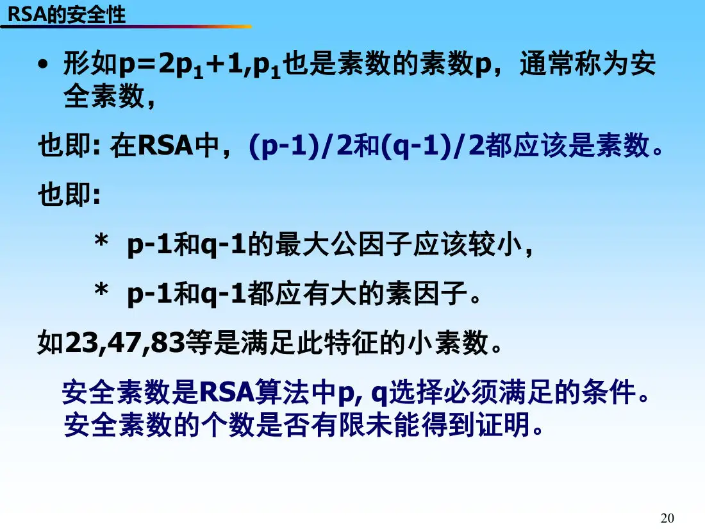

原文：

RSA的安全性

• 形如 $\mathsf { p } { = } 2 \mathsf { p } _ { 1 } { + } 1 , \mathsf { p } _ { 1 }$ 也是素数的素数p，通常称为安全素数，

也即: 在RSA中，(p-1)/2和(q-1)/2都应该是素数。

也即:

\* p-1和q-1的最大公因子应该较小，

\* p-1和q-1都应有大的素因子。

如23,47,83等是满足此特征的小素数。

安全素数是RSA算法中p, q选择必须满足的条件。

安全素数的个数是否有限未能得到证明。

20

### • |q – p|要大

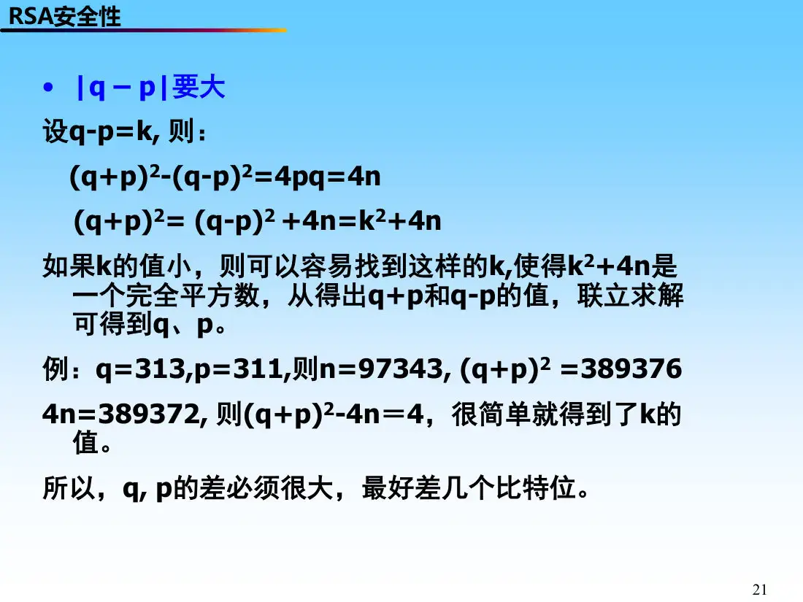

原文：

• |q – p|要大

设 $\mathbf { q } = \mathbf { p } = \mathbf { k } _ { I }$ 则：

$$
(q + p) ^ {2} - (q - p) ^ {2} = 4 p q = 4 n
$$

$$
(q + p) ^ {2} = (q - p) ^ {2} + 4 n = k ^ {2} + 4 n
$$

如果k的值小，则可以容易找到这样的 $\mathbf { k } _ { \pmb { \prime } }$ 使得 $\mathbf { k } ^ { 2 } + 4 \mathbf { n }$ 是一个完全平方数，从得出q+p和q-p的值，联立求解可得到q、p。

例： $\mathbf { q } = 3 1 3 , \mathbf { p } = 3 1 1$ ,则 $\scriptstyle \mathsf { n } = 9 7 3 4 3 , ( \mathsf { q } + \mathsf { p } ) ^ { 2 } = 3 8 9 3 7 6$ $\scriptstyle 4 \ n = 3 8 9 3 7 2 ,$ , 则 $( { \mathsf { q } } + { \mathsf { p } } ) ^ { 2 } - 4 { \mathsf { n } } = 4$ 很简单就得到了k的值。

所以， ${ \mathfrak { q } } , { \mathfrak { p } }$ 的差必须很大，最好差几个比特位。

RSA安全性

21

### RSA的安全性

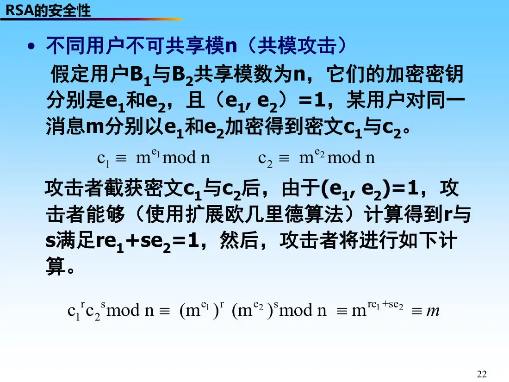

原文：

RSA的安全性

• 不同用户不可共享模n（共模攻击）

假定用户 $\mathbf { B _ { 1 } }$ 与 $\mathbf { B } _ { 2 }$ 共享模数为n，它们的加密密钥分别是 $\mathbf { e _ { 1 } }$ 和 $\mathbf { e } _ { 2 }$ ，且 $( \mathbf { e _ { 1 } } , \mathbf { e _ { 2 } } ) \ = \mathbf { 1 }$ 某用户对同一消息m分别以 $\mathbf { e _ { 1 } }$ 和 $\mathbf { e } _ { 2 }$ 加密得到密文 $\bf { c _ { 1 } }$ 与 $\mathbb { C } _ { 2 ^ { \circ } }$

$$
\mathbf {c} _ {1} \equiv \mathbf {m} ^ {\mathrm{e} _ {1}} \bmod \mathbf {n} \qquad \mathbf {c} _ {2} \equiv \mathbf {m} ^ {\mathrm{e} _ {2}} \bmod \mathbf {n}
$$

攻击者截获密文 $\bf { \delta c _ { 1 } }$ 与 $\mathbb { C } _ { 2 }$ 后，由于 $( \mathbf { e _ { 1 } } , \mathbf { e _ { 2 } } ) { = } 1$ 攻击者能够（使用扩展欧几里德算法）计算得到r与s满足 $\mathbf { r e } _ { 1 } + s \mathbf { e } _ { 2 } { = } 1$ ，然后，攻击者将进行如下计算。

$$
\mathbf {c} _ {1} ^ {\mathrm{r}} \mathbf {c} _ {2} ^ {\mathrm{s}} \bmod \mathbf {n} \equiv (\mathbf {m} ^ {\mathrm{e} _ {1}}) ^ {\mathrm{r}} (\mathbf {m} ^ {\mathrm{e} _ {2}}) ^ {\mathrm{s}} \bmod \mathbf {n} \equiv \mathbf {m} ^ {\mathrm{re} _ {1} + \mathrm{se} _ {2}} \equiv m
$$

22

### RSA的安全性

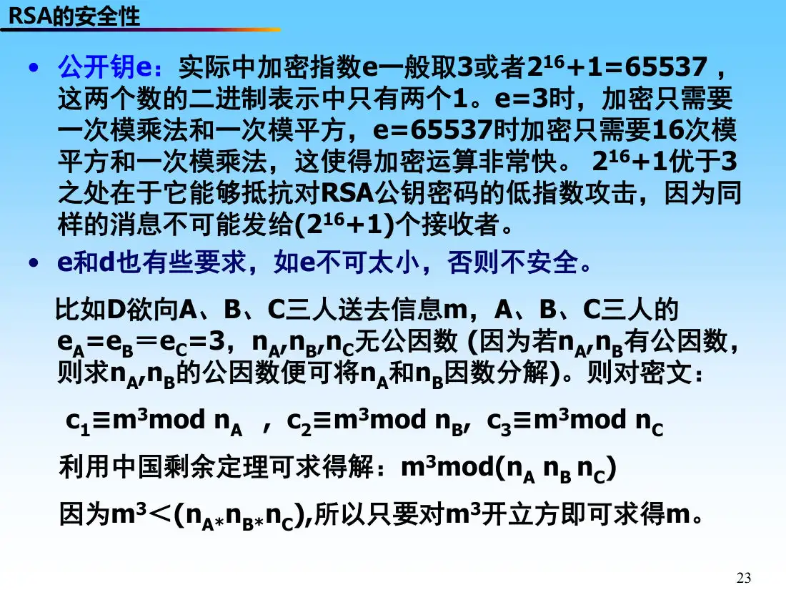

原文：

RSA的安全性

公开钥e：实际中加密指数e一般取3或者 $2 ^ { 1 6 } + 1 { = } 6 5 5 3 7$ 这两个数的二进制表示中只有两个1。e=3时，加密只需要一次模乘法和一次模平方，e=65537时加密只需要16次模平方和一次模乘法，这使得加密运算非常快。 ${ \bf 2 ^ { 1 6 } + 1 }$ 优于3之处在于它能够抵抗对RSA公钥密码的低指数攻击，因为同样的消息不可能发给 $( 2 ^ { 1 6 } + 1 )$ 个接收者。

• e和d也有些要求，如e不可太小，否则不安全。

比如D欲向A、B、C三人送去信息m，A、B、C三人的$\mathbf { e _ { A } } { = } \mathbf { e _ { B } } { = } \mathbf { e _ { C } } { = } 3 , ~ \mathsf { n _ { A ^ { \prime } } n _ { B ^ { \prime } } n _ { C } }$ 无公因数 (因为若 $\mathbf { n _ { A } n _ { B } }$ 有公因数，则求 $\mathbf { n _ { A } n _ { B } }$ 的公因数便可将 ${ \pmb n } _ { \pmb A }$ 和 $\boldsymbol { \mathsf { n } } _ { \boldsymbol { \mathsf { B } } }$ 因数分解)。则对密文：

$$
\mathbf {c} _ {1} \equiv \mathsf {m} ^ {3} \bmod \mathsf {n} _ {\mathsf {A}}, \mathbf {c} _ {2} \equiv \mathsf {m} ^ {3} \bmod \mathsf {n} _ {\mathsf {B}}, \mathbf {c} _ {3} \equiv \mathsf {m} ^ {3} \bmod \mathsf {n} _ {\mathsf {C}}
$$

利用中国剩余定理可求得解： $\mathbf { m ^ { 3 } m o d ( n _ { A } \ n _ { B } \ n _ { C } ) }$

因为 $\mathfrak { m } ^ { 3 } < ( \mathfrak { n } _ { \mathtt { A } ^ { * } } \mathfrak { n } _ { \mathtt { B } ^ { * } } \mathfrak { n } _ { \mathtt { C } } )$ ,所以只要对 $\ m ^ { 3 }$ 开立方即可求得m。

23

### RSA的安全性

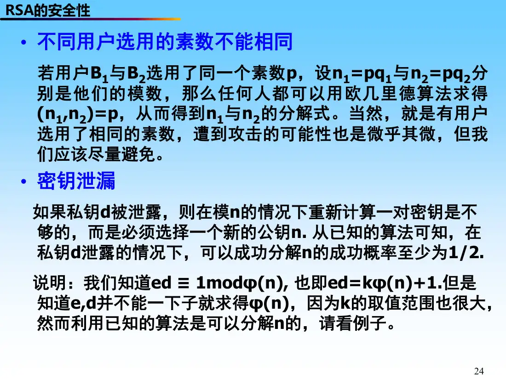

原文：

RSA的安全性

• 不同用户选用的素数不能相同

若用户 $\mathbf { B _ { 1 } }$ 与 $\mathbf { B } _ { 2 }$ 选用了同一个素数p，设 ${ \bf n _ { 1 } } \bf \equiv p q _ { 1 }$ 与 ${ \boldsymbol { \mathsf { n } } } _ { 2 } { \boldsymbol { \mathsf { = p } } } { \boldsymbol { \mathsf { q } } } _ { 2 }$ 分别是他们的模数，那么任何人都可以用欧几里德算法求得$( \boldsymbol { \mathsf { n } } _ { 1 } , \boldsymbol { \mathsf { n } } _ { 2 } ) { = } \boldsymbol { \mathsf { p } }$ 从而得到 ${ \bf n _ { 1 } }$ 与 ${ \mathfrak { n } } _ { 2 }$ 的分解式。当然，就是有用户选用了相同的素数，遭到攻击的可能性也是微乎其微，但我们应该尽量避免。

密钥泄漏

如果私钥d被泄露，则在模n的情况下重新计算一对密钥是不够的，而是必须选择一个新的公钥n. 从已知的算法可知，在私钥d泄露的情况下，可以成功分解n的成功概率至少为1/2.

说明：我们知道 $\mathbf { e d } \equiv \mathbf { 1 } \mathbf { m o d } \Phi ( \mathsf { n } )$ 也即 $\scriptstyle \mathbf { e d } = \mathbf { k } \Phi ( \mathbf { n } ) + \mathbf { 1 }$ .但是知道 $\mathbf { e , d }$ 并不能一下子就求得φ(n)，因为k的取值范围也很大，然而利用已知的算法是可以分解n的，请看例子。

24

### 密钥泄露

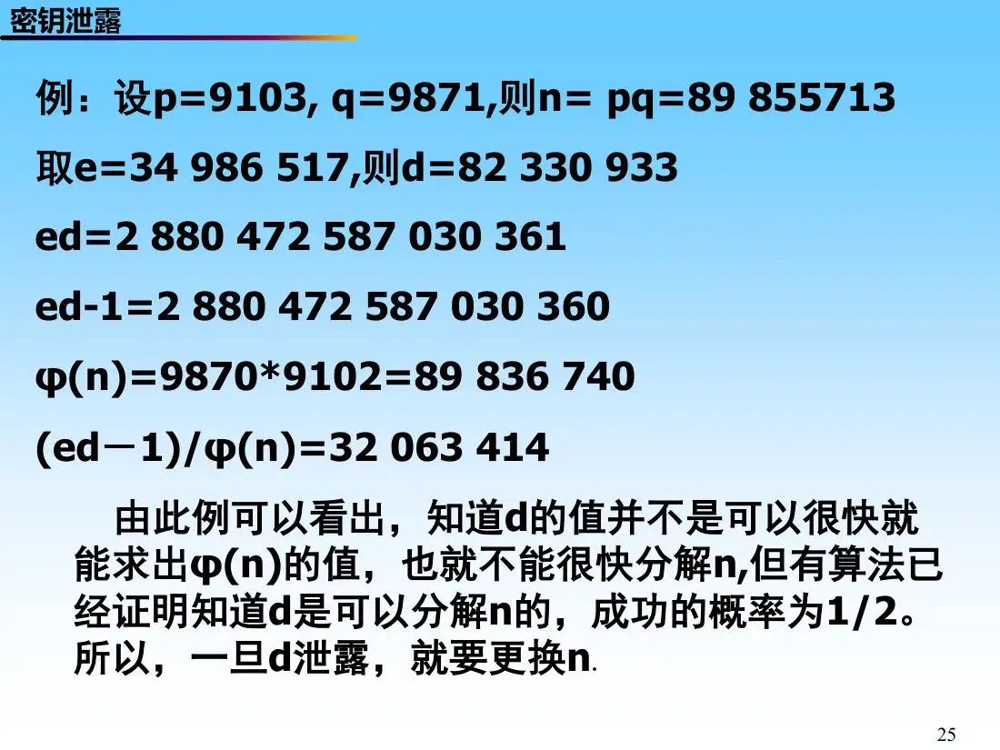

原文：

密钥泄露

例：设 $\mathbf { p } { = } 9 1 0 3 , \ \mathbf { q } { = } 9 8 7 1 .$ ,则 $\mathsf { n } = \mathsf { p q } = \mathsf { 8 9 } \ 8 5 5 7 1 3$

$$
\mathbf {e d} = 2 8 8 0 4 7 2 5 8 7 0 3 0 3 6 1
$$

$$
\text {ed - 1 = 2 880 472 587 030 360}
$$

$$
\varphi (n) = 9 8 7 0 * 9 1 0 2 = 8 9 8 3 6 7 4 0
$$

(ed－1)/φ(n)=32 063 414

由此例可以看出，知道d的值并不是可以很快就能求出φ(n)的值，也就不能很快分解n,但有算法已经证明知道d是可以分解n的，成功的概率为1/2。所以，一旦d泄露，就要更换n.

25

### RSA的安全性问题

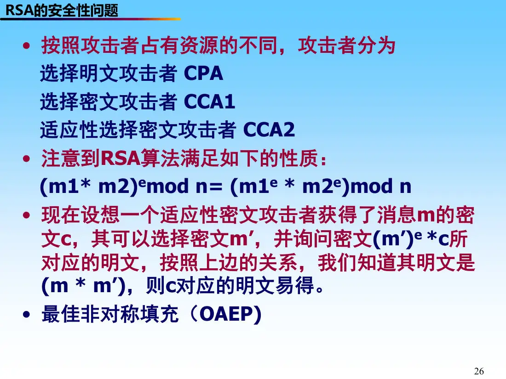

原文：

RSA的安全性问题

• 按照攻击者占有资源的不同，攻击者分为选择明文攻击者 CPA选择密文攻击者 CCA1适应性选择密文攻击者 CCA2

注意到RSA算法满足如下的性质：$( \mathfrak { m } 1 ^ { * } \ \mathfrak { m } 2 ) ^ { \mathrm { e } } \mathfrak { m } \circ \mathrm { d } \ \mathfrak { n } { = } ( \mathfrak { m } 1 ^ { \mathrm { e } } \ ^ { * } \mathfrak { m } 2 ^ { \mathrm { e } } ) \mathfrak { m } \circ \mathrm { d } \ \mathfrak { n }$

现在设想一个适应性密文攻击者获得了消息m的密文c，其可以选择密文m’，并询问密文 $( \mathsf { m } ^ { \prime } ) ^ { \mathsf { e } ^ { \ast } \mathsf { c } }$ 所对应的明文，按照上边的关系，我们知道其明文是$( \mathsf { m } ^ { \star } \mathsf { m } ^ { \prime } )$ 则c对应的明文易得。

• 最佳非对称填充（OAEP)

26

### 本原根

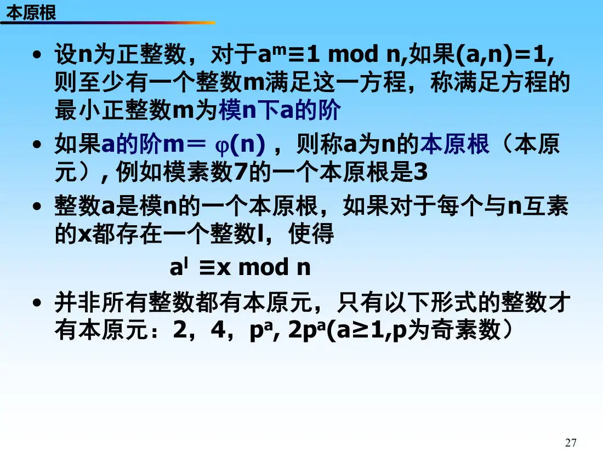

原文：

本原根

设n为正整数，对于 $\mathbf { a } ^ { \mathbf { m } } { \equiv } \mathbf { 1 } ~ \mathbf { m o d } ~ \mathbf { n } ,$ 如果 $( \mathbf { a } , \mathbf { n } ) { = } 1$ 则至少有一个整数m满足这一方程，称满足方程的 最小正整数m为模n下a的阶

• 如果a的阶 ${ \bf m } = \boldsymbol { \rho } ( { \bf n } )$ 则称a为n的本原根（本原元）, 例如模素数7的一个本原根是3

• 整数a是模n的一个本原根，如果对于每个与n互素的x都存在一个整数l，使得

$$
a ^ {l} \equiv x \bmod n
$$

• 并非所有整数都有本原元，只有以下形式的整数才有本原元： $2 , \ 4 , \ \mathsf { p } ^ { \mathsf { a } } , \ 2 \mathsf { p } ^ { \mathsf { a } } ( \mathsf { a } \geq 1 , \mathsf { p }$ 为奇素数）

27

### Elgamal公钥密码体制

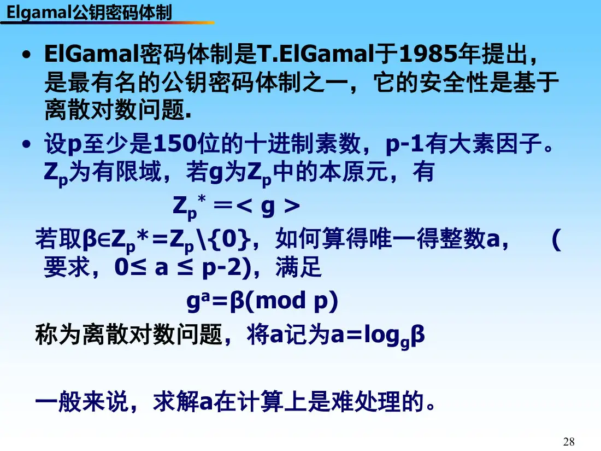

原文：

Elgamal公钥密码体制

ElGamal密码体制是T.ElGamal于1985年提出，是最有名的公钥密码体制之一，它的安全性是基于离散对数问题.

• 设p至少是150位的十进制素数， $\mathsf { p } { = } 1$ 有大素因子。$z _ { p }$ 为有限域，若g为 $z _ { p }$ 中的本原元，有

$$
Z _ {p} ^ {*} = <   g >
$$

若取 $\beta { \in } Z _ { \mathrm { p } } { } ^ { * } { = } Z _ { \mathrm { p } } \backslash \{ 0 \}$ ，如何算得唯一得整数 $\mathbf { a }$ ， (要求， $0 \leq a \leq p - 2 )$ ，满足

$$
\mathbf {g} ^ {\mathrm{a}} = \beta (\mathrm{mod} p)
$$

称为离散对数问题，将a记为 $\mathbf { a } = \mathbf { \mathrm { i } } \mathbf { o } \mathbf { g } _ { \mathbf { g } } \mathbf { \| } _ { \mathbf { g } }$

一般来说，求解a在计算上是难处理的。

28

### 算法描述

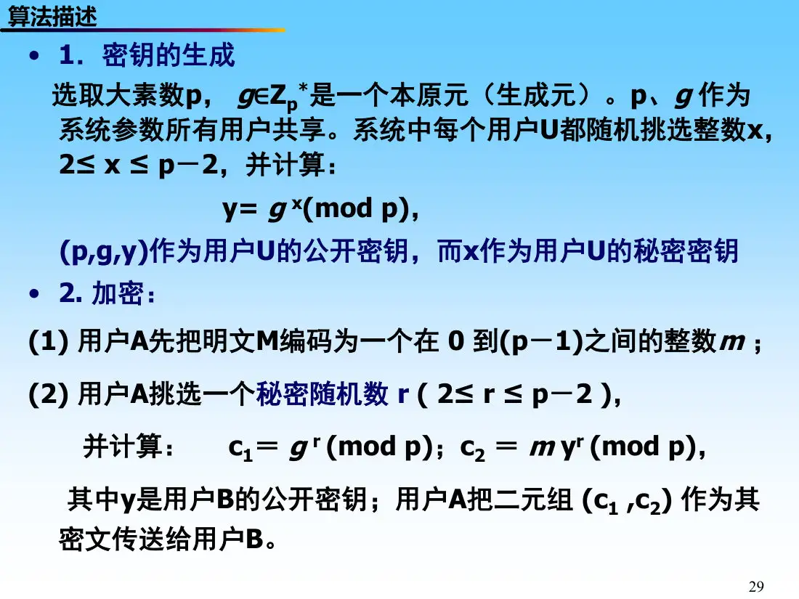

原文：

算法描述

• 1．密钥的生成

选取大素数p， $g { \in } { \mathbb { Z } } _ { \mathfrak { p } } ^ { * }$ 是一个本原元（生成元）。p、g作为系统参数所有用户共享。系统中每个用户U都随机挑选整数x，$2 \leq x \leq { \mathsf { p } } - 2$ ，并计算：

$$
\mathbf {y} = g ^ {\times} (\mathrm{mod} p),
$$

$( \mathsf { p } , \mathsf { g } , \mathsf { v } )$ 作为用户U的公开密钥，而x作为用户U的秘密密钥

• 2. 加密：

(1) 用户A先把明文M编码为一个在 0 到(p－1)之间的整数m ；

(2) 用户A挑选一个秘密随机数 $\displaystyle \textsf { r } ( \textsf { 2 } \leq \textsf { r } \leq \textsf { p } - 2 \textsf { 2 } )$ ，

并计算： $\mathbf { c _ { 1 } } { = } \ g ^ { \textsf { r } } ( \mathbf { m o d } \ \mathbf { p } )$ ； $\mathbf { c } _ { 2 } = m \mathbf { y } ^ { \mathrm { r } } \left( { \mathrm { m o d } } \mathbf { p } \right)$ ，

其中y是用户B的公开密钥；用户A把二元组 $( \pm _ { 1 } , \pm _ { 2 } )$ 作为其密文传送给用户B。

29

### 算法描述

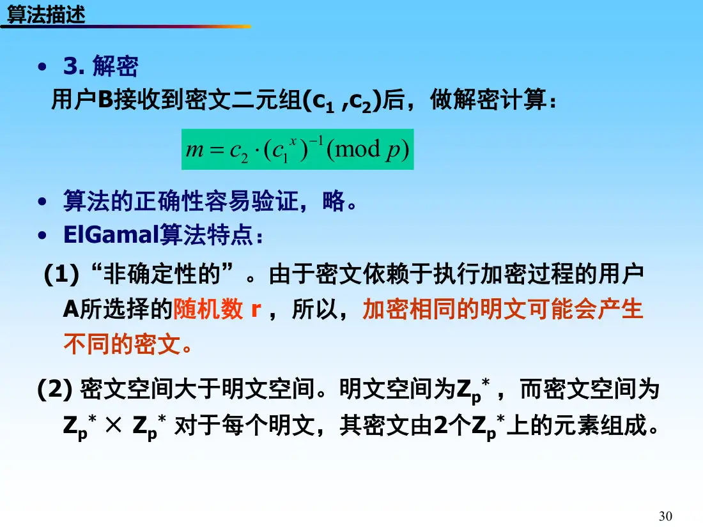

原文：

算法描述

• 3. 解密

用户B接收到密文二元组 $( \mathbf { c _ { 1 } } , \mathbf { c _ { 2 } } )$ 后，做解密计算：

$$
m = c _ {2} \cdot (c _ {1} ^ {x}) ^ {- 1} (\mathrm{mod} p)
$$

• 算法的正确性容易验证，略。

• ElGamal算法特点：

(1)“非确定性的”。由于密文依赖于执行加密过程的用户A所选择的随机数 r ，所以，加密相同的明文可能会产生不同的密文。

(2) 密文空间大于明文空间。明文空间为 $z _ { p } ^ { * }$ ，而密文空间为$\mathbf { Z _ { p } } ^ { \mathrm { ~ * ~ } } \times \mathbf { Z _ { p } } ^ { \mathrm { ~ * ~ } }$ 对于每个明文，其密文由2个 $z _ { p } ^ { * }$ 上的元素组成。

30

### Elgamal算法的安全性

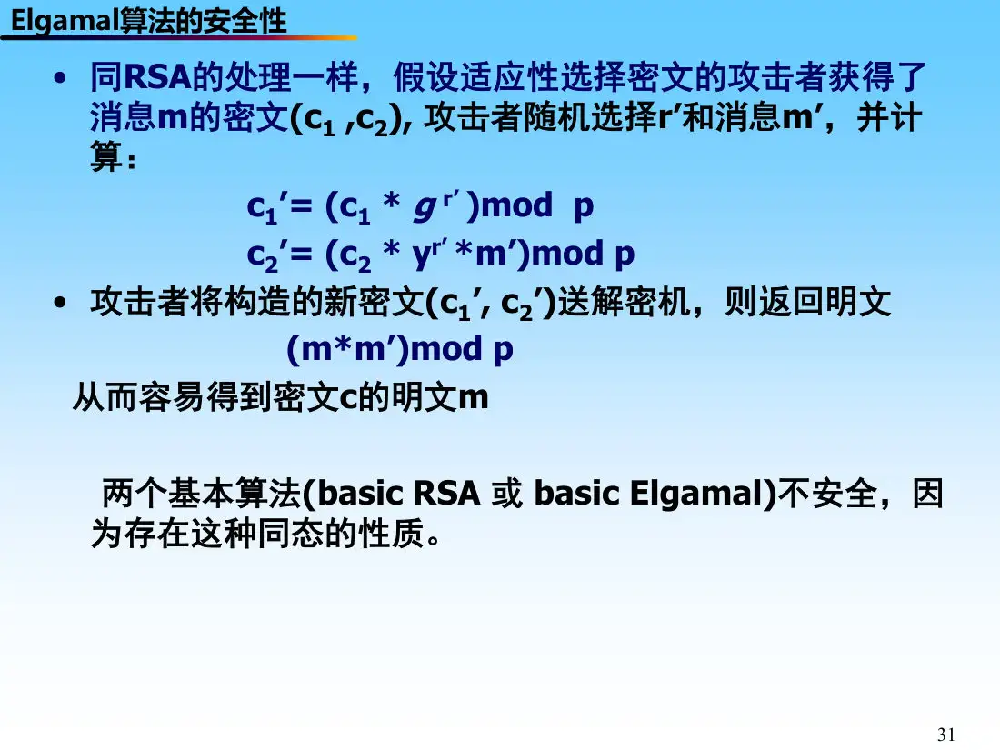

原文：

Elgamal算法的安全性

同RSA的处理一样，假设适应性选择密文的攻击者获得了消息m的密文 $( \mathbf { c _ { 1 } } , \mathbf { c _ { 2 } } )$ 攻击者随机选择r’和消息 $. \mathbf { m ^ { \prime } }$ 并计算：

$$
\begin{array}{l} \mathbf {c _ {1}} ^ {\prime} = (\mathbf {c _ {1}} * \mathbf {g} ^ {\mathbf {r} ^ {\prime}}) \bmod \mathsf {p} \\ \mathbf {c _ {2}} ^ {\prime} = (\mathbf {c _ {2}} * \mathbf {y} ^ {\mathbf {r} ^ {\prime}} * \mathbf {m} ^ {\prime}) \bmod \mathsf {p} \end{array}
$$

• 攻击者将构造的新密文 $( \mathsf { c } _ { 1 } ^ { \prime } , \mathsf { c } _ { 2 } ^ { \prime } )$ 送解密机，则返回明文$( \mathbf { m } ^ { * } \mathbf { m } ^ { \prime } ) \mathbf { m o d } \ \mathbf { p }$ 从而容易得到密文c的明文m

两个基本算法(basic RSA 或 basic Elgamal)不安全，因为存在这种同态的性质。

31

### Elliptic Curve Cryptography

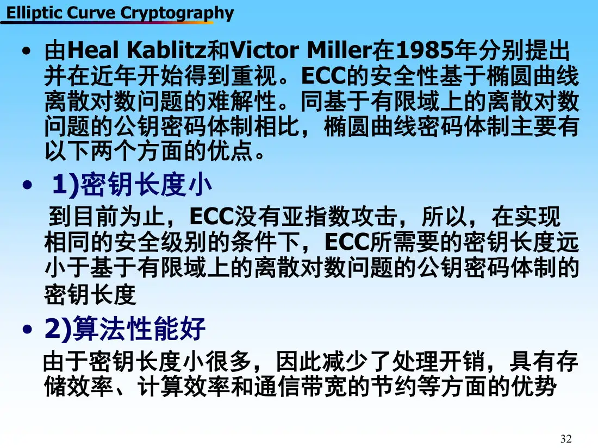

原文：

Elliptic Curve Cryptography

由Heal Kablitz和Victor Miller在1985年分别提出并在近年开始得到重视。ECC的安全性基于椭圆曲线离散对数问题的难解性。同基于有限域上的离散对数问题的公钥密码体制相比，椭圆曲线密码体制主要有以下两个方面的优点。

• 1)密钥长度小

到目前为止，ECC没有亚指数攻击，所以，在实现相同的安全级别的条件下，ECC所需要的密钥长度远小于基于有限域上的离散对数问题的公钥密码体制的密钥长度

• 2)算法性能好

由于密钥长度小很多，因此减少了处理开销，具有存储效率、计算效率和通信带宽的节约等方面的优势

32
