# 《密码学》第7章 公钥密码：背包体制与Rabin算法（课件）

原件的每一页，下面附识别出的文字。

### 背包体制和Rabin

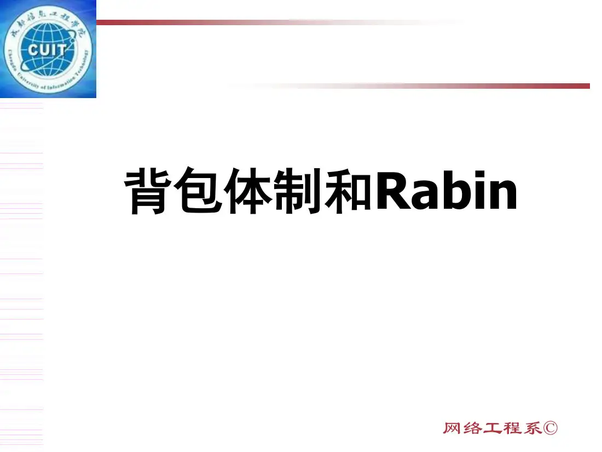

原文：

背包体制和Rabin

网络工程系©

### $$

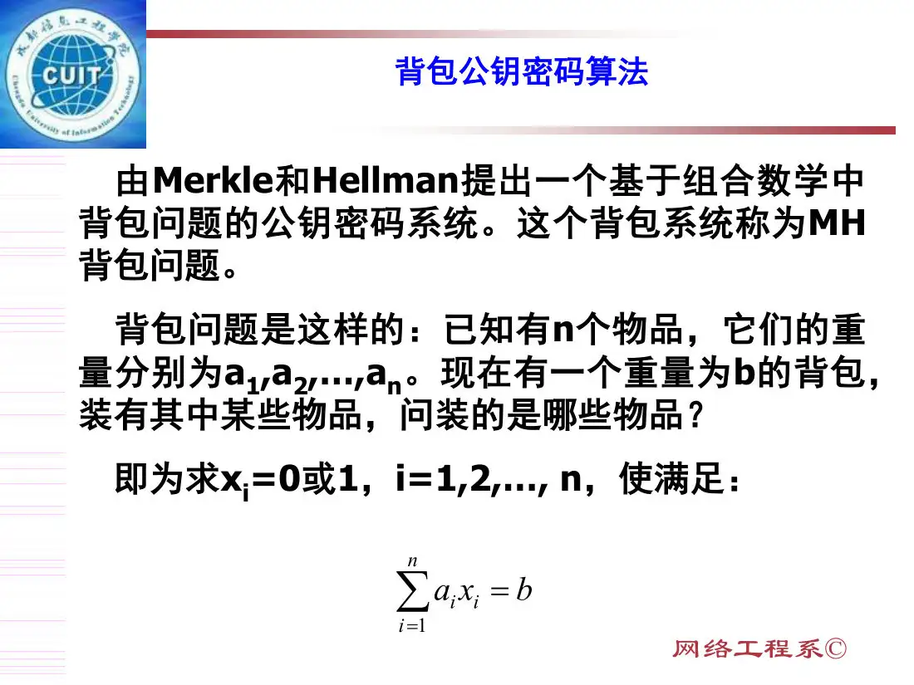

原文：

由Merkle和Hellman提出一个基于组合数学中背包问题的公钥密码系统。这个背包系统称为MH背包问题。

背包问题是这样的：已知有n个物品，它们的重量分别为 $\mathbf { a _ { 1 } } , \mathbf { a _ { 2 } } , \ldots , \mathbf { a _ { n } }$ 。现在有一个重量为b的背包，装有其中某些物品，问装的是哪些物品？

即为求 $x _ { i } = 0$ 或1， $\mathsf { i } { = } 1 , 2 , \ldots , \mathsf { n }$ ，使满足：

$$
\sum_ {i = 1} ^ {n} a _ {i} x _ {i} = b
$$

网络工程系©

背包公钥密码算法

### 由于

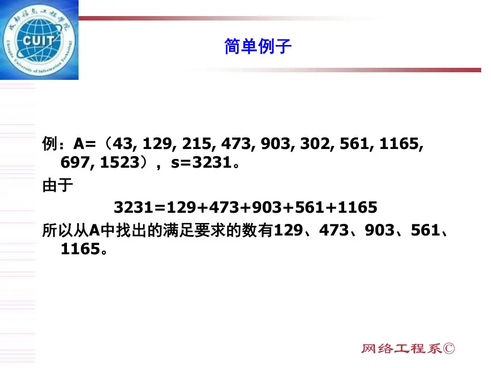

原文：

例：A=（43, 129, 215, 473, 903, 302, 561, 1165,697, 1523），s=3231。

由于

3231=129+473+903+561+1165所以从A中找出的满足要求的数有129、473、903、561、1165。

网络工程系©

简单例子

### f(1)=f(0…001)=an

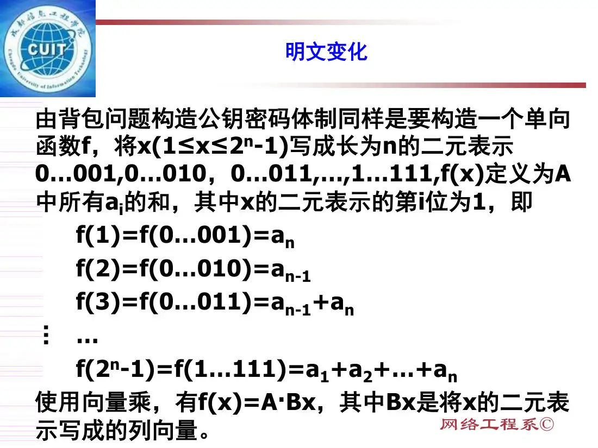

原文：

由背包问题构造公钥密码体制同样是要构造一个单向函数f，将 $\mathbf { x } ( \mathbf { 1 } { \leq } \mathbf { x } { \leq } 2 ^ { { \mathsf { n } } - \mathbf { 1 } } )$ 写成长为n的二元表示$\mathbf { 0 } \ldots \mathbf { 0 0 1 } _ { r } \mathbf { 0 } \ldots \mathbf { 0 1 0 } , \ \mathbf { 0 } \ldots \mathbf { 0 1 1 } _ { r } \ldots \mathbf { 1 } \ldots \mathbf { 1 1 1 } _ { r } \mathbf { f ( x ) }$ 定义为A中所有 $a _ { i }$ 的和，其中x的二元表示的第i位为1，即

f(1)=f(0…001)=an

$$
f (2) = f (0 \dots 0 1 0) = a _ {n - 1}
$$

$$
f (3) = f (0 \dots 0 1 1) = a _ {n - 1} + a _ {n}
$$

$$
f (2 ^ {n} - 1) = f (1 \dots 1 1 1) = a _ {1} + a _ {2} + \dots + a _ {n}
$$

使用向量乘，有 $f ( x ) = A ^ { \prime } B x$ ，其中Bx是将x的二元表示写成的列向量。 网络工程系©

明文变化

### 类似地可求出:

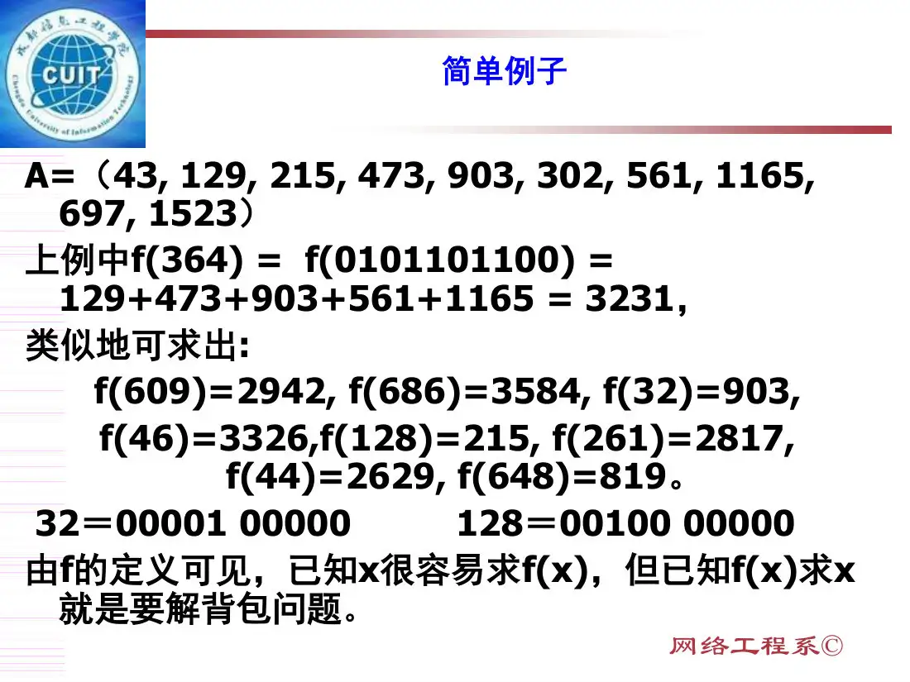

原文：

类似地可求出:

由f的定义可见，已知x很容易求f(x)，但已知f(x)求x就是要解背包问题。

简单例子

网络工程系©

### 背包公钥密码算法

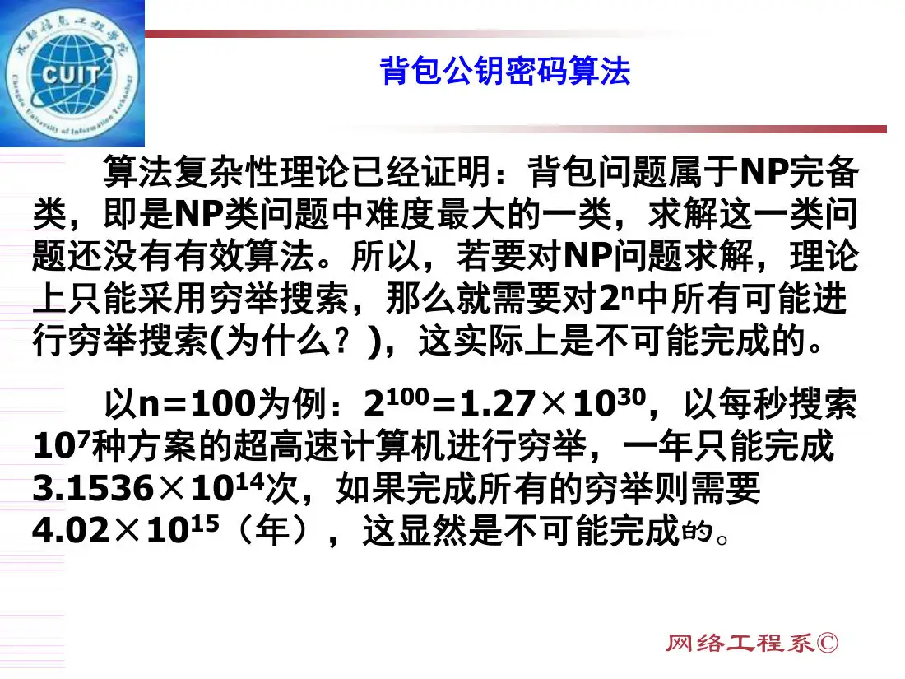

原文：

算法复杂性理论已经证明：背包问题属于NP完备类，即是NP类问题中难度最大的一类，求解这一类问题还没有有效算法。所以，若要对NP问题求解，理论上只能采用穷举搜索，那么就需要对2n中所有可能进行穷举搜索(为什么？)，这实际上是不可能完成的。

$V \angle n = \pm 0 0$ 为例： $2 ^ { 1 0 0 } { = } 1 . 2 7 \times 1 0 ^ { 3 0 }$ ，以每秒搜索$\pm 0 ^ { 7 }$ 种方案的超高速计算机进行穷举，一年只能完成$3 . 1 5 3 6 \times 1 0 ^ { 1 4 } .$ 次，如果完成所有的穷举则需要$4 . 0 2 \times 1 0 ^ { 1 5 }$ （年），这显然是不可能完成的。

背包公钥密码算法

网络工程系©

### $$

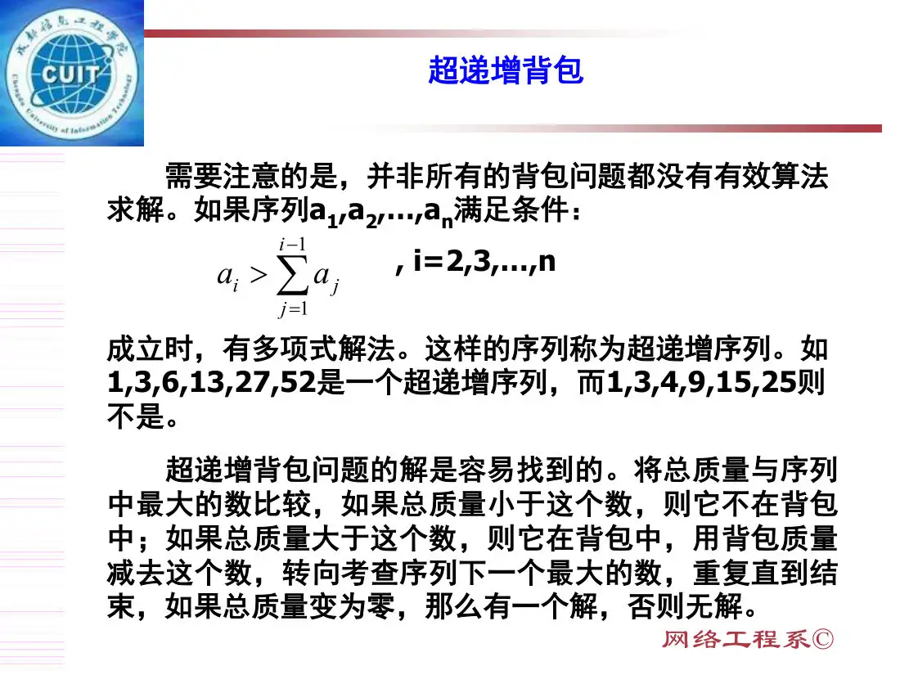

原文：

需要注意的是，并非所有的背包问题都没有有效算法求解。如果序列 $\mathbf { \lambda } _ { \mathbf { a _ { 1 } } } , \mathbf { a _ { 2 } } , \ldots , \mathbf { a _ { n } }$ 满足条件：

$$
a _ {i} > \sum_ {j = 1} ^ {i - 1} a _ {j}, \mathbf {i} = 2, 3, \dots , n
$$

成立时，有多项式解法。这样的序列称为超递增序列。如1,3,6,13,27,52是一个超递增序列，而1,3,4,9,15,25则不是。

超递增背包问题的解是容易找到的。将总质量与序列中最大的数比较，如果总质量小于这个数，则它不在背包中；如果总质量大于这个数，则它在背包中，用背包质量减去这个数，转向考查序列下一个最大的数，重复直到结束，如果总质量变为零，那么有一个解，否则无解。

超递增背包

网络工程系©

### 例：考查总质量为70kg的一个背包，质量序列为：

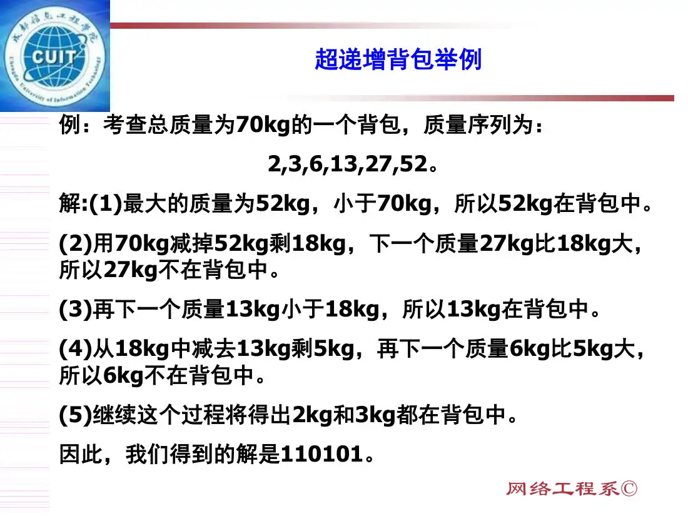

原文：

例：考查总质量为70kg的一个背包，质量序列为：

2,3,6,13,27,52。

解:(1)最大的质量为52kg，小于70kg，所以52kg在背包中。

(2)用70kg减掉52kg剩18kg，下一个质量27kg比18kg大，所以27kg不在背包中。

(3)再下一个质量13kg小于18kg，所以13kg在背包中。

(4)从18kg中减去13kg剩5kg，再下一个质量6kg比5kg大，所以6kg不在背包中。

(5)继续这个过程将得出2kg和3kg都在背包中。

因此，我们得到的解是110101。

O

超递增背包举例

网络工程系©

### MH背包公钥系统选的背包序列是由超递增序列进行以下变换得到的。

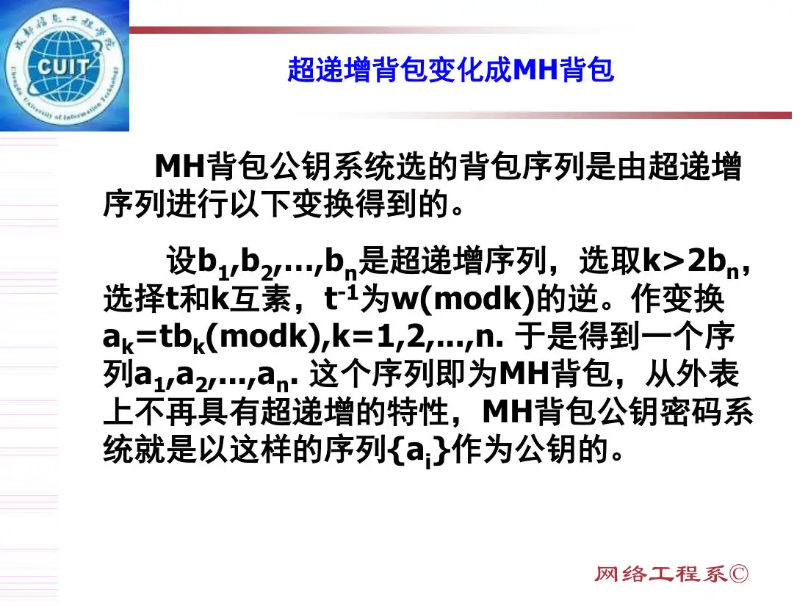

原文：

MH背包公钥系统选的背包序列是由超递增序列进行以下变换得到的。

设 $\mathbf { b _ { 1 } } , \mathbf { b _ { 2 } } , \mathbf { \ldots } , \mathbf { b _ { n } }$ 是超递增序列，选取 $k > 2 b _ { n }$ 选择t和k互素， $\mathbf { t } ^ { - 1 }$ 为w(modk)的逆。作变换$\scriptstyle \mathbf { a } _ { \mathbf { k } } = \mathbf { t } \mathbf { b } _ { \mathbf { k } } ( \mathbf { m o d k } ) , \mathbf { k } = \mathbf { 1 } , 2 _ { r } \cdots , \boldsymbol { \Pi }$ . 于是得到一个序列 $\mathbf { a _ { 1 } } , \mathbf { a _ { 2 } } , \mathbf { \ldots } , \mathbf { a _ { n } }$ . 这个序列即为MH背包，从外表上不再具有超递增的特性，MH背包公钥密码系统就是以这样的序列 $\{ \exists . \}$ 作为公钥的。

超递增背包变化成MH背包

网络工程系©

### 网络工程系©

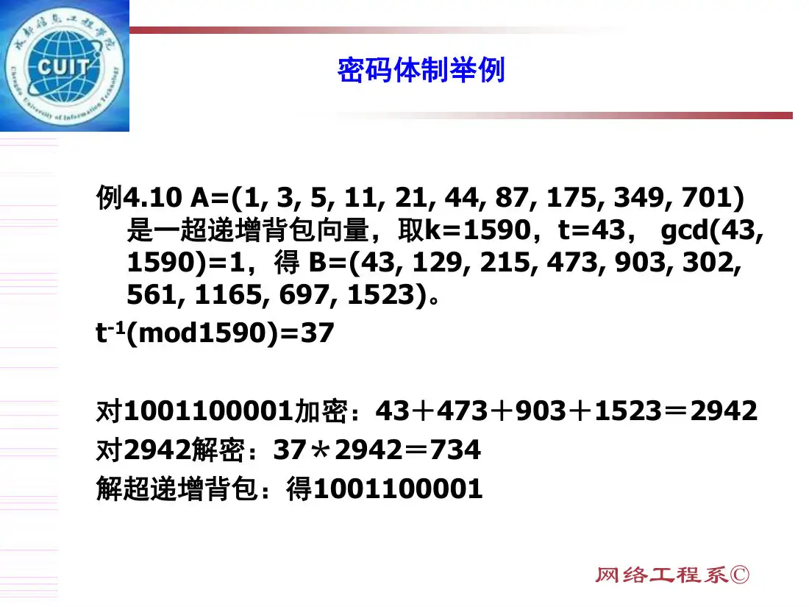

原文：

例4.10 A=(1, 3, 5, 11, 21, 44, 87, 175, 349, 701)是一超递增背包向量，取k=1590，t=43， gcd(43,1590)=1，得 B=(43, 129, 215, 473, 903, 302,561, 1165, 697, 1523)。

对1001100001加密：43＋473＋903＋1523＝2942对2942解密：37＊2942＝734解超递增背包：得1001100001

网络工程系©

密码体制举例

### 已知1,3,5,13,26,65,120,250是超递增序列。

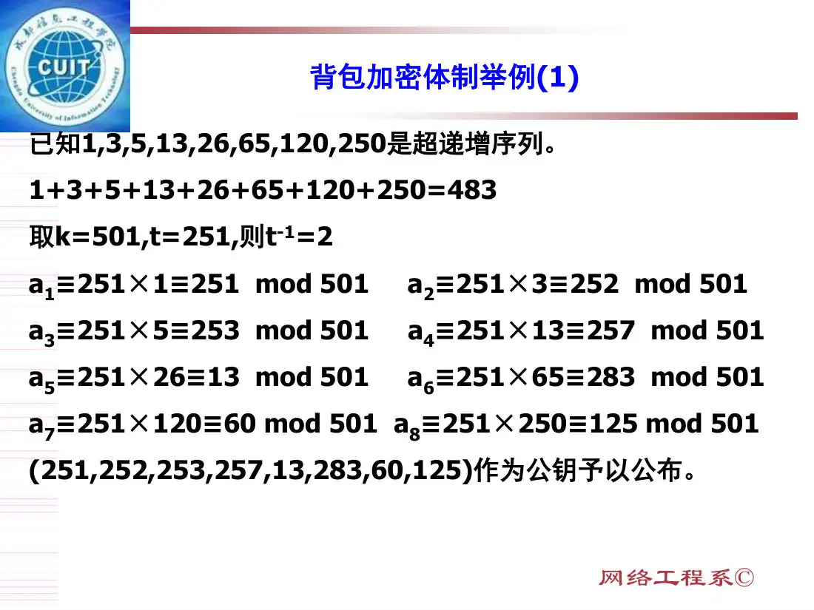

原文：

已知1,3,5,13,26,65,120,250是超递增序列。

$$
1 + 3 + 5 + 1 3 + 2 6 + 6 5 + 1 2 0 + 2 5 0 = 4 8 3
$$

取 $\mathbf { k } { = } 5 0 1 , \mathbf { t } { = } 2 5 1 ,$ ,则 $\pmb { \mathrm { t } } ^ { - 1 } \equiv 2$

$$
\mathbf {a} _ {1} \equiv 2 5 1 \times \mathbf {1} \equiv 2 5 1 \mod 5 0 1
$$

$$
a _ {3} \equiv 2 5 1 \times 5 \equiv 2 5 3 \mod 5 0 1
$$

$$
\mathsf {a} _ {2} \equiv 2 5 1 \times 3 \equiv 2 5 2
$$

$\mathbf { a } _ { 4 } \equiv 2 5 1 \times 1 3 \equiv 2 5 7$ mod 501

$$
\mathsf {a} _ {5} \equiv 2 5 1 \times 2 6 \equiv 1 3
$$

$$
\mathbf {a} _ {6} \equiv 2 5 1 \times 6 5 \equiv 2 8 3
$$

$$
a _ {7} \equiv 2 5 1 \times 1 2 0 \equiv 6 0
$$

$$
a _ {8} \equiv 2 5 1 \times 2 5 0 \equiv 1 2 5
$$

CUIT

背包加密体制举例(1)

网络工程系©

### $$

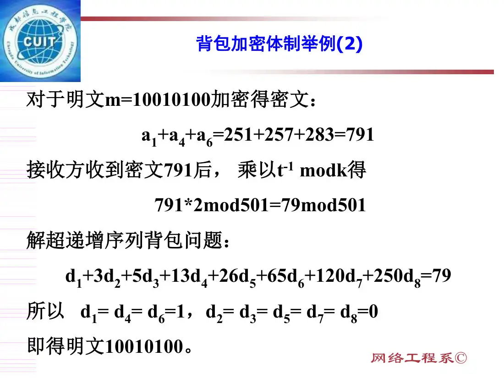

原文：

对于明文 $\scriptstyle \mathbf { m } = 1 0 0 1 0 1 0 0$ 加密得密文：

$$
\mathbf {a} _ {1} + \mathbf {a} _ {4} + \mathbf {a} _ {6} = 2 5 1 + 2 5 7 + 2 8 3 = 7 9 1
$$

接收方收到密文791后， 乘以 $\mathbf { t } ^ { \mathbf { - 1 } } \mathbf { m o d } \mathbf { k }$ 得

$$
7 9 1 * 2 \bmod {5 0 1} = 7 9 \bmod {5 0 1}
$$

解超递增序列背包问题：

d +3d +5d +13d +26d +65d +120d +250d =79所以 $\mathbf { d } _ { 1 } ^ { } = \mathbf { d } _ { 4 } ^ { } = \mathbf { d } _ { 6 } ^ { } = 1 { \bf , d } _ { 2 } ^ { } = \mathbf { d } _ { 3 } ^ { } = \mathbf { d } _ { 5 } ^ { } = \mathbf { d } _ { 7 } ^ { } = \mathbf { d } _ { 8 } ^ { } = \mathbf { 0 }$ 即得明文10010100。 网经工程系假定已知： $\mathbf { d } { = } \mathbf { d } _ { 1 } \mathbf { d } _ { 2 } { \ldots } \mathbf { d } _ { \mathfrak { n } }$ ，其中 $\mathbf { d _ { 1 } } , \mathbf { d _ { 2 } } , \ldots , \mathbf { d _ { n } }$ 是n位的$\mathbf { 0 , 1 }$ 符号串，令 $\mathbf { \hat { c } } = \mathbf { a _ { 1 } d _ { 1 } } + \mathbf { a _ { 2 } d _ { 2 } } + \dots + \mathbf { a _ { n } d _ { n } }$

背包加密体制举例(2)

网络工程系©

### $$

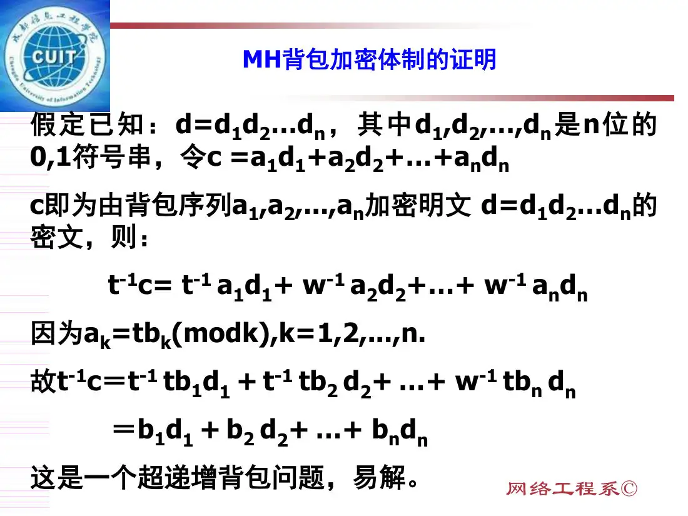

原文：

c即为由背包序列 $\mathbf { a _ { 1 } } , \mathbf { a _ { 2 } } , \ldots , \mathbf { a _ { n } }$ 加密明文 ${ \bf d } = { \bf d } _ { 1 } { \bf d } _ { 2 } \ldots { \bf d } _ { n }$ 的密文，则：

$$
\mathbf {t} ^ {- 1} \mathbf {c} = \mathbf {t} ^ {- 1} \mathbf {a} _ {1} \mathbf {d} _ {1} + \mathbf {w} ^ {- 1} \mathbf {a} _ {2} \mathbf {d} _ {2} + \dots + \mathbf {w} ^ {- 1} \mathbf {a} _ {n} \mathbf {d} _ {n}
$$

因为 $\scriptstyle \mathbf { a } _ { \mathbf { k } } = \mathbf { t } \mathbf { b } _ { \mathbf { k } } ( \mathbf { m o d k } ) , \mathbf { k } = \mathbf { 1 } , 2 , \dotsc , \boldsymbol \Pi$

$$
\begin{array}{r l} \text {故} & t ^ {- 1} c = t ^ {- 1} t b _ {1} d _ {1} + t ^ {- 1} t b _ {2} d _ {2} + \dots + w ^ {- 1} t b _ {n} d _ {n} \\ & = b _ {1} d _ {1} + b _ {2} d _ {2} + \dots + b _ {n} d _ {n} \end{array}
$$

这是一个超递增背包问题，易解。

网络工程系©

MH背包加密体制的证明

### Rabin密码体制已被证明对该体制的破译与分解大整数是等价的，它有两个特点：

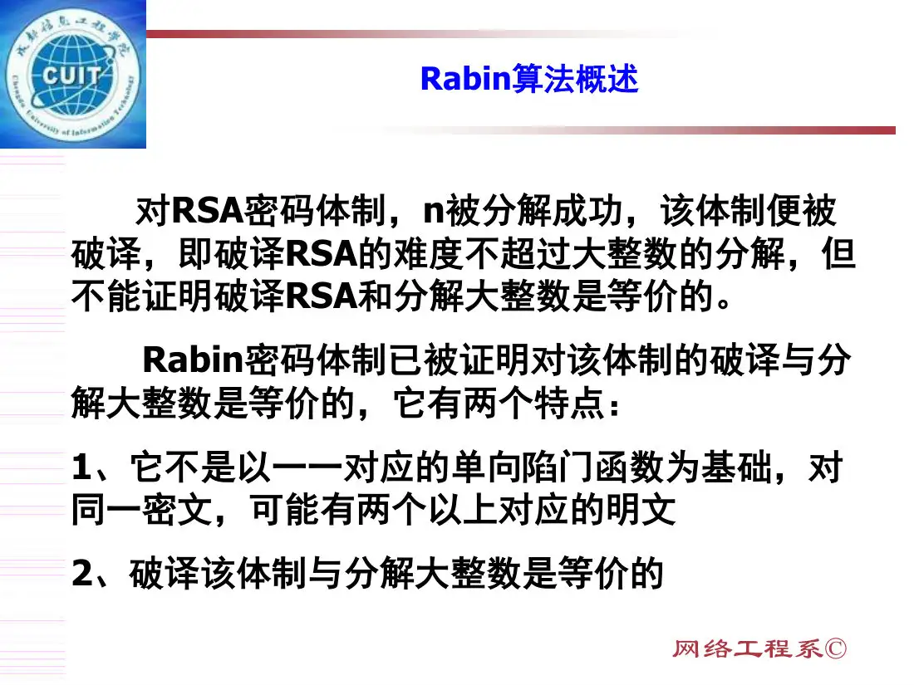

原文：

对RSA密码体制，n被分解成功，该体制便被破译，即破译RSA的难度不超过大整数的分解，但不能证明破译RSA和分解大整数是等价的。

Rabin密码体制已被证明对该体制的破译与分解大整数是等价的，它有两个特点：

1、它不是以一一对应的单向陷门函数为基础，对同一密文，可能有两个以上对应的明文

2、破译该体制与分解大整数是等价的

Rabin算法概述

网络工程系©

### 1、密钥产生

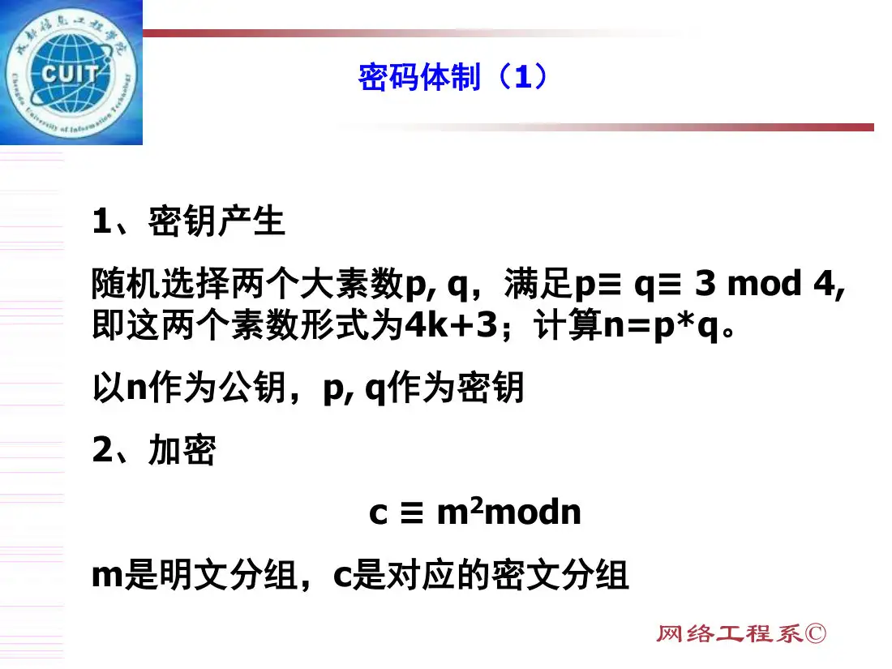

原文：

1、密钥产生

随机选择两个大素数p, q，满足 $\mathbf { p \equiv q \equiv 3 ~ m o d } ~ 4 ,$ 即这两个素数形式为 $4 \times 4 3$ ；计算 $\scriptstyle \mathbf { n } = \mathbf { p } ^ { * } \mathbf { q }$ o

以n作为公钥， $\mathbf { p } , \mathbf { q }$ 作为密钥

2、加密

$$
\mathbf {c} \equiv \mathbf {m} ^ {2} \bmod n
$$

m是明文分组，c是对应的密文分组

密码体制（1）

网络工程系©

### 3、解密

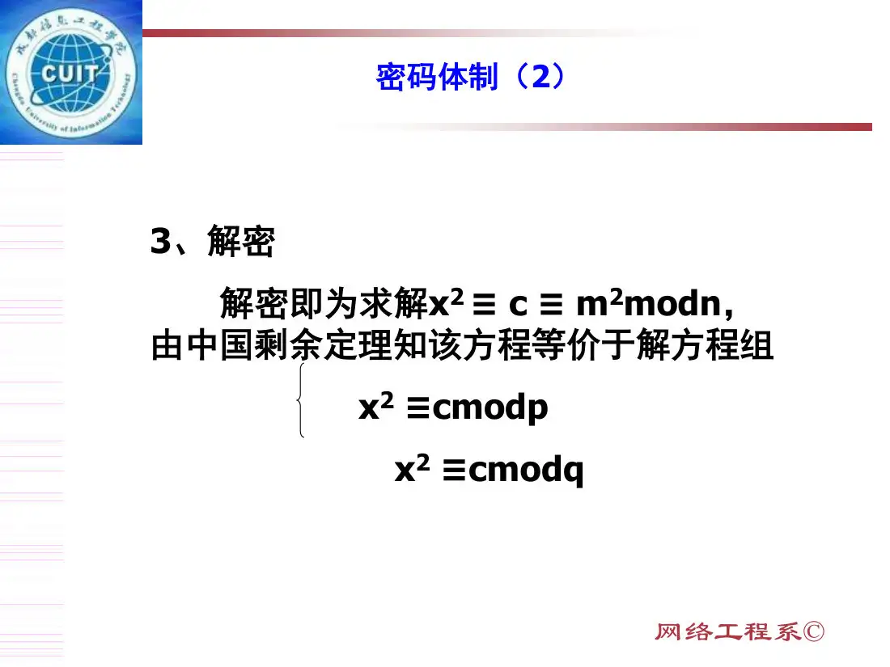

原文：

3、解密

解密即为求解 $\mathbf { x } ^ { 2 } \equiv \mathbf { c } \equiv \mathbf { m } ^ { 2 } \mathbf { m } \mathbf { o } \mathbf { d } \mathbf { n }$ 由中国剩余定理知该方程等价于解方程组

$$
\mathbf {x} ^ {2} \equiv \operatorname{cmodp}
$$

$$
\mathbf {x} ^ {2} \equiv \mathrm{cmod} \mathbf {q}
$$

密码体制（2）

网络工程系©

### $$

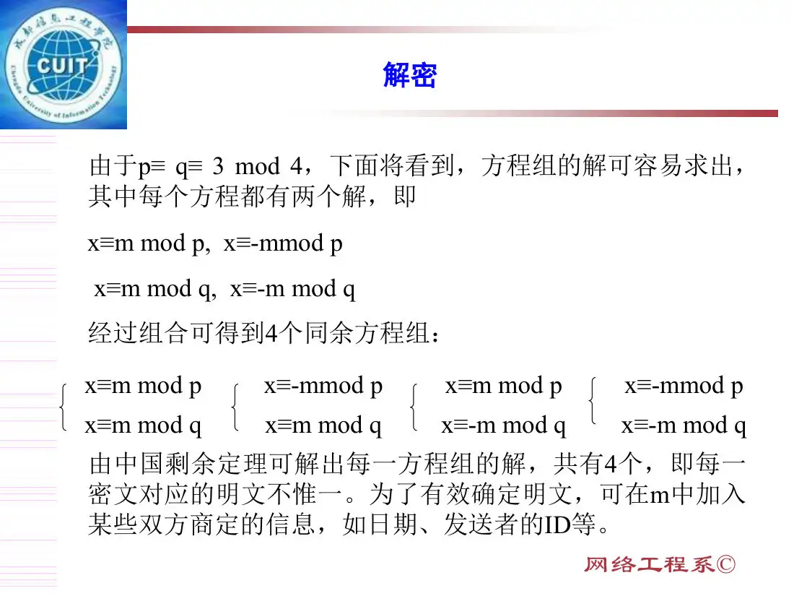

原文：

由于 $\mathbf { p } \equiv { \bf q } \equiv 3 { \mathrm { ~ m o d ~ } } 4$ ，下面将看到，方程组的解可容易求出，其中每个方程都有两个解，即

$$
\mathrm{x} \equiv \mathrm{mmodp}, \mathrm{x} \equiv - \mathrm{mmodp}
$$

$$
\mathrm{x} \equiv \mathrm{mmodq}, \mathrm{x} \equiv - \mathrm{mmodq}
$$

经过组合可得到4个同余方程组：

$$
\begin{array}{l l} \mathrm {x\equiv m mod p} & \left\{ \begin{array}{l l} \mathrm {x\equiv - m mod p} & \left\{ \begin{array}{l l} \mathrm {x\equiv m mod p} & \left\{ \begin{array}{l l} \mathrm {x\equiv - m mod p} \\ \mathrm {x\equiv - m mod q} \end{array} \right. \\ \mathrm {x\equiv m mod q} & \end{array} \right. \end{array} \right. \\ \end{array}
$$

由中国剩余定理可解出每一方程组的解，共有4个，即每一密文对应的明文不惟一。为了有效确定明文，可在m中加入某些双方商定的信息，如日期、发送者的ID等。

网络工程系©

解密

### 解方程组

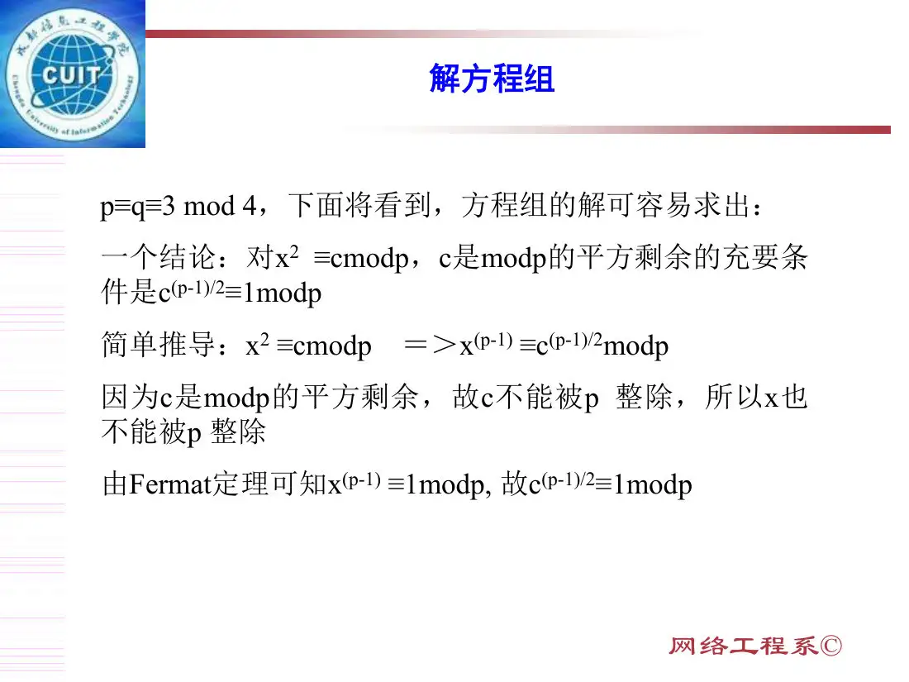

原文：

$\scriptstyle { \mathrm { p } } { \equiv } { \mathrm { q } } { \equiv } 3 { \mathrm { ~ m o d ~ } } 4$ ，下面将看到，方程组的解可容易求出：

一个结论：对 $\mathbf { x } ^ { 2 } \equiv \mathbf { c m o d p }$ ，c是modp的平方剩余的充要条件是 $\mathbf { c } ^ { ( \mathrm { p } - 1 ) / 2 } { \equiv } 1 { \bmod { \mathrm { p } } }$

简单推导： $\begin{array} { r l } { \mathbf { x } ^ { 2 } \equiv \mathbf { c m o d p } } & { { } = > \mathbf { x } ^ { ( \mathrm { p - 1 } ) } \equiv \mathbf { c } ^ { ( \mathrm { p - 1 } ) / 2 } \mathbf { m o d p } } \end{array}$

因为c是modp的平方剩余，故c不能被 $\mathrm { \bf p }$ 整除，所以x也不能被p 整除

由Fermat定理可知 $\mathbf { x } ^ { ( \mathrm { p - 1 } ) } \equiv 1 { \bmod { \mathrm { p } } }$ , 故 $\mathsf { c } ^ { ( \mathsf { p } - 1 ) / 2 } \equiv 1 \bmod { \mathsf { p } }$

解方程组

网络工程系©

### 解方程组

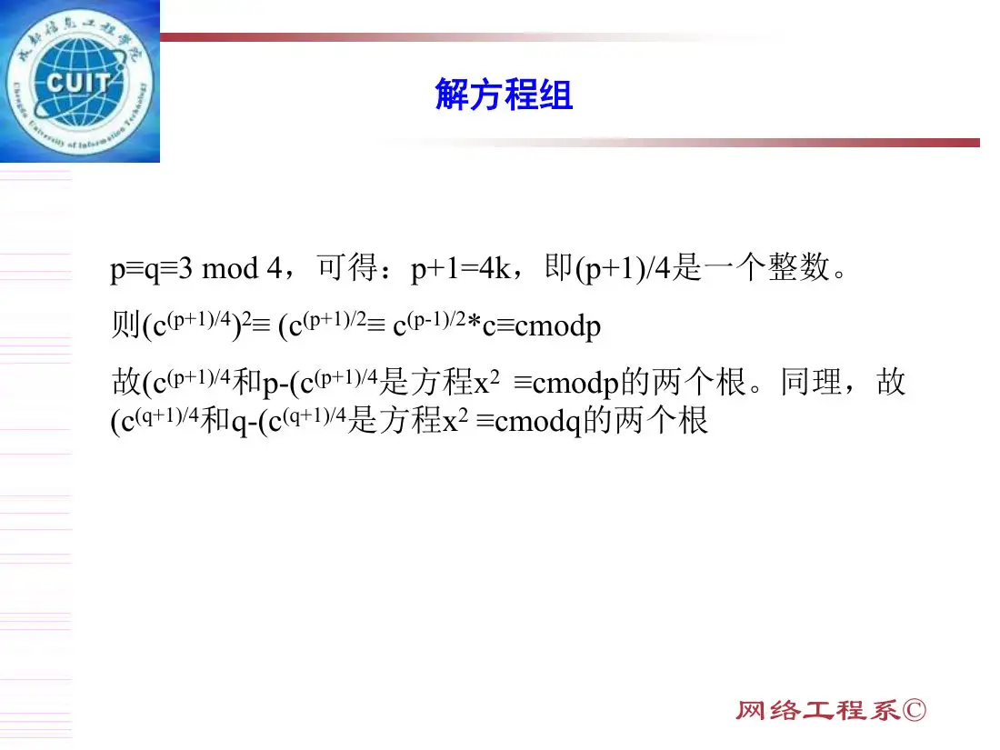

原文：

$\mathsf { p } { \equiv } \mathsf { q } { \equiv } 3 \ \mathsf { m o d } 4$ ，可得： $\mathrm { p } { + } \mathrm { l } { = } 4 \mathrm { k }$ ，即 $( \mathfrak { p } ^ { + 1 ) / 4 }$ 是一个整数。

则 $( \mathbf { c } ^ { ( \mathsf { p } + 1 ) / 4 } ) ^ { 2 } { \equiv } ( \mathbf { c } ^ { ( \mathsf { p } + 1 ) / 2 } { \equiv } \mathbf { c } ^ { ( \mathsf { p } - 1 ) / 2 * } { \mathsf { c } } { \equiv } \mathbf { c } { \bmod { \mathrm { p } } }$

故 $( \mathsf { c } ^ { ( \mathsf { p } + 1 ) / 4 }$ 和 $\mathrm { | p - ( c ^ { ( p + 1 ) / 4 } }$ 是方程 $\mathbf { x } ^ { 2 } \equiv \mathbf { c m o d p }$ 的两个根。同理，故$( \mathsf { c } ^ { ( \mathsf { q } + 1 ) / 4 }$ 和 $\mathsf { q } { - } ( \mathsf { c } ^ { ( \mathsf { q } + 1 ) / 4 }$ 是方程 $\mathbf { x } ^ { 2 } \equiv \mathbf { c m o d q }$ 的两个根

解方程组

网络工程系©

### 公钥为253，私钥为(11,23)

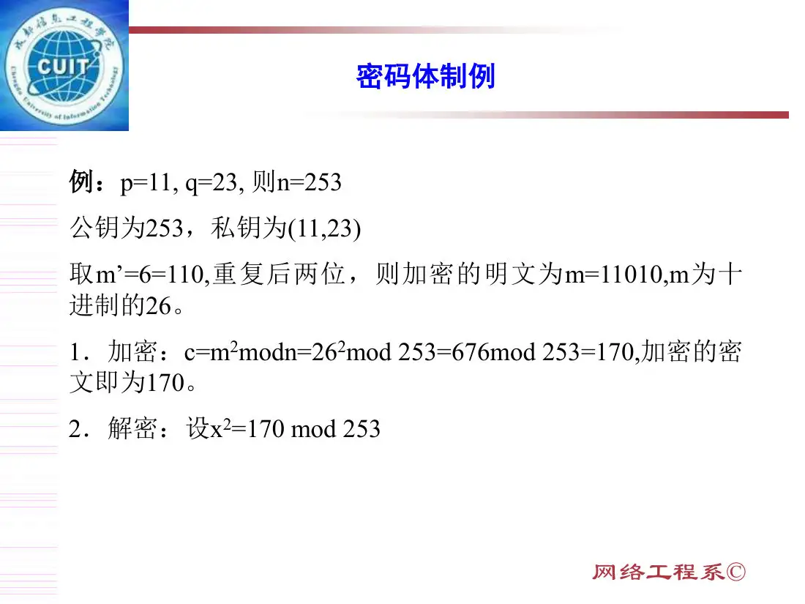

原文：

例： $\mathsf { p } { = } 1 1 , \mathsf { q } { = } 2 3$ , 则 $\mathrm { n } { = } 2 5 3$

公钥为253，私钥为(11,23)

取 $\mathrm { m } ^ { \prime } { = } 6 { = } 1 1 0$ ,重复后两位，则加密的明文为 $\mathrm { m { = } 1 1 0 1 0 , m }$ 为十进制的26。

1．加密： $\mathrm { c } = \mathrm { m } ^ { 2 } \mathrm { m o d n } = 2 6 ^ { 2 } \mathrm { m o d } 2 5 3 = 6 7 6 \mathrm { m o d } 2 5 3 = 1 7 0$ ,加密的密 文即为170。

2．解密：设 $\mathbf { X } ^ { 2 } { = } 1 7 0$ mod 253

O

密码体制例

网络工程系©

### 中国剩余定理，其等价于

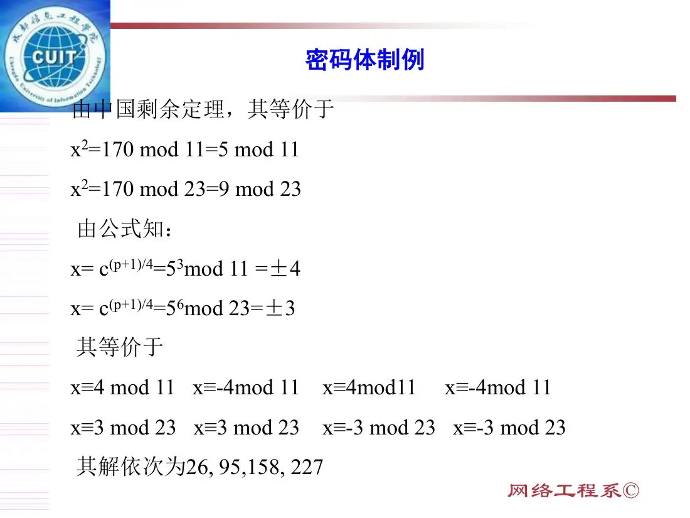

原文：

中国剩余定理，其等价于

由公式知：

$$
\mathrm{x} = \mathrm{c} ^ {(\mathrm{p} + 1) / 4} = 5 ^ {6} \bmod 2 3 = \pm 3
$$

密码体制例

网络工程系©

### 为解密c，A计算c mod n的四个平方根：

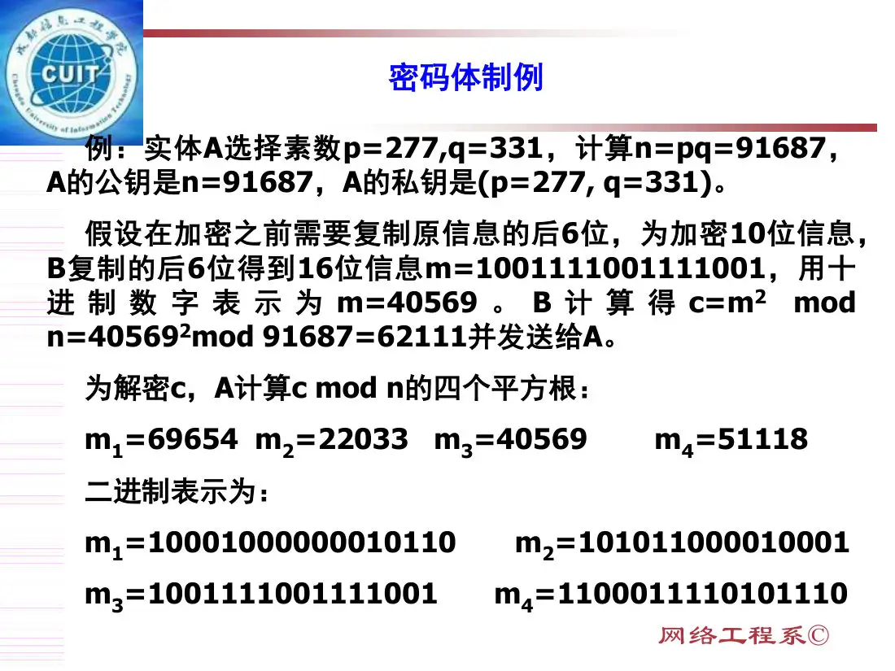

原文：

例：实体A选择素数 $\mathsf { p } { = } 2 7 7 , \mathsf { q } { = } 3 3 1$ ，计算 $\scriptstyle \mathbf { 1 } = \mathbf { p q } = \mathbf { 9 } \mathbf { 1 6 } \mathbf { 8 } 7$ A的公钥是 $\bf { \Pi } \cdot \bf { n } = 9 1 6 8 7$ ，A的私钥是 $( \scriptstyle \mathbf { p } = 2 7 7 , \mathbf { q } = 3 3 \mathbf { 1 } )$ 。

假设在加密之前需要复制原信息的后6位，为加密10位信息，B复制的后6位得到16位信息 $\scriptstyle \mathbf { m } = \mathbf { 1 0 0 1 1 1 1 0 0 1 1 1 1 0 0 1 }$ ，用十进 制 数 字 表 示 为 $\scriptstyle \mathbf { m } = 4 \mathbf { 0 } 5 6 9$ 。 B 计 算 得 $\mathbf { c } { \equiv } { \mathbf { m } } ^ { 2 }$ mod$\scriptstyle \mathsf { n } = 4 0 5 6 9 ^ { 2 } \bmod { 9 } 1 6 8 7 = 6 2 1 1 1$ 并发送给A。

为解密c，A计算c mod n的四个平方根：

$$
\mathrm{m} _ {1} = 6 9 6 5 4 \quad \mathrm{m} _ {2} = 2 2 0 3 3 \quad \mathrm{m} _ {3} = 4 0 5 6 9 \quad \mathrm{m} _ {4} = 5 1 1 1 8
$$

二进制表示为：

m =10001000000010110

$$
\mathsf {m} _ {3} = \mathbf {1 0 0 1 1 1 1 0 0 1 1 1 1 0 0 1}
$$

m =101011000010001

$$
\mathsf {m} _ {4} = \mathbf {1 1 0 0 0 1 1 1 1 0 1 0 1 1 1 0}
$$

网络工程系©

密码体制例
