# 《密码学》第8章 数字签名（课件）

原件的每一页，下面附识别出的文字。

### 第八章数 字 签 名

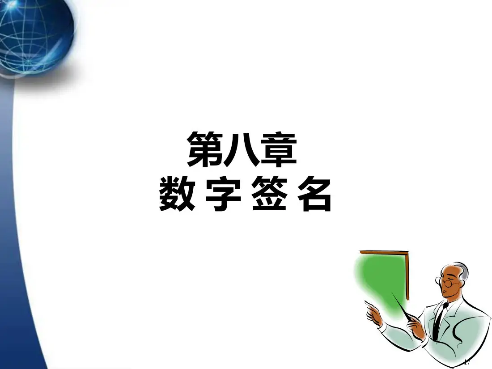

原文：

第八章数 字 签 名

### 基本概念

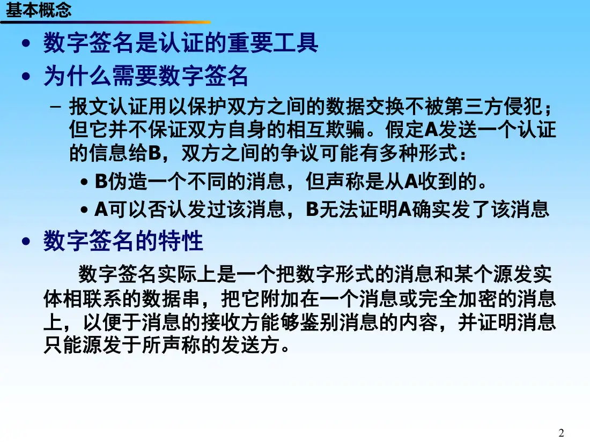

原文：

基本概念

• 数字签名是认证的重要工具

• 为什么需要数字签名

– 报文认证用以保护双方之间的数据交换不被第三方侵犯；但它并不保证双方自身的相互欺骗。假定A发送一个认证的信息给B，双方之间的争议可能有多种形式：

• B伪造一个不同的消息，但声称是从A收到的。

• A可以否认发过该消息，B无法证明A确实发了该消息

• 数字签名的特性

数字签名实际上是一个把数字形式的消息和某个源发实体相联系的数据串，把它附加在一个消息或完全加密的消息上，以便于消息的接收方能够鉴别消息的内容，并证明消息只能源发于所声称的发送方。

2

### 数字签名满足的条件

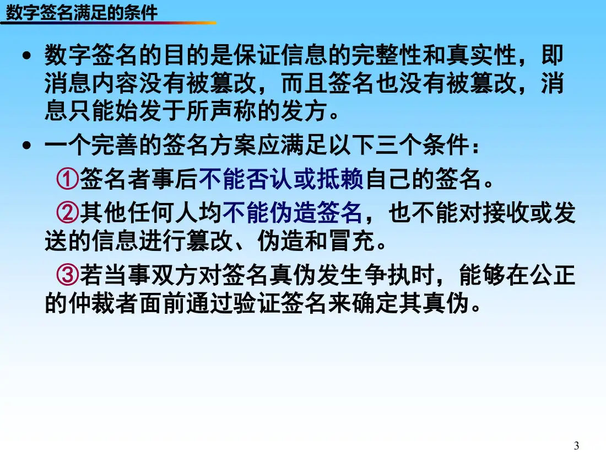

原文：

数字签名满足的条件

数字签名的目的是保证信息的完整性和真实性，即消息内容没有被篡改，而且签名也没有被篡改，消息只能始发于所声称的发方。

• 一个完善的签名方案应满足以下三个条件：

①签名者事后不能否认或抵赖自己的签名。

②其他任何人均不能伪造签名，也不能对接收或发送的信息进行篡改、伪造和冒充。

③若当事双方对签名真伪发生争执时，能够在公正的仲裁者面前通过验证签名来确定其真伪。

3

### 数字签名的设计要求

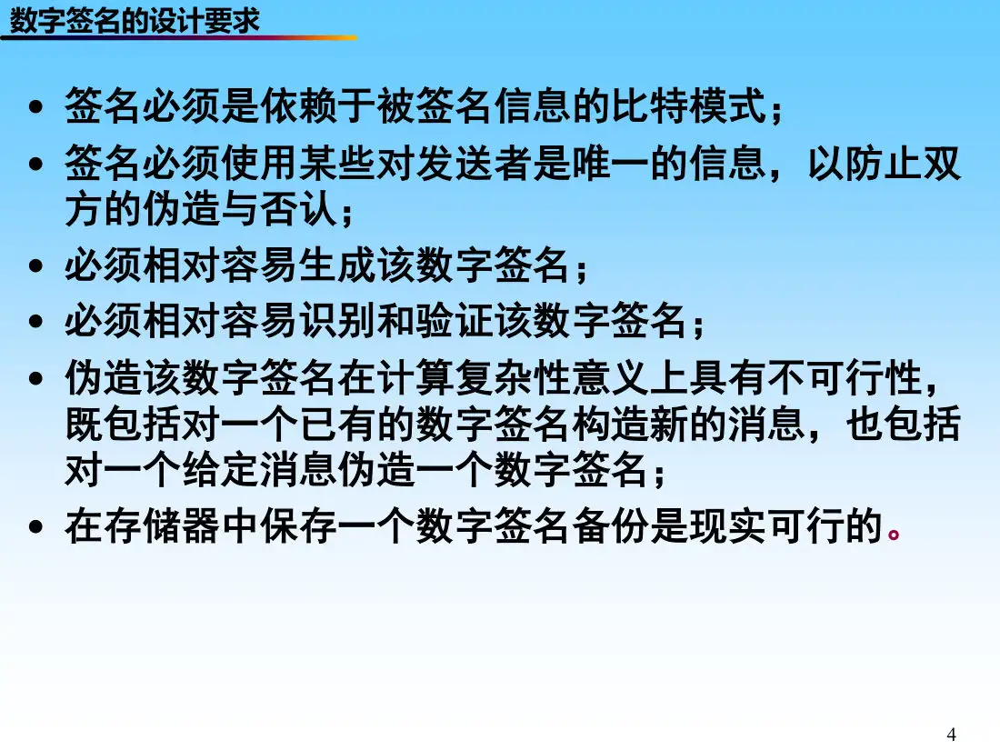

原文：

数字签名的设计要求

• 签名必须是依赖于被签名信息的比特模式；

• 签名必须使用某些对发送者是唯一的信息，以防止双方的伪造与否认；

• 必须相对容易生成该数字签名；

• 必须相对容易识别和验证该数字签名；

伪造该数字签名在计算复杂性意义上具有不可行性，既包括对一个已有的数字签名构造新的消息，也包括对一个给定消息伪造一个数字签名；

• 在存储器中保存一个数字签名备份是现实可行的。

4

### 数字签名方案的描述

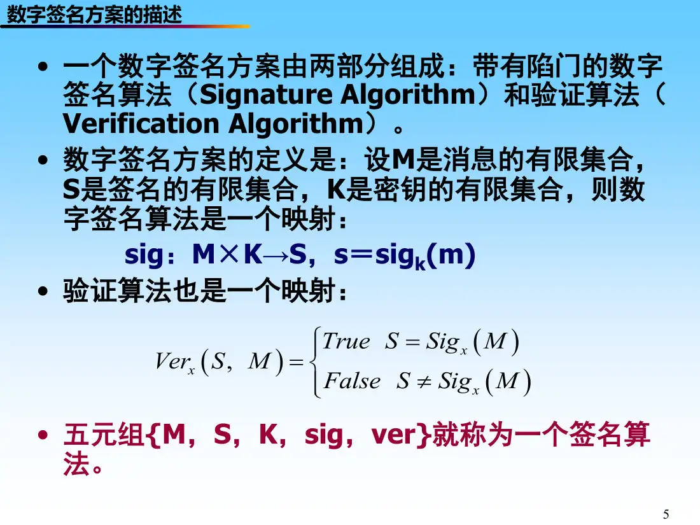

原文：

数字签名方案的描述

一个数字签名方案由两部分组成：带有陷门的数字签名算法（Signature Algorithm）和验证算法Verification Algorithm）。

• 数字签名方案的定义是：设M是消息的有限集合，S是签名的有限集合，K是密钥的有限集合，则数字签名算法是一个映射：

sig： $\mathsf { M } \times \mathsf { K } { \to } \mathsf { S } , \mathsf { s } { = } { \mathsf { s i g } _ { \mathsf { k } } } ( \mathsf { m } )$

• 验证算法也是一个映射：

$$
V e r _ {x} (S, M) = \left\{ \begin{array}{l} \text {True} S = \operatorname{Sig} _ {x} (M) \\ \text {False} S \neq \operatorname{Sig} _ {x} (M) \end{array} \right.
$$

• 五元组{M，S，K，sig，ver}就称为一个签名算法。

5

### 数字签名的应用

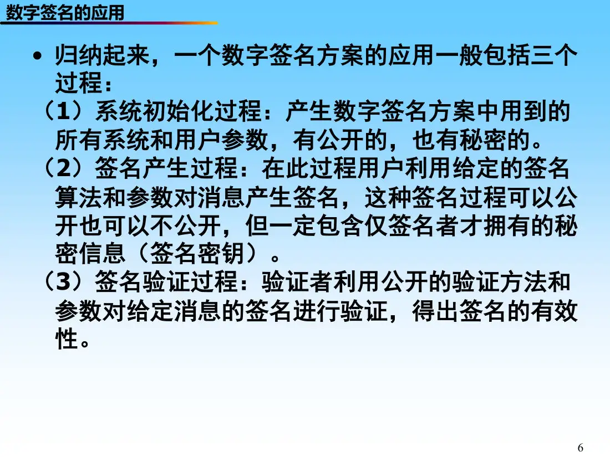

原文：

数字签名的应用

• 归纳起来，一个数字签名方案的应用一般包括三个过程：

（1）系统初始化过程：产生数字签名方案中用到的所有系统和用户参数，有公开的，也有秘密的。

（2）签名产生过程：在此过程用户利用给定的签名算法和参数对消息产生签名，这种签名过程可以公开也可以不公开，但一定包含仅签名者才拥有的秘密信息（签名密钥）。

（3）签名验证过程：验证者利用公开的验证方法和参数对给定消息的签名进行验证，得出签名的有效性。

6

### 两类数字签名函数

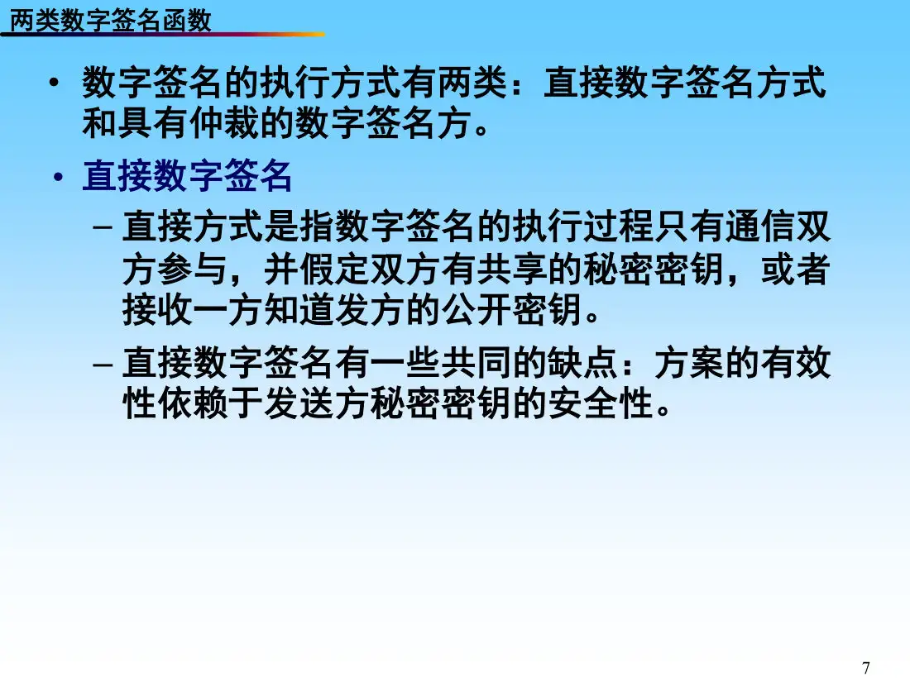

原文：

两类数字签名函数

• 数字签名的执行方式有两类：直接数字签名方式和具有仲裁的数字签名方。

• 直接数字签名

– 直接方式是指数字签名的执行过程只有通信双方参与，并假定双方有共享的秘密密钥，或者接收一方知道发方的公开密钥。

– 直接数字签名有一些共同的缺点：方案的有效性依赖于发送方秘密密钥的安全性。

7

### 直接数字签名

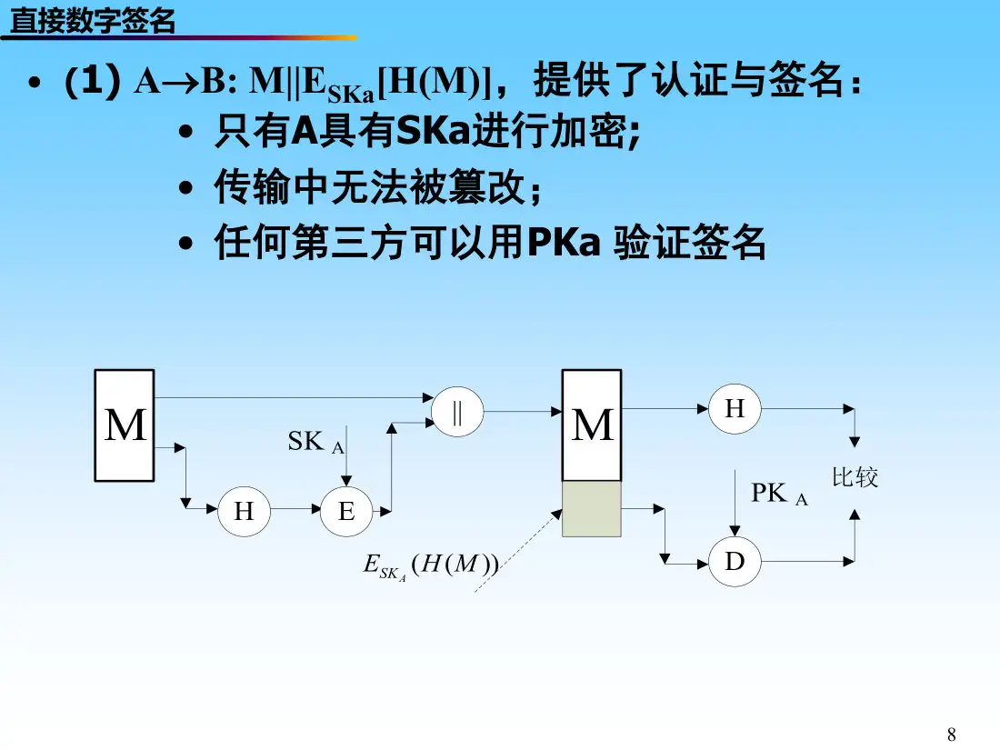

原文：

直接数字签名

• (1) $\mathbf { A } {  } \mathbf { B } { : } \mathbf { M } | | \mathbf { E } _ { \mathbf { S K a } } [ \mathbf { H } ( \mathbf { M } ) ]$ ，提供了认证与签名：

• 只有A具有SKa进行加密;

传输中无法被篡改；

• 任何第三方可以用PKa 验证签名

8

### 直接数字签名

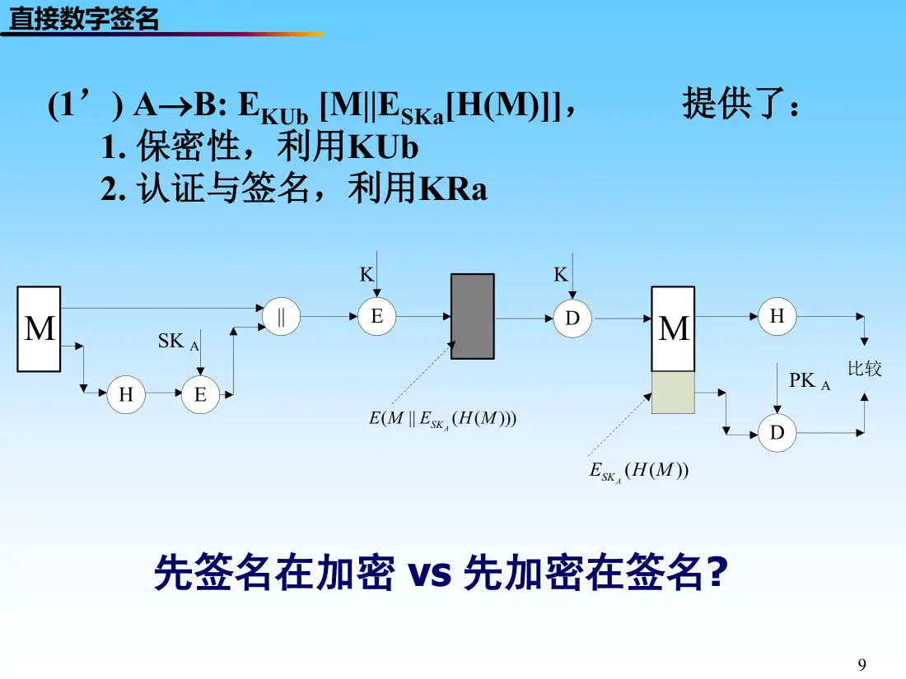

原文：

直接数字签名

$\begin{array} { r } { ( 1 ^ { \prime } ) \operatorname { A \to B } \colon \operatorname { E } _ { \mathrm { K U b } } \left[ \mathrm { M } \right| \operatorname { E } _ { \mathrm { S K } \mathrm { a } } [ \mathrm { H } ( \mathrm { M } ) ] ] } \end{array}$ 提供了：

1. 保密性，利用KUb

2. 认证与签名，利用KRa

先签名在加密 vs 先加密在签名?

9

### 直接数字签名的缺点

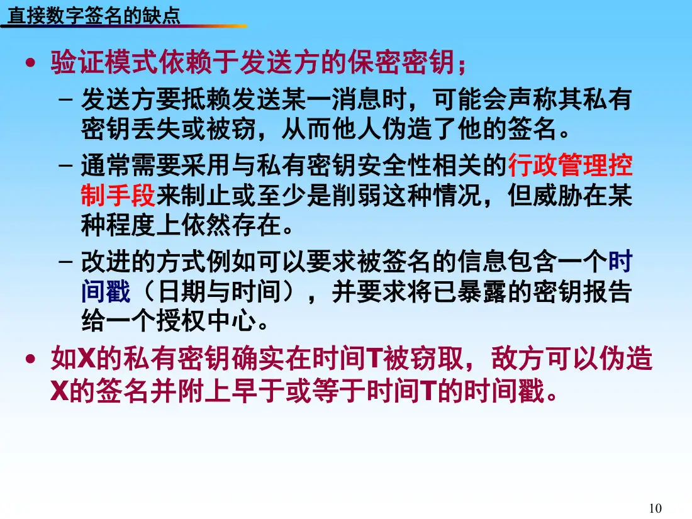

原文：

直接数字签名的缺点

• 验证模式依赖于发送方的保密密钥；

– 发送方要抵赖发送某一消息时，可能会声称其私有密钥丢失或被窃，从而他人伪造了他的签名。

通常需要采用与私有密钥安全性相关的行政管理控制手段来制止或至少是削弱这种情况，但威胁在某种程度上依然存在。

– 改进的方式例如可以要求被签名的信息包含一个时间戳（日期与时间），并要求将已暴露的密钥报告给一个授权中心。

如X的私有密钥确实在时间T被窃取，敌方可以伪造X的签名并附上早于或等于时间T的时间戳。

10

### 仲裁数字签名

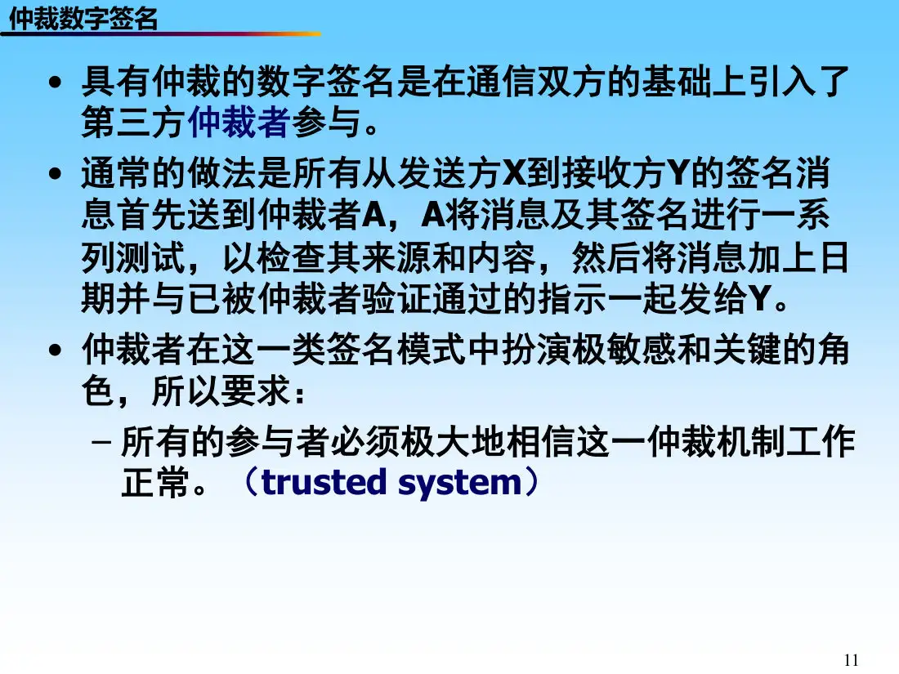

原文：

仲裁数字签名

• 具有仲裁的数字签名是在通信双方的基础上引入了第三方仲裁者参与。

通常的做法是所有从发送方X到接收方Y的签名消息首先送到仲裁者A，A将消息及其签名进行一系列测试，以检查其来源和内容，然后将消息加上日期并与已被仲裁者验证通过的指示一起发给Y。

• 仲裁者在这一类签名模式中扮演极敏感和关键的角色，所以要求：

– 所有的参与者必须极大地相信这一仲裁机制工作正常。（trusted system）

11

### 仲裁数字签名技术

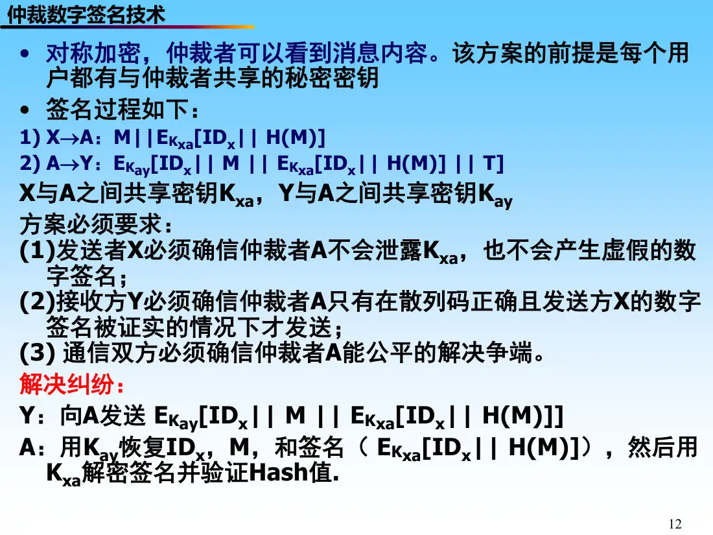

原文：

仲裁数字签名技术

• 对称加密，仲裁者可以看到消息内容。该方案的前提是每个用户都有与仲裁者共享的秘密密钥

• 签名过程如下：

1) $\mathbf { X } { \to } \mathbf { A } \mathbf { : } \ \mathsf { M } \mid \ \vert \ \mathsf { E } _ { \mathbf { K } _ { \mathbf { X } } = \mathbf { [ \mathbf { I D } _ { \mathbf { X } } ] } } \mid \ \mathsf { H } ( \mathbf { M } ) ]$

$$
\mathsf {A} \rightarrow \mathsf {Y}: \mathsf {E} _ {\mathsf {K} _ {\mathsf {a y}}} [ \mathsf {I D} _ {\mathsf {x}} | | \mathsf {M} | | \mathsf {E} _ {\mathsf {K} _ {\mathsf {x a}}} [ \mathsf {I D} _ {\mathsf {x}} | | \mathsf {H} (\mathsf {M}) ] | | \mathsf {T} ]
$$

X与A之间共享密钥 ${ \sf K } _ { { \tt x a } }$ ，Y与A之间共享密钥 $K _ { \mathsf { a y } }$

方案必须要求：

(1)发送者X必须确信仲裁者A不会泄露 $K _ { \mathbf { x } \mathbf { a } }$ ，也不会产生虚假的数字签名；

(2)接收方Y必须确信仲裁者A只有在散列码正确且发送方X的数字签名被证实的情况下才发送；

(3) 通信双方必须确信仲裁者A能公平的解决争端。

解决纠纷：

Y：向A发送 $\mathsf { E } _ { \mathsf { K } _ { \mathrm { a v } } } [ \mathbf { I D } _ { \mathsf { x } } | \mid \mathsf { M } \mid \mid \mathsf { E } _ { { \mathsf { K } } _ { \mathrm { x a } } } [ \mathbf { I D } _ { \mathsf { x } } | \mid \mathsf { H } ( { \mathsf { M } } ) ] ]$

A：用 $\mathsf { K } _ { \mathsf { a v } }$ 恢复 $\mathbf { I D _ { x } } , \mathbf { M }$ ，和签名 $( \phantom { + } \mathbb { E } _ { \mathbb { K } _ { \mathbf { X } \mathbf { a } } } [ \mathbf { I } \mathbf { D } _ { \mathbf { x } } | \mathbf { \Lambda } | \mathbf { H } ( \mathbf { M } ) ] )$ ，然后用 ${ \sf K } _ { { \tt x a } }$ 解密签名并验证Hash值.

12

### 仲裁数字签名

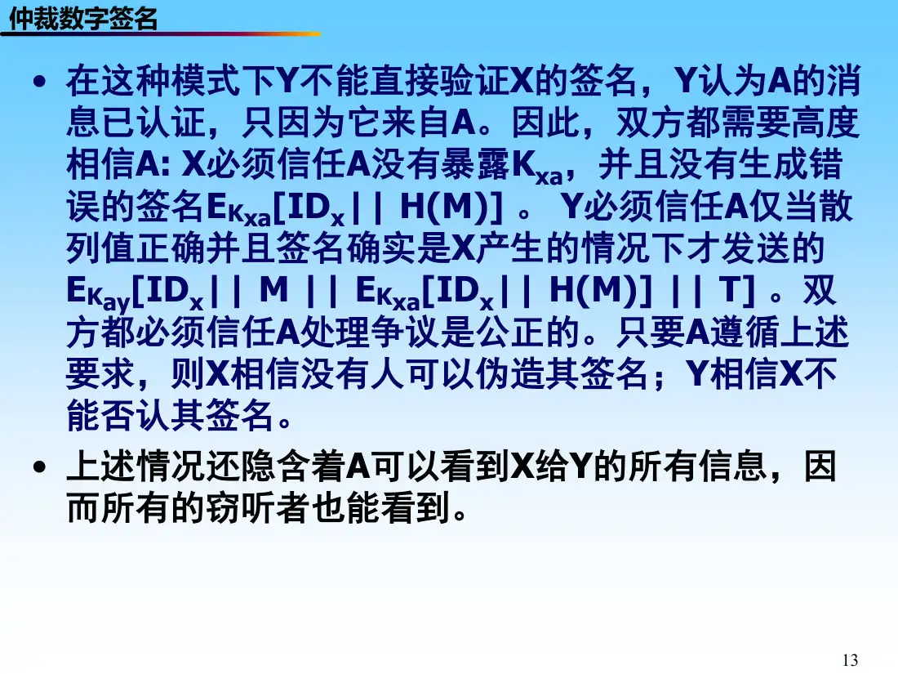

原文：

仲裁数字签名

在这种模式下Y不能直接验证X的签名，Y认为A的消息已认证，只因为它来自A。因此，双方都需要高度相信A: X必须信任A没有暴露 $\mathsf { K } _ { \mathbf { x } \mathbf { a } }$ 并且没有生成错误的签名 $\mathsf { E } _ { \mathsf { K } _ { \mathbf { X } } \mathbf { a } } [ \mathbf { I } \mathbf { D } _ { \mathbf { X } } \mid \mathbf { \Lambda } \mathsf { H } ( \mathbf { M } ) ]$ 。 Y必须信任A仅当散列值正确并且签名确实是X产生的情况下才发送的$\mathsf { E } _ { \mathsf { K } _ { \mathrm { a v } } } [ \mathbf { I D } _ { \mathbf { x } } | \ m | \ m | \hphantom { \frac { 1 } { 1 } } \mathsf { E } _ { \mathbf { K } _ { \mathbf { x } \mathbf { a } } } [ \mathbf { I D } _ { \mathbf { x } } | \ m | \ m | \ m | \ m | \ m ] \hphantom { \frac { 1 } { 1 } } \mathbf { H } ( \mathbf { M } ) ] \ m | \ m | \ m | \ m | \hphantom { \frac { 1 } { 1 } } \mathbf { H } _ { \mathbf { x } } \mathbf { I } _ { \mathbf { x } } | \ m | \ m | \ m | \ m | \ m | \hphantom { \frac { 1 } { 1 } } \mathbf { H } ( \mathbf { M } ) \big ]$ 。双方都必须信任A处理争议是公正的。只要A遵循上述要求，则X相信没有人可以伪造其签名；Y相信X不能否认其签名。

• 上述情况还隐含着A可以看到X给Y的所有信息，因而所有的窃听者也能看到。

13

### 仲裁数字签名技术

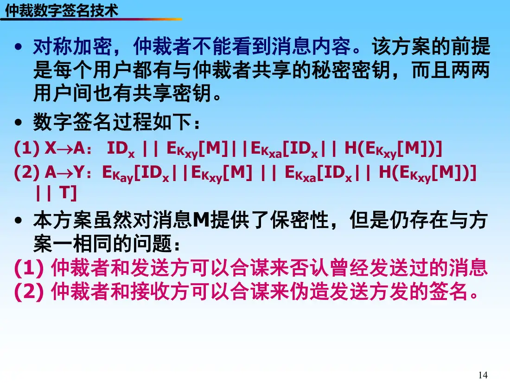

原文：

仲裁数字签名技术

对称加密，仲裁者不能看到消息内容。该方案的前提是每个用户都有与仲裁者共享的秘密密钥，而且两两用户间也有共享密钥。

• 数字签名过程如下：

(1) $\begin{array} { r l }  \mathbf { X } { \} \to \mathbb { A } : } & { { } \mathbb { I D } _ { \mathbf { x } } \mid \mid \mathbb { E } _ { \mathbb { K } _ { \mathbf { X } \mathbf { Y } } } [ \mathbf { M } ] \mid \mid \mathbb { E } _ { \mathbb { K } _ { \mathbf { X } \mathbf { a } } } [ \mathbf { I D } _ { \mathbf { x } } \mid \mid \mathbb { H } ( \mathbb { E } _ { \mathbb { K } _ { \mathbf { X } \mathbf { Y } } } [ \mathbf { M } ] ) ] } \end{array}$

(2) A→Y： $\mathbb { E } _ { { \mathbb K } _ { \mathrm { a y } } } [ { \bf I } { \bf D } _ { \mathbb X } | { \bf \Delta } ] \mathbb { E } _ { { \mathbb K } _ { \mathbb { X } _ { \mathbb { X } } } } [ { \bf M } ] \left. \right| \mathbb { E } _ { { \mathbb K } _ { \mathbb { X } _ { \mathbb { X } } } } [ { \bf I } { \bf D } _ { \mathbb X } | { \bf \Delta } ] \mathbb { H } ( \mathbb { E } _ { { \mathbb K } _ { \mathbb { X } _ { \mathbb { X } } } } [ { \bf M } ] ) ]$ || T]

• 本方案虽然对消息M提供了保密性，但是仍存在与方案一相同的问题：

(1) 仲裁者和发送方可以合谋来否认曾经发送过的消息

(2) 仲裁者和接收方可以合谋来伪造发送方发的签名。

14

### 仲裁数字签名技术

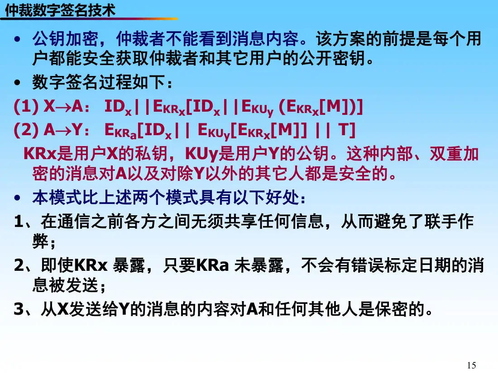

原文：

仲裁数字签名技术

• 公钥加密，仲裁者不能看到消息内容。该方案的前提是每个用户都能安全获取仲裁者和其它用户的公开密钥。

• 数字签名过程如下：

(1) X→A： $\mathbf { I D } _ { \mathbf { x } } \mid \mid \mathsf { E } _ { \mathsf { K R } _ { \mathbf { x } } } [ \mathbf { I D } _ { \mathbf { x } } \mid \mid \mathsf { E } _ { \mathsf { K U } _ { \mathbf { y } } } ( \mathsf { E } _ { \mathsf { K R } _ { \mathbf { x } } } [ \mathbf { M } ] ) ]$

(2) $A  \mathsf { Y } : \quad \mathsf { E } _ { \mathsf { K R } _ { \mathrm { a } } } [ \mathbf { I D } _ { \mathsf { x } } | \ \mid \mathsf { E } _ { \mathsf { K U } _ { \mathrm { y } } } [ \mathsf { E } _ { \mathsf { K R } _ { \mathrm { x } } } [ \mathbf { M } ] ] \ | \ | \ \mathsf { T } ]$

KRx是用户X的私钥，KUy是用户Y的公钥。这种内部、双重加密的消息对A以及对除Y以外的其它人都是安全的。

• 本模式比上述两个模式具有以下好处：

1、在通信之前各方之间无须共享任何信息，从而避免了联手作弊；

2、即使KRx 暴露，只要KRa 未暴露，不会有错误标定日期的消息被发送；

3、从X发送给Y的消息的内容对A和任何其他人是保密的。

15

### 基于RSA的数字签名

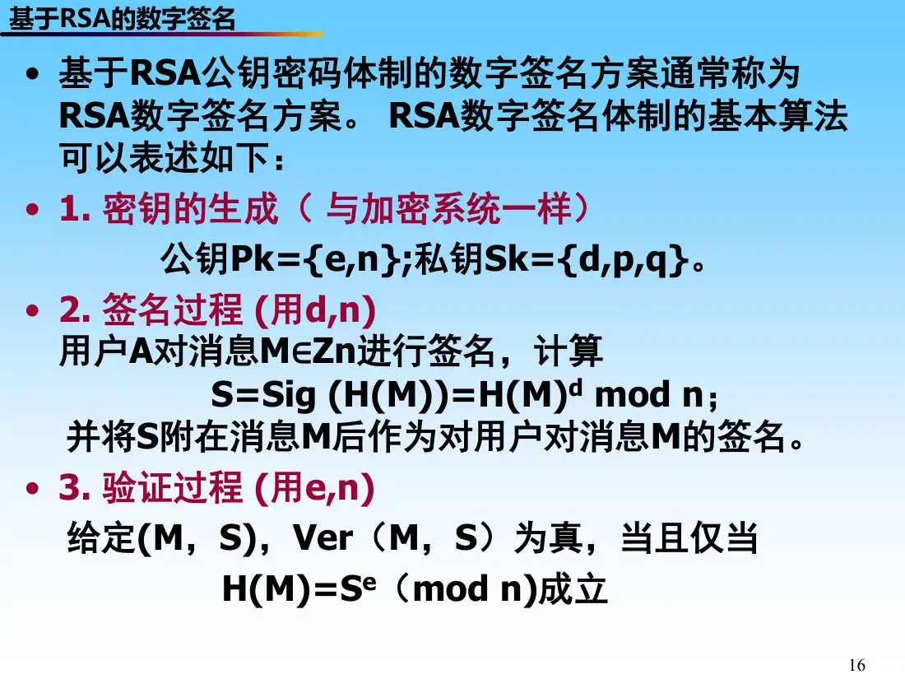

原文：

基于RSA的数字签名

基于RSA公钥密码体制的数字签名方案通常称为RSA数字签名方案。 RSA数字签名体制的基本算法可以表述如下：

• 1. 密钥的生成（ 与加密系统一样）

公钥 $\scriptstyle \mathbf { P } \mathbf { k } = \{ \mathbf { e } , \mathbf { n } \}$ ;私钥 $S { \bf k } = \{ { \bf d } , { \bf p } , { \bf q } \}$ 。

• 2. 签名过程 $( \mathbb { H } \mathbf { d } , \mathbf { n } )$ 用户A对消息M∈Zn进行签名，计算$S { = } S \mathsf { i g } \ ( \mathsf { H } ( \mathsf { M } ) ) { = } \mathsf { H } ( \mathsf { M } ) ^ { \mathsf { d } } \ \mathsf { m o d } \ \mathsf { n }$ 并将S附在消息M后作为对用户对消息M的签名。

• 3. 验证过程 $( \mathbb { H } \mathbf { e } , \mathbf { n } )$ 给定(M，S)，Ver（M，S）为真，当且仅当$\mathsf { H } ( \mathsf { M } ) { = } \mathsf { S } ^ { \mathrm { e } } \ \left( \mathsf { m o d } \ \mathsf { n } \right)$ 成立

16

### RSA签名中注意的问题

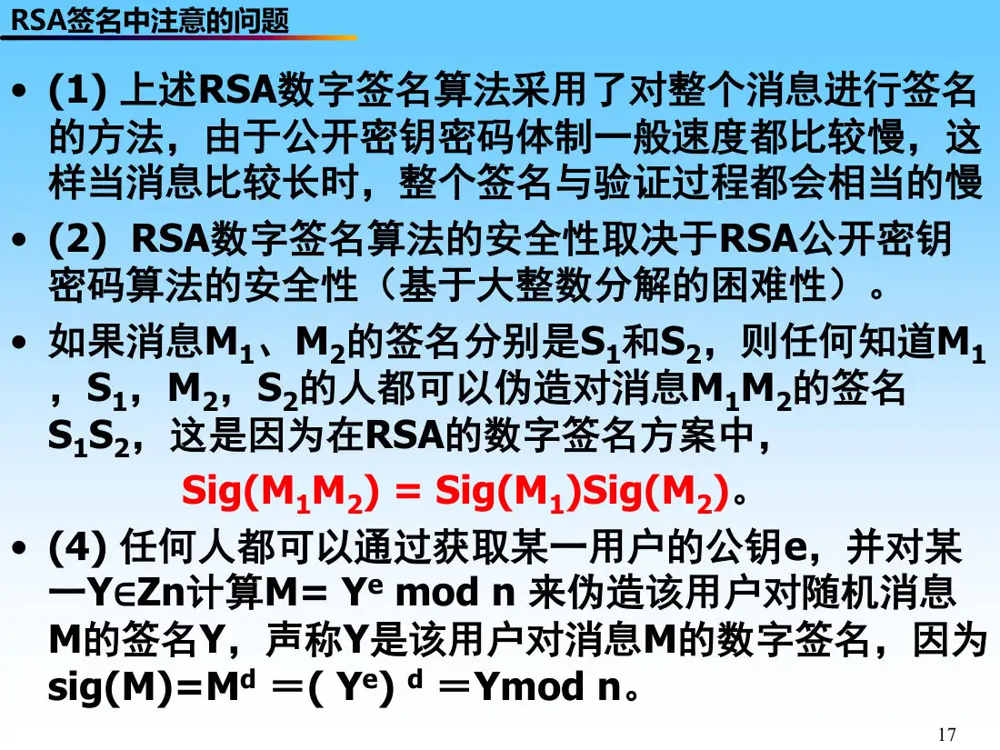

原文：

RSA签名中注意的问题

• (1) 上述RSA数字签名算法采用了对整个消息进行签名的方法，由于公开密钥密码体制一般速度都比较慢，这样当消息比较长时，整个签名与验证过程都会相当的慢

• (2) RSA数字签名算法的安全性取决于RSA公开密钥密码算法的安全性（基于大整数分解的困难性）。

• 如果消息 $\boldsymbol { \mathsf { M } } _ { 1 } , \ \boldsymbol { \mathsf { M } } _ { 2 }$ 的签名分别是 $\pmb { S _ { 1 } }$ 和 $S _ { 2 } ,$ ，则任何知道 $\boldsymbol { \mathsf { M } } _ { 1 }$ $\pmb { S _ { 1 } }$ $\boldsymbol { \mathsf { M } } _ { 2 }$ $\mathsf { S } _ { 2 }$ 的人都可以伪造对消息 $\mathbf { M _ { 1 } M _ { 2 } }$ 的签名$\mathsf { S } _ { 1 } \mathsf { S } _ { 2 } ,$ 这是因为在RSA的数字签名方案中，

$$
\operatorname{Sig} \left(\mathrm{M} _ {1} \mathrm{M} _ {2}\right) = \operatorname{Sig} \left(\mathrm{M} _ {1}\right) \operatorname{Sig} \left(\mathrm{M} _ {2}\right)
$$

• (4) 任何人都可以通过获取某一用户的公钥 $\mathbf { e } _ { ! }$ ，并对某一Y∈Zn计算 $\mathbf { \boldsymbol { \mathsf { M } } } = \mathbf { \boldsymbol { \mathsf { Y } } } ^ { \mathrm { e } } \mathbf { \bmod { \mathrm { ~ n ~ } } }$ 来伪造该用户对随机消息M的签名Y，声称Y是该用户对消息M的数字签名，因为$s | \boldsymbol { \mathrm { g } } ( \mathsf { M } ) = \mathsf { M } ^ { \mathrm { d } } = ( \mathsf { Y } ^ { \mathrm { e } } ) ^ { \mathrm { ~ d ~ } } = \mathsf { Y } \mathsf { m o d } \mathsf { n }$ 0

17

### Elgamal数字签名方案

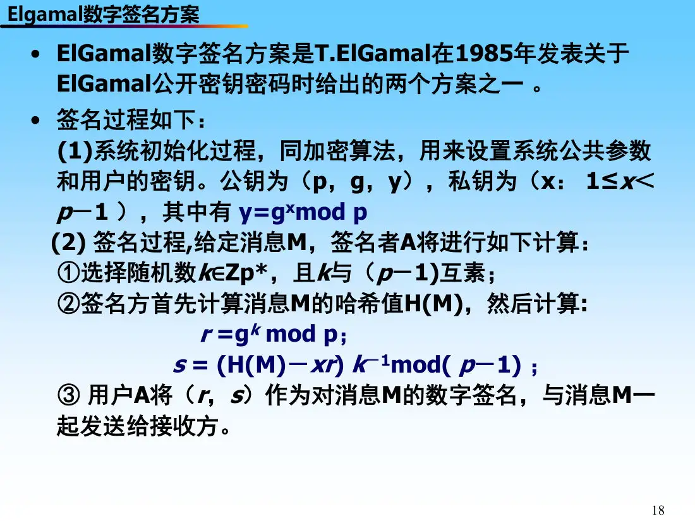

原文：

Elgamal数字签名方案

ElGamal数字签名方案是T.ElGamal在1985年发表关于ElGamal公开密钥密码时给出的两个方案之一 。

• 签名过程如下：

(1)系统初始化过程，同加密算法，用来设置系统公共参数和用户的密钥。公钥为 $( { \bf p } , { \bf q } , { \bf y } )$ ，私钥为 $( x = 1 \leq x <$ ${ \pmb \rho } { - } { \pmb 1 } )$ ，其中有 $\scriptstyle \mathbf { y = g \times m o d } \ p$

(2) 签名过程,给定消息M，签名者A将进行如下计算：

①选择随机数 $\scriptstyle { k \in Z | p ^ { * } }$ ，且k与 $( p - 1 )$ 互素；

②签名方首先计算消息M的哈希值 ${ \mathsf { H } } ( { \mathsf { M } } )$ ，然后计算:

$$
\begin{array}{c} r = \mathsf {g} ^ {k} \bmod p; \\ s = (H (M) - x r) k ^ {- 1} \bmod (p - 1); \end{array}
$$

③ 用户A将 $( r , s )$ 作为对消息M的数字签名，与消息 $\mathbf { M } -$ 起发送给接收方。

18

### Elgamal数字签名方案

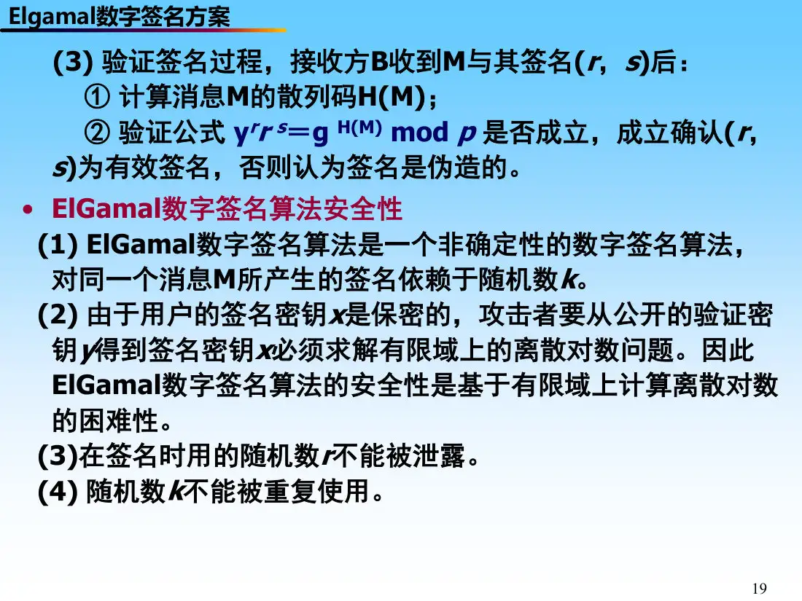

原文：

Elgamal数字签名方案

(3) 验证签名过程，接收方B收到M与其签名(r，s)后：

① 计算消息M的散列码H(M)；

② 验证公式 $\mathbf { \boldsymbol { y } } ^ { r } \boldsymbol { r } ^ { s } { = } \mathbf { \boldsymbol { g } } ^ { \mathrm { ~ H ( M ) ~ } } \mathrm { m o d } \mathrm { ~ } \boldsymbol { p }$ 是否成立，成立确认 $( r ,$ )为有效签名，否则认为签名是伪造的。

ElGamal数字签名算法安全性

(1) ElGamal数字签名算法是一个非确定性的数字签名算法，对同一个消息M所产生的签名依赖于随机数k。

(2) 由于用户的签名密钥x是保密的，攻击者要从公开的验证密钥y得到签名密钥x必须求解有限域上的离散对数问题。因此ElGamal数字签名算法的安全性是基于有限域上计算离散对数的困难性。

(3)在签名时用的随机数r不能被泄露。

(4) 随机数k不能被重复使用。

19

### 数字签名标准DSS

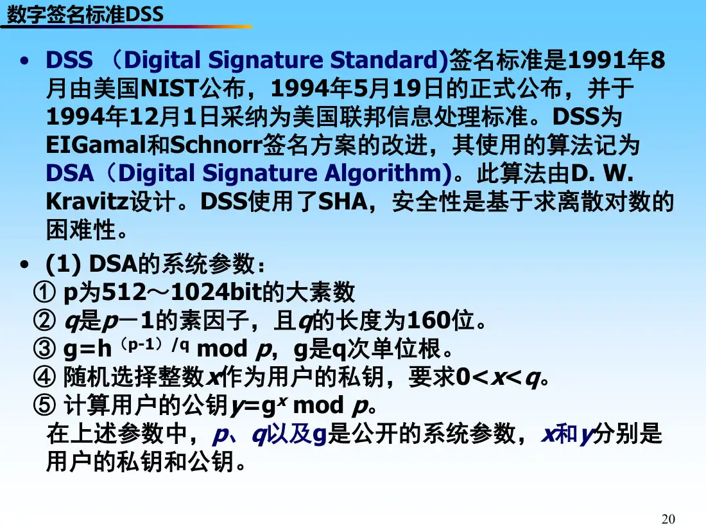

原文：

数字签名标准DSS

DSS （Digital Signature Standard)签名标准是1991年8月由美国NIST公布，1994年5月19日的正式公布，并于1994年12月1日采纳为美国联邦信息处理标准。DSS为EIGamal和Schnorr签名方案的改进，其使用的算法记为DSA（Digital Signature Algorithm)。此算法由D. W.Kravitz设计。DSS使用了SHA，安全性是基于求离散对数的困难性。

• (1) DSA的系统参数：

① p为512～1024bit的大素数

② q是p－1的素因子，且q的长度为160位。

③ g=h（p-1）/q mod $\pmb { \rho } ,$ g是q次单位根。

④ 随机选择整数x作为用户的私钥，要求 $0 < x < q _ { \circ }$

⑤ 计算用户的公钥 $\scriptstyle \gamma = \mathbf { g } ^ { x } \mathbf { m o d } \ p .$ 。

在上述参数中， $p _ { \cdot }$ q以及g是公开的系统参数，x和y分别是用户的私钥和公钥。

20

### • (2) 签名过程

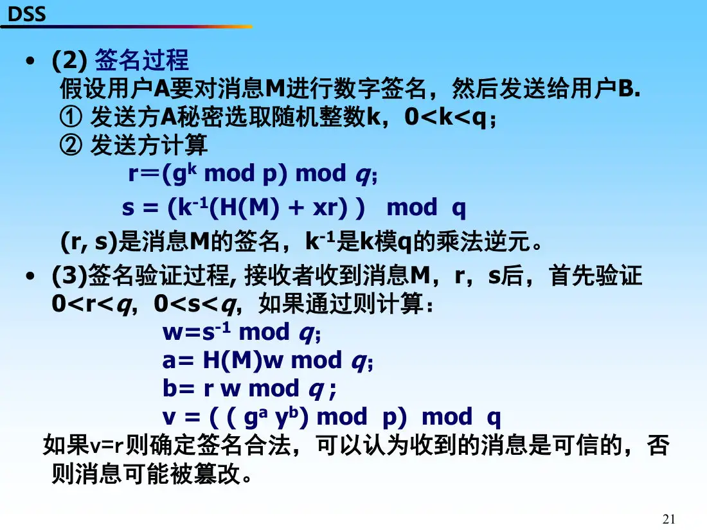

原文：

• (2) 签名过程

假设用户A要对消息M进行数字签名，然后发送给用户B.

① 发送方A秘密选取随机整数k， $\mathbf { 0 < k < q }$ ；

② 发送方计算

$$
r = (g ^ {k} \mod p) \mod q;
$$

$$
s = (k ^ {- 1} (H (M) + x r)) \mod q
$$

(r, s)是消息M的签名， $\mathbf { k } ^ { - 1 }$ 是k模q的乘法逆元。

• (3)签名验证过程, 接收者收到消息M，r，s后，首先验证$\scriptstyle 0 < \mathrm { r } < q , 0 < s < q$ ，如果通过则计算：

如果v=r则确定签名合法，可以认为收到的消息是可信的，否则消息可能被篡改。

DSS

21

### 特殊的数字签名— 盲签名 Blind Signature

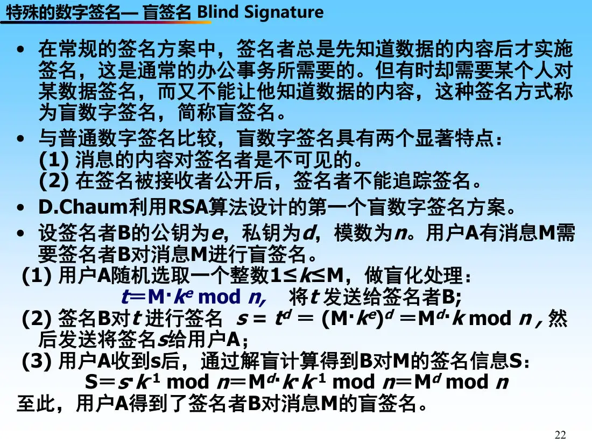

原文：

特殊的数字签名— 盲签名 Blind Signature

在常规的签名方案中，签名者总是先知道数据的内容后才实施签名，这是通常的办公事务所需要的。但有时却需要某个人对某数据签名，而又不能让他知道数据的内容，这种签名方式称为盲数字签名，简称盲签名。

• 与普通数字签名比较，盲数字签名具有两个显著特点：

(1) 消息的内容对签名者是不可见的。

(2) 在签名被接收者公开后，签名者不能追踪签名。

• D.Chaum利用RSA算法设计的第一个盲数字签名方案。

• 设签名者B的公钥为 $\pmb { e } _ { \pmb { \jmath } }$ ，私钥为 $\mathbf { \delta } _ { d , \mathrm { ~ ~  ~ } }$ 模数为 $m _ { 0 }$ 。用户A有消息M需要签名者B对消息M进行盲签名。

(1) 用户A随机选取一个整数 $1 \leq k \leq M$ ，做盲化处理：

$t { = } \mathsf { M } \cdot k ^ { e } \mathsf { m o d } \ n ,$ 将 发送给签名者B;

(2) 签名B对t 进行签名 $\begin{array} { r } { { \mathcal { s } } = t ^ { d } = ( \mathsf { M } ^ { } \cdot k ^ { e } ) ^ { d } = \mathsf { M } ^ { d * } k ^ { \mathrm { { m o d } } \ n } } \end{array}$ 然后发送将签名s给用户A；

(3) 用户A收到s后，通过解盲计算得到B对M的签名信息S：

$S { = } s k ^ { 1 } \mathrm { m o d } \ n { = } \mathsf { M } ^ { d { \circ } } k ^ { \prime } k ^ { 1 } \mathrm { m o d } \ n { = } \mathsf { M } ^ { d } \mathrm { m o d } \ n$ 至此，用户A得到了签名者B对消息M的盲签名。

22

### 群签名

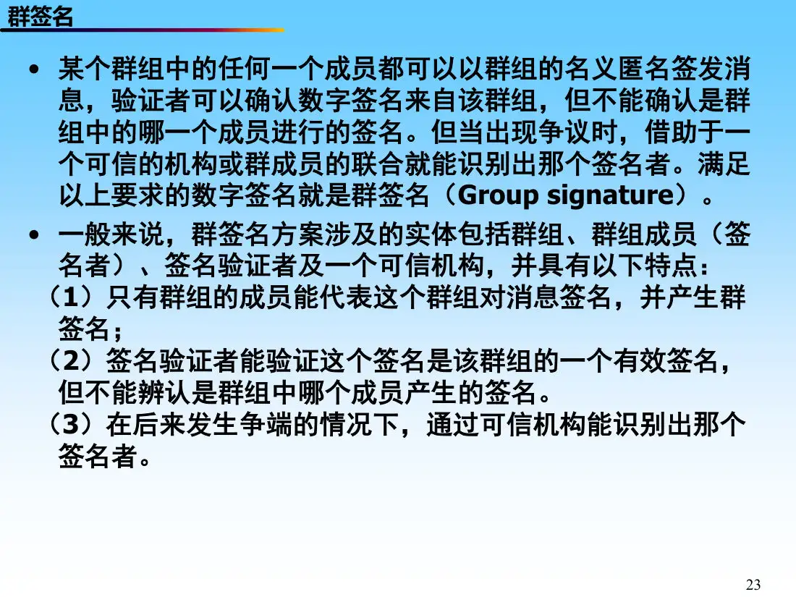

原文：

群签名

某个群组中的任何一个成员都可以以群组的名义匿名签发消息，验证者可以确认数字签名来自该群组，但不能确认是群组中的哪一个成员进行的签名。但当出现争议时，借助于一个可信的机构或群成员的联合就能识别出那个签名者。满足以上要求的数字签名就是群签名（Group signature）。

• 一般来说，群签名方案涉及的实体包括群组、群组成员（签名者）、签名验证者及一个可信机构，并具有以下特点：

（1）只有群组的成员能代表这个群组对消息签名，并产生群签名；

（2）签名验证者能验证这个签名是该群组的一个有效签名，但不能辨认是群组中哪个成员产生的签名。

（3）在后来发生争端的情况下，通过可信机构能识别出那个签名者。

23

### 群签名

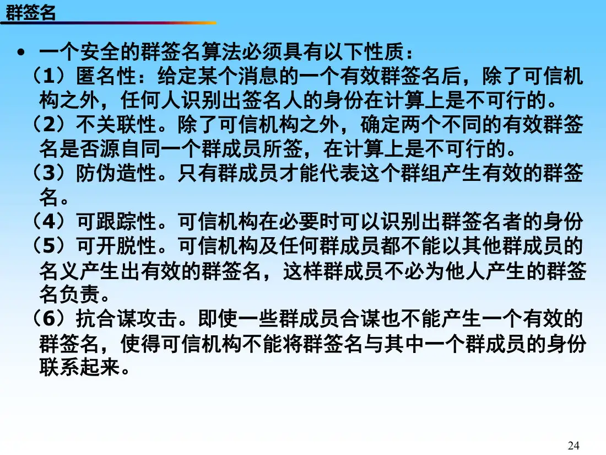

原文：

群签名

• 一个安全的群签名算法必须具有以下性质：

（1）匿名性：给定某个消息的一个有效群签名后，除了可信机构之外，任何人识别出签名人的身份在计算上是不可行的。

（2）不关联性。除了可信机构之外，确定两个不同的有效群签名是否源自同一个群成员所签，在计算上是不可行的。

（3）防伪造性。只有群成员才能代表这个群组产生有效的群签名。

（4）可跟踪性。可信机构在必要时可以识别出群签名者的身份

（5）可开脱性。可信机构及任何群成员都不能以其他群成员的名义产生出有效的群签名，这样群成员不必为他人产生的群签名负责。

（6）抗合谋攻击。即使一些群成员合谋也不能产生一个有效的群签名，使得可信机构不能将群签名与其中一个群成员的身份联系起来。

24

### \- 一次数字签名方案

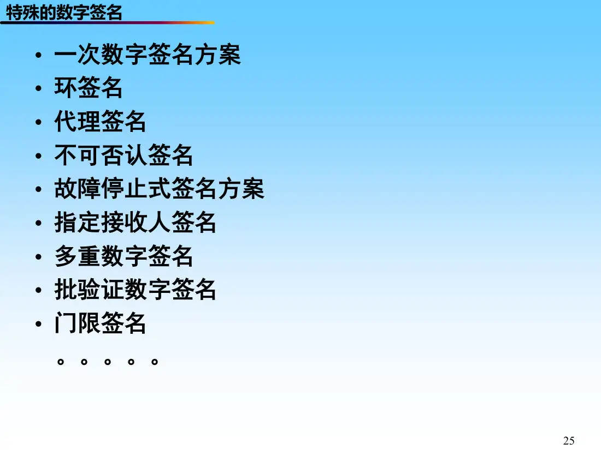

原文：

\- 一次数字签名方案
- 环签名
- 代理签名
- 不可否认签名
- 故障停止式签名方案
- 指定接收人签名
- 多重数字签名
- 批验证数字签名
- 门限签名
。。。。。。

特殊的数字签名

25

### 题目

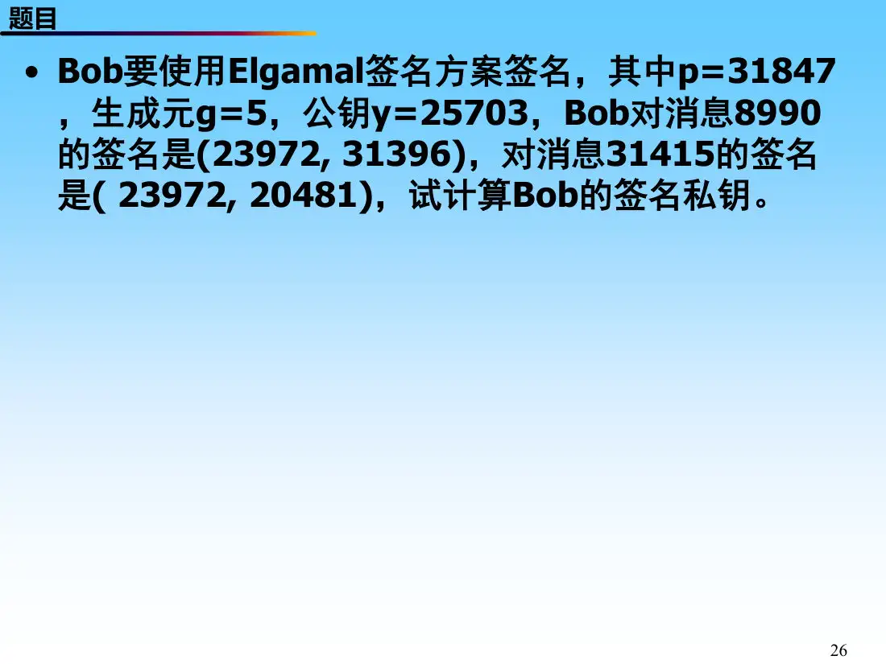

原文：

题目

Bob要使用Elgamal签名方案签名，其中p=31847生成元g=5，公钥y=25703，Bob对消息8990的签名是(23972, 31396)，对消息31415的签名是( 23972, 20481)，试计算Bob的签名私钥。

26
