# 《密码学》第9章 身份识别技术（课件）

原件的每一页，下面附识别出的文字。

### 第九章身份识别方案

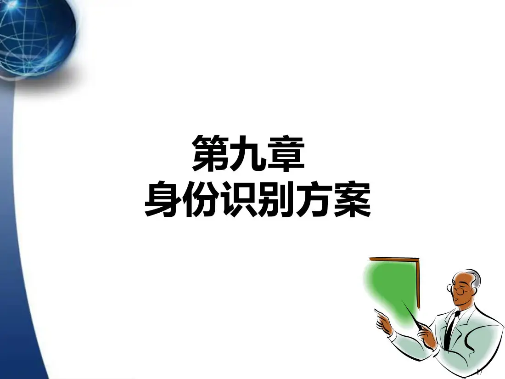

原文：

第九章身份识别方案

### 一、基本原理

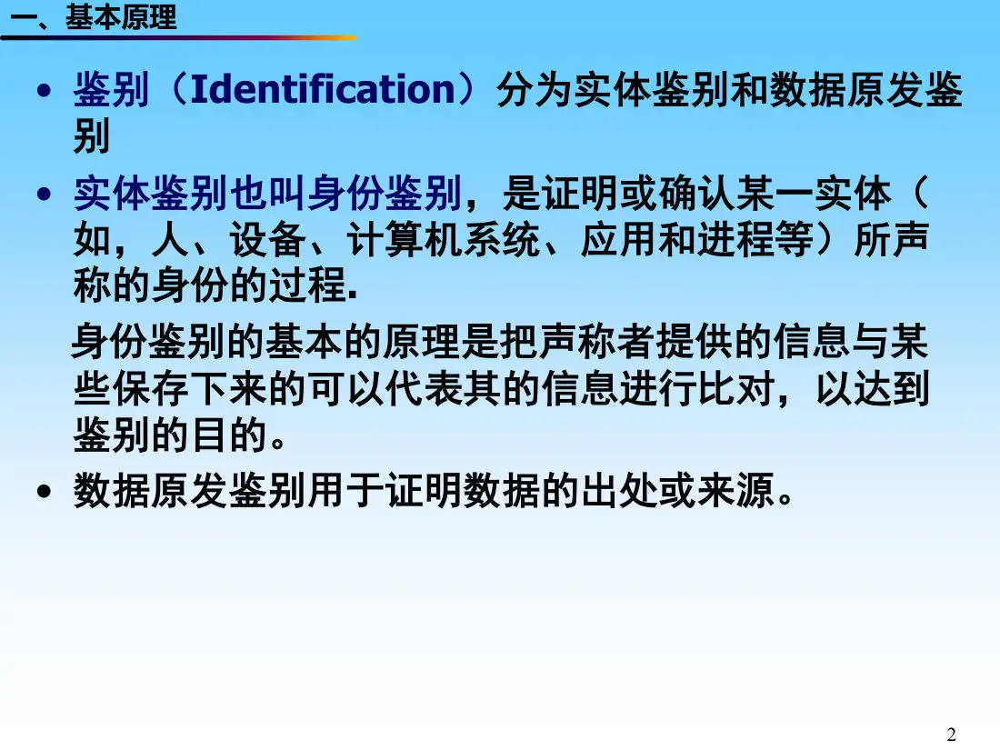

原文：

一、基本原理

• 鉴别（Identification）分为实体鉴别和数据原发鉴别

实体鉴别也叫身份鉴别，是证明或确认某一实体（如，人、设备、计算机系统、应用和进程等）所声称的身份的过程.

身份鉴别的基本的原理是把声称者提供的信息与某些保存下来的可以代表其的信息进行比对，以达到鉴别的目的。

• 数据原发鉴别用于证明数据的出处或来源。

2

### 身份识别的要素

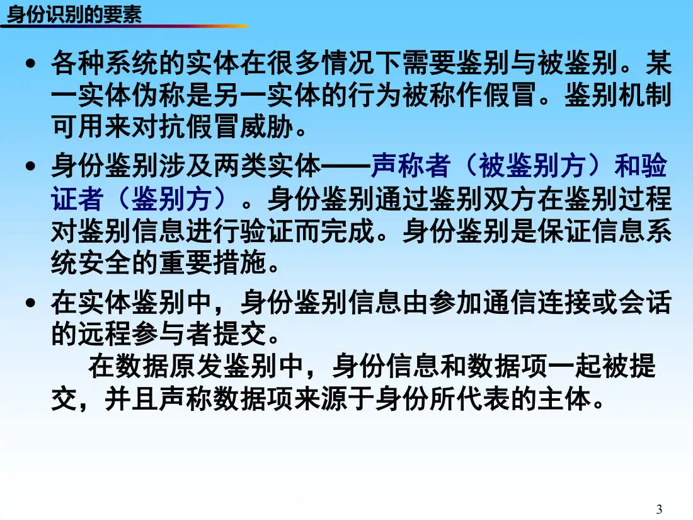

原文：

身份识别的要素

各种系统的实体在很多情况下需要鉴别与被鉴别。某一实体伪称是另一实体的行为被称作假冒。鉴别机制可用来对抗假冒威胁。

• 身份鉴别涉及两类实体——声称者（被鉴别方）和验证者（鉴别方）。身份鉴别通过鉴别双方在鉴别过程对鉴别信息进行验证而完成。身份鉴别是保证信息系统安全的重要措施。

• 在实体鉴别中，身份鉴别信息由参加通信连接或会话的远程参与者提交。

在数据原发鉴别中，身份信息和数据项一起被提交，并且声称数据项来源于身份所代表的主体。

3

### • 依据鉴别信息是否共享对鉴别分类：

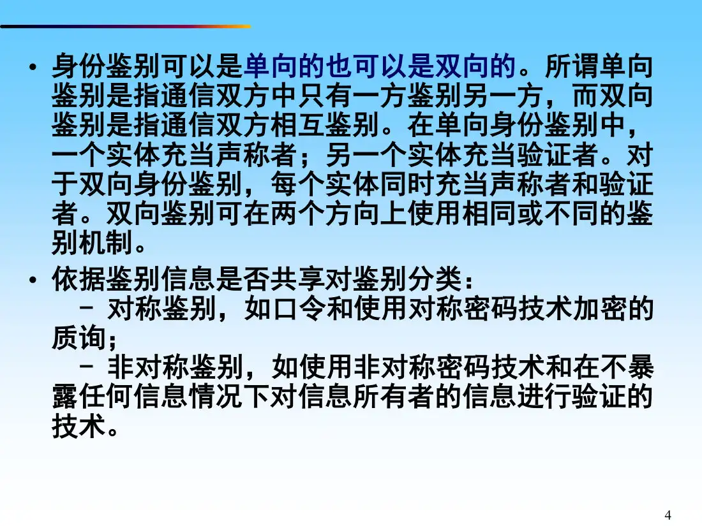

原文：

身份鉴别可以是单向的也可以是双向的。所谓单向鉴别是指通信双方中只有一方鉴别另一方，而双向鉴别是指通信双方相互鉴别。在单向身份鉴别中，一个实体充当声称者；另一个实体充当验证者。对于双向身份鉴别，每个实体同时充当声称者和验证者。双向鉴别可在两个方向上使用相同或不同的鉴别机制。

• 依据鉴别信息是否共享对鉴别分类：

\- 对称鉴别，如口令和使用对称密码技术加密的质询；

\- 非对称鉴别，如使用非对称密码技术和在不暴露任何信息情况下对信息所有者的信息进行验证的技术。

4

### 身份鉴别的方式

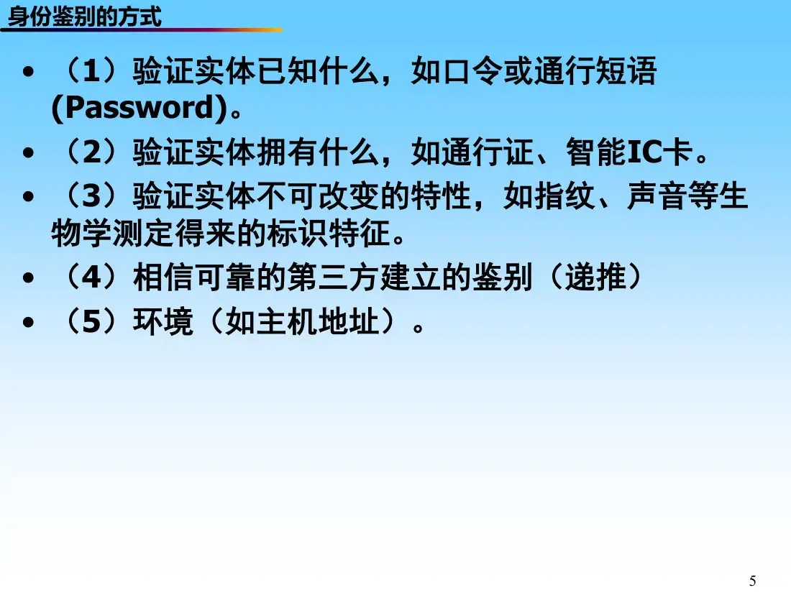

原文：

身份鉴别的方式

（1）验证实体已知什么，如口令或通行短语(Password)。

• （2）验证实体拥有什么，如通行证、智能IC卡。

• （3）验证实体不可改变的特性，如指纹、声音等生物学测定得来的标识特征。

• （4）相信可靠的第三方建立的鉴别（递推）

• （5）环境（如主机地址）。

5

### 基于口令的身份鉴别方案

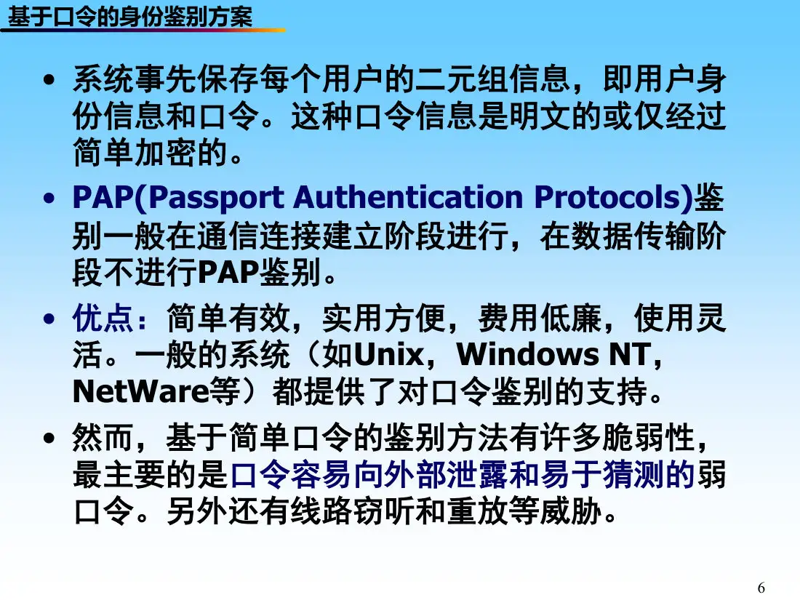

原文：

基于口令的身份鉴别方案

系统事先保存每个用户的二元组信息，即用户身份信息和口令。这种口令信息是明文的或仅经过简单加密的。

PAP(Passport Authentication Protocols)鉴别一般在通信连接建立阶段进行，在数据传输阶段不进行PAP鉴别。

优点：简单有效，实用方便，费用低廉，使用灵活。一般的系统（如Unix，Windows NT，NetWare等）都提供了对口令鉴别的支持。

• 然而，基于简单口令的鉴别方法有许多脆弱性，最主要的是口令容易向外部泄露和易于猜测的弱口令。另外还有线路窃听和重放等威胁。

6

### 基于口令鉴别机制的改进

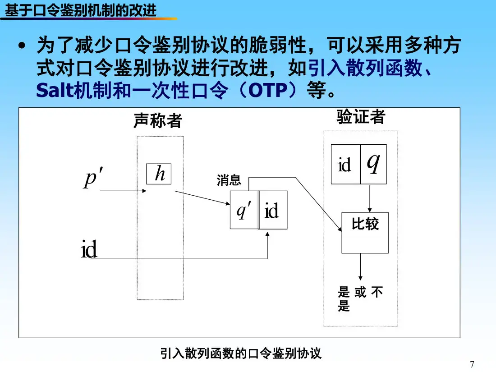

原文：

基于口令鉴别机制的改进

为了减少口令鉴别协议的脆弱性，可以采用多种方式对口令鉴别协议进行改进，如引入散列函数、Salt机制和一次性口令（OTP）等。

7

### Hash的引入

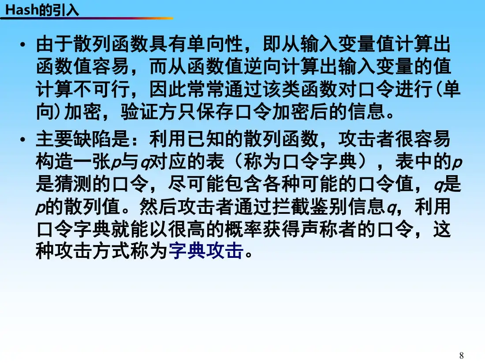

原文：

Hash的引入

由于散列函数具有单向性，即从输入变量值计算出函数值容易，而从函数值逆向计算出输入变量的值计算不可行，因此常常通过该类函数对口令进行(单向)加密，验证方只保存口令加密后的信息。

主要缺陷是：利用已知的散列函数，攻击者很容易构造一张p与q对应的表（称为口令字典），表中的p是猜测的口令，尽可能包含各种可能的口令值，q是的散列值。然后攻击者通过拦截鉴别信息 ，利用口令字典就能以很高的概率获得声称者的口令，这种攻击方式称为字典攻击。

8

### 加Salt机制

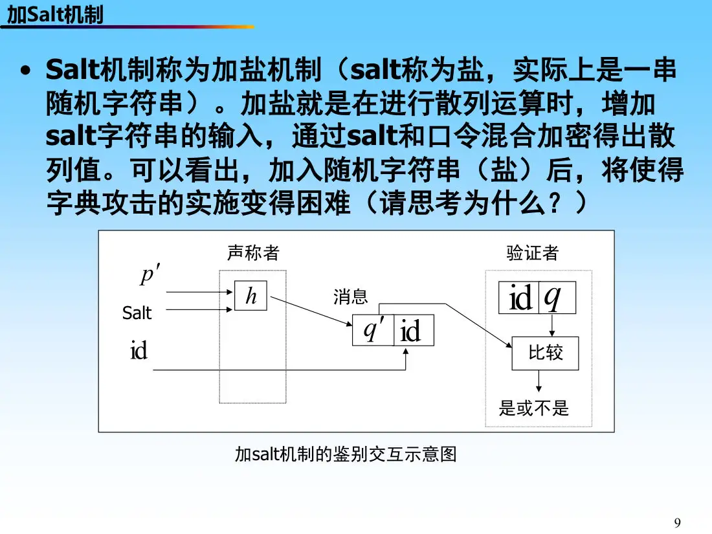

原文：

加Salt机制

Salt机制称为加盐机制（salt称为盐，实际上是一串随机字符串）。加盐就是在进行散列运算时，增加salt字符串的输入，通过salt和口令混合加密得出散列值。可以看出，加入随机字符串（盐）后，将使得字典攻击的实施变得困难（请思考为什么？）

9

### OTP

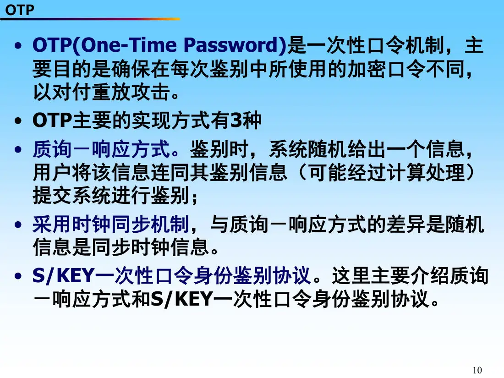

原文：

OTP

• OTP(One-Time Password)是一次性口令机制，主要目的是确保在每次鉴别中所使用的加密口令不同，以对付重放攻击。

• OTP主要的实现方式有3种

质询－响应方式。鉴别时，系统随机给出一个信息用户将该信息连同其鉴别信息（可能经过计算处理）提交系统进行鉴别；

• 采用时钟同步机制，与质询－响应方式的差异是随机信息是同步时钟信息。

• S/KEY一次性口令身份鉴别协议。这里主要介绍质询－响应方式和S/KEY一次性口令身份鉴别协议。

10

### 基于质询-响应的身份识别方案

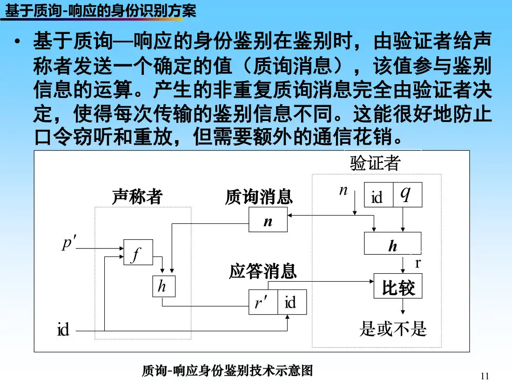

原文：

基于质询-响应的身份识别方案

基于质询—响应的身份鉴别在鉴别时，由验证者给声称者发送一个确定的值（质询消息），该值参与鉴别信息的运算。产生的非重复质询消息完全由验证者决定，使得每次传输的鉴别信息不同。这能很好地防止口令窃听和重放，但需要额外的通信花销。

11

### 质询-响应

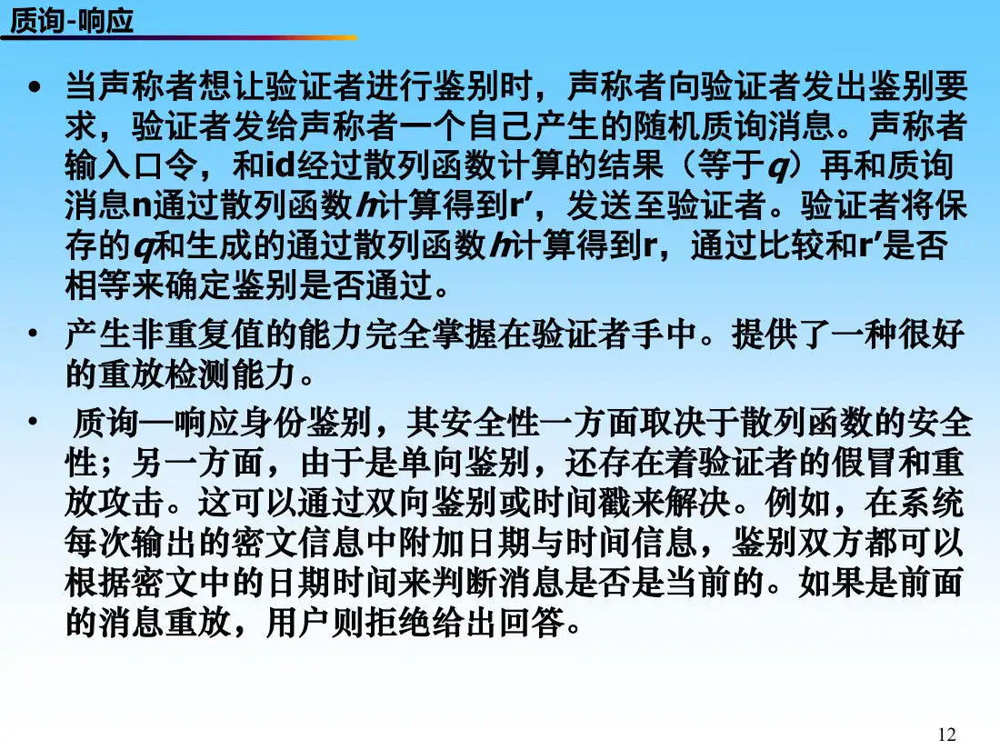

原文：

质询-响应

• 当声称者想让验证者进行鉴别时，声称者向验证者发出鉴别要求，验证者发给声称者一个自己产生的随机质询消息。声称者输入口令，和id经过散列函数计算的结果（等于q）再和质询消息n通过散列函数h计算得到r’，发送至验证者。验证者将保存的q和生成的通过散列函数h计算得到r，通过比较和r’是否相等来确定鉴别是否通过。

• 产生非重复值的能力完全掌握在验证者手中。提供了一种很好的重放检测能力。

质询—响应身份鉴别，其安全性一方面取决于散列函数的安全性；另一方面，由于是单向鉴别，还存在着验证者的假冒和重放攻击。这可以通过双向鉴别或时间戳来解决。例如，在系统每次输出的密文信息中附加日期与时间信息，鉴别双方都可以根据密文中的日期时间来判断消息是否是当前的。如果是前面的消息重放，用户则拒绝给出回答。

12

### S/Key一次性口令身份鉴别方案

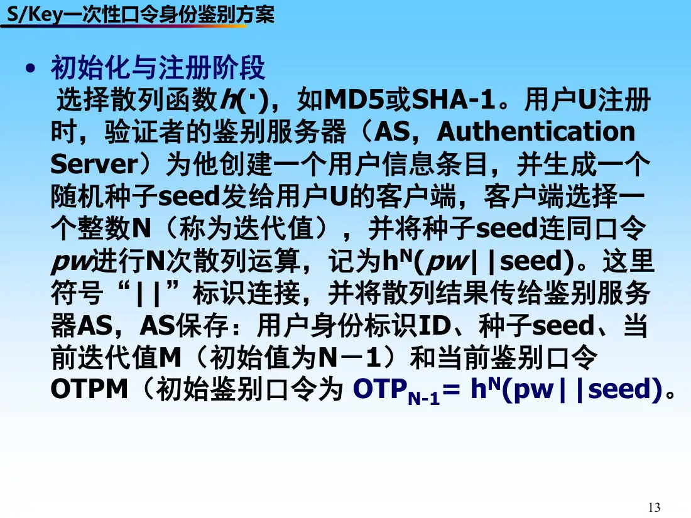

原文：

S/Key一次性口令身份鉴别方案

• 初始化与注册阶段

选择散列函数h(·)，如MD5或SHA-1。用户U注册时，验证者的鉴别服务器（AS，AuthenticationServer）为他创建一个用户信息条目，并生成一个随机种子seed发给用户U的客户端，客户端选择一个整数N（称为迭代值），并将种子seed连同口令进行N次散列运算，记为hN( ||seed)。这里符号“||”标识连接，并将散列结果传给鉴别服务器AS，AS保存：用户身份标识ID、种子seed、当前迭代值M（初始值为N－1）和当前鉴别口令OTPM（初始鉴别口令为 $\mathbf { O T P _ { N - 1 } } \mathbf { = } \mathbf { h ^ { N } } ( \mathbf { p w } \mid \mathbf { | \Lambda _ { S e e d } } )$

13

### • 身份鉴别阶段

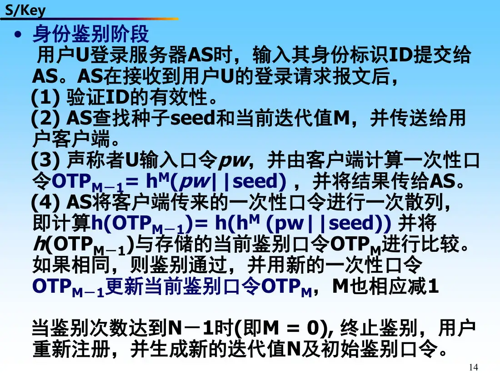

原文：

• 身份鉴别阶段

用户U登录服务器AS时，输入其身份标识ID提交给AS。AS在接收到用户U的登录请求报文后，

(1) 验证ID的有效性。

(2) AS查找种子seed和当前迭代值M，并传送给用户客户端。

(3) 声称者U输入口令pw，并由客户端计算一次性口$\mathfrak { P } _ { \mathrm { u - 1 } } \mathrm { = } \mathsf { h } ^ { \mathsf { M } } ( \rho w$ |seed) ，并将结果传给AS。

(4) AS将客户端传来的一次性口令进行一次散列，即计算 $\mathsf { h } ( { \bf O } ^ { \top } { \bf P } _ { \mathsf { M - 1 } } ) = \mathsf { h } ( \mathsf { h } ^ { \mathsf { M } } \left( \mathsf { p w } \mid \mathsf { s e e d } \right) )$ 并将$H ( 0 \mathsf { T P } _ { \mathsf { M - 1 } } )$ 与存储的当前鉴别口令 $\mathbf { o r p } _ { \mathbf { \eta } _ { \mathbf { M } } }$ 进行比较。如果相同，则鉴别通过，并用新的一次性口令$\bf { 0 T P _ { M - 1 } }$ 更新当前鉴别口令 $\mathbf { o } _ { \mathsf { T } } \mathbf { P } _ { \mathsf { M } }$ ，M也相应减1

当鉴别次数达到N－1时(即 $\mathbf { M } = \mathbf { 0 } )$ , 终止鉴别，用户重新注册，并生成新的迭代值N及初始鉴别口令。

S/Key

14

### S/Key

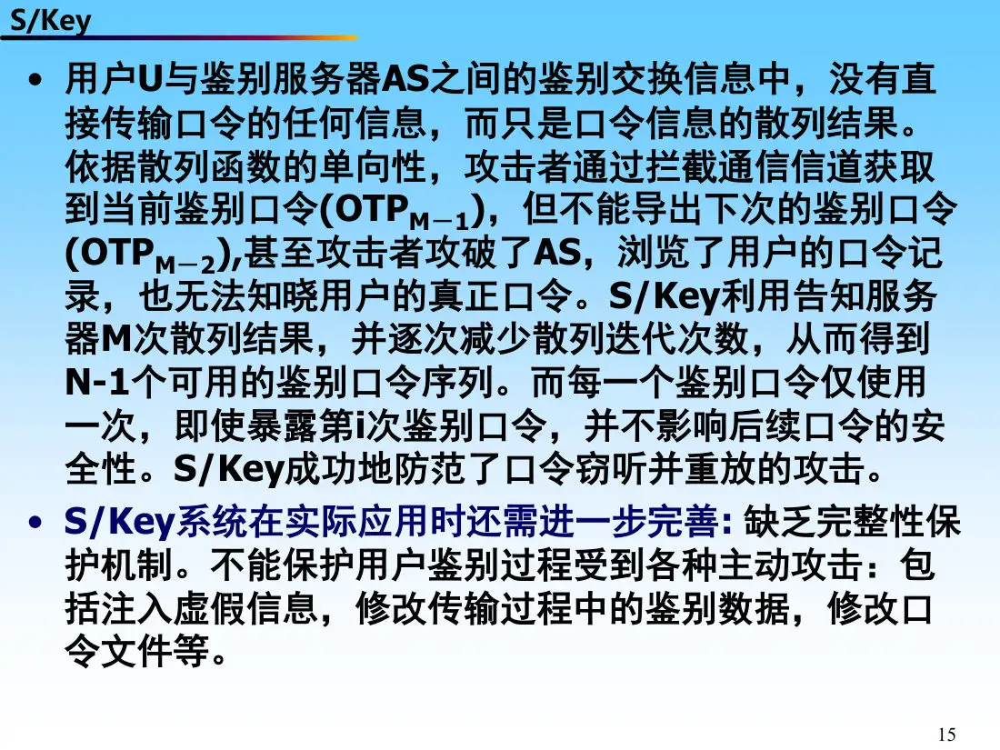

原文：

S/Key

用户U与鉴别服务器AS之间的鉴别交换信息中，没有直接传输口令的任何信息，而只是口令信息的散列结果。依据散列函数的单向性，攻击者通过拦截通信信道获取到当前鉴别口令 $\mathbf { ( o T P _ { M - 1 } ) }$ 但不能导出下次的鉴别口令$( 0 \mathsf { T P } _ { \mathsf { M } - 2 } )$ ,甚至攻击者攻破了AS，浏览了用户的口令记录，也无法知晓用户的真正口令。S/Key利用告知服务器M次散列结果，并逐次减少散列迭代次数，从而得到N-1个可用的鉴别口令序列。而每一个鉴别口令仅使用一次，即使暴露第i次鉴别口令，并不影响后续口令的安全性。S/Key成功地防范了口令窃听并重放的攻击。

• S/Key系统在实际应用时还需进一步完善: 缺乏完整性保护机制。不能保护用户鉴别过程受到各种主动攻击：包括注入虚假信息，修改传输过程中的鉴别数据，修改口令文件等。

15

### 基于身份特征的身份识别

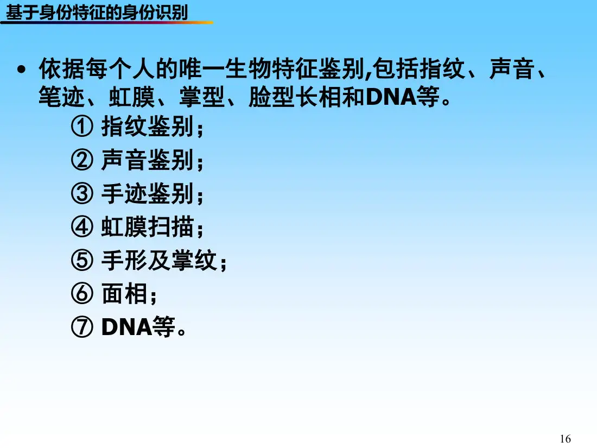

原文：

基于身份特征的身份识别

依据每个人的唯一生物特征鉴别,包括指纹、声音、笔迹、虹膜、掌型、脸型长相和DNA等。

① 指纹鉴别；

② 声音鉴别；

③ 手迹鉴别；

④ 虹膜扫描；

⑤ 手形及掌纹；

⑥ 面相；

⑦ DNA等。

16

### 零知识证明和身份鉴别方案

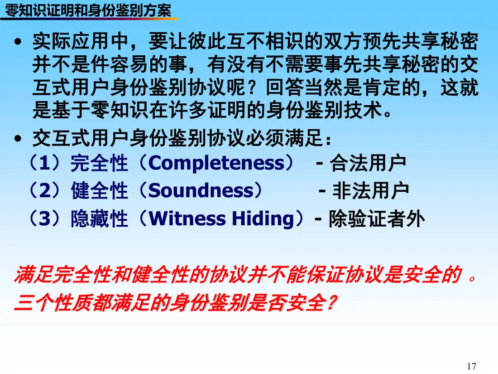

原文：

零知识证明和身份鉴别方案

实际应用中，要让彼此互不相识的双方预先共享秘密并不是件容易的事，有没有不需要事先共享秘密的交互式用户身份鉴别协议呢？回答当然是肯定的，这就是基于零知识在许多证明的身份鉴别技术。

• 交互式用户身份鉴别协议必须满足：

（1）完全性（Completeness） - 合法用户

（2）健全性（Soundness） - 非法用户

（3）隐藏性（Witness Hiding）- 除验证者外

满足完全性和健全性的协议并不能保证协议是安全的。

三个性质都满足的身份鉴别是否安全？

17

### 证明方法

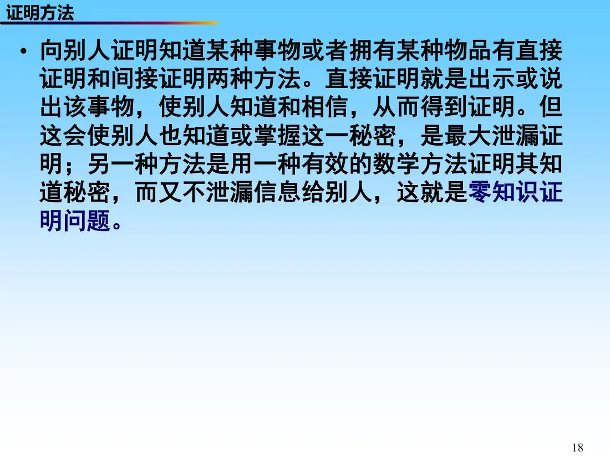

原文：

证明方法

向别人证明知道某种事物或者拥有某种物品有直接证明和间接证明两种方法。直接证明就是出示或说出该事物，使别人知道和相信，从而得到证明。但这会使别人也知道或掌握这一秘密，是最大泄漏证明；另一种方法是用一种有效的数学方法证明其知道秘密，而又不泄漏信息给别人，这就是零知识证明问题。

18

### 零知识证明的实例

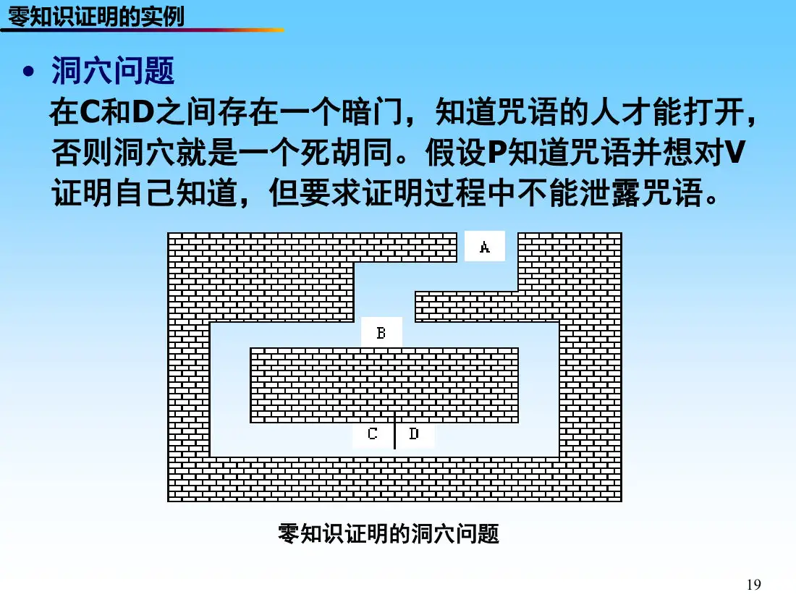

原文：

零知识证明的实例

• 洞穴问题

在C和D之间存在一个暗门，知道咒语的人才能打开，否则洞穴就是一个死胡同。假设P知道咒语并想对V证明自己知道，但要求证明过程中不能泄露咒语。

19

### 洞穴问题

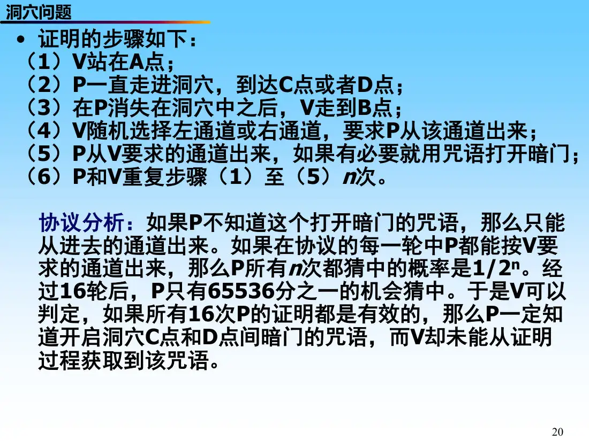

原文：

洞穴问题

• 证明的步骤如下：

（1）V站在A点；

（2）P一直走进洞穴，到达C点或者D点；

（3）在P消失在洞穴中之后，V走到B点；

（4）V随机选择左通道或右通道，要求P从该通道出来；

（5）P从V要求的通道出来，如果有必要就用咒语打开暗门；

（6）P和V重复步骤（1）至（5）n次。

协议分析：如果P不知道这个打开暗门的咒语，那么只能从进去的通道出来。如果在协议的每一轮中P都能按V要求的通道出来，那么P所有n次都猜中的概率是1/2n。经过16轮后，P只有65536分之一的机会猜中。于是V可以判定，如果所有16次P的证明都是有效的，那么P一定知道开启洞穴C点和D点间暗门的咒语，而V却未能从证明过程获取到该咒语。

20

### 协议的分析

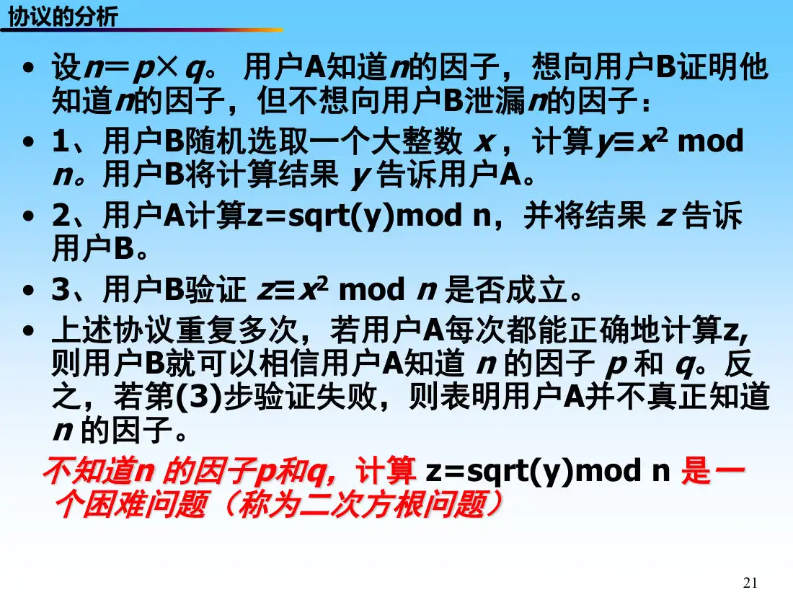

原文：

协议的分析

• 设 $\scriptstyle { n = p \times q _ { \circ } }$ 用户A知道n的因子，想向用户B证明他知道n的因子，但不想向用户B泄漏n的因子：

• 1、用户B随机选取一个大整数 x，计算 $\scriptstyle \gamma \equiv x ^ { 2 } { \mathrm { ~ m o d } }$ 用户B将计算结果 告诉用户A。

• 2、用户A计算z=sqrt(y)mod n，并将结果 z 告诉用户B。

• 3、用户B验证 $z { \equiv } x ^ { 2 } \bmod n$ 是否成立。

上述协议重复多次，若用户A每次都能正确地计算 $z _ { \prime }$ 则用户B就可以相信用户A知道 n 的因子 $\pmb { p }$ 和 $\pmb q _ { 0 }$ 。反之，若第(3)步验证失败，则表明用户A并不真正知道的因子。

计算 z=sqrt(y)mod n 是个困难问题（称为二次方根问题）

21

### Fiege-Fiat-Shamir的身份识别方案

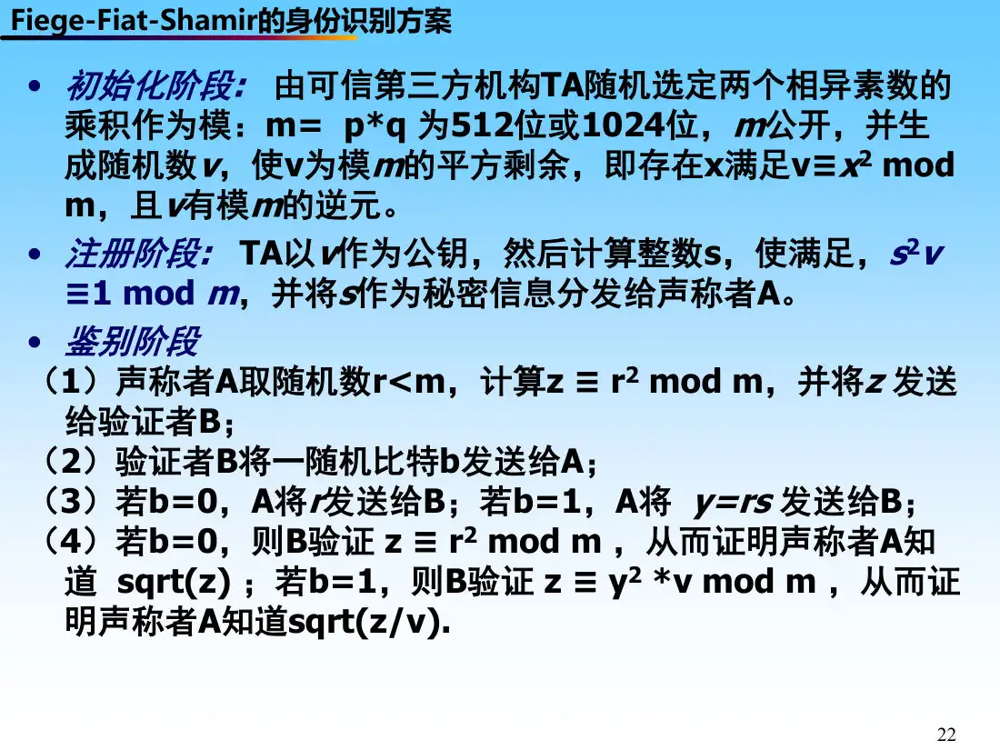

原文：

Fiege-Fiat-Shamir的身份识别方案

• 初始化阶段: 由可信第三方机构TA随机选定两个相异素数的乘积作为模： $\mathrm { \bf m } = \mathrm { \bf ~ p } ^ { * } { \bf q }$ 为512位或1024位，m公开，并生成随机数v，使v为模m的平方剩余，即存在x满足 $\mathbf { v } \equiv x ^ { 2 } { \mathrm { ~ m o d } }$ m，且v有模m的逆元。

• 注册阶段: TA以v作为公钥，然后计算整数s，使满足， $s ^ { 2 } V$ ≡1 mod m，并将s作为秘密信息分发给声称者A。

• 鉴别阶段

（1）声称者A取随机数 $\mathbf { r } { < } \mathbf { m }$ ，计算 $z \equiv { \sf r } ^ { 2 } { \sf m o d } { \sf m }$ 并将z发送给验证者B；

（2）验证者B将一随机比特b发送给A；

（3）若b=0，A将r发送给B；若b=1，A将 $y { = } r s$ 发送给B；

（4）若b=0，则B验证 $z \equiv r ^ { 2 } { \bmod { \mathrm { m } } }$ ，从而证明声称者A知道 sqrt(z) ；若b=1，则B验证 $\mathbf { z } \equiv \mathbf { y } ^ { 2 } \cdots \mathbf { v } { \mathrm { ~ m o d ~ m } }$ ，从而证明声称者A知道 $\bf s q r t ( z / v )$

22

### FFS 方案

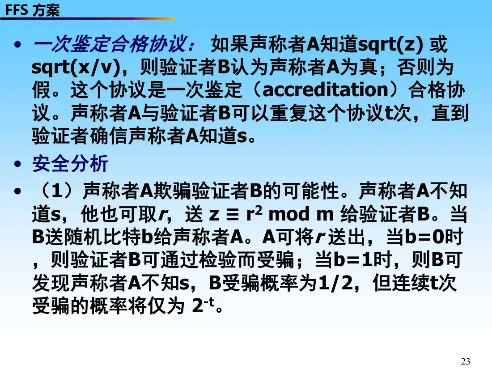

原文：

FFS 方案

一次鉴定合格协议： 如果声称者A知道sqrt(z) 或sqrt(x/v)，则验证者B认为声称者A为真；否则为假。这个协议是一次鉴定（accreditation）合格协议。声称者A与验证者B可以重复这个协议t次，直到验证者确信声称者A知道s。

• 安全分析

• （1）声称者A欺骗验证者B的可能性。声称者A不知道s，他也可取r，送 $z \equiv { \sf r } ^ { 2 } { \sf m o d } { \sf m }$ 给验证者B。当B送随机比特b给声称者A。A可将r送出，当 $\mathtt { b } \equiv \mathtt { 0 }$ 时则验证者B可通过检验而受骗；当b=1时，则B可发现声称者A不知s，B受骗概率为1/2，但连续t次受骗的概率将仅为 $z ^ { t }$

23

### FFS方案

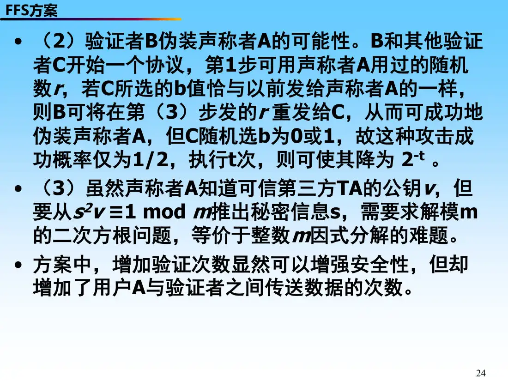

原文：

FFS方案

（2）验证者B伪装声称者A的可能性。B和其他验证者C开始一个协议，第1步可用声称者A用过的随机数r，若C所选的b值恰与以前发给声称者A的一样，则B可将在第（3）步发的r重发给C，从而可成功地伪装声称者A，但C随机选b为0或1，故这种攻击成功概率仅为1/2，执行t次，则可使其降为 2-t 。

• （3）虽然声称者A知道可信第三方TA的公钥v，但要从s ≡1 mod 推出秘密信息s，需要求解模m的二次方根问题，等价于整数m因式分解的难题。

• 方案中，增加验证次数显然可以增强安全性，但却增加了用户A与验证者之间传送数据的次数。

24

### Guillou-Quisquater身份方案

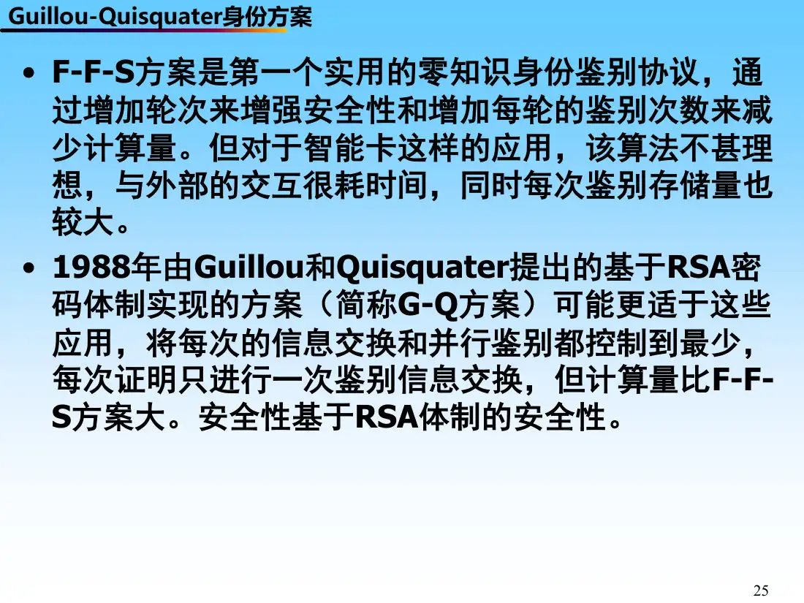

原文：

Guillou-Quisquater身份方案

• F-F-S方案是第一个实用的零知识身份鉴别协议，通过增加轮次来增强安全性和增加每轮的鉴别次数来减少计算量。但对于智能卡这样的应用，该算法不甚理想，与外部的交互很耗时间，同时每次鉴别存储量也较大。

• 1988年由Guillou和Quisquater提出的基于RSA密码体制实现的方案（简称G-Q方案）可能更适于这些应用，将每次的信息交换和并行鉴别都控制到最少，每次证明只进行一次鉴别信息交换，但计算量比F-F-S方案大。安全性基于RSA体制的安全性。

25

### G-Q方案

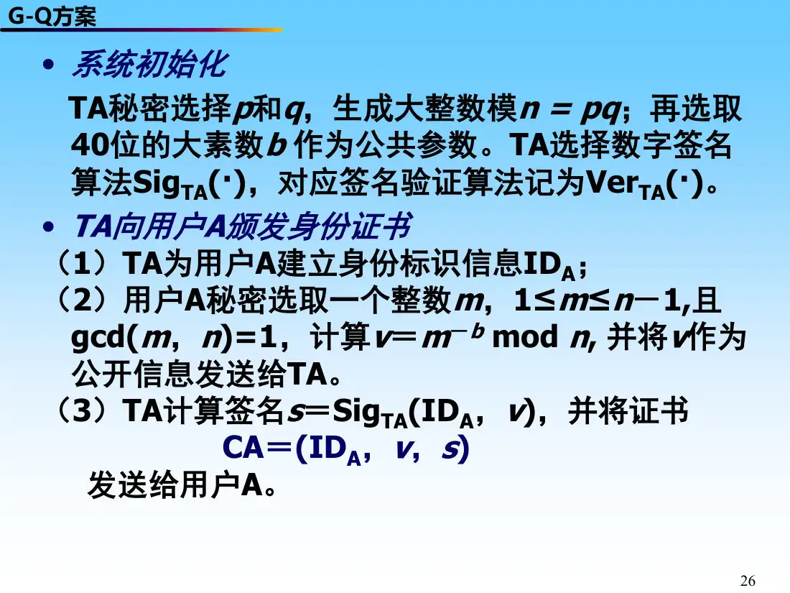

原文：

G-Q方案

• 系统初始化

TA秘密选择p和q，生成大整数模 $n = p q _ { \mathrm { { 3 } } }$ 再选取40位的大素数b作为公共参数。TA选择数字签名算法 $S i g _ { \mathrm { T A } } ( \cdot )$ 对应签名验证算法记为 $\mathsf { V e r } _ { \mathsf { T A } } ( { \mathsf { \Omega } } )$

• TA向用户A颁发身份证书

（1）TA为用户A建立身份标识信息 $\mathbf { I D _ { A } }$ ；

（2）用户A秘密选取一个整数m， $1 \leq m \leq n - 1 ,$ 且$\mathfrak { g c d } ( m , \ n ) { = } 1$ ，计算 $\scriptstyle { \pmb { v } } = { \pmb { m } } ^ { - { \pmb { b } } } \operatorname { m o d } \ n _ { \pmb { \eta } } ,$ 并将v作为公开信息发送给TA。

（3）TA计算签名 $s { = } s | _ { \mathfrak { g _ { \mathrm { T A } } } } ( \mathbf { I D } _ { \mathsf { A } } , \mathbf { \Omega } _ { V } )$ 并将证书$\mathsf { C A } { = } ( \mathbf { I D } _ { \mathsf { A } } , \mathrm { ~ } \nu , \mathrm { ~ } s )$ 发送给用户A。

26

### G-Q方案

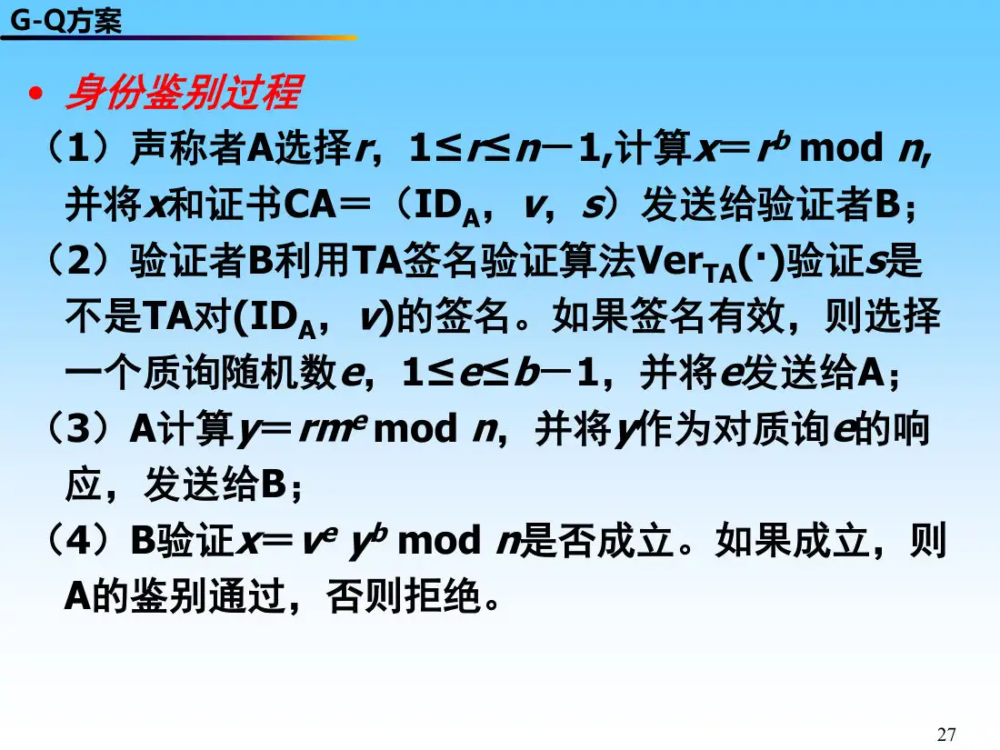

原文：

G-Q方案

• 身份鉴别过程

（1）声称者A选择r， $1 \leq r \leq n - 1$ ,计算 $x { = } r ^ { b } \operatorname { m o d } n ,$ 并将x和证书 ${ \bf C A } = { \bf \Psi } ( { \bf I D } _ { \bf A } , { \bf \Psi } { \bf \Psi } , { \bf \Psi } { \bf \Psi } { \bf \Psi } )$ 发送给验证者B；

（2）验证者B利用TA签名验证算法 $\mathsf { V e r } _ { \mathsf { T A } } ( { \mathsf { \Omega } } )$ 验证s是不是TA对 $( \mathbf { I D _ { A } }$ v)的签名。如果签名有效，则选择一个质询随机数 $\pmb { e } ,$ $1 \leq e \leq b - 1$ 并将e发送给A；

（3）A计算 $\gamma { = } r m ^ { e } \bmod n ,$ 并将y作为对质询e的响应，发送给B；

（4）B验证 $x { = } v ^ { e } \gamma ^ { b } \ m { \bf { o } } { \bf { d } } \ n$ 是否成立。如果成立，则A的鉴别通过，否则拒绝。

27

### G-Q方案交互示意图

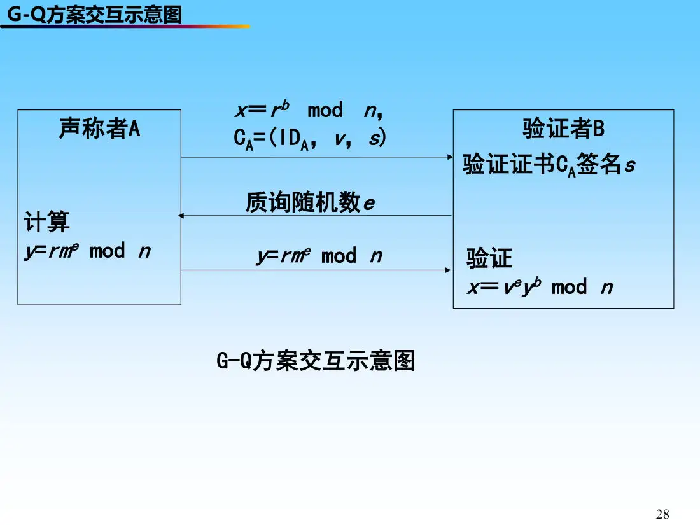

原文：

G-Q方案交互示意图

声称者A

计算

$y = r m ^ { e }$ mod

$x { = } r ^ { b }$ mod ，

$$
\mathsf {C} _ {\mathsf {A}} = (\mathsf {I D} _ {\mathsf {A}}, \nu , s)
$$

质询随机数e

$$
y = r m ^ {e} \mod n
$$

G-Q方案交互示意图

验证者B

验证证书 ${ \tt C } _ { \tt A }$ 签名s

验证

$$
x = v ^ {e} y ^ {b}
$$

28

### G-Q方案

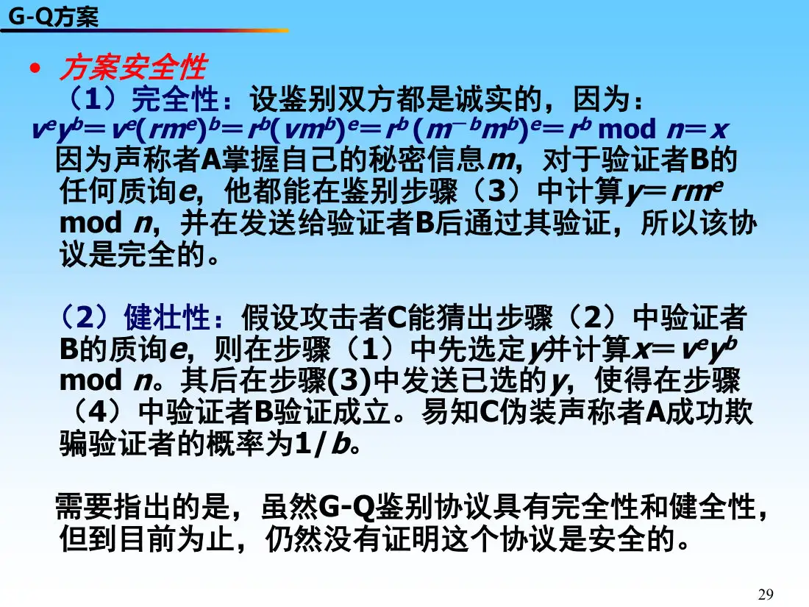

原文：

G-Q方案

• 方案安全性

（1）完全性：设鉴别双方都是诚实的，因为：

$\nu ^ { e } \gamma ^ { b } = \nu ^ { e } ( r m e ) ^ { b } = r ^ { b } ( \nu / { m } ^ { b } ) ^ { e } = r ^ { b } ( m ^ { - b } / { m } ^ { b } ) ^ { e } = r ^ { b } \bmod n = x$ 因为声称者A掌握自己的秘密信息 $m ,$ 对于验证者B的任何质询 $\pmb { e } _ { \pmb { \jmath } }$ ，他都能在鉴别步骤（3）中计算 $\scriptstyle \gamma = r m ^ { e }$ mod $\pmb { \eta } _ { \pmb { \eta } }$ ，并在发送给验证者B后通过其验证，所以该协议是完全的。

（2）健壮性：假设攻击者C能猜出步骤（2）中验证者B的质询 $\pmb { e } _ { \pmb { \jmath } }$ ，则在步骤（1）中先选定y并计算 $x = \nu ^ { e } \nu ^ { b }$ mod $m _ { 0 }$ 。其后在步骤(3)中发送已选的 $\pmb { \gamma } ,$ 使得在步骤（4）中验证者B验证成立。易知C伪装声称者A成功欺骗验证者的概率为 $\pmb { 1 / b _ { c } }$

需要指出的是，虽然G-Q鉴别协议具有完全性和健全性，但到目前为止，仍然没有证明这个协议是安全的。

29

### Schnorr身份鉴别方案

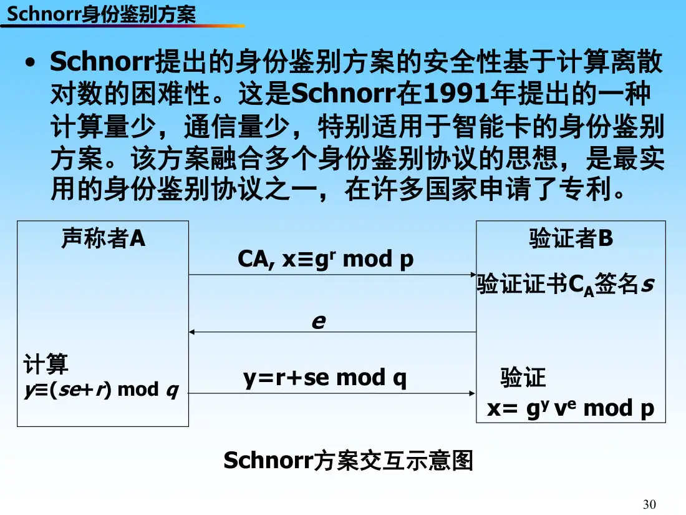

原文：

Schnorr身份鉴别方案

• Schnorr提出的身份鉴别方案的安全性基于计算离散对数的困难性。这是Schnorr在1991年提出的一种计算量少，通信量少，特别适用于智能卡的身份鉴别方案。该方案融合多个身份鉴别协议的思想，是最实用的身份鉴别协议之一，在许多国家申请了专利。

$$
\begin{array}{c c c} \text {声称者A} & \text {验证者B} \\ & \text {验证证书C} _ {\mathrm{A}} \text {签名s} \\ & e \\ \text {计算} & y = r + s e \bmod q \\ y \equiv (s e + r) \bmod q & \text {验证} \\ & x = g ^ {y} v ^ {e} \bmod p \end{array}
$$

Schnorr方案交互示意图

30

### Schnorr方案

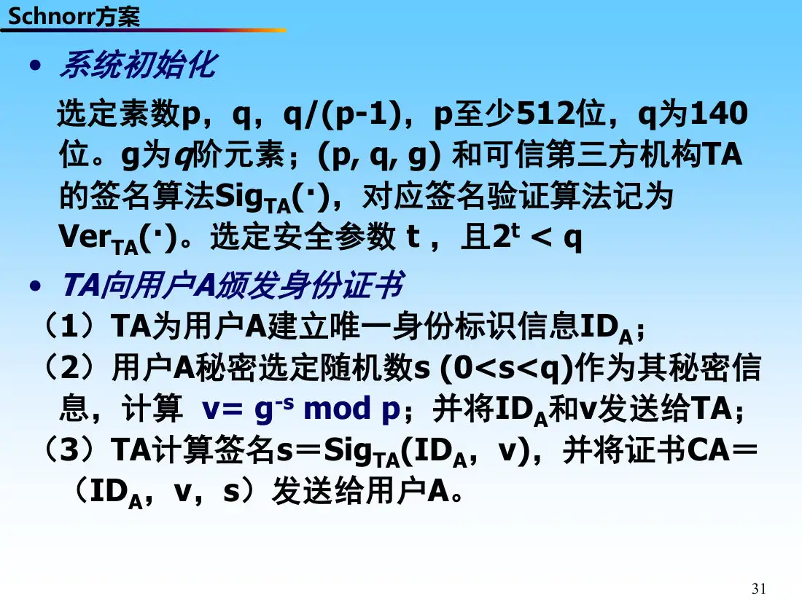

原文：

Schnorr方案

• 系统初始化

选定素数p， ${ \bf q } , { \bf q } / ( { \bf p } - { \bf 1 } )$ ，p至少512位，q为140位。g为q阶元素； $( \boldsymbol { \mathsf { p } } , \boldsymbol { \mathsf { q } } , \boldsymbol { \mathsf { g } } )$ 和可信第三方机构TA的签名算法 $S i g _ { T A } ( \cdot )$ 对应签名验证算法记为$\mathsf { V e r } _ { \mathsf { T A } } ( { \mathsf { \Omega } } )$ 选定安全参数 t ，且 $2 ^ { \mathfrak { t } } < \mathfrak { q }$

• TA向用户A颁发身份证书

（1）TA为用户A建立唯一身份标识信息 $\mathbf { I D _ { A } }$ ；

（2）用户A秘密选定随机数s $( 0 < s < \mathbf { q } )$ 作为其秘密信息，计算 $\mathbf { v } { = } \mathbf { \vec { g } } ^ { - s } \mathrm { m o d } \mathrm { ~ \vec { p } ~ }$ ；并将 $\mathbf { I D _ { A } }$ 和v发送给TA；

（3）TA计算签名 $s { = } s | \mathfrak { g } _ { \mathtt { T A } } ( \mathbf { I D } _ { \mathtt { A } } , \textbf { v } )$ ，并将证书 $\mathbf { C A } =$ （I $\mathsf { D } _ { \mathsf { A } } , ~ \mathsf { v } , ~ \mathsf { s } )$ 发送给用户A。

31

### Schnorr方案

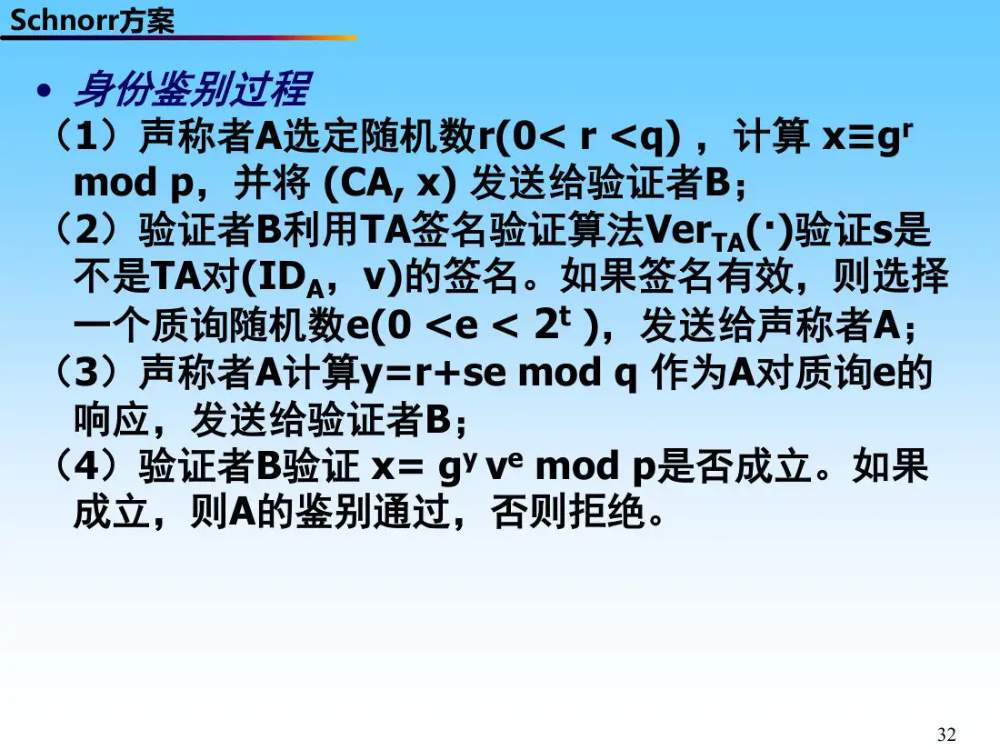

原文：

Schnorr方案

• 身份鉴别过程

（1）声称者A选定随机数 $\mathrm { { r } } ( 0 < \mathrm { { r } } < { \bf { q } } )$ ，计算 $\mathbf { \boldsymbol { x } } \equiv \mathbf { \boldsymbol { g } } ^ { \mathbf { \check { r } } }$ mod p，并将 $( \mathbb { C } \mathbb { A } , \mathbb { x } )$ 发送给验证者B；

（2）验证者B利用TA签名验证算法 $\mathsf { V e r } _ { \mathsf { T A } } ( { \mathsf { \Omega } } )$ 验证s是不是TA对 $( \mathbb { I } \mathbb { D } _ { \mathbb { A } } , \ \mathbb { v } )$ 的签名。如果签名有效，则选择一个质询随机数 $\mathrm { e } ( 0 < \mathrm { e } < 2 ^ { \mathrm { t } } )$ 发送给声称者A；

（3）声称者A计算y=r+se mod q 作为A对质询e的响应，发送给验证者B；

（4）验证者B验证 $\mathbf { x } { = } \mathbf { g } ^ { \mathbf { } \mathbf { } \mathbf { } } \mathbf { v } ^ { \mathbf { e } } \mathbf { m o d } \mathbf { \rho } \mathbf { p }$ 是否成立。如果成立，则A的鉴别通过，否则拒绝。

32

### Schnorr方案 安全性

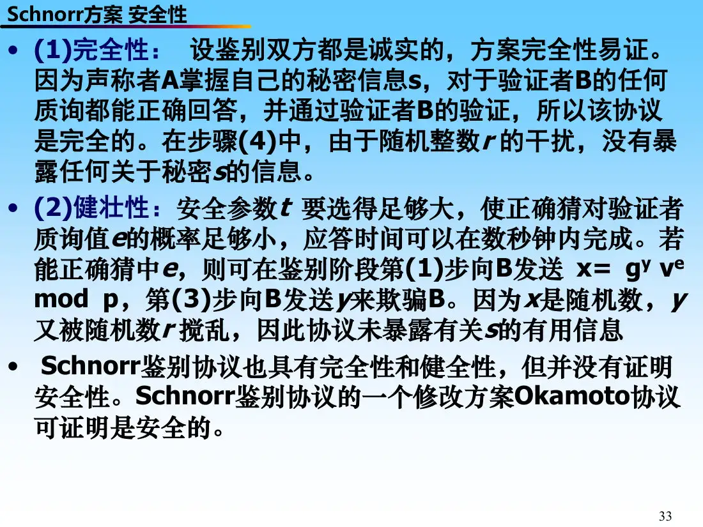

原文：

Schnorr方案 安全性

(1)完全性： 设鉴别双方都是诚实的，方案完全性易证。因为声称者A掌握自己的秘密信息s，对于验证者B的任何质询都能正确回答，并通过验证者B的验证，所以该协议是完全的。在步骤(4)中，由于随机整数r的干扰，没有暴露任何关于秘密s的信息。

• (2)健壮性：安全参数t 要选得足够大，使正确猜对验证者质询值e的概率足够小，应答时间可以在数秒钟内完成。若能正确猜中e，则可在鉴别阶段第(1)步向B发送 $\mathbf { x } = \mathbf { \nabla } \mathbf { g } \mathbf { v } \mathbf { \nabla } \mathbf { v } ^ { \mathbf { e } }$ mod p，第(3)步向B发送y来欺骗B。因为x是随机数，y又被随机数r 搅乱，因此协议未暴露有关s的有用信息

Schnorr鉴别协议也具有完全性和健全性，但并没有证明安全性。Schnorr鉴别协议的一个修改方案Okamoto协议可证明是安全的。

33
