# 《现代密码学》第1章 引言（课件）

原件的每一页，下面附识别出的文字。

### 密码学

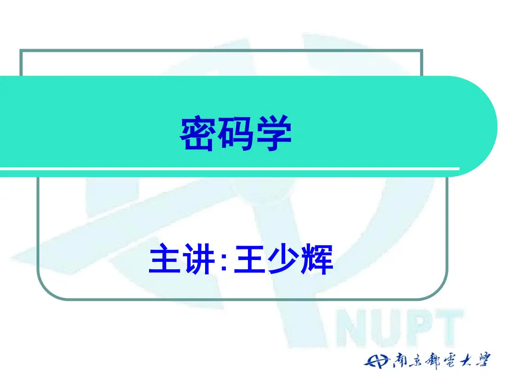

原文：

密码学

主讲:王少辉

今南京郵電大學

### 课程性质及考核

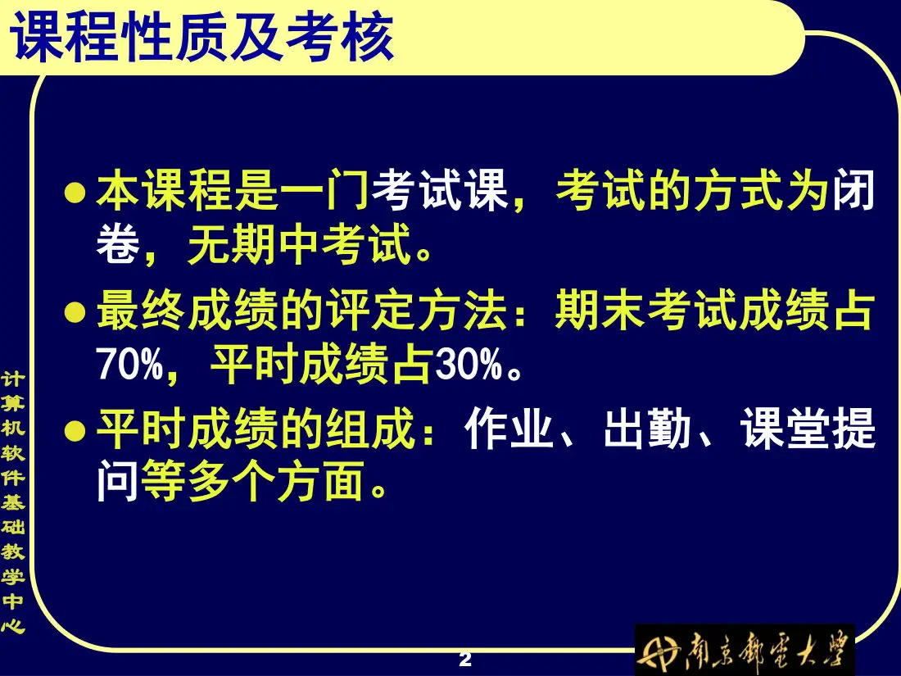

原文：

课程性质及考核

⚫本课程是一门考试课，考试的方式为闭卷，无期中考试。

最终成绩的评定方法：期末考试成绩占70%，平时成绩占30%。

平时成绩的组成：作业、出勤、课堂提问等多个方面。

2

安南京郵電大学

### 教材与参考书

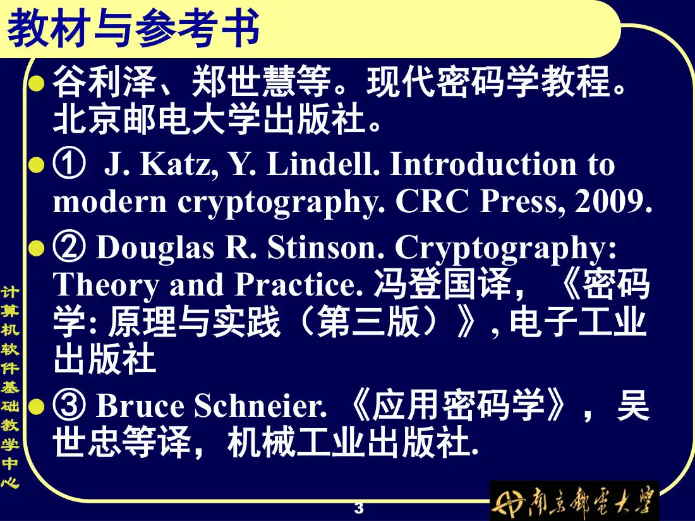

原文：

教材与参考书

谷利泽、郑世慧等。现代密码学教程。北京邮电大学出版社。

J. Katz, Y. Lindell. Introduction to modern cryptography. CRC Press, 2009.

Douglas R. Stinson. Cryptography:Theory and Practice. 冯登国译，《密码学: 原理与实践（第三版）》, 电子工业出版社

③ Bruce Schneier. 《应用密码学》，吴世忠等译，机械工业出版社.

3

华南京郵電大学

### 课时分配&上课要求

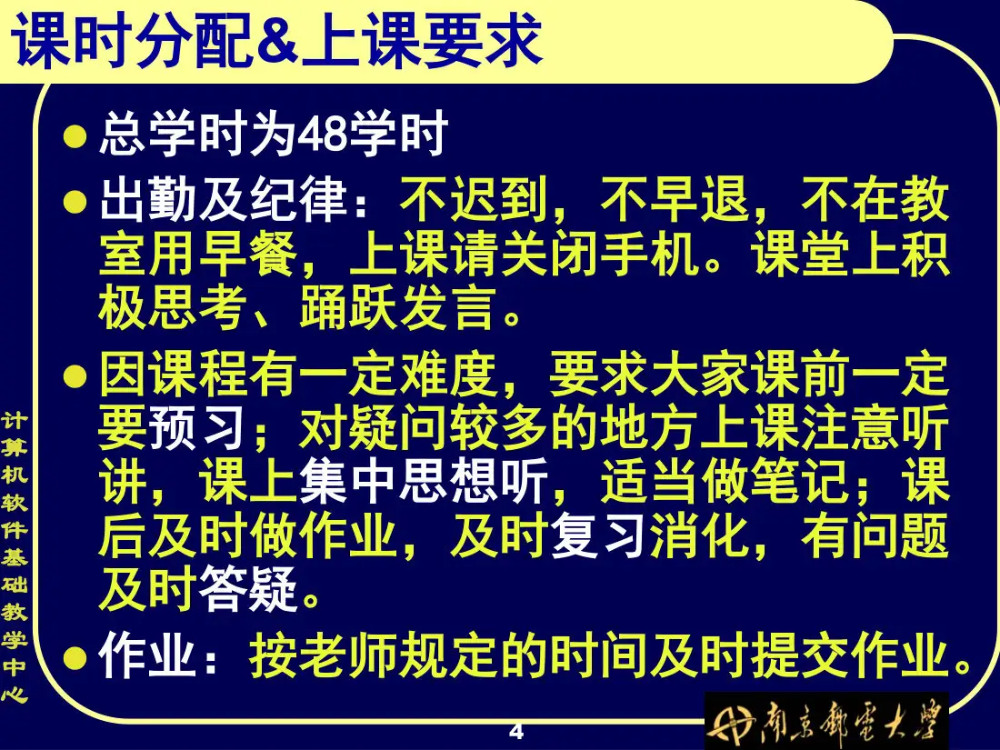

原文：

课时分配&上课要求

总学时为48学时

出勤及纪律：不迟到，不早退，不在教室用早餐，上课请关闭手机。课堂上积极思考、踊跃发言。

因课程有一定难度，要求大家课前一定要预习；对疑问较多的地方上课注意听讲，课上集中思想听，适当做笔记；课后及时做作业，及时复习消化，有问题及时答疑。

⚫作业：按老师规定的时间及时提交作业。

4

今南京郵電大学

### 答疑安排

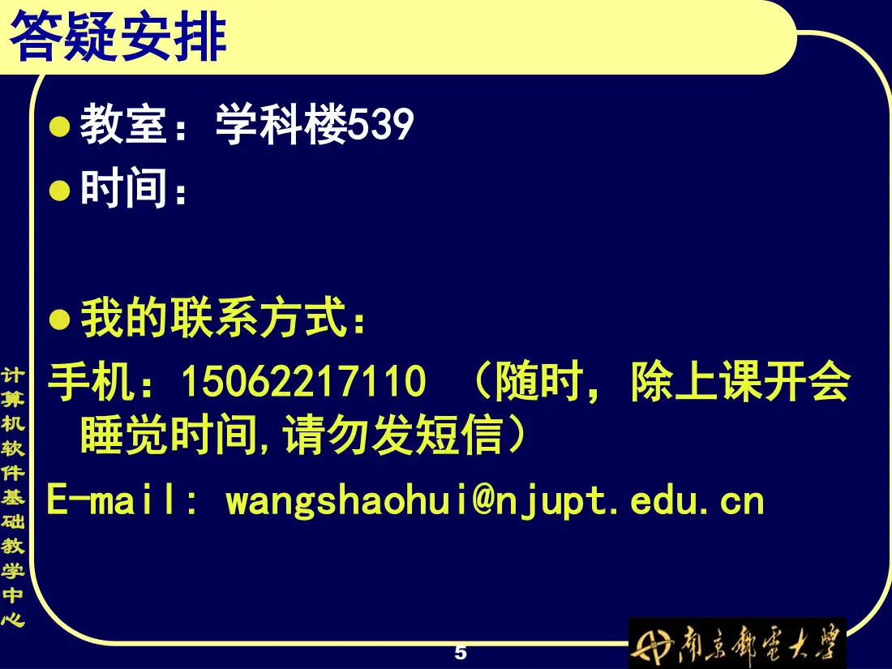

原文：

答疑安排

教室：学科楼539

时间：

我的联系方式：

手机：15062217110 （随时，除上课开会睡觉时间,请勿发短信）

E-mail: wangshaohui@njupt.edu.cn

5

今南京郵電大学

### 现代密码学教程

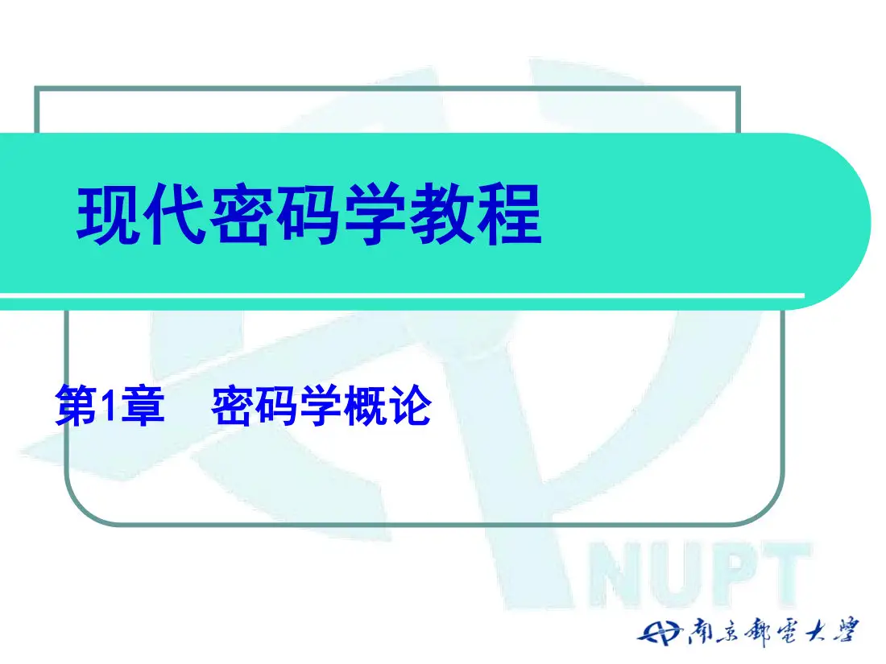

原文：

现代密码学教程

第1章 密码学概论

今南京郵電大學

### 1.1 信息安全和密码学

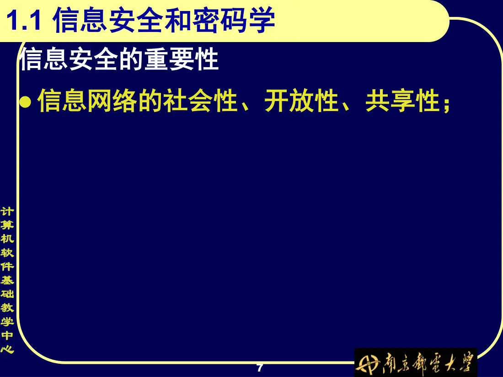

原文：

1.1 信息安全和密码学

信息安全的重要性

⚫信息网络的社会性、开放性、共享性；

安南京郵電大学

### 攻击的主要形式和分类

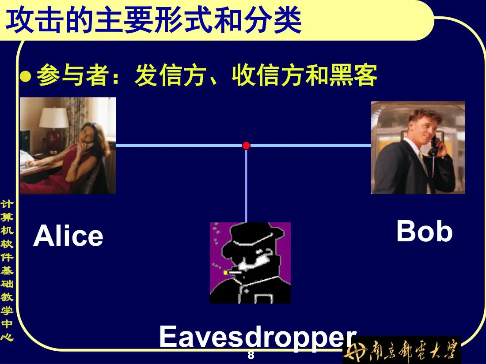

原文：

攻击的主要形式和分类

⚫参与者：发信方、收信方和黑客

Alice

Bob

Eavesdropper

### 安全攻击

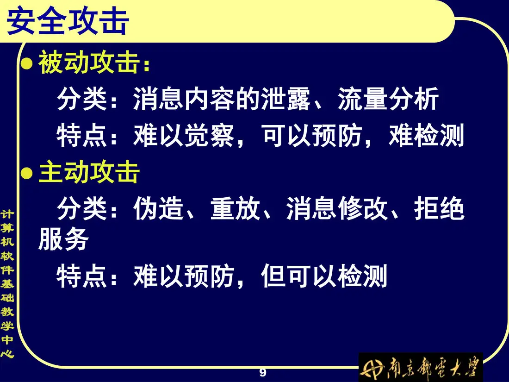

原文：

安全攻击

被动攻击：

分类：消息内容的泄露、流量分析

特点：难以觉察，可以预防，难检测

⚫主动攻击

分类：伪造、重放、消息修改、拒绝服务

特点：难以预防，但可以检测

9

安南京郵電大学

### 信息安全的目标

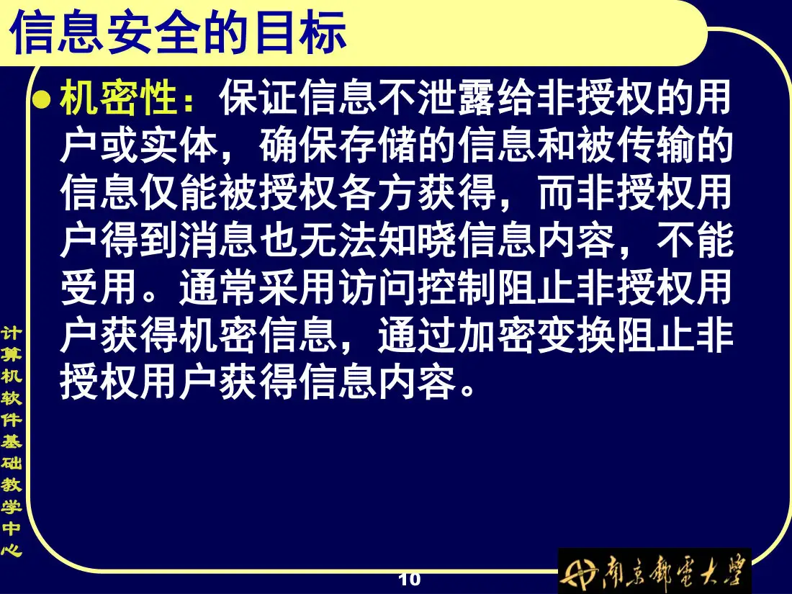

原文：

信息安全的目标

⚫机密性：保证信息不泄露给非授权的用户或实体，确保存储的信息和被传输的信息仅能被授权各方获得，而非授权用户得到消息也无法知晓信息内容，不能受用。通常采用访问控制阻止非授权用户获得机密信息，通过加密变换阻止非授权用户获得信息内容。

10

今南京郵電大学

### 信息安全的目标

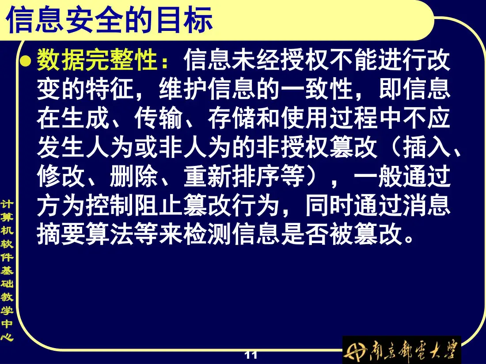

原文：

信息安全的目标

数据完整性：信息未经授权不能进行改变的特征，维护信息的一致性，即信息在生成、传输、存储和使用过程中不应发生人为或非人为的非授权篡改（插入、修改、删除、重新排序等），一般通过方为控制阻止篡改行为，同时通过消息摘要算法等来检测信息是否被篡改。

11

今南京郵電大学

### 信息安全的目标

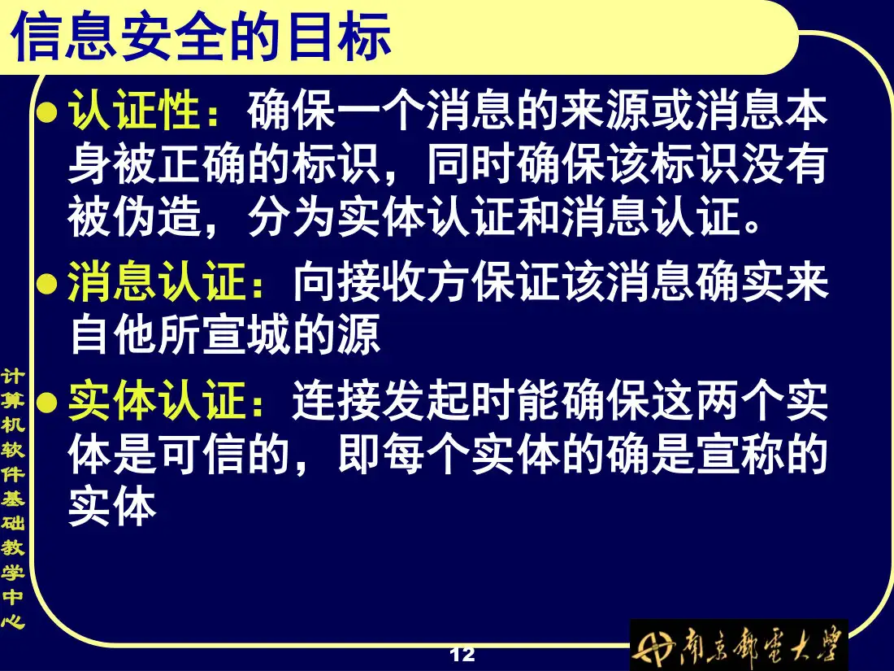

原文：

信息安全的目标

认证性：确保一个消息的来源或消息本身被正确的标识，同时确保该标识没有被伪造，分为实体认证和消息认证。

消息认证：向接收方保证该消息确实来自他所宣城的源

实体认证：连接发起时能确保这两个实体是可信的，即每个实体的确是宣称的实体

12

今南京郵電大学

### 信息安全的目标

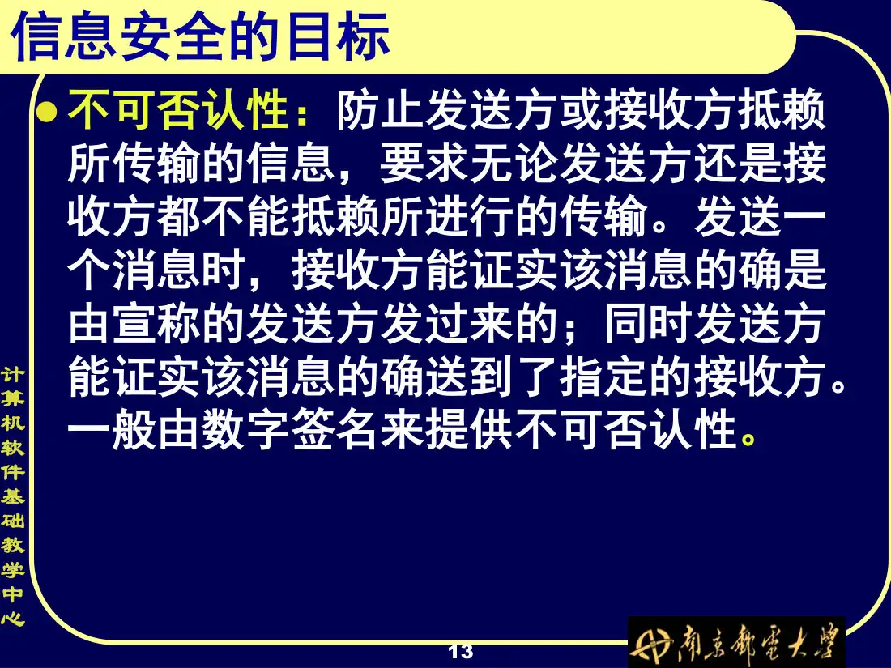

原文：

信息安全的目标

不可否认性：防止发送方或接收方抵赖所传输的信息，要求无论发送方还是接收方都不能抵赖所进行的传输。发送一个消息时，接收方能证实该消息的确是由宣称的发送方发过来的；同时发送方能证实该消息的确送到了指定的接收方。一般由数字签名来提供不可否认性。

13

今南京郵電大学

### 密码学的重要性

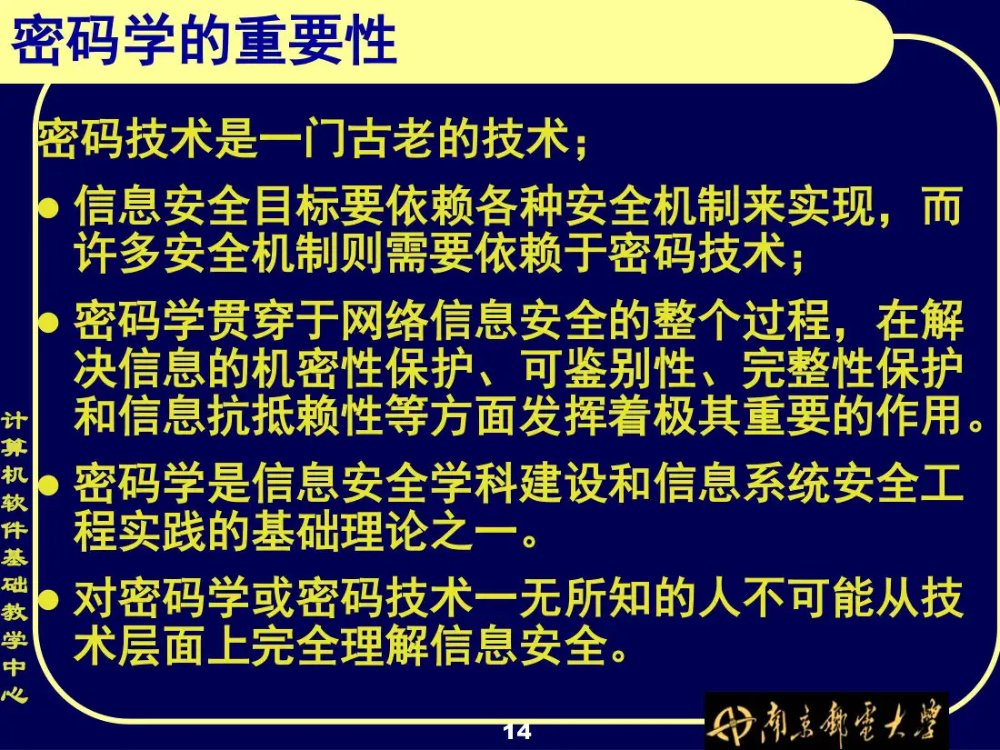

原文：

密码学的重要性

密码技术是一门古老的技术；

信息安全目标要依赖各种安全机制来实现，而许多安全机制则需要依赖于密码技术；

密码学贯穿于网络信息安全的整个过程，在解决信息的机密性保护、可鉴别性、完整性保护和信息抗抵赖性等方面发挥着极其重要的作用。

密码学是信息安全学科建设和信息系统安全工程实践的基础理论之一。

对密码学或密码技术一无所知的人不可能从技术层面上完全理解信息安全。

14

今南京郵電大学

### 密码学发展

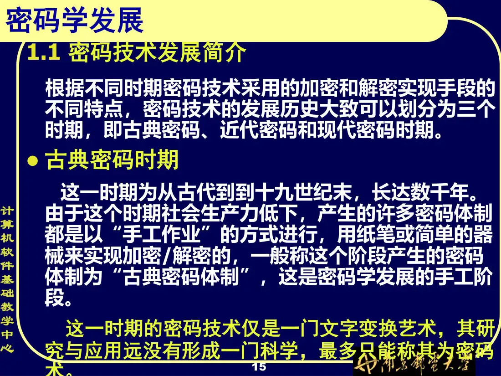

原文：

密码学发展

1.1 密码技术发展简介

根据不同时期密码技术采用的加密和解密实现手段的不同特点，密码技术的发展历史大致可以划分为三个时期，即古典密码、近代密码和现代密码时期。

古典密码时期

这一时期为从古代到到十九世纪末，长达数千年。由于这个时期社会生产力低下，产生的许多密码体制都是以“手工作业”的方式进行，用纸笔或简单的器械来实现加密/解密的，一般称这个阶段产生的密码体制为“古典密码体制”，这是密码学发展的手工阶段。

这一时期的密码技术仅是一门文字变换艺术，其研究与应用远没有形成一门科学，最多只能称其为密码15

### 近代密码时期

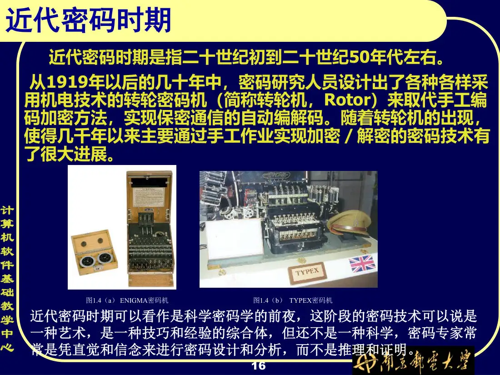

原文：

近代密码时期

近代密码时期是指二十世纪初到二十世纪50年代左右。从1919年以后的几十年中，密码研究人员设计出了各种各样采用机电技术的转轮密码机（简称转轮机，Rotor）来取代手工编码加密方法，实现保密通信的自动编解码。随着转轮机的出现，使得几千年以来主要通过手工作业实现加密／解密的密码技术有了很大进展。

近代密码时期可以看作是科学密码学的前夜，这阶段的密码技术可以说是一种艺术，是一种技巧和经验的综合体，但还不是一种科学，密码专家常常是凭直觉和信念来进行密码设计和分析，而不是推理和证明 理和電大学 理和 证

16

### 密码学概述

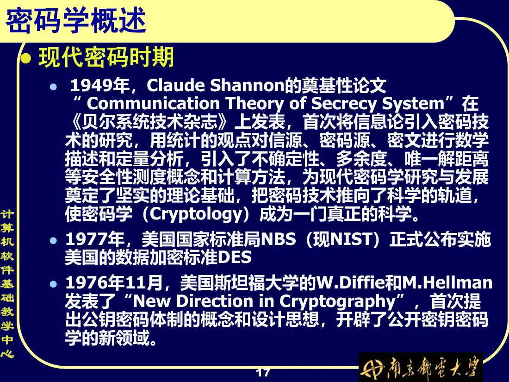

原文：

密码学概述

现代密码时期

1949年，Claude Shannon的奠基性论文Communication Theory of Secrecy System”在《贝尔系统技术杂志》上发表，首次将信息论引入密码技术的研究，用统计的观点对信源、密码源、密文进行数学描述和定量分析，引入了不确定性、多余度、唯一解距离等安全性测度概念和计算方法，为现代密码学研究与发展奠定了坚实的理论基础，把密码技术推向了科学的轨道，使密码学（Cryptology）成为一门真正的科学。

⚫ 1977年，美国国家标准局NBS（现NIST）正式公布实施美国的数据加密标准DES

1976年11月，美国斯坦福大学的W.Diffie和M.Hellman发表了“New Direction in Cryptography”，首次提出公钥密码体制的概念和设计思想，开辟了公开密钥密码学的新领域。

17

今南京郵電大学

### 密码学概述

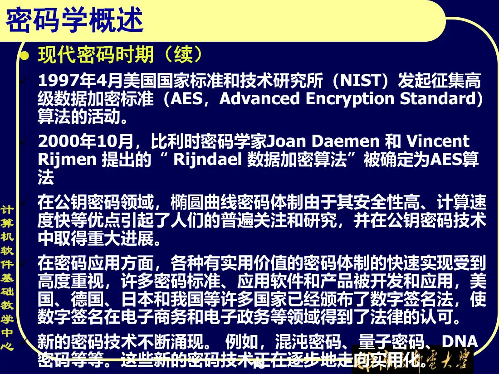

原文：

密码学概述

现代密码时期（续）

1997年4月美国国家标准和技术研究所（NIST）发起征集高级数据加密标准（AES，Advanced Encryption Standard）算法的活动。

2000年10月，比利时密码学家Joan Daemen 和 VincentRijmen 提出的“ Rijndael 数据加密算法”被确定为AES算法

在公钥密码领域，椭圆曲线密码体制由于其安全性高、计算速度快等优点引起了人们的普遍关注和研究，并在公钥密码技术中取得重大进展。

在密码应用方面，各种有实用价值的密码体制的快速实现受到高度重视，许多密码标准、应用软件和产品被开发和应用，美国、德国、日本和我国等许多国家已经颁布了数字签名法，使数字签名在电子商务和电子政务等领域得到了法律的认可。

新的密码技术不断涌现。 例如，混沌密码、量子密码、DNA18密码等等。这些新的密码技术正在逐步地走向实用化。

### 密码学概念的发展

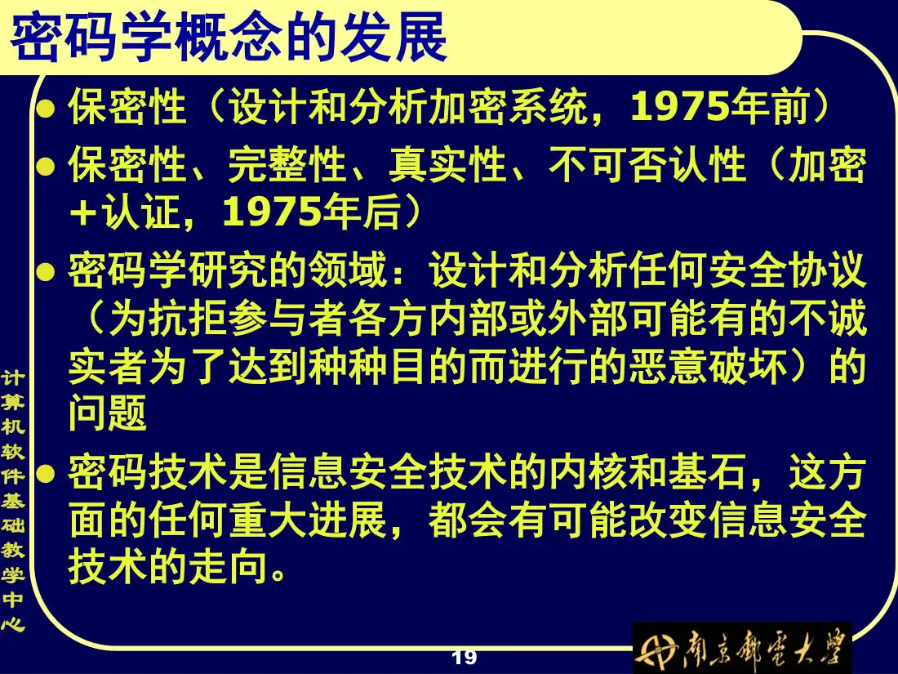

原文：

密码学概念的发展

保密性（设计和分析加密系统，1975年前）

保密性、完整性、真实性、不可否认性（加密+认证，1975年后）

密码学研究的领域：设计和分析任何安全协议（为抗拒参与者各方内部或外部可能有的不诚实者为了达到种种目的而进行的恶意破坏）的问题

密码技术是信息安全技术的内核和基石，这方面的任何重大进展，都会有可能改变信息安全技术的走向。

19

今南京郵電大学

### 加密系统模型

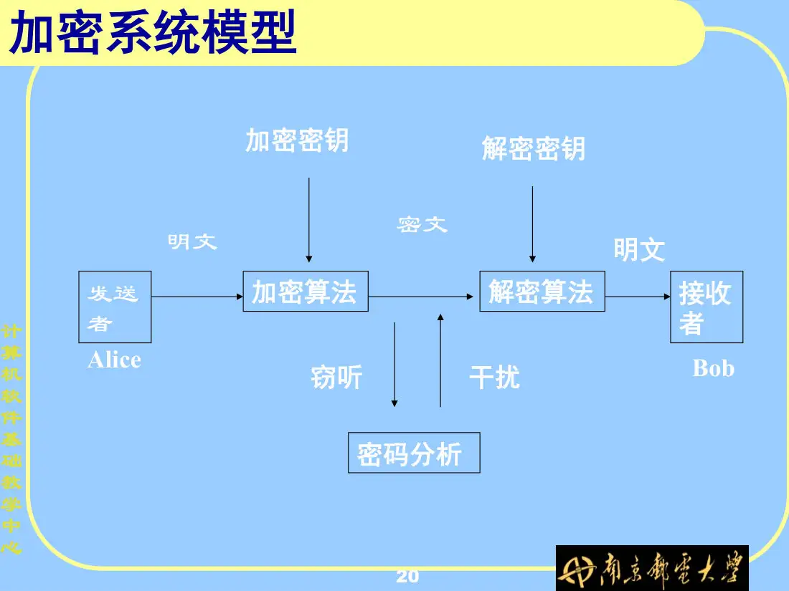

原文：

加密系统模型

加密密钥

密文

加密算法

解密算法

密码分析

20

今南京郵電大学

### 密码体制的要素

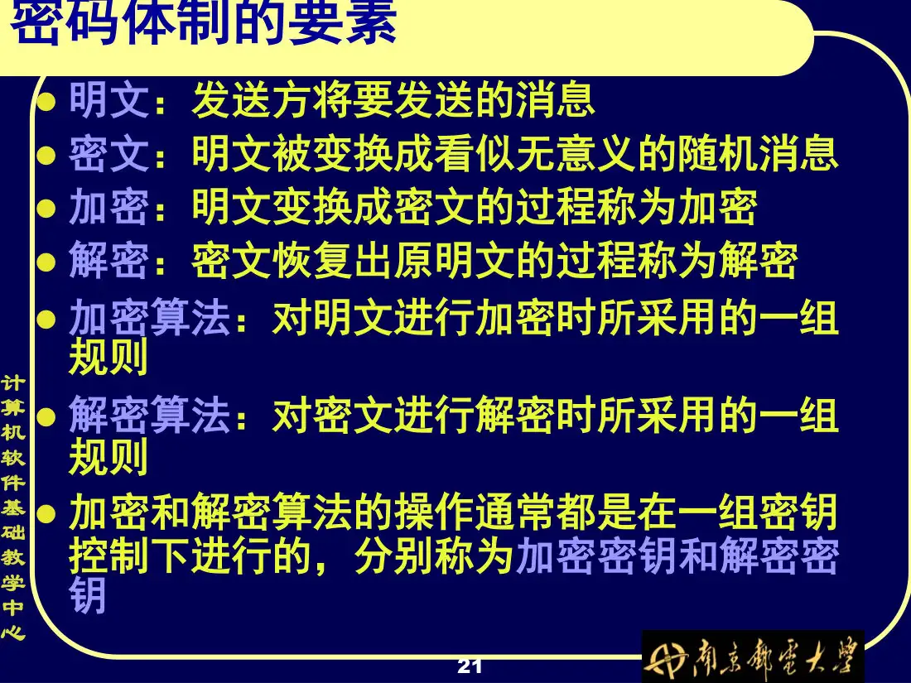

原文：

密码体制的要素

⚫明文：发送方将要发送的消息

⚫ 密文：明文被变换成看似无意义的随机消息

加密：明文变换成密文的过程称为加密

解密：密文恢复出原明文的过程称为解密

加密算法：对明文进行加密时所采用的一组规则

解密算法：对密文进行解密时所采用的一组规则

加密和解密算法的操作通常都是在一组密钥控制下进行的，分别称为加密密钥和解密密钥

21

华南京郵電大学

### （1）P是可能明文的有限集；（明文空间）

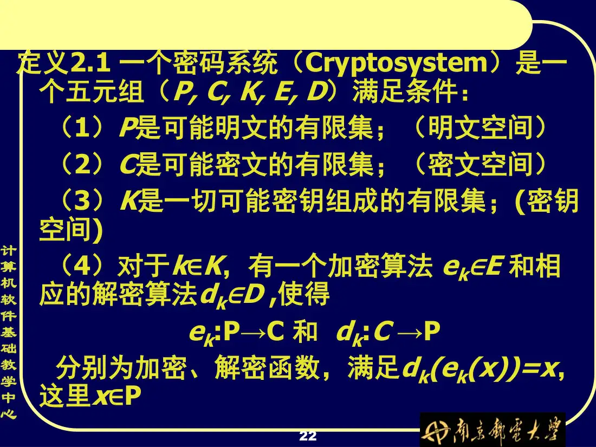

原文：

定义2.1 一个密码系统（Cryptosystem）是个五元组 $\textcircled { 1 } 2 0 0 0 = \textcircled { 1 } 2$ 满足条件：

（1）P是可能明文的有限集；（明文空间）

（2）C是可能密文的有限集；（密文空间）

（3）K是一切可能密钥组成的有限集；(密钥空间)

（4）对于k∈K，有一个加密算法 ek∈E 和相应的解密算法 $x _ { 1 } = \sqrt { \frac { 3 } { 2 } }$ ,使得

:P→C 和 $\it E M - \sum \limits _ { i = 0 } ^ { n }$

分别为加密、解密函数，满足 $( 1 ) R ( - \pi , 0 ) ) = 0$ 这里x∈P

华南京郵電大学

### 密码体制的原则和分类

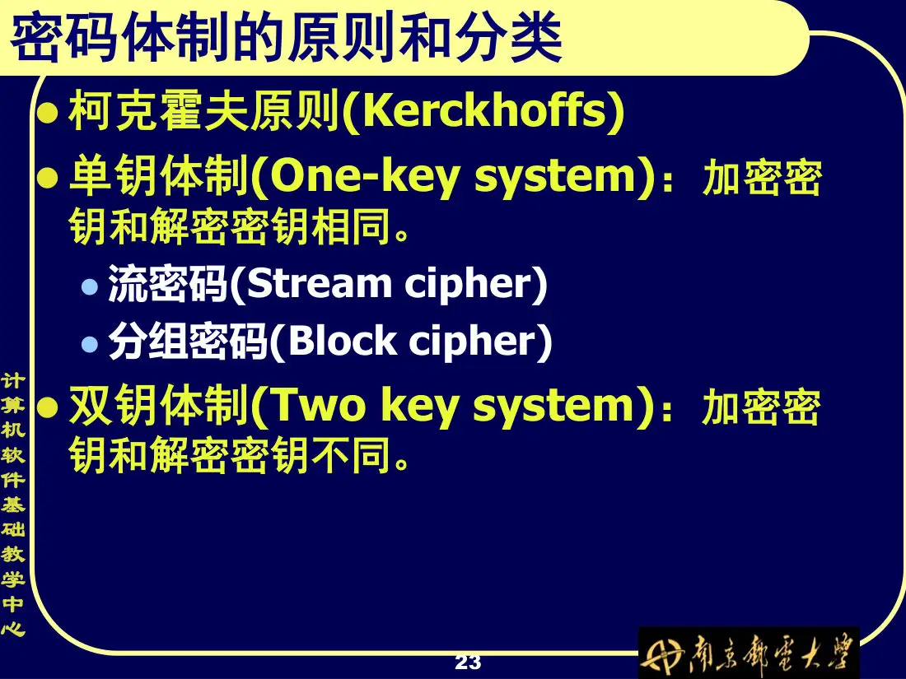

原文：

密码体制的原则和分类

柯克霍夫原则(Kerckhoffs)

单钥体制(One-key system)：加密密钥和解密密钥相同。

⚫ 流密码(Stream cipher)

⚫ 分组密码(Block cipher)

⚫双钥体制(Two key system)：加密密钥和解密密钥不同。

23

今南京郵電大学

### 对称密码是一种加解密使用相同密钥的密码体制

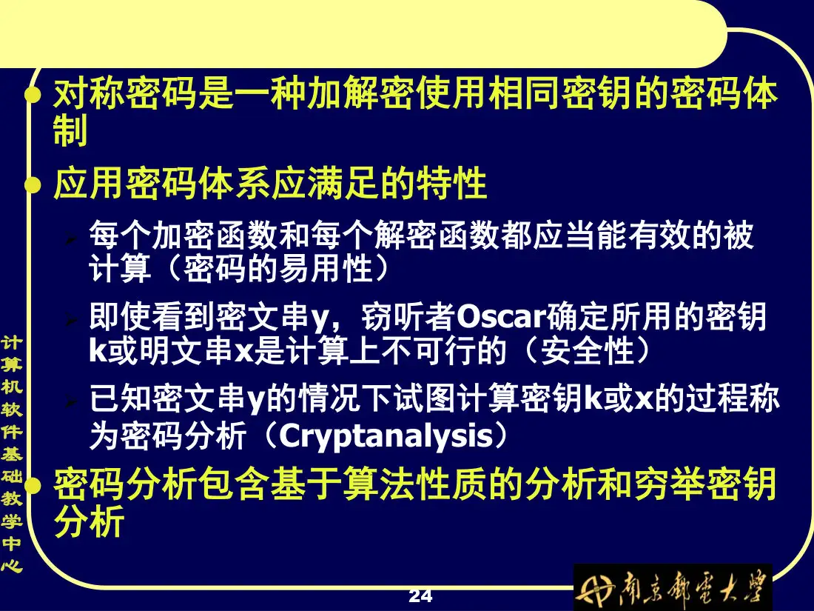

原文：

对称密码是一种加解密使用相同密钥的密码体制

应用密码体系应满足的特性

每个加密函数和每个解密函数都应当能有效的被计算（密码的易用性）

即使看到密文串y，窃听者Oscar确定所用的密钥k或明文串x是计算上不可行的（安全性）

已知密文串y的情况下试图计算密钥k或x的过程称为密码分析（Cryptanalysis）

密码分析包含基于算法性质的分析和穷举密钥分析

24

今南京郵電大学

### 密码分析学

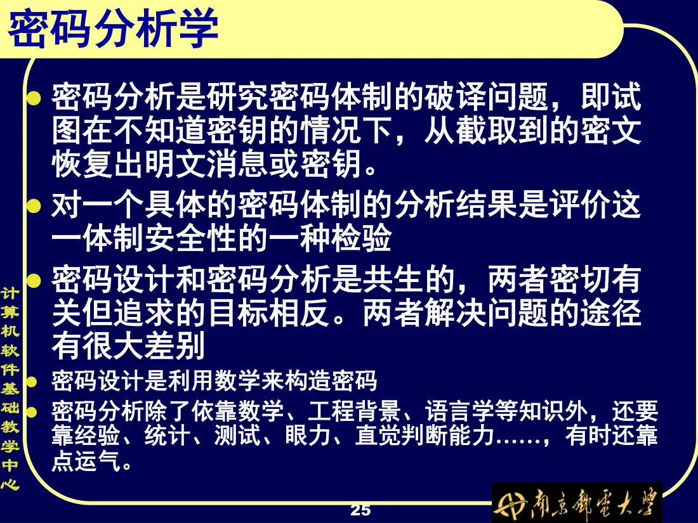

原文：

密码分析学

密码分析是研究密码体制的破译问题，即试图在不知道密钥的情况下，从截取到的密文恢复出明文消息或密钥。

对一个具体的密码体制的分析结果是评价这一体制安全性的一种检验

密码设计和密码分析是共生的，两者密切有关但追求的目标相反。两者解决问题的途径有很大差别

密码设计是利用数学来构造密码

密码分析除了依靠数学、工程背景、语言学等知识外，还要靠经验、统计、测试、眼力、直觉判断能力……，有时还靠点运气。

25

今南京郵電大学

### 密码体制的安全性

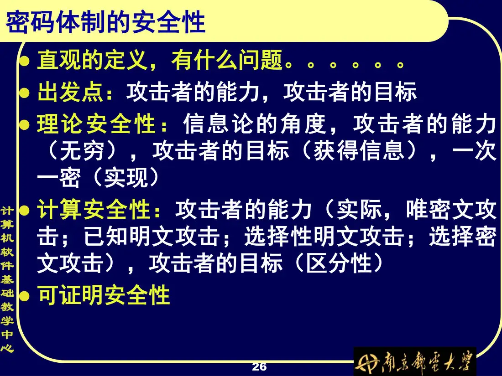

原文：

密码体制的安全性

直观的定义，有什么问题。。。。。。

⚫ 出发点：攻击者的能力，攻击者的目标

理论安全性：信息论的角度，攻击者的能力（无穷），攻击者的目标（获得信息），一次一密（实现）

计算安全性：攻击者的能力（实际，唯密文攻击；已知明文攻击；选择性明文攻击；选择密文攻击），攻击者的目标（区分性）

可证明安全性

26

今南京郵電大学
