# 《现代密码学》第2章 数学背景（课件）

原件的每一页，下面附识别出的文字。

### 数学基础(1)

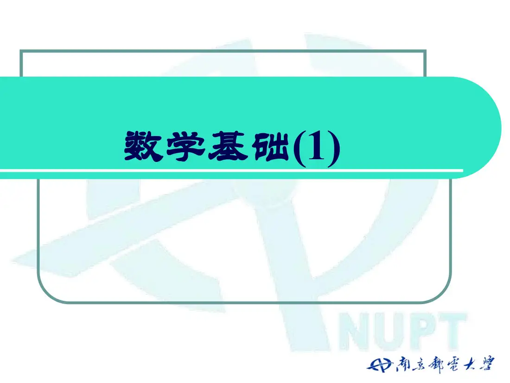

原文：

数学基础(1)

今南京郵電大学

### 数论基础（1）

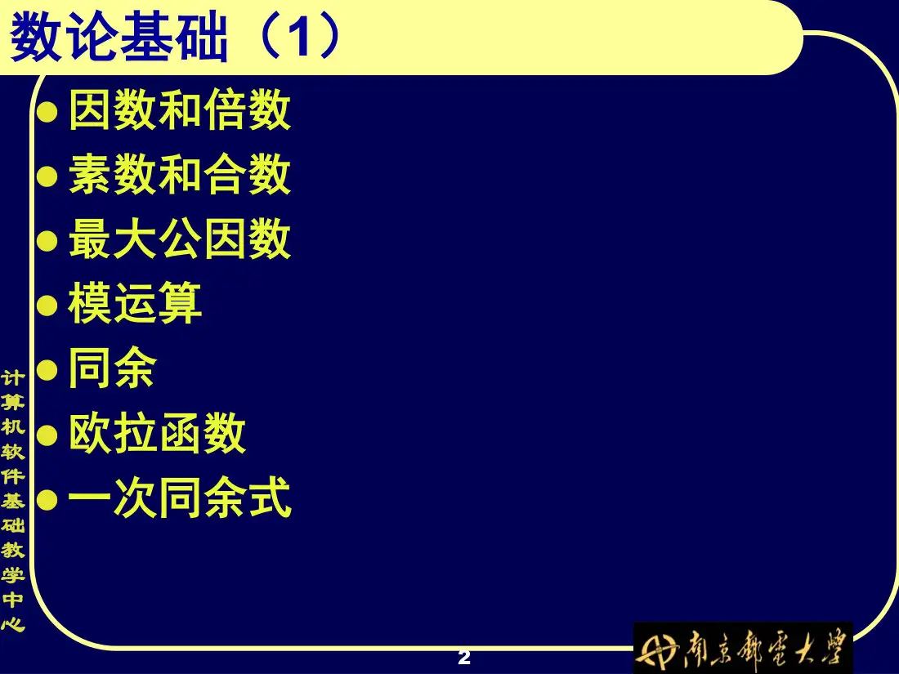

原文：

数论基础（1）

⚫因数和倍数

素数和合数

最大公因数

模运算

⚫同余

欧拉函数

⚫一次同余式

2

今南京郵電大学

### 1 因数和倍数

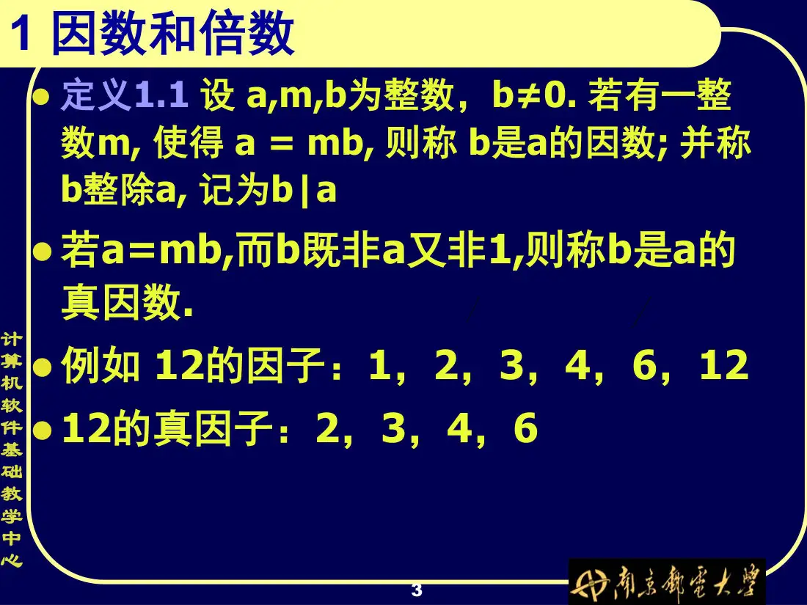

原文：

1 因数和倍数

定义1.1 设 $\mathbf { E } \widetilde { \mathbf { \Gamma } } \widetilde { \mathbf { \Gamma } } \widetilde { \mathbf { \Gamma } } \widetilde { \mathbf { \Gamma } } \widetilde { \mathbf { \Gamma } } \widetilde { \mathbf { \Gamma } } \widetilde { \mathbf { \Gamma } }$ 为整数，b≠0. 若有一整数m, 使得 $\mathrm { E }$ 则称 b是a的因数; 并称b整除a, 记为b|a

若a=mb,而b既非a又非1,则称b是a的真因数.

⚫例如 12的因子：1，2，3，4，6，12⚫ 12的真因子：2，3，4，6

3

今南京郵電大学

### 1 因数和倍数

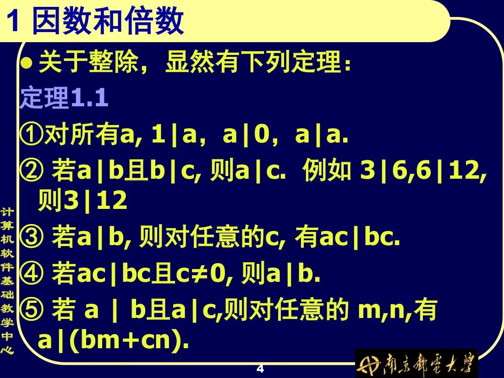

原文：

1 因数和倍数

关于整除，显然有下列定理：定理1.1

② 若a|b且b|c, 则a|c. 例如 3|6,6|12,则3|12

⑤ 若 a | b且a|c,则对任意的 m,n,有a|(bm+cn).

朵南京郵電大学

### 2 素数和合数

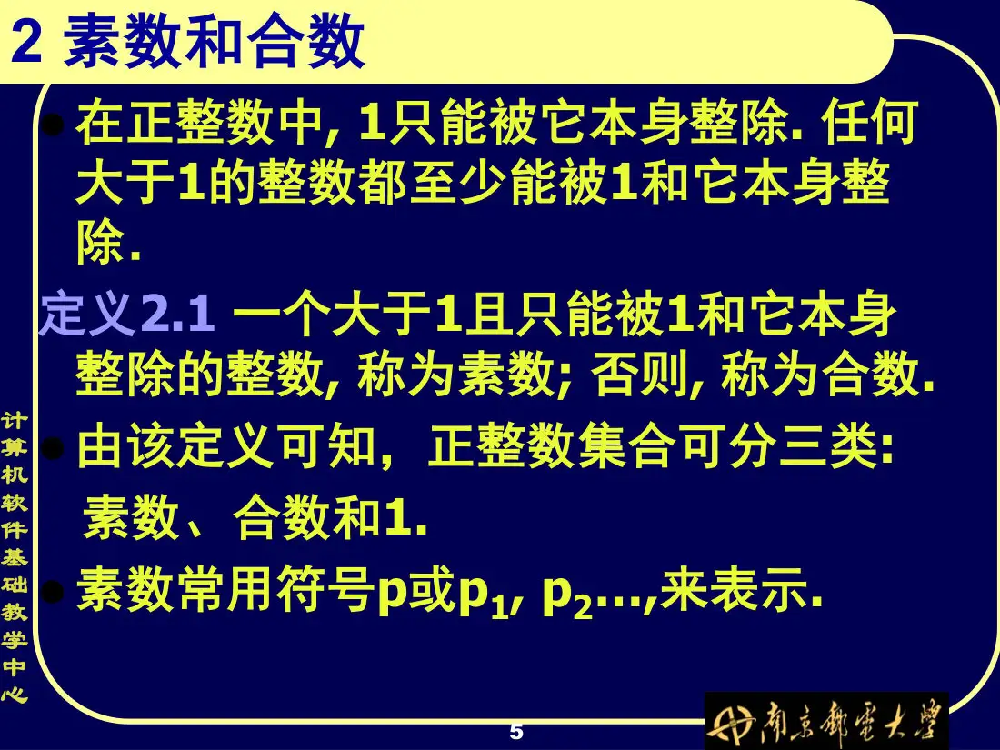

原文：

2 素数和合数

在正整数中, 1只能被它本身整除. 任何大于1的整数都至少能被1和它本身整除．

定义2.1 一个大于1且只能被1和它本身整除的整数, 称为素数; 否则, 称为合数.由该定义可知，正整数集合可分三类:素数、合数和1.素数常用符号p或p1, p2…,来表示.

5

今南京郵電大学

### 2 素数和合数

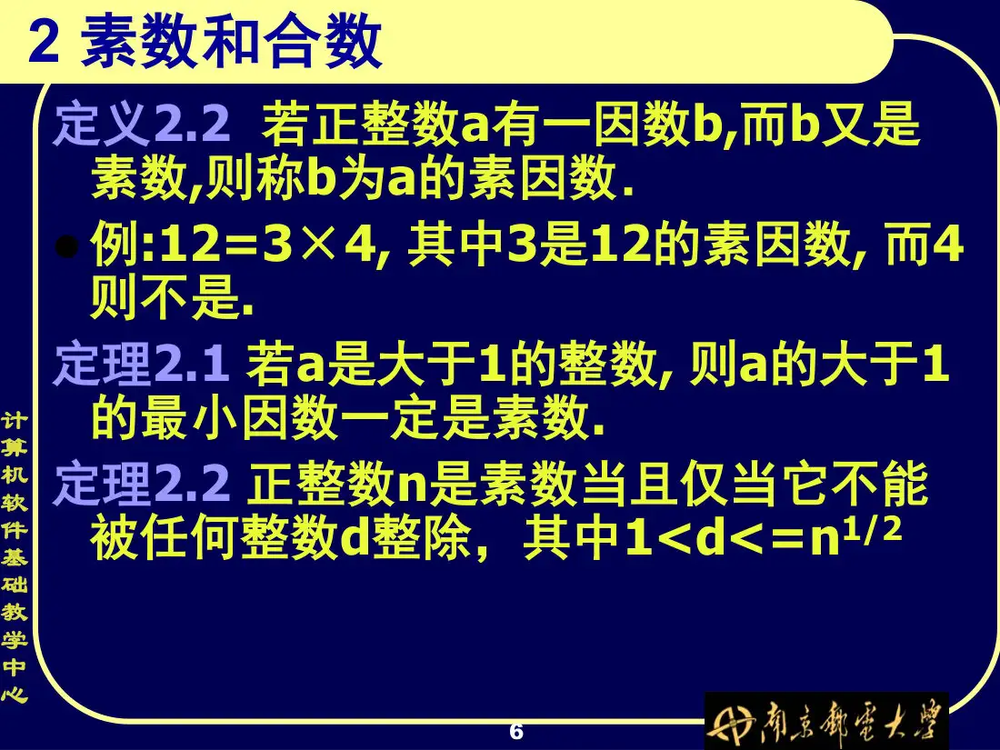

原文：

2 素数和合数

定义2.2 若正整数a有一因数b,而b又是素数,则称b为a的素因数例:12=3×4, 其中3是12的素因数, 而4则不是.定理2.1 若a是大于1的整数, 则a的大于1的最小因数一定是素数.定理2.2 正整数n是素数当且仅当它不能被任何整数d整除，其中1<d<=n1/2

6

华南京郵電大学

### 3 最大公因数(greatest common divisor)

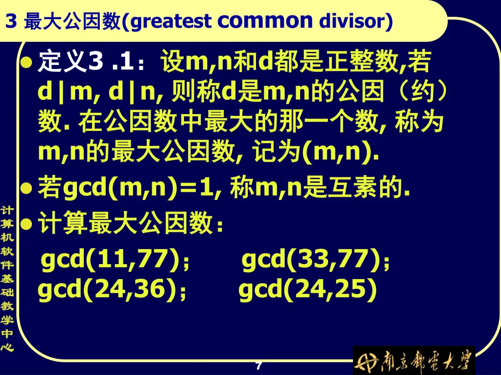

原文：

3 最大公因数(greatest common divisor)

定义3 .1：设m,n和d都是正整数,若d|m, d|n, 则称d是m,n的公因（约）数. 在公因数中最大的那一个数, 称为$\boxed { 1 1 } \boxed { 2 } \boxed { 1 }$ 的最大公因数, 记为 $\textcircled { 1 1 } \textcircled { 1 } \textcircled { 2 }$

⚫若 $\mathbf { \dot { \varepsilon } } ( \mathbf { o } ( \mathbf { \dot { \varepsilon } } ( | | \mathbf { m } | ) ) ) = \mathbf { \dot { \varepsilon } } ( | | \mathbf { \dot { \varepsilon } } | |$ 称m,n是互素的.

⚫计算最大公因数：gcd(11,77)； gcd(33,77)；gcd(24,36)； gcd(24,25)

华南京郵電大学

### 3 最大公因数

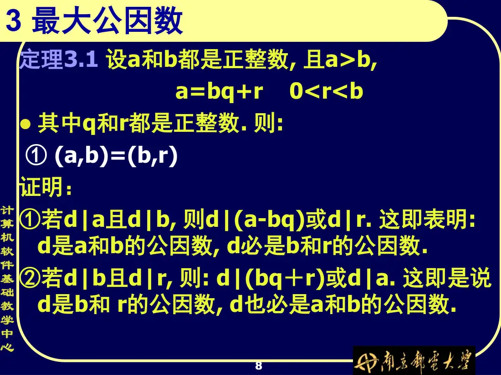

原文：

3 最大公因数

定理3.1 设a和b都是正整数, 且a>b,

其中q和r都是正整数. 则:

$$
① (a, b) = (b, r)
$$

证明：

①若d|a且d|b, 则d|(a-bq)或d|r. 这即表明:d是a和b的公因数, d必是b和r的公因数.②若d|b且d|r, 则: d|(bq＋r)或d|a. 这即是说d是b和 r的公因数, d也必是a和b的公因数.

8

今南京郵電大学

### 3 最大公因数

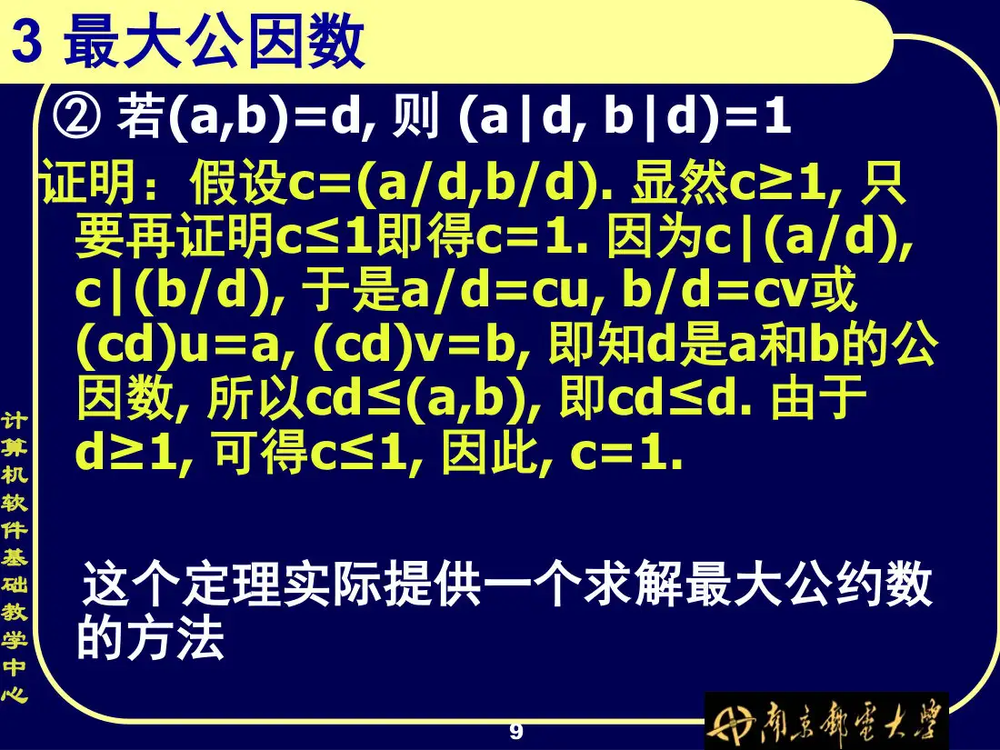

原文：

3 最大公因数

若(a,b)=d, 则 (a|d, b|d)=1证明：假设c=(a/d,b/d). 显然c≥1, 只要再证明c≤1即得c=1. 因为c|(a/d),c|(b/d), 于是a/d=cu, b/d=cv或(cd)u=a, (cd)v=b, 即知d是a和b的公因数, 所以cd≤(a,b), 即cd≤d. 由于d≥1, 可得c≤1, 因此, c=1.

这个定理实际提供一个求解最大公约数的方法

9

朵南京郵電大学

### 欧几里德算法（求最大公约数）

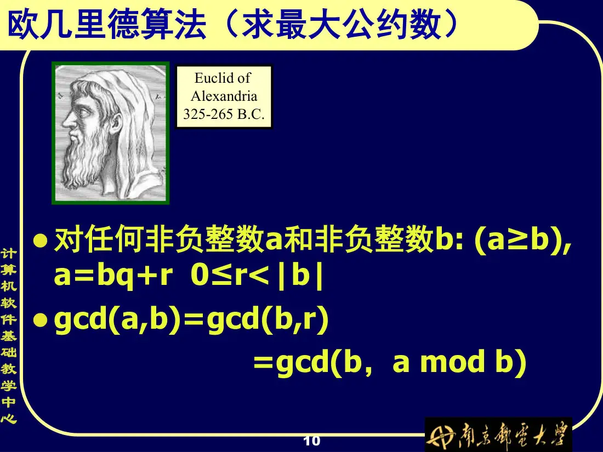

原文：

欧几里德算法（求最大公约数）

Euclid of Alexandria 325-265 B.C.

⚫对任何非负整数a和非负整数b: (a≥b),$[ \cdot ] = [ \cdot ] [ \cdot ] [ \cdot ] [ \cdot ] [ \cdot ] [ \cdot ] [ \cdot ] [ \cdot ] [ \cdot ]$ $\mathrm { C E } ( \mathrm { o } ( \mathbb { C } / \mathbb { D } ) ) { \scriptstyle = \mathrm { C E } ( \mathrm { o } ( \mathbb { C } / \mathbb { D } ) ) }$ =gcd(b，a mod b)

10

今南京郵電大学

### 欧几里德算法

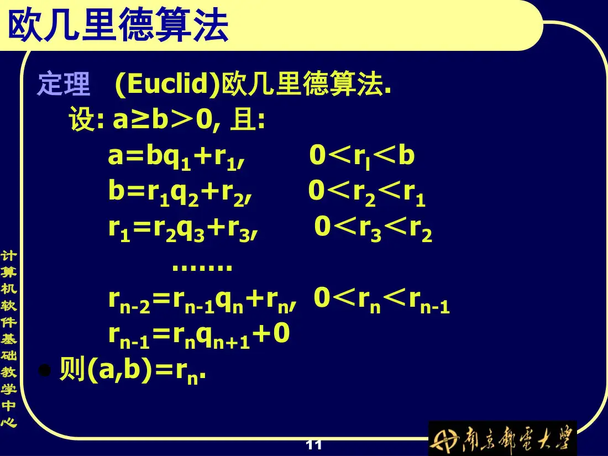

原文：

欧几里德算法

定理 (Euclid)欧几里德算法. 设: $\mathbf { \varepsilon } _ { \mathrm { { E } } } \mathbf { \varepsilon } _ { \mathrm { { D } } } \mathbf { \varepsilon } _ { \mathrm { { 0 } } }$ 且: $\mathbf { \hat { c } } \mathbf { E } \mathbf { | \hat { \nu } \mathbf { \cdot } \hat { \nu } \mathbf { \bar { \ n } } | \mathbf { \bar { \nu } } }$ 0＜rl＜b b=r1q2+r2, 0＜r2＜r1 r1=r2q3+r3, 0＜r3＜r2 $\frac { 1 } { 2 } \times 2 = 1 \times 2 = 1 \times 2$ 0＜rn＜rn-1 $\pmb { \mathrm { 1 } } \pmb { \mathrm { 2 } } \pmb { \mathrm { 1 } } \pmb { \mathrm { 1 } } \pmb { \mathrm { 2 } } \pmb { \mathrm { 1 } } \pmb { \mathrm { 1 } } \pmb { \mathrm { 2 } } \pmb { \mathrm { 1 } } \pmb { \mathrm { 2 } } \pmb { \mathrm { 1 } } \pmb { \mathrm { 2 } } \pmb { \mathrm { 1 } }$ 则 $( \mathbf { \epsilon } \mathbf { \cdot } \mathbf { \alpha } \mathbf { \cdot } \mathbf { \beta } \mathbf { \cdot } \mathbf { \beta } \mathbf { \eta } ^ { \mathbf { - } } \mathbf { \beta } \mathbf { \eta } ^ { \mathbf { - } }$

11

今南京郵電大学

### 欧几里德算法

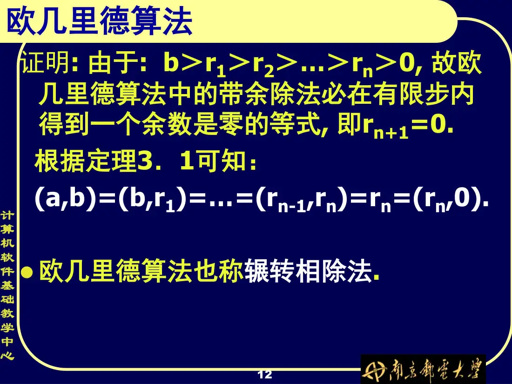

原文：

欧几里德算法

证明: 由于: $: 2 \times ( - 2 \pi + 2 \times 2 \times 2 \times 2 \times 2 \times 2 \times 2 \times 2 \times 2 \times 2 \times 2 \times 2 \times 2 \times 2 \times 2 \times 2 \times 2 \times 2 \times 2 \times 2 \times 2 \times 2 \times 2 \times 2 \times 2 \times 2 \times 2 \times 2 \times 2 \times 2 \times 2 \times 2 \times 2 \times 2 \times 2 \times 2 \times 2 \times 2 \times 2 \times 2 \times 2 \times 2 \times 2 \times 2 \times 2 \times 2 \times 2 \times 2 \times 2 \times 2 \times 2 \times 2 \times 2 \times 2 \times 2 \times 2 \times 2 \times 2 \times 2 \times 2 \times 2 \times 2 \times 2 \times 2 \times 2 \times 2 \times 2 \times 2 \times 2 \times 2 \times 2 \times 2 \times 2 \times 2 \times 2 \times 2 \times 2 \times 2 \times 2 \times 2 \times 2 \times 2 \times 2 \times 2 \times 2 \times 2 \times 2 \times 2 \times 2 \times 2 \times 2 \times 2 \times 2 \times 2 \times 2 \times 2 \times 2 \times 2 \times 2 \times \times 2 \times 2 \times 2 \times 2 \times 2 \times \times 2 \times 2 \times 2 \times 2 \times \times 2 \times 2 \times 2 \times \times 2 \times 2 \times \times 2 \times 2 \times \times 2 \times 2 \times \times 2 \times 2 \times \times 2 \times \times 2 \times \times 2 \times 2 \times \times 2 \times \times 2 \times \times 2 \times 2 \times \times \times 2 \times 2 \times \times 2 \times \times \times 2 \times \times 2 \times \times 2 \times \times 2 \times \times 2 \times \times \times 2 \times \times 2 \times \times \times 2 \times \times \times \times 2 \times \times 2 \times \times \times \times \times 2 \times \times 2 \times \times \times 2 \times \times \ c \ c o \ c o \ c o \ c o \ c o r \ c o r \ c o r \ c o r c o r c o r c o r c o r c o r c o r c o r m p r m p r m p r m p r m p r m p r m p r m a r m a r m a r m a r m a r m a r m p r m a r m a r m a r m m a r m a r m m a r m m a r m m m m a r m m m a r m m m a n t r m a r m m a n t r m m a n t r m a n t r m a n t r m a n t r m a n t r m a n t r m a n t r m a n t r m a n t r m a n t r m a n t r m a r m a n t r m a n t r m a n t r m a n t r m a r m a n t r m a n t r m a n t r m a n t r m a n t r m a n t r m a n t r m a n t r m a n t r m a n t r m a n t r m a n t r m a n t r m a$ 故欧几里德算法中的带余除法必在有限步内得到一个余数是零的等式, 即 $\mathrm { \Delta I n E M } = \mathrm { \Delta 0 }$ 根据定理3．1可知：

$$
(a, b) = (b, r _ {1}) = \dots = (r _ {n - 1}, r _ {n}) = r _ {n} = (r _ {n}, 0).
$$

⚫欧几里德算法也称辗转相除法.

12

安南京郵電大学

### 欧几里德算法实例

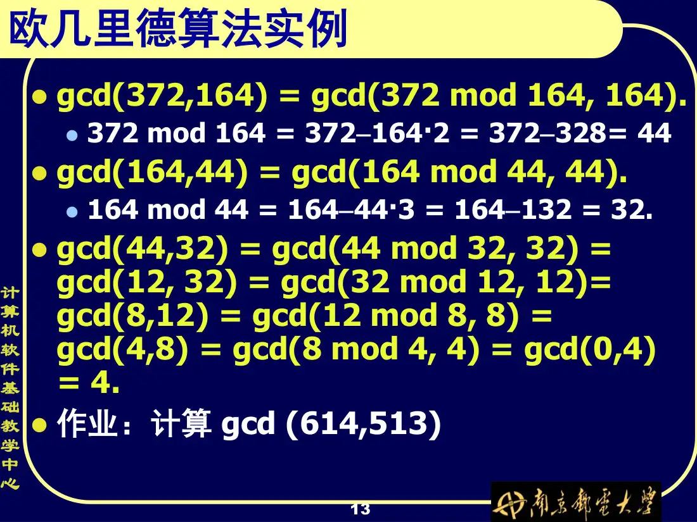

原文：

欧几里德算法实例

$$
3 7 2 \bmod {1 6 4} = 3 7 2 - 1 6 4 \cdot 2 = 3 7 2 - 3 2 8 = 4 4
$$

$$
1 6 4 \bmod {4 4} = 1 6 4 - 4 4 \cdot 3 = 1 6 4 - 1 3 2 = 3 2.
$$

⚫ gcd(44,32) = gcd(44 mod 32, 32) = gcd(12, 32) = gcd(32 mod 12, 12)= gcd(8,12) = gcd(12 mod 8, 8) = gcd(4,8) = gcd(8 mod 4, 4) = gcd(0,4) = 4.

作业：计算 gcd (614,513)

13

今南京郵電大学

### 模运算

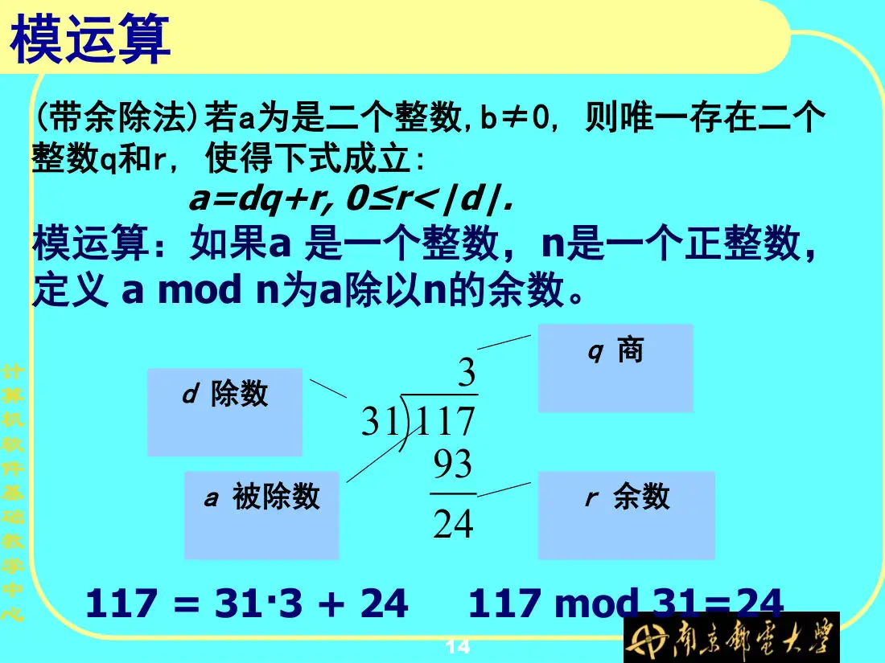

原文：

模运算

(带余除法)若a为是二个整数, $\boldsymbol { \mathbf { b } } \neq \boldsymbol { 0 }$ 则唯一存在二个整数q和r, 使得下式成立:

$$
a = d q + r, 0 \leq r <   | d |.
$$

模运算：如果a 是一个整数，n是一个正整数，定义 a mod n为a除以n的余数。

除数

商

被除数

$$
\begin{array}{r} 3 \\ \times \quad 3 1 \overline {{) 1 1 7}} \\ \hline 9 3 \\ \hline 2 4 \end{array}
$$

余数

117 = 31·3 + 24 117 mod 31=24

14

今南京郵電大学

### 5 乘法逆元

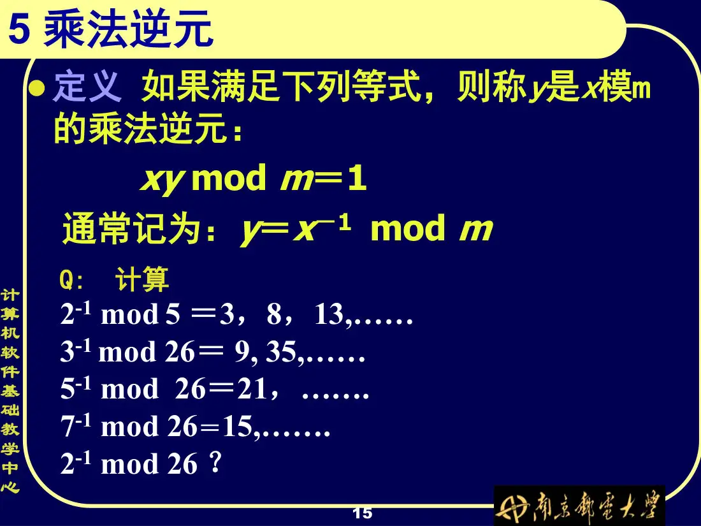

原文：

5 乘法逆元

⚫定义 如果满足下列等式，则称y是x模m的乘法逆元：

mod $\widetilde { L I } \widetilde { = } \widetilde { \Delta }$ 通常记为：y＝x－1 mod m

Q: 计算2-1 mod 5 ＝3，8，13,……$\mathrm { 8 . 9 2 } \mathrm  1 0 0 0 0 0 0 0 0 0 0 0 0 0 0 0 0 0 0 0 0 0 0 0 0 0 0 0 0 0 0 0 0 0 0 0 0 0 0 0 0 0 0 0 0 0 0 0 0 0 0 0 0 0 0 0 0 0 0 0 0 0 0 0 0 0 0 0 0 0 0 0 0 0 0 0 0 0 0 0 0 0 0 0 0 0 0 0 0 0 0 0 0 0 0 0 0 0 0 0 0 0 0 0 0 0 0 0 0 0 0 0 0 0 0 0 0 0 0 0 0 0 0 0 0 0 0 0 0 0$ 5-1 mod 26＝21，7-1 mod 26＝15,…2-1 mod 26 ？

15

今南京郵電大学

### 欧几里德算法

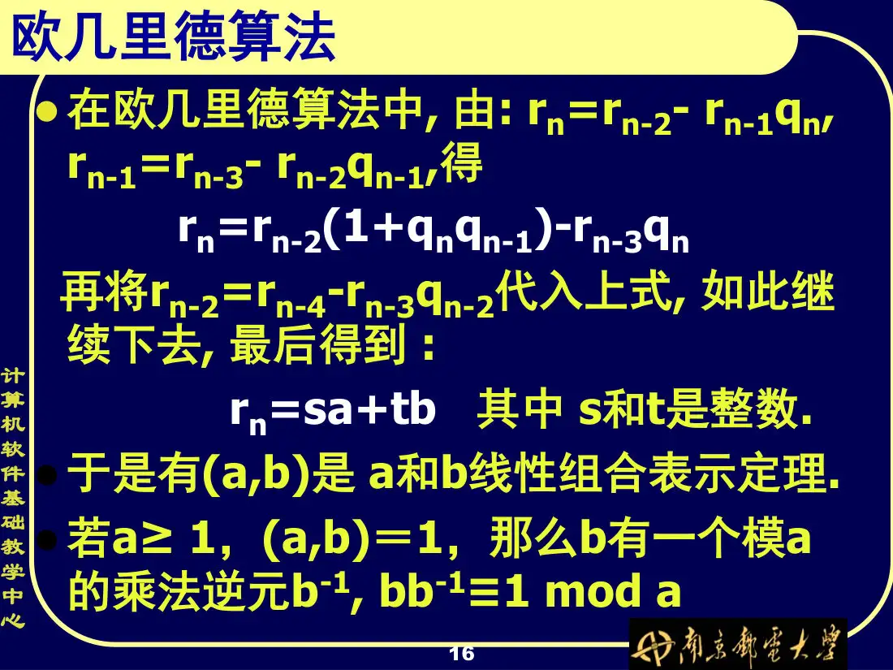

原文：

欧几里德算法

在欧几里德算法中, 由: $1 1 - 1 1 = 1 1 0$ $\angle B = \angle B E C = \angle B = \angle C$ 得$\scriptstyle 1 = ( 1 , 2 , 3 , 4 , 5 , 5 , 5 , 5 , 6 , 5 , 7 , 5 , 5 , 6 , 5 , 7 , 1 )$ 再将 $\angle B A C = \angle B A C = \angle C A C = 9 0 ^ { \circ }$ 代入上式, 如此继续下去, 最后得到 :$7 7 - 5 = 5 7 = 7 7 9$ 其中 s和t是整数.于是有 $( \epsilon ) \ni$ 是 a和b线性组合表示定理.若a≥ 1， $( \mathbf { \epsilon } \mathbf { \epsilon } \mathbf { \cdot } \mathbf { \vec { \alpha } } \mathbf { \cdot } \mathbf { \vec { \alpha } } )$ 那么b有一个模a的乘法逆元b-1, bb-1≡1 mod a

16

今南京郵電大学

### 欧几里德算法

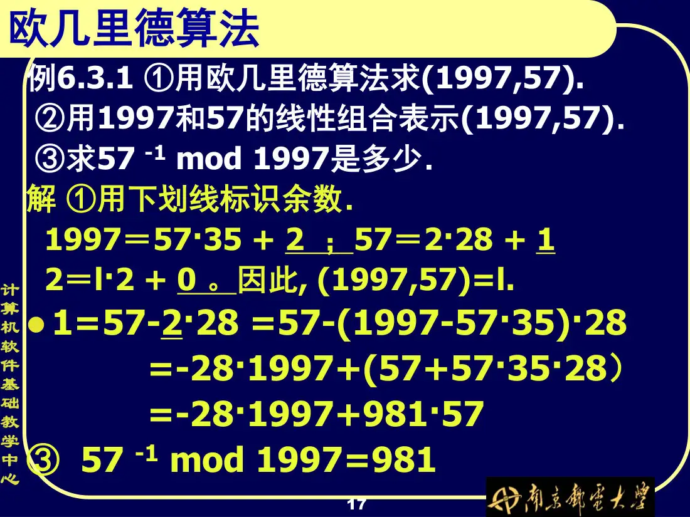

原文：

欧几里德算法

例6.3.1 ①用欧几里德算法求(1997,57).②用1997和57的线性组合表示(1997,57)③求57 -1 mod 1997是多少解 ①用下划线标识余数1997＝57·35 + 2 ；57＝2·28 + 12＝l·2 + 0 。因此, (1997,57)=l.⚫ 1=57-2·28 =57-(1997-57·35)·28=-28·1997+(57+57·35·28）=-28·1997+981·5757 -1 mod 1997=981

17

今南京郵電大学

### 欧几里德算法

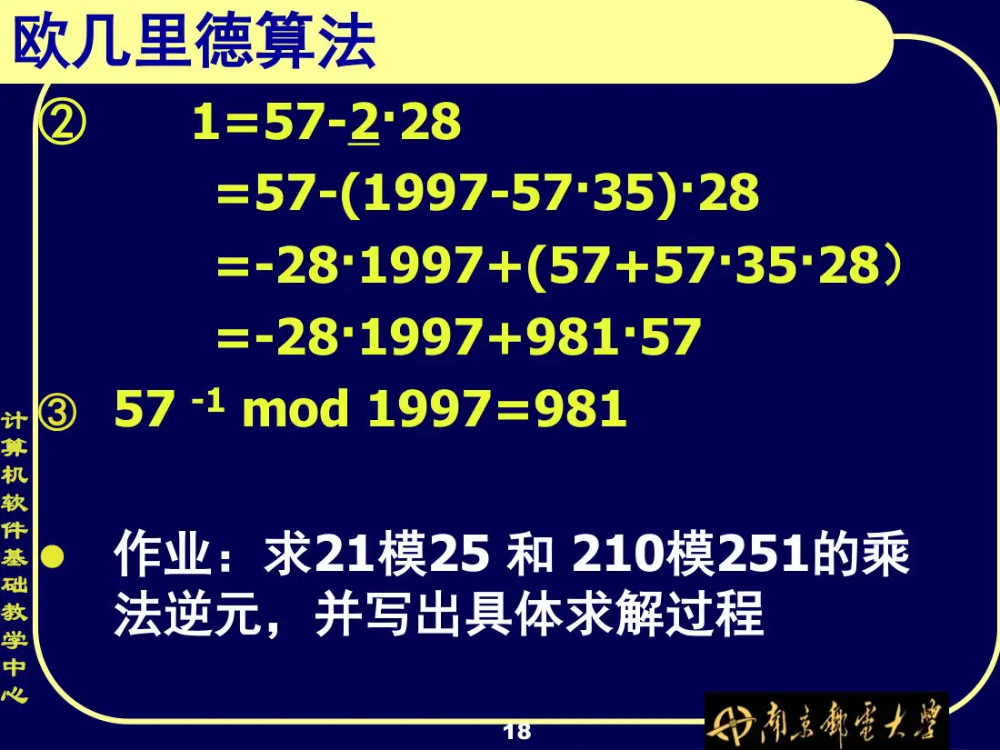

原文：

欧几里德算法

1=57-2·28 =57-(1997-57·35)·28 =-28·1997+(57+57·35·28） =-28·1997+981·57 7 -1 mod 1997=981

作业：求21模25 和 210模251的乘法逆元，并写出具体求解过程

18

朵南京郵電大学

### 6 同余式定义和基本性质

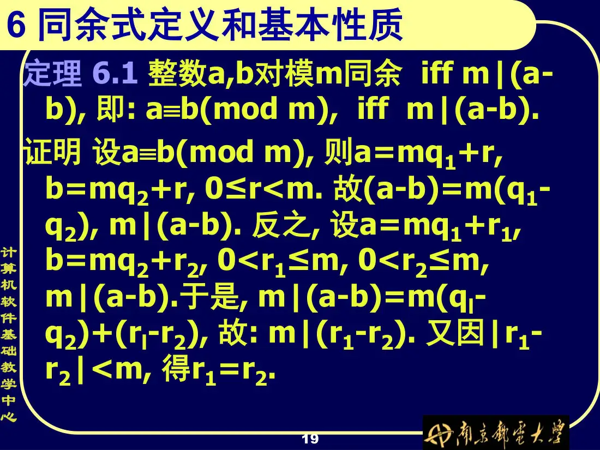

原文：

6 同余式定义和基本性质

定理 6.1 整数a,b对模m同余 iff m|(a-b), 即: ab(mod m), iff m|(a-b).证明 设ab(mod m), 则 $\mathsf { E } \equiv \varprojlim ( \bullet \varepsilon - \circ )$ b=mq +r, 0≤r<m. 故 $( \epsilon \ b ) { } = \mathbb { m } ( \cdot { } )$ q2), m|(a-b). 反之, 设a=mq1+r1,b=mq2+r2, 0<r1≤m, 0<r2≤m,m|(a-b).于是, m|(a-b)=m(q -$\mathrm { ( 9 ) } \mathbf { \vec { a } } = \mathrm { ( 4 ) } \mathbf { \vec { a } }$ 故: m|(r1-r2). 又因 $\mathbf { I } [ \mathbf { \overline { { v } } } ]$ r2|<m, 得 $\bf \delta m = \delta E F _ { 2 }$

19

今南京郵電大学

### 6 一次同余式

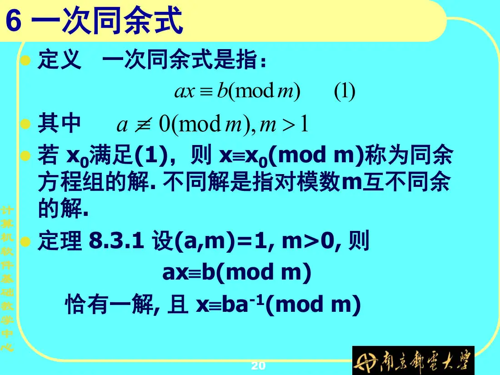

原文：

6 一次同余式

定义 一次同余式是指：

$$
a x \equiv b (\mathrm{mod} m)\tag{1}
$$

⚫ 其中 $a \not = 0 ( { \mathrm { m o d } } m ) , m > 1$

若 $\mathbf { \ x _ { 0 } }$ 满足(1)，则 $\scriptstyle \mathbf { x } \equiv \mathbf { x } _ { 0 } ( \mathbf { m o d } \ m )$ 称为同余方程组的解. 不同解是指对模数m互不同余的解.

定理 8.3.1 设 $( \mathbf { a } , \mathbf { m } ) { = } \mathbf { 1 } , \mathbf { m } { > } 0 ,$ 则$\scriptstyle \mathbf { a x } \equiv \mathbf { b } ( \mathbf { m o d } \ \mathbf { m } )$ 恰有一解, 且 $\mathbf { x } { \equiv } \mathbf { b } \mathbf { a } ^ { - 1 } ( \mathbf { m o d } ~ \mathbf { m } )$

20

今南京郵電大学

### 求解下列一次同余式

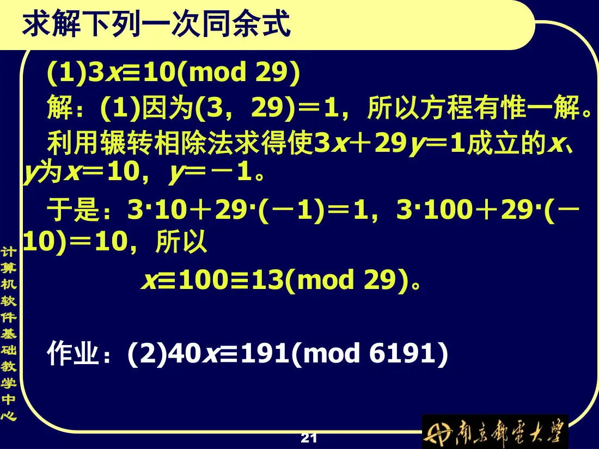

原文：

求解下列一次同余式

(1)3x≡10(mod 29)解：(1)因为(3，29)＝1，所以方程有惟一解。利用辗转相除法求得使3x＋29y＝1成立的x、为 $\Sigma { = } \Sigma \mathbb { G }$ ， ＝－1。于是：3·10＋29·(－1)＝1，3·100＋29·(－$\pmb { \mathrm { H } } \pmb { \mathrm { 0 } } \pmb { \mathrm { H } }$ 所以x≡100≡13(mod 29)。

作业：(2)40x≡191(mod 6191)

21

华南京郵電大学
