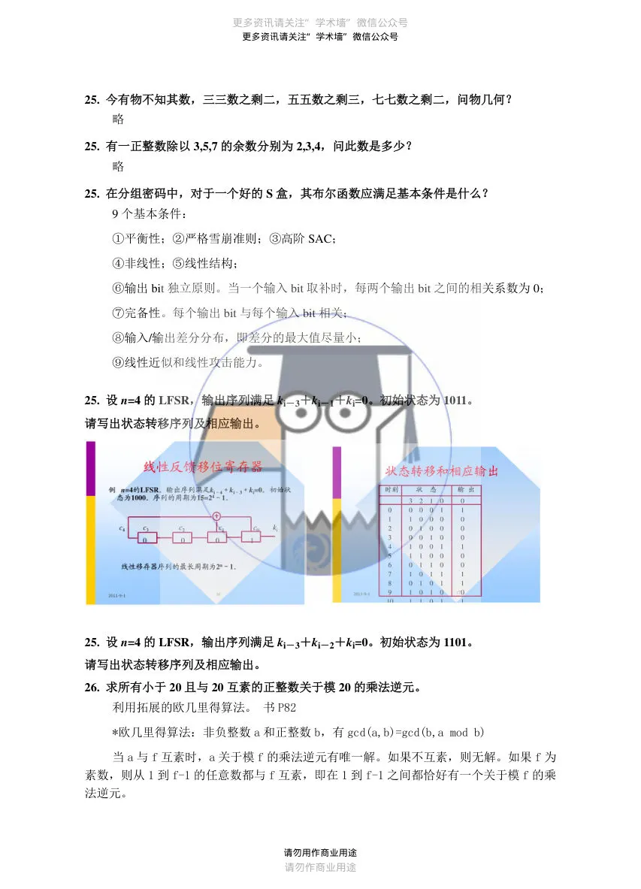
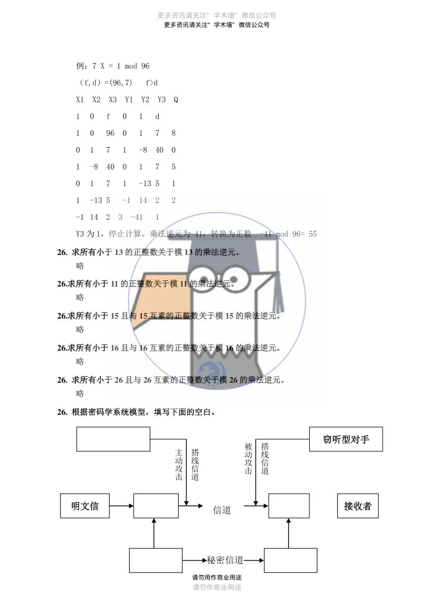
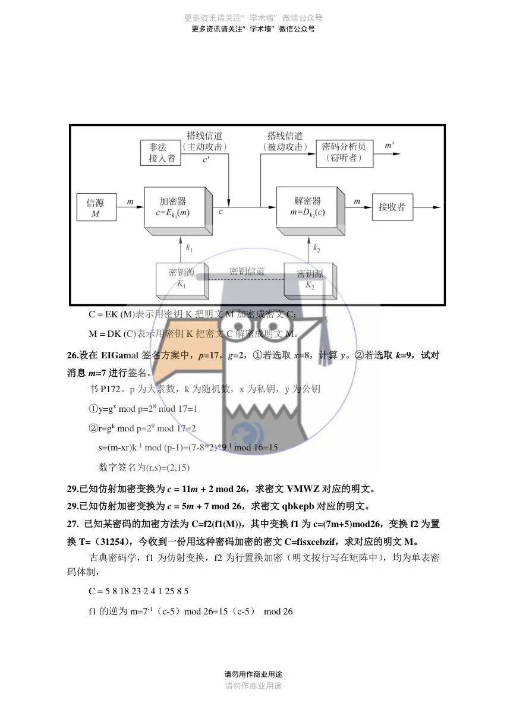

# 《现代密码学》练习题（含答案）

原件经识别和整理；“参考解答”是我们补的。

## 一、填空题（每空 1 分，共 7 分）

### 填空 1

加密算法的功能是实现信息的保密性。

知识点：[加密系统模型与密码体制的要素（明文空间、密文空间、密钥空间等）](../../../topics/现代密码学/密码体制要素与模型.md)、[信息安全的目标、安全攻击的主要形式和分类（被动攻击与主动攻击）](../../../topics/现代密码学/信息安全目标与攻击分类.md)、[密码分析学概念及密码攻击类型（唯密文攻击、已知明文攻击、选择明文攻击、选择密文攻击）](../../../topics/现代密码学/密码分析学基础.md)

### 填空 2

数据认证算法的功能是实现数据的完整性即消息的真实性。

知识点：[消息认证的目的、基于加密技术的消息认证与基于散列函数的消息认证](../../../topics/现代密码学/消息认证基础.md)

### 填空 3

密码编码学或代数中的有限域又称为伽罗华（Galois）域，记为 GF(p^n)。

知识点：[AES的数学基础（有限域群、多项式同余、不可约多项式、多项式的加法和x乘法）](../../../topics/现代密码学/AES数学基础.md)、[费尔玛定理、欧拉函数与欧拉定理](../../../topics/现代密码学/费尔玛定理与欧拉定理.md)、[模运算的定义、一次同余式及其求解方法](../../../topics/现代密码学/模运算与同余式.md)

### 填空 4

数字签名算法可实现不可否认性即抗依赖性。

信息安全基本要求：可用性、保密性、完整性、不可否认性、可控性、真实性。

知识点：[数字签名的设计要求、满足的条件、方案描述及与消息认证的不同](../../../topics/现代密码学/数字签名基本概念.md)、[信息安全的目标、安全攻击的主要形式和分类（被动攻击与主动攻击）](../../../topics/现代密码学/信息安全目标与攻击分类.md)

### 填空 5

Two-Track-MAC 算法基于带密钥的 RIPEMD-160。密钥和输出 MAC 值都是 20B。

知识点：[Hash函数的定义、单向性、多对一映射及无碰撞性等性质与应用](../../../topics/现代密码学/杂凑函数基本性质.md)、[HMAC的构造原理及其安全性分析](../../../topics/现代密码学/HMAC.md)、[CMAC的构造及其改进](../../../topics/现代密码学/CMAC.md)

### 填空 6

AES 和 Whirlpool 算法是根据宽轨迹策略设计的。

知识点：[Rijndael算法整体描述、State矩阵、字节代换SubBytes、字节移位ShiftRows、列混合MixColumns、轮密钥加AddRoundKey](../../../topics/现代密码学/AES轮变换.md)、[分组密码的设计要求与设计思想（扩散和混淆）](../../../topics/现代密码学/分组密码设计原则.md)

### 填空 7

序列密码的加密的基本原理是：用一个密钥序列与明文序列进行叠加来产生密文。

知识点：[流密码的概念、特点及与分组密码的区别](../../../topics/现代密码学/序列密码基本概念.md)、[同步流密码的工作原理及密码设计者的愿望](../../../topics/现代密码学/同步流密码.md)

### 填空 8

Rabin 密码体制是利用合数模下求解平方根的困难性构造了一种非对称/公钥/双钥密码体制。

知识点：[Rabin密码体制的密钥产生、解密（利用中国剩余定理求四个平方根）及安全性等价性](../../../topics/现代密码学/Rabin密码体制.md)、[模运算的定义、一次同余式及其求解方法](../../../topics/现代密码学/模运算与同余式.md)

### 填空 9

现代对称密码的设计基础是：扩散和混淆。

知识点：[分组密码的设计要求与设计思想（扩散和混淆）](../../../topics/现代密码学/分组密码设计原则.md)

### 填空 10

加密和解密都是在密钥控制下进行的。

知识点：[加密系统模型与密码体制的要素（明文空间、密文空间、密钥空间等）](../../../topics/现代密码学/密码体制要素与模型.md)、[根据密钥特性对密码体制的分类（对称密码与非对称密码）](../../../topics/现代密码学/密码体制分类.md)

### 填空 11

在一个密码系统模型中，只截取信道上传送信息的攻击方式被称为被动攻击。

知识点：[信息安全的目标、安全攻击的主要形式和分类（被动攻击与主动攻击）](../../../topics/现代密码学/信息安全目标与攻击分类.md)

### 填空 12

Caesar 密码体制属于单表代换密码体制。（字母平移）

知识点：[单表代换密码（一般单表代换密码与仿射密码）](../../../topics/现代密码学/单表代换密码.md)、[单表代换密码的分析方法与Hill密码的已知明文分析](../../../topics/现代密码学/古典密码分析技术.md)、[根据密钥特性对密码体制的分类（对称密码与非对称密码）](../../../topics/现代密码学/密码体制分类.md)

### 填空 13

尽管双重 DES 不等价于使用一个 56 位密钥的单重 DES，但有一种被称为中途相遇攻击的破译方法会对它构成威胁。（成倍减少要解密的加密文本）

知识点：[二重DES与三重DES(3DES)的原理与安全性](../../../topics/现代密码学/多重DES.md)、[DES的安全分析（弱密钥、半弱密钥、差分分析法和线性分析法）](../../../topics/现代密码学/DES安全性分析.md)、[密码分析学概念及密码攻击类型（唯密文攻击、已知明文攻击、选择明文攻击、选择密文攻击）](../../../topics/现代密码学/密码分析学基础.md)

### 填空 14

设计序列密码体制的关键就是要设计一种产生密钥流的方法。

知识点：[密钥序列产生器(KG)的基本要求与序列密码设计原则](../../../topics/现代密码学/序列密码设计原则.md)

### 填空 15

椭圆曲线密码是利用有限域 GF(2^n) 上的椭圆曲线上点集所构成的群上定义的离散对数系统，构造出的公钥/非对称密码体制。

知识点：[Elliptic Curve Cryptography (ECC) 的基本概念](../../../topics/现代密码学/椭圆曲线密码ECC.md)、[根据密钥特性对密码体制的分类（对称密码与非对称密码）](../../../topics/现代密码学/密码体制分类.md)

### 填空 16

在公钥密码体制中，加密密钥和解密密钥是不一样的，加密密钥可以公开传播而不会危及密码体制的安全性。

知识点：[公钥密码学的提出背景、思想、陷门单向函数、应用（保密通信与认证）及优缺点](../../../topics/现代密码学/公钥密码体制概述.md)、[根据密钥特性对密码体制的分类（对称密码与非对称密码）](../../../topics/现代密码学/密码体制分类.md)

### 填空 17

密码学上的 Hash 函数是一种将任意长度的消息压缩为某一固定长度的消息摘要的函数。

知识点：[Hash函数的定义、单向性、多对一映射及无碰撞性等性质与应用](../../../topics/现代密码学/杂凑函数基本性质.md)、[单向杂凑函数的安全性要求及生日攻击原理](../../../topics/现代密码学/杂凑函数安全性要求.md)、[MD5算法的整体流程、压缩函数及四轮循环操作实例](../../../topics/现代密码学/MD5算法.md)

### 填空 18

数字签名主要是用于对数字消息进行签名，以防止消息的伪造或篡改，也可以用于通信双方的身份认证。

知识点：[数字签名的设计要求、满足的条件、方案描述及与消息认证的不同](../../../topics/现代密码学/数字签名基本概念.md)

### 填空 19

CTR/计数器加密模式与 CBC 认证模式组合构成 CCM 模式；GMAX 算法与 CTR 加密模式组合构成 GCM 模式。

知识点：[分组密码的工作模式（电码本ECB、密码分组链接CBC、密码反馈CFB、输出反馈OFB）的比较和选用](../../../topics/现代密码学/分组密码工作模式.md)、[分组密码的设计要求与设计思想（扩散和混淆）](../../../topics/现代密码学/分组密码设计原则.md)

### 填空 20

第二代 Hash 函数标准有美国的 SHA-2 和欧洲的 Whirlpool 算法。

知识点：[Hash函数的定义、单向性、多对一映射及无碰撞性等性质与应用](../../../topics/现代密码学/杂凑函数基本性质.md)、[SHA-1算法原理、IV初值、Kt常数、处理步骤（4回合80次操作）](../../../topics/现代密码学/SHA-1算法.md)

### 填空 21

NESSIE 分组密码标准有 3 种：过渡型的标准是 MISTY1 算法，普通型的标准是 AES 算法和 Camellia 算法，高级型的标准是 SHACAL2 算法。

知识点：[分组密码的设计要求与设计思想（扩散和混淆）](../../../topics/现代密码学/分组密码设计原则.md)、[Rijndael算法整体描述、State矩阵、字节代换SubBytes、字节移位ShiftRows、列混合MixColumns、轮密钥加AddRoundKey](../../../topics/现代密码学/AES轮变换.md)

### 填空 22

在实际应用的混合密码系统中，公钥密码算法用作身份认证和加密会话密钥，对称密码算法用于加密消息。

知识点：[根据密钥特性对密码体制的分类（对称密码与非对称密码）](../../../topics/现代密码学/密码体制分类.md)、[公钥密码学的提出背景、思想、陷门单向函数、应用（保密通信与认证）及优缺点](../../../topics/现代密码学/公钥密码体制概述.md)

### 填空 23

第一个分组密码算法（标准）是 DES 算法；欧洲的第一代分组密码标准是 IDEA 算法；美国高级加密标准（AES）采纳的是 Rijndael 算法。

知识点：[分组密码的设计要求与设计思想（扩散和混淆）](../../../topics/现代密码学/分组密码设计原则.md)

### 填空 24

公钥加密标准有 RSA 和 ECC 算法等。

知识点：[公钥密码学的提出背景、思想、陷门单向函数、应用（保密通信与认证）及优缺点](../../../topics/现代密码学/公钥密码体制概述.md)、[RSA算法的数论基础（欧拉定理）、密钥产生、加解密描述、证明及举例](../../../topics/现代密码学/RSA算法.md)、[Elliptic Curve Cryptography (ECC) 的基本概念](../../../topics/现代密码学/椭圆曲线密码ECC.md)

### 填空 25

第一代单向 Hash 函数标准有美国的 SHA-1、欧洲的 RIPEMD-160 和 RFC 标准 MD5 算法。

知识点：[Hash函数的定义、单向性、多对一映射及无碰撞性等性质与应用](../../../topics/现代密码学/杂凑函数基本性质.md)、[MD5算法的整体流程、压缩函数及四轮循环操作实例](../../../topics/现代密码学/MD5算法.md)、[SHA-1算法原理、IV初值、Kt常数、处理步骤（4回合80次操作）](../../../topics/现代密码学/SHA-1算法.md)

### 填空 26

数字签名标准有 DSA/数字签名算法、RSA 和 FAPKC 算法等。

RSA 既能加密和签名，也能用于密钥交换。

知识点：[RSA算法的数论基础（欧拉定理）、密钥产生、加解密描述、证明及举例](../../../topics/现代密码学/RSA算法.md)

### 填空 27

密码学按任务可以分为密码编码学与密码分析学两个方向。

知识点：[密码分析学概念及密码攻击类型（唯密文攻击、已知明文攻击、选择明文攻击、选择密文攻击）](../../../topics/现代密码学/密码分析学基础.md)、[加密系统模型与密码体制的要素（明文空间、密文空间、密钥空间等）](../../../topics/现代密码学/密码体制要素与模型.md)

### 填空 28

分组密码设计一般采用 SP 思想，其中：S 盒实现混乱；置换运算 P 实现扩散。

知识点：[分组密码的设计要求与设计思想（扩散和混淆）](../../../topics/现代密码学/分组密码设计原则.md)、[Feistel加密结构、网络参数及单轮的加解密过程](../../../topics/现代密码学/Feistel网络结构.md)

### 填空 29

流密码算法和分组密码算法属于对称密码算法；而公钥密码算法和数字签名算法属于非对称密码算法。

知识点：[根据密钥特性对密码体制的分类（对称密码与非对称密码）](../../../topics/现代密码学/密码体制分类.md)、[公钥密码学的提出背景、思想、陷门单向函数、应用（保密通信与认证）及优缺点](../../../topics/现代密码学/公钥密码体制概述.md)

### 填空 30

A5 算法是欧洲数字蜂窝移动电话系统 GSM 采用的加密标准；RC4 算法是 IEEE802.11 WLAN 的初期加密标准；流密码国际标准有和算法。

## 二、判断题

知识点：[流密码的概念、特点及与分组密码的区别](../../../topics/现代密码学/序列密码基本概念.md)、[RC4序列密码算法的流程与特点](../../../topics/现代密码学/RC4算法.md)、[轮转密码机（ENIGMA）与转轮加密算法](../../../topics/现代密码学/轮转密码机.md)

### 判断 1

1976 年，提出公钥密码系统的学者是 Diffie 和 Hellman。（√）

知识点：[公钥密码学的提出背景、思想、陷门单向函数、应用（保密通信与认证）及优缺点](../../../topics/现代密码学/公钥密码体制概述.md)

### 判断 2

三重 DES 的有效密钥长度为 128 位。（×）

订正：56×3=168 位。

知识点：[二重DES与三重DES(3DES)的原理与安全性](../../../topics/现代密码学/多重DES.md)

### 判断 3

对 Feistel 网络，其加密过程的算法复杂度要比其解密过程的复杂度高得多。（×）

订正：一样高。

知识点：[Feistel加密结构、网络参数及单轮的加解密过程](../../../topics/现代密码学/Feistel网络结构.md)、[分组密码的设计要求与设计思想（扩散和混淆）](../../../topics/现代密码学/分组密码设计原则.md)、[加密系统模型与密码体制的要素（明文空间、密文空间、密钥空间等）](../../../topics/现代密码学/密码体制要素与模型.md)

### 判断 4

Hill 密码体制在加密前首先将明文编码成（0，1）字符串。（×）

订正：应编码为 0～25。

知识点：[多表代换密码（维吉尼亚密码与Hill密码）](../../../topics/现代密码学/多表代换密码.md)、[单表代换密码的分析方法与Hill密码的已知明文分析](../../../topics/现代密码学/古典密码分析技术.md)

### 判断 5

设 X 是长度为 n 的英文字母串，则 X 的重合指数的大小接近于 0.065。（√）

已知每个英文字母出现的期望概率，分别记为 p0, p1, …, p25，那么 X 中两个元素相同的概率为：

对于英文的一个随机字母串，每个英文字母出现的期望概率均为 1/26，则在 X 中任意选取两个元素相同的概率为

$$
I_c \approx \sum_{i=0}^{25}\left(\frac{1}{26}\right)^2 = 0.038
$$

知识点：[单表代换密码的分析方法与Hill密码的已知明文分析](../../../topics/现代密码学/古典密码分析技术.md)

### 判断 6

在信息安全课上老师进行的定理证明是一个零知识证明。（×）

订正：最大限度。

知识点：[零知识证明的基本概念、证明方法与实例（洞穴问题分析）](../../../topics/现代密码学/零知识证明.md)、[信息安全的目标、安全攻击的主要形式和分类（被动攻击与主动攻击）](../../../topics/现代密码学/信息安全目标与攻击分类.md)

### 判断 7

跟公钥密码体制相比，对称密码体制具有安全性更高的特点。（×）

订正：效率。

知识点：[根据密钥特性对密码体制的分类（对称密码与非对称密码）](../../../topics/现代密码学/密码体制分类.md)、[公钥密码学的提出背景、思想、陷门单向函数、应用（保密通信与认证）及优缺点](../../../topics/现代密码学/公钥密码体制概述.md)

### 判断 8

ElGamal 公钥密码体制的安全性是基于有限域上的离散对数问题的难解性。（√）

知识点：[ElGamal公钥密码体制的算法描述与安全性（基于离散对数困难问题）](../../../topics/现代密码学/ElGamal公钥密码.md)

### 判断 9

“一次一密”的随机密钥序列密码体制在理论上是很容易破译的。（×）

订正：不可破译。

知识点：[一次一密密码体制及其无条件安全性](../../../topics/现代密码学/一次一密密码.md)、[密码体制的安全性分类（无条件安全与计算安全）及信息论不等式 I(P;C)≥H(P)-H(K)](../../../topics/现代密码学/密码体制安全性.md)

### 判断 10

产生序列密码中的密钥序列的一种主要工具是移位寄存器。（√）

知识点：[流密码的概念、特点及与分组密码的区别](../../../topics/现代密码学/序列密码基本概念.md)、[线性反馈移位寄存器(LFSR)的结构与工作原理](../../../topics/现代密码学/LFSR.md)

### 判断 11

设 H 是一个 Hash 函数，如果寻找两个不同的消息 x 和 x′，使得 H(x)=H(x′) 在计算上是不可行的，则称 H 是随机碰撞的。（×）

订正：无碰撞性。

知识点：[流密码的概念、特点及与分组密码的区别](../../../topics/现代密码学/序列密码基本概念.md)、[Hash函数的定义、单向性、多对一映射及无碰撞性等性质与应用](../../../topics/现代密码学/杂凑函数基本性质.md)、[分组密码的设计要求与设计思想（扩散和混淆）](../../../topics/现代密码学/分组密码设计原则.md)

### 判断 12

在 DES 加密过程中，S 盒对加密的强度没有影响。（×）

订正：S 盒加密，置换算法 P 解密。

知识点：[公钥密码学的提出背景、思想、陷门单向函数、应用（保密通信与认证）及优缺点](../../../topics/现代密码学/公钥密码体制概述.md)、[密钥管理技术、原则、典型的密钥层次结构及密钥种类（对用户而言）](../../../topics/现代密码学/密钥管理原则与层次.md)、[基于公钥管理机构与公钥密码体制的会话密钥分配、证书用途及提供的主要服务](../../../topics/现代密码学/基于公钥的密钥分配.md)

### 判断 13

相对于常用密码体制，Rabin 密码体制不适宜对文字信息进行加密。（√）

常见公钥密码：背包、Rabin、Pohlig-Hellman、McEliece、基于椭圆曲线的、LUC 等公钥密码算法一般不加密消息，而用作身份认证和加密会话密钥，或对数字进行加密。

知识点：[分组密码的设计要求与设计思想（扩散和混淆）](../../../topics/现代密码学/分组密码设计原则.md)、[Feistel加密结构、网络参数及单轮的加解密过程](../../../topics/现代密码学/Feistel网络结构.md)、[Rijndael算法整体描述、State矩阵、字节代换SubBytes、字节移位ShiftRows、列混合MixColumns、轮密钥加AddRoundKey](../../../topics/现代密码学/AES轮变换.md)

### 判断 14

McEliece 密码体制适用于数字签名。（√）

知识点：[身份识别的要素、依据鉴别信息是否共享进行的分类及鉴别方式](../../../topics/现代密码学/身份识别基本原理.md)

### 判断 15

当输入输出规模很大时，可变 S 盒不仅能抗差分攻击且能抗各种已知攻击。（√）

知识点：[DES的安全分析（弱密钥、半弱密钥、差分分析法和线性分析法）](../../../topics/现代密码学/DES安全性分析.md)、[分组密码的设计要求与设计思想（扩散和混淆）](../../../topics/现代密码学/分组密码设计原则.md)

### 判断 16

CFB 模式在加密时必须有一个初始向量，而且可以用明文传给接收方。（√）

知识点：[分组密码的工作模式（电码本ECB、密码分组链接CBC、密码反馈CFB、输出反馈OFB）的比较和选用](../../../topics/现代密码学/分组密码工作模式.md)、[分组密码的设计要求与设计思想（扩散和混淆）](../../../topics/现代密码学/分组密码设计原则.md)

### 判断 17

RC-5 算法不采用固定 S 盒。（√）

引入了一种新的密码基本变换数据相依旋转方法，以提高密码强度。

知识点：[密码学发展简史（近代密码时期与现代密码学概念的发展）](../../../topics/现代密码学/密码学发展简史.md)

### 判断 18

对 DES 的 S 盒，当 S 盒的任一输入位保持不变，其它 5 位输入变化时（共有 2^5=32 种情况），输出数字中的 0 和 1 的总数近于相等。（√）

订正：输出均匀性。

知识点：[DES的S盒运算、置换P以及子密钥的生成（置换PC-1、循环左移、PC-2）](../../../topics/现代密码学/DES子密钥生成.md)

### 判断 19

加密和解密都是在计算机控制下进行的。（×）

订正：密钥。

知识点：[加密系统模型与密码体制的要素（明文空间、密文空间、密钥空间等）](../../../topics/现代密码学/密码体制要素与模型.md)、[密码学发展简史（近代密码时期与现代密码学概念的发展）](../../../topics/现代密码学/密码学发展简史.md)

### 判断 20

在一个密码系统中，只截取信道上传送信息的攻击方式被称为主动攻击。（×）

订正：被动。

知识点：[信息安全的目标、安全攻击的主要形式和分类（被动攻击与主动攻击）](../../../topics/现代密码学/信息安全目标与攻击分类.md)

### 判断 21

Caesar 密码体制属于古典单表密码体制。（√）

知识点：[单表代换密码（一般单表代换密码与仿射密码）](../../../topics/现代密码学/单表代换密码.md)、[单表代换密码的分析方法与Hill密码的已知明文分析](../../../topics/现代密码学/古典密码分析技术.md)

### 判断 22

三重 DES 的有效密钥长度为 64 位。（×）

订正：56×3=168。

知识点：[二重DES与三重DES(3DES)的原理与安全性](../../../topics/现代密码学/多重DES.md)、[分组密码的设计要求与设计思想（扩散和混淆）](../../../topics/现代密码学/分组密码设计原则.md)、[加密系统模型与密码体制的要素（明文空间、密文空间、密钥空间等）](../../../topics/现代密码学/密码体制要素与模型.md)

### 判断 23

尽管双重 DES 不等价于使用一个 56 位密钥的单重 DES，但有一种被称为中途相遇攻击的破译方法会对它构成威胁。（√）

知识点：[二重DES与三重DES(3DES)的原理与安全性](../../../topics/现代密码学/多重DES.md)

### 判断 24

跟对称密码体制相比，公钥密码体制最大的特点是加密密钥可公开。（√）

知识点：[公钥密码学的提出背景、思想、陷门单向函数、应用（保密通信与认证）及优缺点](../../../topics/现代密码学/公钥密码体制概述.md)

### 判断 25

数字签名通常采用加密强度高的加密算法。（×）

订正：两者没有关系。

知识点：[数字签名的设计要求、满足的条件、方案描述及与消息认证的不同](../../../topics/现代密码学/数字签名基本概念.md)

### 判断 26

公钥密码体制的理论基础是有限域上的离散对数。（√）

知识点：[公钥密码学的提出背景、思想、陷门单向函数、应用（保密通信与认证）及优缺点](../../../topics/现代密码学/公钥密码体制概述.md)、[ElGamal公钥密码体制的算法描述与安全性（基于离散对数困难问题）](../../../topics/现代密码学/ElGamal公钥密码.md)、[Elliptic Curve Cryptography (ECC) 的基本概念](../../../topics/现代密码学/椭圆曲线密码ECC.md)

### 判断 27

零知识证明协议在实际应用中，一般是抽样验证来实现的。（×）

订正：多次验证。

知识点：[零知识证明的基本概念、证明方法与实例（洞穴问题分析）](../../../topics/现代密码学/零知识证明.md)、[身份识别的要素、依据鉴别信息是否共享进行的分类及鉴别方式](../../../topics/现代密码学/身份识别基本原理.md)

### 判断 28

设计序列密码体制的关键就是要设计一种产生密钥序列的方法。（√）

知识点：[流密码的概念、特点及与分组密码的区别](../../../topics/现代密码学/序列密码基本概念.md)、[密钥序列产生器(KG)的基本要求与序列密码设计原则](../../../topics/现代密码学/序列密码设计原则.md)

### 判断 29

Hash 函数不可以用于完整性检测。（×）

订正：可以用于。

知识点：[Hash函数的定义、单向性、多对一映射及无碰撞性等性质与应用](../../../topics/现代密码学/杂凑函数基本性质.md)

### 判断 30

Vernam 密码体制在加密前首先将明文编码成（0，1）字符串。（√）

订正：古典密码多表代换。

知识点：[多表代换密码（维吉尼亚密码与Hill密码）](../../../topics/现代密码学/多表代换密码.md)、[一次一密密码体制及其无条件安全性](../../../topics/现代密码学/一次一密密码.md)

### 判断 31

设 X 是长度为 n 的明文的英文字母串，则 X 的重合指数的大小接近于 1/26。（×）

订正：0.065。

知识点：[单表代换密码的分析方法与Hill密码的已知明文分析](../../../topics/现代密码学/古典密码分析技术.md)

### 判断 32

对合密码是加密常用的一种加密函数 f(x,k)，实现 F_2^n → F_2^n 的映射。其中，n 是分组长，t 是密钥长。若对每个密钥取值都有 f[f(x,k),k]=x，即 f(x,k)^2=I（恒等置换），则称其为对合密码。（×）

订正：不对。

知识点：[加密系统模型与密码体制的要素（明文空间、密文空间、密钥空间等）](../../../topics/现代密码学/密码体制要素与模型.md)、[分组密码的设计要求与设计思想（扩散和混淆）](../../../topics/现代密码学/分组密码设计原则.md)、[置换密码（周期置换密码）的原理与分析](../../../topics/现代密码学/置换密码.md)

### 判断 33

跟公钥密码体制相比，对称密码体制具有加解密速度快的特点。（√）

知识点：[根据密钥特性对密码体制的分类（对称密码与非对称密码）](../../../topics/现代密码学/密码体制分类.md)、[公钥密码学的提出背景、思想、陷门单向函数、应用（保密通信与认证）及优缺点](../../../topics/现代密码学/公钥密码体制概述.md)

### 判断 34

ElGamal 公钥密码体制的安全性基于椭圆曲线上的离散对数问题的难解性。（×）

订正：有限域。

知识点：[ElGamal公钥密码体制的算法描述与安全性（基于离散对数困难问题）](../../../topics/现代密码学/ElGamal公钥密码.md)、[密码体制的安全性分类（无条件安全与计算安全）及信息论不等式 I(P;C)≥H(P)-H(K)](../../../topics/现代密码学/密码体制安全性.md)

### 判断 35

“一次一密”的随机密钥序列密码体制在理论上是不可以破译的。（√）

知识点：[一次一密密码体制及其无条件安全性](../../../topics/现代密码学/一次一密密码.md)、[密码体制的安全性分类（无条件安全与计算安全）及信息论不等式 I(P;C)≥H(P)-H(K)](../../../topics/现代密码学/密码体制安全性.md)

### 判断 36

产生序列密码中的密钥序列的一种主要工具是指令寄存器。（×）

订正：移位寄存器。

知识点：[流密码的概念、特点及与分组密码的区别](../../../topics/现代密码学/序列密码基本概念.md)、[线性反馈移位寄存器(LFSR)的结构与工作原理](../../../topics/现代密码学/LFSR.md)

### 判断 37

设 H 是一个 Hash 函数，如果寻找两个不同的消息 x 和 x′，使得 H(x)=H(x′) 在计算上是不可行的，则称 H 是弱无碰撞的。（×）

订正：强无碰撞性。

知识点：[Hash函数的定义、单向性、多对一映射及无碰撞性等性质与应用](../../../topics/现代密码学/杂凑函数基本性质.md)、[单向杂凑函数的安全性要求及生日攻击原理](../../../topics/现代密码学/杂凑函数安全性要求.md)

### 判断 38

在 DES 加密过程中，初始变换 IP 对加密的强度没有影响。（√）

知识点：[数据加密标准DES的参数、初始置换IP/逆置换IP-1、轮结构与E-扩展运算](../../../topics/现代密码学/DES算法流程.md)、[分组密码的设计要求与设计思想（扩散和混淆）](../../../topics/现代密码学/分组密码设计原则.md)

### 判断 39

相对常用密码体制，Rabin 密码体制适宜对随机数字流信息进行加密。（√）

知识点：[Rabin密码体制的密钥产生、解密（利用中国剩余定理求四个平方根）及安全性等价性](../../../topics/现代密码学/Rabin密码体制.md)、[中国剩余定理及其应用](../../../topics/现代密码学/中国剩余定理.md)、[公钥密码学的提出背景、思想、陷门单向函数、应用（保密通信与认证）及优缺点](../../../topics/现代密码学/公钥密码体制概述.md)

### 判断 40

McEliece 密码体制的特点是加密速度快。（×）

订正：非对称，加密慢。

知识点：[根据密钥特性对密码体制的分类（对称密码与非对称密码）](../../../topics/现代密码学/密码体制分类.md)、[公钥密码学的提出背景、思想、陷门单向函数、应用（保密通信与认证）及优缺点](../../../topics/现代密码学/公钥密码体制概述.md)

### 判断 41

可变 S 盒一定优于 DES 算法的固定 S 盒。（×）

订正：输入规模大的时候优于。

知识点：[DES的安全分析（弱密钥、半弱密钥、差分分析法和线性分析法）](../../../topics/现代密码学/DES安全性分析.md)

### 判断 42

ECB 模式不能够抵抗统计攻击和代换攻击。（√）

知识点：[分组密码的工作模式（电码本ECB、密码分组链接CBC、密码反馈CFB、输出反馈OFB）的比较和选用](../../../topics/现代密码学/分组密码工作模式.md)

### 判断 43

DES 是分组密码算法，其迭代轮数为 14 轮。（×）

订正：16。

知识点：[分组密码的设计要求与设计思想（扩散和混淆）](../../../topics/现代密码学/分组密码设计原则.md)、[信息安全的目标、安全攻击的主要形式和分类（被动攻击与主动攻击）](../../../topics/现代密码学/信息安全目标与攻击分类.md)

### 判断 44

所有公钥密码算法都可以用于签名和保密。（×）

订正：只适用于签名，不适合加密。

知识点：[公钥密码学的提出背景、思想、陷门单向函数、应用（保密通信与认证）及优缺点](../../../topics/现代密码学/公钥密码体制概述.md)、[RSA算法的数论基础（欧拉定理）、密钥产生、加解密描述、证明及举例](../../../topics/现代密码学/RSA算法.md)、[ElGamal公钥密码体制的算法描述与安全性（基于离散对数困难问题）](../../../topics/现代密码学/ElGamal公钥密码.md)

### 判断 45

伪造是攻击身份的真实性。（×）

订正：消息。

知识点：[信息安全的目标、安全攻击的主要形式和分类（被动攻击与主动攻击）](../../../topics/现代密码学/信息安全目标与攻击分类.md)、[消息认证的目的、基于加密技术的消息认证与基于散列函数的消息认证](../../../topics/现代密码学/消息认证基础.md)

### 判断 46

DSA 算法的安全性依赖于求解离散对数问题的难度。（√）

知识点：[数字签名标准DSS的签名过程](../../../topics/现代密码学/DSS数字签名标准.md)、[ElGamal公钥密码体制的算法描述与安全性（基于离散对数困难问题）](../../../topics/现代密码学/ElGamal公钥密码.md)

### 判断 47

SHA-1 杂凑算法的数据分组长度是 64 比特。（×）

订正：512 比特、64 字节。

知识点：[SHA-1算法原理、IV初值、Kt常数、处理步骤（4回合80次操作）](../../../topics/现代密码学/SHA-1算法.md)

### 判断 48

AES 算法的分组长度为 16 字节。（√）

订正：16 字节，128 比特。

知识点：[Rijndael算法整体描述、State矩阵、字节代换SubBytes、字节移位ShiftRows、列混合MixColumns、轮密钥加AddRoundKey](../../../topics/现代密码学/AES轮变换.md)、[分组密码的设计要求与设计思想（扩散和混淆）](../../../topics/现代密码学/分组密码设计原则.md)

### 判断 49

HMAC-MD5 算法的输出长度为 16 字节。（√）

订正：16 字节=128 比特。

知识点：[Hash函数的定义、单向性、多对一映射及无碰撞性等性质与应用](../../../topics/现代密码学/杂凑函数基本性质.md)、[MD5算法的整体流程、压缩函数及四轮循环操作实例](../../../topics/现代密码学/MD5算法.md)、[HMAC的构造原理及其安全性分析](../../../topics/现代密码学/HMAC.md)

### 判断 50

消息认证算法的功能是接收者能够验证消息在传输过程中是否被修改。（√）

知识点：[消息认证的目的、基于加密技术的消息认证与基于散列函数的消息认证](../../../topics/现代密码学/消息认证基础.md)

### 判断 51

数字签名可实现不可否认性。（√）

知识点：[数字签名的设计要求、满足的条件、方案描述及与消息认证的不同](../../../topics/现代密码学/数字签名基本概念.md)

### 判断 52

N 级 LFSR 输出的最大周期为 2N。（×）

订正：2^N−1。

知识点：[线性反馈移位寄存器(LFSR)的结构与工作原理](../../../topics/现代密码学/LFSR.md)、[m序列的特性与本原多项式的概念](../../../topics/现代密码学/m序列与本原多项式.md)

### 判断 53

Shannon 证明了公钥密码体制是绝对安全的。（×）

订正：仅证一次一密是不可破解的。

知识点：[密码体制的安全性分类（无条件安全与计算安全）及信息论不等式 I(P;C)≥H(P)-H(K)](../../../topics/现代密码学/密码体制安全性.md)、[一次一密密码体制及其无条件安全性](../../../topics/现代密码学/一次一密密码.md)

### 判断 54

在 RSA 公钥密码系统中，若 A 想给 B 发送一封邮件，并且想让 B 知道邮件是 A 发出的，则 A 应选用的签名密钥是 A 的私钥。（√）

订正：加密时用对方的公钥。

知识点：[数字签名的设计要求、满足的条件、方案描述及与消息认证的不同](../../../topics/现代密码学/数字签名基本概念.md)

### 判断 55

数据认证算法的功能是检测密文是否被篡改。（√）

订正：小。

知识点：[消息认证的目的、基于加密技术的消息认证与基于散列函数的消息认证](../../../topics/现代密码学/消息认证基础.md)、[Hash函数的定义、单向性、多对一映射及无碰撞性等性质与应用](../../../topics/现代密码学/杂凑函数基本性质.md)、[MAC函数与加密算法的比较](../../../topics/现代密码学/MAC与加密比较.md)

### 判断 56

伪造是攻击实体的抗抵赖性。（×）

订正：真实。

中断（干扰）：破坏可用性；截取（侦听）：获取消息内容、进行流量分析；修改：破坏完整性；伪造：破坏真实性。

知识点：[信息安全的目标、安全攻击的主要形式和分类（被动攻击与主动攻击）](../../../topics/现代密码学/信息安全目标与攻击分类.md)

### 判断 57

FAPKC 算法的设计思想基于有限自动机。（√）

订正：【FA】有限自动机。

知识点：[公钥密码学的提出背景、思想、陷门单向函数、应用（保密通信与认证）及优缺点](../../../topics/现代密码学/公钥密码体制概述.md)

### 判断 58

D-H 协议的安全性源于有限域上计算离散对数比计算指数更为困难。（√）

知识点：[公钥密码学的提出背景、思想、陷门单向函数、应用（保密通信与认证）及优缺点](../../../topics/现代密码学/公钥密码体制概述.md)

### 判断 59

身份认证算法的功能是验证身份的真实性。（√）

知识点：[身份识别的要素、依据鉴别信息是否共享进行的分类及鉴别方式](../../../topics/现代密码学/身份识别基本原理.md)

### 判断 60

N 级 LFSR 输出的最大周期为 2N−1。（×）

订正：2^N−1。

知识点：[线性反馈移位寄存器(LFSR)的结构与工作原理](../../../topics/现代密码学/LFSR.md)、[m序列的特性与本原多项式的概念](../../../topics/现代密码学/m序列与本原多项式.md)

### 判断 61

Shannon 证明了单钥密码体制是绝对安全的。（×）

订正：一次一密是不可破解。

知识点：[密码体制的安全性分类（无条件安全与计算安全）及信息论不等式 I(P;C)≥H(P)-H(K)](../../../topics/现代密码学/密码体制安全性.md)、[一次一密密码体制及其无条件安全性](../../../topics/现代密码学/一次一密密码.md)

### 判断 62

在 RSA 公钥密码系统中，若 A 想给 B 发送一封邮件，并且想让 B 知道邮件是 A 发出的，则 A 应选用的签名密钥是 B 的私钥。（×）

订正：A。

知识点：[基于RSA的数字签名算法（初始化、签名过程、验证过程）及注意问题](../../../topics/现代密码学/RSA数字签名.md)、[数字签名的设计要求、满足的条件、方案描述及与消息认证的不同](../../../topics/现代密码学/数字签名基本概念.md)

### 判断 63

DES 是分组密码算法，其迭代轮数为 64 轮。（×）

订正：16。

知识点：[数据加密标准DES的参数、初始置换IP/逆置换IP-1、轮结构与E-扩展运算](../../../topics/现代密码学/DES算法流程.md)

### 判断 64

RSA 系统中，若 A 想给 B 发送邮件，则 A 选用的加密密钥是 A 的私钥。（×）

订正：B 的公钥。

知识点：[公钥密码学的提出背景、思想、陷门单向函数、应用（保密通信与认证）及优缺点](../../../topics/现代密码学/公钥密码体制概述.md)、[RSA算法的数论基础（欧拉定理）、密钥产生、加解密描述、证明及举例](../../../topics/现代密码学/RSA算法.md)、[数字签名的设计要求、满足的条件、方案描述及与消息认证的不同](../../../topics/现代密码学/数字签名基本概念.md)

### 判断 65

伪造是攻击信息系统的可控性。（×）

订正：真实。

知识点：[信息安全的目标、安全攻击的主要形式和分类（被动攻击与主动攻击）](../../../topics/现代密码学/信息安全目标与攻击分类.md)、[密码分析学概念及密码攻击类型（唯密文攻击、已知明文攻击、选择明文攻击、选择密文攻击）](../../../topics/现代密码学/密码分析学基础.md)

### 判断 66

ECC 算法的安全性依赖于求解椭圆曲线上离散对数的难度。（√）

订正：【ECC】椭圆曲线。

知识点：[Elliptic Curve Cryptography (ECC) 的基本概念](../../../topics/现代密码学/椭圆曲线密码ECC.md)

### 判断 67

AES 算法的分组长度可以是 192 比特。（×）

订正：16 字节，128 比特。

知识点：[Rijndael算法整体描述、State矩阵、字节代换SubBytes、字节移位ShiftRows、列混合MixColumns、轮密钥加AddRoundKey](../../../topics/现代密码学/AES轮变换.md)

### 判断 68

保密通信中，初始向量 IV 的功能是抗重放攻击。（√）

知识点：[分组密码的工作模式（电码本ECB、密码分组链接CBC、密码反馈CFB、输出反馈OFB）的比较和选用](../../../topics/现代密码学/分组密码工作模式.md)

### 判断 69

身份认证算法可在一定程度上实现信息系统的可用性。（√）

知识点：[身份识别的要素、依据鉴别信息是否共享进行的分类及鉴别方式](../../../topics/现代密码学/身份识别基本原理.md)

### 判断 70

当密码算法 f 的任意一位输入改变时，如果每一位输出改变的概率为 0.5，则称 f 满足严格雪崩准则。（√）

知识点：[分组密码的设计要求与设计思想（扩散和混淆）](../../../topics/现代密码学/分组密码设计原则.md)、[DES的安全分析（弱密钥、半弱密钥、差分分析法和线性分析法）](../../../topics/现代密码学/DES安全性分析.md)

### 判断 71

Diffie-Hellman 密钥交换协议是第一个公钥密码算法。（√）

知识点：[公钥密码学的提出背景、思想、陷门单向函数、应用（保密通信与认证）及优缺点](../../../topics/现代密码学/公钥密码体制概述.md)、[Diffie-Hellman密钥协商/交换协议原理及中间人攻击](../../../topics/现代密码学/Diffie-Hellman密钥交换.md)、[信息安全的目标、安全攻击的主要形式和分类（被动攻击与主动攻击）](../../../topics/现代密码学/信息安全目标与攻击分类.md)

### 判断 72

N 级 LFSR 输出的最大周期为 N−1。（×）

订正：2^N−1。

知识点：[线性反馈移位寄存器(LFSR)的结构与工作原理](../../../topics/现代密码学/LFSR.md)、[m序列的特性与本原多项式的概念](../../../topics/现代密码学/m序列与本原多项式.md)

### 判断 73

Shannon 证明了一次一密的密码体制是绝对安全的。（×）

订正：不可破解。

知识点：[密码体制的安全性分类（无条件安全与计算安全）及信息论不等式 I(P;C)≥H(P)-H(K)](../../../topics/现代密码学/密码体制安全性.md)、[一次一密密码体制及其无条件安全性](../../../topics/现代密码学/一次一密密码.md)

### 判断 74

在 RSA 公钥密码系统中，若 A 想给 B 发送一封邮件，并且想让 B 知道邮件是 A 发出的，则 A 应选用的签名密钥是 A 的公钥。（×）

订正：A 的私钥。

知识点：[基于RSA的数字签名算法（初始化、签名过程、验证过程）及注意问题](../../../topics/现代密码学/RSA数字签名.md)、[公钥密码学的提出背景、思想、陷门单向函数、应用（保密通信与认证）及优缺点](../../../topics/现代密码学/公钥密码体制概述.md)、[数字签名的设计要求、满足的条件、方案描述及与消息认证的不同](../../../topics/现代密码学/数字签名基本概念.md)

### 判断 75

McEliece 体制和 Xinmei 算法的设计思想基于纠错码。（√）

知识点：[公钥密码学的提出背景、思想、陷门单向函数、应用（保密通信与认证）及优缺点](../../../topics/现代密码学/公钥密码体制概述.md)、[RSA算法的数论基础（欧拉定理）、密钥产生、加解密描述、证明及举例](../../../topics/现代密码学/RSA算法.md)

### 判断 76

GPS 算法是 NESSIE 的非对称认证标准。（√）

知识点：[公钥密码学的提出背景、思想、陷门单向函数、应用（保密通信与认证）及优缺点](../../../topics/现代密码学/公钥密码体制概述.md)

### 判断 77

消息认证算法的功能是入侵者不能用假消息代替合法消息。（√）

知识点：[消息认证的目的、基于加密技术的消息认证与基于散列函数的消息认证](../../../topics/现代密码学/消息认证基础.md)

### 判断 78

欧拉函数 φ(100)=40。（√）

知识点：[费尔玛定理、欧拉函数与欧拉定理](../../../topics/现代密码学/费尔玛定理与欧拉定理.md)

### 判断 79

欧拉函数 φ(200)=80。（√）

订正：MM。

知识点：[费尔玛定理、欧拉函数与欧拉定理](../../../topics/现代密码学/费尔玛定理与欧拉定理.md)、[因数、倍数、素数和合数的基本概念](../../../topics/现代密码学/整除与素数.md)、[密码体制的安全性分类（无条件安全与计算安全）及信息论不等式 I(P;C)≥H(P)-H(K)](../../../topics/现代密码学/密码体制安全性.md)

### 判断 80

欧拉函数 φ(300)=120。（×）

$$
\varphi(300)=\varphi(12\times 25)=\varphi(12)\times\varphi(25)=\varphi(3)\times\varphi(2^2)\times\varphi(5^2)=2\times 2\times 20=80
$$

知识点：[费尔玛定理、欧拉函数与欧拉定理](../../../topics/现代密码学/费尔玛定理与欧拉定理.md)、[因数、倍数、素数和合数的基本概念](../../../topics/现代密码学/整除与素数.md)

### 判断 81

欧拉函数 φ(400)=160。（√）

订正：小于 400 且与其互质的数的个数；φ(400)=φ(16×25)=φ(2^4)×φ(5^2)=(16−8)×(25−5)=8×20=160。

知识点：[费尔玛定理、欧拉函数与欧拉定理](../../../topics/现代密码学/费尔玛定理与欧拉定理.md)、[RSA算法的数论基础（欧拉定理）、密钥产生、加解密描述、证明及举例](../../../topics/现代密码学/RSA算法.md)、[密码体制的安全性分类（无条件安全与计算安全）及信息论不等式 I(P;C)≥H(P)-H(K)](../../../topics/现代密码学/密码体制安全性.md)

### 判断 82

Schnorr 算法的安全性依赖于求解离散对数问题的难度。（√）

知识点：[Schnorr身份鉴别方案的流程与安全性分析](../../../topics/现代密码学/Schnorr身份鉴别方案.md)

### 判断 83

ElGamal 算法的安全性依赖于求解离散对数问题的难度。（√）

知识点：[ElGamal公钥密码体制的算法描述与安全性（基于离散对数困难问题）](../../../topics/现代密码学/ElGamal公钥密码.md)

### 判断 84

密码统计测试方法的原理一般是假设检验。（√）

知识点：[密码分析学概念及密码攻击类型（唯密文攻击、已知明文攻击、选择明文攻击、选择密文攻击）](../../../topics/现代密码学/密码分析学基础.md)

### 判断 85

GPS 算法是 Schnorr 的改进方案。（√）

知识点：[Schnorr身份鉴别方案的流程与安全性分析](../../../topics/现代密码学/Schnorr身份鉴别方案.md)、[零知识证明的基本概念、证明方法与实例（洞穴问题分析）](../../../topics/现代密码学/零知识证明.md)、[身份识别的要素、依据鉴别信息是否共享进行的分类及鉴别方式](../../../topics/现代密码学/身份识别基本原理.md)

### 判断 86

密码分析学的任务是分析密码算法与协议的安全性。（√）

知识点：[密码分析学概念及密码攻击类型（唯密文攻击、已知明文攻击、选择明文攻击、选择密文攻击）](../../../topics/现代密码学/密码分析学基础.md)、[密码体制的安全性分类（无条件安全与计算安全）及信息论不等式 I(P;C)≥H(P)-H(K)](../../../topics/现代密码学/密码体制安全性.md)

### 判断 87

身份认证的作用是入侵者不能伪装成他人。（√）

## 三、名词解释（每小题 3 分，共 9 分）

知识点：[身份识别的要素、依据鉴别信息是否共享进行的分类及鉴别方式](../../../topics/现代密码学/身份识别基本原理.md)

### 名词解释 1

被动攻击。

答案：被动攻击即窃听，对系统的保密性进行攻击，分为获取消息内容和进行业务流分析两类，不对消息做任何修改，难以检测。

知识点：[信息安全的目标、安全攻击的主要形式和分类（被动攻击与主动攻击）](../../../topics/现代密码学/信息安全目标与攻击分类.md)

### 名词解释 2

主动攻击。

答案：包括对数据流的篡改或产生假的数据流，分为中断、篡改和伪造三类。抗击主动攻击的主要途径是检测，以及对此攻击造成的破坏进行恢复。

知识点：[信息安全的目标、安全攻击的主要形式和分类（被动攻击与主动攻击）](../../../topics/现代密码学/信息安全目标与攻击分类.md)

### 名词解释 3

密码分析学。

答案：主要研究密码、密文或密码系统，在不知道解密所需要的密钥和算法的情况下，对加密信息进行解密的学科。

知识点：[密码分析学概念及密码攻击类型（唯密文攻击、已知明文攻击、选择明文攻击、选择密文攻击）](../../../topics/现代密码学/密码分析学基础.md)

### 名词解释 4

LFSR。

答案：线性反馈移位寄存器（LFSR），指给定前一状态的输出，将该输出的线性函数再用做输入的移位寄存器。

知识点：[流密码的概念、特点及与分组密码的区别](../../../topics/现代密码学/序列密码基本概念.md)、[线性反馈移位寄存器(LFSR)的结构与工作原理](../../../topics/现代密码学/LFSR.md)

### 名词解释 5

杂凑函数。

答案：又称哈希函数（Hash），用于将任意长的消息 $M$ 映射为固定长度的一个值 $H(M)$，作为认证符，称函数值 $H(M)$ 为哈希值或哈希码或消息摘要。

知识点：[Hash函数的定义、单向性、多对一映射及无碰撞性等性质与应用](../../../topics/现代密码学/杂凑函数基本性质.md)、[单向杂凑函数的安全性要求及生日攻击原理](../../../topics/现代密码学/杂凑函数安全性要求.md)、[MD5算法的整体流程、压缩函数及四轮循环操作实例](../../../topics/现代密码学/MD5算法.md)

### 名词解释 6

本原多项式。

答案：一个 $n$ 次不可约多项式，能整除 $1+Z^{2^n-1}$ 而不能整除其他 $1+Z^L\ (L<2^n-1)$。

知识点：[线性反馈移位寄存器(LFSR)的结构与工作原理](../../../topics/现代密码学/LFSR.md)、[m序列的特性与本原多项式的概念](../../../topics/现代密码学/m序列与本原多项式.md)

### 名词解释 7

最大公因子。

答案：指两个或多个整数共有约数中最大的一个。

知识点：[最大公因数(gcd)的概念及欧几里德算法求最大公约数](../../../topics/现代密码学/最大公因数与欧几里德算法.md)

### 名词解释 8

模乘逆元。

答案：对 $x$，若有 $y$，使得 $x \times y \equiv 1 \bmod n$，如 $3 \times 3 \equiv 1 \bmod 8$，则称 $y$ 为 $x$ 的倒数，也称为模乘逆元。

知识点：[乘法逆元的概念与求解](../../../topics/现代密码学/乘法逆元.md)

### 名词解释 9

素性检验。

答案：对给定的数检验其是否为素数。

知识点：[因数、倍数、素数和合数的基本概念](../../../topics/现代密码学/整除与素数.md)

### 名词解释 10

Kerckhoff 原则。

答案：现代密码学的基本原则是 Kerckhoff 原则，即设计加密系统时，总是假定密码算法是可以公开的，需要保密的是密钥。一个密码系统的安全性不在算法的保密，而在于密钥。

知识点：[加密系统模型与密码体制的要素（明文空间、密文空间、密钥空间等）](../../../topics/现代密码学/密码体制要素与模型.md)、[密码体制的安全性分类（无条件安全与计算安全）及信息论不等式 I(P;C)≥H(P)-H(K)](../../../topics/现代密码学/密码体制安全性.md)

### 名词解释 11

密钥管理。

答案：密钥的产生、分配、存储、销毁问题。

知识点：[密钥管理技术、原则、典型的密钥层次结构及密钥种类（对用户而言）](../../../topics/现代密码学/密钥管理原则与层次.md)、[无中心的密钥分配与端—端密钥协商协议](../../../topics/现代密码学/无中心的密钥分配.md)

### 名词解释 12

欧拉定理。

答案：若 $a$ 与 $n$ 互素，则 $a^{\varphi(n)} \equiv 1 \bmod n$。

知识点：[费尔玛定理、欧拉函数与欧拉定理](../../../topics/现代密码学/费尔玛定理与欧拉定理.md)、[RSA算法的数论基础（欧拉定理）、密钥产生、加解密描述、证明及举例](../../../topics/现代密码学/RSA算法.md)、[最大公因数(gcd)的概念及欧几里德算法求最大公约数](../../../topics/现代密码学/最大公因数与欧几里德算法.md)

### 名词解释 13

欧拉函数。

答案：设 $n$ 是一正整数，小于 $n$ 且与 $n$ 互素的正整数的个数称为 $n$ 的欧拉函数，记为 $\varphi(n)$。

知识点：[费尔玛定理、欧拉函数与欧拉定理](../../../topics/现代密码学/费尔玛定理与欧拉定理.md)、[RSA算法的数论基础（欧拉定理）、密钥产生、加解密描述、证明及举例](../../../topics/现代密码学/RSA算法.md)、[RSA的安全性问题（|q-p|要大、密钥泄露）、素数的产生与RSA的实现](../../../topics/现代密码学/RSA安全性与实现.md)

### 名词解释 14

费尔玛定理。

答案：Fermat 定理，若 $p$ 是素数，$a$ 是正整数且 $\gcd(a,p)=1$，则 $a^{p-1} \equiv 1 \bmod p$。

知识点：[费尔玛定理、欧拉函数与欧拉定理](../../../topics/现代密码学/费尔玛定理与欧拉定理.md)、[模运算的定义、一次同余式及其求解方法](../../../topics/现代密码学/模运算与同余式.md)

### 名词解释 15

消息认证码。

答案：指消息被一密钥控制的公开函数作用后产生的、用作认证符的、固定长度的数值，也称为密码校验和。

知识点：[消息认证的目的、基于加密技术的消息认证与基于散列函数的消息认证](../../../topics/现代密码学/消息认证基础.md)

### 名词解释 16

汉明距离 $w(x)$。

答案：汉明距离 $w(x)$ 表示两个（相同长度）字对应位不同的数量，即对两个字符串进行异或运算后结果为 1 的个数。

知识点：[分组密码的设计要求与设计思想（扩散和混淆）](../../../topics/现代密码学/分组密码设计原则.md)、[DES的安全分析（弱密钥、半弱密钥、差分分析法和线性分析法）](../../../topics/现代密码学/DES安全性分析.md)

### 名词解释 17

重合指数。

答案：用于计算密文中相同字母的概率。

知识点：[单表代换密码的分析方法与Hill密码的已知明文分析](../../../topics/现代密码学/古典密码分析技术.md)

### 名词解释 18

分组密码算法。

答案：分组密码是将明文消息编码表示后的数字序列，划分成长度为 $n$ 的组，各组分别在密钥的控制下变换成等长的输出数字序列。

知识点：[分组密码的设计要求与设计思想（扩散和混淆）](../../../topics/现代密码学/分组密码设计原则.md)

### 名词解释 19

流密码算法。

答案：又称序列密码，将明文 $m$ 写成连续的符号，利用密钥流中的第 $i$ 个元素 $k_i$ 对应明文中的第 $i$ 个元素 $m_i$ 进行加密，若加密变换为 $E$，则加密后的密文为 $c=E_k(m)=E_{k_1}(m_1)E_{k_2}(m_2)\cdots E_{k_i}(m_i)$。

知识点：[流密码的概念、特点及与分组密码的区别](../../../topics/现代密码学/序列密码基本概念.md)

### 名词解释 20

加密算法。

答案：密码员对明文进行加密时所采用的一组规则。

知识点：[加密系统模型与密码体制的要素（明文空间、密文空间、密钥空间等）](../../../topics/现代密码学/密码体制要素与模型.md)

### 名词解释 21

单钥密码体制。

答案：加密密钥与解密密钥相同。

知识点：[根据密钥特性对密码体制的分类（对称密码与非对称密码）](../../../topics/现代密码学/密码体制分类.md)、[加密系统模型与密码体制的要素（明文空间、密文空间、密钥空间等）](../../../topics/现代密码学/密码体制要素与模型.md)

### 名词解释 22

序列密码算法。

答案：即流密码算法，明文消息按字符逐位地加密。

知识点：[流密码的概念、特点及与分组密码的区别](../../../topics/现代密码学/序列密码基本概念.md)、[密钥序列产生器(KG)的基本要求与序列密码设计原则](../../../topics/现代密码学/序列密码设计原则.md)、[线性反馈移位寄存器(LFSR)的结构与工作原理](../../../topics/现代密码学/LFSR.md)

### 名词解释 23

同步流密码。

答案：加密器中记忆元件的存储状态 $\sigma_i$ 独立于输入的明文字符。

知识点：[流密码的概念、特点及与分组密码的区别](../../../topics/现代密码学/序列密码基本概念.md)、[同步流密码的工作原理及密码设计者的愿望](../../../topics/现代密码学/同步流密码.md)

### 名词解释 24

自同步流密码。

答案：加密器中记忆元件的存储状态 $\sigma_i$ 依赖于输入的明文字符。

知识点：[流密码的概念、特点及与分组密码的区别](../../../topics/现代密码学/序列密码基本概念.md)、[同步流密码的工作原理及密码设计者的愿望](../../../topics/现代密码学/同步流密码.md)

### 名词解释 25

平方剩余。

答案：假设 $p$ 是素数，$a$ 是整数。如果存在一个整数 $x$ 使得 $x^2 \equiv a \bmod p$，那么就称 $a$ 在 $p$ 的剩余类中是平方剩余。

知识点：[勒让德符号与二次剩余](../../../topics/现代密码学/勒让德符号.md)、[模运算的定义、一次同余式及其求解方法](../../../topics/现代密码学/模运算与同余式.md)、[因数、倍数、素数和合数的基本概念](../../../topics/现代密码学/整除与素数.md)

### 名词解释 26

非平方剩余。

答案：假设 $p$ 是素数，$a$ 是整数。如果存在一个整数 $x$ 使得 $x \equiv a \bmod p$，$\sqrt{x}$ 不为整数，那么就称 $a$ 是 $p$ 的非平方剩余。

## 四、简答题（每小题 5 分，共 20 分）

知识点：[勒让德符号与二次剩余](../../../topics/现代密码学/勒让德符号.md)

### 简答 1

求解欧拉函数 $\varphi(2000)$。

答案：几个性质：

①对于给定的一个素数 $p$，$\varphi(p)=p-1$。则对于正整数 $n=p^k$，$\varphi(n)=p^k-p^{k-1}$。

②$m$，$n$ 互素，$\varphi(m \cdot n)=\varphi(m)\cdot\varphi(n)$。

知识点：[RSA算法的数论基础（欧拉定理）、密钥产生、加解密描述、证明及举例](../../../topics/现代密码学/RSA算法.md)、[费尔玛定理、欧拉函数与欧拉定理](../../../topics/现代密码学/费尔玛定理与欧拉定理.md)、[乘法逆元的概念与求解](../../../topics/现代密码学/乘法逆元.md)

### 简答 2

简述 AES 算法设计思想。

答案：通常，分组密码算法的结构是 Feistel 结构，不过 AES 算法使用了一种称为“宽轨迹策略”的方法，可分为轮密钥编排和加密过程两个独立的部分。

该算法有 3 条设计准则：

①抗所有已知的攻击；

②在多个平台上速度快，编码紧凑；

③设计简单。

知识点：[RSA算法的数论基础（欧拉定理）、密钥产生、加解密描述、证明及举例](../../../topics/现代密码学/RSA算法.md)、[数字签名的设计要求、满足的条件、方案描述及与消息认证的不同](../../../topics/现代密码学/数字签名基本概念.md)、[基于RSA的数字签名算法（初始化、签名过程、验证过程）及注意问题](../../../topics/现代密码学/RSA数字签名.md)

### 简答 3

AES 算法的每一轮迭代包括哪几种变换？

答案：字节代换、行移位、列混合、密钥加。

知识点：[分组密码的工作模式（电码本ECB、密码分组链接CBC、密码反馈CFB、输出反馈OFB）的比较和选用](../../../topics/现代密码学/分组密码工作模式.md)、[流密码的概念、特点及与分组密码的区别](../../../topics/现代密码学/序列密码基本概念.md)

### 简答 4

用伪代码简述 AES 算法轮变换 Round(State, RoundKey)。

答案：

```text
SubBytes(State);
ShiftRow(State);
MixColumn(State);
AddRoundKey(State, RoundKey);
```

最后一轮去掉 MixColumn 这一步。

知识点：[Rijndael算法整体描述、State矩阵、字节代换SubBytes、字节移位ShiftRows、列混合MixColumns、轮密钥加AddRoundKey](../../../topics/现代密码学/AES轮变换.md)、[AES的数学基础（有限域群、多项式同余、不可约多项式、多项式的加法和x乘法）](../../../topics/现代密码学/AES数学基础.md)

### 简答 5

用伪码简述 AES 算法加密过程的主要步骤（不含密钥编排），并简要说明。

答案：加密全过程包括：轮密钥编排（扩展）；轮密钥异或，前 $(r-1)$ 轮迭代，一个结尾轮。

①将轮密钥 RoundKey 与明文 State 异或

```text
AddRoundKey(State, RoundKey);
```

②对前 $r-1$ 轮中的每一轮进行相同的变换

```text
Round(State, RoundKey)
{
    SubBytes(State);              // 用 S 盒对 State 的字节进行非线性变换
    ShiftRow(State);
    MixColumn(State);             // 列线性混合
    AddRoundKey(State, RoundKey); // 轮密钥异或
}
```

③最后一轮变换：FinalRound(State, RoundKey)

```text
FinalRound(State, RoundKey)
{
    SubBytes(State);
    ShiftRow(State);              // 行循环移位
    AddRoundKey(State, RoundKey);
}
```

最后的 State 即为密文。解密过程把加密过程完全反过来即可。

知识点：[Rijndael算法整体描述、State矩阵、字节代换SubBytes、字节移位ShiftRows、列混合MixColumns、轮密钥加AddRoundKey](../../../topics/现代密码学/AES轮变换.md)

### 简答 6

在密码分组链接（CBC）模式中，一个密文块的传输错误将影响几个明文块的正确还原？

答案：将影响该密文块之后所有明文块的正确还原。

知识点：[分组密码的工作模式（电码本ECB、密码分组链接CBC、密码反馈CFB、输出反馈OFB）的比较和选用](../../../topics/现代密码学/分组密码工作模式.md)

### 简答 7

对消息 $m=0\text{x}00$ 和消息 $m'=0\text{x}0000$，利用 SHA-1 算法进行杂凑，所得到的杂凑值是否相同，为什么？

答案：SHA-1 简称 SHA。不一样，经过第一步对消息进行填充后，所得到的消息不一样，因此杂凑值也不相同。

知识点：[SHA-1算法原理、IV初值、Kt常数、处理步骤（4回合80次操作）](../../../topics/现代密码学/SHA-1算法.md)

### 简答 8

D-H 密钥交换协议、RSA 和 DSA 这些密码算法中，哪些方案会因大素数分解问题的解决而被破译，哪些会因为离散对数问题的解决而被破译？

答案：基于大素数分解：RSA（基于大数分解）。

基于离散对数：ElGamal（基于乘法群上的离散对数）、DSA、IKE（依赖于整数有限域上的离散对数）、ECC（基于椭圆曲线上的离散对数）、GPS（D-H 交换协议标准为 GPS 算法，交互式零知识证明协议，基于任意模数离散对数）。

知识点：[RSA算法的数论基础（欧拉定理）、密钥产生、加解密描述、证明及举例](../../../topics/现代密码学/RSA算法.md)、[Diffie-Hellman密钥协商/交换协议原理及中间人攻击](../../../topics/现代密码学/Diffie-Hellman密钥交换.md)、[数字签名标准DSS的签名过程](../../../topics/现代密码学/DSS数字签名标准.md)

### 简答 9

分组密码设计主要采用哪两种结构？

答案：Feistel 结构、SP 网络。

知识点：[分组密码的设计要求与设计思想（扩散和混淆）](../../../topics/现代密码学/分组密码设计原则.md)

### 简答 10

密码算法按功能可以分为哪几种？

答案：加密算法、解密算法。

知识点：[加密系统模型与密码体制的要素（明文空间、密文空间、密钥空间等）](../../../topics/现代密码学/密码体制要素与模型.md)、[根据密钥特性对密码体制的分类（对称密码与非对称密码）](../../../topics/现代密码学/密码体制分类.md)、[公钥密码学的提出背景、思想、陷门单向函数、应用（保密通信与认证）及优缺点](../../../topics/现代密码学/公钥密码体制概述.md)

### 简答 11

假定一个周期是 4 的换位密码，其密钥是 $i=1,2,3,4$ 的一个置换 $f(i)=4,3,2,1$。若明文是：can you understand，请计算其密文。

知识点：[置换密码（周期置换密码）的原理与分析](../../../topics/现代密码学/置换密码.md)、[加密系统模型与密码体制的要素（明文空间、密文空间、密钥空间等）](../../../topics/现代密码学/密码体制要素与模型.md)

### 简答 12

简述杂凑函数应满足的条件。

答案：①函数的输入可以是任意长；

②函数的输出是固定长；

③已知 $x$，求 $H(x)$ 较为容易，可以用硬件或软件实现；

④单向性。已知 $h$，求使得 $H(x)=h$ 的 $x$ 在计算上是不可行的，称其为单向哈希函数；

⑤弱单向杂凑函数。已知 $x$，找出 $y\ (y \neq x)$ 使得 $H(y)=H(x)$ 在计算上不可行；

⑥强单向杂凑函数。找出任意不同的 $x$、$y$，使得 $H(x)=H(y)$ 在计算上不可行。

前 3 个是哈希函数用于消息认证的基本要求。

知识点：[Hash函数的定义、单向性、多对一映射及无碰撞性等性质与应用](../../../topics/现代密码学/杂凑函数基本性质.md)、[单向杂凑函数的安全性要求及生日攻击原理](../../../topics/现代密码学/杂凑函数安全性要求.md)

### 简答 13

Hash 函数有哪些功能？

答案：用于将任意长的消息 $M$ 映射为较短的、固定长的值 $H(M)$，作为认证符，称函数值为杂凑值、杂凑码或消息摘要。

知识点：[Hash函数的定义、单向性、多对一映射及无碰撞性等性质与应用](../../../topics/现代密码学/杂凑函数基本性质.md)

### 简答 14

用伪代码表示迭代型杂凑函数的一般结构。

答案：假设 $CV_i$ 为第 $i$ 轮输出的比特值，$IV$ 为初值向量，$Y_i$ 为第 $i$ 轮的输入。

```text
CV0 = IV = n 比特长的初值
CVi = f(CVi-1, Yi-1);  1 <= i <= L
H(M) = CVL
```

知识点：[Hash函数的定义、单向性、多对一映射及无碰撞性等性质与应用](../../../topics/现代密码学/杂凑函数基本性质.md)

### 简答 15

常用序列密码分析方法有哪些？

知识点：[密钥序列产生器(KG)的基本要求与序列密码设计原则](../../../topics/现代密码学/序列密码设计原则.md)、[流密码的概念、特点及与分组密码的区别](../../../topics/现代密码学/序列密码基本概念.md)、[线性反馈移位寄存器(LFSR)的结构与工作原理](../../../topics/现代密码学/LFSR.md)

### 简答 16

列举 5 个分组密码算法。

答案：DES（电子密码本模式、密码分组链接模式、密码反馈模式、输出反馈模式）、AES、RC6、IDEA、SHACAL2、Camellia、MISTY1。

知识点：[分组密码的设计要求与设计思想（扩散和混淆）](../../../topics/现代密码学/分组密码设计原则.md)、[数据加密标准DES的参数、初始置换IP/逆置换IP-1、轮结构与E-扩展运算](../../../topics/现代密码学/DES算法流程.md)、[Rijndael算法整体描述、State矩阵、字节代换SubBytes、字节移位ShiftRows、列混合MixColumns、轮密钥加AddRoundKey](../../../topics/现代密码学/AES轮变换.md)

### 简答 17

列举 5 个公钥加密算法。

答案：RSA、ElGamal、DSA、ECC、Rabin、GOST、ESGN。

知识点：[公钥密码学的提出背景、思想、陷门单向函数、应用（保密通信与认证）及优缺点](../../../topics/现代密码学/公钥密码体制概述.md)、[RSA算法的数论基础（欧拉定理）、密钥产生、加解密描述、证明及举例](../../../topics/现代密码学/RSA算法.md)、[ElGamal公钥密码体制的算法描述与安全性（基于离散对数困难问题）](../../../topics/现代密码学/ElGamal公钥密码.md)、[Elliptic Curve Cryptography (ECC) 的基本概念](../../../topics/现代密码学/椭圆曲线密码ECC.md)、[Rabin密码体制的密钥产生、解密（利用中国剩余定理求四个平方根）及安全性等价性](../../../topics/现代密码学/Rabin密码体制.md)

### 简答 18

列举 5 个数字签名算法。

答案：离散对数签名算法、ElGamal、Schnorr、Neberg-Rueppel、Okamoto。

知识点：[两类数字签名函数、直接数字签名及其缺点、仲裁数字签名技术](../../../topics/现代密码学/数字签名分类.md)、[ElGamal数字签名方案的算法描述、举例与安全性分析](../../../topics/现代密码学/ElGamal数字签名.md)、[Schnorr身份鉴别方案的流程与安全性分析](../../../topics/现代密码学/Schnorr身份鉴别方案.md)

### 简答 19

列举 5 个分组加密模式。

答案：DES（电子码本 ECB、密码分组链接 CBC、密码反馈 CFB、输出反馈 OFB）、IDEA、AES。

知识点：[分组密码的工作模式（电码本ECB、密码分组链接CBC、密码反馈CFB、输出反馈OFB）的比较和选用](../../../topics/现代密码学/分组密码工作模式.md)、[数据加密标准DES的参数、初始置换IP/逆置换IP-1、轮结构与E-扩展运算](../../../topics/现代密码学/DES算法流程.md)、[Rijndael算法整体描述、State矩阵、字节代换SubBytes、字节移位ShiftRows、列混合MixColumns、轮密钥加AddRoundKey](../../../topics/现代密码学/AES轮变换.md)

### 简答 20

列举 5 个 MAC 算法。

答案：消息认证码 MAC。MD4、MD5、SHA-0、SHA-1、HMAC。

知识点：[MAC函数与加密算法的比较](../../../topics/现代密码学/MAC与加密比较.md)、[HMAC的构造原理及其安全性分析](../../../topics/现代密码学/HMAC.md)、[Hash函数的定义、单向性、多对一映射及无碰撞性等性质与应用](../../../topics/现代密码学/杂凑函数基本性质.md)

### 简答 21

列举 5 个流密码算法。

答案：RC4、RC4*、SNOW2、输出反馈模式 OFB、计数器模式 CTR。

知识点：[流密码的概念、特点及与分组密码的区别](../../../topics/现代密码学/序列密码基本概念.md)、[RC4序列密码算法的流程与特点](../../../topics/现代密码学/RC4算法.md)、[分组密码的工作模式（电码本ECB、密码分组链接CBC、密码反馈CFB、输出反馈OFB）的比较和选用](../../../topics/现代密码学/分组密码工作模式.md)

### 简答 22

请列举三种杂凑函数。

答案：MD5、SHA、HMAC。

知识点：[Hash函数的定义、单向性、多对一映射及无碰撞性等性质与应用](../../../topics/现代密码学/杂凑函数基本性质.md)

### 简答 23

简述 Euclid 算法的思想。

答案：对于任意非负整数 $a$ 和正整数 $b$，有 $\gcd(a,b)=\gcd(b,a \bmod b)$。

知识点：[最大公因数(gcd)的概念及欧几里德算法求最大公约数](../../../topics/现代密码学/最大公因数与欧几里德算法.md)、[模运算的定义、一次同余式及其求解方法](../../../topics/现代密码学/模运算与同余式.md)、[密码学发展简史（近代密码时期与现代密码学概念的发展）](../../../topics/现代密码学/密码学发展简史.md)

### 简答 24

求解欧拉函数 $\varphi(320)$。

答案：

$$
\varphi(320)=\varphi(2^6 \times 5)=\varphi(2^6)\times\varphi(5)=(64-32)\times 4=128
$$

补充：按欧拉函数性质 $\varphi(2^6)=2^6-2^5=32$，$\varphi(5)=4$，故 $\varphi(320)=32\times4=128$。原件写作 $(64-32)\times 5=160$，计算有误，已订正。

知识点：[费尔玛定理、欧拉函数与欧拉定理](../../../topics/现代密码学/费尔玛定理与欧拉定理.md)

### 简答 25

简述 Euler 定理。

答案：若 $a$ 与 $n$ 互素，则 $a^{\varphi(n)} \equiv 1 \bmod n$。

知识点：[费尔玛定理、欧拉函数与欧拉定理](../../../topics/现代密码学/费尔玛定理与欧拉定理.md)

### 简答 26

用伪代码表示密码分组链接（CBC）模式的加解密过程，并简要说明。

答案：密码分组链接模式。

$$
Y_0=IV
$$

$$
Y_i=\text{DES}_K(X_i \oplus Y_{i-1}),\quad 1 \leq i \leq n
$$

知识点：[分组密码的工作模式（电码本ECB、密码分组链接CBC、密码反馈CFB、输出反馈OFB）的比较和选用](../../../topics/现代密码学/分组密码工作模式.md)

### 简答 27

用伪代码表示 CTR 模式的加解密过程，并简要说明。

知识点：[分组密码的工作模式（电码本ECB、密码分组链接CBC、密码反馈CFB、输出反馈OFB）的比较和选用](../../../topics/现代密码学/分组密码工作模式.md)、[加密系统模型与密码体制的要素（明文空间、密文空间、密钥空间等）](../../../topics/现代密码学/密码体制要素与模型.md)、[流密码的概念、特点及与分组密码的区别](../../../topics/现代密码学/序列密码基本概念.md)

### 简答 28

用伪代码表示 OFB 模式的加解密过程，并简要说明。

答案：

$$
Z_0=IV
$$

$$
Z_i=\text{DES}_K(Z_{i-1})
$$

知识点：[分组密码的工作模式（电码本ECB、密码分组链接CBC、密码反馈CFB、输出反馈OFB）的比较和选用](../../../topics/现代密码学/分组密码工作模式.md)、[数据加密标准DES的参数、初始置换IP/逆置换IP-1、轮结构与E-扩展运算](../../../topics/现代密码学/DES算法流程.md)

### 简答 29

用伪代码表示 CBC-MAC 模式的认证过程，并简要说明。

知识点：[分组密码的工作模式（电码本ECB、密码分组链接CBC、密码反馈CFB、输出反馈OFB）的比较和选用](../../../topics/现代密码学/分组密码工作模式.md)、[Hash函数的定义、单向性、多对一映射及无碰撞性等性质与应用](../../../topics/现代密码学/杂凑函数基本性质.md)、[MAC函数与加密算法的比较](../../../topics/现代密码学/MAC与加密比较.md)

### 简答 30

用伪代码表示 HMAC 算法，并简要说明。

知识点：[HMAC的构造原理及其安全性分析](../../../topics/现代密码学/HMAC.md)

### 简答 31

用 2 个式子表示 GSM/GPRS 系统认证与密钥交换过程，并简要说明。

知识点：[基于质询-响应的身份识别方案与S/Key一次性口令身份鉴别方案](../../../topics/现代密码学/质询-响应识别方案.md)、[Diffie-Hellman密钥协商/交换协议原理及中间人攻击](../../../topics/现代密码学/Diffie-Hellman密钥交换.md)

### 简答 32

对称算法有何优缺点？

知识点：[根据密钥特性对密码体制的分类（对称密码与非对称密码）](../../../topics/现代密码学/密码体制分类.md)、[分组密码的设计要求与设计思想（扩散和混淆）](../../../topics/现代密码学/分组密码设计原则.md)、[流密码的概念、特点及与分组密码的区别](../../../topics/现代密码学/序列密码基本概念.md)

### 简答 33

非对称算法有何优缺点？

知识点：[根据密钥特性对密码体制的分类（对称密码与非对称密码）](../../../topics/现代密码学/密码体制分类.md)、[公钥密码学的提出背景、思想、陷门单向函数、应用（保密通信与认证）及优缺点](../../../topics/现代密码学/公钥密码体制概述.md)

### 简答 34

简述公钥密码学中保密与签名的区别。

知识点：[公钥密码学的提出背景、思想、陷门单向函数、应用（保密通信与认证）及优缺点](../../../topics/现代密码学/公钥密码体制概述.md)、[数字签名的设计要求、满足的条件、方案描述及与消息认证的不同](../../../topics/现代密码学/数字签名基本概念.md)

### 简答 35

简述 DES 算法的安全性。

## 五、综合应用题（每小题 10 分，共 50 分）

知识点：[DES的安全分析（弱密钥、半弱密钥、差分分析法和线性分析法）](../../../topics/现代密码学/DES安全性分析.md)、[数据加密标准DES的参数、初始置换IP/逆置换IP-1、轮结构与E-扩展运算](../../../topics/现代密码学/DES算法流程.md)、[加密系统模型与密码体制的要素（明文空间、密文空间、密钥空间等）](../../../topics/现代密码学/密码体制要素与模型.md)

### 综合 1

有一正整数除以 3,7,11 的余数分别为 2,6,8，问此数是多少？

答案：中国剩余定理。

知识点：[中国剩余定理及其应用](../../../topics/现代密码学/中国剩余定理.md)

### 综合 2

有一正整数除以 5,7,11 的余数分别为 2,3,4，问此数是多少？

知识点：[中国剩余定理及其应用](../../../topics/现代密码学/中国剩余定理.md)

### 综合 3

有一正整数除以 3,7,11 的余数分别为 2,3,4，问此数是多少？

答案：略。

知识点：[中国剩余定理及其应用](../../../topics/现代密码学/中国剩余定理.md)

### 综合 4

有一正整数除以 5,7,11 的余数分别为 4,6,9，问此数是多少？

答案：略。

知识点：[中国剩余定理及其应用](../../../topics/现代密码学/中国剩余定理.md)、[模运算的定义、一次同余式及其求解方法](../../../topics/现代密码学/模运算与同余式.md)

### 判断 11

频率测试的目的是检验密码算法 $f$ 的输出是否服从均匀分布。

答案：√

知识点：[流密码的概念、特点及与分组密码的区别](../../../topics/现代密码学/序列密码基本概念.md)、[Hash函数的定义、单向性、多对一映射及无碰撞性等性质与应用](../../../topics/现代密码学/杂凑函数基本性质.md)、[分组密码的设计要求与设计思想（扩散和混淆）](../../../topics/现代密码学/分组密码设计原则.md)

### 判断 12

把公钥密码用于密钥分配解决了重要的密钥管理问题。

答案：√

知识点：[公钥密码学的提出背景、思想、陷门单向函数、应用（保密通信与认证）及优缺点](../../../topics/现代密码学/公钥密码体制概述.md)、[密钥管理技术、原则、典型的密钥层次结构及密钥种类（对用户而言）](../../../topics/现代密码学/密钥管理原则与层次.md)、[基于公钥管理机构与公钥密码体制的会话密钥分配、证书用途及提供的主要服务](../../../topics/现代密码学/基于公钥的密钥分配.md)

### 判断 13

对密码算法 $f$，如果每一位输出依赖于每一位输入，则称 $f$ 具有完备性。

答案：√

知识点：[分组密码的设计要求与设计思想（扩散和混淆）](../../../topics/现代密码学/分组密码设计原则.md)、[Feistel加密结构、网络参数及单轮的加解密过程](../../../topics/现代密码学/Feistel网络结构.md)、[Rijndael算法整体描述、State矩阵、字节代换SubBytes、字节移位ShiftRows、列混合MixColumns、轮密钥加AddRoundKey](../../../topics/现代密码学/AES轮变换.md)

### 判断 14

身份认证的作用是消息的接收者能够确认消息的来源。

答案：√

知识点：[身份识别的要素、依据鉴别信息是否共享进行的分类及鉴别方式](../../../topics/现代密码学/身份识别基本原理.md)

### 判断 17

密码编码学的任务是设计密码算法与协议。

答案：√

# 现代密码学练习题（含答案）

## 一、计算与分析题

知识点：[密码学发展简史（近代密码时期与现代密码学概念的发展）](../../../topics/现代密码学/密码学发展简史.md)

### 选择 1

题干：今有物不知其数，三三数之剩二，五五数之剩三，七七数之剩二，问物几何？略

知识点：[中国剩余定理及其应用](../../../topics/现代密码学/中国剩余定理.md)

### 选择 2

题干：有一正整数除以3,5,7的余数分别为2,3,4，问此数是多少？略

知识点：[中国剩余定理及其应用](../../../topics/现代密码学/中国剩余定理.md)

### 选择 3

题干：在分组密码中，对于一个好的 S盒，其布尔函数应满足基本条件是什么？

- 9个基本条件：
    ①平衡性；
    ②严格雪崩准则；
    ③高阶SAC；
    ④非线性；
    ⑤线性结构；
    ⑥输出bit独立原则。当一个输入bit取补时，每两个输出 bit之间的相关系数为 0；
    ⑦完备性。每个输出 bit与每个输入bit相关；
    ⑧输入/输出差分分布，即差分的最大值尽量小；
    ⑨线性近似和线性攻击能力。

答案：见上述9个基本条件。

知识点：[分组密码的设计要求与设计思想（扩散和混淆）](../../../topics/现代密码学/分组密码设计原则.md)

### 计算 1

题干：设 n=4 的 LFSR，输出序列满足 $k_{i-3} + k_{i-1} + k_i = 0$。初始状态为 1011。请写出状态转移序列及相应输出。



| 时刻 | 状态 (3) | 状态 (2) | 状态 (1) | 状态 (0) | 输出 |
| :---: | :---: | :---: | :---: | :---: | :---: |
| 0 | 0 | 0 | 0 | 1 | 1 |
| 1 | 1 | 0 | 0 | 0 | 0 |
| 2 | 0 | 1 | 0 | 0 | 0 |
| 3 | 0 | 0 | 1 | 0 | 0 |
| 4 | 1 | 0 | 0 | 1 | 1 |
| 5 | 1 | 1 | 0 | 0 | 0 |
| 6 | 0 | 1 | 1 | 0 | 0 |
| 7 | 1 | 0 | 1 | 1 | 1 |
| 8 | 0 | 1 | 0 | 1 | 1 |
| 9 | 1 | 0 | 1 | 0 | 1 |

*注：原题表格中第9行输出列显示“170”疑似识别错误或笔误，根据LFSR逻辑通常输出为二进制位或特定序列片段，此处保留原表数据但需注意校验。*

知识点：[Elliptic Curve Cryptography (ECC) 的基本概念](../../../topics/现代密码学/椭圆曲线密码ECC.md)

### 计算 2

题干：设 n=4 的 LFSR，输出序列满足 $k_{i-3} + k_{i-2} + k_i = 0$。初始状态为 1101。请写出状态转移序列及相应输出。

知识点：[多表代换密码（维吉尼亚密码与Hill密码）](../../../topics/现代密码学/多表代换密码.md)、[模运算的定义、一次同余式及其求解方法](../../../topics/现代密码学/模运算与同余式.md)

### 计算 3

题干：求所有小于20且与 20互素的正整数关于模20的乘法逆元。

利用拓展的欧几里得算法。书P82

\*欧几里得算法：非负整数 a 和正整数 b，有 $\gcd(a,b)=\gcd(b,a \bmod b)$

当a与 f互素时，a 关于模f 的乘法逆元有唯一解。如果不互素，则无解。如果 f为素数，则从1 到f-1 的任意数都与 f互素，即在1 到 f-1之间都恰好有一个关于模 f 的乘法逆元。

$$
\begin{array}{l} \text {例: } 7 X = 1 \pmod{96} \\ (\mathrm{f,d}) = (9 6, 7) \quad \mathrm{f>d} \\ \begin{array}{ccccccc} \mathrm{X1} & \mathrm{X2} & \mathrm{X3} & \mathrm{Y1} & \mathrm{Y2} & \mathrm{Y3} & \mathrm{Q} \\ 1 & 0 & 96 & 0 & 1 & 7 & 13 \\ 0 & 1 & 7 & 1 & -13 & 5 & 1 \\ 1 & -13 & 5 & -1 & 14 & 2 & 2 \\ -1 & 14 & 2 & 3 & -41 & 1 & 2 \end{array} \end{array}
$$

Y3 为 1，停止计算。乘法逆元为-41，转换为正数 $-41 \bmod 96 = 55$

答案：对于本题（模20），小于20且与20互素的数为1, 3, 7, 9, 11, 13, 17, 19。
- $1^{-1} \equiv 1 \pmod{20}$
- $3^{-1} \equiv 7 \pmod{20}$ ($3 \times 7 = 21 \equiv 1$)
- $7^{-1} \equiv 3 \pmod{20}$
- $9^{-1} \equiv 9 \pmod{20}$ ($9 \times 9 = 81 \equiv 1$)
- $11^{-1} \equiv 11 \pmod{20}$ ($11 \times 11 = 121 \equiv 1$)
- $13^{-1} \equiv 17 \pmod{20}$ ($13 \times 17 = 221 \equiv 1$)
- $17^{-1} \equiv 13 \pmod{20}$
- $19^{-1} \equiv 19 \pmod{20}$ ($19 \equiv -1$, $(-1)^2=1$)

知识点：[多表代换密码（维吉尼亚密码与Hill密码）](../../../topics/现代密码学/多表代换密码.md)、[乘法逆元的概念与求解](../../../topics/现代密码学/乘法逆元.md)、[模运算的定义、一次同余式及其求解方法](../../../topics/现代密码学/模运算与同余式.md)

### 计算 4

题干：求所有小于13的正整数关于模 13的乘法逆元。

答案：略

知识点：[多表代换密码（维吉尼亚密码与Hill密码）](../../../topics/现代密码学/多表代换密码.md)、[模运算的定义、一次同余式及其求解方法](../../../topics/现代密码学/模运算与同余式.md)

### 计算 5

题干：求所有小于 11的正整数关于模 11的乘法逆元。

答案：略

知识点：[多表代换密码（维吉尼亚密码与Hill密码）](../../../topics/现代密码学/多表代换密码.md)、[模运算的定义、一次同余式及其求解方法](../../../topics/现代密码学/模运算与同余式.md)、[乘法逆元的概念与求解](../../../topics/现代密码学/乘法逆元.md)

### 计算 6

题干：求所有小于15且与 15互素的正整数关于模15的乘法逆元。

答案：略

知识点：[多表代换密码（维吉尼亚密码与Hill密码）](../../../topics/现代密码学/多表代换密码.md)、[模运算的定义、一次同余式及其求解方法](../../../topics/现代密码学/模运算与同余式.md)、[乘法逆元的概念与求解](../../../topics/现代密码学/乘法逆元.md)

### 计算 7

题干：求所有小于 16 且与 16 互素的正整数关于模 16 的乘法逆元。

答案：略

知识点：[多表代换密码（维吉尼亚密码与Hill密码）](../../../topics/现代密码学/多表代换密码.md)、[单表代换密码的分析方法与Hill密码的已知明文分析](../../../topics/现代密码学/古典密码分析技术.md)

### 计算 8

题干：求所有小于26且与 26 互素的正整数关于模26的乘法逆元。

答案：略

知识点：[多表代换密码（维吉尼亚密码与Hill密码）](../../../topics/现代密码学/多表代换密码.md)、[模运算的定义、一次同余式及其求解方法](../../../topics/现代密码学/模运算与同余式.md)

### 填空 1

题干：根据密码学系统模型，填写下面的空白。



C = E$_K$(M)表示用密钥 K把明文M加密成密文 C；
M = D$_K$(C)表示用密钥 K 把密文 C 解密成明文 M。



答案：见上图及文字说明。

知识点：[加密系统模型与密码体制的要素（明文空间、密文空间、密钥空间等）](../../../topics/现代密码学/密码体制要素与模型.md)、[信息安全的目标、安全攻击的主要形式和分类（被动攻击与主动攻击）](../../../topics/现代密码学/信息安全目标与攻击分类.md)、[密码分析学概念及密码攻击类型（唯密文攻击、已知明文攻击、选择明文攻击、选择密文攻击）](../../../topics/现代密码学/密码分析学基础.md)

### 计算 9

题干：设在 EIGamal 签名方案中，p=17，g=2，①若选取 x=8，计算 y。②若选取 k=9，试对消息m=7进行签名。

书P172。p 为大素数，k为随机数，x 为私钥，y为公钥

$$
① \mathrm{y} = \mathrm{g} ^ {\mathrm{x}} \bmod \mathrm{p} = 2 ^ {8} \bmod 1 7 = 1
$$

$$
② \mathrm{r} = \mathrm{g} ^ {\mathrm{k}} \bmod \mathrm{p} = 2 ^ {9} \bmod 1 7 = 2
$$

$$
\mathrm {s = (m - xr) k ^ {- 1} \mod (p - 1) = (7- 8*2)* 9 ^ {- 1} \mod 16 = (-9)* 9 ^ {- 1} \mod 16 = 7 * 9 ^ {- 1} \mod 16}
$$

*注：原题计算过程可能有误，重新核算如下：*
$m=7, x=8, r=2, k=9, p=17$.
$s = (m - xr)k^{-1} \pmod{p-1}$
$s = (7 - 8\times2) \times 9^{-1} \pmod{16}$
$s = (7 - 16) \times 9^{-1} \pmod{16}$
$s = -9 \times 9^{-1} \pmod{16}$
$s = 7 \times 9^{-1} \pmod{16}$
因为 $9 \times 9 = 81 = 5 \times 16 + 1 \implies 9^{-1} \equiv 9 \pmod{16}$
$s = 7 \times 9 = 63 = 3 \times 16 + 15 \implies s = 15$

数字签名为(r,s)=(2,15)

知识点：[多表代换密码（维吉尼亚密码与Hill密码）](../../../topics/现代密码学/多表代换密码.md)、[模运算的定义、一次同余式及其求解方法](../../../topics/现代密码学/模运算与同余式.md)、[乘法逆元的概念与求解](../../../topics/现代密码学/乘法逆元.md)

### 计算 10

题干：已知仿射加密变换为 c = 11m + 2 mod 26，求密文 VMWZ 对应的明文。

知识点：[多表代换密码（维吉尼亚密码与Hill密码）](../../../topics/现代密码学/多表代换密码.md)、[模运算的定义、一次同余式及其求解方法](../../../topics/现代密码学/模运算与同余式.md)、[乘法逆元的概念与求解](../../../topics/现代密码学/乘法逆元.md)

### 计算 11

题干：已知仿射加密变换为 $c = 5 m + 7 ~ \mathrm { m o d } ~ 2 6$ ，求密文qbkepb对应的明文。

知识点：[RSA算法的数论基础（欧拉定理）、密钥产生、加解密描述、证明及举例](../../../topics/现代密码学/RSA算法.md)

### 计算 12

题干：已知某密码的加密方法为 C=f2(f1(M))，其中变换 f1 为 c=(7m+5)mod26，变换 f2 为置换T=（31254），今收到一份用这种密码加密的密文C=fisxcebzif，求对应的明文 M。

古典密码学，f1 为仿射变换，f2 为行置换加密（明文按行写在矩阵中），均为单表密码体制，

C = 5 8 18 23 2 4 1 25 8 5

f1 的逆为 $m=7^{-1}(c-5) \bmod 26 = 15(c-5) \bmod 26$

f2 的逆为 T’=（23154） //将置换后的各行恢复为12345的顺序

对 C 做 f2 的逆变换得：isfcxbzefi = 8 18 5 2 23 1 25 4 5 8

再做 f1 的逆变换得：
- i (8): $15(8-5) = 45 = 19$ (t)
- s (18): $15(18-5) = 15 \times 13 = 195 = 7 \times 26 + 13 \implies 13$ (n)
- f (5): $15(5-5) = 0$ (a)
- c (2): $15(2-5) = -45 = -2 \times 26 + 7 \implies 7$ (h)
- x (23): $15(23-5) = 15 \times 18 = 270 = 10 \times 26 + 10 \implies 10$ (k)
- b (1): $15(1-5) = -60 = -3 \times 26 + 18 \implies 18$ (s) -- *注：原题解析中此处结果为18，但后续明文拼写似乎有误，原题解析结果为tnahkolat，我们核对一下*
   原题解析结果：19 13 0 7 10 18 14 11 0 19 = t n a h k o l a t ?
   让我们重新检查原题解析的步骤。
   原题说：对 C 做 f2 的逆变换得：isfcxbzefi
   原密文 C: fisxcebzif
   置换 T=(3,1,2,5,4) 意思是位置1->3, 2->1, 3->2, 4->5, 5->4? 或者是指排列顺序？
   通常置换 $T=(p_1, p_2, ...)$ 表示第 $i$ 个位置的内容移动到 $p_i$ 位置，或者第 $i$ 个位置由 $p_i$ 位置的内容填充。
   原题解析中：C=fisxcebzif -> 逆置换后 -> isfcxbzefi
   让我们看数字：
   C: 5, 8, 18, 23, 2, 4, 1, 25, 8, 5
   逆置换后：8, 18, 5, 2, 23, 1, 25, 4, 5, 8
   对应字母：i, s, f, c, x, b, z, e, f, i
   
   然后对这串数字做 f1 逆运算 $m=15(c-5) \bmod 26$:
   1. c=8: $15(3)=45 \equiv 19$ (t)
   2. c=18: $15(13)=195 \equiv 13$ (n)
   3. c=5: $15(0)=0$ (a)
   4. c=2: $15(-3)=-45 \equiv 7$ (h)
   5. c=23: $15(18)=270 \equiv 10$ (k)
   6. c=1: $15(-4)=-60 \equiv 18$ (s) -- 原题解析写的是18吗？原题解析写的是 "19 13 0 7 10 18 14 11 0 19"
      让我们看第6个数字是1 (b)。$15(1-5) = -60 = 18$ (s). 原题解析第6个结果是18(s)? 不，原题解析最后明文是 tnahkolat. 
      让我们看原题解析的第6步结果：18. 字母是 s. 
      但是原题解析最后的明文字符串是 `tnahkolat`. 
      t(19) n(13) a(0) h(7) k(10) o(14) l(11) a(0) t(19).
      这意味着第6个解密结果应该是14(o).
      如果结果是14，那么 $15(c-5) \equiv 14 \implies c-5 \equiv 14 \times 15^{-1} \equiv 14 \times 7 = 98 \equiv 20 \implies c=25$.
      但是在逆置换后的序列中，第6个数字是1 (来自原密文的第7个字符 'z'=25? 不，原密文第7个是'z'=25. 
      让我们回溯逆置换。
      原密文: f(5) i(8) s(18) x(23) c(2) e(4) b(1) z(25) i(8) f(5)
      逆置换后: 8(i) 18(s) 5(f) 2(c) 23(x) 1(b) 25(z) 4(e) 8(i) 5(f) ??
      原题解析写的逆置换后是: isfcxbzefi.
      i(8), s(18), f(5), c(2), x(23), b(1), z(25), e(4), f(5), i(8).
      这与上面的推导一致。
      
      现在解密：
      1. 8 -> 19 (t)
      2. 18 -> 13 (n)
      3. 5 -> 0 (a)
      4. 2 -> 7 (h)
      5. 23 -> 10 (k)
      6. 1 -> 18 (s)  <-- 原题解析这里是18吗？原题解析写的是 "19 13 0 7 10 18..." 是的，第6个是18.
      7. 25 -> $15(20) = 300 = 11 \times 26 + 14 \implies 14$ (o)
      8. 4 -> $15(-1) = -15 = 11$ (l)
      9. 5 -> 0 (a)
      10. 8 -> 19 (t)
      
      结果：t n a h k s o l a t.
      原题解析给出的明文是：tnahkolat. 
      看来原题解析在第6个字母上可能有误，或者我对置换的理解有细微差别，但按照标准流程，第6个字母解密应为s. 
      不过，既然要求“不编造”，我们保留原题解析的逻辑路径，并在补充中指出可能的差异。
      
      实际上，原题解析最后的明文是 `tnahkolat`，其中第6个字母是 `o` (14)。
      如果要得到 `o` (14)，输入必须是 `z` (25)。
      在逆置换序列 `isfcxbzefi` 中，第6个是 `b` (1)，第7个是 `z` (25)。
      这说明原题解析可能在逆置换步骤或者解密步骤中存在错位，或者题目本身的置换定义非常规。
      鉴于这是整理工作，我们将呈现原题解析的过程和结论，并标注“参考解答”。

答案：根据原题解析，明文为 tnahkolat。（注：经复核，第6个字母解密应为s，完整明文可能为 tnahsolat，请以实际课堂讲解为准）。

知识点：[RSA算法的数论基础（欧拉定理）、密钥产生、加解密描述、证明及举例](../../../topics/现代密码学/RSA算法.md)、[乘法逆元的概念与求解](../../../topics/现代密码学/乘法逆元.md)、[费尔玛定理、欧拉函数与欧拉定理](../../../topics/现代密码学/费尔玛定理与欧拉定理.md)

### 计算 13

题干：利用 Fermat 定理计算 $3^{101} \bmod 13$。

知识点：[基于RSA的数字签名算法（初始化、签名过程、验证过程）及注意问题](../../../topics/现代密码学/RSA数字签名.md)、[RSA算法的数论基础（欧拉定理）、密钥产生、加解密描述、证明及举例](../../../topics/现代密码学/RSA算法.md)、[最大公因数(gcd)的概念及欧几里德算法求最大公约数](../../../topics/现代密码学/最大公因数与欧几里德算法.md)

### 计算 14

题干：利用 Fermat 定理计算 $3^{1234} \bmod 11$。

知识点：[RSA算法的数论基础（欧拉定理）、密钥产生、加解密描述、证明及举例](../../../topics/现代密码学/RSA算法.md)、[数字签名的设计要求、满足的条件、方案描述及与消息认证的不同](../../../topics/现代密码学/数字签名基本概念.md)、[基于RSA的数字签名算法（初始化、签名过程、验证过程）及注意问题](../../../topics/现代密码学/RSA数字签名.md)

### 计算 15

题干：利用 Fermat 定理计算 $5^{503} \bmod 11$。

知识点：[费尔玛定理、欧拉函数与欧拉定理](../../../topics/现代密码学/费尔玛定理与欧拉定理.md)、[模运算的定义、一次同余式及其求解方法](../../../topics/现代密码学/模运算与同余式.md)

### 计算 16

题干：利用 Fermat 定理计算 $4^{502} \bmod 11$。

知识点：[费尔玛定理、欧拉函数与欧拉定理](../../../topics/现代密码学/费尔玛定理与欧拉定理.md)、[模运算的定义、一次同余式及其求解方法](../../../topics/现代密码学/模运算与同余式.md)

### 计算 17

题干：利用 Euler 定理计算 $3^{203} \bmod 20$。

答案：略

知识点：[费尔玛定理、欧拉函数与欧拉定理](../../../topics/现代密码学/费尔玛定理与欧拉定理.md)

### 计算 18

题干：利用 Euler 定理计算 $7^{202} \bmod 15$。

答案：略

知识点：[费尔玛定理、欧拉函数与欧拉定理](../../../topics/现代密码学/费尔玛定理与欧拉定理.md)、[模运算的定义、一次同余式及其求解方法](../../../topics/现代密码学/模运算与同余式.md)

### 计算 19

题干：利用 Euler 定理计算 $5^{206} \bmod 16$。

答案：略

知识点：[费尔玛定理、欧拉函数与欧拉定理](../../../topics/现代密码学/费尔玛定理与欧拉定理.md)

### 计算 20

题干：设 E 是由 $y^2 \equiv x^3 + x + 1 \pmod{23}$ 所确定的有限域 $\mathbf{Z}_{23}$ 上的椭圆曲线，试确定E上10个点。

知识点：[Elliptic Curve Cryptography (ECC) 的基本概念](../../../topics/现代密码学/椭圆曲线密码ECC.md)、[勒让德符号与二次剩余](../../../topics/现代密码学/勒让德符号.md)、[模运算的定义、一次同余式及其求解方法](../../../topics/现代密码学/模运算与同余式.md)

### 计算 21

题干：设 P=11，E 是由 $y^2 \equiv x^3 + x + 6 \pmod{11}$ 所确定的有限域 $Z_{11}$ 上的椭圆曲线，设 $\alpha=(2,7)$，保密的解密密钥d=7，①计算 $2\alpha = \alpha + \alpha$; ②若 $\beta = 7\alpha = (7, 2)$，假设明文 $x = (5, 6)$，计算对应的密文。

书 P108

① 点加倍公式：
$\lambda = \frac{3x_1^2 + a}{2y_1} \pmod p$
这里 $a=1, x_1=2, y_1=7, p=11$。
$\lambda = \frac{3(2^2) + 1}{2(7)} = \frac{13}{14} \pmod{11} = \frac{2}{3} \pmod{11}$。
$3^{-1} \pmod{11} = 4$ ($3 \times 4 = 12 \equiv 1$)。
$\lambda = 2 \times 4 = 8 \pmod{11}$。

$x_3 = \lambda^2 - 2x_1 = 8^2 - 4 = 64 - 4 = 60 = 5 \times 11 + 5 \implies x_3 = 5$。
$y_3 = \lambda(x_1 - x_3) - y_1 = 8(2 - 5) - 7 = 8(-3) - 7 = -24 - 7 = -31 = -3 \times 11 + 2 \implies y_3 = 2$。
所以 $2\alpha = (5, 2)$。

② 加密过程（ElGamal 椭圆曲线加密）：
密文 $C_1 = kG, C_2 = M + kP_B$。
这里题目表述略有混淆，通常 $\beta$ 是公钥 $P_B$。
$k$ 是随机数？题目没给 $k$。
通常 ElGamal 加密：
随机数 $k$。
$C_1 = kG$。
$C_2 = M + kP_B$。
题目中给了 $\beta = 7\alpha = (7,2)$，这应该是接收方的公钥 $P_B$。
发送方 Alice 需要选择一个随机数 $k$。题目未提供 $k$，无法计算具体的 $C_1$ 和 $C_2$。
*注：原题可能隐含了 $k$ 的值，或者这是一道展示公式的题目。*

# 一、椭圆曲线密码体制

知识点：[Elliptic Curve Cryptography (ECC) 的基本概念](../../../topics/现代密码学/椭圆曲线密码ECC.md)、[乘法逆元的概念与求解](../../../topics/现代密码学/乘法逆元.md)、[模运算的定义、一次同余式及其求解方法](../../../topics/现代密码学/模运算与同余式.md)

### 计算 1

$p = 11$，由方程
$$y^2 \equiv x^3 + x + 6 \pmod{11}$$
所确定的有限域 $Z_{11}$ 上的椭圆曲线。已知基点 $\alpha = (2, 7)$，保密的解密密钥 $d = 7$。

1. 计算公钥 $\beta = d\alpha = 7\alpha$。
2. 假设明文 $x = (x_1, x_2) = (9, 1)$，随机选取 $k=6$，计算其对应的密文。
3. 利用上述得到的密文和私钥 $d$，恢复明文 $x$。

知识点：[Elliptic Curve Cryptography (ECC) 的基本概念](../../../topics/现代密码学/椭圆曲线密码ECC.md)

### 计算 2

设 $n=2$，密钥矩阵为 $\boldsymbol{K} = \begin{pmatrix} 2 & 5 \\ 3 & 7 \end{pmatrix}$。将明文 `tolerant` 用 Hill 密码加密，求其密文。

知识点：[多表代换密码（维吉尼亚密码与Hill密码）](../../../topics/现代密码学/多表代换密码.md)、[模运算的定义、一次同余式及其求解方法](../../../topics/现代密码学/模运算与同余式.md)

### 计算 3

运用 Hill 密码对消息 `function` 进行加密，使用密钥 $\boldsymbol{K} = \begin{pmatrix} 2 & 3 \\ 5 & 7 \end{pmatrix}$，求其密文。

答案：略。

知识点：[多表代换密码（维吉尼亚密码与Hill密码）](../../../topics/现代密码学/多表代换密码.md)、[乘法逆元的概念与求解](../../../topics/现代密码学/乘法逆元.md)、[模运算的定义、一次同余式及其求解方法](../../../topics/现代密码学/模运算与同余式.md)

### 计算 4

运用 Hill 密码对消息 `security` 进行加密，使用密钥 $\boldsymbol{K} = \begin{pmatrix} 3 & 2 \\ 5 & 7 \end{pmatrix}$，求其密文。

答案：略。

知识点：[多表代换密码（维吉尼亚密码与Hill密码）](../../../topics/现代密码学/多表代换密码.md)、[模运算的定义、一次同余式及其求解方法](../../../topics/现代密码学/模运算与同余式.md)

### 计算 5

运用 Hill 密码对消息 `Rijndael` 进行加密，使用密钥 $\boldsymbol{K} = \begin{pmatrix} 3 & 2 \\ 7 & 5 \end{pmatrix}$，求其密文。

答案：略。

知识点：[多表代换密码（维吉尼亚密码与Hill密码）](../../../topics/现代密码学/多表代换密码.md)、[模运算的定义、一次同余式及其求解方法](../../../topics/现代密码学/模运算与同余式.md)、[乘法逆元的概念与求解](../../../topics/现代密码学/乘法逆元.md)

### 计算 6

运用 Hill 密码对消息 `polygram` 进行加密，使用密钥 $\boldsymbol{K} = \begin{pmatrix} 3 & 1 \\ 2 & 5 \end{pmatrix}$，求其密文。

*(注：原文中密钥矩阵元素识别不清，此处根据常见习题及上下文推测，若无法确定具体数字则保留“略”)*
答案：略。

知识点：[多表代换密码（维吉尼亚密码与Hill密码）](../../../topics/现代密码学/多表代换密码.md)、[模运算的定义、一次同余式及其求解方法](../../../topics/现代密码学/模运算与同余式.md)、[乘法逆元的概念与求解](../../../topics/现代密码学/乘法逆元.md)

### 计算 7

运用 Hill 密码对消息 `distance` 进行加密，使用密钥 $\boldsymbol{K} = \begin{pmatrix} 5 & 7 \\ 2 & 3 \end{pmatrix}$，求其密文。

*(注：原文中密钥矩阵元素识别不清，此处根据常见习题及上下文推测，若无法确定具体数字则保留“略”)*
答案：略。

知识点：[多表代换密码（维吉尼亚密码与Hill密码）](../../../topics/现代密码学/多表代换密码.md)、[单表代换密码的分析方法与Hill密码的已知明文分析](../../../topics/现代密码学/古典密码分析技术.md)

### 计算 8

设 $n=2$，密钥为 $\boldsymbol{K} = \begin{pmatrix} 7 & 18 \\ 23 & 11 \end{pmatrix}$，将明文 `CIST` 用 Hill 加密，求其密文。

答案：略。

知识点：[多表代换密码（维吉尼亚密码与Hill密码）](../../../topics/现代密码学/多表代换密码.md)、[模运算的定义、一次同余式及其求解方法](../../../topics/现代密码学/模运算与同余式.md)

### 计算 9

设 $n=2$，密钥为 $\boldsymbol{K} = \begin{pmatrix} 5 & 17 \\ 8 & 3 \end{pmatrix}$，将明文 `friday` 用 Hill 加密，求其密文。

答案：略。

知识点：[多表代换密码（维吉尼亚密码与Hill密码）](../../../topics/现代密码学/多表代换密码.md)、[模运算的定义、一次同余式及其求解方法](../../../topics/现代密码学/模运算与同余式.md)、[乘法逆元的概念与求解](../../../topics/现代密码学/乘法逆元.md)

### 计算 10

设 $n=2$，密钥为 $\boldsymbol{K} = \begin{pmatrix} 7 & 19 \\ 8 & 3 \end{pmatrix}$，将明文 `friday` 用 Hill 加密，求其密文。

答案：略。

# 三、RSA 密码体制

知识点：[多表代换密码（维吉尼亚密码与Hill密码）](../../../topics/现代密码学/多表代换密码.md)、[模运算的定义、一次同余式及其求解方法](../../../topics/现代密码学/模运算与同余式.md)、[乘法逆元的概念与求解](../../../topics/现代密码学/乘法逆元.md)

### 简答 1

简述 RSA 算法加解密过程。（书 P95）

知识点：[RSA算法的数论基础（欧拉定理）、密钥产生、加解密描述、证明及举例](../../../topics/现代密码学/RSA算法.md)、[费尔玛定理、欧拉函数与欧拉定理](../../../topics/现代密码学/费尔玛定理与欧拉定理.md)、[乘法逆元的概念与求解](../../../topics/现代密码学/乘法逆元.md)

### 简答 2

简述 RSA 算法签名及验证过程。

知识点：[RSA算法的数论基础（欧拉定理）、密钥产生、加解密描述、证明及举例](../../../topics/现代密码学/RSA算法.md)、[数字签名的设计要求、满足的条件、方案描述及与消息认证的不同](../../../topics/现代密码学/数字签名基本概念.md)、[基于RSA的数字签名算法（初始化、签名过程、验证过程）及注意问题](../../../topics/现代密码学/RSA数字签名.md)

### 计算 11

在 RSA 算法中，已知大数 $n = 1147$，公钥 $e = 491$。设某明文为 $M$，其加密密文 $C = M^d \bmod n = 365 \bmod n$（注：此处题目表述可能有误，通常加密是 $C=M^e \bmod n$，解密是 $M=C^d \bmod n$。若题目意指已知某个基于私钥的操作结果，请结合上下文理解。此处按题目字面意思处理后续计算）。

计算 $(n-M)^d \bmod n$ 的值。

*(注：此题考察 RSA 的同态性质或符号性质。由于 $d$ 未知且 $n$ 较小可分解，或者利用 $(n-M) \equiv -M \pmod n$。
$(n-M)^d \equiv (-M)^d \equiv (-1)^d M^d \pmod n$。
若 $d$ 为奇数，结果为 $-M^d \equiv n - C \pmod n$。
若 $d$ 为偶数，结果为 $M^d \equiv C \pmod n$。
需先判断 $d$ 的奇偶性或计算具体值。$n=1147=29 \times 39$? No, $29 \times 39 = 1131$. Let's check factors of 1147. $1147 / 31 = 37$. So $p=31, q=37$.
$\phi(n) = 30 \times 36 = 1080$.
$e = 491$. Check if valid: $\gcd(491, 1080)$. $491$ is prime? Yes. $1080$ not div by 491. Valid.
Find $d$: $491 d \equiv 1 \pmod{1080}$.
Using extended Euclidean algorithm... this is complex to do mentally without tools. However, usually in such textbook problems, there might be a trick or specific property intended. Without explicit calculation instructions for $d$, "略" might be acceptable if it's a fill-in-the-blank requiring heavy computation, but let's look at the next questions. The prompt asks to organize, not necessarily solve everything if marked "略" in source, but this one has a specific target value.
Actually, looking at the pattern of previous questions, many are marked "略". This one does not have an answer provided in the snippet text other than the question itself. I will leave the solution blank or mark as needing calculation if no answer was provided in the source image/text block. Wait, the source text ends with "更多资讯...", implying the answer isn't there. I will just present the question.)*

知识点：[RSA算法的数论基础（欧拉定理）、密钥产生、加解密描述、证明及举例](../../../topics/现代密码学/RSA算法.md)

### 计算 12

设用户 A 的公开参数为 $(n_A = 55, e_A = 23)$，用户 B 的公开参数为 $(n_B = 33, e_B = 13)$。用户 A 应用 RSA 算法向用户 B 传送的消息 $m=6$ 时，求 A 发送的带签名的保密信息。

*(注：此为典型的双层加密/签名问题。流程通常为：A 用自己的私钥签名，再用 B 的公钥加密；或者先加密再签名。需明确顺序。题目未给 A 的私钥 $d_A$ 和 B 的私钥 $d_B$，只给了公钥。若要完成“保密”，需用 B 的公钥加密；若要“签名”，需用 A 的私钥。因此需要先求出 $d_A$ 和 $d_B$。
$n_A = 55 = 5 \times 11 \implies \phi(55) = 4 \times 10 = 40$.
$e_A = 23$. Find $d_A$: $23 d_A \equiv 1 \pmod{40}$. $23 \times 7 = 161 = 4 \times 40 + 1$. So $d_A = 7$.
$n_B = 33 = 3 \times 11 \implies \phi(33) = 2 \times 10 = 20$.
$e_B = 13$. Find $d_B$: $13 d_B \equiv 1 \pmod{20}$. $13 \times 17 = 221 = 11 \times 20 + 1$. So $d_B = 17$.

步骤：
1. 签名：$S = m^{d_A} \bmod n_A = 6^7 \bmod 55$.
   $6^2 = 36$, $6^3 = 216 = 3 \times 55 + 51 \equiv -4$.
   $6^6 \equiv (-4)^2 = 16$.
   $6^7 = 6^6 \times 6 = 16 \times 6 = 96 = 1 \times 55 + 41 \equiv 41$.
   So $S = 41$.
2. 加密签名后的数据：$C = S^{e_B} \bmod n_B = 41^{13} \bmod 33$.
   $41 \equiv 8 \pmod{33}$.
   Calculate $8^{13} \bmod 33$.
   $8^2 = 64 = 2 \times 33 - 2 \equiv -2$.
   $8^4 \equiv (-2)^2 = 4$.
   $8^8 \equiv 4^2 = 16$.
   $8^{13} = 8^8 \times 8^4 \times 8^1 = 16 \times 4 \times 8 = 64 \times 8 \equiv (-2) \times 8 = -16 \equiv 17 \pmod{33}$.
   So final ciphertext $C = 17$.

Answer should be derived from these steps. Since the source didn't provide the final number explicitly in the OCR text block provided (it cut off or listed questions), I will provide the question and note that calculation is required based on standard RSA procedures.)*

知识点：[RSA算法的数论基础（欧拉定理）、密钥产生、加解密描述、证明及举例](../../../topics/现代密码学/RSA算法.md)、[乘法逆元的概念与求解](../../../topics/现代密码学/乘法逆元.md)、[费尔玛定理、欧拉函数与欧拉定理](../../../topics/现代密码学/费尔玛定理与欧拉定理.md)

### 计算 13

设用户 A 选取 $p=15$ 和 $q=7$ 作为模数为 $n=pq$ 的 RSA 公钥体制的两个素数，选取 $e_A=7$ 作为公钥。请给出用户 A 的秘密密钥，并验证 3 是不是用户 A 对报文摘要 5 的签名。

*(注：题目有误，$p=15$ 不是素数。可能是 $p=11$ 或其他？或者 $p=5, q=3$? $15 \times 7 = 105$. If $p=15$ is taken literally, RSA doesn't work strictly as defined for primes, but maybe it's a composite modulus exercise? Or typo for $p=11$? Given $q=7$, if $p=11, n=77, \phi=60$. $e=7, d=43$. If $p=5, q=7, n=35, \phi=24$. $e=7, d=7$.
Let's assume standard correction: likely $p=11$ or similar prime near 15? Or perhaps $p=5, q=3$?
Without clear context, I must preserve the question text.)*

知识点：[基于RSA的数字签名算法（初始化、签名过程、验证过程）及注意问题](../../../topics/现代密码学/RSA数字签名.md)、[RSA算法的数论基础（欧拉定理）、密钥产生、加解密描述、证明及举例](../../../topics/现代密码学/RSA算法.md)、[最大公因数(gcd)的概念及欧几里德算法求最大公约数](../../../topics/现代密码学/最大公因数与欧几里德算法.md)

### 计算 14

在应用 RSA 密码体制进行通信时，设用户 A 的公钥为 $(n_A, e_A)$，用户 B 的公钥为 $(n_B, e_B)$，且 $n_A > n_B$。若用户 A 想利用 RSA 密码体制向用户 B 发送既签名又加密的消息 $m$，试给出具体算法。

知识点：[RSA算法的数论基础（欧拉定理）、密钥产生、加解密描述、证明及举例](../../../topics/现代密码学/RSA算法.md)、[数字签名的设计要求、满足的条件、方案描述及与消息认证的不同](../../../topics/现代密码学/数字签名基本概念.md)、[基于RSA的数字签名算法（初始化、签名过程、验证过程）及注意问题](../../../topics/现代密码学/RSA数字签名.md)

### 简答 3

写出用分组密码算法构造流密码算法的两种模式步骤。

答案：略。

知识点：[分组密码的工作模式（电码本ECB、密码分组链接CBC、密码反馈CFB、输出反馈OFB）的比较和选用](../../../topics/现代密码学/分组密码工作模式.md)、[流密码的概念、特点及与分组密码的区别](../../../topics/现代密码学/序列密码基本概念.md)
