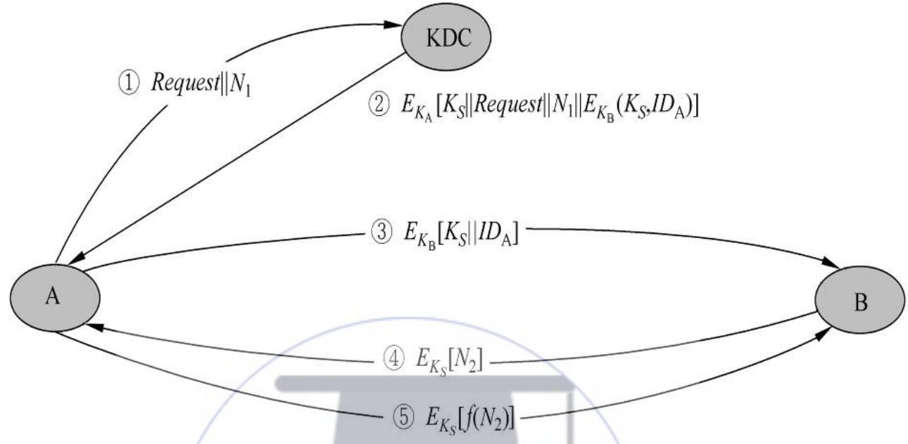
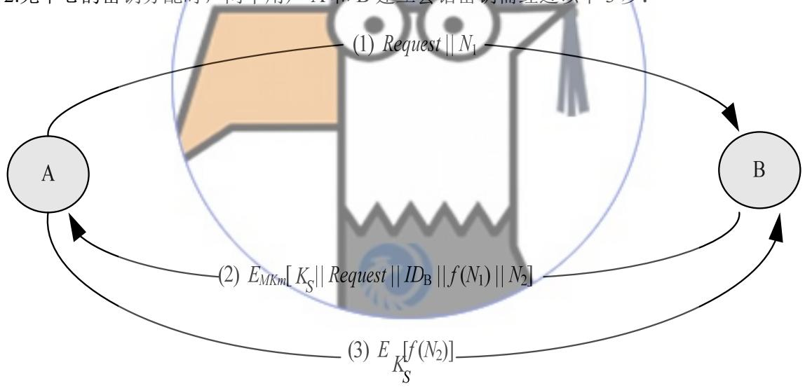
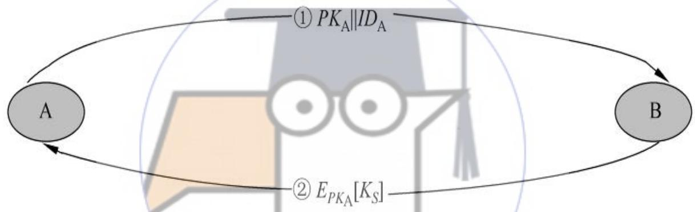
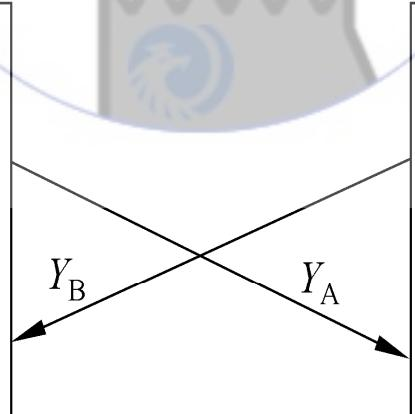

# 《现代密码学》重点概念整理

原件经识别和整理；“参考解答”是我们补的。

本资料为《现代密码学》课程复习要点的第 1 部分，涵盖第一至第五章的核心概念、定理及算法流程。

## 第一章 概述

### 1. 被动攻击与主动攻击

**被动攻击**：
- 获取消息的真实内容
- 进行业务流分析

**主动攻击**：
- 中断
- 篡改
- 伪造

知识点：[信息安全的目标、安全攻击的主要形式和分类（被动攻击与主动攻击）](../../../topics/现代密码学/信息安全目标与攻击分类.md)

### 2. 安全业务

1. **保密业务**：保护数据以防被动攻击。
2. **认证业务**：用于保证通信的真实性。
3. **完整性业务**：防止对消息流的篡改和业务拒绝。
4. **不可否认业务**：用于防止通信双方中的某一方对所传输消息的否认。
5. **访问控制**：目的是防止对网络资源的非授权访问，控制的实现方式是认证，即检查欲访问某一资源的用户是否具有访问权。

知识点：[信息安全的目标、安全攻击的主要形式和分类（被动攻击与主动攻击）](../../../topics/现代密码学/信息安全目标与攻击分类.md)

### 3. 安全通信需考虑的因素

- 加密算法
- 用于加密的秘密信息
- 秘密信息的分布与共享
- 安全服务所需的协议

知识点：[加密系统模型与密码体制的要素（明文空间、密文空间、密钥空间等）](../../../topics/现代密码学/密码体制要素与模型.md)

### 4. 信息安全分类

信息安全可分为系统安全、数据安全、内容安全，密码技术是保障数据安全的关键技术。

知识点：[信息安全的目标、安全攻击的主要形式和分类（被动攻击与主动攻击）](../../../topics/现代密码学/信息安全目标与攻击分类.md)

### 5. 密码体制分类

从原理上分为单钥体制和双钥体制：
- **单钥体制**：包括对明文消息按字符逐位加密的流密码和将明文消息分组加密的分组密码。
- **双钥体制**：特点是将加密和解密能力分开。

知识点：[根据密钥特性对密码体制的分类（对称密码与非对称密码）](../../../topics/现代密码学/密码体制分类.md)

### 6. 密码攻击类型

- 唯密文攻击
- 已知明文攻击
- 选择明文攻击
- 选择密文攻击

知识点：[密码分析学概念及密码攻击类型（唯密文攻击、已知明文攻击、选择明文攻击、选择密文攻击）](../../../topics/现代密码学/密码分析学基础.md)

### 7. 无条件安全

加密算法是无条件安全的，仅当密钥至少和明文一样长时，才能达到无条件安全。

知识点：[密码体制的安全性分类（无条件安全与计算安全）及信息论不等式 I(P;C)≥H(P)-H(K)](../../../topics/现代密码学/密码体制安全性.md)、[一次一密密码体制及其无条件安全性](../../../topics/现代密码学/一次一密密码.md)

### 8. 其他

多表代换密码的计算问题，参见课后习题 3、4。

## 第二章 序列密码

知识点：[多表代换密码（维吉尼亚密码与Hill密码）](../../../topics/现代密码学/多表代换密码.md)、[单表代换密码的分析方法与Hill密码的已知明文分析](../../../topics/现代密码学/古典密码分析技术.md)

### 1. 流密码的概念

利用密钥 $k$ 产生一个密钥流 $z = z_0 z_1 \dots$，并使用如下规则对明文串 $x = x_0 x_1 x_2 \dots$ 加密：

$$
y = y_0 y_1 y_2 \dots = E_{z_0}(x_0) E_{z_1}(x_1) E_{z_2}(x_2) \dots
$$

密钥流由密钥流发生器 $f$ 产生：

$$
z_i = f(k, \sigma_i)
$$

其中：
- $\sigma_i$: 加密器中的记忆元件(存储器)在时刻 $i$ 的状态
- $f$: 由密钥 $k$ 和状态 $\sigma_i$ 生成的函数

知识点：[流密码的概念、特点及与分组密码的区别](../../../topics/现代密码学/序列密码基本概念.md)、[同步流密码的工作原理及密码设计者的愿望](../../../topics/现代密码学/同步流密码.md)、[线性反馈移位寄存器(LFSR)的结构与工作原理](../../../topics/现代密码学/LFSR.md)

### 2. 分组密码与流密码的区别

有无记忆性。

知识点：[流密码的概念、特点及与分组密码的区别](../../../topics/现代密码学/序列密码基本概念.md)

### 3. 密码设计者的愿望

设计出一个滚动密钥生成器，使得密钥经其扩展成的密钥流序列具有如下性质：
- 极大的周期
- 良好的统计特性
- 抗线性分析
- 抗统计分析

知识点：[同步流密码的工作原理及密码设计者的愿望](../../../topics/现代密码学/同步流密码.md)

### 4. 同步流密码

关键是密钥流产生器。

知识点：[流密码的概念、特点及与分组密码的区别](../../../topics/现代密码学/序列密码基本概念.md)、[同步流密码的工作原理及密码设计者的愿望](../../../topics/现代密码学/同步流密码.md)、[线性反馈移位寄存器(LFSR)的结构与工作原理](../../../topics/现代密码学/LFSR.md)

### 5. 线性反馈移位寄存器 (LFSR)

如果移位寄存器的反馈函数 $f(a_1, a_2, \cdots, a_n)$ 是 $a_1, a_2, \cdots, a_n$ 的线性函数，则称之为线性反馈移位寄存器 LFSR (linear feedback shift register)。

知识点：[线性反馈移位寄存器(LFSR)的结构与工作原理](../../../topics/现代密码学/LFSR.md)、[m序列的特性与本原多项式的概念](../../../topics/现代密码学/m序列与本原多项式.md)、[流密码的概念、特点及与分组密码的区别](../../../topics/现代密码学/序列密码基本概念.md)

### 6. m 序列

周期达到最大值 $2^n - 1$ 的序列称为 m 序列。

知识点：[m序列的特性与本原多项式的概念](../../../topics/现代密码学/m序列与本原多项式.md)、[线性反馈移位寄存器(LFSR)的结构与工作原理](../../../topics/现代密码学/LFSR.md)、[密钥序列产生器(KG)的基本要求与序列密码设计原则](../../../topics/现代密码学/序列密码设计原则.md)

### 7. 本原多项式

若 $n$ 次不可约多项式 $p(x)$ 的阶为 $2^n - 1$，则称 $p(x)$ 是 $n$ 次本原多项式。

知识点：[m序列的特性与本原多项式的概念](../../../topics/现代密码学/m序列与本原多项式.md)、[线性反馈移位寄存器(LFSR)的结构与工作原理](../../../topics/现代密码学/LFSR.md)

### 8. 伪随机序列

只能要求截获比周期短的一段时不会泄露更多信息，这样的序列称为伪随机序列。

知识点：[流密码的概念、特点及与分组密码的区别](../../../topics/现代密码学/序列密码基本概念.md)、[同步流密码的工作原理及密码设计者的愿望](../../../topics/现代密码学/同步流密码.md)

### 9. 序列密码设计原则

设计一个性能良好的序列密码是一项十分困难的任务。最基本的设计原则是“密钥流生成器的不可预测性”，它可分解为下述基本原则：
1. 长周期。
2. 高线性复杂度。
3. 统计性能良好。
4. 足够的“混乱”。
5. 足够的“扩散”。
6. 抵抗不同形式的攻击。

知识点：[密钥序列产生器(KG)的基本要求与序列密码设计原则](../../../topics/现代密码学/序列密码设计原则.md)

### 10. 其他

课后习题 1、3。

## 第三章 分组密码

知识点：[分组密码的设计要求与设计思想（扩散和混淆）](../../../topics/现代密码学/分组密码设计原则.md)

### 1. 分组密码设计要求

分组密码设计的算法应满足下述要求：
1. 分组长度要足够大
2. 密钥量要足够大
3. 由密钥确定置换的算法要足够复杂
4. 加密和解密运算简单
5. 数据扩展尽可能地小
6. 差错传播尽可能地小

知识点：[分组密码的设计要求与设计思想（扩散和混淆）](../../../topics/现代密码学/分组密码设计原则.md)、[Feistel加密结构、网络参数及单轮的加解密过程](../../../topics/现代密码学/Feistel网络结构.md)、[数据加密标准DES的参数、初始置换IP/逆置换IP-1、轮结构与E-扩展运算](../../../topics/现代密码学/DES算法流程.md)

### 2. 扩散和混淆

是由香农提出的设计密码系统的两个基本方法，成功地实现了分组密码的本质属性，因而成为设计现代分组密码的基础。

知识点：[分组密码的设计要求与设计思想（扩散和混淆）](../../../topics/现代密码学/分组密码设计原则.md)、[Feistel加密结构、网络参数及单轮的加解密过程](../../../topics/现代密码学/Feistel网络结构.md)、[数据加密标准DES的参数、初始置换IP/逆置换IP-1、轮结构与E-扩展运算](../../../topics/现代密码学/DES算法流程.md)

### 3. Feistel 加密结构

第 $i$ 轮迭代的输入为前轮输出的函数（详见课本 P33）：

$$
L_i = R_{i-1}
$$

$$
R_i = L_{i-1} \oplus F(R_{i-1}, K_i)
$$

*(注：原文符号 ○ 通常表示异或运算)*

知识点：[分组密码的设计要求与设计思想（扩散和混淆）](../../../topics/现代密码学/分组密码设计原则.md)、[数据加密标准DES的参数、初始置换IP/逆置换IP-1、轮结构与E-扩展运算](../../../topics/现代密码学/DES算法流程.md)

### 4. DES 参数

- 分组长度：64 比特
- 密钥长度：56 比特

知识点：[数据加密标准DES的参数、初始置换IP/逆置换IP-1、轮结构与E-扩展运算](../../../topics/现代密码学/DES算法流程.md)

### 5. IDEA 参数

- 分组长度：64 比特
- 密钥长度：128 比特

知识点：[分组密码的设计要求与设计思想（扩散和混淆）](../../../topics/现代密码学/分组密码设计原则.md)

### 6. AES 参数

- 分组长度：128 比特
- 密钥长度：128/192/256 比特

知识点：[Rijndael算法整体描述、State矩阵、字节代换SubBytes、字节移位ShiftRows、列混合MixColumns、轮密钥加AddRoundKey](../../../topics/现代密码学/AES轮变换.md)

### 7. AES 设计策略

宽轨迹策略，轮函数包括：字节代换、行移位、列混合、密钥加。

知识点：[分组密码的设计要求与设计思想（扩散和混淆）](../../../topics/现代密码学/分组密码设计原则.md)

### 8. 二重 DES

不能抵抗中途相遇攻击。

知识点：[二重DES与三重DES(3DES)的原理与安全性](../../../topics/现代密码学/多重DES.md)、[DES的安全分析（弱密钥、半弱密钥、差分分析法和线性分析法）](../../../topics/现代密码学/DES安全性分析.md)、[分组密码的设计要求与设计思想（扩散和混淆）](../../../topics/现代密码学/分组密码设计原则.md)

### 9. 其他

课后作业习题：1、3、4、6。

## 第四章 公钥密码与数论基础

知识点：[公钥密码学的提出背景、思想、陷门单向函数、应用（保密通信与认证）及优缺点](../../../topics/现代密码学/公钥密码体制概述.md)、[RSA算法的数论基础（欧拉定理）、密钥产生、加解密描述、证明及举例](../../../topics/现代密码学/RSA算法.md)、[费尔玛定理、欧拉函数与欧拉定理](../../../topics/现代密码学/费尔玛定理与欧拉定理.md)

### 1. 费尔玛定理

**定理 4.2 (Fermat)**：若 $p$ 是素数，$a$ 是正整数且 $\gcd(a, p)=1$，则
$$
a^{p-1} \equiv 1 \pmod p
$$

知识点：[费尔玛定理、欧拉函数与欧拉定理](../../../topics/现代密码学/费尔玛定理与欧拉定理.md)

### 2. 欧拉函数

设 $n$ 是一正整数，小于 $n$ 且与 $n$ 互素的正整数的个数称为 $n$ 的欧拉函数，记为 $\varphi(n)$。

知识点：[费尔玛定理、欧拉函数与欧拉定理](../../../topics/现代密码学/费尔玛定理与欧拉定理.md)

### 3. 欧拉定理

**定理 4.4 (Euler)**：若 $a$ 和 $n$ 互素，则
$$
a^{\varphi(n)} \equiv 1 \pmod n
$$

知识点：[费尔玛定理、欧拉函数与欧拉定理](../../../topics/现代密码学/费尔玛定理与欧拉定理.md)

### 4. 求最大公因子

Euclid 算法是基于下面一个基本结论：对任意非负整数 $a$ 和正整数 $b$，有
$$
\gcd(a, b) = \gcd(b, a \bmod b)
$$

知识点：[最大公因数(gcd)的概念及欧几里德算法求最大公约数](../../../topics/现代密码学/最大公因数与欧几里德算法.md)

### 5. 中国剩余定理

**定理 4.5**：设 $m_1, m_2, \dots, m_k$ 是两两互素的正整数，$M = \prod_{i=1}^k m_i$，则一次同余方程组

$$
\begin{cases} 
x \equiv a_1 \pmod{m_1} \\ 
x \equiv a_2 \pmod{m_2} \\ 
\dots \\ 
x \equiv a_k \pmod{m_k} 
\end{cases}
$$

对模 $M$ 有惟一解:

$$
x \equiv \left(\frac {M}{m _ {1}} e _ {1} a _ {1} + \frac {M}{m _ {2}} e _ {2} a _ {2} + \dots + \frac {M}{m _ {k}} e _ {k} a _ {k}\right) \pmod M
$$

其中 $e_i$ 满足 $\frac {M}{m _ {i}} e _ {i} \equiv 1 \big ( \mathrm { m o d } m _ {i} \big ) ( i = 1 , ~ 2 , \cdots , k )$。

知识点：[中国剩余定理及其应用](../../../topics/现代密码学/中国剩余定理.md)、[模运算的定义、一次同余式及其求解方法](../../../topics/现代密码学/模运算与同余式.md)、[乘法逆元的概念与求解](../../../topics/现代密码学/乘法逆元.md)

### 6. 元素的阶

**定理 4.6**：设 $a$ 的阶为 $m$，则 $a^k \equiv 1 \pmod n$ 的充要条件是 $k$ 为 $m$ 的倍数。

**推论**：$a$ 的阶 $m$ 整除 $\varphi(n)$。

如果 $a$ 的阶 $m$ 等于 $\varphi(n)$，则称 $a$ 为 $n$ 的本原根。如果 $a$ 是 $n$ 的本原根，则 $a, a^2, \cdots, a^{\varphi(n)}$ 在 $\bmod n$ 下互不相同且都与 $n$ 互素。

特别地，如果 $a$ 是素数 $p$ 的本原根，则 $a, a^2, \cdots, a^{p-1}$ 在 $\bmod p$ 下都不相同。

知识点：[元素的阶与本原根的概念](../../../topics/现代密码学/元素的阶与本原根.md)、[模运算的定义、一次同余式及其求解方法](../../../topics/现代密码学/模运算与同余式.md)、[费尔玛定理、欧拉函数与欧拉定理](../../../topics/现代密码学/费尔玛定理与欧拉定理.md)

### 7. 公钥密码体制提出者

W. Diffie 和 M. Hellman。

知识点：[公钥密码学的提出背景、思想、陷门单向函数、应用（保密通信与认证）及优缺点](../../../topics/现代密码学/公钥密码体制概述.md)、[RSA算法的数论基础（欧拉定理）、密钥产生、加解密描述、证明及举例](../../../topics/现代密码学/RSA算法.md)

### 8. 勒让德符号

**定义 4.1**：设 $p$ 是素数，$a$ 是一整数，符号 $\left(\frac{a}{p}\right)$ 的定义如下：

$$
\left(\frac{a}{p}\right) = \begin{cases} 
0 & \text{如果 } a \text{ 被 } p \text{ 整除} \\ 
1 & \text{如果 } a \text{ 是模 } p \text{ 的平方剩余} \\ 
-1 & \text{如果 } a \text{ 是模 } p \text{ 的非平方剩余} 
\end{cases}
$$

称符号 $\left(\frac{a}{p}\right)$ 为 Legendre 符号。

知识点：[勒让德符号与二次剩余](../../../topics/现代密码学/勒让德符号.md)

### 9. 公钥密码算法要求

公钥密码算法应满足以下要求:
1. 接收方 B 产生密钥对（公开钥 $PK_B$ 和秘密钥 $SK_B$）在计算上是容易的。
2. 发方 A 用收方的公开钥对消息 $m$ 加密以产生密文 $c$，即 $c = E_{PK_B}[m]$ 在计算上是容易的。
3. 收方 B 用自己的秘密钥对 $c$ 解密，即 $m = D_{SK_B}[c]$ 在计算上是容易的。
4. 敌手由 B 的公开钥 $PK_B$ 求秘密钥 $SK_B$ 在计算上是不可行的。
5. 敌手由密文 $c$ 和 B 的公开钥 $PK_B$ 恢复明文 $m$ 在计算上是不可行的。
6. 加、解密次序可换，即 $E_{PK_B}[D_{SK_B}(m)] = D_{SK_B}[E_{PK_B}(m)]$。其中最后一条虽然非常有用，但不是对所有的算法都作要求。

知识点：[公钥密码学的提出背景、思想、陷门单向函数、应用（保密通信与认证）及优缺点](../../../topics/现代密码学/公钥密码体制概述.md)、[RSA算法的数论基础（欧拉定理）、密钥产生、加解密描述、证明及举例](../../../topics/现代密码学/RSA算法.md)、[ElGamal公钥密码体制的算法描述与安全性（基于离散对数困难问题）](../../../topics/现代密码学/ElGamal公钥密码.md)

### 10. 陷门单向函数

是一族可逆函数 $f_k$，满足：
1. $Y=f_k(X)$ 易于计算（当 $k$ 和 $X$ 已知时）。
2. $X=f^{-1}_k(Y)$ 易于计算（当 $k$ 和 $Y$ 已知时）。
3. $X=f^{-1}_k(Y)$ 计算上是不可行的（当 $Y$ 已知但 $k$ 未知时）。

知识点：[公钥密码学的提出背景、思想、陷门单向函数、应用（保密通信与认证）及优缺点](../../../topics/现代密码学/公钥密码体制概述.md)、[RSA算法的数论基础（欧拉定理）、密钥产生、加解密描述、证明及举例](../../../topics/现代密码学/RSA算法.md)、[信息安全的目标、安全攻击的主要形式和分类（被动攻击与主动攻击）](../../../topics/现代密码学/信息安全目标与攻击分类.md)

### 11. RSA 算法

- 提出人: R.Rivest, A.Shamir 和 L.Adleman
- 安全性是基于分解大整数的困难性假定

知识点：[RSA算法的数论基础（欧拉定理）、密钥产生、加解密描述、证明及举例](../../../topics/现代密码学/RSA算法.md)、[费尔玛定理、欧拉函数与欧拉定理](../../../topics/现代密码学/费尔玛定理与欧拉定理.md)、[公钥密码学的提出背景、思想、陷门单向函数、应用（保密通信与认证）及优缺点](../../../topics/现代密码学/公钥密码体制概述.md)

### 12. 其他

计算题：课后 3、4、5、6、7、8、10、14、15、17、18、19、20。

## 第五章 密钥管理

知识点：[密钥管理技术、原则、典型的密钥层次结构及密钥种类（对用户而言）](../../../topics/现代密码学/密钥管理原则与层次.md)、[在线密钥分发、基于KDC的密钥分配中心模式（KDC生成会话密钥）及Kerberos协议](../../../topics/现代密码学/基于KDC的密钥分配.md)、[Diffie-Hellman密钥协商/交换协议原理及中间人攻击](../../../topics/现代密码学/Diffie-Hellman密钥交换.md)、[基于公钥管理机构与公钥密码体制的会话密钥分配、证书用途及提供的主要服务](../../../topics/现代密码学/基于公钥的密钥分配.md)

### 1. 基于 KDC 的密钥分配

假定两个用户 A、B 分别与密钥分配中心 KDC (key distribution center) 有一个共享的主密钥 $K_A$ 和 $K_B$，A 希望与 B 建立一个共享的一次性会话密钥，可通过以下几步来完成：

① Request || $N_1$

知识点：[在线密钥分发、基于KDC的密钥分配中心模式（KDC生成会话密钥）及Kerberos协议](../../../topics/现代密码学/基于KDC的密钥分配.md)

### 2. 无中心的密钥分配

无中心的密钥分配时，两个用户 A 和 B 建立会话密钥需经过以下 3 步：

知识点：[无中心的密钥分配与端—端密钥协商协议](../../../topics/现代密码学/无中心的密钥分配.md)

### 3. 公钥管理机构

与公用目录表类似，这里假定有一个公钥管理机构来为各用户建立、维护动态的公钥目录，但同时对系统提出以下要求，即：
每个用户都可靠地知道管理机构的公开钥，而只有管理机构自己知道相应的秘密钥。

公开钥的分配步骤如下：

① Request || Time$_1$

④ Request || Time$_2$

$$
E _ {S K _ {\mathrm{AU}}} \left[ P K _ {\mathrm{B}} \| R e q u e s t \| T i m e _ {1} \right]
$$

⑤ $E _ { S K _ { \mathrm { A U } } } [ P K _ { \mathrm { A } } \| R e q u e s t \| T i m e _ { 2 } ]$

$$
E _ {P K \mathrm{B}} [ I D _ {\mathrm{A}} | | N _ {1} ]
$$

$$
E _ {P K \mathrm{A}} [ N _ {1} | | N _ {2} ]
$$

$$
E _ {P K \mathrm{B}} [ N _ {2} ]
$$

知识点：[基于公钥管理机构与公钥密码体制的会话密钥分配、证书用途及提供的主要服务](../../../topics/现代密码学/基于公钥的密钥分配.md)、[Diffie-Hellman密钥协商/交换协议原理及中间人攻击](../../../topics/现代密码学/Diffie-Hellman密钥交换.md)

### 4. Diffie-Hellman 密钥交换

Diffie-Hellman 密钥交换是 W. Diffie 和 M. Hellman 于 1976 年提出的第一个公钥密码算法，算法的安全性基于求离散对数的困难性。缺点：易受中间人攻击（Oscar 图例）。

| 用户 A | 用户 B |
| :--- | :--- |
| 选择一随机数 $X_{A} < p$ 计算 $Y_{A} = a^{X_{A}} \mod p$ | 选择一随机数 $X _ { \mathrm { B } } { < } p$ 计算 $Y _ { \mathrm { B } } { = } a ^ { X _ { \mathrm { B } } } \mod p$ |
| 计算 $K = Y_{B}^{X_{A}} \mod p$ | 计算 $K { = } Y _ { \mathrm { A } } ^ { \mathrm { { X } } _ { \mathrm { B } } } \mod p$ |

*(注：表格中 B 的计算公式原文存在乱码 "X" 和重复 mod，已根据 DH 算法原理修正为 $X_B$ 和单次 mod)*

知识点：[公钥密码学的提出背景、思想、陷门单向函数、应用（保密通信与认证）及优缺点](../../../topics/现代密码学/公钥密码体制概述.md)、[身份识别的要素、依据鉴别信息是否共享进行的分类及鉴别方式](../../../topics/现代密码学/身份识别基本原理.md)

### 5. 秘密分割门限方案

**定义**：设秘密 $s$ 被分成 $n$ 个部分信息，每一部分信息称为一个子密钥或影子，由一个参与者持有，使得：
- 由 $k$ 个或多于 $k$ 个参与者所持有的部分信息可重构 $s$。
- 由少于 $k$ 个参与者所持有的部分信息则无法重构 $s$。

则称这种方案为 $(k,n)$-秘密分割门限方案，$k$ 称为方案的门限值。

如果一个参与者或一组未经授权的参与者在猜测秘密 $s$ 时，并不比局外人猜秘密时有优势。

# 现代密码学重点概念整理（第 2 部分）

基于《现代密码学》教材及复习要点整理，涵盖秘密分割、杂凑函数、数字签字、认证协议及零知识证明等核心章节内容。

## 第六章 消息认证与杂凑函数

知识点：[秘密共享技术与Shamir秘密共享方案（系统初始化与秘密分发）](../../../topics/现代密码学/秘密分割门限方案.md)、[加密系统模型与密码体制的要素（明文空间、密文空间、密钥空间等）](../../../topics/现代密码学/密码体制要素与模型.md)、[信息安全的目标、安全攻击的主要形式和分类（被动攻击与主动攻击）](../../../topics/现代密码学/信息安全目标与攻击分类.md)

### 第一节 门限方案与消息认证基础

#### 1. 完善性秘密分割
由少于 $k$ 个参与者所持有的部分信息得不到秘密 $s$ 的任何信息，则称这个方案是完善的。即 $(k,n)$-秘密分割门限方案是完善的。

#### 2. 基于中国剩余定理的门限方案
参考课本 P138。

#### 3. 消息认证的目标属性
消息认证用以验证接收消息的如下属性：
- **真实性**：的确是由它所声称的实体发来的（消息源认证）。
- **完整性**：未被篡改、插入、删除。
- **顺序性和时间性**。

#### 4. 认证符的产生方法
- 消息认证函数 (MAC)
- 杂凑函数

知识点：[秘密共享技术与Shamir秘密共享方案（系统初始化与秘密分发）](../../../topics/现代密码学/秘密分割门限方案.md)、[中国剩余定理及其应用](../../../topics/现代密码学/中国剩余定理.md)、[消息认证的目的、基于加密技术的消息认证与基于散列函数的消息认证](../../../topics/现代密码学/消息认证基础.md)

### 第二节 杂凑函数的性质与攻击

#### 5. 杂凑函数的基本要求
杂凑函数应满足以下条件：
1. 函数的输入可以是任意长。
2. 函数的输出是固定长。
3. 已知 $x$，求 $H(x)$ 较为容易，可用硬件或软件实现。
   > 前 3 个是杂凑函数能用于消息认证的基本要求。

4. **单向性**：已知 $h$，求使得 $H(x)=h$ 的 $x$ 在计算上是不可行的。这一性质称为函数的单向性，称 $H(x)$ 为单向散列函数。
   - 单向性对使用秘密值的认证技术极为重要。假如不具有单向性，则攻击者截获 $M$ 和 $C=H(S\|M)$ 后，求 $C$ 的逆 $S\|M$，就可求出秘密值 $S$。

5. **弱抗碰撞性**：已知 $x$，找出 $y(y \neq x)$ 使得 $H(y)=H(x)$ 在计算上是不可行的。

6. **强抗碰撞性**：找出任意两个不同的输入 $x$、$y$，使得 $H(y)=H(x)$ 在计算上是不可行的。

#### 6. 生日攻击
- **第 I 类生日攻击**：
  已知一散列函数 $H$ 有 $n$ 个可能输出，$H(x)$ 是一特定输出。若对 $H$ 随机取 $k$ 个输入，则至少有一个输入 $y$ 使得 $H(y)=H(x)$ 的概率为 0.5 时，$k$ 有多大？称对散列函数 $H$ 寻找上述 $y$ 的攻击为第 I 类生日攻击。

- **第Ⅱ类生日攻击**：
  设散列函数 $H$ 有 $2^m$ 个可能的输出（即输出长 $m$ 比特），如果 $H$ 的 $k$ 个随机输入中至少有两个产生相同输出的概率大于 0.5，则寻找函数 $H$ 的具有相同输出的两个任意输入的攻击方式为第Ⅱ类生日攻击。
  
  此时 $k$ 的大小约为：
  $$ k \approx \sqrt{2^m} \approx 2^{m/2} $$

#### 7. 杂凑函数的结构与安全性
- 大多数杂凑函数如 MD5、SHA，其结构都是迭代型的，算法的核心技术是设计无碰撞的压缩函数 $f$。
- **MD5**：由 Ron Rivest 提出。算法的输入为小于 $2^{64}$ 比特长的任意消息，分为 512 比特长的分组，输出为 160 或 128 比特长的消息摘要（注：标准 MD5 输出通常为 128 位，此处原文提及 160 或 128，以教材为准）。
- **破译历史**：
  - 2004 年，山东大学王小云教授破译了 MD5。
  - 2005 年，王小云等提出了对 SHA-1 碰撞搜索攻击。

#### 8. 杂凑函数与 MAC 的关系
- 杂凑函数并不是为用于 MAC 而设计的。由于杂凑函数不使用密钥，因此不能直接用于 MAC。
- 基于密码杂凑函数构造的 MAC 的安全性取决于嵌套的杂凑函数的安全性。

## 第七章 数字签字与认证协议

知识点：[Hash函数的定义、单向性、多对一映射及无碰撞性等性质与应用](../../../topics/现代密码学/杂凑函数基本性质.md)、[单向杂凑函数的安全性要求及生日攻击原理](../../../topics/现代密码学/杂凑函数安全性要求.md)

### 第一节 数字签字的要求与算法

#### 9. 数字签字的要求
数字签字应满足以下要求：
1. 签字的产生必须使用发方独有的一些信息，以防伪造和否认。
2. 签字的产生应较为容易。
3. 签字的识别和验证应较为容易。
4. 对已知的数字签字构造一新的消息或对已知的消息构造一假冒的数字签字在计算上都是不可行的。

#### 10. 数字签字的产生与安全
由签字算法产生数字签字。算法的安全性在于从 $M$ 和 $S$ 难以推出密钥 $x$ 或伪造一个消息 $M'$ 使 $M'$ 和 $S$ 可被验证为真。

#### 11. 数字签字标准 DSS 与算法对比
- **RSA 算法**：既能用于加密和签字，又能用于密钥交换。
- **DSS (Digital Signature Standard)**：使用的算法只能提供数字签字功能。
- **DSA (Digital Signature Algorithm)**：是在 ElGamal 和 Schnorr 两个签字方案的基础上设计的，其安全性基于求离散对数的困难性。

知识点：[数字签名的设计要求、满足的条件、方案描述及与消息认证的不同](../../../topics/现代密码学/数字签名基本概念.md)、[数字签名标准DSS的签名过程](../../../topics/现代密码学/DSS数字签名标准.md)

### 第二节 密钥分配与交互证明

#### 12. Needham-Schroeder 协议
KDC 的密钥分配过程，可用以下协议（称为 Needham-Schroeder 协议）来描述：
1. $A \to KDC$: $IDA \| IDB \| N_1$
2. $KDC \to A$: $E_{K_A}[K_S \| IDB \| N_1 \| E_{K_B}[K_S \| IDA]]$
3. $A \to B$: $E_{K_B}[K_S \| IDA]$ （弱点）
4. $B \to A$: $E_{K_S}[N_2]$
5. $A \to B$: $E_{K_S}[f(N_2)]$

#### 13. 交互证明系统
- **定义**：交互证明系统由两方参与，分别称为证明者（Prover, $P$）和验证者（Verifier, $V$）。其中 $P$ 知道某一秘密（如公钥密码体制的秘密钥或一平方剩余 $x$ 的平方根），$P$ 希望使 $V$ 相信自己的确掌握这一秘密。
- **区别**：交互证明和数学证明的区别是，数学证明的证明者可自己独立地完成证明，而交互证明是由 $P$ 产生证明、$V$ 验证证明的有效性来实现，因此双方之间通过某种信道的通信是必需的。
- **要求**：
  1. **完备性**：如果 $P$ 知道某一秘密，$V$ 将接受 $P$ 的证明。
  2. **正确性**：如果 $P$ 能以一定的概率使 $V$ 相信 $P$ 的证明，则 $P$ 知道相应的秘密。

#### 14. 零知识证明
- **起源**：零知识证明起源于最小泄露证明。
- **定义**：在交互证明系统中，设 $P$ 知道某一秘密，并向 $V$ 证明自己掌握这一秘密，但又不向 $V$ 泄露这一秘密，这就是最小泄露证明。进一步，如果 $V$ 除了知道 $P$ 能证明某一事实外，不能得到其他任何信息，则称 $P$ 实现了零知识证明，相应的协议称为零知识证明协议。

#### 15. 不经意传输协议
设 $A$ 有一个秘密，想以 $1/2$ 的概率传递给 $B$，即 $B$ 有 50% 的机会收到这个秘密，另外 50% 的机会什么也没有收到。协议执行完后，$B$ 知道自己是否收到了这个秘密，但 $A$ 却不知 $B$ 是否收到了这个秘密。这种协议就称为不经意传输协议。

知识点：[在线密钥分发、基于KDC的密钥分配中心模式（KDC生成会话密钥）及Kerberos协议](../../../topics/现代密码学/基于KDC的密钥分配.md)、[零知识证明的基本概念、证明方法与实例（洞穴问题分析）](../../../topics/现代密码学/零知识证明.md)
