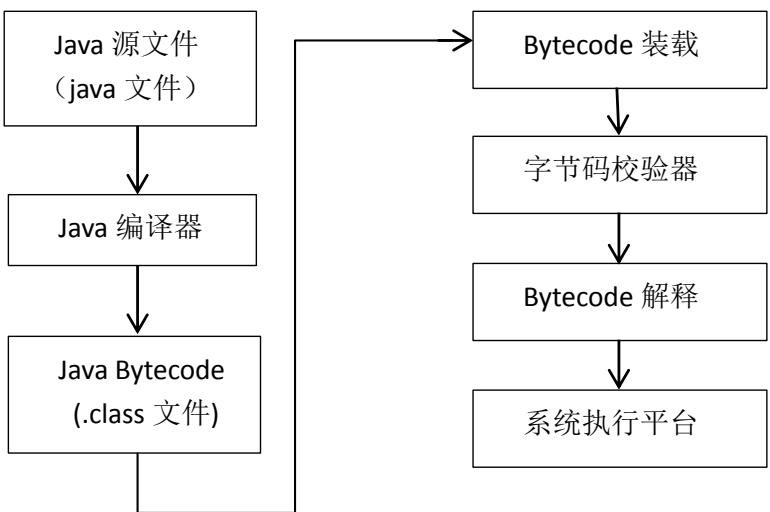

# 2014—2015学年《Java软件开发》期末考试复习资料总结

原件经识别和整理；“参考解答”是我们补的。

# 2014—2015学年《Java软件开发》期末考试复习资料总结

## 一、Java基础与环境

### Java程序运行环境



知识点：[Java平台、JVM定义及编译解释执行原理](../../../topics/Java开发/Java平台与JVM.md)

### Java中的包

Java为编写应用程序提供了丰富的预定义类库，这些预定义类库按相关的范畴进行了分组，这些分组被称为包（package）。

一个包是一个已命名的类的集合，一个包还可以包含其他的子包。Java所有的包被称为 Java 应用程序接口（Java API）。

知识点：[Java平台、JVM定义及编译解释执行原理](../../../topics/Java开发/Java平台与JVM.md)

### 应用 System.out.printf( )方法进行格式化的输出

`printf()`方法中常用的格式说明符如下表所示：

| 格式说明 | 含义 | 事例 |
| :--- | :--- | :--- |
| %s | 输出字符串,对应的参数类型为 String | “This is a string” |
| %c | 输出字符,对应的参数类型为 char | ‘a’ |
| %d | 输出整数,对应的参数类型为整型 | 123 |
| %f | 输出浮点数,对应的参数类型为 float 或 double | 12.34 |
| %b | 输出布尔值,对应的参数类型为 boolean | true |

*(注：原识别内容中第一行 `%d` 对应 String 有误，根据常识修正为 `%s`；第二行 `%c` 对应“输出字符串”描述略有偏差，通常指输出单个字符，此处保留原意但修正了明显的类型匹配错误)*

知识点：[System.out.printf格式化输出与Scanner类输入](../../../topics/Java开发/输入输出基础.md)

### 标识符

标识符是程序员声明的单词，它命名程序正文中的一些实体，如类名、变量名、方法名、对象名等。Java标识符的构成规则如下：

*   以字母、下划线（`_`）或美元符（`$`）开始；
*   可以由以大写字母、小写、下划线、`$`或数字 `0 ~ 9` 组成；
*   不能是Java的关键字；
*   大写字母和小写字母代表不同的标识符。

知识点：[Java标识符命名规则与保留关键字](../../../topics/Java开发/标识符与关键字.md)

### Java的基本数据类型

| 数据类型 | 关键字 | 占用位数 | 数据范围 |
| :--- | :--- | :--- | :--- |
| 布尔型 | boolean | 8 | true, false |
| 字符型 | char | 16 | “\u0000” ~ “\uFFFF” |
| 字节型 | byte | 8 | -128 ~ 127 |
| 短整型 | short | 16 | -32 768 ~ 32 767 |
| 整型 | int | 32 | -2147 483 648 ~ 2147 483 647 |
| 长整型 | long | 64 | $-2^{63} \sim 2^{63}-1$ |
| 浮点型 | float | 32 | 略 |
| 双精度型 | double | 64 | 略 |

*(注：原识别内容中 double 占用位数写为 34，应为 64，已修正)*

知识点：[基本数据类型（整型、浮点型、字符型、布尔型）及Unicode编码](../../../topics/Java开发/基本数据类型.md)、[Java标识符命名规则与保留关键字](../../../topics/Java开发/标识符与关键字.md)

### 常量

常量是指在程序运行的整个过程中其值始终不可改变的值，也就是直接使用文字符号表示的值，也通常称为常数。例如，`123`，`5.6`，`'B'`都是文字常量。Java中的常量有5种类型：整型常量、浮点型常量、布尔常量、字符常量和字符串常量。

在流程控制中经常会用到布尔常量。布尔常量包括 `true`和`false`,分别代表真和假。

Java是一种严格的类型语言，它不允许数值类型和布尔类型之间进行转换。

## 二、运算符与表达式

知识点：[基本数据类型（整型、浮点型、字符型、布尔型）及Unicode编码](../../../topics/Java开发/基本数据类型.md)、[算术、关系、逻辑、位运算、移位、条件及复合赋值运算符与优先级](../../../topics/Java开发/运算符与表达式.md)

### 运算符

运算符指明对操作数的运算方式。运算符按其要求操作数数目来分，可以有单目运算符（如求负“-”），双目运算符（如加“+”、减“-”）和三目运算符（如“？”、“：”），它们分别对应于1 个，2 个和3 个操作数。

#### （1） 双目运算符

双目运算符定义如下表所示，这里需要注意两点。

1.  只有整型（int,long,short）的数据才能够进行取余运算（%），float 和 double 不能取余。
2.  两个整型的数据做除法时，结果是截取商的整数部分，而小数部分被截断。如果希望保留小数部分，则应该对除法运算的操作数做强制类型转换。例如 `2/4`的结果是 `0`，而 `(double)2/4` 的结果是 `0.5`。

**双目算术运算符**

| 运算符 | 运算 | 举例 | 功能 |
| :--- | :--- | :--- | :--- |
| + | 加 | a+b | 求 a 与 b 相加的和 |
| - | 减 | a-b | 求 a 与 b 相减得差 |
| * | 乘 | a*b | 求 a 与 b 相乘的积 |
| / | 除 | a/b | 求 a 除以 b 的商 |
| % | 取余 | a%b | 求 a 除以 b 所得的余数 |

#### （2） 单目运算符

单目运算符的操作数只有一个，算术运算中有3 个单目运算符：求负（—）、自增1（++）和自减1（--）。其定义如下表所示。

单目运算符中的自增 1和自减1，其运算符的位置可以在操作数的前面，称为前缀运算符，也可以在操作数的后面，称为后缀运算符。例如：

```java
a++; //后缀++，将 a变量的值加1
```

**单目算术运算符**

| 运算符 | 运算 | 举例 | 功能 |
| :--- | :--- | :--- | :--- |
| ++ | 自增 1 | a++或++a | a=a+1 |
| -- | 自减 1 | a--或--a | a=a-1 |
| - | 求负数 | -a | a=-a |

当单目运算符单独作为一条语句出现时，如`--a`和`a--`，它们表达的功能是一样的，都是将变量 a的值减1。而单目运算符位于一个复杂表达式的内部，前缀运算和后缀运算是有区别的。前缀运算表示变量的值先加（减）1，然后再将此变量的值参加表达式的计算。而后缀运算表示先用变量的原先值参加表达式的计算，然后再将后缀运算的变量值加（减）1。

知识点：[算术、关系、逻辑、位运算、移位、条件及复合赋值运算符与优先级](../../../topics/Java开发/运算符与表达式.md)、[基本数据类型（整型、浮点型、字符型、布尔型）及Unicode编码](../../../topics/Java开发/基本数据类型.md)、[成员变量与局部变量的作用范围、默认值及final终止变量](../../../topics/Java开发/变量的作用域与初始化.md)

### 复合赋值运算符

| 运算符 | 举例 | 运算符 | 举例 |
| :--- | :--- | :--- | :--- |
| += | x+=a 等价于 x=x+a | &= | x&=a 等价于 x=x&a |
| -= | x-=a 等价于 x=x-a | \|= | x\|=a 等价于 x=x\|a |
| *= | x*=a 等价于 x=x*a | ^= | x^=a 等价于 x=x^a |
| /= | x/=a 等价于 x=x/a | <<= | x<<=a 等价于 x=x<<a |
| %= | x%=a 等价于 x=x%a | >>= | x>>=a 等价于 x=x>>a |
| | | >>>= | x>>>=a 等价于 x=x>>>a |

知识点：[算术、关系、逻辑、位运算、移位、条件及复合赋值运算符与优先级](../../../topics/Java开发/运算符与表达式.md)

### 逻辑运算符与逻辑表达式

逻辑运算是针对布尔型数据进行的运算，运算的结果仍然是布尔型量。常用的逻辑运算符如下表所示。

**逻辑运算符**

| 运算符 | 运算 | 举例 | 运算规则 |
| :--- | :--- | :--- | :--- |
| ! | 逻辑取反 | !x | x真时为假,x假时为真 |
| \|\| | 逻辑或 | x\|\|y | x,y都假时结果才为假 |
| && | 逻辑与 | x&&y | x,y都真时结果才为真 |
| ^ | 布尔逻辑异或 | x^y | x,y同真假时结果为假 |
| & | 布尔逻辑与 | x&y | x,y都真时结果才为真 |
| \| | 布尔逻辑或 | x\|y | x,y都假时结果才为假 |

## 三、流程控制

知识点：[算术、关系、逻辑、位运算、移位、条件及复合赋值运算符与优先级](../../../topics/Java开发/运算符与表达式.md)

### 算法的基本结构控制

算法的基本控制结构有3种：顺序结构、选择结构、循环结构。

*   **顺序结构**：3 种结构中最简单的一种，即语句按照书写的顺序依次执行。
*   **选择结构**（又称分支结构）：将根据布尔表达式的值来判断应选择执行哪一个流程的分支。
*   **循环结构**：在一定条件下反复执行一段语句的流程结构。

知识点：[if-else、switch、while、do-while、for语句及break/continue/return分支控制](../../../topics/Java开发/流程控制语句.md)

### switch 语句

switch语句是多分支的开关语句。

## 四、面向对象编程基础

知识点：[if-else、switch、while、do-while、for语句及break/continue/return分支控制](../../../topics/Java开发/流程控制语句.md)

### 方法的重载

方法的重载（Overloading）定义为：在一个类中定义多个同名的方法，但要求各个方法具有不同的参数的类型或参数的个数。

知识点：[方法的声明、调用、按值/按引用参数传递及方法的重载(Overloading)](../../../topics/Java开发/方法的定义与重载.md)、[基本数据类型（整型、浮点型、字符型、布尔型）及Unicode编码](../../../topics/Java开发/基本数据类型.md)

### 成员访问控制

成员访问控制是用来控制类中成员的访问范围，由修饰符声明。下表列出了常见的成员访问控制修饰符。

**成员访问控制修饰符**

| 修饰符 | 作用 |
| :--- | :--- |
| public | 说明公共成员,可以在类外被使用 |
| protected | 说明保护成员,在同一包中或子类中被使用 |
| package(缺省值) | 说明包作用域成员,该成员只能在同一包中被使用 |
| private | 说明私有成员,该成员只能在类中访问 |

知识点：[对象(Object)和类(Class)的概念、实例变量与方法](../../../topics/Java开发/对象与类的概念.md)、[Java标识符命名规则与保留关键字](../../../topics/Java开发/标识符与关键字.md)、[成员变量与局部变量的作用范围、默认值及final终止变量](../../../topics/Java开发/变量的作用域与初始化.md)

### 构造方法

定义构造方法时必须注意两点：

1.  构造方法必须与其类名相同；
2.  构造方法没有返回类型，但可以有参数，并且可以被重载。

知识点：[对象(Object)和类(Class)的概念、实例变量与方法](../../../topics/Java开发/对象与类的概念.md)、[方法的声明、调用、按值/按引用参数传递及方法的重载(Overloading)](../../../topics/Java开发/方法的定义与重载.md)

### this

this定义为被调用的方法的当前对象的引用。this引用仅能出现在类中的方法体中。

知识点：[对象(Object)和类(Class)的概念、实例变量与方法](../../../topics/Java开发/对象与类的概念.md)、[消息(Message)的组成及其在对象通信中的作用](../../../topics/Java开发/消息传递机制.md)

### static

属于类的变量或方法被称为静态量或静态方法，以关键词 `static`加在变量声明或方法声明的前面。

知识点：[成员变量与局部变量的作用范围、默认值及final终止变量](../../../topics/Java开发/变量的作用域与初始化.md)

### java.lang

基本语言类，程序运行时自动引入。

知识点：[Java标识符命名规则与保留关键字](../../../topics/Java开发/标识符与关键字.md)、[基本数据类型（整型、浮点型、字符型、布尔型）及Unicode编码](../../../topics/Java开发/基本数据类型.md)

### 包的创建

建立一个包时，使用 `package` 语句。`package` 语句必须是整个 Java 文件的第一个语句。当一个类所在的源文件无包创建语句时，系统会给源文件创建一个无名包（缺省包），该java文件中的定义的所有类都隶属于这个无名包。

## 五、继承与多态

知识点：[Java平台、JVM定义及编译解释执行原理](../../../topics/Java开发/Java平台与JVM.md)、[第一个Java程序（源文件创建、javac编译、类定义、main方法）](../../../topics/Java开发/HelloWorld程序结构.md)、[对象(Object)和类(Class)的概念、实例变量与方法](../../../topics/Java开发/对象与类的概念.md)

### 继承

继承是从已有的类派生出新的类，新的类能够吸收已有类的数据属性和行为，并能拓展新能力。

继承是类之间的一种“is-a”的关系。子类可看成是超类的一个特例。子类的对象可当成超类对象。但反过来，不能把超类对象当成子类对象。

继承可分为单继承和多继承。Java语言中的类只支持单继承，而接口支持多继承。

继承使软件的代码得到重用。

知识点：[类之间的继承、聚合、合成、依赖关系及开闭原则(OCP)](../../../topics/Java开发/类之间的关系.md)、[对象(Object)和类(Class)的概念、实例变量与方法](../../../topics/Java开发/对象与类的概念.md)、[接口(Interface)用于定义协议或行为的作用](../../../topics/Java开发/接口的基础概念.md)

### 方法的重新定义

如果在子类的方法中要调用超类的这个被重写的方法，可以用关键字 `super`实现。

知识点：[类之间的继承、聚合、合成、依赖关系及开闭原则(OCP)](../../../topics/Java开发/类之间的关系.md)、[方法的声明、调用、按值/按引用参数传递及方法的重载(Overloading)](../../../topics/Java开发/方法的定义与重载.md)

### 继承层次下的构造方法的调用次序

在创建子类的对象时，必须先调用直接父类的构造方法，然后才调用子类本身的构造方法。

知识点：[类之间的继承、聚合、合成、依赖关系及开闭原则(OCP)](../../../topics/Java开发/类之间的关系.md)、[对象(Object)和类(Class)的概念、实例变量与方法](../../../topics/Java开发/对象与类的概念.md)

### 抽象类程序设计的举例

*(原文此处仅有标题，无具体内容)*

知识点：[对象(Object)和类(Class)的概念、实例变量与方法](../../../topics/Java开发/对象与类的概念.md)、[类之间的继承、聚合、合成、依赖关系及开闭原则(OCP)](../../../topics/Java开发/类之间的关系.md)、[接口(Interface)用于定义协议或行为的作用](../../../topics/Java开发/接口的基础概念.md)

### 接口

在接口中声明的数据成员只能是 `public`、`static`和 `final`型的，所以这些修饰符在接口中可缺省不写。

知识点：[接口(Interface)用于定义协议或行为的作用](../../../topics/Java开发/接口的基础概念.md)、[Java标识符命名规则与保留关键字](../../../topics/Java开发/标识符与关键字.md)、[成员变量与局部变量的作用范围、默认值及final终止变量](../../../topics/Java开发/变量的作用域与初始化.md)

### final 方法和 final 类

变量可以声明为 `final`，说明该变量是常量，常量的值不能在声明后进行修改。子类不能重载超类中声明为 `final` 的方法。

## 六、图形用户界面 (GUI)

知识点：[成员变量与局部变量的作用范围、默认值及final终止变量](../../../topics/Java开发/变量的作用域与初始化.md)、[类之间的继承、聚合、合成、依赖关系及开闭原则(OCP)](../../../topics/Java开发/类之间的关系.md)

### 颜色控制

Java的图形系统的坐标系统中，像素原点（0，0）在 JFrame 左上角。

知识点：[第一个Java程序（源文件创建、javac编译、类定义、main方法）](../../../topics/Java开发/HelloWorld程序结构.md)、[基本数据类型（整型、浮点型、字符型、布尔型）及Unicode编码](../../../topics/Java开发/基本数据类型.md)、[if-else、switch、while、do-while、for语句及break/continue/return分支控制](../../../topics/Java开发/流程控制语句.md)

### 容器

容器（Container）是Component的子类，它具有组件的所有性质，同时又具有容纳其他组件和容器的功能。

知识点：[对象(Object)和类(Class)的概念、实例变量与方法](../../../topics/Java开发/对象与类的概念.md)、[类之间的继承、聚合、合成、依赖关系及开闭原则(OCP)](../../../topics/Java开发/类之间的关系.md)

### 布局管理器

布局管理器（LayoutManager）用于管理组件在容器中的布局方式。JPanel 和 Applet容器的默认布局管理器是 FlowLayout,而 getContentPane( )容器的默认布局管理器是BorderLayout。

## 七、异常处理

知识点：[对象(Object)和类(Class)的概念、实例变量与方法](../../../topics/Java开发/对象与类的概念.md)、[UML主要模型（用例图、类图、时序图、状态图）](../../../topics/Java开发/UML模型图.md)

### 异常

所谓异常（Exception）,是指程序在运行过程中出现的不正常情况或错误。

知识点：[Java平台、JVM定义及编译解释执行原理](../../../topics/Java开发/Java平台与JVM.md)、[if-else、switch、while、do-while、for语句及break/continue/return分支控制](../../../topics/Java开发/流程控制语句.md)

### 异常的捕获处理

Java 的异常处理是通过 3 个关键词来实现的：try、catch、finally。

*   **try**: 接受监视的程序块，在此区域内发生的异常，由catch中指定的程序处理。
*   **catch**（要处理的异常类型和标识符）: 捕获一个异常并进行异常处理。
*   **finally**: 最终处理。

## 八、输入输出流

知识点：[if-else、switch、while、do-while、for语句及break/continue/return分支控制](../../../topics/Java开发/流程控制语句.md)、[System.out.printf格式化输出与Scanner类输入](../../../topics/Java开发/输入输出基础.md)

### 输入流和输出流

Java的流分为两类：输入流（Input Stream）和输出流（Output Stream），输入流是能够读取字节序列的对象；而输出流是能够写字节序列的对象。对一个文件，向其中写数据时，它就是一个输出流；当从其中读取数据时，它就是一个输入流。例如键盘是一个输入流，屏幕是一个输出流。

## 九、重点例题

知识点：[System.out.printf格式化输出与Scanner类输入](../../../topics/Java开发/输入输出基础.md)

### 例 3-15：输入一个整数，求出他的所有因子

**算法思路**：求一个整数n的所有因子的算法：对 $1 \sim n$的全部整数判断，如果能整除n的均是n的因子，即 `n % k == 0` ($k$ 从 1 变化到 $n$)。

知识点：[if-else、switch、while、do-while、for语句及break/continue/return分支控制](../../../topics/Java开发/流程控制语句.md)、[算术、关系、逻辑、位运算、移位、条件及复合赋值运算符与优先级](../../../topics/Java开发/运算符与表达式.md)、[System.out.printf格式化输出与Scanner类输入](../../../topics/Java开发/输入输出基础.md)

### 例 3-18：使用带标号的 continue语句的一个程序段

**题目背景**：查找 $1 \sim 100$之间的素数。

**算法思路**：判断 $i$ 是否是素数的过程：如果找到整数 $i$ 的一个因子（当 $j$ 从 2 到 $i-1$ 变化时），则说明这个 $i$ 不是素数。程序将跳过本轮循环剩余的语句，直接进入下一轮循环，检查下一个数是否是素数。

知识点：[if-else、switch、while、do-while、for语句及break/continue/return分支控制](../../../topics/Java开发/流程控制语句.md)、[数组的声明、初始化、访问、数组复制及数组的数组](../../../topics/Java开发/一维数组与多维数组.md)、[基本数据类型（整型、浮点型、字符型、布尔型）及Unicode编码](../../../topics/Java开发/基本数据类型.md)

### 例 3-22：输出 10 000 之内的所有完全数

**定义**：完全数是指等于其所有因子和（包括 1，但不包括这个数本身）的数。

**示例**：$6 = 1 + 2 + 3$，则6是一个完全数。（注：原文写 $6=1*2*3$ 有误，完全数定义为因子之和，故修正为加法关系，并补充说明）

知识点：[if-else、switch、while、do-while、for语句及break/continue/return分支控制](../../../topics/Java开发/流程控制语句.md)、[数组的声明、初始化、访问、数组复制及数组的数组](../../../topics/Java开发/一维数组与多维数组.md)、[算术、关系、逻辑、位运算、移位、条件及复合赋值运算符与优先级](../../../topics/Java开发/运算符与表达式.md)
